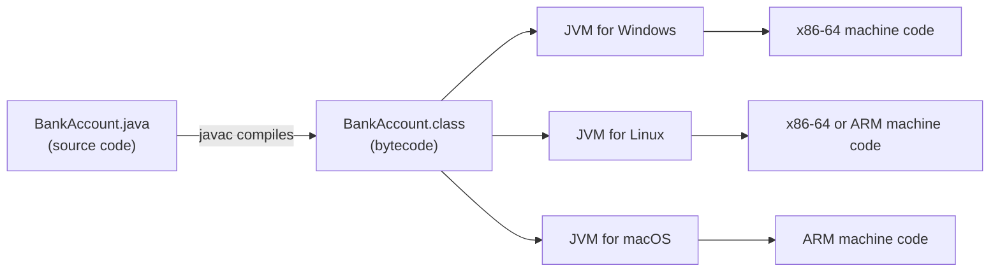
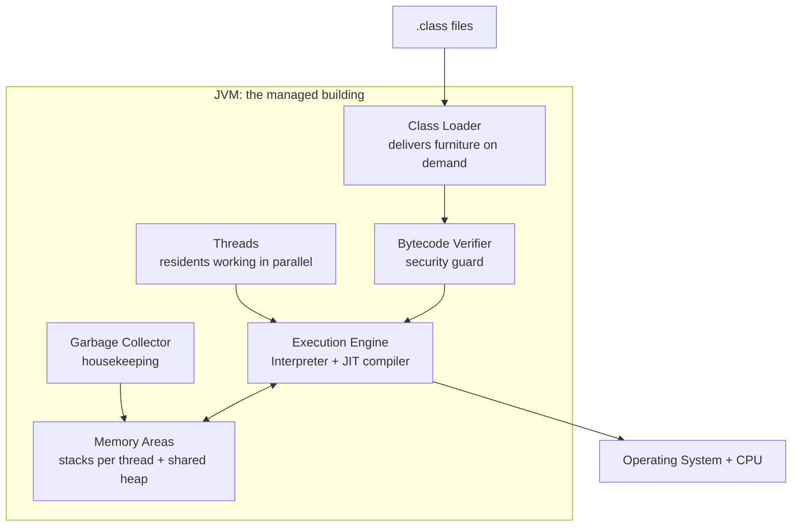
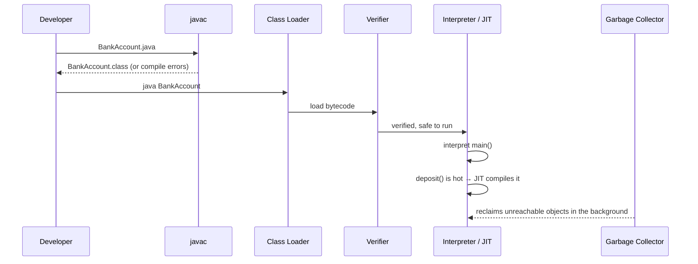
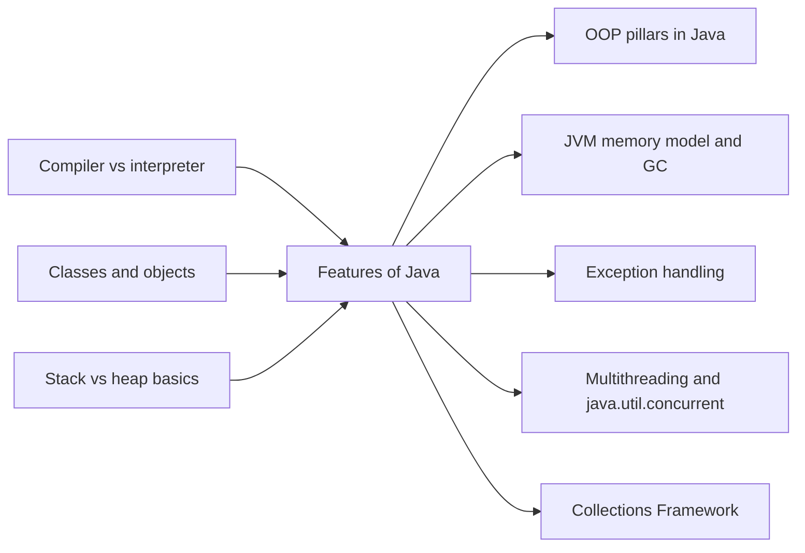

# Features of Java

**TL;DR:** Java's features are not a random list of buzzwords. Almost every one of them comes from a single design decision: compile your code to **bytecode** and run it inside a managed program called the **JVM**, which takes care of portability, memory, safety and threads for you.

## Table of Contents

1. [TL;DR](#1-tldr)
2. [Why it matters](#2-why-it-matters)
3. [Prerequisites](#3-prerequisites)
4. [Mental model](#4-mental-model)
5. [Core concepts](#5-core-concepts)
6. [How it works](#6-how-it-works)
7. [Examples](#7-examples)
8. [Comparisons](#8-comparisons)
9. [Trade-offs](#9-trade-offs)
10. [Gotchas](#10-gotchas)
11. [Practical application](#11-practical-application)
12. [Interview prep](#12-interview-prep)
13. [Connections](#13-connections)
14. [Summary](#14-summary)
15. [Answers](#answers)

---

## 1. TL;DR

Java is a general-purpose, **object-oriented** language (code is organised around objects that bundle data with the functions that act on it). You compile Java source code into **bytecode**, a portable instruction set, and the **Java Virtual Machine (JVM)** runs that bytecode on any operating system. Because the JVM sits between your code and the machine, it can also clean up unused memory, block unsafe operations, and run many tasks at once.

**The analogy we'll use throughout: the JVM is a managed apartment building.**

| In the building… | In Java… | Feature it explains |
|---|---|---|
| Every branch of the building chain has the **same floor plan** in every city | Same bytecode runs on Windows, Linux, macOS | Platform independent / portable |
| **Housekeeping** takes out the trash you no longer use | Garbage collector frees unused objects | Robust (automatic memory management) |
| **Security guards** inspect every delivery and you can't knock down walls | Bytecode verifier, no pointer arithmetic, bounds checks | Secure |
| **Many residents** live and work at the same time; shared rooms have locks | Multiple threads; `synchronized` | Multithreaded |
| Furniture is **delivered on demand**, when you first need it | Classes are loaded at runtime when first used | Dynamic |
| Staff notice which corridors are busiest and **install a fast elevator** there | JIT compiler turns hot code into machine code | High performance |

**Running example:** a tiny `BankAccount` program. We'll use it in every section to see each feature in action.

---

## 2. Why it matters

**The problem Java solved (1990s).** In C and C++, the compiler produces **machine code** (raw CPU instructions) for one specific CPU + operating system. That caused three recurring pains:

| Pain in C/C++ | What it looked like | Java's answer |
|---|---|---|
| Recompile for every platform | A Windows `.exe` won't run on Linux; even `int` size could differ between compilers | Compile once to bytecode; primitive sizes fixed by the language |
| Manual memory management | Forget `free()` → leak; free twice → crash; use after free → security hole | Garbage collection |
| Unsafe memory access | Pointer arithmetic and unchecked arrays let bugs overwrite random memory | No pointer arithmetic, array bounds checked, bytecode verified |

**What goes wrong without these features (concretely):**
- Without platform independence, a company shipping to Windows, Linux and macOS maintains three builds and three sets of bugs.
- Without automatic memory management, a large share of serious security bugs in C/C++ code are memory-safety bugs (buffer overflows, use-after-free). ⚠️ Microsoft and Google have each publicly reported roughly 70% of their severe security bugs being memory-safety issues; exact figures vary by codebase and year.
- Without built-in threading, every server would need OS-specific threading libraries.

**Why interviewers ask about it.** "What are the features of Java?" is a warm-up question, but the follow-ups ("Is the JVM platform-independent?", "Can Java leak memory?", "Is Java pure OO?") quickly reveal whether you understand *mechanisms* or just memorised a list.

---

## 3. Prerequisites

| Prerequisite | One-line refresher | Importance |
|---|---|---|
| Source code vs machine code | You write human-readable source; the CPU only executes binary instructions. | Essential |
| Compiler vs interpreter | A **compiler** translates the whole program ahead of time; an **interpreter** translates and runs it line by line. | Essential |
| Variables and types | A variable is a named box; its **type** (e.g. `int`) says what can go in it. | Essential |
| Classes and objects | A **class** is a blueprint; an **object** is a thing built from it. | Essential |
| Memory: stack vs heap | The **stack** holds a method's local variables; the **heap** holds objects that outlive a single method call. | Nice-to-have (explained below) |
| What a thread is | A **thread** is an independent path of execution; a program can run several at once. | Nice-to-have (explained below) |

---

## 4. Mental model

> **Keep this one picture in your head:** your code never talks to the operating system directly. It talks to the JVM, and the JVM talks to the OS.


*One `.class` file, many JVMs: the bytecode is portable; each JVM is built for its own platform.*

Inside the JVM, several "building services" run your program:


*The JVM's internal services; each one is the mechanism behind one or more "features".*

**The key insight:** "Features of Java" is really a list of *services the JVM building provides*. When you're asked about any feature, name the mechanism behind it.

---

## 5. Core concepts

| Term | Meaning (1 line) | Tiny example |
|---|---|---|
| **Source code** | The `.java` file you write. | `BankAccount.java` |
| **javac** | The Java compiler; turns source into bytecode and catches type errors. | `javac BankAccount.java` |
| **Bytecode** | Platform-neutral instructions stored in `.class` files, defined by the JVM specification. | `iadd`, `invokevirtual` |
| **JVM** (Java Virtual Machine) | A program that loads, checks and executes bytecode; one build per OS/CPU. | HotSpot (the most common JVM) |
| **JRE** (Java Runtime Environment) | JVM + standard class libraries: what you need to *run* Java. | `java.util`, `java.io` |
| **JDK** (Java Development Kit) | JRE + developer tools: what you need to *build* Java. | `javac`, `javap`, `jshell`, `jar` |
| **Class loader** | Finds and loads `.class` files into the JVM when first needed. | Loads `BankAccount` when `main` starts |
| **Bytecode verifier** | Checks loaded bytecode is type-safe and well-formed before it runs. | Rejects bytecode that treats an `int` as an object reference |
| **Interpreter** | Executes bytecode one instruction at a time. | Runs `main` on startup |
| **JIT compiler** (Just-In-Time) | Compiles frequently-run ("hot") bytecode into native machine code at runtime. | `deposit()` called 20,000 times gets compiled |
| **Heap** | Shared memory area where all objects live. | `new BankAccount()` |
| **Stack** | Per-thread memory for method calls and local variables. | `acct` variable inside `main` |
| **Reference** | A managed handle to an object; like a pointer but no arithmetic allowed. | `BankAccount acct` |
| **Garbage collector (GC)** | Automatically frees heap objects no longer reachable from any live reference. | Object with no references gets reclaimed |
| **Thread** | An independent flow of execution inside one program. | `new Thread(task).start()` |
| **`synchronized`** | Keyword that lets only one thread at a time run a block/method on the same object. | `public synchronized void deposit(...)` |
| **Exception** | An object representing an error, which you can catch and handle. | `IllegalArgumentException` |
| **Primitive type** | One of 8 non-object types with fixed sizes. | `int` is always 32 bits |
| **WORA** | "Write Once, Run Anywhere": Java's original slogan for portability. | Same `.class` on Windows and Linux |

> [!NOTE]
> **The official list.** Sun's 1990s white paper *The Java Language Environment* described Java as: simple, object-oriented, distributed, robust, secure, architecture-neutral, portable, interpreted, high-performance, multithreaded, and dynamic. Interviewers often expect roughly this list. "Platform independent" is the everyday name for *architecture-neutral + portable*.

---

## 6. How it works

### 6.1 The execution pipeline

1. **Write** source code in `BankAccount.java`.
2. **Compile:** `javac` checks types and syntax, then emits `BankAccount.class` (bytecode). Many bugs die here. *(Robust)*
3. **Launch:** `java BankAccount` starts the JVM for *your* OS/CPU. *(Platform independent)*
4. **Load:** the class loader finds `BankAccount.class` and loads it; other classes are loaded only when first used. *(Dynamic)*
5. **Verify:** the bytecode verifier checks the bytecode can't break type safety or corrupt memory. *(Secure)*
6. **Execute:** the interpreter starts running `main`. *(Interpreted)*
7. **Optimise:** the JVM counts how often methods run; hot ones are compiled to native code by the JIT. *(High performance)*
8. **Run threads:** each thread gets its own stack; all share the heap. *(Multithreaded)*
9. **Clean up:** the garbage collector reclaims objects nobody references anymore. *(Robust, Simple)*


*From source file to running program: each arrow is one JVM service doing its job.*

### 6.2 The running example

```java
// BankAccount.java  —  run with: javac BankAccount.java && java BankAccount
public class BankAccount {
    private long balance; // private: only this class's methods can touch it (encapsulation)

    // synchronized: only one thread at a time may run this on the same account
    public synchronized void deposit(long amount) {
        if (amount <= 0) {
            throw new IllegalArgumentException("Deposit must be positive: " + amount);
        }
        balance += amount; // read-modify-write: unsafe without synchronized
    }

    public synchronized long getBalance() {
        return balance;
    }

    public static void main(String[] args) throws InterruptedException {
        BankAccount acct = new BankAccount();   // object created on the heap

        Runnable task = () -> {                 // a job for a thread (lambda, Java 8+)
            for (int i = 0; i < 10_000; i++) {
                acct.deposit(1);
            }
        };

        Thread t1 = new Thread(task);
        Thread t2 = new Thread(task);
        t1.start();
        t2.start();       // both threads now deposit at the same time
        t1.join();
        t2.join();        // wait for both to finish

        System.out.println("Balance: " + acct.getBalance());

        try {
            acct.deposit(-50);                  // invalid input
        } catch (IllegalArgumentException e) {  // handled, program keeps running
            System.out.println("Rejected: " + e.getMessage());
        }
    }
}
```

**Expected output:**
```
Balance: 20000
Rejected: Deposit must be positive: -50
```

> [!TIP]
> On Java 11+, you can skip the separate compile step: `java BankAccount.java` compiles in memory and runs it.

### 6.3 Worked trace: what the JVM does, step by step

| # | Event | JVM state after this step | Feature on display |
|---|---|---|---|
| 1 | `javac BankAccount.java` | `BankAccount.class` exists on disk; compiler confirmed every type is valid (e.g. you can't pass a `String` to `deposit`) | Robust (static typing) |
| 2 | `java BankAccount` | JVM process for this OS starts | Platform independent |
| 3 | Class loader loads `BankAccount` | Class metadata in memory; `Thread`, `String`, etc. loaded only as needed | Dynamic |
| 4 | Verifier checks bytecode | Bytecode marked safe; would have been rejected if tampered | Secure |
| 5 | `new BankAccount()` | Heap: one `BankAccount` object, `balance = 0`; main's stack: `acct` → that object | Object-oriented, references |
| 6 | `t1.start(); t2.start()` | 3 threads (main, t1, t2), each with its own stack; all see the same heap object | Multithreaded |
| 7 | Threads call `deposit(1)` repeatedly | Only one thread at a time holds the account's lock; `balance` climbs 1, 2, 3… | Multithreaded (safe) |
| 8 | `deposit` called thousands of times | JIT compiles `deposit` to native code; later calls are faster ⚠️ (exact threshold is JVM-internal) | High performance |
| 9 | `t1.join(); t2.join()` | t1 and t2 finished; their stacks are gone; `balance = 20000` | Multithreaded |
| 10 | `deposit(-50)` | Exception object created, thrown, caught; program continues | Robust (exception handling) |
| 11 | `main` returns | `acct` no longer referenced; the object becomes eligible for GC; JVM exits | Robust (GC) |

Memory at step 7 (simplified):

```
   STACKS (one per thread)                HEAP (shared, managed by GC)
 ┌──────────────────────┐
 │ main                 │              ┌──────────────────────────┐
 │   acct ──────────────┼────────┬────►│ BankAccount              │
 │   task ──────────┐   │        │     │   balance = 7342 (rising)│
 └──────────────────┼───┘        │     │   [lock held by t2]      │
 ┌──────────────────┼───┐        │     └──────────────────────────┘
 │ t1 (waiting)     │   │        │     ┌──────────────────────────┐
 │   i = 3671       │   │        │     │ Runnable (lambda)        │
 └──────────────────┼───┘        │     │   captured acct ─────────┼──┐
 ┌──────────────────┼───┐        │     └──────────────────────────┘  │
 │ t2 (in deposit)  │   │        └───────────────────────────────────┘
 │   i = 3671       └───┼──────────────► (points to the Runnable)
 └──────────────────────┘
```
*Each thread has a private stack; objects live once on the shared heap. Arrows are references, not raw memory addresses.*

### 6.4 Feature by feature: which mechanism delivers it

| Feature | What it means | Mechanism behind it | In our example |
|---|---|---|---|
| **Simple** *(a design goal; "simple" is subjective)* | Removed C++'s hardest parts | No pointer arithmetic, no operator overloading, no multiple class inheritance, no manual `free`, no header files | We never free `acct` |
| **Object-oriented** | Programs are built from objects combining data + behaviour | Classes, encapsulation, inheritance, polymorphism, abstraction | `balance` is `private`; access only via methods |
| **Platform independent** (architecture-neutral + portable) | Compiled output runs unchanged on any OS/CPU with a JVM | Bytecode + per-platform JVM; fixed primitive sizes (`int` = 32 bits everywhere) | Same `.class` runs on Windows/Linux/macOS |
| **Robust** | Hard to crash or corrupt silently | Static type checking, exceptions, GC, array bounds checks, no uninitialised local variables | `deposit(-50)` rejected cleanly |
| **Secure** | Code can't corrupt memory or bypass the type system | No pointer arithmetic, bytecode verifier, bounds checks, class loader separation | Can't read memory beyond `balance` |
| **Interpreted** | Bytecode is executed by the JVM, not directly by the CPU | Interpreter in the execution engine | `main` starts in the interpreter |
| **High performance** | Close to native speed for long-running programs | JIT compilation of hot code + runtime optimisations | `deposit` gets JIT-compiled |
| **Multithreaded** | Many tasks run concurrently in one program | `Thread`, `synchronized`, `volatile`, `java.util.concurrent` built into language + library | Two threads deposit safely |
| **Distributed** | Networking is built into the standard library | `java.net`, HTTP client (Java 11+), RMI | *(not used here)* |
| **Dynamic** | Classes can be loaded and inspected at runtime | Lazy class loading, reflection, `ServiceLoader` | `Thread` class loaded only when first used |

> [!NOTE]
> "Interpreted" and "high performance" sound contradictory. They aren't: the JVM *starts* by interpreting (fast startup, no compile wait) and *then* compiles the hot parts (fast steady state). Modern JVMs are best described as **compiled twice**: once to bytecode by `javac`, and again to machine code by the JIT.

---

## 7. Examples

### 7.1 Toy example: see the bytecode yourself

```java
// Hello.java
public class Hello {
    public static void main(String[] args) {
        System.out.println("Hello, JVM!");
    }
}
```

```bash
javac Hello.java      # produces Hello.class (bytecode)
java Hello            # runs it on this machine's JVM
javap -c Hello        # disassembles the bytecode so you can read it
```

**Expected output of `java Hello`:**
```
Hello, JVM!
```

**Expected output of `javap -c Hello`** (constant-pool numbers like `#7` vary by compiler version):
```
Compiled from "Hello.java"
public class Hello {
  public Hello();
    Code:
       0: aload_0
       1: invokespecial #1   // Method java/lang/Object."<init>":()V
       4: return

  public static void main(java.lang.String[]);
    Code:
       0: getstatic     #7   // Field java/lang/System.out:Ljava/io/PrintStream;
       3: ldc           #13  // String Hello, JVM!
       5: invokevirtual #15  // Method java/io/PrintStream.println:(Ljava/lang/String;)V
       8: return
}
```

What to notice:
- There is **no x86 or ARM instruction** here. `getstatic`, `ldc`, `invokevirtual` are JVM instructions. That's why the file is portable.
- The compiler added a constructor `Hello()` you never wrote: every class gets a default one, and it calls `Object`'s constructor. Every class ultimately extends `Object` (object-oriented).
- Copy `Hello.class` to any machine with a JVM and `java Hello` prints the same line. No recompiling.

### 7.2 Real-world examples

| System | What it is | Which Java features it relies on |
|---|---|---|
| **Apache Kafka** | Distributed event-streaming platform used by many large companies | Runs on the JVM across fleets of Linux servers (portability); heavy use of threads for network and disk I/O (multithreaded); performance depends on JIT and GC tuning |
| **Elasticsearch** | Search and analytics engine | Written in Java; ships with a bundled JDK so every install runs on a known JVM version (portable + controlled runtime) |
| **Apache Hadoop** | Big-data storage and processing framework | Java code shipped to many machines in a cluster without recompiling (platform independence); networking built in (distributed) |
| **Android apps** | Mobile apps written in Java/Kotlin | ⚠️ Uses the Java *language* but **not** the JVM: `.class` files are converted to DEX bytecode and run on Android Runtime (ART). A classic interview trap. |

---

## 8. Comparisons

| Aspect | **Java** | **C++** | **Python** (CPython) | **C#** (.NET) |
|---|---|---|---|---|
| Compiles to | Bytecode (`.class`) | Native machine code | Bytecode (`.pyc`), usually invisible | CIL bytecode |
| Runs on | JVM (interpreter + JIT) | Directly on CPU | CPython interpreter | .NET CLR (JIT) |
| Typing | Static, strong | Static | Dynamic, strong | Static, strong |
| Memory management | Garbage collector | Manual / RAII / smart pointers | Reference counting + cycle collector | Garbage collector |
| Pointer arithmetic | No | Yes | No | Only in `unsafe` code |
| Multiple inheritance of classes | No (interfaces only) | Yes | Yes | No (interfaces only) |
| Same compiled file runs on other OS? | Yes, with a JVM | No, recompile | Source runs with interpreter | Yes, with .NET runtime ⚠️ (cross-platform since .NET Core) |
| Startup time | Moderate (JVM boot + warm-up) | Fastest | Fast for small scripts | Moderate |
| Long-running throughput | High (JIT) | Highest potential | Lower (no JIT by default ⚠️) | High (JIT) |

**Use Java when…** you're building long-running backend services, large codebases with many developers, or systems that must run on many servers and OSes, and you want memory safety plus strong tooling.

**Use C++ when…** you need maximum control over memory and latency (game engines, browsers, embedded, trading engines) and can afford the safety risk.

**Use Python when…** speed of writing code matters more than speed of running it: scripting, data science, prototypes, ML glue code.

**Use C# when…** you're in the Microsoft/.NET ecosystem (Windows apps, Unity games, Azure services); it's Java's closest sibling.

---

## 9. Trade-offs

### Pros

| Pro | Why it holds |
|---|---|
| Portability | One build artifact for every OS with a JVM |
| Memory safety | No pointer arithmetic, bounds-checked arrays, GC removes whole bug classes (use-after-free, double free) |
| Strong tooling | Static types enable reliable IDE refactoring, autocompletion, and compile-time errors |
| Fast steady-state performance | JIT optimises using real runtime behaviour (e.g. inlining hot methods) |
| Huge ecosystem | Mature libraries (Spring, Apache projects) and a stable, backward-compatible platform |
| Built-in concurrency | Threads, locks, and `java.util.concurrent` in the standard library |

### Cons and limitations

| Con | Concrete figure / detail |
|---|---|
| Startup and warm-up | ⚠️ JVM startup takes tens of milliseconds even for Hello World, and code runs slower until the JIT warms up. Bad fit for very short-lived processes (CLI tools, some serverless). |
| Memory overhead | ⚠️ On 64-bit HotSpot, a plain `new Object()` typically takes 16 bytes (object header + alignment) before any fields. An `Integer` uses far more memory than a 4-byte `int`. Compact object headers (Project Lilliput) are reducing this in newer versions. |
| GC pauses | GC may briefly pause threads. ⚠️ Modern low-pause collectors (ZGC, Shenandoah) target pauses around or under a millisecond, but need tuning and extra memory. |
| Verbosity | Historically more boilerplate than Python/Kotlin; reduced by `var` (Java 10), records (Java 16), lambdas (Java 8). |
| Less low-level control | No direct memory addressing; native/hardware work needs JNI or the Foreign Function & Memory API ⚠️ (finalised in Java 22). |
| "Anywhere" has limits | Native libraries, file paths, line endings, and default charsets can still differ per OS (see Gotchas). |

---

## 10. Gotchas

### Myths

| ❌ Myth | ✅ Reality |
|---|---|
| The JVM is platform-independent. | **Bytecode** is platform-independent. The **JVM is platform-dependent**: there's a different JVM build for each OS/CPU. That's exactly what makes the bytecode portable. |
| Java is purely object-oriented. | No. It has **8 primitive types** (`byte, short, int, long, float, double, char, boolean`) that are not objects, plus `static` members that belong to no object. |
| Java is interpreted, so it's slow. | The JVM interprets first, then **JIT-compiles hot code** to native machine code. Long-running Java services often run at speeds comparable to compiled languages. |
| Java has no pointers. | Java has **references**, which are managed pointers. What it lacks is **pointer arithmetic** and manual freeing. That's why `NullPointerException` exists. |
| Garbage collection means no memory leaks. | GC frees only *unreachable* objects. If you keep a reference (e.g. in a static `Map` that grows forever), the object is still reachable and **leaks**. |
| `System.gc()` forces garbage collection. | It's only a **hint**; the JVM may ignore it. |
| GC also closes my files and connections. | GC manages **memory only**, and runs at unpredictable times. Close files, sockets and DB connections yourself, ideally with **try-with-resources**. |
| Java is pass-by-reference for objects. | Java is **always pass-by-value**. For objects, the *value* passed is a copy of the reference. You can mutate the object, but reassigning the parameter doesn't affect the caller. |
| Java doesn't support multiple inheritance at all. | It forbids multiple inheritance of **classes** (state), but a class can implement **many interfaces**, and interfaces can carry default methods (Java 8+). |
| "Secure" means Java programs have no vulnerabilities. | The language prevents memory-corruption bugs. It does **not** prevent logic bugs, SQL injection, or vulnerable libraries (e.g. Log4Shell, CVE-2021-44228, in the Java logging library Log4j). |
| Android runs Java on the JVM. | Android converts bytecode to DEX and runs it on **ART**, not a JVM. |

### Common mistakes and edge cases

**1. "Robust" does not mean overflow-checked.**
```java
public class Overflow {
    public static void main(String[] args) {
        System.out.println(Integer.MAX_VALUE + 1);              // wraps silently
        System.out.println(Math.addExact(Integer.MAX_VALUE, 1)); // throws instead
    }
}
```
Expected output:
```
-2147483648
Exception in thread "main" java.lang.ArithmeticException: integer overflow
	at ...
```

**2. Pass-by-value with references.**
```java
public class PassByValue {
    static void reassign(StringBuilder sb) { sb = new StringBuilder("new"); } // changes local copy only
    static void mutate(StringBuilder sb)   { sb.append("!"); }               // changes the shared object

    public static void main(String[] args) {
        StringBuilder s = new StringBuilder("hi");
        reassign(s);
        System.out.println(s); // hi
        mutate(s);
        System.out.println(s); // hi!
    }
}
```

**3. Portability leaks.**
- Hard-coded `"C:\\data\\file.txt"` breaks on Linux. Use `Path.of("data", "file.txt")`.
- Reading text without specifying a charset used the OS default. ⚠️ Since Java 18, the default charset is UTF-8 on all platforms (JEP 400); older versions differ per OS.
- Code calling native libraries (JNI) is only as portable as those libraries.

**4. `char` is 16 bits, not "one character".** Some characters, like most emoji, need **two** `char` values. `"😀".length()` is `2`.

**5. Threads without synchronisation.** Two threads doing `count++` on the same field can lose updates, because `count++` is read → add → write. See the exercise in Section 11.

> [!WARNING]
> ⚠️ The old **SecurityManager** sandbox (once a big part of the "secure" answer) was deprecated for removal in Java 17 and permanently disabled in Java 24. Don't cite it as a current security feature; cite the verifier, type safety and bounds checking instead.

---

## 11. Practical application

### How the features should shape the way you write Java

| Feature | Best practice it implies |
|---|---|
| Platform independent | Use `Path`/`Files` APIs, never hard-code separators; always specify a charset (`StandardCharsets.UTF_8`); avoid native code unless necessary. |
| Robust (types) | Make the compiler work for you: precise types, `final` where possible, avoid raw types (`List` instead of `List<String>`). |
| Robust (exceptions) | Validate inputs and throw meaningful exceptions (like `deposit` does); never swallow exceptions with an empty `catch`. |
| GC | Don't call `System.gc()`; remove entries from long-lived collections; close resources with try-with-resources. |
| Multithreaded | Protect shared mutable state (`synchronized`, `AtomicInteger`, concurrent collections), or avoid sharing it. Prefer `ExecutorService` over raw `Thread`. ⚠️ Since Java 21, virtual threads make huge numbers of threads cheap. |
| Object-oriented | Keep fields `private`; expose behaviour, not data (`deposit()`, not `setBalance()`). |
| High performance | Benchmark *after* warm-up (use JMH); don't micro-optimise before measuring. |

### Checklist before you say "my Java code is portable and safe"
- [ ] No hard-coded OS paths or line separators
- [ ] Charset specified for all text I/O
- [ ] Shared mutable state protected or eliminated
- [ ] Every opened resource closed via try-with-resources
- [ ] No unbounded static collections
- [ ] Input validated; exceptions not swallowed

### try-with-resources (GC doesn't close files for you)
```java
import java.io.*;
import java.nio.charset.StandardCharsets;
import java.nio.file.*;

public class ReadFirstLine {
    public static void main(String[] args) throws IOException {
        Path p = Path.of("demo.txt");                         // portable path
        Files.writeString(p, "line one\nline two\n", StandardCharsets.UTF_8);

        // reader is closed automatically, even if an exception is thrown
        try (BufferedReader r = Files.newBufferedReader(p, StandardCharsets.UTF_8)) {
            System.out.println(r.readLine());
        }
    }
}
```
Expected output:
```
line one
```

### Hands-on exercise: break and fix multithreading

Run this program 5 times.

```java
public class Counter {
    private int count = 0;

    public void increment() { count++; } // NOT thread-safe

    public static void main(String[] args) throws InterruptedException {
        Counter c = new Counter();
        Runnable r = () -> { for (int i = 0; i < 100_000; i++) c.increment(); };
        Thread t1 = new Thread(r), t2 = new Thread(r);
        t1.start(); t2.start();
        t1.join();  t2.join();
        System.out.println(c.count);
    }
}
```

**Tasks:**
1. Predict the output, then run it. Is it always `200000`?
2. Explain *why* in two sentences.
3. Fix it in two different ways.

**Expected outcome:** the unfixed version usually prints a number **below 200000** that changes between runs (it may occasionally hit 200000 by luck). Both fixed versions always print `200000`.

<details><summary>Answer</summary>

**Why:** `count++` is three steps: read `count`, add 1, write it back. If t1 and t2 both read `5`, both write `6`, and one increment is lost. This is a **race condition**.

**Fix 1: `synchronized`** (only one thread at a time runs `increment` on this object):
```java
public synchronized void increment() { count++; }
```

**Fix 2: `AtomicInteger`** (lock-free atomic increment):
```java
import java.util.concurrent.atomic.AtomicInteger;

public class Counter {
    private final AtomicInteger count = new AtomicInteger();

    public void increment() { count.incrementAndGet(); }

    public static void main(String[] args) throws InterruptedException {
        Counter c = new Counter();
        Runnable r = () -> { for (int i = 0; i < 100_000; i++) c.increment(); };
        Thread t1 = new Thread(r), t2 = new Thread(r);
        t1.start(); t2.start();
        t1.join();  t2.join();
        System.out.println(c.count.get()); // 200000
    }
}
```
This is exactly why `BankAccount.deposit` is `synchronized` in the running example.
</details>

---

## 12. Interview prep

### Likely questions with model answers

**Q1. Why is Java platform-independent? Is the JVM platform-independent?**
> "When you compile Java with `javac`, you don't get machine code for a specific CPU. You get bytecode, a standard instruction set defined by the JVM specification. Each operating system has its own JVM, which translates that bytecode into native instructions at runtime. Java also fixes primitive sizes, so an `int` is 32 bits everywhere. So the `.class` file is platform-independent, but the JVM itself is platform-dependent. That's the whole trick: the platform-specific part is moved out of your code and into the JVM."

- *Follow-ups:* Where does "write once, run anywhere" break? (native code, file paths, charsets) · Is Android a JVM? (No, ART.)
- *Red flags:* Saying the JVM is platform-independent. Saying "Java source is portable" without mentioning bytecode.

**Q2. Difference between JDK, JRE and JVM?**
> "The JVM is the engine that loads, verifies and executes bytecode. The JRE is the JVM plus the standard class libraries, so it's what you need to *run* Java programs. The JDK is the JRE plus development tools like `javac`, `javap`, `jar` and `jshell`, so it's what you need to *build* them. One nuance: since Java 11, a separate JRE isn't distributed by Oracle or most OpenJDK builds; you either install a JDK or use `jlink` to build a trimmed runtime for your app."

- *Follow-ups:* What do you install on a production server? (A JDK or a jlink-built runtime.) What's HotSpot? (The most common JVM implementation.)
- *Red flags:* Using the three terms interchangeably.

**Q3. Is Java compiled or interpreted?**
> "Both. `javac` compiles source to bytecode ahead of time. At runtime, the JVM starts by interpreting that bytecode, which gives fast startup. It tracks which methods run often, and the JIT compiler turns those hot methods into optimised native machine code. That's why Java programs warm up: they get faster after running for a while. HotSpot uses tiered compilation with a quick compiler, C1, and an optimising compiler, C2."

- *Follow-ups:* What is warm-up and why does it matter for benchmarks? What is AOT? (⚠️ e.g. GraalVM Native Image compiles ahead of time to a native binary, trading some peak optimisation for fast startup.)
- *Red flags:* "Java is interpreted, so it's slow."

**Q4. Is Java a pure object-oriented language?**
> "No. Java is strongly object-oriented, since every piece of code lives in a class and all classes extend `Object`, but it has eight primitive types like `int` and `boolean` that aren't objects, and `static` members that don't belong to any object. Primitives were kept for performance: an `int` is 4 bytes stored directly, while an `Integer` is a full heap object with a header. Wrapper classes and autoboxing let primitives act like objects when needed, for example in collections."

- *Follow-ups:* What is autoboxing? Why can't you write `List<int>`? (Generics work only with reference types.)
- *Red flags:* Saying "yes, everything is an object."

**Q5. What makes Java secure?**
> "Several layers. The language has no pointer arithmetic and checks every array access, so you can't read or overwrite arbitrary memory. Local variables must be assigned before use. When classes are loaded, the bytecode verifier checks that the bytecode is type-safe and well-formed, so even hand-crafted bytecode can't break those guarantees. Class loaders keep classes from different sources in separate namespaces. That eliminates whole categories of bugs like buffer overflows. It doesn't prevent application-level bugs like SQL injection or vulnerable dependencies, Log4Shell being the famous example."

- *Follow-ups:* What does the verifier check? Is the SecurityManager still used? (⚠️ No: deprecated in 17, permanently disabled in 24.)
- *Red flags:* "Java is secure because it's compiled to bytecode" with no mechanism. Claiming Java code can't have vulnerabilities.

**Q6. What makes Java robust? Can a Java program still leak memory?**
> "Robust means mistakes are caught early or handled cleanly instead of silently corrupting things. Java gets that from strong static typing checked by the compiler, exception handling with checked exceptions forcing you to handle failures, automatic garbage collection, and runtime checks like array bounds and null checks. But yes, memory can still leak: GC only frees *unreachable* objects. If you keep adding objects to a static map and never remove them, they stay reachable and the heap fills until you get an `OutOfMemoryError`."

- *Follow-ups:* Checked vs unchecked exceptions? How would you find a leak? (Heap dump + analyser such as Eclipse MAT.)
- *Red flags:* "GC means no memory leaks."

**Q7. Why doesn't Java support multiple inheritance of classes?**
> "To avoid ambiguity, the classic diamond problem: if class C extends both A and B and both define `hello()` or the same field, which one does C get? Java avoids that for classes, which carry state. Instead a class can implement many interfaces, which gives multiple inheritance of *type*. Since Java 8, interfaces can have default methods, so the diamond can reappear for behaviour, and Java resolves it by forcing the class to override the method, optionally calling `A.super.hello()`."

```java
interface A { default String hello() { return "A"; } }
interface B { default String hello() { return "B"; } }

class C implements A, B {
    @Override
    public String hello() { return A.super.hello() + B.super.hello(); } // required, else compile error
}
// new C().hello() returns "AB"
```
- *Follow-ups:* Abstract class vs interface? 
- *Red flags:* "Java has no multiple inheritance at all."

**Q8. How does Java support multithreading?**
> "Threads are built into the language and standard library. You create work as a `Runnable` or `Callable` and run it on a `Thread` or, better, an `ExecutorService`. Each thread has its own stack but all share the heap, so shared mutable data must be protected, using `synchronized`, `volatile`, locks, atomic classes, or concurrent collections like `ConcurrentHashMap`. Since Java 21, virtual threads let you run very large numbers of lightweight threads, which suits I/O-heavy servers."

- *Follow-ups:* What is a race condition? What does `volatile` guarantee? (Visibility, not atomicity.) `synchronized` vs `ReentrantLock`?
- *Red flags:* Not knowing that `count++` isn't atomic.

### What interviewers watch for
- Naming the **mechanism** behind each feature, not just the buzzword.
- Precision on the trap questions: JVM platform-dependence, primitives, pass-by-value, GC leaks.
- Marking version-specific facts ("since Java 8…", "since Java 21…").
- ⚠️ Knowing the current long-term support (LTS) releases is a plus: 8, 11, 17, 21 and 25 are LTS; a new version ships every six months.

---

## 13. Connections


*What you need before this topic, and where it leads next.*

- **OOP pillars in Java:** the most common next interview question after "features"; encapsulation, inheritance, polymorphism, abstraction in depth.
- **JVM memory model and GC:** turns "Java has GC" into answers about heap generations, GC roots, and diagnosing `OutOfMemoryError`.
- **Exception handling:** the practical half of "robust": checked vs unchecked, try-with-resources, custom exceptions.
- **Multithreading and `java.util.concurrent`:** a heavily tested area in backend interviews; builds directly on the race condition you saw here.
- **Collections Framework:** where you'll use generics, wrapper classes and autoboxing every day.

---

## 14. Summary

**One-line essence:** Java compiles to portable bytecode and runs it on a platform-specific JVM, and that managed runtime is what gives Java portability, memory safety, garbage collection, built-in threading and JIT speed.

### 60-second revision card
- `javac` → **bytecode** (`.class`) → **JVM** → native code. Bytecode portable; JVM platform-specific.
- **JDK** ⊃ **JRE** ⊃ **JVM**: build tools ⊃ libraries ⊃ execution engine.
- Interpreted first, then **JIT** compiles hot methods → fast after warm-up.
- **Not pure OO**: 8 primitives + `static`.
- **Secure**: no pointer arithmetic, bounds checks, bytecode verifier, class loaders.
- **Robust**: static typing, exceptions, GC; but GC frees only *unreachable* objects (leaks still possible) and doesn't close resources.
- **Multithreaded**: threads share the heap; protect shared state (`synchronized`, atomics).
- Always **pass-by-value**; no multiple class inheritance, but many interfaces.

### Cheat sheet

| Command / syntax | What it does |
|---|---|
| `javac Foo.java` | Compile to `Foo.class` |
| `java Foo` | Run class `Foo` on the JVM |
| `java Foo.java` | Compile in memory and run (⚠️ Java 11+) |
| `javap -c Foo` | Show bytecode |
| `java -version` | Show installed Java version |
| `jshell` | Interactive Java REPL (⚠️ Java 9+) |
| `java -Xmx512m Foo` | Set maximum heap size to 512 MB |
| `synchronized` | One thread at a time per object lock |
| `try (var r = ...) { }` | Auto-close resources |
| `Math.addExact(a, b)` | Addition that throws on overflow |

| Primitive | Size | Primitive | Size |
|---|---|---|---|
| `byte` | 8 bits | `float` | 32 bits |
| `short` | 16 bits | `double` | 64 bits |
| `int` | 32 bits | `char` | 16 bits (UTF-16 code unit) |
| `long` | 64 bits | `boolean` | true/false (size not fixed by spec) |

### Self-test questions

1. 🟢 What does `javac` produce, and what executes it?
2. 🟢 Which of JDK, JRE, JVM would you need to compile a program, and which contains the others?
3. 🟡 Explain why bytecode is platform-independent but the JVM is not.
4. 🟡 Why can a Java service get faster after running for a few minutes?
5. 🟡 Is Java a pure object-oriented language? Give two reasons.
6. 🟡 What does `System.out.println(Integer.MAX_VALUE + 1);` print, and does that contradict "Java is robust"?
7. 🔴 **Spot the misconception.** A teammate says: "This can't cause an OutOfMemoryError because Java has garbage collection."
   ```java
   import java.util.*;
   public class SessionStore {
       private static final Map<String, byte[]> SESSIONS = new HashMap<>();
       static void onLogin(String userId) {
           SESSIONS.put(userId + System.nanoTime(), new byte[1024 * 1024]); // 1 MB per login
       }
   }
   ```
8. 🔴 Your app reads a text file correctly on your Mac but garbles characters and can't find the file on a Windows server. Name two Java-specific causes and fixes.

### Flashcards (Anki)

```
What does javac compile Java source into? :: Bytecode, stored in .class files
Is the JVM platform-independent? :: No. Bytecode is platform-independent; each OS/CPU has its own JVM build
JDK vs JRE vs JVM? :: JVM executes bytecode; JRE = JVM + standard libraries; JDK = JRE + dev tools (javac, javap, jar)
What is the JIT compiler? :: A JVM component that compiles frequently executed bytecode into native machine code at runtime
Why is Java not purely object-oriented? :: It has 8 primitive types and static members that don't belong to objects
Can a Java program leak memory despite GC? :: Yes, if objects stay reachable (e.g. an ever-growing static collection)
Is Java pass-by-value or pass-by-reference? :: Always pass-by-value; for objects, the value copied is the reference
What does the bytecode verifier do? :: Checks loaded bytecode is well-formed and type-safe before it runs
Why no multiple inheritance of classes in Java? :: To avoid diamond-problem ambiguity; Java allows multiple interface implementation instead
Why is count++ unsafe across threads? :: It is read-add-write, not atomic, so concurrent increments can be lost
```

### Resources
- **dev.java** (Oracle's official Java learning site): https://dev.java/learn/
- **The Java Language Specification and JVM Specification** (official): https://docs.oracle.com/javase/specs/
- **Effective Java**, 3rd edition, by Joshua Bloch: the canonical book on writing good Java.
- **Head First Java**, 3rd edition, by Kathy Sierra, Bert Bates and Trisha Gee: beginner-friendly and visual.

---

## Answers

<details><summary>1. What does javac produce, and what executes it?</summary>

Bytecode in `.class` files. The JVM executes it (interpreting first, then JIT-compiling hot code).
</details>

<details><summary>2. Which do you need to compile, and which contains the others?</summary>

You need the **JDK** to compile (it contains `javac`). The JDK contains the JRE's contents, which contain the JVM: JDK ⊃ JRE ⊃ JVM.
</details>

<details><summary>3. Why is bytecode portable but the JVM not?</summary>

Bytecode targets an abstract machine defined by the JVM specification, not a real CPU, so the same file works everywhere. The JVM is a native program that must translate bytecode into real instructions and call the real OS, so a different build is needed for each OS/CPU.
</details>

<details><summary>4. Why does a Java service get faster after a few minutes?</summary>

JIT warm-up. The JVM starts by interpreting, profiles which methods are hot, then compiles them to optimised native code. Once the hot paths are compiled, throughput rises.
</details>

<details><summary>5. Is Java pure OO?</summary>

No. (1) It has 8 primitive types (`int`, `boolean`, etc.) that are not objects. (2) `static` methods and fields belong to the class, not to any object.
</details>

<details><summary>6. Integer.MAX_VALUE + 1</summary>

It prints `-2147483648` because `int` arithmetic wraps on overflow. It doesn't contradict robustness: "robust" refers to type safety, exceptions, GC and bounds checks, not overflow checking. Use `Math.addExact` if you want an exception on overflow.
</details>

<details><summary>7. Spot the misconception (SessionStore)</summary>

The teammate is wrong. Every byte array is stored in a `static` map and never removed, so it stays **reachable** from a GC root. GC only frees unreachable objects, so the heap grows by about 1 MB per login until `OutOfMemoryError`. Fix: remove entries on logout/expiry, or use a bounded cache with eviction.
</details>

<details><summary>8. Works on Mac, breaks on Windows</summary>

- **File path:** a hard-coded `/`-style or absolute Mac path doesn't exist on Windows. Fix: build paths with `Path.of(...)` and make locations configurable.
- **Charset:** reading text without specifying a charset uses the platform default (⚠️ before Java 18 this differed by OS). Fix: always pass `StandardCharsets.UTF_8`.

(Line endings `\n` vs `\r\n` are another common cause when parsing lines manually.)
</details>
