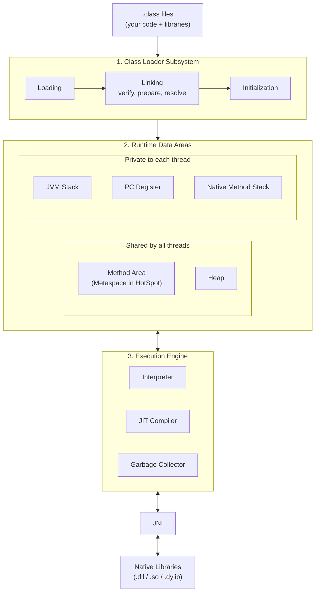
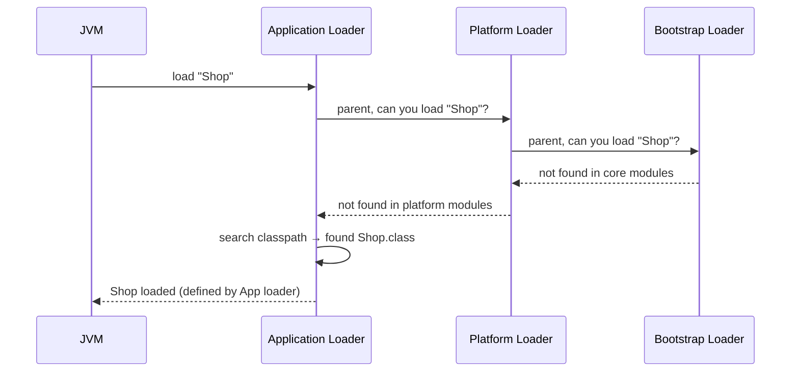
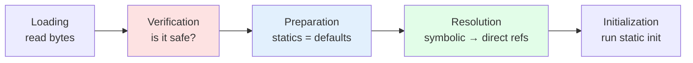
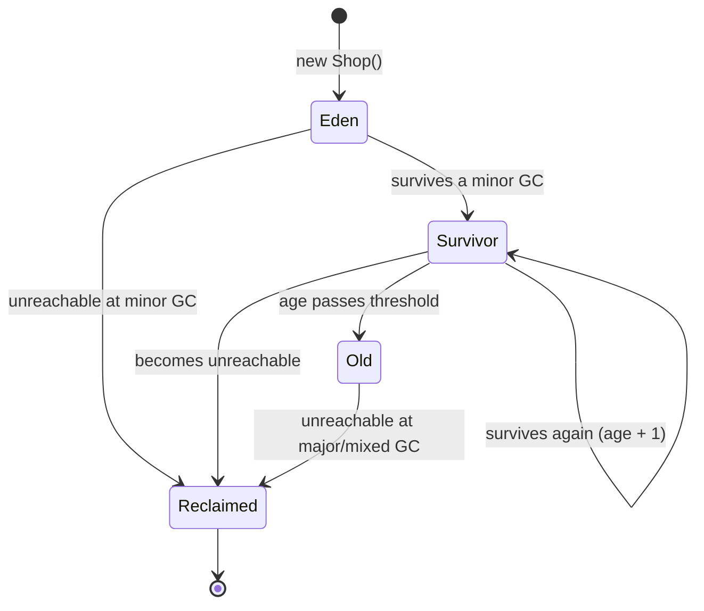
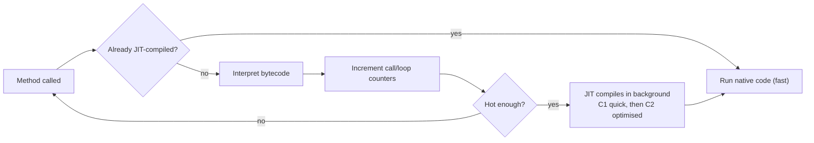
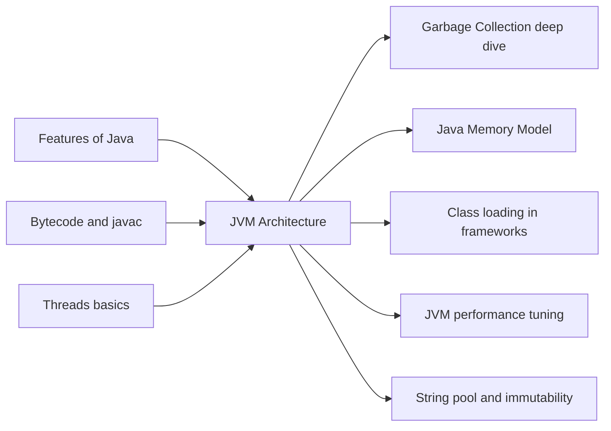

# JVM Architecture

**TL;DR:** The JVM has three parts: a **Class Loader Subsystem** that brings classes in, **Runtime Data Areas** that hold everything in memory (shared heap and method area, plus a private stack per thread), and an **Execution Engine** that runs bytecode (interpreter + JIT compiler + garbage collector).

## Table of Contents

1. [TL;DR](#1-tldr)
2. [Why it matters](#2-why-it-matters)
3. [Prerequisites](#3-prerequisites)
4. [Mental model](#4-mental-model)
5. [Core concepts](#5-core-concepts)
6. [How it works](#6-how-it-works)
7. [Examples](#7-examples)
8. [Comparisons](#8-comparisons)
9. [Trade-offs](#9-trade-offs)
10. [Gotchas](#10-gotchas)
11. [Practical application](#11-practical-application)
12. [Interview prep](#12-interview-prep)
13. [Connections](#13-connections)
14. [Summary](#14-summary)
15. [Answers](#answers)

---

## 1. TL;DR

The **JVM (Java Virtual Machine)** is a program that runs Java **bytecode** (the platform-neutral instructions inside `.class` files). Internally it does three jobs: **load** classes, **store** data in well-defined memory areas, and **execute** instructions. Almost every JVM interview question is about one of these three jobs.

**The analogy (continued from "Features of Java"): the JVM is a managed apartment building.**

| In the building… | In the JVM… |
|---|---|
| **Receiving desk** checks in furniture deliveries, the building's own items first | **Class Loader Subsystem** (bootstrap → platform → application loaders) |
| **Blueprint archive**: one shared copy of every floor plan | **Method Area / Metaspace**: one copy of each class's structure and code |
| **Shared warehouse** where all residents' belongings are stored | **Heap**: all objects, shared by every thread |
| Each resident's **private desk** with a stack of notepads, one per task in progress | **JVM Stack** per thread, one **frame** per method call |
| A **bookmark** showing which line of the instructions each resident is on | **PC register** per thread |
| A **phone line to outside contractors** | **Native method stack + JNI** for C/C++ code |
| **Workers** who read instructions, build fast elevators, and take out the trash | **Execution Engine**: interpreter, JIT compiler, garbage collector |

**Running example:** a tiny `Shop` program. We'll trace exactly where each of its pieces lives in memory and how each line executes.

---

## 2. Why it matters

**The problem it solves.** "Platform independence", "garbage collection" and "security" from the previous notes are promises. JVM architecture is *how* those promises are kept. Knowing it lets you answer *why*, not just *what*.

**What goes wrong if you don't understand it** (all real production failures):

| Symptom | Which JVM part is involved | Without this knowledge you'd… |
|---|---|---|
| `java.lang.StackOverflowError` | JVM stack (too many frames) | Increase heap size, which does nothing |
| `java.lang.OutOfMemoryError: Java heap space` | Heap | Increase stack size, which does nothing |
| `java.lang.OutOfMemoryError: Metaspace` | Metaspace (class metadata) | Not realise you're leaking *classes*, not objects |
| `ClassNotFoundException` / `NoClassDefFoundError` | Class loader subsystem | Blindly reinstall dependencies |
| App is slow for the first minute, then fast | Interpreter → JIT warm-up | Benchmark the wrong thing |
| Two threads see different values of a variable | Per-thread stacks vs shared heap | Not know which data is shared |

**Why interviewers ask.** "Explain JVM architecture" is one of the most common Java interview questions at every level. It tests whether you have a mental model of what happens after you type `java MyApp`.

---

## 3. Prerequisites

| Prerequisite | One-line refresher | Importance |
|---|---|---|
| Bytecode and `.class` files | `javac` compiles `.java` into bytecode; the JVM runs bytecode. | Essential |
| Classes vs objects | A class is a blueprint (one copy); objects are instances (many copies). | Essential |
| Static vs instance members | `static` belongs to the class; non-static belongs to each object. | Essential |
| Method call and return | Calling a method pauses the caller; returning resumes it. | Essential |
| Threads | Independent flows of execution in one program. | Essential |
| Stack data structure | Last-in, first-out: push on top, pop from top. | Essential |
| JDK/JRE/JVM | JDK = tools + JRE; JRE = JVM + libraries. | Nice-to-have |

---

## 4. Mental model

> **The one picture to keep in your head:** classes come *in* through the Class Loader, live in the *Runtime Data Areas*, and are *run* by the Execution Engine.


*The three-part architecture: load → store → execute, with JNI as the bridge to native code.*

**Two rules that answer half of all interview questions:**
1. **Shared:** Heap and Method Area. One per JVM, every thread sees them, so the garbage collector and concurrency issues live here.
2. **Per-thread:** JVM Stack, PC Register, Native Method Stack. Created with each thread and destroyed with it, so they're automatically thread-safe.

> [!NOTE]
> **Definition vs implementation.** The **JVM Specification** (written by Oracle) defines *what* a JVM must do: the memory areas, the bytecode instructions, the loading rules. **HotSpot** (the JVM inside OpenJDK and Oracle JDK) is one *implementation*. Terms like "Metaspace", "Eden" and "C2" are HotSpot details, not spec terms. These notes say which is which.

---

## 5. Core concepts

| Term | Meaning (1 line) | Tiny example |
|---|---|---|
| **Class Loader Subsystem** | Finds `.class` bytes, turns them into a class in the JVM, and prepares it to run. | Loads `Shop` when `java Shop` starts |
| **Bootstrap class loader** | Built into the JVM (native code); loads core classes. | `java.lang.String` |
| **Platform class loader** | Loads some standard modules not in the core (Java 9+; was the *extension* loader before). | `java.sql.Connection` |
| **Application (system) class loader** | Loads your classes from the classpath/module path. | `Shop` |
| **Parent delegation** | A loader first asks its parent to load a class; it only tries itself if the parent fails. | App loader asks platform, which asks bootstrap |
| **Loading** | Reading the `.class` bytes and creating a class representation. | Read `Shop.class` |
| **Linking** | Verify + Prepare + Resolve. | See below |
| **Verification** | Checks bytecode is well-formed and type-safe. | Rejects tampered bytecode |
| **Preparation** | Allocates static fields and sets them to **default** values. | `ordersPlaced = 0` |
| **Resolution** | Replaces symbolic names (e.g. `"java/lang/String"`) with direct references; often done lazily. | `println` call resolved on first use |
| **Initialization** | Runs static initializers and explicit static assignments (the class's `<clinit>` method). | `static { ... }` runs |
| **Method Area** | Shared spec-defined area for per-class data: structure, method code, runtime constant pool. | `Shop`'s method bytecode |
| **Metaspace** | HotSpot's implementation of the method area, in native memory (Java 8+). | Replaced PermGen |
| **Runtime constant pool** | Per-class table of constants and symbolic references used by bytecode. | `"Corner Cafe"`, `#7 → ordersPlaced` |
| **Heap** | Shared area where all objects and arrays are allocated; managed by GC. | `new Shop(...)` |
| **JVM Stack** | Per-thread stack of frames, one frame per active method call. | `main` frame under `total` frame |
| **Frame** | Holds one method call's local variables, operand stack and constant-pool link. | Frame for `total(40, 3)` |
| **Local variable array** | Numbered slots in a frame for parameters and locals (`this` is slot 0 in instance methods). | slot 1 = `price` |
| **Operand stack** | Scratch stack in a frame where bytecode pushes and pops values to compute. | `40, 3 → imul → 120` |
| **PC register** | Per-thread pointer to the bytecode instruction being executed. | At offset `2: imul` |
| **Native method stack** | Per-thread stack for native (C/C++) method calls. | Writing bytes to stdout |
| **Execution Engine** | Runs bytecode: interpreter, JIT, GC. | Executes `main` |
| **Interpreter** | Executes bytecode one instruction at a time. | First calls of `total` |
| **JIT compiler** | Compiles hot bytecode into native machine code at runtime. | `total` after many calls |
| **Garbage Collector (GC)** | Finds unreachable objects and reclaims their heap memory. | `Shop` object after `main` ends |
| **GC roots** | Starting points the GC treats as always alive: local variables in stacks, static fields, active threads, etc. | `s` in `main`'s frame |
| **JNI** (Java Native Interface) | Standard bridge for Java to call native code and vice versa. | `native` methods in the JDK |

---

## 6. How it works

### 6.1 Part 1: The Class Loader Subsystem

**Step 1: Loading with parent delegation.** When the JVM needs a class, it asks a class loader. The loader delegates *up* before trying itself.


*Parent delegation: requests go up first, and the first loader that finds the class defines it.*

**Why delegate up?**
- **Security:** if you put your own `java/lang/String.class` on the classpath, the bootstrap loader finds the real `String` first, so core classes can't be replaced. (The JVM also refuses to define classes in `java.*` packages from non-bootstrap/platform loaders.)
- **No duplicates:** each core class is loaded once and shared.

> [!NOTE]
> **Class identity = fully qualified name + the loader that defined it.** Two loaders that each load `com.shop.Shop` produce two *different* classes, and casting one to the other throws `ClassCastException`. Servers like Tomcat use this deliberately to isolate web apps from each other.

**Step 2: Linking**, three sub-steps:


*Lifecycle of a class: Loading → Linking (verify, prepare, resolve) → Initialization.*

| Sub-step | What happens | Example for `static int ordersPlaced = 5;` |
|---|---|---|
| Verification | Check stack usage, types, branch targets, valid constant-pool references | Bytecode is legal |
| Preparation | Allocate statics, set to defaults (`0`, `false`, `null`) | `ordersPlaced = 0` |
| Resolution | Turn names into actual references (lazily, when first used, in HotSpot) | `Shop.ordersPlaced` → actual field location |

**Step 3: Initialization.** Run the class's static initialization code in textual order (explicit static assignments and `static { }` blocks, compiled into a special method named `<clinit>`). Now `ordersPlaced = 5`.

A class is initialized on its **first active use**: creating an instance, calling a static method, reading/writing a non-constant static field, initializing a subclass, using certain reflection calls, or being the main class.

### 6.2 Part 2: Runtime Data Areas

```
 ┌──────────────────────────── ONE JVM PROCESS ─────────────────────────────┐
 │                                                                          │
 │  SHARED BY ALL THREADS                                                   │
 │  ┌─────────────────────────────┐   ┌──────────────────────────────────┐  │
 │  │ METHOD AREA (Metaspace)     │   │ HEAP                             │  │
 │  │  class Shop:                │   │  ┌──────────┐  ┌──────────────┐  │  │
 │  │   - fields, method list     │   │  │Shop obj  │  │String        │  │  │
 │  │   - bytecode of total(),main│   │  │ name ────┼─►│"Corner Cafe" │  │  │
 │  │   - runtime constant pool   │   │  └──────────┘  └──────────────┘  │  │
 │  └─────────────────────────────┘   │  Class mirror for Shop           │  │
 │                                    │   (holds static ordersPlaced) ⚠️ │  │
 │                                    └──────────────────────────────────┘  │
 │  PRIVATE PER THREAD                                                      │
 │  ┌──── main thread ─────┐  ┌──── thread T2 ───────┐                      │
 │  │ PC: total @ 2        │  │ PC: ...              │                      │
 │  │ JVM STACK            │  │ JVM STACK            │                      │
 │  │  ┌ frame: total ──┐  │  │  ┌ frame: run ───┐   │                      │
 │  │  └────────────────┘  │  │  └───────────────┘   │                      │
 │  │  ┌ frame: main ───┐  │  │                      │                      │
 │  │  └────────────────┘  │  │ NATIVE METHOD STACK  │                      │
 │  │ NATIVE METHOD STACK  │  └──────────────────────┘                      │
 │  └──────────────────────┘                                                │
 └──────────────────────────────────────────────────────────────────────────┘
```
*Memory layout of a running JVM: two shared areas, three private areas per thread.*

| Area | Shared or per-thread | Stores | Error when it runs out |
|---|---|---|---|
| **Method Area** (Metaspace) | Shared | Class structures, method bytecode, runtime constant pool | `OutOfMemoryError: Metaspace` |
| **Heap** | Shared | All objects and arrays (incl. string pool since Java 7) | `OutOfMemoryError: Java heap space` |
| **JVM Stack** | Per-thread | Frames: locals, operand stack, return info | `StackOverflowError` (or `OutOfMemoryError` if a new thread's stack can't be allocated) |
| **PC Register** | Per-thread | Address of current bytecode instruction (undefined while running native code) | None (fixed tiny size) |
| **Native Method Stack** | Per-thread | Frames of native (C/C++) calls | `StackOverflowError` / `OutOfMemoryError` |

> [!WARNING]
> ⚠️ **"Where do static variables live?"** The spec only says class-level data is in the method area. In HotSpot since Java 7, static field *values* are stored in the class's `java.lang.Class` object on the **heap**, while class *metadata* is in Metaspace. A good interview answer mentions both: "conceptually the method area; in modern HotSpot the values are on the heap with the Class object."

#### Inside a stack frame

Each method call pushes one **frame**:

```
 Frame for total(40, 3)
 ┌───────────────────────────────────────────────────────┐
 │ Local variable array                                  │
 │   slot 0: this ───► Shop object (heap)                │
 │   slot 1: price = 40                                  │
 │   slot 2: qty   = 3                                   │
 │   slot 3: sum   = (not yet set)                       │
 ├───────────────────────────────────────────────────────┤
 │ Operand stack   (scratchpad for calculations)         │
 │   [ empty ]                                           │
 ├───────────────────────────────────────────────────────┤
 │ Link to Shop's runtime constant pool (for #refs)      │
 │ Return info (where to resume in main)                 │
 └───────────────────────────────────────────────────────┘
```
*A frame has numbered local slots plus an operand stack. For instance methods, slot 0 is always `this`.*

#### Heap structure (HotSpot, generational)

Most HotSpot collectors split the heap by object age, because most objects die young (the **generational hypothesis**).

```
 ┌──────────────────── HEAP ─────────────────────────────────────┐
 │  YOUNG GENERATION                       │  OLD GENERATION     │
 │  ┌──────────────┬──────────┬──────────┐ │                     │
 │  │    Eden      │ Survivor │ Survivor │ │  long-lived objects │
 │  │ new objects  │   S0     │   S1     │ │  (caches, sessions) │
 │  └──────────────┴──────────┴──────────┘ │                     │
 └───────────────────────────────────────────────────────────────┘
```
*Generational heap: new objects start in Eden; survivors move between S0/S1 and eventually get promoted to Old.*


*Life of an object in a generational heap.*

> [!NOTE]
> ⚠️ G1 (HotSpot's default collector since Java 9) divides the heap into many equal-sized **regions** instead of three contiguous blocks, but each region still plays a young or old role. The Eden/Survivor/Old picture is the right *mental model*; the physical layout depends on the collector.

### 6.3 Part 3: The Execution Engine

| Component | Job | Analogy |
|---|---|---|
| **Interpreter** | Reads bytecode instruction by instruction and executes it. Starts instantly but each instruction is relatively slow. | A worker reading a manual line by line |
| **JIT compiler** | Profiles running code; compiles **hot** methods to optimised native machine code, then reuses it. | Staff installing a fast elevator in the busiest corridor |
| **Garbage Collector** | Starts from GC roots, marks reachable objects, reclaims the rest. | Housekeeping |


*Tiered execution in HotSpot: interpret first, compile what proves hot.*

**JIT optimisations you should be able to name:**
- **Inlining:** copies a small method's body into its caller, removing call overhead.
- **Escape analysis:** if an object never escapes a method, the JIT may avoid heap allocation entirely.
- **Dead code elimination:** removes code whose result is never used.
- **Deoptimisation:** if an assumption breaks (e.g. a new subclass is loaded), the JVM throws away compiled code and goes back to interpreting.

> [!TIP]
> Why not compile everything at startup? Compiling costs time and memory, and most code runs rarely. Profiling first also lets the JIT optimise using **real runtime data** (which branches are taken, which types appear), which ahead-of-time compilers can't see.

**JNI and native libraries.** Some JDK methods are declared `native` (implemented in C/C++), for example low-level file and socket I/O. Calls go through JNI and run on the thread's **native method stack**. ⚠️ Java 22 finalised the Foreign Function & Memory API as a safer modern alternative to JNI.

### 6.4 Worked example: `java Shop`, traced step by step

```java
// Shop.java  —  run with: javac Shop.java && java Shop
public class Shop {
    static int ordersPlaced = 0;      // static field: one copy per class
    private final String name;        // instance field: one copy per object

    Shop(String name) {
        this.name = name;
    }

    int total(int price, int qty) {   // instance method: called on an object
        int sum = price * qty;        // local variable: lives in the frame
        ordersPlaced++;
        return sum;
    }

    public static void main(String[] args) {
        Shop s = new Shop("Corner Cafe");  // object on heap, reference on stack
        int t = s.total(40, 3);
        System.out.println(s.name + " total = " + t + ", orders = " + ordersPlaced);
    }
}
```

**Expected output:**
```
Corner Cafe total = 120, orders = 1
```

**The bytecode of `total`** (from `javap -c Shop`; the `#n` numbers vary by compiler version):
```
  int total(int, int);
    Code:
       0: iload_1                   // push local slot 1 (price)
       1: iload_2                   // push local slot 2 (qty)
       2: imul                      // pop two, push product
       3: istore_3                  // pop into slot 3 (sum)
       4: getstatic     #7          // push Shop.ordersPlaced
       7: iconst_1                  // push constant 1
       8: iadd                      // pop two, push sum
       9: putstatic     #7          // pop into Shop.ordersPlaced
      12: iload_3                   // push sum
      13: ireturn                   // return top of stack to caller
```

**Trace of the whole run:**

| # | What happens | Method Area | Heap | main thread's stack |
|---|---|---|---|---|
| 1 | OS starts JVM; heap and Metaspace reserved; main thread created | empty | empty | empty |
| 2 | Bootstrap loader loads core classes | `Object`, `String`, `System`… | some core objects | empty |
| 3 | App loader loads `Shop` (after delegating up) | `Shop` structure, bytecode, constant pool | `Class` object for `Shop` | empty |
| 4 | Link: verify, prepare | same | `ordersPlaced = 0` (default) | empty |
| 5 | Initialize `Shop` (`<clinit>`) | same | `ordersPlaced = 0` (explicit) | empty |
| 6 | Execution engine calls `main` | same | same | `[main: args, s=?, t=?]` |
| 7 | `new Shop("Corner Cafe")` | same | `Shop{name→"Corner Cafe"}` (typically in Eden); `"Corner Cafe"` in string pool | `[<init>]` pushed, then popped; `main: s → Shop obj` |
| 8 | `s.total(40, 3)` called | same | same | `[total: this, 40, 3, sum=?]` on top of `[main]` |
| 9 | Bytecode 0–3 runs | same | same | operand stack: `[40] → [40,3] → [120] → []`; `sum = 120` |
| 10 | Bytecode 4–9 runs | same | `ordersPlaced = 1` | operand stack: `[0] → [0,1] → [1] → []` |
| 11 | `ireturn` | same | same | `total` frame popped; `main: t = 120` |
| 12 | `println` | more classes loaded (`PrintStream`, string-concat helpers…) | temporary `String` for the message | frames for `println` etc.; eventually a **native** method writes to stdout via the native method stack |
| 13 | `main` returns; JVM shuts down | — | `Shop` obj now unreachable (would be GC-eligible); process memory released | empty |

> [!NOTE]
> In step 9, the PC register for the main thread steps through offsets `0 → 1 → 2 → 3`. If you paused the thread there, the PC tells the JVM exactly where to resume. That's why each thread needs its own PC.

---

## 7. Examples

### 7.1 Toy example: see the class loaders yourself

```java
// Loaders.java  —  compile and run with: javac Loaders.java && java Loaders
public class Loaders {
    public static void main(String[] args) {
        System.out.println(String.class.getClassLoader());              // core class
        System.out.println(java.sql.Connection.class.getClassLoader()); // platform module
        System.out.println(Loaders.class.getClassLoader());             // your class
        System.out.println(Loaders.class.getClassLoader().getParent()); // its parent
    }
}
```

**Expected output** (Java 9+; the hex after `@` varies every run):
```
null
jdk.internal.loader.ClassLoaders$PlatformClassLoader@5ca881b5
jdk.internal.loader.ClassLoaders$AppClassLoader@251a69d7
jdk.internal.loader.ClassLoaders$PlatformClassLoader@5ca881b5
```

What to notice:
- `null` means **bootstrap**: it's implemented natively, so there's no Java object to print.
- Your class is loaded by the **application** loader, whose parent is the **platform** loader. That's the delegation chain.

> [!WARNING]
> Run it with `javac` + `java`. If you use the single-file launcher (`java Loaders.java`), your class is loaded by a special in-memory loader, so line 3 prints something different.

**Watch class loading and JIT live:**
```bash
java -Xlog:class+load:stdout Shop | head -5     # every class as it loads (Java 9+)
java -XX:+PrintCompilation Shop                # methods as the JIT compiles them
java -Xint Shop                                # interpreter only, no JIT (much slower on long runs)
```

### 7.2 Real-world examples

| System | Which JVM part matters | How |
|---|---|---|
| **Apache Tomcat** (Java web server) | Class loaders | Gives each deployed web app its **own class loader**, so two apps can use different versions of the same library without clashing. Redeploying an app discards its loader so its classes can be unloaded. A classic `OutOfMemoryError: Metaspace` cause is a leaked web-app loader that can never be unloaded. |
| **Spring Boot** fat JARs | Class loaders | Packages dependencies as JARs inside your JAR; a custom class loader reads classes from those nested JARs, something the default loader can't do. |
| **Apache Kafka / Elasticsearch in containers** | Heap + GC | These are memory-heavy JVM services; operators set heap size (`-Xms`/`-Xmx`) and choose a GC to balance throughput and pause times. ⚠️ Modern JVMs (JDK 10+, backported to 8u191) detect container memory limits, so `-XX:MaxRAMPercentage` sizes the heap relative to the container, not the host. |
| **IntelliJ IDEA** and other JVM desktop apps | JIT warm-up | Noticeably slower right after launch, faster once hot code is JIT-compiled. |

---

## 8. Comparisons

### 8.1 The three most-confused memory areas

| Aspect | **Stack** | **Heap** | **Metaspace** (method area) |
|---|---|---|---|
| Stores | Frames: primitives in locals, references, operand stack | Objects, arrays, string pool | Class metadata, method bytecode, constant pools |
| Scope | One per thread | One per JVM, shared | One per JVM, shared |
| Lifetime | Frame popped when method returns | Until GC finds it unreachable | Until its class loader is unloaded |
| Managed by | Automatic push/pop | Garbage collector | Freed when class loaders are collected |
| Thread-safe? | Yes (private) | No, needs synchronisation | Managed by JVM |
| Size flag | `-Xss` (per thread) | `-Xms`, `-Xmx` | `-XX:MaxMetaspaceSize` |
| Typical failure | `StackOverflowError` | `OutOfMemoryError: Java heap space` | `OutOfMemoryError: Metaspace` |
| Allocation speed | Very fast (move a pointer) | Fast in HotSpot (thread-local allocation buffers), but GC costs later | Only when classes load |

**Use the stack when…** data is only needed during one method call (you don't choose; primitives and references in local variables go here automatically).
**Use the heap when…** data must outlive a method call or be shared (every `new` goes here).

### 8.2 PermGen vs Metaspace

| | **PermGen** (Java 7 and earlier) | **Metaspace** (Java 8+) |
|---|---|---|
| Where | Part of the Java heap's reserved space | **Native memory** (outside the heap) |
| Default limit | Fixed and small; often had to tune `-XX:MaxPermSize` | ⚠️ Unlimited by default; grows as needed, cap with `-XX:MaxMetaspaceSize` |
| Common error | `OutOfMemoryError: PermGen space` | `OutOfMemoryError: Metaspace` |
| Interned strings | In PermGen until Java 6; moved to heap in Java 7 | Heap |

### 8.3 JVM implementations

| | **HotSpot** | **Eclipse OpenJ9** | **GraalVM** |
|---|---|---|---|
| From | OpenJDK (Oracle + community) | Eclipse Foundation (originally IBM) | Oracle |
| Notable for | The default; C1/C2 JIT, many GC options | ⚠️ Often cited for lower memory footprint and faster startup | Graal JIT compiler written in Java; **Native Image** compiles ahead-of-time into a standalone binary |
| Use when | Almost always; it's what interviews assume | Memory-constrained deployments | Fast-startup needs (CLIs, serverless), with some limits on reflection/dynamic loading |

---

## 9. Trade-offs

### Pros of this architecture

| Pro | Why |
|---|---|
| Portability | Bytecode + per-platform JVM; your code never touches the OS directly |
| Safety | Verifier + managed heap + bounds checks eliminate memory-corruption bugs |
| Adaptive speed | JIT optimises using real runtime profiles, which can beat static compilers on some long-running workloads |
| Isolation and pluggability | Class loaders allow plugins, hot redeploys, and multiple library versions in one process |
| Observability | Rich built-in tooling: `jcmd`, Java Flight Recorder, heap dumps, GC logs |

### Cons and limitations

| Con | Concrete figures / detail |
|---|---|
| Warm-up | Code runs interpreted until hot; peak performance may take seconds to minutes. Benchmarks without warm-up mislead. |
| Startup cost | ⚠️ JVM boot plus class loading takes at least tens of milliseconds, more for large frameworks. |
| Memory per thread | ⚠️ Default stack size is typically 1 MB per platform thread on 64-bit Linux (`-Xss`), so 1,000 threads reserve about 1 GB of address space. Virtual threads (Java 21) reduce this drastically. |
| Default heap size | ⚠️ Without flags, max heap is typically 1/4 of available memory. Always set it explicitly in production. |
| GC pauses | Collection can pause threads; ⚠️ low-pause collectors (ZGC, Shenandoah) aim for about 1 ms or less but use more CPU/memory. |
| Large heaps | ⚠️ Above about 32 GB, HotSpot loses **compressed oops** (32-bit object references), so references double in size. A 33 GB heap can effectively hold *less* than a 31 GB one. |
| Metaspace has no default cap | ⚠️ A class-loader leak can consume native memory until the OS or container kills the process. |

---

## 10. Gotchas

### Myths

| ❌ Myth | ✅ Reality |
|---|---|
| Objects are on the stack, primitives on the heap. | **Objects are on the heap.** Local *variables* (primitives or references) are on the stack. A primitive *field* of an object lives inside that object, on the heap. |
| Each thread has its own heap. | **One heap per JVM**, shared by all threads. Each thread has its own *stack*. |
| Static variables are on the stack. | Never. Spec: method area. ⚠️ HotSpot 7+: values stored with the `Class` object on the heap. |
| PermGen still exists. | Removed in **Java 8**; replaced by Metaspace in native memory. |
| All classes are loaded when the program starts. | Classes load **lazily**, on first use. That's why a missing dependency can fail minutes after startup with `NoClassDefFoundError`. |
| The JIT compiles everything before running. | It compiles only **hot** code, at runtime, in background threads. |
| `ClassNotFoundException` and `NoClassDefFoundError` are the same. | `ClassNotFoundException` (checked exception): you asked by name (`Class.forName`) and it wasn't found. `NoClassDefFoundError` (error): the class existed at compile time but can't be loaded/initialized at runtime. |
| More `-Xmx` fixes a `StackOverflowError`. | Stack depth depends on `-Xss`, and usually the real fix is a recursion bug. |
| The JVM is one thing everybody builds the same way. | The **spec** is one thing; implementations (HotSpot, OpenJ9, GraalVM) differ internally. |
| The class loader hierarchy is bootstrap → extension → application. | That was **Java 8 and earlier**. Since Java 9: bootstrap → **platform** → application. |

### Common mistakes and edge cases

**1. Initialization order.**
```java
public class InitOrder {
    static { System.out.println("1: static block"); }       // runs once, at class init
    { System.out.println("3: instance block"); }            // runs before constructor body
    InitOrder() { System.out.println("4: constructor"); }

    public static void main(String[] args) {
        System.out.println("2: main starts");
        new InitOrder();
    }
}
```
Expected output:
```
1: static block
2: main starts
3: instance block
4: constructor
```
The static block runs *before* `main` because the main class must be initialized before its static method can run.

**2. Compile-time constants don't trigger initialization.**
```java
class Config {
    static final int TIMEOUT = 30;                  // compile-time constant → inlined by javac
    static { System.out.println("Config initialized"); }
}

public class ConstDemo {
    public static void main(String[] args) {
        System.out.println(Config.TIMEOUT);
    }
}
```
Expected output:
```
30
```
No "Config initialized": `javac` copied `30` directly into `ConstDemo`'s bytecode, so `Config` is never initialized. (Change it to `static final Integer TIMEOUT = 30;` and the static block *does* run.)

**3. Recursion without a base case.**
```java
static int fact(int n) { return n * fact(n - 1); }  // no base case → StackOverflowError
```
Each call adds a frame; frames are never popped.

**4. Shared heap means shared bugs.** Two threads holding references to the *same* heap object both see (and can race on) its fields. Local primitives can't be raced on, because they're in a private frame.

**5. A huge local array is still on the heap.** `int[] big = new int[10_000_000];` puts only the *reference* on the stack; the ~40 MB array is on the heap.

---

## 11. Practical application

### Memory flags cheat sheet

| Flag | Controls | Example |
|---|---|---|
| `-Xms` | Initial heap size | `-Xms512m` |
| `-Xmx` | Maximum heap size | `-Xmx2g` |
| `-Xss` | Stack size per thread | `-Xss2m` |
| `-XX:MaxMetaspaceSize` | Cap on Metaspace | `-XX:MaxMetaspaceSize=256m` |
| `-XX:MaxRAMPercentage` | Heap as % of container/host memory | `-XX:MaxRAMPercentage=75` |
| `-XX:+UseG1GC` / `-XX:+UseZGC` | Choose garbage collector | `-XX:+UseZGC` |
| `-Xlog:gc` | GC logging (Java 9+) | `-Xlog:gc:file=gc.log` |
| `-XX:+HeapDumpOnOutOfMemoryError` | Write heap dump on OOM | add `-XX:HeapDumpPath=/tmp` |

### Diagnosing which area is in trouble

| Error / symptom | First thing to check | Tool |
|---|---|---|
| `StackOverflowError` | The top repeating lines of the stack trace: usually unbounded recursion | Stack trace |
| `OutOfMemoryError: Java heap space` | What's holding memory | Heap dump (`jcmd <pid> GC.heap_dump file.hprof`) + Eclipse MAT |
| `OutOfMemoryError: Metaspace` | Class loader leaks / too many generated classes | `jcmd <pid> VM.metaspace`, `-Xlog:class+load` |
| `unable to create native thread` | Too many threads or OS limits | `jcmd <pid> Thread.print` |
| Slow at start, fast later | JIT warm-up (normal) | `-XX:+PrintCompilation` |
| Long pauses | GC behaviour | GC logs, Java Flight Recorder |

### Best practices checklist
- [ ] Set `-Xmx` (or `MaxRAMPercentage` in containers) explicitly in production
- [ ] Enable `-XX:+HeapDumpOnOutOfMemoryError` so failures leave evidence
- [ ] Turn on GC logging; it's cheap and invaluable
- [ ] Benchmark only after warm-up (use JMH)
- [ ] Avoid deep recursion on unbounded input; prefer loops
- [ ] Don't create a new class loader per request; long-lived loaders leak Metaspace

### Hands-on exercise: measure your stack

```java
public class Depth {
    static int depth = 0;

    static void recurse() {
        depth++;
        recurse();          // no base case on purpose
    }

    public static void main(String[] args) {
        try {
            recurse();
        } catch (StackOverflowError e) {
            System.out.println("Max depth: " + depth);
        }
    }
}
```

**Tasks:**
1. Run `java Depth` three times. Record the depth.
2. Run `java -Xss4m Depth`. Record the depth.
3. Run `java -Xmx4g Depth`. Does the depth change?
4. Explain each result using JVM architecture.

**Expected outcome:** step 1 gives a number in the thousands to tens of thousands that may vary slightly between runs (⚠️ exact values depend on OS, JVM version and JIT). Step 2 gives a much larger depth, very roughly proportional to the stack increase. Step 3 gives about the same as step 1.

<details><summary>Answer</summary>

1. Each call to `recurse()` pushes a frame on the main thread's **JVM stack**. When the stack's fixed size (`-Xss`, typically 1 MB by default) is exhausted, the JVM throws `StackOverflowError`. Catching it is possible here only because the frames are popped as the error propagates back to `main`. Small run-to-run variation comes from JIT compilation changing frame sizes partway through.
2. `-Xss4m` gives the thread a bigger stack, so more frames fit: depth increases substantially.
3. `-Xmx` changes the **heap**, which recursion doesn't use (no objects are created), so depth stays about the same.
4. Lesson: **stack and heap are separate areas with separate limits**. Raising the wrong one doesn't help, and the right fix for real code is usually a base case or converting recursion to a loop.

> [!NOTE]
> `-Xss` affects threads the JVM creates; ⚠️ on some platforms the main thread's stack size is set by the OS launcher, so results can differ. If step 2 shows no change, run the recursion inside `new Thread(...)`.
</details>

---

## 12. Interview prep

### Likely questions with model answers

**Q1. Explain the JVM architecture.**
> "The JVM has three main parts. First, the class loader subsystem: it loads `.class` files using the bootstrap, platform and application loaders with parent delegation, then links them, meaning verify, prepare and resolve, and then initializes them. Second, the runtime data areas: the heap and method area are shared by all threads; each thread also gets its own JVM stack, PC register and native method stack. Third, the execution engine: an interpreter runs bytecode immediately, a JIT compiler turns hot methods into native code, and the garbage collector reclaims unreachable objects. JNI connects it to native libraries."

- *Follow-ups:* Which areas are shared? What's in a stack frame? What happens on `java MyApp`?
- *Red flags:* Listing names without saying what's shared vs per-thread. Mixing up JVM, JRE, JDK.

**Q2. Explain class loading and the parent delegation model. Why delegate?**
> "Loading reads the class bytes; linking verifies the bytecode, prepares static fields with default values and resolves symbolic references; initialization runs static initializers. Classes are loaded lazily, on first active use. With parent delegation, a loader always asks its parent first: application asks platform, platform asks bootstrap, and only if the parent can't find the class does the child try. That protects core classes: if I put a fake `java.lang.String` on the classpath, bootstrap loads the real one first. It also avoids loading the same class twice."

- *Follow-ups:* Can you write your own `java.lang.String`? (It won't be used, and defining classes in `java.*` from a custom loader is rejected.) When would you break delegation? (Tomcat web-app isolation, plugin systems.) What defines class identity? (Name + loader.)
- *Red flags:* Saying "bootstrap → extension → application" for modern Java without noting it's pre-Java 9.

**Q3. What are the runtime data areas, and which are thread-safe?**
> "Five: the method area, holding class metadata and bytecode, which HotSpot calls Metaspace; the heap, for all objects; and per thread, a JVM stack of frames, a PC register pointing at the current instruction, and a native method stack. The per-thread ones are inherently thread-safe because only their own thread touches them. The heap and method area are shared, so objects on the heap need synchronization when multiple threads mutate them."

- *Follow-ups:* Why does each thread need its own PC register? (Threads are at different instructions and must resume independently.)
- *Red flags:* "Each thread has its own heap."

**Q4. Where are local variables, objects, instance variables and static variables stored?**
> "Local variables, whether primitives or references, are in the current method's frame on the thread's stack. Objects are always on the heap, and their instance fields live inside the object, so also on the heap. Static variables belong to the class: the spec places class data in the method area, and in modern HotSpot static values are stored with the `Class` object on the heap while metadata is in Metaspace. One nuance: the JIT's escape analysis can avoid heap-allocating objects that never leave a method, but conceptually objects are heap-allocated."

- *Follow-ups:* Where's the string pool? (Heap, since Java 7.) Where is `int[] arr = new int[5]` inside a method? (Reference on stack, array on heap.)
- *Red flags:* "Primitives go on the stack" without the qualifier *local*.

**Q5. `StackOverflowError` vs `OutOfMemoryError`?**
> "Both are `Error`s, not exceptions you'd normally catch. `StackOverflowError` means a single thread's stack ran out of room for frames, almost always from deep or infinite recursion; the knob is `-Xss`. `OutOfMemoryError` means some memory area is exhausted, and the message tells you which: 'Java heap space' for the heap, fixed with `-Xmx` or by finding a leak with a heap dump; 'Metaspace' for class metadata; 'unable to create native thread' when the OS can't give you more threads."

- *Follow-ups:* How would you debug a heap OOM in production? (Heap dump on OOM, analyse dominators in Eclipse MAT.)
- *Red flags:* Suggesting to "increase heap" for a stack overflow.

**Q6. What's the difference between PermGen and Metaspace?**
> "PermGen was the HotSpot area for class metadata up to Java 7. It had a fixed, fairly small size, so apps that loaded many classes, like app servers with redeploys, hit 'OutOfMemoryError: PermGen space'. Java 8 removed it and replaced it with Metaspace, which lives in native memory and by default grows as needed, capped with `MaxMetaspaceSize`. Interned strings had already moved to the heap in Java 7."

- *Follow-ups:* Can Metaspace still run out? (Yes, especially with class loader leaks.)
- *Red flags:* Saying PermGen exists in Java 17.

**Q7. Interpreter vs JIT: why does the JVM use both?**
> "The interpreter starts executing immediately with no compile delay, but it's slow per instruction. The JIT produces fast native code but compiling takes time and memory. So HotSpot interprets first, profiles which methods and loops are hot, and compiles only those, first quickly with C1, then with heavy optimisations using C2. Profiling also lets the JIT optimise for actual behaviour, like inlining the one implementation of an interface that's really used, and it can deoptimise if that assumption breaks."

- *Follow-ups:* What's warm-up and why does it matter for benchmarks? What's escape analysis? What is GraalVM Native Image's trade-off?
- *Red flags:* "Java compiles everything to machine code on startup."

**Q8. Walk me through what happens when you run `java Shop`.**
> "The OS starts the JVM process, which reserves the heap and Metaspace and creates the main thread. The bootstrap loader loads core classes. The application loader loads `Shop` after delegating to its parents, then it's verified, prepared, and initialized. The execution engine pushes a frame for `main` on the main thread's stack. `new Shop()` allocates an object on the heap; the reference goes in a local variable slot. Each method call pushes a frame, computes with the operand stack, and pops on return. Hot code may get JIT-compiled. When `main` returns and no non-daemon threads remain, the JVM shuts down."

- *Follow-ups:* What's a daemon thread? (One that doesn't keep the JVM alive.)
- *Red flags:* Skipping class loading entirely, or saying the whole program is compiled to machine code before running.

### What interviewers watch for
- The **shared vs per-thread** split stated clearly and early.
- Version awareness: PermGen → Metaspace (8), extension → platform loader (9), string pool to heap (7).
- Separating **spec** (method area) from **HotSpot implementation** (Metaspace, Eden, C1/C2).
- Linking architecture to **real failures** (which error comes from which area, which flag fixes it).

---

## 13. Connections


*Where this topic sits: what feeds into it and what to learn next.*

- **Garbage Collection deep dive:** GC roots, mark-sweep-compact, G1 vs ZGC; the most common follow-up after JVM architecture.
- **Java Memory Model (JMM):** explains *visibility* between threads (`volatile`, happens-before); builds directly on the shared-heap idea.
- **Class loading in frameworks:** how Spring, Tomcat and plugin systems use custom loaders; explains real Metaspace leaks.
- **JVM performance tuning:** turning flags, GC logs and profilers into faster, cheaper services.
- **String pool and immutability:** a favourite interview topic that depends on knowing where the pool lives.

---

## 14. Summary

**One-line essence:** The JVM loads classes through delegating class loaders, keeps them in shared (heap, method area) and per-thread (stack, PC, native stack) memory areas, and runs them with an interpreter, a JIT compiler and a garbage collector.

### 60-second revision card
- **Three parts:** Class Loader Subsystem → Runtime Data Areas → Execution Engine (+ JNI).
- **Loaders (Java 9+):** bootstrap → platform → application; **parent delegation** protects core classes.
- **Class lifecycle:** Loading → Linking (verify, prepare, resolve) → Initialization; loaded lazily on first use.
- **Shared:** Heap (objects) + Method Area (class data, HotSpot Metaspace in native memory since Java 8).
- **Per-thread:** JVM Stack (frames: locals + operand stack), PC register, native method stack.
- **Errors map to areas:** stack → `StackOverflowError`; heap → `OOM: Java heap space`; Metaspace → `OOM: Metaspace`.
- **Execution:** interpret first, JIT-compile hot code (C1 → C2), GC reclaims unreachable objects from GC roots.
- **Class identity** = name + defining loader.

### Cheat sheet

| What | Where | Flag |
|---|---|---|
| Local primitive / reference | Thread's stack (frame) | `-Xss` |
| Object, array, instance field | Heap | `-Xms`, `-Xmx` |
| Class metadata, bytecode | Metaspace | `-XX:MaxMetaspaceSize` |
| Static field value | ⚠️ Heap (with `Class` object) in HotSpot 7+ | — |
| String literal | String pool on heap (Java 7+) | — |

| Command | Purpose |
|---|---|
| `javap -c MyClass` | Show bytecode |
| `java -Xlog:class+load:stdout MyClass` | Show class loading |
| `java -XX:+PrintCompilation MyClass` | Show JIT activity |
| `jps` | List running JVMs |
| `jcmd <pid> Thread.print` | Thread dump |
| `jcmd <pid> GC.heap_info` | Heap summary |
| `jcmd <pid> GC.heap_dump file.hprof` | Heap dump |

### Self-test questions

1. 🟢 Name the three main components of the JVM.
2. 🟢 Which runtime data areas are shared by all threads, and which are per-thread?
3. 🟡 What happens during the *preparation* step of linking, and how is it different from *initialization*?
4. 🟡 Why does the JVM use parent delegation? Give one benefit.
5. 🟡 In `void f() { int x = 5; Shop s = new Shop("A"); }`, where do `x`, `s`, and the `Shop` object live?
6. 🟡 What's in a stack frame? Name three things.
7. 🔴 **Spot the misconception.** A teammate expects this to print "Config initialized" and then "30". What actually prints, and why?
   ```java
   class Config {
       static final int TIMEOUT = 30;
       static { System.out.println("Config initialized"); }
   }
   public class App {
       public static void main(String[] args) { System.out.println(Config.TIMEOUT); }
   }
   ```
8. 🔴 A service throws `OutOfMemoryError: Metaspace` after many hot redeploys, and the team proposes raising `-Xmx`. Will that help? What's the likely cause?

### Flashcards (Anki)

```
Three main parts of the JVM? :: Class Loader Subsystem, Runtime Data Areas, Execution Engine (plus JNI to native libraries)
Class loader hierarchy since Java 9? :: Bootstrap → Platform → Application (system)
What is parent delegation? :: A class loader asks its parent to load a class first and only loads it itself if the parent can't
Three steps of linking? :: Verification, Preparation (statics set to defaults), Resolution (symbolic → direct references)
Which runtime data areas are shared across threads? :: Heap and Method Area (Metaspace in HotSpot)
Which runtime data areas are per-thread? :: JVM Stack, PC Register, Native Method Stack
What does a stack frame contain? :: Local variable array, operand stack, reference to the runtime constant pool, return info
What replaced PermGen and when? :: Metaspace, in Java 8; it lives in native memory
StackOverflowError vs OutOfMemoryError? :: Stack: one thread ran out of frame space (-Xss); OOM: a memory area like heap or Metaspace is exhausted
What defines a class's identity in the JVM? :: Its fully qualified name plus the class loader that defined it
```

### Resources
- **The Java Virtual Machine Specification** (official; chapters 2 and 5 cover data areas and loading): https://docs.oracle.com/javase/specs/
- **dev.java** (Oracle's official learning site): https://dev.java/learn/
- **Java Performance**, 2nd edition, by Scott Oaks: JIT, GC and memory in practical depth.
- **Inside the Java Virtual Machine** by Bill Venners: older (pre-Java 8 details), but the clearest beginner explanation of frames and class loading.

---

## Answers

<details><summary>1. Three main components</summary>

Class Loader Subsystem, Runtime Data Areas, Execution Engine (with JNI and native libraries alongside).
</details>

<details><summary>2. Shared vs per-thread</summary>

Shared: Heap, Method Area (Metaspace). Per-thread: JVM Stack, PC Register, Native Method Stack.
</details>

<details><summary>3. Preparation vs initialization</summary>

Preparation allocates static fields and sets them to **default** values (`0`, `false`, `null`). Initialization later runs the class's static initializer code, assigning **explicit** values and executing `static { }` blocks in source order. For `static int x = 5;`, `x` is `0` after preparation and `5` after initialization.
</details>

<details><summary>4. Why parent delegation?</summary>

Security: core classes like `java.lang.String` are always loaded by the bootstrap loader, so user code can't replace them. Also consistency: each class is loaded once by the highest loader that can find it, avoiding duplicate copies.
</details>

<details><summary>5. Where do x, s and the object live?</summary>

`x` (local primitive) is in `f`'s frame on the thread's stack. `s` (local reference) is also in that frame. The `Shop` object is on the heap (and its `"A"` string literal in the string pool, also on the heap).
</details>

<details><summary>6. Contents of a stack frame</summary>

Local variable array (parameters and locals; `this` in slot 0 for instance methods), operand stack (scratch space for bytecode computations), a reference to the class's runtime constant pool (for dynamic linking), and return/exception-handling info.
</details>

<details><summary>7. Spot the misconception (Config)</summary>

It prints only `30`. `TIMEOUT` is a `static final` primitive initialized with a constant expression, so it's a **compile-time constant**: `javac` inlines `30` directly into `App`'s bytecode. `App` never actively uses `Config`, so `Config` is never initialized and its static block never runs.
</details>

<details><summary>8. OutOfMemoryError: Metaspace after redeploys</summary>

No. `-Xmx` sizes the **heap**; Metaspace is separate native memory. The likely cause is a **class loader leak**: each redeploy creates a new class loader with fresh copies of the app's classes, and something (a static reference, a thread, a JDBC driver registration) keeps the old loader reachable, so its classes can never be unloaded. Fix the leak (find the GC root holding the old loader via a heap dump); `-XX:MaxMetaspaceSize` only makes the failure happen sooner and more predictably.
</details>
