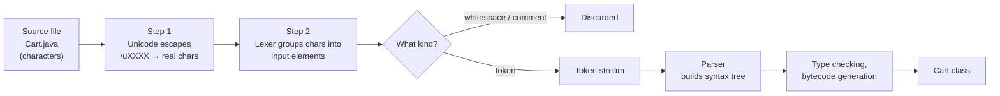
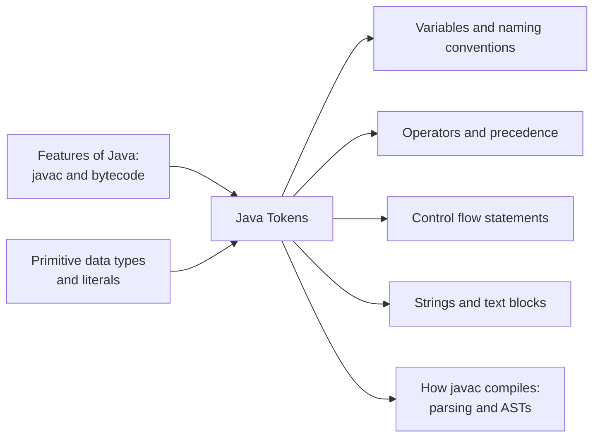

# Java Tokens

**TL;DR:** Before `javac` can understand your program, it chops the source text into **tokens**: the smallest meaningful pieces. Java has exactly **five kinds**: **keywords**, **identifiers**, **literals**, **operators** and **separators**. Whitespace and comments are read and then thrown away; they are *not* tokens.

## Table of Contents

1. [TL;DR](#1-tldr)
2. [Why it matters](#2-why-it-matters)
3. [Prerequisites](#3-prerequisites)
4. [Mental model](#4-mental-model)
5. [Core concepts](#5-core-concepts)
6. [How it works](#6-how-it-works)
7. [Examples](#7-examples)
8. [Comparisons](#8-comparisons)
9. [Trade-offs](#9-trade-offs)
10. [Gotchas](#10-gotchas)
11. [Practical application](#11-practical-application)
12. [Interview prep](#12-interview-prep)
13. [Connections](#13-connections)
14. [Summary](#14-summary)
15. [Answers](#answers)

---

## 1. TL;DR

A **token** is the smallest unit of a Java program that has meaning to the compiler, such as `int`, `total`, `500`, `>=` or `;`. The part of the compiler that splits source code into tokens is called the **lexer** (or **scanner**), and the process is **lexical analysis**. The official rules are in Chapter 3, "Lexical Structure", of the **Java Language Specification (JLS)**.

**The analogy: tokens are the words and punctuation of a sentence.**

| In an English sentence… | In Java… | Token kind |
|---|---|---|
| Grammar words with fixed meaning: *if*, *while*, *the* | `if`, `while`, `class`, `int` | **Keyword** |
| Names you choose: *Priya*, *Fluffy* | `total`, `Cart`, `main` | **Identifier** |
| Quoted values or written numbers: *"hello"*, *500* | `"hello"`, `500`, `'A'`, `true` | **Literal** |
| Maths symbols and action marks: *+*, *=*, *≥* | `+`, `=`, `>=`, `&&` | **Operator** |
| Punctuation: *.* *,* *;* *(* *)* | `.` `,` `;` `(` `)` `{` `}` | **Separator** |
| Spaces between words and notes in the margin | spaces, newlines, `// comments` | **Not tokens**: discarded |

You read "Thecatsat" with difficulty and "The cat sat" easily: you split it into words first, then understand the grammar. `javac` does the same thing, in that order.

**Running example:** a tiny `Cart` program. We'll split it into all 53 of its tokens and classify every one.

---

## 2. Why it matters

**The problem tokens solve.** A source file is just a long string of characters. A compiler can't check grammar ("is this a valid `if` statement?") on raw characters. Lexical analysis turns characters into a clean stream of labelled tokens, so the next stage, the **parser**, can work with meaningful units.

**What goes wrong if you don't understand tokens** (real, common errors and surprises):

| Code | What happens | Token reason |
|---|---|---|
| `int class = 5;` | Compile error | `class` is a keyword, not an identifier |
| `int 2ndPlace = 1;` | Compile error | An identifier can't start with a digit |
| `int my-score = 10;` | Compile error | `-` is an operator token, so this is `my`, `-`, `score` |
| `int c = a--b;` | Compile error | Lexer reads `a`, `--`, `b`, not `a - -b` |
| `int c = a+++b;` | Compiles: means `a++ + b` | The lexer always takes the **longest** possible token |
| `// see \u000a for details` followed by code | The comment ends early | `\u000a` becomes a real newline *before* tokenising |
| `int var = 3;` | Compiles fine | `var` is a *contextual* keyword, not a reserved one |

**Why interviewers ask.** "What are tokens in Java?" is a common fresher-level question, especially in Indian service-company and campus interviews. Senior interviewers use the edge cases above (`a+++b`, `true` as keyword or literal, `var`) to check precision.

---

## 3. Prerequisites

| Prerequisite | One-line refresher | Importance |
|---|---|---|
| Compilation | `javac` turns `.java` source into `.class` bytecode. | Essential |
| Variables | A named storage location: `int total = 0;` | Essential |
| Primitive types and literals | `int`, `double`, `char`… and values like `42`, `3.14`, `'A'`. | Essential |
| Characters and Unicode | Every character has a number; `'A'` is U+0041. | Nice-to-have |
| Compiler stages | Source → tokens → syntax tree → bytecode. | Nice-to-have (explained below) |

---

## 4. Mental model

> **The one picture to keep in your head:** the compiler reads your file as a stream of characters, groups them into tokens, and throws away the whitespace and comments before any grammar checking happens.


*Lexical analysis is the first stage of compilation: characters in, tokens out.*

**Classifying any token:**

```mermaid
flowchart TB
    T["Token"] --> K["Keyword<br/>int, if, class, …"]
    T --> I["Identifier<br/>total, Cart, String, …"]
    T --> L["Literal"]
    T --> O["Operator<br/>+ - * / = == >= && ++ …"]
    T --> S["Separator<br/>( ) { } [ ] ; , . ... @ ::"]
    L --> L1["Integer: 42, 0x2A, 0b101"]
    L --> L2["Floating-point: 3.14, 1e3, 2.5f"]
    L --> L3["Boolean: true, false"]
    L --> L4["Character: 'A', '\n'"]
    L --> L5["String: \"hi\", text blocks"]
    L --> L6["Null: null"]
```
*The JLS's five token categories, with literal subtypes.*

---

## 5. Core concepts

| Term | Meaning (1 line) | Tiny example |
|---|---|---|
| **Token** | The smallest meaningful unit of source code. | `int`, `total`, `=`, `0`, `;` |
| **Lexer / scanner** | The compiler component that splits characters into tokens. | Part of `javac` |
| **Lexical analysis** | The process of tokenising source code. | First stage of compilation |
| **Lexeme** | The actual text of one token. | The characters `total` |
| **Input element** | Anything the lexer recognises: whitespace, a comment, or a token. | `// note` is an input element, not a token |
| **Keyword** | A word with a fixed meaning in the language; can't be used as a name. | `class`, `if`, `int` |
| **Reserved keyword** | A keyword that is *always* reserved. Java has 51 (⚠️ as of Java 9+, including `_`). | `goto` (reserved but unused) |
| **Contextual keyword** | A word with special meaning only in certain positions; usable as a name elsewhere. | `var`, `record`, `yield` |
| **Identifier** | A name you give to a class, method, variable, package or label. | `totalPrice`, `Cart` |
| **Literal** | A fixed value written directly in source code. | `500`, `"Hi"`, `true`, `null` |
| **Operator** | A symbol that performs an operation on operands. | `+`, `>=`, `&&`, `=` |
| **Separator** | A symbol that structures code: groups, ends or separates parts. | `;`, `{`, `,`, `.` |
| **Whitespace** | Spaces, tabs, form feeds and line terminators; separate tokens, then discarded. | `int␣x` |
| **Comment** | Text for humans; discarded by the lexer. | `// unit price` |
| **Unicode escape** | `\u` + 4 hex digits; replaced by that character *before* tokenising. | `\u0041` → `A` |
| **Escape sequence** | Backslash code inside a char/string literal for special characters. | `"\n"` (newline) |
| **Maximal munch** | Lexer rule: always take the **longest** sequence that forms a valid token. | `a+++b` → `a`, `++`, `+`, `b` |
| **Parser** | The next stage: checks token order against Java's grammar and builds a syntax tree. | Knows `if ( expr ) stmt` |

### 5.1 Keywords

All **51 reserved keywords** (⚠️ JLS 9+; `_` became a keyword in Java 9), grouped by purpose:

| Group | Keywords | Count |
|---|---|---|
| Primitive types | `boolean` `byte` `char` `short` `int` `long` `float` `double` | 8 |
| No return value | `void` | 1 |
| Access modifiers | `public` `protected` `private` | 3 |
| Other modifiers | `abstract` `final` `static` `native` `synchronized` `transient` `volatile` `strictfp` | 8 |
| Types and structure | `class` `interface` `enum` `extends` `implements` `package` `import` | 7 |
| Control flow | `if` `else` `switch` `case` `default` `for` `while` `do` `break` `continue` `return` | 11 |
| Exceptions and checks | `try` `catch` `finally` `throw` `throws` `assert` | 6 |
| Objects | `new` `this` `super` `instanceof` | 4 |
| Reserved, never used | `const` `goto` | 2 |
| Underscore | `_` | 1 |

**Contextual keywords** (special meaning only in specific places; ⚠️ 17 as of Java 21):

| Word | Meaning where it applies | Introduced |
|---|---|---|
| `var` | Local variable type inference: `var x = 10;` | Java 10 |
| `yield` | Return a value from a switch expression | Java 14 |
| `record` | Declare a record class | Java 16 |
| `sealed`, `non-sealed`, `permits` | Restrict which classes may extend a type | Java 17 |
| `when` | Guard in a switch pattern: `case Integer i when i > 0` | Java 21 |
| `module`, `open`, `requires`, `transitive`, `exports`, `opens`, `to`, `uses`, `provides`, `with` | Only inside `module-info.java` | Java 9 |

> [!WARNING]
> `true`, `false` and `null` look like keywords but are officially **literals**. You still can't use them as identifiers. This is the most common "trick" question on this topic.

### 5.2 Identifiers

**Rules (enforced by the compiler):**
1. Must start with a **letter**, **`$`** or **`_`**.
2. Later characters may be letters, digits, `$` or `_`.
3. Cannot be a reserved keyword, `true`, `false` or `null`.
4. Cannot be `_` alone (⚠️ since Java 9).
5. **Case-sensitive**: `total`, `Total` and `TOTAL` are three different identifiers.
6. No length limit.
7. "Letter" includes Unicode letters, so `café` and `ගණන` are legal identifiers.

**Conventions (not enforced, but expected in interviews and code review):**

| Kind | Convention | Example |
|---|---|---|
| Class, interface, enum, record | PascalCase | `ShoppingCart` |
| Method, variable | camelCase | `calculateTotal`, `itemCount` |
| Constant (`static final`) | UPPER_SNAKE_CASE | `MAX_ITEMS` |
| Package | all lowercase, reversed domain | `com.example.shop` |
| Generic type parameter | single uppercase letter | `T`, `E`, `K`, `V` |

> [!TIP]
> `$` is legal but by convention reserved for compiler-generated names (e.g. inner class files like `Outer$Inner.class`). Don't use it in your own identifiers.

### 5.3 Literals

| Literal kind | Forms | Example → value |
|---|---|---|
| Integer | Decimal, hex `0x`, octal leading `0`, binary `0b` (Java 7+); `L` suffix for `long`; `_` between digits (Java 7+) | `0x1F` → 31, `017` → 15, `0b101` → 5, `1_000_000L` |
| Floating-point | Decimal, scientific `e`, hex `p`; `f`/`F` for float, `d`/`D` optional for double | `3.14`, `1e3` → 1000.0, `2.5f`, `0x1.8p1` → 3.0 |
| Boolean | Exactly two values | `true`, `false` |
| Character | One character in single quotes, or an escape | `'A'`, `'\n'`, `'\u0041'` |
| String | Characters in double quotes | `"Free shipping!"` |
| Text block | Multi-line string between `"""` delimiters (Java 15+) | see below |
| Null | The "no object" reference | `null` |

**Escape sequences** (inside character and string literals):

| Escape | Meaning |
|---|---|
| `\n` | Newline (line feed) |
| `\t` | Tab |
| `\r` | Carriage return |
| `\b` | Backspace |
| `\f` | Form feed |
| `\s` | Single space (Java 15+) |
| `\'` | Single quote |
| `\"` | Double quote |
| `\\` | Backslash |
| `\0` to `\377` | Octal character code |

**Text block** (Java 15+):
```java
String json = """
        {"item": "pen", "qty": 3}
        """;
// json is: {"item": "pen", "qty": 3}\n   (common indentation removed)
```

### 5.4 Operators

The JLS defines **38 operator tokens**:

| Group | Operators |
|---|---|
| Assignment | `=` |
| Arithmetic | `+` `-` `*` `/` `%` |
| Increment / decrement | `++` `--` |
| Relational / equality | `==` `!=` `>` `<` `>=` `<=` |
| Logical | `&&` `\|\|` `!` |
| Bitwise / shift | `&` `\|` `^` `~` `<<` `>>` `>>>` |
| Compound assignment | `+=` `-=` `*=` `/=` `%=` `&=` `\|=` `^=` `<<=` `>>=` `>>>=` |
| Conditional (ternary) | `?` `:` |
| Lambda arrow | `->` |

> [!NOTE]
> `instanceof` behaves like an operator but is lexically a **keyword** token. `::` (method reference) is lexically a **separator**, even though it feels like an operator. Interviewers rarely go this deep, but it's correct per the JLS.

### 5.5 Separators

The JLS defines **12 separators**:

| Separator | Name | Used for | Example |
|---|---|---|---|
| `(` `)` | Parentheses | Method calls/declarations, grouping, conditions | `main(String[] args)` |
| `{` `}` | Braces | Blocks: class, method, loop bodies; array initialisers | `{ total = 0; }` |
| `[` `]` | Brackets | Array types and indexing | `args[0]` |
| `;` | Semicolon | Ends a statement | `int x = 5;` |
| `,` | Comma | Separates parameters, arguments, declarations | `int a, b;` |
| `.` | Dot | Member access, package names | `System.out.println` |
| `...` | Ellipsis | Varargs | `int sum(int... nums)` |
| `@` | At sign | Annotations | `@Override` |
| `::` | Double colon | Method references | `String::length` |

---

## 6. How it works

### 6.1 The lexical translation steps (JLS §3.2)

1. **Translate Unicode escapes.** Every `\uXXXX` in the *entire file* (including comments and strings) is replaced with the actual character. This happens before anything else.
2. **Find lines.** Characters are split into input characters and **line terminators** (`\n`, `\r`, or `\r\n`).
3. **Form input elements.** The lexer reads left to right, grouping characters into **whitespace**, **comments** or **tokens**, always using the **longest possible** match (maximal munch).
4. **Discard** whitespace and comments. Only tokens are passed on.
5. The **parser** receives the token stream and checks grammar.

> [!NOTE]
> There is one deliberate exception to maximal munch: in a **type context** like `List<List<String>>`, the lexer treats `>>` as two separate `>` tokens, so generics close correctly instead of being read as a right-shift.

### 6.2 Maximal munch in action

**Tracing `x+++y`** character by character:

| Position | Characters seen | Longest valid token so far | Next char extends it? | Emitted token |
|---|---|---|---|---|
| 0 | `x` | identifier `x` | `+` can't continue an identifier | `x` (identifier) |
| 1 | `+` | `+` | next `+` → `++` is valid | — |
| 1–2 | `++` | `++` | next `+` → `+++` is **not** an operator | `++` (operator) |
| 3 | `+` | `+` | next `y` can't extend `+` | `+` (operator) |
| 4 | `y` | identifier `y` | end of input | `y` (identifier) |

Result: `x ++ + y`, which the parser reads as `(x++) + y`.

```java
public class Munch {
    public static void main(String[] args) {
        int a = 5, b = 3;
        int c = a+++b;          // tokens: a ++ + b  → (a++) + b
        System.out.println(c + " " + a);
        // int d = a--b;        // tokens: a -- b → compile error (no operator between a-- and b)
        int e = a - -b;         // space separates the tokens: a - (-b)
        System.out.println(e);
    }
}
```
**Expected output:**
```
8 6
9
```
(`c` = 5 + 3 = 8, then `a` becomes 6; `e` = 6 − (−3) = 9.)

> [!TIP]
> Whitespace has no meaning of its own, but it does **separate** tokens. `a - -b` and `a--b` contain the same characters except spaces, and they tokenise completely differently.

### 6.3 Worked example: tokenising `Cart.java`

```java
public class Cart {
    public static void main(String[] args) {
        int qty = 3;                 // items in cart
        int price = 250;
        int total = qty * price;
        if (total >= 500) {
            System.out.println("Free shipping! Total = " + total);
        }
    }
}
```

**Expected output:**
```
Free shipping! Total = 750
```

**Step 1 (Unicode escapes):** none in this file, so nothing changes.

**Step 2–4: token stream, line by line** (K = keyword, I = identifier, L = literal, O = operator, S = separator):

| Line | Tokens | Count |
|---|---|---|
| 1 | `public`ᴷ `class`ᴷ `Cart`ᴵ `{`ˢ | 4 |
| 2 | `public`ᴷ `static`ᴷ `void`ᴷ `main`ᴵ `(`ˢ `String`ᴵ `[`ˢ `]`ˢ `args`ᴵ `)`ˢ `{`ˢ | 11 |
| 3 | `int`ᴷ `qty`ᴵ `=`ᴼ `3`ᴸ `;`ˢ (comment discarded) | 5 |
| 4 | `int`ᴷ `price`ᴵ `=`ᴼ `250`ᴸ `;`ˢ | 5 |
| 5 | `int`ᴷ `total`ᴵ `=`ᴼ `qty`ᴵ `*`ᴼ `price`ᴵ `;`ˢ | 7 |
| 6 | `if`ᴷ `(`ˢ `total`ᴵ `>=`ᴼ `500`ᴸ `)`ˢ `{`ˢ | 7 |
| 7 | `System`ᴵ `.`ˢ `out`ᴵ `.`ˢ `println`ᴵ `(`ˢ `"Free shipping! Total = "`ᴸ `+`ᴼ `total`ᴵ `)`ˢ `;`ˢ | 11 |
| 8 | `}`ˢ | 1 |
| 9 | `}`ˢ | 1 |
| 10 | `}`ˢ | 1 |
| | **Total** | **53** |

**Summary by kind:**

| Kind | Count | The tokens |
|---|---|---|
| Keywords | 9 | `public` ×2, `class`, `static`, `void`, `int` ×3, `if` |
| Identifiers | 14 | `Cart`, `main`, `String`, `args`, `qty` ×2, `price` ×2, `total` ×3, `System`, `out`, `println` |
| Literals | 4 | `3`, `250`, `500`, `"Free shipping! Total = "` |
| Operators | 6 | `=` ×3, `*`, `>=`, `+` |
| Separators | 20 | `(` ×3, `)` ×3, `{` ×3, `}` ×3, `[`, `]`, `;` ×4, `.` ×2 |
| **Total** | **53** | |

**Things to notice:**
- `String`, `System`, `out`, `println` and `main` are **identifiers**, not keywords. They're names defined in the standard library or by convention.
- The string literal is **one** token, even though it contains spaces, `!` and `=`. Inside quotes, nothing is tokenised separately.
- The comment `// items in cart` and all indentation produce **zero** tokens.
- `>=` is **one** token (maximal munch), not `>` followed by `=`.

**What the parser does next:** it sees `if ( total >= 500 ) {` and matches it against the grammar rule `if ( Expression ) Statement`. If you'd written `if total >= 500 {`, the lexer would happily produce tokens; it's the **parser** that reports the error, because the `(` separator is missing.

```mermaid
sequenceDiagram
    participant Src as Source text
    participant Lex as Lexer
    participant Par as Parser
    Src->>Lex: "if (total >= 500) {"
    Lex->>Par: if
    Lex->>Par: (
    Lex->>Par: total
    Lex->>Par: >=
    Lex->>Par: 500
    Lex->>Par: )
    Lex->>Par: {
    Par->>Par: matches "if ( Expression ) Statement"
```
*The lexer streams labelled tokens; the parser checks that their order follows Java's grammar.*

---

## 7. Examples

### 7.1 Toy example: build a mini lexer

This simplified lexer handles a small subset of Java. It shows the same ideas `javac` uses: patterns per token kind, skipping whitespace and comments, and longest-match for operators.

```java
// MiniLexer.java  —  run with: javac MiniLexer.java && java MiniLexer   (Java 9+)
import java.util.Set;
import java.util.regex.Matcher;
import java.util.regex.Pattern;

public class MiniLexer {
    static final Set<String> KEYWORDS =
        Set.of("int", "if", "else", "while", "return", "public", "class", "static", "void");

    // Order matters: alternatives are tried left to right, so longer operators come first
    static final Pattern TOKEN = Pattern.compile(
          "\\s+|//[^\\n]*"                                   // whitespace or line comment (skipped)
        + "|(?<ID>[A-Za-z_$][A-Za-z0-9_$]*)"                 // identifier or keyword
        + "|(?<NUM>\\d+)"                                    // integer literal
        + "|(?<STR>\"[^\"]*\")"                              // simple string literal
        + "|(?<OP>>=|<=|==|!=|\\+\\+|--|&&|\\|\\||[=+\\-*/<>!])"
        + "|(?<SEP>[(){}\\[\\];,.])");

    public static void main(String[] args) {
        String code = "if (total >= 500) { count++; } // done";
        Matcher m = TOKEN.matcher(code);
        int pos = 0;
        while (pos < code.length()) {
            m.region(pos, code.length());
            if (!m.lookingAt()) {                            // no pattern matches here
                throw new IllegalStateException("Unexpected character at " + pos);
            }
            String text = m.group();
            String kind =
                  m.group("ID")  != null ? (KEYWORDS.contains(text) ? "KEYWORD" : "IDENTIFIER")
                : m.group("NUM") != null ? "LITERAL"
                : m.group("STR") != null ? "LITERAL"
                : m.group("OP")  != null ? "OPERATOR"
                : m.group("SEP") != null ? "SEPARATOR"
                : null;                                      // whitespace or comment
            if (kind != null) {
                System.out.printf("%-10s %s%n", kind, text);
            }
            pos = m.end();
        }
    }
}
```

**Expected output:**
```
KEYWORD    if
SEPARATOR  (
IDENTIFIER total
OPERATOR   >=
LITERAL    500
SEPARATOR  )
SEPARATOR  {
IDENTIFIER count
OPERATOR   ++
SEPARATOR  ;
SEPARATOR  }
```

What to notice:
- Keywords and identifiers use the **same pattern**; the lexer checks a keyword table afterwards. Real lexers do this too.
- `>=` and `++` come out as single tokens because they're listed before `>` and `+`, imitating maximal munch.
- The trailing `// done` produced nothing.

### 7.2 Real-world examples

| System | How it uses tokens |
|---|---|
| **`javac`** (OpenJDK compiler) | Its first phase is a hand-written scanner that turns source into tokens for the parser. ⚠️ Internal classes like `JavaTokenizer` aren't public API. |
| **IntelliJ IDEA and other IDEs** | Syntax highlighting runs a **lexer** on every keystroke and colours tokens by kind: keywords, string literals, comments. It's fast because it doesn't need a full parse. |
| **Checkstyle** (Java style checker) | Parses Java using an ANTLR-generated grammar; its rules are written against token types such as `IDENT`, `LITERAL_IF` and `STRING_LITERAL` (for example, "identifiers must match this naming pattern"). |
| **Code formatters** (e.g. google-java-format) | Re-insert whitespace between tokens according to style rules. They can freely change spacing precisely because whitespace isn't a token. |

---

## 8. Comparisons

### 8.1 Commonly confused pairs

| Concept A | Concept B | Difference |
|---|---|---|
| **Token** | **Lexeme** | Token = the category plus value (IDENTIFIER `total`); lexeme = the raw text `total`. (Everyday usage, and the JLS, often say "token" for both.) |
| **Keyword** | **Identifier** | Keyword has a fixed meaning and is reserved; an identifier is a name you choose. |
| **Reserved keyword** | **Contextual keyword** | Reserved words (`class`, `int`) can never be names; contextual ones (`var`, `record`) are special only in certain positions. |
| **Keyword** | **Literal** `true`/`false`/`null` | Both can't be identifiers, but `true`/`false`/`null` are values, so the JLS classifies them as literals. |
| **Operator** | **Separator** | Operators compute values (`+`, `>=`); separators structure code (`;`, `{`, `.`). |
| **Identifier** | **Variable** | An identifier is just a name; it can name a variable, method, class, package or label. |
| **Escape sequence** `\n` | **Unicode escape** `\u000a` | Escape sequences are processed *inside literals* during lexing; Unicode escapes are processed *everywhere*, *before* lexing. |

### 8.2 Tokens vs other compiler stages

| Stage | Input | Output | Example error it catches |
|---|---|---|---|
| **Lexical analysis** | Characters | Tokens | `int x = 5#;` (`#` isn't a valid character outside literals/comments) |
| **Parsing** (syntax analysis) | Tokens | Syntax tree | `if total > 5 {` (missing parentheses) |
| **Semantic analysis** | Syntax tree | Annotated tree | `int x = "hi";` (type mismatch), undeclared variable |
| **Code generation** | Annotated tree | Bytecode | — |

**Use "lexical error" when…** a character sequence can't form any token (stray `#`, unterminated string `"abc`, malformed number `0x`).
**Use "syntax error" when…** every token is valid but their order isn't (`int = x 5;`).
**Use "semantic error" when…** the grammar is fine but the meaning isn't (`String s = 5;`).

---

## 9. Trade-offs

Tokens are a fixed part of the language, not something you choose, so the trade-offs here are about **Java's design decisions** at the token level.

| Design decision | Benefit | Cost |
|---|---|---|
| **Small set of reserved keywords** (⚠️ 51) | Clear, predictable grammar; easy to learn. Python has about 35 keywords, C89 has 32 ⚠️ | Every new reserved word can break old code. `assert` (Java 1.4) and `enum` (Java 5) broke programs using them as variable names, a common one being `Enumeration enum = …`. |
| **Contextual keywords** (`var`, `record`, `yield`…) | New features without breaking existing code: `int var = 1;` still compiles | Harder to explain, and the lexer/parser are more complex. |
| **Unicode identifiers** | Code can use names in any language (`café`, `ගණන`) | Look-alike characters (Latin `a` vs Cyrillic `а`) can create confusing or malicious code. |
| **Unicode escapes processed first** | Any character can be written in pure ASCII source | Puzzlers: `\u000a` inside a comment becomes a real newline (see Gotchas). |
| **Maximal munch** | Simple, fast, unambiguous lexer | Surprises like `a--b` failing; needs a special case for `>>` in generics. |
| **Case sensitivity** | `Cart` (class) vs `cart` (variable) can coexist | Typos like `system.out.println` cause errors that look odd to beginners. |
| **`goto` and `const` reserved but unused** | Clear error messages for C/C++ programmers; keeps the option open | Two dead words you can't use. |

---

## 10. Gotchas

### Myths

| ❌ Myth | ✅ Reality |
|---|---|
| `true`, `false` and `null` are keywords. | They're **literals** (boolean and null literals). They still can't be used as identifiers. |
| `String`, `System` and `main` are keywords. | They're **identifiers**. `String` and `System` are class names; `main` is a method name. `int main = 5;` compiles. |
| Comments and whitespace are tokens. | They're **input elements** that are discarded. Only keywords, identifiers, literals, operators and separators are tokens. |
| `var` is a keyword like `int`. | It's a **contextual keyword** (a reserved type name). `int var = 10;` and even `var var = 10;` compile. |
| `goto` and `const` work in Java. | They're **reserved but unused**: you can't use them at all. |
| `_` is a valid variable name. | Not since Java 9; `_` alone is a keyword. ⚠️ Java 22+ uses it for unnamed variables (e.g. `catch (Exception _)`). |
| Java is case-insensitive. | It's **case-sensitive**: `Int` is a legal identifier; `int` is a keyword. |
| Comments can't affect code. | A Unicode escape like `\u000a` inside a comment is turned into a real newline *before* comments are recognised. |
| `a--b` means `a - (-b)`. | Maximal munch reads `a -- b`, which is a compile error. Write `a - -b`. |
| A string literal is many tokens. | The whole `"Free shipping! Total = "` is **one** literal token. |
| Comments can be nested. | `/* outer /* inner */ still outer? */` fails: the first `*/` ends the comment. |

### Common mistakes and edge cases

**1. The Unicode-escape comment trap.**
```java
public class Escape {
    public static void main(String[] args) {
        // Note: \u000a System.out.println("Surprise!");
        System.out.println("Done");
    }
}
```
**Expected output:**
```
Surprise!
Done
```
`\u000a` is a newline. It's converted *before* tokenising, so the "comment" ends there and `System.out.println("Surprise!");` becomes real code.

**2. Unicode escapes inside string literals.**
```java
System.out.println("a\u0022.length() + \u0022b".length());   // prints 2
```
`\u0022` is `"`, so after step 1 the code is `"a".length() + "b".length()`. (From *Java Puzzlers*.)

**3. Character literal mistakes.**
```java
char ok1 = 'A';
char ok2 = '\'';      // escaped single quote
// char bad1 = 'AB';  // compile error: only one character allowed
// char bad2 = "A";   // compile error: "A" is a String literal
// char bad3 = '\u0027'; // compile error: becomes ''' after Unicode translation
```

**4. Identifier legality quick check.**

| Candidate | Legal? | Why |
|---|---|---|
| `_count` | ✅ | Starts with `_` |
| `$price` | ✅ | Starts with `$` (legal, though discouraged) |
| `2ndPlace` | ❌ | Starts with a digit |
| `my-score` | ❌ | `-` is an operator token |
| `café` | ✅ | Unicode letters allowed |
| `class` | ❌ | Reserved keyword |
| `Class` | ✅ | Case differs from `class` |
| `var` | ✅ | Contextual keyword, usable as a name |
| `null` | ❌ | Null literal |
| `_` | ❌ | Keyword since Java 9 |

**5. Octal literals.** `int code = 010;` is **8**, because a leading `0` makes it octal. `int bad = 09;` doesn't compile (9 isn't an octal digit).

**6. Underscore placement in numbers.** `1_000` is fine; `_1000` is an *identifier*; `1000_`, `0_x10` and `1._5` are compile errors. Underscores must sit **between digits**.

**7. Line-spanning strings.** A normal `"..."` literal can't contain a raw line break. Use `\n`, concatenation, or a text block (Java 15+).

---

## 11. Practical application

### How tokens show up in everyday coding

| Situation | Token knowledge that helps |
|---|---|
| Reading compiler errors | "illegal character", "unclosed string literal", "malformed number" → lexical problem; "';' expected" → parser problem. |
| Naming things | Follow identifier rules *and* conventions: `PascalCase` classes, `camelCase` members, `UPPER_SNAKE` constants. |
| Writing literals | `L` on large longs, `f` on floats, `_` for readability (`1_000_000`), text blocks for JSON/SQL. |
| Avoiding puzzlers | Never put `\u` sequences in comments; add spaces around `-`/`+` when mixing unary and binary operators. |
| Upgrading Java versions | New contextual keywords rarely break code, but a variable named `_` broke when moving to Java 9. |

### Checklist
- [ ] No identifiers starting with a digit, containing `-`, or matching a keyword
- [ ] Constants named `UPPER_SNAKE_CASE` and declared `static final`
- [ ] Large numeric literals use `_` separators and the right suffix (`L`, `f`)
- [ ] No `\u` escapes in comments
- [ ] Ambiguous operator sequences spaced out (`a - -b`, not `a--b`)
- [ ] Multi-line strings written as text blocks (Java 15+)

### Hands-on exercise: tokenise by hand

**Part A.** Split this line into tokens, label each with its kind, and give the total count.

```java
double avg = (sum + 0.5) / count; // average
```

**Part B.** For each snippet, say whether it compiles. If it does, give the result.

```java
int x = 10, y = 4;
int r1 = x+++y;     // (i)
int r2 = x---y;     // (ii)
int r3 = x-- -y;    // (iii)
int r4 = x--y;      // (iv)
```
(Assume each line starts again from `x = 10, y = 4`.)

**Part C.** Without running it, predict the output:
```java
public class Hidden {
    public static void main(String[] args) {
        int count = 1;
        // count = 100; \u000a count = 42;
        System.out.println(count);
    }
}
```

**Expected outcome:** you can explain each answer using maximal munch, the five token kinds, and the "Unicode escapes first" rule.

<details><summary>Answer</summary>

**Part A:** 11 tokens (the comment is discarded):

| # | Token | Kind |
|---|---|---|
| 1 | `double` | Keyword |
| 2 | `avg` | Identifier |
| 3 | `=` | Operator |
| 4 | `(` | Separator |
| 5 | `sum` | Identifier |
| 6 | `+` | Operator |
| 7 | `0.5` | Literal (floating-point) |
| 8 | `)` | Separator |
| 9 | `/` | Operator |
| 10 | `count` | Identifier |
| 11 | `;` | Separator |

**Part B:**
- (i) `x+++y` → `x ++ + y` → `(x++) + y` = 10 + 4 = **14**; compiles (x becomes 11).
- (ii) `x---y` → `x -- - y` → `(x--) - y` = 10 − 4 = **6**; compiles (x becomes 9).
- (iii) `x-- -y` → `(x--) - y` = **6**; compiles. Same tokens as (ii); the space just makes it readable.
- (iv) `x--y` → `x -- y` → **compile error**: after `x--` there's no operator before `y`.

**Part C:** it prints **42**. `\u000a` becomes a newline before tokenising, so the code is really:
```java
        // count = 100;
 count = 42;
```
The first part stays a comment; `count = 42;` runs.
</details>

---

## 12. Interview prep

### Likely questions with model answers

**Q1. What are tokens in Java? Name their types.**
> "A token is the smallest meaningful unit of a Java program, the building block the compiler works with. When `javac` compiles a file, its first step, lexical analysis, splits the source characters into tokens. The Java Language Specification defines five kinds: keywords like `int` and `class`, identifiers like variable and class names, literals like `42` or `\"hello\"`, operators like `+` and `>=`, and separators like `;`, `{` and `.`. Whitespace and comments are recognised but discarded, so they aren't tokens."

- *Follow-ups:* Are comments tokens? What happens after tokenising? (Parsing into a syntax tree.)
- *Red flags:* Listing comments or whitespace as token types without qualification.

**Q2. What is the difference between a keyword and an identifier? What are the rules for identifiers?**
> "A keyword is a word reserved by the language with a fixed meaning, like `if` or `class`, so you can't use it as a name. An identifier is a name you choose for a class, method, variable or package. Identifiers must start with a letter, `$` or underscore, can then contain letters, digits, `$` and underscores, are case-sensitive, have no length limit, and can't be a keyword, `true`, `false`, `null`, or a lone underscore since Java 9. By convention, classes use PascalCase, methods and variables camelCase, and constants UPPER_SNAKE_CASE."

- *Follow-ups:* Is `String` a keyword? (No, an identifier: a class name.) Can identifiers contain Unicode? (Yes.)
- *Red flags:* "Identifiers can start with a digit"; calling conventions "rules".

**Q3. Are `true`, `false` and `null` keywords?**
> "No. They look like keywords and you can't use them as identifiers, but the JLS classifies `true` and `false` as boolean literals and `null` as the null literal. They represent values, which is what literals are."

- *Follow-ups:* What type is `null`? (The special null type, assignable to any reference type.) Are `const` and `goto` keywords? (Yes, reserved but unused.)
- *Red flags:* Confidently answering "yes, they're keywords".

**Q4. Is `var` a keyword?**
> "It's a contextual keyword, also called a reserved type name, added in Java 10 for local variable type inference. It only has special meaning where a type is expected in a local variable declaration. That's why `int var = 5;` still compiles. Java added it this way so existing code using `var` as a name wouldn't break. Later features did the same: `record`, `yield`, `sealed`, `permits` and `when` are also contextual."

- *Follow-ups:* Can you write `var x;` without an initialiser? (No: the type must be inferred from it.) Can you name a class `var`? (No, since Java 10.)
- *Red flags:* Saying `var` makes Java dynamically typed. (It's still static typing, inferred at compile time.)

**Q5. What types of literals does Java have?**
> "Integer literals in decimal, hex with `0x`, octal with a leading zero, or binary with `0b`, with an `L` suffix for `long`. Floating-point literals, which default to `double`, with an `f` suffix for `float`. Boolean literals `true` and `false`. Character literals in single quotes, including escapes like `'\n'`. String literals in double quotes, plus text blocks with triple quotes since Java 15. And the `null` literal. Underscores can separate digits for readability since Java 7."

- *Follow-ups:* What's `010`? (8: octal.) Why doesn't `float f = 1.5;` compile? (`1.5` is a `double` literal.)
- *Red flags:* Forgetting `null` or not knowing the octal trap.

**Q6. Are comments and whitespace tokens? What role does whitespace play?**
> "No. The lexer recognises three kinds of input elements: whitespace, comments and tokens. Whitespace and comments are discarded; only tokens go to the parser. Whitespace still matters because it separates tokens: `int x` needs the space, otherwise `intx` is one identifier. And `a - -b` compiles while `a--b` doesn't, purely because of spacing. Javadoc comments are also discarded by the compiler; the separate `javadoc` tool reads them."

- *Follow-ups:* Can a comment ever change program behaviour? (Yes: Unicode escapes like `\u000a` are processed before comments are recognised.)

**Q7. What does `a+++b` mean? Explain how the lexer decides.**
> "It means `(a++) + b`. Java's lexer follows the 'longest possible translation' rule, often called maximal munch: at each step it takes the longest sequence of characters that forms a valid token. From `+++`, it takes `++` because `+++` isn't an operator, then a single `+`. The same rule makes `a--b` a compile error, since it's read as `a -- b`. The one exception is in generics: in `List<List<String>>`, the `>>` is split into two `>` tokens so the type closes correctly."

- *Follow-ups:* How would you make `a--b` mean subtraction of a negative? (Add a space: `a - -b`.)
- *Red flags:* Guessing the parse instead of explaining the rule.

**Q8. Why are `goto` and `const` reserved if Java doesn't use them?**
> "They're reserved so that C and C++ programmers who use them by habit get a clear compile error instead of confusing behaviour, and so the language designers kept the option of using them later. Java deliberately left out `goto` because unrestricted jumps make code hard to follow; labelled `break` and `continue` cover the legitimate use cases. For constants, Java uses `final`."

- *Follow-ups:* Show a labelled break. (`outer: for (...) { for (...) { break outer; } }`)

### What interviewers watch for
- Naming **exactly five** token types, and excluding comments/whitespace.
- The `true`/`false`/`null` = literal distinction.
- Knowing that `String`, `System` and `main` are identifiers.
- Awareness of **contextual keywords** (`var`, `record`) and version changes (`_` in Java 9).
- Explaining maximal munch instead of guessing.

---

## 13. Connections


*Tokens sit between "what Java is" and "how to write Java statements".*

- **Variables and naming conventions:** applies identifier rules to declarations, scope and `var`.
- **Operators and precedence:** tokens tell you *what* the operators are; precedence tells you *which runs first* (`a + b * c`).
- **Control flow statements:** how keywords like `if`, `switch`, `for` and separators combine into real logic.
- **Strings and text blocks:** the most-used literal type; immutability and the string pool are interview favourites.
- **How javac compiles:** the stages after tokenising (parsing, type checking, bytecode), useful for understanding compiler errors.

---

## 14. Summary

**One-line essence:** `javac` first splits source code into five kinds of tokens (keywords, identifiers, literals, operators, separators) using the longest-match rule, after translating Unicode escapes and before discarding whitespace and comments.

### 60-second revision card
- **Token** = smallest meaningful unit; produced by the **lexer** in lexical analysis, the first compiler stage.
- **Five kinds:** keywords, identifiers, literals, operators, separators.
- **Not tokens:** whitespace and comments (recognised, then discarded).
- ⚠️ **51 reserved keywords** (incl. `const`, `goto` unused; `_` since Java 9) plus **contextual keywords** like `var`, `record`, `yield`.
- `true`, `false`, `null` are **literals**, not keywords.
- Identifiers: start with letter/`$`/`_`; case-sensitive; not a keyword or literal.
- **Maximal munch:** `a+++b` → `(a++) + b`; `a--b` → compile error.
- **Unicode escapes** (`\uXXXX`) are translated before anything else, even in comments.

### Cheat sheet

| Kind | Examples | Count / rule |
|---|---|---|
| Keyword | `class` `int` `if` `return` `new` `static` | ⚠️ 51 reserved + contextual (`var`, `record`, …) |
| Identifier | `total` `Cart` `String` `main` | `[letter $ _][letter digit $ _]*`, not a keyword/literal |
| Literal | `42` `0x2A` `0b101` `3.14` `2.5f` `'A'` `"hi"` `true` `null` | 6 kinds: integer, floating, boolean, char, string, null |
| Operator | `=` `+` `==` `>=` `&&` `++` `+=` `?:` `->` `>>>` | 38 operator tokens |
| Separator | `(` `)` `{` `}` `[` `]` `;` `,` `.` `...` `@` `::` | 12 |
| Discarded | spaces, tabs, newlines, `//`, `/* */`, `/** */` | Input elements, not tokens |

| Literal syntax | Meaning |
|---|---|
| `0x`, `0b`, leading `0` | Hex, binary, octal |
| `L` / `f` / `d` suffix | long / float / double |
| `1_000_000` | Underscores between digits (Java 7+) |
| `'\n'` `'\t'` `'\\'` `'\''` `"\""` | Escape sequences |
| `"""` … `"""` | Text block (Java 15+) |

### Self-test questions

1. 🟢 Name the five kinds of tokens in Java.
2. 🟢 Are comments tokens? What happens to them?
3. 🟢 Classify each: `if`, `String`, `true`, `>=`, `;`, `"if"`.
4. 🟡 Which of these are legal identifiers: `$total`, `3d`, `first_name`, `goto`, `Int`, `max-value`, `var`?
5. 🟡 How many tokens are in `System.out.println(x+1);`? List them.
6. 🟡 Why does `int var = 7;` compile while `int class = 7;` doesn't?
7. 🔴 **Spot the misconception.** A teammate says: "Comments are removed before compiling, so nothing inside a comment can ever affect the program." Show a counterexample and explain.
8. 🔴 Given `int a = 3, b = 2;`, what is `a+++b` and what is `a` afterwards? Why does `a--b` fail to compile?

### Flashcards (Anki)

```
What is a token in Java? :: The smallest meaningful unit of source code that the compiler recognises
Five kinds of Java tokens? :: Keywords, identifiers, literals, operators, separators
Are comments and whitespace tokens? :: No — they are input elements that the lexer discards
Are true, false and null keywords? :: No — they are literals (boolean and null literals), though they can't be identifiers
Is String a keyword? :: No — it is an identifier (the name of a class)
What can a Java identifier start with? :: A letter, $ or _ (never a digit)
What is maximal munch? :: The lexer rule of always taking the longest character sequence that forms a valid token
How does the lexer read a+++b? :: a ++ + b, i.e. (a++) + b
Is var a reserved keyword? :: No — it's a contextual keyword (reserved type name) from Java 10, so int var = 1; compiles
When are \uXXXX Unicode escapes processed? :: Before tokenising, everywhere in the file — including comments and strings
```

### Resources
- **The Java Language Specification**, Chapter 3 "Lexical Structure" (official definitions of every token kind): https://docs.oracle.com/javase/specs/
- **The Java Tutorials: Language Basics** (Oracle): https://docs.oracle.com/javase/tutorial/java/nutsandbolts/index.html
- **Java Puzzlers** by Joshua Bloch and Neal Gafter: several puzzles on Unicode escapes and lexing surprises.
- **Compilers: Principles, Techniques, and Tools** (the "Dragon Book") by Aho, Lam, Sethi and Ullman: the classic explanation of lexical analysis, if you want to go deeper.

---

## Answers

<details><summary>1. Five kinds of tokens</summary>

Keywords, identifiers, literals, operators, separators.
</details>

<details><summary>2. Are comments tokens?</summary>

No. The lexer recognises comments (and whitespace) as input elements and then discards them; only tokens are passed to the parser.
</details>

<details><summary>3. Classify the tokens</summary>

`if` → keyword. `String` → identifier. `true` → literal (boolean). `>=` → operator. `;` → separator. `"if"` → literal (string): the quotes make it a single string literal token, not a keyword.
</details>

<details><summary>4. Legal identifiers</summary>

Legal: `$total`, `first_name`, `Int`, `var`.
Illegal: `3d` (starts with a digit), `goto` (reserved keyword), `max-value` (`-` is an operator, so it's three tokens).
</details>

<details><summary>5. Tokens in System.out.println(x+1);</summary>

**11 tokens:** `System` `.` `out` `.` `println` `(` `x` `+` `1` `)` `;`
- Identifiers (4): `System`, `out`, `println`, `x`
- Separators (5): `.`, `.`, `(`, `)`, `;`
- Operator (1): `+`
- Literal (1): `1`
</details>

<details><summary>6. int var vs int class</summary>

`class` is a **reserved** keyword, so it can never be an identifier. `var` is a **contextual** keyword: it's only special as a type in a local variable declaration, so it remains usable as a variable name. Java made `var` contextual (Java 10) so existing code using `var` as a name wouldn't break.
</details>

<details><summary>7. Spot the misconception: comments can't affect code</summary>

Counterexample:
```java
int count = 1;
// reset \u000a count = 0;
System.out.println(count); // prints 0
```
Unicode escapes are translated **before** the lexer recognises comments. `\u000a` becomes a line terminator, which ends the `//` comment, so `count = 0;` is real code. The teammate's claim is true only for comments containing no Unicode escapes.
</details>

<details><summary>8. a+++b and a--b</summary>

`a+++b` is tokenised as `a ++ + b` (maximal munch), meaning `(a++) + b` = 3 + 2 = **5**, and afterwards `a` is **4**.
`a--b` is tokenised as `a -- b`: a post-decrement followed directly by an identifier with no operator between them, which is a syntax error. To subtract negative `b`, write `a - -b`.
</details>
