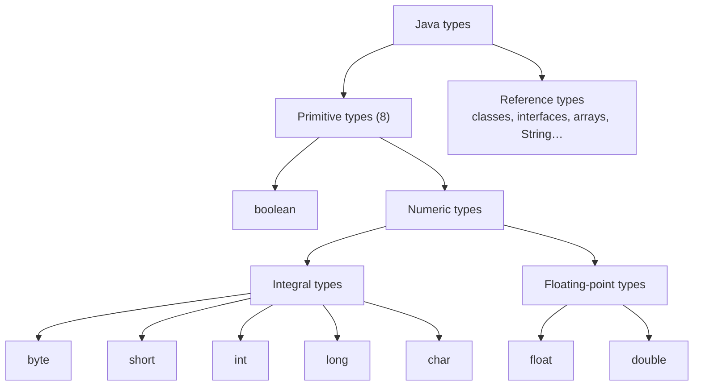
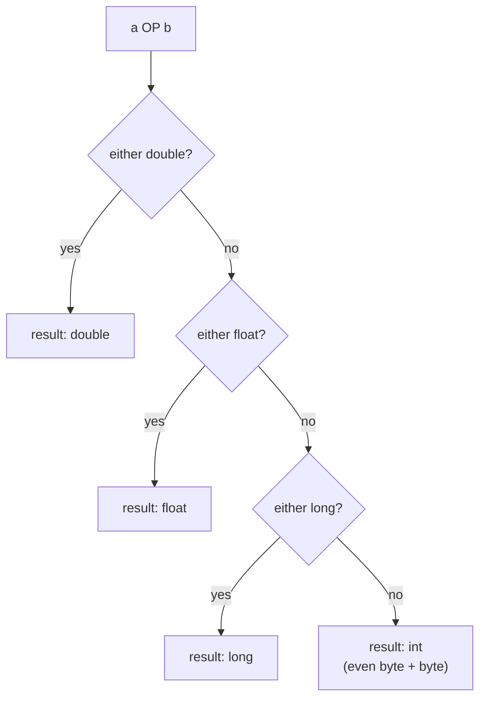
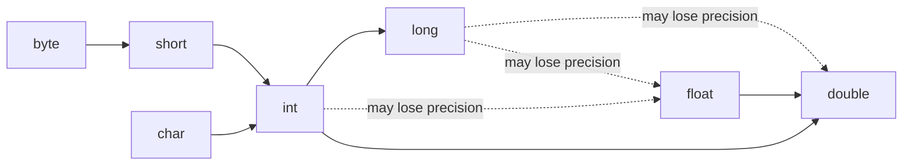
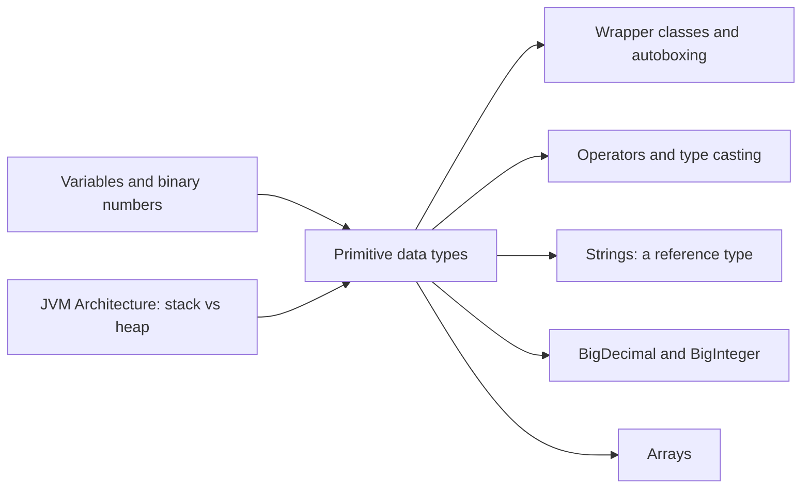

# Working with Data Types: Primitive Data Types in Java

**TL;DR:** Java has exactly **8 primitive types** (`byte`, `short`, `int`, `long`, `float`, `double`, `char`, `boolean`). Each stores a raw value of a **fixed size** directly in memory, with no object around it. Most interview questions about them come down to three things: **sizes and ranges**, **how values convert between types**, and **what happens at the edges** (overflow, floating-point rounding, boxing).

## Table of Contents

1. [TL;DR](#1-tldr)
2. [Why it matters](#2-why-it-matters)
3. [Prerequisites](#3-prerequisites)
4. [Mental model](#4-mental-model)
5. [Core concepts](#5-core-concepts)
6. [How it works](#6-how-it-works)
7. [Examples](#7-examples)
8. [Comparisons](#8-comparisons)
9. [Trade-offs](#9-trade-offs)
10. [Gotchas](#10-gotchas)
11. [Practical application](#11-practical-application)
12. [Interview prep](#12-interview-prep)
13. [Connections](#13-connections)
14. [Summary](#14-summary)
15. [Answers](#answers)

---

## 1. TL;DR

A **data type** tells Java what kind of value a variable holds, how much memory it uses, and which operations are allowed. A **primitive type** is one of 8 built-in types whose value is stored *directly* (not as an object). Everything else (`String`, arrays, your classes) is a **reference type**: the variable holds a reference to an object on the heap.

**The analogy: primitives are fixed-size storage boxes.**

| Box idea | Java idea |
|---|---|
| Boxes come in **fixed sizes**: matchbox, shoebox, suitcase | `byte` (8 bits), `int` (32 bits), `long` (64 bits)… |
| The item sits **directly inside** the box | The value is stored directly; no object, no reference |
| Moving an item into a **bigger box** is always safe | **Widening** conversion (`int` → `long`) is automatic |
| Forcing an item into a **smaller box** squashes it, and you must do it deliberately | **Narrowing** (`long` → `int`) needs an explicit cast and can lose data |
| Over-filling a box makes the counter **wrap around**, like a car odometer | **Overflow**: `Integer.MAX_VALUE + 1` becomes `Integer.MIN_VALUE` |
| A ruler with limited markings can only **approximate** some lengths | `float`/`double` store approximations (`0.1 + 0.2 != 0.3`) |
| Putting the box inside a **courier parcel** with a label and tracking adds weight | **Wrapper classes** (`Integer`, `Double`) wrap a primitive in an object |

**Running example:** a `Checkout` program for an online shop that uses all 8 types to compute an order total, and shows exactly where each type helps or hurts.

---

## 2. Why it matters

**The problem primitives solve.** Computers do arithmetic on fixed-size binary numbers. If every number in Java were an object, every `i++` in a loop would allocate memory and create work for the garbage collector. Primitives give you raw, fast, fixed-size values; Java's designers kept them for **performance**, even though it means Java isn't "purely" object-oriented.

**What goes wrong when you don't understand them** (all real, common bugs):

| Bug | Cause | Section |
|---|---|---|
| A total turns negative after a big sale | `int` overflow wraps silently | [Gotchas](#10-gotchas) |
| `$0.30` shows as `0.30000000000000004` | `double` can't store `0.1` exactly | [How it works](#6-how-it-works) |
| `long ms = 24 * 60 * 60 * 1000 * 1000;` gives a wrong answer | Multiplication done in `int` *before* storing into `long` | [Self-test](#self-test-questions) |
| `Integer a = 128, b = 128; a == b` is `false` | Comparing object references, not values | [Gotchas](#10-gotchas) |
| `NullPointerException` on `int n = map.get(key);` | Unboxing a `null` `Integer` | [Gotchas](#10-gotchas) |
| `float f = 3.14;` won't compile | Decimal literals are `double` by default | [Core concepts](#5-core-concepts) |

**Why interviewers ask.** These questions look easy but test precision: exact ranges, promotion rules, `==` vs `equals` on wrappers, and why money shouldn't be stored in `double`. Trick-output questions ("what does this print?") are very common here.

---

## 3. Prerequisites

| Prerequisite | One-line refresher | Importance |
|---|---|---|
| Variables | A named place that holds a value: `int age = 25;` | Essential |
| Binary numbers | Computers store numbers as bits (0/1); 8 bits = 1 **byte**. | Essential |
| Powers of 2 | n bits can represent 2ⁿ different values (8 bits → 256 values). | Essential |
| Stack vs heap | Local variables live in the method's stack frame; objects live on the heap. | Nice-to-have (see JVM Architecture notes) |
| Classes and objects | Objects are instances of classes, accessed through references. | Nice-to-have |

---

## 4. Mental model

> **The one picture to keep in your head:** a primitive variable *is* the value. A reference variable *points to* an object that holds the value.

```
   STACK FRAME (inside a method)                HEAP
 ┌──────────────────────────────┐
 │ int     count  = 42          │   ← value stored right here (4 bytes)
 │ double  price  = 19.99       │   ← value stored right here (8 bytes)
 │ boolean active = true        │
 │ Integer boxed  ──────────────┼──────►  ┌──────────────────────────┐
 │                              │         │ Integer object           │
 │ String  name   ──────────────┼──┐      │  [object header] [42]    │
 └──────────────────────────────┘  │      └──────────────────────────┘
                                   └───►  ┌──────────────────────────┐
                                          │ String object "Ana"      │
                                          └──────────────────────────┘
```
*Primitives hold their value directly; references (including wrappers like `Integer`) point to objects on the heap.*

**Where primitives fit in Java's type system:**


*The Java Language Specification's type hierarchy: note that `char` is an integral (number) type.*

---

## 5. Core concepts

### 5.1 The 8 primitive types

| Type | Size | Range | Default (fields/arrays) | Literal example | Typical use |
|---|---|---|---|---|---|
| `byte` | 8 bits | −128 to 127 | `0` | `(byte) 10` | Raw binary data, file/network bytes |
| `short` | 16 bits | −32,768 to 32,767 | `0` | `(short) 1200` | Rare; large arrays of small numbers |
| `int` | 32 bits | −2,147,483,648 to 2,147,483,647 (≈ ±2.1 billion) | `0` | `42`, `1_000_000` | **Default** for whole numbers |
| `long` | 64 bits | −9,223,372,036,854,775,808 to 9,223,372,036,854,775,807 (≈ ±9.2 quintillion) | `0L` | `42L`, `3_000_000_000L` | Timestamps, IDs, money in cents |
| `float` | 32 bits | ≈ ±3.4 × 10³⁸, about 6–7 significant decimal digits | `0.0f` | `1.25f` | Large arrays where memory matters (graphics, ML) |
| `double` | 64 bits | ≈ ±1.8 × 10³⁰⁸, about 15–16 significant decimal digits | `0.0d` | `19.99`, `1e-3` | **Default** for decimals (science, measurements) |
| `char` | 16 bits | `'\u0000'` to `'\uffff'` (0 to 65,535), **unsigned** | `'\u0000'` | `'A'`, `'\u0041'` | A single UTF-16 character |
| `boolean` | not precisely defined | `true` or `false` only | `false` | `true` | Flags, conditions |

> [!TIP]
> **Memorise the integer ranges as powers of 2.** An n-bit signed integer ranges from −2ⁿ⁻¹ to 2ⁿ⁻¹ − 1. So `byte`: −2⁷ to 2⁷−1 = −128 to 127. `int`: −2³¹ to 2³¹−1. The positive side is one smaller because zero takes one of the "non-negative" slots.

> [!NOTE]
> These sizes are **fixed by the Java Language Specification** on every platform. In C, the size of `int` depends on the compiler and CPU. This is part of what makes Java portable.

### 5.2 Glossary

| Term | Meaning (1 line) | Tiny example |
|---|---|---|
| **Primitive type** | One of 8 built-in, non-object types storing a raw value. | `int x = 5;` |
| **Reference type** | Any non-primitive type; the variable holds a reference to an object. | `String s = "hi";` |
| **Literal** | A value written directly in source code. | `42`, `3.14`, `'A'`, `true` |
| **Integral type** | A whole-number type: `byte`, `short`, `int`, `long`, `char`. | `int` |
| **Floating-point type** | A type storing approximate real numbers in IEEE 754 format: `float`, `double`. | `double` |
| **Signed** | Can hold negative numbers. All Java integral types except `char`. | `byte b = -5;` |
| **Two's complement** | The binary scheme Java uses for signed integers; the top bit means negative. | `-1` as byte = `1111 1111` |
| **IEEE 754** | The international standard for floating-point binary formats. | `double` = 1 sign + 11 exponent + 52 fraction bits |
| **Widening conversion** | Converting to a type with a larger range; automatic. | `long l = 5;` (int → long) |
| **Narrowing conversion** | Converting to a smaller range; needs an explicit **cast**. | `int i = (int) 3.99;` → `3` |
| **Cast** | Explicit conversion written as `(type) value`. | `(byte) 200` → `-56` |
| **Numeric promotion** | Java converting smaller operands to `int` (or wider) before arithmetic. | `byte + byte` gives `int` |
| **Overflow** | A result too large for the type; Java integers wrap around silently. | `Integer.MAX_VALUE + 1` → `-2147483648` |
| **Wrapper class** | An object version of a primitive. | `Integer`, `Double`, `Character`, `Boolean` |
| **Autoboxing** | Automatic primitive → wrapper conversion (Java 5+). | `Integer i = 5;` |
| **Unboxing** | Automatic wrapper → primitive conversion. | `int n = i;` |
| **Default value** | The value fields and array elements get if not assigned. Local variables get *none*. | `new int[3]` → `{0, 0, 0}` |
| **NaN** | "Not a Number": the floating-point result of undefined operations. | `0.0 / 0.0` |

### 5.3 Literal rules (where the compiler decides the type)

| You write | Type Java gives it | Notes |
|---|---|---|
| `42` | `int` | All whole-number literals are `int` unless suffixed |
| `42L` | `long` | Use uppercase `L`; lowercase `l` looks like `1` |
| `3.14` | `double` | All decimal literals are `double` unless suffixed |
| `3.14f` | `float` | Required to assign a decimal literal to a `float` |
| `0x1F` | `int` (hex) = 31 | Prefix `0x` |
| `0b1010` | `int` (binary) = 10 | Prefix `0b`, Java 7+ |
| `017` | `int` (**octal**) = 15 | A leading `0` means octal! |
| `1_000_000` | `int` | Underscores for readability, Java 7+ |
| `'A'` | `char` | Single quotes; `"A"` (double quotes) is a `String` |
| `'\u0041'` | `char` = `'A'` | Unicode escape |
| `true` / `false` | `boolean` | Lowercase only |

---

## 6. How it works

### 6.1 How integers are stored: two's complement

Java stores signed integers in **two's complement**. For a `byte` (8 bits):

```
 bit:      7    6    5    4    3    2    1    0
 weight: -128   64   32   16    8    4    2    1

   127 =   0    1    1    1    1    1    1    1   (largest)
     1 =   0    0    0    0    0    0    0    1
     0 =   0    0    0    0    0    0    0    0
    -1 =   1    1    1    1    1    1    1    1   (-128 + 127)
  -128 =   1    0    0    0    0    0    0    0   (smallest)
```
*The top bit has a negative weight. To negate a number: flip all bits, then add 1.*

**Overflow is just the bits wrapping around.** Add 1 to `0111 1111` (127) and you get `1000 0000`, which means −128. Picture it as a circle, like a car odometer:

```
              0
        -1         1
     -2               2
    ...      byte     ...
   -127             126
       -128  ◄──  127      (127 + 1 wraps to -128)
```
*Integer types form a loop: going past the maximum lands on the minimum, with no error.*

### 6.2 How decimals are stored: IEEE 754 floating point

A `double` stores a number like scientific notation, but in base 2:

```
 double (64 bits):
 ┌──────┬─────────────────┬────────────────────────────────────────────────────┐
 │ sign │ exponent (11)   │ fraction / mantissa (52)                           │
 └──────┴─────────────────┴────────────────────────────────────────────────────┘
   1 bit      11 bits                         52 bits

 float (32 bits):  sign 1 bit | exponent 8 bits | fraction 23 bits
```
*Value ≈ (−1)^sign × 1.fraction × 2^(exponent − bias). The fraction is binary, so only sums of powers of 2 are exact.*

**Why `0.1` can't be stored exactly.** In decimal, 1/3 = 0.3333… never ends. In binary, 1/10 = 0.000110011001100… never ends either. The `double` stores the *nearest* representable value, so tiny errors appear:

```java
System.out.println(0.1 + 0.2);         // 0.30000000000000004
System.out.println(0.1 + 0.2 == 0.3);  // false
System.out.println(1.00 - 9 * 0.10);   // 0.09999999999999998
System.out.println(0.5 + 0.25);        // 0.75  (exact: 1/2 and 1/4 are powers of 2)
```

Special floating-point values (no exceptions are thrown):

| Expression | Result |
|---|---|
| `1.0 / 0` | `Infinity` |
| `-1.0 / 0` | `-Infinity` |
| `0.0 / 0.0` | `NaN` |
| `Double.NaN == Double.NaN` | `false` (NaN is unequal to everything, even itself) |
| `Double.isNaN(0.0 / 0.0)` | `true` (the correct way to check) |

Compare with integers: `1 / 0` throws `ArithmeticException: / by zero`.

### 6.3 How arithmetic chooses a result type: numeric promotion

Before applying `+ - * / %` to two numbers, Java applies **binary numeric promotion**:

1. If either operand is `double`, the other becomes `double`.
2. Otherwise, if either is `float`, the other becomes `float`.
3. Otherwise, if either is `long`, the other becomes `long`.
4. **Otherwise, both become `int`**, even if both were `byte`, `short` or `char`.


*Binary numeric promotion: the result type of arithmetic on two primitives.*

**Why does `byte + byte` become `int`?** At the JVM level there is no "add two bytes" instruction. Bytecode has `iadd` (int), `ladd` (long), `fadd` (float) and `dadd` (double). `byte`, `short`, `char` and `boolean` are all handled as `int` inside the JVM's stack frames. You can see this in the bytecode:

```java
byte a = 10, b = 20;
byte c = (byte) (a + b);
```
```
 0: bipush 10     // push 10 as an int
 2: istore_1      // store into local slot 1 (a)
 3: bipush 20
 5: istore_2      // b
 6: iload_1
 7: iload_2
 8: iadd          // INT addition
 9: i2b           // the cast: truncate int to byte
10: istore_3      // c
```

### 6.4 How values convert between types


*Widening conversions happen automatically. Dashed arrows are widening but can silently lose precision.*

| Conversion | Automatic? | Can lose data? | Example | Result |
|---|---|---|---|---|
| `int` → `long` | Yes | No | `long l = 100;` | `100` |
| `int` → `double` | Yes | No | `double d = 7;` | `7.0` |
| `int` → `float` | Yes | **Yes, precision** | `float f = 16_777_217;` | `1.6777216E7` |
| `long` → `double` | Yes | **Yes, precision** | `double d = 9_007_199_254_740_993L;` | `9.007199254740992E15` |
| `double` → `int` | No, cast | **Yes**, truncates toward zero | `(int) 3.99` / `(int) -3.99` | `3` / `-3` |
| `int` → `byte` | No, cast | **Yes**, keeps lowest 8 bits | `(byte) 200` | `-56` |
| `int` → `char` | No, cast | Yes | `(char) 66` | `'B'` |
| `char` → `int` | Yes | No | `int code = 'A';` | `65` |
| `boolean` ↔ anything | **Never** | — | `(int) true` | Compile error |

**Why `(byte) 200` is −56:** 200 in binary is `1100 1000`. As a byte, the top bit means −128, so it's −128 + 64 + 8 = **−56**. Shortcut: 200 − 256 = −56.

> [!NOTE]
> **Constant exception.** `byte b = 10;` compiles without a cast even though `10` is an `int` literal, because the compiler can see the constant fits in a byte. `byte b = x;` (where `x` is an `int` variable) does not compile.

### 6.5 Worked example: the `Checkout` program, traced

```java
// Checkout.java  —  run with: javac Checkout.java && java Checkout
public class Checkout {
    public static void main(String[] args) {
        byte    rating     = 4;          // 1–5 stars: tiny range
        short   stockLeft  = 1_200;      // fits in 16 bits
        int     quantity   = 3;          // default choice for counts
        long    priceCents = 1_999L;     // $19.99 stored exactly as whole cents
        float   weightKg   = 1.25f;      // 'f' needed: decimal literals are double
        double  taxRate    = 0.08;       // a rate, not money
        char    sizeCode   = 'M';        // one character, single quotes
        boolean isMember   = true;       // only true or false

        long subtotal = priceCents * quantity;          // quantity widened int → long
        long tax      = Math.round(subtotal * taxRate); // double math, rounded back to long
        long discount = isMember ? 500 : 0;             // members save $5.00
        long total    = subtotal + tax - discount;

        System.out.println("Size " + sizeCode + ", rated " + rating + "/5, " + stockLeft + " in stock");
        System.out.println("Weight: " + weightKg * quantity + " kg");
        System.out.println("Subtotal: " + subtotal + " cents");
        System.out.println("Tax: " + tax + " cents");
        System.out.printf("Total: $%d.%02d%n", total / 100, total % 100); // %02d pads cents to 2 digits
    }
}
```

**Expected output:**
```
Size M, rated 4/5, 1200 in stock
Weight: 3.75 kg
Subtotal: 5997 cents
Tax: 480 cents
Total: $59.77
```

**Step-by-step trace:**

| Step | Expression | Promotion / conversion | Intermediate value | Type |
|---|---|---|---|---|
| 1 | `priceCents * quantity` | `quantity` (int) widened to long | `1999L * 3L` = `5997` | `long` |
| 2 | `subtotal * taxRate` | `subtotal` (long) widened to double | `5997.0 * 0.08` ≈ `479.76` | `double` |
| 3 | `Math.round(479.76)` | `Math.round(double)` returns long | `480` | `long` |
| 4 | `isMember ? 500 : 0` | `500` (int) widened on assignment | `500` | `long` |
| 5 | `subtotal + tax - discount` | all long | `5997 + 480 - 500` = `5977` | `long` |
| 6 | `weightKg * quantity` | `quantity` widened to float | `1.25f * 3.0f` = `3.75` | `float` |
| 7 | `total / 100`, `total % 100` | integer division, remainder | `59`, `77` | `long` |
| 8 | `"Size " + sizeCode + …` | string concatenation converts each value to text | `"Size M, rated 4/5, …"` | `String` |

**Design decisions in this example:**
- Money is a **`long` of cents**, not a `double` of dollars, so it's exact. `double` appears only for the tax *rate*, and the result is rounded back to whole cents immediately.
- `%02d` matters: with `total = 5905`, naive `total / 100 + "." + total % 100` would print `59.5` instead of `59.05`.
- `byte` and `short` here are for illustration. Inside a method they save **no memory**: the JVM stores them in 32-bit local slots. In real code you'd just use `int`.

**How the frame stores these locals** (from the JVM Architecture notes):

```
 main() frame — local variable array (each slot is 32 bits)
 slot 0     : args       (reference)
 slot 1     : rating     byte    → stored as int
 slot 2     : stockLeft  short   → stored as int
 slot 3     : quantity   int
 slot 4–5   : priceCents long    → takes TWO slots
 slot 6     : weightKg   float
 slot 7–8   : taxRate    double  → takes TWO slots
 slot 9     : sizeCode   char    → stored as int
 slot 10    : isMember   boolean → stored as int (0 or 1)
 ...
```
*In the JVM, `long` and `double` locals use two slots; `byte`, `short`, `char` and `boolean` locals use a full int slot.*

---

## 7. Examples

### 7.1 Toy example: inspect every type's limits and defaults

```java
public class Limits {
    static int i; static long l; static double d; static boolean b; static char c; // fields get defaults

    public static void main(String[] args) {
        System.out.println("byte:   " + Byte.MIN_VALUE + " to " + Byte.MAX_VALUE);
        System.out.println("short:  " + Short.MIN_VALUE + " to " + Short.MAX_VALUE);
        System.out.println("int:    " + Integer.MIN_VALUE + " to " + Integer.MAX_VALUE);
        System.out.println("long:   " + Long.MIN_VALUE + " to " + Long.MAX_VALUE);
        System.out.println("float:  max " + Float.MAX_VALUE + ", smallest positive " + Float.MIN_VALUE);
        System.out.println("double: max " + Double.MAX_VALUE + ", smallest positive " + Double.MIN_VALUE);
        System.out.println("char:   " + (int) Character.MIN_VALUE + " to " + (int) Character.MAX_VALUE);
        System.out.println("defaults: " + i + " " + l + " " + d + " " + b + " " + (int) c);
    }
}
```

**Expected output:**
```
byte:   -128 to 127
short:  -32768 to 32767
int:    -2147483648 to 2147483647
long:   -9223372036854775808 to 9223372036854775807
float:  max 3.4028235E38, smallest positive 1.4E-45
double: max 1.7976931348623157E308, smallest positive 4.9E-324
char:   0 to 65535
defaults: 0 0 0.0 false 0
```

> [!WARNING]
> `Float.MIN_VALUE` and `Double.MIN_VALUE` are the smallest **positive** values, not the most negative. The most negative `double` is `-Double.MAX_VALUE`. This is a favourite trick question.

### 7.2 Real-world examples

| System | Primitive decision | Why |
|---|---|---|
| **`System.currentTimeMillis()`** (JDK) | Returns `long` | Milliseconds since 1970 are already about 1.7 trillion; an `int` maxes out at about 2.1 billion ms ≈ **24.8 days**. |
| **`String.hashCode()`** (JDK) | Returns `int` and *deliberately* lets overflow wrap | Its documented formula `s[0]*31^(n-1) + … + s[n-1]` overflows for longer strings; wrapping is fine because a hash only needs to be consistent, not mathematically exact. |
| **Stripe payments API** | Amounts as integers in the smallest currency unit (e.g. cents) | Avoids floating-point rounding errors on money; the same idea as `priceCents` in the running example. |
| **YouTube view counter** (2014, not Java-specific) | Was a 32-bit signed integer | "Gangnam Style" approached 2,147,483,647 views, and YouTube switched to a 64-bit counter. The same overflow risk an `int` has. |
| **fastutil / Eclipse Collections** (Java libraries) | Collections of primitives (`IntList`, `IntIntMap`) | Standard `List<Integer>` boxes every value; primitive collections avoid that memory and GC cost. |

---

## 8. Comparisons

### 8.1 Primitive vs wrapper class

| Aspect | `int` (primitive) | `Integer` (wrapper) |
|---|---|---|
| What the variable holds | The value itself | A reference to a heap object |
| Memory per value | 4 bytes | ⚠️ ~16 bytes object + 4–8 byte reference (HotSpot, 64-bit) |
| Can be `null`? | No | Yes |
| Default as a field | `0` | `null` |
| Usable in generics/collections? | No (`List<int>` is illegal) | Yes (`List<Integer>`) |
| `==` compares | Values | **References** (object identity) |
| Has methods? | No | Yes (`Integer.parseInt`, `compareTo`…) |
| Speed | Fastest | Slower; boxing allocates objects |

| Primitive | `byte` | `short` | `int` | `long` | `float` | `double` | `char` | `boolean` |
|---|---|---|---|---|---|---|---|---|
| **Wrapper** | `Byte` | `Short` | `Integer` | `Long` | `Float` | `Double` | `Character` | `Boolean` |

**Use the primitive when…** you're doing arithmetic, loops, counters, or storing lots of numbers.
**Use the wrapper when…** you need `null` to mean "missing", need a collection or generic type, or need utility methods.

### 8.2 Choosing a numeric type

| Need | Use | Avoid | Why |
|---|---|---|---|
| Counts, indexes, loop variables | `int` | `byte`/`short` | Array indexes are `int`; smaller types save nothing in locals |
| Timestamps, IDs, very large counts | `long` | `int` | `int` overflows at about 2.1 billion |
| Measurements, science, statistics | `double` | `float` | `float`'s ~7 digits run out fast |
| Money | `long` (minor units) or `BigDecimal` | `float`/`double` | Binary floating point can't represent most decimal fractions exactly |
| Huge integers (crypto, factorials) | `BigInteger` | `long` | No upper limit |
| Raw binary data (files, network) | `byte[]` | `int[]` | Matches the data's real size; 4× less memory |
| Large numeric arrays where precision isn't critical | `float[]` | `double[]` | Half the memory (graphics, ML weights) |

### 8.3 Java primitives vs C/C++

| | Java | C / C++ |
|---|---|---|
| `int` size | Always 32 bits | Implementation-defined (commonly 32) |
| Unsigned integers | None, except `char` (Java 8 added helpers like `Integer.toUnsignedLong`) | `unsigned int`, etc. |
| `boolean` ↔ integer | Not convertible | `0` is false, non-zero is true |
| Integer overflow | Defined: wraps (two's complement) | Signed overflow is **undefined behaviour** |
| Uninitialised local | Compile error | Allowed; contains garbage |
| `char` | 16-bit UTF-16 unit | Usually 8 bits |

---

## 9. Trade-offs

### Pros of having primitives

| Pro | Detail |
|---|---|
| Speed | Map directly to CPU operations; no allocation, no GC. |
| Memory | ⚠️ An `int[]` of 1,000,000 elements is about 4 MB. An `Integer[]` of 1,000,000 distinct values is roughly 20 MB (4 MB of references plus ~16 bytes per object). |
| Predictability | Fixed sizes and fully defined overflow behaviour on every platform. |
| Never `null` | No `NullPointerException` from a primitive. |

### Cons and limitations

| Con | Detail |
|---|---|
| Not objects | Can't be used directly in generics or collections; boxing adds overhead and `null`/`==` pitfalls. |
| Silent overflow | Integer arithmetic wraps without error; you must opt in to checks (`Math.addExact`). |
| Floating-point imprecision | `float` ≈ 6–7 significant digits, `double` ≈ 15–16; decimal fractions like `0.1` are approximations. |
| No unsigned types | Working with unsigned data (e.g. bytes 0–255) needs masks like `b & 0xFF`. |
| `char` is too small for all of Unicode | Characters beyond U+FFFF (most emoji) need **two** `char`s (a surrogate pair). |
| Small types don't save memory in locals | `byte`/`short` locals still use 32-bit slots; savings appear only in arrays (and often fields). |

> [!NOTE]
> ⚠️ **Project Valhalla** (in development for years) aims to narrow the gap between primitives and objects with "value classes". Interviews still expect the classic primitive/wrapper distinction.

---

## 10. Gotchas

### Myths

| ❌ Myth | ✅ Reality |
|---|---|
| `String` is a primitive type. | `String` is a **class** (reference type). There are exactly 8 primitives. |
| Using `byte` instead of `int` saves memory. | Not for local variables (32-bit slots). It saves memory in **arrays**: `byte[1000]` ≈ 1 KB vs `int[1000]` ≈ 4 KB. |
| A `boolean` is 1 bit. | The spec doesn't define its size. ⚠️ HotSpot typically uses 1 byte per element in `boolean[]` and an int slot for local variables. |
| `double` is precise enough for money. | `0.1 + 0.2` prints `0.30000000000000004`. Use `long` cents or `BigDecimal`. |
| Integer overflow throws an exception. | It **wraps silently**. Only integer division/remainder by zero throws. |
| Dividing by zero always throws. | Only for integers. `1.0 / 0` is `Infinity`; `0.0 / 0.0` is `NaN`. |
| `Double.MIN_VALUE` is the most negative double. | It's the smallest **positive** double (`4.9E-324`). |
| Local variables default to 0 like fields do. | Locals have **no default**; reading one before assigning it is a compile error. |
| `char` holds any character. | It holds one **UTF-16 code unit**. `"😀".length()` is `2`. |
| `(int) 3.99` rounds to 4. | Casting **truncates toward zero**: `3`. Use `Math.round` to round. |
| `Integer` values can be compared with `==`. | `==` compares references. It *seems* to work for −128 to 127 because those are cached. Use `.equals()`. |
| Java is pass-by-reference for primitives… or anything. | Java is always **pass-by-value**. A primitive argument is a copy; changing it in the method doesn't affect the caller. |

### Common mistakes and edge cases

**1. Overflow happens *before* widening.**
```java
int a = 2_000_000_000, b = 2_000_000_000;
long wrong = a + b;          // int + int overflows FIRST, then widened
long right = (long) a + b;   // widen first, then add in long
System.out.println(wrong);   // -294967296
System.out.println(right);   // 4000000000
```

**2. The `Math.abs` trap.**
```java
System.out.println(Math.abs(Integer.MIN_VALUE)); // -2147483648 (still negative!)
```
+2,147,483,648 doesn't fit in an `int`, so negating `MIN_VALUE` wraps back to itself. This can break code like `array[Math.abs(hash) % n]`.

**3. Compound assignment hides a cast.**
```java
byte b = 10;
// b = b + 1;     // COMPILE ERROR: possible lossy conversion from int to byte
b += 1;           // OK: compiles as b = (byte) (b + 1)
b += 200;         // also compiles, and silently wraps: (byte) 211 = -45
System.out.println(b); // -45
```

**4. Integer division truncates.**
```java
System.out.println(7 / 2);     // 3
System.out.println(7 / 2.0);   // 3.5
System.out.println(-7 / 2);    // -3   (toward zero, not -4)
System.out.println(-7 % 3);    // -1   (sign follows the left operand)
```

**5. `char` arithmetic produces `int`.**
```java
char c = 'A';
System.out.println(c + 1);           // 66   (int)
System.out.println((char) (c + 1));  // B
c++;                                 // OK: ++ includes an implicit cast
System.out.println(c);               // B
System.out.println('a' + 'b');       // 195  (97 + 98, not "ab")
System.out.println("" + 'a' + 'b');  // ab
System.out.println('7' - '0');       // 7    (digit char → its number value)
```

**6. Octal surprise.**
```java
int code = 010;
System.out.println(code); // 8, not 10
```

**7. Boxing pitfalls.**
```java
Integer a = 127, b = 127;
Integer c = 128, d = 128;
System.out.println(a == b);       // true  (both from the Integer cache)
System.out.println(c == d);       // false (two different objects) ⚠️ with default JVM settings
System.out.println(c.equals(d));  // true  (compares values)

Integer missing = null;
int n = missing;                  // NullPointerException during unboxing
```
`Integer.valueOf` (which autoboxing uses) caches −128 to 127. ⚠️ The upper bound can be raised with a JVM flag, so never rely on `==`.

**8. Hidden boxing in loops.**
```java
Long sum = 0L;                            // wrapper by mistake
for (long i = 0; i < 1_000_000; i++) {
    sum += i;                             // unbox, add, box a NEW Long each time
}
```
Changing `Long` to `long` removes about a million object allocations. (Joshua Bloch's *Effective Java* uses this exact example.)

**9. Comparing doubles.**
```java
double x = 0.1 + 0.2;
System.out.println(x == 0.3);                    // false
System.out.println(Math.abs(x - 0.3) < 1e-9);    // true: compare with a tolerance
```

**10. `float` vs `double` literals.**
```java
// float f = 3.14;                // COMPILE ERROR: possible lossy conversion from double to float
float f = 3.14f;                  // OK
System.out.println(0.1f == 0.1);  // false: float 0.1 and double 0.1 are different approximations
```

---

## 11. Practical application

### Choosing a type: decision steps
1. **Is it true/false?** → `boolean`.
2. **Is it a single character?** → `char` (use `String` for text, or if you need emoji/full Unicode).
3. **Is it a whole number?** → `int`. If it can exceed about 2 billion (time in ms, IDs, file sizes) → `long`.
4. **Is it money or another exact decimal?** → `long` in minor units, or `BigDecimal`.
5. **Is it a measured or scientific decimal?** → `double`.
6. **Storing millions of them in an array?** → only then consider `byte`/`short`/`float` to save memory.
7. **Need `null` or a collection?** → the wrapper, compared with `.equals()`.

### Best-practice checklist
- [ ] `int` and `double` by default; other types only with a reason
- [ ] `L` suffix on large `long` literals and on the *first* operand of big multiplications (`24L * 60 * …`)
- [ ] Use `Math.addExact` / `multiplyExact` / `toIntExact` where overflow would be a bug
- [ ] Never `==` on wrappers; never `==` on computed doubles
- [ ] Never store money in `float`/`double`; use `BigDecimal("0.10")` (string constructor), not `new BigDecimal(0.10)`
- [ ] Check wrappers for `null` before unboxing
- [ ] Use `Math.round` when you mean rounding; a cast truncates
- [ ] Prefer primitives in hot loops; watch for accidental boxing

### Overflow-safe and exact-money helpers
```java
import java.math.BigDecimal;
import java.math.RoundingMode;

public class SafeMath {
    public static void main(String[] args) {
        // Overflow-checked arithmetic
        try {
            int result = Math.multiplyExact(100_000, 100_000); // 10 billion > int max
            System.out.println(result);
        } catch (ArithmeticException e) {
            System.out.println("Caught: " + e.getMessage());
        }

        // Exact decimal money with BigDecimal
        BigDecimal price = new BigDecimal("19.99");        // String constructor: exact
        BigDecimal total = price.multiply(BigDecimal.valueOf(3))
                                .multiply(new BigDecimal("1.08"))  // add 8% tax
                                .setScale(2, RoundingMode.HALF_UP);
        System.out.println("Total: " + total);
    }
}
```
**Expected output:**
```
Caught: integer overflow
Total: 64.77
```
(19.99 × 3 = 59.97; × 1.08 = 64.7676 → 64.77.)

### Hands-on exercise: predict, then verify

**Part A.** Without running it, write down what each line prints. Then run it and compare.

```java
public class Predict {
    public static void main(String[] args) {
        System.out.println(7 / 2);
        System.out.println(7 / 2.0);
        System.out.println((byte) 130);
        System.out.println('A' + 1);
        System.out.println((char) ('A' + 1));
        System.out.println(0.1 + 0.2 == 0.3);
        System.out.println(010 + 1);
        System.out.println(1.0 / 0);
        System.out.println(Integer.MAX_VALUE + 1 == Integer.MIN_VALUE);
    }
}
```

**Part B.** This method should return the number of **milliseconds in `days` days**, but it returns wrong answers for large inputs. Find the bug and fix it.

```java
static long millisIn(int days) {
    return days * 24 * 60 * 60 * 1000;
}
```

**Expected outcome:** you can explain every Part A line using the rules in Section 6, and your fixed `millisIn(30)` returns `2592000000`.

<details><summary>Answer</summary>

**Part A:**
```
3
3.5
-126
66
B
false
9
Infinity
true
```
- `7 / 2` → integer division truncates.
- `7 / 2.0` → one operand is `double`, so the result is `double`.
- `(byte) 130` → 130 − 256 = −126 (keep the lowest 8 bits).
- `'A' + 1` → `char` promoted to `int`: 65 + 1.
- `(char) ('A' + 1)` → cast back to `char`.
- `0.1 + 0.2 == 0.3` → floating-point approximation.
- `010 + 1` → `010` is octal 8.
- `1.0 / 0` → floating-point division by zero gives `Infinity`, not an exception.
- `MAX_VALUE + 1` wraps to `MIN_VALUE`.

**Part B:** the whole multiplication runs in `int` (every operand is an `int`), and only the final result is widened to `long`. For `days = 30`, the true value 2,592,000,000 exceeds `Integer.MAX_VALUE`, so it wraps to −1,702,967,296 before being widened.

Fix: make the first operand a `long` so every step is done in `long`:
```java
static long millisIn(int days) {
    return days * 24L * 60 * 60 * 1000;   // or (long) days * 24 * 60 * 60 * 1000
}
```
Note that `24L` must be early enough that no `int`-only multiplication overflows before it; putting the `long` first is the safe habit. In real code, prefer `java.time.Duration.ofDays(days).toMillis()`.
</details>

---

## 12. Interview prep

### Likely questions with model answers

**Q1. What are Java's primitive data types and their sizes?**
> "There are eight. Four integer types: `byte` is 8 bits, `short` 16, `int` 32 and `long` 64, all signed two's complement. Two floating-point types, `float` at 32 bits and `double` at 64, both IEEE 754. `char` is 16 bits and unsigned, holding a UTF-16 code unit from 0 to 65,535. And `boolean` holds only `true` or `false`; its size isn't specified by the language. These sizes are fixed on every platform, unlike in C."

- *Follow-ups:* What's the range of `int`? (−2³¹ to 2³¹−1, about ±2.1 billion.) Why is `char` 16 bits? (Java was designed for Unicode from the start.) What's the size of `boolean`?
- *Red flags:* Listing `String` as a primitive; saying `boolean` is definitely 1 bit.

**Q2. Why does Java have primitives if it's object-oriented?**
> "Performance. A primitive stores its value directly, like 4 bytes for an `int`, and maps straight to CPU instructions. If every number were an object, each one would need a heap allocation with an object header, and arithmetic in loops would create garbage for the GC. So Java keeps primitives for speed and memory, and provides wrapper classes like `Integer` for when you need an object, such as in collections. That's also why Java isn't considered purely object-oriented."

- *Follow-ups:* What is autoboxing? What does it cost?
- *Red flags:* Not knowing the wrapper classes exist.

**Q3. What's the difference between `int` and `Integer`? Explain this output: `Integer a = 128, b = 128; a == b` is `false`.**
> "`int` is a primitive holding the value directly; `Integer` is an object on the heap, can be `null`, and works with generics. Autoboxing converts `int` to `Integer` using `Integer.valueOf`, which caches values from −128 to 127. So `127 == 127` on two `Integer`s is `true` because both point to the same cached object, but `128` creates two separate objects, and `==` compares references, so it's `false`. Always compare wrapper values with `equals`. Also, unboxing a `null` `Integer` throws a `NullPointerException`."

- *Follow-ups:* Where else does unboxing NPE bite? (`int n = map.get(key);` when the key is missing.) Can you change the cache range? (⚠️ Upper bound, via a JVM flag.)
- *Red flags:* Saying `==` compares values for wrappers.

**Q4. Explain widening and narrowing conversions. What is `(byte) 200`?**
> "Widening goes to a type with a larger range, like `int` to `long`, and Java does it automatically. Narrowing goes the other way and needs an explicit cast because data can be lost. For integers, narrowing keeps only the low-order bits: 200 is `1100 1000` in binary, and as a signed byte the top bit is negative, so it's −56. For floating point to integer, the cast truncates toward zero, so `(int) 3.99` is `3`. One subtle case: some widening conversions, like `int` or `long` to `float`, are automatic but can lose precision."

- *Follow-ups:* What's `(int) Double.NaN`? (`0`.) What's `(int) 1e20`? (`Integer.MAX_VALUE`; double-to-int casts saturate.)
- *Red flags:* Claiming a cast rounds.

**Q5. Why does `byte b = 10; b = b + 1;` fail to compile, while `b += 1;` works?**
> "In `b + 1`, binary numeric promotion converts both operands to `int`, so the result is an `int`, and assigning an `int` expression to a `byte` is a narrowing conversion that needs a cast. Compound assignment operators like `+=` include an implicit cast to the left-hand type, so `b += 1` means `b = (byte)(b + 1)`. That's convenient but dangerous: `b += 200` also compiles and silently wraps. The underlying reason is that the JVM has no byte arithmetic instructions; it computes in `int`."

- *Follow-ups:* Why does `byte c = 10 + 20;` compile? (Constant expression that fits in a byte.)
- *Red flags:* Not knowing the promotion-to-int rule.

**Q6. Why shouldn't you use `double` for money? What do you use instead?**
> "`double` is binary floating point, so most decimal fractions like 0.1 can't be represented exactly. `0.1 + 0.2` gives `0.30000000000000004`, and those errors accumulate across many transactions. For money, use either a `long` holding the smallest unit, like cents, which is exact and fast, or `BigDecimal` when you need arbitrary precision and explicit rounding modes. With `BigDecimal`, construct from a `String`, like `new BigDecimal("0.10")`, because `new BigDecimal(0.10)` captures the double's inexact value."

- *Follow-ups:* Which rounding mode for currency? (Commonly `HALF_UP` or `HALF_EVEN`, depending on business rules.) `BigDecimal` `equals` vs `compareTo`? (`equals` also compares scale: `2.0` vs `2.00` are not equal.)
- *Red flags:* "Just round it at the end."

**Q7. What are the default values of primitives? Do local variables get them?**
> "Fields and array elements get defaults: zero for numeric types, `'\u0000'` for `char`, and `false` for `boolean`, while reference fields default to `null`. Local variables get no default at all: the compiler enforces definite assignment, so reading a local before assigning it is a compile error, 'variable might not have been initialized'. That's deliberate, to prevent garbage values like in C."

- *Follow-ups:* Default of an `Integer` field? (`null`, so unboxing it throws NPE.)
- *Red flags:* "Locals default to zero."

**Q8. What happens on integer overflow in Java? How do you guard against it?**
> "It wraps around silently using two's complement: `Integer.MAX_VALUE + 1` becomes `Integer.MIN_VALUE`, with no exception. A classic case is `Math.abs(Integer.MIN_VALUE)`, which stays negative. To guard against it: use a wider type like `long` and widen *before* the arithmetic, use `Math.addExact`, `multiplyExact` or `toIntExact`, which throw `ArithmeticException` on overflow, or use `BigInteger` for unbounded values. Only integer division or remainder by zero throws; floating point gives `Infinity` or `NaN`."

- *Follow-ups:* Spot the bug in `long ms = 24 * 60 * 60 * 1000 * 1000;`. Binary search midpoint `(low + high) / 2` overflow? (Use `low + (high - low) / 2` or `(low + high) >>> 1`.)
- *Red flags:* "Java throws an exception on overflow."

### What interviewers watch for
- **Exact** ranges and sizes, plus the power-of-2 reasoning behind them.
- Knowing that arithmetic on `byte`/`short`/`char` produces `int`.
- `==` vs `.equals()` on wrappers, and the cache explanation.
- Choosing `long`/`BigDecimal` for money without being prompted.
- Spotting overflow in multiplication chains and midpoint calculations (common in coding rounds).

---

## 13. Connections


*Where primitive types sit: what you need first, and what builds on them.*

- **Wrapper classes and autoboxing:** the object side of every primitive; essential for collections and a very common interview topic.
- **Operators and type casting:** precedence, bitwise operators (`&`, `>>>`), and casting rules in more depth.
- **Strings:** the most-used reference type; immutability and the string pool are frequent interview questions.
- **BigDecimal and BigInteger:** exact decimal money and unbounded integers when primitives aren't enough.
- **Arrays:** where primitive choice actually affects memory (`byte[]` vs `int[]`), and the basis of most DSA problems.

---

## 14. Summary

**One-line essence:** Java's 8 primitives are fixed-size raw values stored directly; master their ranges, the promote-to-`int` arithmetic rule, cast behaviour, overflow wrapping and floating-point approximation, and you can answer almost any question about them.

### 60-second revision card
- **8 primitives:** `byte` 8, `short` 16, `int` 32, `long` 64, `float` 32, `double` 64, `char` 16 (unsigned), `boolean` (size unspecified).
- Integer range = −2ⁿ⁻¹ to 2ⁿ⁻¹−1; `int` ≈ ±2.1 billion.
- Literals: whole numbers are `int`, decimals are `double`; use `L` and `f` suffixes; a leading `0` means octal.
- Arithmetic on `byte`/`short`/`char` produces **`int`**; mixed types promote to the widest.
- Widening is automatic; narrowing needs a cast and keeps low bits or truncates toward zero.
- Integer overflow **wraps silently**; use `Math.*Exact` or `long`/`BigInteger`.
- `0.1 + 0.2 != 0.3`; never use `double` for money; use `long` cents or `BigDecimal("…")`.
- Wrappers: `==` compares references (cache −128..127); use `.equals()`; unboxing `null` throws NPE.

### Cheat sheet

| Type | Bits | Min | Max | Default | Wrapper |
|---|---|---|---|---|---|
| `byte` | 8 | −128 | 127 | `0` | `Byte` |
| `short` | 16 | −32,768 | 32,767 | `0` | `Short` |
| `int` | 32 | −2,147,483,648 | 2,147,483,647 | `0` | `Integer` |
| `long` | 64 | −9,223,372,036,854,775,808 | 9,223,372,036,854,775,807 | `0L` | `Long` |
| `float` | 32 | −3.4028235E38 | 3.4028235E38 | `0.0f` | `Float` |
| `double` | 64 | −1.7976931348623157E308 | 1.7976931348623157E308 | `0.0d` | `Double` |
| `char` | 16 | `'\u0000'` (0) | `'\uffff'` (65,535) | `'\u0000'` | `Character` |
| `boolean` | — | `false` | `true` | `false` | `Boolean` |

| Syntax / API | Meaning |
|---|---|
| `100L`, `1.5f`, `0x1F`, `0b101`, `1_000` | long, float, hex, binary, underscores |
| `(int) x` | Cast: truncates / keeps low bits |
| `Math.round(d)` | Round `double` → `long` |
| `Math.addExact(a, b)` | Add, throw on overflow |
| `Math.toIntExact(l)` | `long` → `int`, throw if it doesn't fit |
| `Integer.parseInt("42")` | String → `int` |
| `Integer.valueOf(42)` | `int` → `Integer` (cached for −128..127) |
| `Double.isNaN(x)` | Correct NaN check |
| `Byte.toUnsignedInt(b)` / `b & 0xFF` | Read a byte as 0–255 |
| `Character.isDigit(c)`, `c - '0'` | Digit checks and conversion |

### Self-test questions

1. 🟢 List the 8 primitive types and their sizes in bits.
2. 🟢 What is the default value of an `int` field, a `boolean` field, and an `int` local variable?
3. 🟡 Why does `float f = 3.14;` fail to compile, and what are two ways to fix it?
4. 🟡 What is the type of `b1 + b2` when both are `byte`, and why?
5. 🟡 What does `(int) -7.9` evaluate to? What about `Math.round(-7.9)`?
6. 🟡 Why can `Integer x = 100, y = 100; x == y` be `true` while the same with `1000` is `false`?
7. 🔴 **Spot the bug.** What does this print and why? Fix it.
   ```java
   long microsPerDay = 24 * 60 * 60 * 1000 * 1000;
   System.out.println(microsPerDay);
   ```
8. 🔴 You're storing 50 million sensor temperature readings (range −50.0 to 150.0, 0.1 precision) in memory. Which primitive array type would you choose and why? Name one alternative trick.

### Flashcards (Anki)

```
How many primitive types does Java have? :: 8 — byte, short, int, long, float, double, char, boolean
Range of a Java byte? :: -128 to 127
Range of a Java int? :: -2,147,483,648 to 2,147,483,647 (−2^31 to 2^31−1)
Default type of the literal 3.14? :: double (use 3.14f for float)
What type is byte + byte? :: int (binary numeric promotion)
What does (byte) 200 evaluate to? :: -56 (keeps the low 8 bits: 200 − 256)
What happens on int overflow? :: It wraps silently (MAX_VALUE + 1 == MIN_VALUE); no exception
Why is 0.1 + 0.2 != 0.3 with doubles? :: 0.1 and 0.2 have no exact binary representation, so the sum is a rounded approximation
Integer cache range used by autoboxing? :: -128 to 127 (Integer.valueOf)
Do local variables have default values? :: No — reading an unassigned local is a compile error
```

### Resources
- **The Java Tutorials: Primitive Data Types** (Oracle): https://docs.oracle.com/javase/tutorial/java/nutsandbolts/datatypes.html
- **The Java Language Specification**, Chapter 4 "Types, Values, and Variables" and Chapter 5 "Conversions and Contexts": https://docs.oracle.com/javase/specs/
- **Effective Java**, 3rd edition, by Joshua Bloch: the items on avoiding `float`/`double` for exact answers and preferring primitives over boxed primitives.
- **Java Puzzlers** by Joshua Bloch and Neal Gafter: dozens of "what does this print?" puzzles, many about primitives.

---

## Answers

<details><summary>1. The 8 primitives and sizes</summary>

`byte` 8, `short` 16, `int` 32, `long` 64, `float` 32, `double` 64, `char` 16, `boolean` (size not specified by the language; holds only `true`/`false`).
</details>

<details><summary>2. Default values</summary>

`int` field: `0`. `boolean` field: `false`. `int` local variable: **no default**; using it before assignment is a compile error ("variable might not have been initialized").
</details>

<details><summary>3. float f = 3.14;</summary>

`3.14` is a `double` literal, and `double` → `float` is a narrowing conversion that needs to be explicit. Fixes: `float f = 3.14f;` or `float f = (float) 3.14;`. (Or use `double` if you don't specifically need `float`.)
</details>

<details><summary>4. Type of b1 + b2</summary>

`int`. Binary numeric promotion converts `byte`, `short` and `char` operands to `int` before arithmetic, and the JVM has no byte-add instruction (it uses `iadd`). To store the result in a `byte`, you need a cast: `byte s = (byte) (b1 + b2);`.
</details>

<details><summary>5. (int) -7.9 and Math.round(-7.9)</summary>

`(int) -7.9` is `-7`: casts truncate toward zero. `Math.round(-7.9)` is `-8`: it rounds to the nearest whole number (returned as a `long`).
</details>

<details><summary>6. Integer 100 vs 1000 with ==</summary>

Autoboxing uses `Integer.valueOf`, which returns cached objects for −128 to 127. Two boxed `100`s are the same cached object, so `==` (reference comparison) is `true`. `1000` is outside the cache, so two separate objects are created and `==` is `false`. Use `x.equals(y)` to compare values.
</details>

<details><summary>7. Spot the bug: microsPerDay</summary>

It prints `500654080`, not `86400000000`. Every operand is an `int`, so the multiplication happens in `int` and overflows (86,400,000,000 > 2,147,483,647) **before** the result is widened to `long`. Fix: make the first operand `long`:
```java
long microsPerDay = 24L * 60 * 60 * 1000 * 1000; // 86400000000
```
</details>

<details><summary>8. 50 million sensor readings</summary>

`float[]`: about 200 MB (4 bytes each) vs about 400 MB for `double[]`, and `float`'s ~7 significant digits easily cover values like `123.4`. Avoid `Float[]`/`List<Float>`, which would box every reading and use several times more memory.

Alternative trick: store **tenths of a degree as `short`** (−500 to 1500 fits in −32,768..32,767): `short[]` uses about 100 MB and is exact to 0.1. Convert with `reading / 10.0` when needed.
</details>
