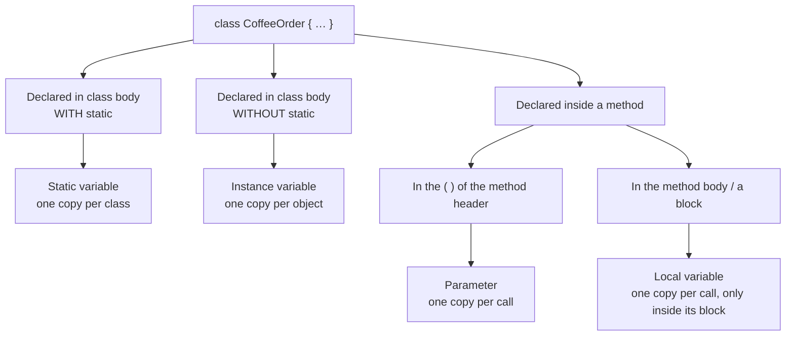
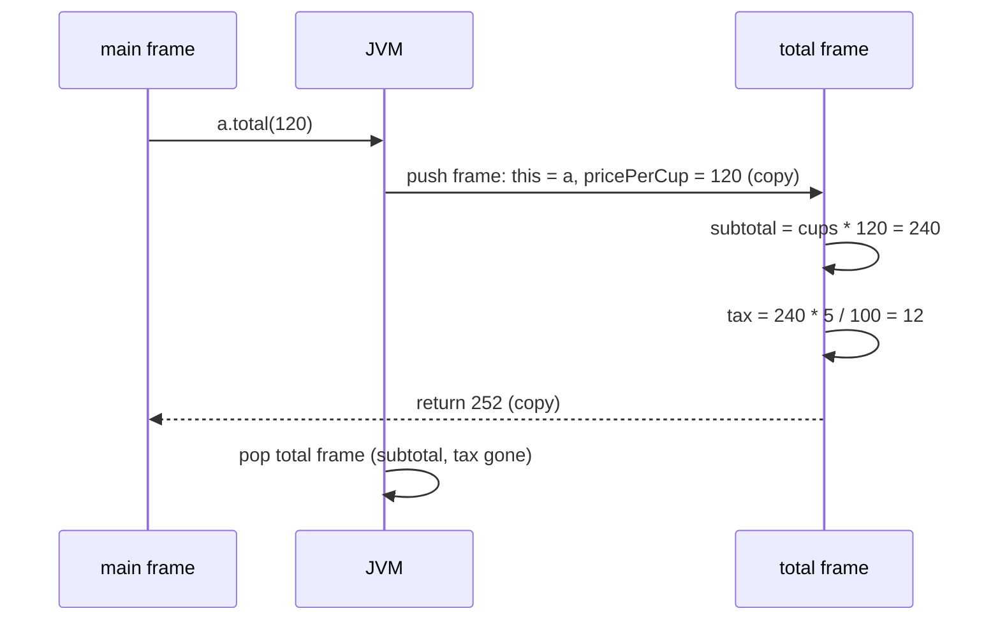
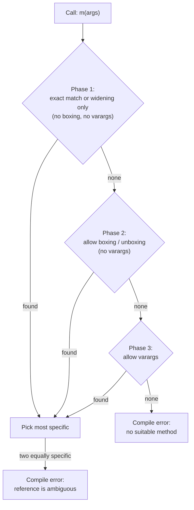
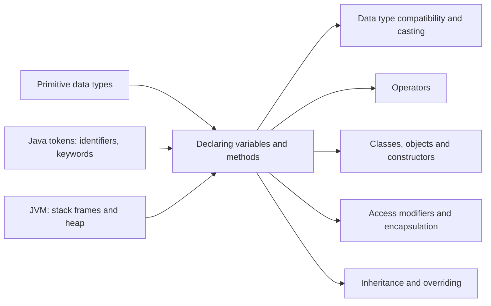

# Declaring Variables and Methods in Java

**TL;DR:** A **variable** is a named, typed place to store a value; a **method** is a named, reusable block of code with inputs (parameters) and an output (return type). Most interview questions here are about **where** a variable is declared (which decides its scope, lifetime and default value), **what a method's signature is** (which decides overloading), and **how arguments are passed** (always by value).

## Table of Contents

1. [TL;DR](#1-tldr)
2. [Why it matters](#2-why-it-matters)
3. [Prerequisites](#3-prerequisites)
4. [Mental model](#4-mental-model)
5. [Core concepts](#5-core-concepts)
6. [How it works](#6-how-it-works)
7. [Examples](#7-examples)
8. [Comparisons](#8-comparisons)
9. [Trade-offs](#9-trade-offs)
10. [Gotchas](#10-gotchas)
11. [Practical application](#11-practical-application)
12. [Interview prep](#12-interview-prep)
13. [Interview question bank](#13-interview-question-bank)
14. [Tricky code snippets](#14-tricky-code-snippets)
15. [Connections](#15-connections)
16. [Summary](#16-summary)
17. [Answers](#answers)

---

## 1. TL;DR

- **Declaring a variable** tells the compiler its **type** and **name**: `int cups;`. **Initialising** gives it a first value: `int cups = 2;`.
- **Declaring a method** tells the compiler its **modifiers**, **return type**, **name**, **parameters** and body: `int total(int price) { ... }`.
- Java has four main kinds of variables: **local**, **parameter**, **instance** (field) and **static** (class) variables. Where you declare one decides how long it lives and who can see it.

**The analogy: a coffee shop.**

| In the coffee shop… | In Java… |
|---|---|
| A **recipe card** with a name, ingredients and the drink it produces | A **method**: name, parameters, return type |
| The **ingredients you hand to the barista** for one drink | **Arguments** passed to a method call |
| The barista's **scratch pad**, thrown away after each drink | A **local variable**: lives only during one method call |
| Each customer's **order ticket**: one per customer | An **instance variable**: one copy per object |
| The **counter board** showing "orders today", shared by everyone | A **static variable**: one copy for the whole class |
| Two recipes both called "Latte", one for 1 shot and one for 2 shots | **Overloading**: same method name, different parameter lists |
| A sealed price sticker that can't be changed | A **`final`** variable |

**Running example:** a `CoffeeOrder` class with a static counter, instance fields, a constructor, an instance method, a static varargs method and `main`. We'll trace every variable through it.

---

## 2. Why it matters

**The problem.** Programs need to remember values (variables) and repeat work without copy-pasting (methods). Java is **statically typed**: every variable and method is declared with a type *before* use, so the compiler can catch mistakes before the program runs.

**What goes wrong if you get declarations wrong** (all verified with `javac` 21):

| Code | What happens | Why |
|---|---|---|
| `int x; System.out.println(x);` | Compile error: *variable x might not have been initialized* | Locals have no default value |
| `Counter(int count) { count = count; }` | Compiles, but the field stays `0` | The parameter **shadows** the field; you assigned it to itself |
| Calling `inc()` from `static main` | Compile error: *non-static method inc() cannot be referenced from a static context* | Static code has no `this` object |
| `int f()` and `void f()` in one class | Compile error: *method f() is already defined* | Return type isn't part of the signature |
| `swap(x, y)` doesn't swap | Silent bug | Java passes **copies** of values |
| `print(null)` with `print(String)` and `print(Integer)` | Compile error: *reference to print is ambiguous* | Overload resolution can't pick one |

**Why interviewers ask.** These are the building blocks of every Java program, so fresher rounds ask the definitions ("types of variables?"), and stronger interviewers use output-prediction questions on shadowing, overloading with `null`/boxing, static access and pass-by-value.

---

## 3. Prerequisites

| Prerequisite | One-line refresher | Importance |
|---|---|---|
| Primitive types | `int`, `double`, `boolean`… store raw values ([Primitive Data Types notes]). | Essential |
| Classes and objects | A class is a blueprint; `new` creates an object from it. | Essential |
| Blocks `{ }` | Curly braces group statements; they also define scope. | Essential |
| Stack vs heap | Locals live in a method's stack frame; objects (and their fields) live on the heap ([JVM Architecture notes]). | Nice-to-have |
| Tokens and identifiers | Names must follow identifier rules ([Java Tokens notes]). | Nice-to-have |

---

## 4. Mental model

> **The one picture to keep in your head:** *where* you write a declaration decides *what kind* of variable it is.


*The location of the declaration determines the variable's kind, lifetime and visibility.*

And the anatomy of a method declaration:

```
   public   static    int      sum   ( int... amounts )   throws X   { body }
   └──┬──┘  └──┬──┘  └─┬─┘    └─┬─┘   └──────┬───────┘   └───┬───┘   └──┬──┘
   access   other   return    name      parameter list     exceptions   body
   modifier modifier type                                   (optional)
                              └────────── signature ──────┘
                              (name + parameter TYPES only)
```
*The signature is just the name plus the parameter types. Return type, parameter names, modifiers and `throws` are not part of it.*

---

## 5. Core concepts

### 5.1 Glossary

| Term | Meaning (1 line) | Tiny example |
|---|---|---|
| **Variable** | A named storage location with a fixed type. | `int cups;` |
| **Declaration** | Introducing a name and type to the compiler. | `int cups;` |
| **Initialisation** | Giving a variable its first value. | `int cups = 2;` |
| **Assignment** | Storing a new value in an existing variable. | `cups = 3;` |
| **Local variable** | Declared inside a method, constructor or block; lives during that execution. | `int subtotal = …;` |
| **Parameter** | A variable in a method's header that receives an argument. | `int total(int price)` |
| **Argument** | The actual value passed when calling a method. | `total(120)` → `120` |
| **Instance variable (field)** | Declared in a class without `static`; each object has its own copy. | `private int cups;` |
| **Static variable (class variable)** | Declared with `static`; one copy shared by the whole class. | `static int ordersToday;` |
| **Scope** | The region of code where a name can be used. | A local is visible from its declaration to the end of its block |
| **Lifetime** | How long the variable exists at runtime. | Local: one method call; field: as long as the object |
| **Shadowing** | A local or parameter with the same name hides a field. | parameter `cups` hides field `cups` |
| **`this`** | A reference to the current object, used to reach a shadowed field. | `this.cups = cups;` |
| **Definite assignment** | The compiler's check that a local is assigned before it is read. | `int x; print(x);` → error |
| **`final` variable** | Can be assigned only once. | `final int MAX = 10;` |
| **Blank final** | A `final` variable declared without a value, assigned later exactly once. | `final int id;` + set in constructor |
| **Effectively final** | Not marked `final` but never reassigned; can be used in lambdas (Java 8+). | `int n = 5; Runnable r = () -> print(n);` |
| **`var`** | Local variable type inference (Java 10+): the compiler infers the type from the initialiser. | `var list = new ArrayList<String>();` |
| **Method** | A named block of code that can take inputs and return a result. | `int total(int price) {…}` |
| **Return type** | The type of value the method gives back; `void` means none. | `int`, `void` |
| **Method signature** | Name + ordered parameter types. Used to tell methods apart. | `total(int)` |
| **Overloading** | Several methods with the same name but different parameter lists. | `sum(int, int)` / `sum(int...)` |
| **Varargs** | A last parameter that accepts zero or more arguments as an array (Java 5+). | `int sum(int... amounts)` |
| **Static method** | Belongs to the class; no `this`; called as `ClassName.method()`. | `Math.max(a, b)` |
| **Instance method** | Belongs to an object; can use `this` and fields. | `order.addCups(2)` |
| **Pass-by-value** | Java copies each argument's value into the parameter. For objects, it copies the reference. | `swap(a, b)` doesn't swap |

### 5.2 The four kinds of variables

| | **Local** | **Parameter** | **Instance (field)** | **Static (class)** |
|---|---|---|---|---|
| Declared | Inside a method/block | In the method's `( )` | Class body, no `static` | Class body, with `static` |
| Copies | One per execution of the block | One per call | One per object | One per class |
| Scope | Declaration → end of its block | Whole method body | Whole class (via object) | Whole class (and outside, per access modifier) |
| Lifetime | Until the block ends | Until the method returns | Until the object is garbage collected | Until the class is unloaded (usually program end) |
| Default value | **None**: must assign before use | Set by the caller's argument | Yes (`0`, `false`, `null`…) | Yes (`0`, `false`, `null`…) |
| Memory (see JVM notes) | Stack frame | Stack frame | Inside the object, on the heap | With the class (⚠️ HotSpot 7+: in the `Class` object on the heap) |
| Access modifiers allowed | No (only `final`) | No (only `final`) | Yes | Yes |
| Accessed as | `name` | `name` | `obj.name` or `this.name` | `ClassName.name` |

### 5.3 Variable declaration syntax

```java
int cups;                    // declaration only
int cups = 2;                // declaration + initialisation
int a, b = 5;                // TWO variables; only b is initialised!
final double TAX = 0.05;     // constant (local)
var name = "Asha";           // inferred as String (Java 10+)
static final int MAX_CUPS = 10;   // class constant (inside a class body)
```

**Rules for `var`** (all verified):

| Allowed | Not allowed |
|---|---|
| Local variables **with** an initialiser | Fields, method parameters, return types |
| `for (var i = 0; …)` and `for (var s : list)` | `var x;` (no initialiser) |
| try-with-resources: `try (var in = …)` | `var x = null;` (no type to infer) |
| Lambda parameters: `(var x, var y) -> x + y` (Java 11+) | `var arr = {1, 2, 3};` (array initialiser alone) |
| Using `var` as a variable *name*: `var var = "ok";` | `var a = 1, b = 2;` (compound declaration) |
| | `catch (var e)` |

> [!WARNING]
> `var` is still **static typing**. `var n = 10;` makes `n` an `int` forever; `n = 2.5;` is a compile error. And `var list = new ArrayList<>();` infers `ArrayList<Object>`, not what you probably meant.

### 5.4 Method declaration syntax

```java
[access modifier] [static] [final] [abstract] [synchronized] returnType name([parameters]) [throws ExceptionList] {
    // body
}
```

| Part | Required? | Examples |
|---|---|---|
| Access modifier | No (default = package-private) | `public`, `protected`, `private` |
| Other modifiers | No | `static`, `final`, `abstract`, `synchronized`, `native` |
| Return type | **Yes** | `int`, `String`, `void`, `List<String>` |
| Name | **Yes** | camelCase verb: `addCups`, `total` |
| Parameter list | **Yes** (may be empty `()`) | `(int price, String name)` |
| `throws` clause | No | `throws IOException` |
| Body | Yes (except `abstract`/`native`/interface methods) | `{ return x; }` |

**Access modifiers** (for fields and methods):

| Modifier | Same class | Same package | Subclass (other package) | Everywhere |
|---|---|---|---|---|
| `private` | ✅ | ❌ | ❌ | ❌ |
| *(none)* package-private | ✅ | ✅ | ❌ | ❌ |
| `protected` | ✅ | ✅ | ✅ | ❌ |
| `public` | ✅ | ✅ | ✅ | ✅ |

**Varargs rules:** only **one** varargs parameter, and it must be **last** (`static void m(int... a, String s)` → *varargs parameter must be the last parameter*). Inside the method it's an ordinary array; calling with no arguments gives an empty array (length 0), not `null`.

**Valid `main` signatures** (all verified):
```java
public static void main(String[] args)
public static void main(String... args)
static public void main(String[] args)              // modifier order doesn't matter
final static public void main(final String... args)  // final is allowed
```
You may also **overload** `main` (e.g. `main(int x)`), but the JVM launcher only calls the `String[]` version. ⚠️ Newer Java versions (preview in 21, finalised in 25 via JEP 512) also allow simpler "instance main" methods like `void main()`; interviews still expect the classic form.

### 5.5 Naming conventions

| Thing | Convention | Example |
|---|---|---|
| Variable, parameter, method | camelCase; methods usually start with a verb | `cupCount`, `addCups()` |
| Constant (`static final`) | UPPER_SNAKE_CASE | `TAX_PERCENT` |
| Boolean | reads like a question | `isPaid`, `hasDiscount` |
| Getter / setter | `getX()` / `setX()`; booleans `isX()` | `getCups()`, `isPaid()` |

---

## 6. How it works

### 6.1 What the compiler checks

1. **Every name is declared before use** in its scope (else *cannot find symbol*).
2. **No duplicate names** in the same or an enclosing local scope (else *variable x is already defined*). A local *may* shadow a field.
3. **Definite assignment:** every local is assigned on *every* path before it's read. The compiler does flow analysis, and treats constant `true`/`false` conditions specially (so `if (true) x = 1;` counts as assigned).
4. **`final` variables are assigned at most once** (else *variable x might already have been assigned*).
5. **Every path of a non-`void` method returns a value** (else *missing return statement*), and no statement is unreachable.
6. **Static code doesn't touch instance members** without an object.
7. **Overload resolution** picks exactly one method for each call (else *ambiguous*).

> [!NOTE]
> `javac` reports errors in stages. In the exercise in Section 11, it first reports only the "static context" error; the "missing return" error in the same file appears after you fix it. Don't assume a single error message means a single bug.

### 6.2 What happens at runtime when a method is called

1. The caller evaluates each **argument** left to right.
2. The JVM pushes a new **stack frame** for the method.
3. Each argument's **value is copied** into the matching parameter slot (this is pass-by-value).
4. For instance methods, slot 0 holds `this`, the object the method was called on.
5. The body runs; locals get slots in the same frame as they're declared.
6. `return` copies the result back to the caller, and the frame (with all its locals and parameters) is discarded.


*A method call: arguments copied in, result copied out, locals discarded.*

### 6.3 Overload resolution: how Java picks a method

When several methods share a name, the compiler picks one **at compile time** in three phases. It stops at the first phase that finds a match, then picks the **most specific** method in that phase.


*Widening beats boxing, and boxing beats varargs. Verified examples are in Section 14.*

| Call | Candidates | Chosen | Phase |
|---|---|---|---|
| `m(5)` | `m(long)`, `m(Integer)`, `m(int...)` | `m(long)` | 1 (widening) |
| `m(5)` | `m(double)`, `m(Object)` | `m(double)` | 1 |
| `m(5)` | `m(Integer)`, `m(int...)` | `m(Integer)` | 2 (boxing) |
| `m('a')` | `m(int)`, `m(long)`, `m(Character)` | `m(int)` | 1 (most specific widening) |
| `m(1, 2)` | `m(int, int)`, `m(int...)` | `m(int, int)` | 1 |
| `print(null)` | `print(Object)`, `print(String)` | `print(String)` | 1 (`String` is more specific) |
| `print(null)` | `print(String)`, `print(Integer)` | **error: ambiguous** | Neither is more specific |

### 6.4 Worked example: `CoffeeOrder`, traced

```java
// CoffeeOrder.java  —  run with: javac CoffeeOrder.java && java CoffeeOrder
public class CoffeeOrder {
    static int ordersToday = 0;          // static: one copy for the class
    static final int TAX_PERCENT = 5;    // constant

    private final String customer;       // instance + blank final: set once per object
    private int cups;                    // instance: default 0

    CoffeeOrder(String customer) {       // constructor parameter shadows the field
        this.customer = customer;        // this.customer = field; customer = parameter
        ordersToday++;
    }

    void addCups(int cups) {             // instance method; parameter shadows field
        this.cups += cups;
    }

    int total(int pricePerCup) {         // returns an int
        int subtotal = cups * pricePerCup;          // local
        int tax = subtotal * TAX_PERCENT / 100;     // local
        return subtotal + tax;
    }

    static int sum(int... amounts) {     // static + varargs
        int s = 0;
        for (int a : amounts) s += a;
        return s;
    }

    public static void main(String[] args) {
        CoffeeOrder a = new CoffeeOrder("Asha");
        a.addCups(2);
        CoffeeOrder b = new CoffeeOrder("Ben");
        b.addCups(3);
        System.out.println(a.customer + " pays " + a.total(120));
        System.out.println(b.customer + " pays " + b.total(120));
        System.out.println("Orders today: " + ordersToday);
        System.out.println("Cups total: " + sum(a.cups, b.cups));
        System.out.println("No args: " + sum());
    }
}
```

**Expected output** (verified):
```
Asha pays 252
Ben pays 378
Orders today: 2
Cups total: 5
No args: 0
```

**Trace of every variable:**

| # | Statement | `ordersToday` (static) | Object `a` | Object `b` | Current frame's locals/params |
|---|---|---|---|---|---|
| 1 | Class loads | `0` | — | — | — |
| 2 | `new CoffeeOrder("Asha")` | `1` | `customer="Asha"`, `cups=0` (default) | — | ctor frame: `this=a`, `customer="Asha"` |
| 3 | `a.addCups(2)` | `1` | `cups=2` | — | `this=a`, `cups=2` (parameter, not the field) |
| 4 | `new CoffeeOrder("Ben")` | `2` | unchanged | `customer="Ben"`, `cups=0` | ctor frame: `this=b` |
| 5 | `b.addCups(3)` | `2` | unchanged | `cups=3` | `this=b`, `cups=3` |
| 6 | `a.total(120)` | `2` | unchanged | unchanged | `this=a`, `pricePerCup=120`, `subtotal=240`, `tax=12` → returns `252` |
| 7 | `b.total(120)` | `2` | unchanged | unchanged | `subtotal=360`, `tax=18` → returns `378` |
| 8 | `sum(a.cups, b.cups)` | `2` | unchanged | unchanged | `amounts=[2, 3]`, `s=5` → returns `5` |
| 9 | `sum()` | `2` | unchanged | unchanged | `amounts=[]` (length 0, not null) → returns `0` |

Memory at step 6 (simplified):

```
   main's frame                      HEAP
 ┌──────────────────┐        ┌─────────────────────────┐
 │ args             │        │ CoffeeOrder a           │
 │ a ───────────────┼───────►│  customer → "Asha"      │
 │ b ───────────────┼──┐     │  cups = 2               │
 └──────────────────┘  │     └─────────────────────────┘
   total's frame        │     ┌─────────────────────────┐
 ┌──────────────────┐  └────►│ CoffeeOrder b           │
 │ this ────────────┼──► a   │  customer → "Ben"       │
 │ pricePerCup = 120│        │  cups = 3               │
 │ subtotal = 240   │        └─────────────────────────┘
 │ tax = 12         │        CoffeeOrder class data:
 └──────────────────┘          ordersToday = 2, TAX_PERCENT = 5
```
*Locals and parameters live in frames; instance fields live inside each object; the static field exists once for the class.*

**Things to notice:**
- In `addCups(int cups)`, the bare name `cups` means the **parameter**. Only `this.cups` reaches the field.
- `customer` is `final` but has no initialiser, so it's a **blank final**; the constructor must assign it exactly once.
- `ordersToday` is shared: both constructors incremented the same variable.
- `sum()` with no arguments gets an **empty array**, so the loop just doesn't run.

---

## 7. Examples

### 7.1 Toy example: scope in one screen

```java
public class Scope {
    static int x = 10;                         // static field

    public static void main(String[] args) {
        int x = 20;                            // local shadows the field
        System.out.println(x + " " + Scope.x); // 20 10

        for (int i = 0; i < 2; i++) {
            int square = i * i;                // new 'square' each iteration
            System.out.println(i + "^2=" + square);
        }
        // System.out.println(i);              // error: cannot find symbol (i ended with the loop)

        {
            int y = 1;                         // y lives only in this block
            // int x = 5;                      // error: variable x is already defined in method main(String[])
        }
    }
}
```
**Expected output:**
```
20 10
0^2=0
1^2=1
```

### 7.2 Real-world examples

| System | Declaration practice | Why |
|---|---|---|
| **JDK `java.lang.Math`** | `public static final double PI`, `public static int max(int, int)` overloaded for `int`, `long`, `float`, `double` | Pure functions need no object, so they're `static`; overloading gives one memorable name for every numeric type. |
| **JDK `String.format(String, Object...)` and `List.of(…)`** | Varargs; `List.of` also has **fixed-arity overloads** for 0–10 elements | Varargs is convenient; the fixed overloads avoid allocating an array on the most common calls (documented in the `List` Javadoc). |
| **Spring Framework** | Constructor injection into `private final` fields | `final` fields can't be accidentally reassigned and are safely visible to all threads after construction. |
| **Logging (SLF4J)** | `private static final Logger log = LoggerFactory.getLogger(Foo.class);` | One logger per class, shared by every instance: a textbook static constant. |

---

## 8. Comparisons

### 8.1 Local vs instance vs static variable

See the table in [5.2](#52-the-four-kinds-of-variables). In one line each:
- **Local:** temporary working values inside one method call.
- **Instance:** state that belongs to one object (`cups` of this order).
- **Static:** state shared by all objects of the class (`ordersToday`), or constants.

### 8.2 Static method vs instance method

| | Static method | Instance method |
|---|---|---|
| Belongs to | The class | An object |
| Called as | `CoffeeOrder.sum(1, 2)` | `order.addCups(2)` |
| Has `this`? | No | Yes |
| Can use instance fields directly? | No (needs an object) | Yes |
| Can use static fields? | Yes | Yes |
| Can be overridden? | No (only **hidden**) | Yes |
| Typical use | Utilities, factories, `main` | Behaviour that depends on an object's state |

### 8.3 Overloading vs overriding

| | Overloading | Overriding |
|---|---|---|
| Where | Same class (or subclass) | Subclass redefines a superclass method |
| Signature | Same name, **different** parameters | **Same** name and parameters |
| Return type | Can differ (but can't be the *only* difference) | Same or a subtype (covariant) |
| Decided | **Compile time** (static binding) | **Runtime** (dynamic dispatch) |
| Applies to static methods? | Yes | No (static methods are hidden, not overridden) |

### 8.4 `final` vs effectively final vs immutable

| | `final` variable | Effectively final | Immutable object |
|---|---|---|---|
| Meaning | Can't be reassigned (compiler-enforced keyword) | Never reassigned, no keyword | The object's state can't change |
| Example | `final int[] a = {1};` | `int n = 5;` (never changed) | `String`, `List.of(…)` |
| Can the object it refers to change? | **Yes**: `a[0] = 99` is legal | Yes | No |

### 8.5 Parameter vs argument

| Parameter | Argument |
|---|---|
| The variable in the method **declaration** | The value in the method **call** |
| `int total(int pricePerCup)` | `a.total(120)` |

**Use a local variable when…** the value is only needed during one call.
**Use an instance variable when…** the value describes one object and must survive between method calls.
**Use a static variable when…** the value is a constant or truly shared by every instance (and think twice if it's mutable).
**Use a static method when…** the method doesn't need any object state.

---

## 9. Trade-offs

| Choice | Benefit | Cost / limitation |
|---|---|---|
| **`var`** | Less repetition: `var map = new HashMap<String, List<Order>>();` | Hides the type when the right-hand side isn't obvious (`var x = service.load();`); `new ArrayList<>()` infers `ArrayList<Object>` |
| **Mutable `static` fields** | Easy shared state | Global state: hard to test, not thread-safe by default, survives between tests in one JVM |
| **`static` methods** | No object needed; fast to call | Can't be overridden or mocked easily; can't use instance state |
| **Varargs** | Flexible call sites: `sum(1, 2, 3)` | Allocates an **array on every call**; ambiguous with `null` and overloads; at most one, must be last |
| **Overloading** | One memorable name for related operations | Resolution rules with boxing, widening and `null` surprise readers |
| **`final` everywhere** | Prevents accidental reassignment; communicates intent; needed for safe publication of fields | More keywords; doesn't make objects immutable |
| **Many parameters** | Everything explicit | Hard to read and easy to swap arguments. ⚠️ The JVM caps a method at 255 parameter slots (`long`/`double` take 2, `this` takes 1); use a parameter object or builder long before that |
| **Long methods** | Fewer jumps while reading | Harder to test; ⚠️ the JVM rejects methods over 64 KB of bytecode (*code too large*) |

---

## 10. Gotchas

### Myths

| ❌ Myth | ✅ Reality |
|---|---|
| Local variables default to 0 / null like fields. | **No default.** Reading an unassigned local is a compile error. |
| `int a, b = 5;` initialises both. | Only `b`. `a` is declared but unassigned. |
| Return type is part of the method signature. | Signature = **name + parameter types**. `int f()` and `void f()` clash. |
| Overloading can be done by changing parameter names. | Names don't matter: `f(int a)` and `f(int b)` clash. |
| Java passes objects by reference. | Java **always passes by value**. For objects, the value copied is the reference: you can mutate the object, but reassigning the parameter has no effect outside. |
| `final` makes an object immutable. | `final` only stops **reassignment**. `final int[] nums` can still have `nums[0] = 99`. |
| `var` makes Java dynamically typed. | The type is fixed at compile time. `var n = 10; n = 2.5;` fails. |
| A static method can be overridden. | It can only be **hidden**. `Parent p = new Child(); p.who()` calls `Parent.who()` for static methods. |
| Calling a static member through a `null` reference throws NPE. | It doesn't: `((CoffeeOrder) null).ordersToday` works, because the compiler uses only the **declared type**. |
| A method named like its class is a constructor. | Only if it has **no return type**. `void Main() {}` is an ordinary method. |
| Varargs with no arguments passes `null`. | It passes an **empty array** (length 0). |
| A local can reuse a name from an outer block. | Not in Java: *variable x is already defined*. (A local *can* shadow a **field**.) |

### Common mistakes and edge cases

**1. Self-assignment in setters and constructors.**
```java
void setValue(int value) { value = value; }   // assigns the parameter to itself; field unchanged
void setValue(int value) { this.value = value; } // correct
```

**2. Static code using instance members.**
```java
int count;
public static void main(String[] args) {
    count++;            // error: non-static variable count cannot be referenced from a static context
    new Main().count++; // fine: go through an object
}
```

**3. Forward references between fields.**
```java
int a = b + 1;      // error: illegal forward reference
int b = 2;

int a = this.b + 1; // compiles! a = 1, because b still has its default 0
int b = 2;
```

**4. Static initialisation order.**
```java
static int x = getY();   // runs first: y is still 0
static int y = 10;
static int getY() { return y; }
// x == 0, y == 10
```

**5. Lambdas need effectively final locals.**
```java
int count = 0;
Runnable r = () -> count++;   // error: local variables referenced from a lambda expression
                              //        must be final or effectively final
```

**6. `switch` case blocks share one scope.**
```java
switch (k) {
    case 1: int y = 10; break;
    case 2: y = 20; System.out.println(y); break;   // compiles: y is in scope (declared above)
}
```
With `k = 2` this prints `20`. The declaration is in scope, but its initialiser never ran, so `y` must be assigned before reading.

**7. `return` inside `finally` overrides the `try`'s return** (and swallows exceptions). Never do it.

---

## 11. Practical application

### Declaration checklist
- [ ] Declare locals **as late as possible**, in the **smallest scope** that works
- [ ] Initialise at declaration when you can; avoid "declare now, assign later"
- [ ] Make fields `private`; expose behaviour through methods
- [ ] Make fields `final` unless they really need to change
- [ ] `static final` + UPPER_SNAKE_CASE for constants; avoid mutable statics
- [ ] Use `this.field = field` in constructors/setters
- [ ] Use `var` only when the type is obvious from the right-hand side
- [ ] Keep methods short and named with verbs; return early to avoid deep nesting
- [ ] Prefer a fixed overload or a `List` parameter over varargs on hot paths
- [ ] Don't overload with parameter types that are related by boxing (`int`/`Integer`) or both accept `null`

### Hands-on exercise: fix the class

This class has **three** bugs. Find and fix them so that `main` prints `6`, then `6 1`, then `0` after a `reset()` call.

```java
public class Counter {
    int count;
    static int instances;

    Counter(int count) { count = count; instances++; }

    int next() { count++; }

    static void reset() { count = 0; }

    public static void main(String[] args) {
        Counter c = new Counter(5);
        System.out.println(c.next());
        System.out.println(c.count + " " + instances);
        c.reset();
        System.out.println(c.count);
    }
}
```

**Expected outcome:** after your fixes, the output is:
```
6
6 1
0
```

<details><summary>Answer</summary>

1. **Self-assignment:** `count = count;` assigns the parameter to itself, so the field stays `0`. Fix: `this.count = count;`.
2. **Missing return:** `int next()` must return a value on every path. Fix: `return ++count;` (pre-increment so it returns the new value, `6`).
3. **Static context:** `static void reset()` can't touch the instance field `count`. Fix: make it an instance method: `void reset() { count = 0; }`.

Fixed class (verified):
```java
public class Counter {
    int count;
    static int instances;

    Counter(int count) { this.count = count; instances++; }

    int next() { return ++count; }

    void reset() { count = 0; }

    public static void main(String[] args) {
        Counter c = new Counter(5);
        System.out.println(c.next());
        System.out.println(c.count + " " + instances);
        c.reset();
        System.out.println(c.count);
    }
}
```
Note: `javac` first reports only *non-static variable count cannot be referenced from a static context*. The *missing return statement* error appears after that one is fixed, because flow analysis runs in a later compiler stage. If you fix the other two bugs but leave the self-assignment, the program compiles cleanly and `c.count` ends up `1` instead of `6` (verified): the constructor never set the field, so `next()` started from `0`. That's how silently self-assignment bugs hide.
</details>

---

## 12. Interview prep

### Likely questions with model answers

**Q1. What are the types of variables in Java?**
> "By where they're declared: local variables inside methods or blocks, parameters in a method header, instance variables declared in the class without `static`, and static variables declared with `static`. Locals and parameters live in the method's stack frame and disappear when it returns, and locals have no default value, so they must be assigned before use. Instance variables live inside each object on the heap, with one copy per object and default values like `0` or `null`. Static variables have one copy for the whole class, shared by every instance, and also get default values."

- *Follow-ups:* Where is each stored? Which are thread-safe? (Locals/params are confined to one thread; fields are shared if the object is.)
- *Red flags:* "Locals default to zero"; "static variables are on the stack".

**Q2. What is a method signature? Can you overload by return type?**
> "The signature is the method name plus the number, types and order of its parameters. Return type, parameter names, modifiers and the `throws` clause aren't part of it. So two methods `int f()` and `void f()` have the same signature and won't compile: the compiler couldn't tell which one a call like `f();` means. Overloading needs a different parameter list."

- *Follow-ups:* Is `throws` part of the signature? (No.) Can overloads differ only in `static`? (No.)

**Q3. How does Java choose between overloaded methods?**
> "At compile time, in three phases. Phase one considers only exact matches and widening conversions, no boxing or varargs. If nothing fits, phase two allows boxing and unboxing. Phase three allows varargs. Within the first phase that finds candidates, the most specific method wins, and if two are equally specific the call is ambiguous and won't compile. So `m(5)` prefers `m(long)` over `m(Integer)`, and `m(Integer)` over `m(int...)`. With `null`, `print(String)` beats `print(Object)` because `String` is more specific, but `print(String)` vs `print(Integer)` is ambiguous."

- *Follow-ups:* What does `m('a')` call with `m(int)` and `m(Character)`? (`m(int)`: widening wins.)
- *Red flags:* "It's decided at runtime."

**Q4. Is Java pass-by-value or pass-by-reference?**
> "Always pass-by-value. Each argument's value is copied into the parameter. For primitives that's the number itself, so a `swap(int a, int b)` method can't affect the caller. For objects, the value is the reference, so the method can mutate the shared object through it, like `sb.append("!")`, but assigning a new object to the parameter only changes the local copy, not the caller's variable."

- *Follow-ups:* How would you return two values? (Return an object/record or array.)

**Q5. Why can't a static method access instance variables directly?**
> "A static method belongs to the class, not to any object, so it runs without a `this` reference. Instance variables exist once per object; without an object, there's no way to know *whose* `count` you mean. The compiler reports 'non-static variable cannot be referenced from a static context'. You fix it by creating or passing an object, or by making the method an instance method."

- *Follow-ups:* Can an instance method call a static method? (Yes.) Can you call a static method through a null reference? (Yes, no NPE; it's resolved by the declared type.)

**Q6. What is `var`? What are its limitations?**
> "`var`, from Java 10, is local variable type inference: the compiler infers the static type from the initialiser. It only works for local variables with an initialiser, loop variables, try-with-resources, and lambda parameters since Java 11. It's not allowed for fields, method parameters, return types or catch parameters, and you can't write `var x;`, `var x = null;`, `var a = {1, 2};` or `var a = 1, b = 2;`. It's still statically typed. Technically it's a reserved type name, not a keyword, so `var var = 1;` compiles."

**Q7. What do `final`, blank final and effectively final mean?**
> "A `final` variable can be assigned only once. A blank final is a `final` declared without a value and assigned later exactly once, like a `final` field set in every constructor; if a constructor misses it, the code doesn't compile. Effectively final, from Java 8, means a local that isn't marked `final` but is never reassigned; lambdas and anonymous classes can only capture final or effectively final locals. `final` on a reference doesn't make the object immutable: the array or list it points to can still change."

**Q8. What are varargs and their rules?**
> "Varargs, written `Type... name`, lets a method accept zero or more arguments of that type, which arrive as an array. There can be only one varargs parameter and it must be last. Calling with no arguments gives an empty array, not `null`. In overload resolution it's the last resort, after exact/widening and boxing matches. The cost is an array allocation per call, which is why APIs like `List.of` add fixed-arity overloads."

### What interviewers watch for
- Clear **local vs instance vs static** distinctions: scope, lifetime, default values, memory.
- Knowing the **signature** definition and its consequences for overloading.
- Explaining **pass-by-value** precisely for both primitives and references.
- Recognising **shadowing** and **self-assignment** bugs on sight.
- Version awareness: `var` (10), lambda `var` (11), effectively final (8).

---

## 13. Interview question bank

Short answers are hidden. Try answering aloud first. Difficulty: 🟢 fresher, 🟡 intermediate, 🔴 senior/FAANG follow-up.

### 13.1 Variables: basics

**1. 🟢 What is a variable? What's the syntax to declare one?**
<details><summary>Answer</summary>

A named, typed storage location. Syntax: `type name;` or `type name = value;`, e.g. `int cups = 2;`.
</details>

**2. 🟢 Difference between declaration, initialisation and assignment?**
<details><summary>Answer</summary>

Declaration introduces the name and type (`int x;`). Initialisation gives the first value (`int x = 5;` or the first `x = 5;`). Assignment stores any later value (`x = 7;`).
</details>

**3. 🟢 What are the types of variables in Java?**
<details><summary>Answer</summary>

Local, parameter, instance (non-static field) and static (class) variables. (Also: exception parameters in `catch`, and loop variables, which behave like locals.)
</details>

**4. 🟢 What are the default values of instance variables?**
<details><summary>Answer</summary>

`0` for numeric types (`0.0` for `float`/`double`), `'\u0000'` for `char`, `false` for `boolean`, `null` for references. Verified output for `int, double, boolean, String, char`: `0 0.0 false null 0`.
</details>

**5. 🟢 Do local variables have default values?**
<details><summary>Answer</summary>

No. Reading one before assignment is a compile error: *variable x might not have been initialized*.
</details>

**6. 🟢 What's the difference between an instance variable and a static variable?**
<details><summary>Answer</summary>

Instance: one copy per object, accessed via an object. Static: one copy per class, shared by all objects, accessed via the class name. Both get default values.
</details>

**7. 🟢 Where are local, instance and static variables stored in memory?**
<details><summary>Answer</summary>

Locals and parameters: in the method's stack frame. Instance fields: inside the object on the heap. Static fields: with the class (spec: method area; ⚠️ HotSpot 7+: in the `Class` object on the heap).
</details>

**8. 🟢 What is the scope of a local variable?**
<details><summary>Answer</summary>

From its declaration to the end of the block `{ }` it's declared in. A `for` loop variable's scope ends with the loop.
</details>

**9. 🟡 What is variable shadowing? How do you access a shadowed field?**
<details><summary>Answer</summary>

When a local or parameter has the same name as a field, the field is hidden inside that scope. Use `this.name` for instance fields or `ClassName.name` for static fields.
</details>

**10. 🟡 Can you declare two local variables with the same name in nested blocks?**
<details><summary>Answer</summary>

No. Java forbids a local shadowing another local or parameter in an enclosing scope (*variable x is already defined*). A local may shadow a field, though.
</details>

**11. 🟡 What does `int a, b = 5;` declare?**
<details><summary>Answer</summary>

Two `int` variables; only `b` is initialised to 5. `a` is unassigned.
</details>

**12. 🟡 Can you use access modifiers or `static` on local variables?**
<details><summary>Answer</summary>

No. Only `final` (and annotations) are allowed on locals. `private int x = 5;` or `static int calls;` inside a method fails to compile.
</details>

**13. 🟡 What is definite assignment?**
<details><summary>Answer</summary>

The compiler's flow analysis proving that every local is assigned on every path before being read, and that `final` variables are assigned at most once. It treats constant conditions specially: `int x; if (true) x = 1; print(x);` compiles.
</details>

**14. 🔴 Why don't locals get default values while fields do?**
<details><summary>Answer</summary>

Fields can be read by any method at any time, so the JVM zeroes object memory to guarantee a defined value. Locals are only visible in one method, so the compiler can *prove* they're assigned, catching "forgot to initialise" bugs at compile time instead of hiding them behind a silent `0`.
</details>

### 13.2 `final`, `var` and constants

**15. 🟢 What is a `final` variable?**
<details><summary>Answer</summary>

A variable that can be assigned only once. For references, the reference can't change, but the object it points to can.
</details>

**16. 🟢 How do you declare a constant?**
<details><summary>Answer</summary>

`static final` with an UPPER_SNAKE_CASE name: `static final int MAX_CUPS = 10;`.
</details>

**17. 🟡 What is a blank final variable?**
<details><summary>Answer</summary>

A `final` declared without an initialiser. A blank final field must be assigned exactly once in every constructor (or an initialiser block), otherwise: *variable id not initialized in the default constructor*.
</details>

**18. 🟡 What is "effectively final"?**
<details><summary>Answer</summary>

A local never reassigned after initialisation, even without the `final` keyword (Java 8+). Lambdas and anonymous/local classes can only capture final or effectively final locals.
</details>

**19. 🟡 Why must lambda-captured locals be effectively final?**
<details><summary>Answer</summary>

The lambda gets a **copy** of the value (the local may be gone when the lambda runs, possibly on another thread). Allowing changes would make the copy and original silently diverge, so Java forbids it.
</details>

**20. 🟡 What is `var`? Is it a keyword?**
<details><summary>Answer</summary>

Local variable type inference (Java 10). It's a reserved type name (contextual), not a reserved keyword, so `var var = "ok";` compiles.
</details>

**21. 🟡 Where is `var` not allowed?**
<details><summary>Answer</summary>

Fields, method parameters, return types, `catch` parameters, without an initialiser, with `null`, with an array initialiser `{…}`, and in compound declarations (`var a = 1, b = 2;`).
</details>

**22. 🔴 What type does `var list = new ArrayList<>();` have?**
<details><summary>Answer</summary>

`ArrayList<Object>`: the diamond has nothing to infer from. `list.add(1); list.add("two");` compiles and prints `[1, two]`.
</details>

**23. 🔴 Does `final` make a field thread-safe?**
<details><summary>Answer</summary>

It guarantees other threads see the correctly constructed value of the `final` field once the constructor finishes (if `this` didn't escape during construction). It doesn't make the referenced object's internal state thread-safe.
</details>

### 13.3 Methods

**24. 🟢 What is a method? What are its parts?**
<details><summary>Answer</summary>

A named block of reusable code. Parts: access modifier, other modifiers, return type, name, parameter list, optional `throws` clause, body.
</details>

**25. 🟢 What is a method signature?**
<details><summary>Answer</summary>

Name + number, types and order of parameters. Not the return type, parameter names, modifiers or `throws`.
</details>

**26. 🟢 Difference between parameter and argument?**
<details><summary>Answer</summary>

Parameter: variable in the method declaration. Argument: actual value passed at the call.
</details>

**27. 🟢 What does `void` mean? Can a `void` method use `return`?**
<details><summary>Answer</summary>

It returns no value. It can use a bare `return;` to exit early, but `return 5;` is an error (*unexpected return value*).
</details>

**28. 🟢 What happens if a non-void method doesn't return on every path?**
<details><summary>Answer</summary>

Compile error: *missing return statement*. (A path that ends in an infinite loop or a `throw` doesn't need a return.)
</details>

**29. 🟡 Is Java pass-by-value or pass-by-reference?**
<details><summary>Answer</summary>

Always pass-by-value. For objects, the reference is copied: mutations through it are visible to the caller; reassigning the parameter isn't.
</details>

**30. 🟡 What are varargs? What are the rules?**
<details><summary>Answer</summary>

`Type... name`: zero or more arguments received as an array. Only one, must be last. No arguments → empty array.
</details>

**31. 🟡 What is a recursive method? What's the risk?**
<details><summary>Answer</summary>

A method that calls itself, needing a base case. Risks: `StackOverflowError` from too-deep or infinite recursion, and silent `int` overflow (`factorial(13)` returns `1932053504`).
</details>

**32. 🟡 Can a method have the same name as its class?**
<details><summary>Answer</summary>

Yes. If it has a return type (`void Main()`), it's an ordinary method, not a constructor, and `new Main()` doesn't call it.
</details>

**33. 🟡 Can a field and a method have the same name?**
<details><summary>Answer</summary>

Yes; they're in different namespaces. `int count = 3; int count() { return count * 2; }` compiles (`m.count` is 3, `m.count()` is 6).
</details>

**34. 🔴 What happens to a `return` in `try` if `finally` also returns or changes the variable?**
<details><summary>Answer</summary>

The `try`'s return value is computed first and saved. Changing the variable in `finally` doesn't affect it (`return x;` with `x = 99` in finally still returns `1`). But a `return` in `finally` **replaces** it (returns `2`) and discards any exception.
</details>

### 13.4 Overloading

**35. 🟢 What is method overloading?**
<details><summary>Answer</summary>

Multiple methods in a class with the same name but different parameter lists (number, types or order).
</details>

**36. 🟢 Can you overload by changing only the return type?**
<details><summary>Answer</summary>

No: *method f() is already defined*.
</details>

**37. 🟡 Is overloading compile-time or runtime polymorphism?**
<details><summary>Answer</summary>

Compile-time (static binding): the compiler picks the method from the **declared** argument types.
</details>

**38. 🟡 Explain the three phases of overload resolution.**
<details><summary>Answer</summary>

1) exact/widening only; 2) boxing/unboxing allowed; 3) varargs allowed. First phase with a match wins; then the most specific method; ties are ambiguous.
</details>

**39. 🟡 Which method runs: `print(null)` with `print(Object)` and `print(String)`?**
<details><summary>Answer</summary>

`print(String)`: `String` is more specific than `Object`.
</details>

**40. 🔴 Why is `print(null)` ambiguous with `print(String)` and `print(Integer)`?**
<details><summary>Answer</summary>

Both accept `null`, and neither type is a subtype of the other, so neither is more specific.
</details>

**41. 🔴 Can overloading with `int` and `Integer` parameters cause problems?**
<details><summary>Answer</summary>

Yes. Readers expect `m(x)` with an `Integer` to call `m(Integer)`, but primitives prefer widening over boxing. A famous real case: `List<Integer>.remove(int index)` vs `remove(Object o)`: `list.remove(1)` removes the element **at index 1**, not the value 1.
</details>

### 13.5 Static members and `main`

**42. 🟢 What is a static method? How do you call it?**
<details><summary>Answer</summary>

A method belonging to the class, with no `this`. Call it as `ClassName.method()`.
</details>

**43. 🟢 Why is `main` static?**
<details><summary>Answer</summary>

So the JVM can call it without first creating an object (it wouldn't know which constructor or arguments to use).
</details>

**44. 🟡 Can a static method access instance members? Can an instance method access static ones?**
<details><summary>Answer</summary>

Static → instance: not directly (needs an object). Instance → static: yes.
</details>

**45. 🟡 Can static methods be overridden?**
<details><summary>Answer</summary>

No, they're **hidden**. The version called depends on the reference's declared type: `Parent p = new Child(); p.who()` prints `Parent`.
</details>

**46. 🟡 Can you overload `main`? Which one runs?**
<details><summary>Answer</summary>

Yes. The JVM calls only `public static void main(String[] args)` (or `String...`); others are normal methods.
</details>

**47. 🟡 Which `main` declarations are valid?**
<details><summary>Answer</summary>

Any order of `public static`, `String[] args` or `String... args`, any parameter name, optional `final`. Missing `static` or `public` (in classic launching), or a non-`void` return type, makes it not a launchable `main`. (⚠️ Instance `main` methods are allowed in recent Java versions; see 5.4.)
</details>

**48. 🔴 Does `CoffeeOrder o = null; o.ordersToday` throw a NullPointerException?**
<details><summary>Answer</summary>

No. Static members are resolved from the declared type at compile time; the reference value isn't used. Verified: prints the value. (IDEs warn against it.)
</details>

**49. 🔴 Why are mutable static fields considered a design smell?**
<details><summary>Answer</summary>

They're global state: hidden coupling between unrelated code, hard to reset in tests, and shared across threads without synchronisation. Prefer instance state passed through constructors (dependency injection).
</details>

**50. 🔴 In what order are static fields initialised? What's an illegal forward reference?**
<details><summary>Answer</summary>

Textual order, once, when the class is initialised. Using a field's simple name in an initialiser before its declaration is an *illegal forward reference*; going through a method or `this.` compiles but sees the default value (e.g. `0`).
</details>

---

## 14. Tricky code snippets

Each snippet was compiled and run with OpenJDK 21. Predict the result (output, compile error, or exception) before opening the answer.

**Snippet 1 🟢**
```java
int x;
System.out.println(x);
```
<details><summary>Answer</summary>

Compile error: *variable x might not have been initialized*. Locals have no defaults.
</details>

**Snippet 2 🟡**
```java
boolean flag = args.length == 0;
int x;
if (flag) x = 1;
System.out.println(x);
```
<details><summary>Answer</summary>

Compile error: *variable x might not have been initialized*. The compiler doesn't know `flag`'s value, so the `false` path leaves `x` unassigned. Adding `else x = 2;` fixes it.
</details>

**Snippet 3 🔴**
```java
int x;
if (true) x = 1;
System.out.println(x);
```
<details><summary>Answer</summary>

Compiles and prints `1`. Definite-assignment rules treat a constant `true` condition specially: the "false" path is known to be impossible.
</details>

**Snippet 4 🟢**
```java
int a, b = 5;
System.out.println(a + b);
```
<details><summary>Answer</summary>

Compile error: *variable a might not have been initialized*. Only `b` was initialised.
</details>

**Snippet 5 🟢**
```java
final int[] nums = {1, 2, 3};
nums[0] = 99;
System.out.println(nums[0]);
```
<details><summary>Answer</summary>

`99`. `final` prevents reassigning `nums`, not changing the array's contents.
</details>

**Snippet 6 🟡**
```java
public class Main {
    int value;
    void setValue(int value) { value = value; }
    public static void main(String[] args) {
        Main m = new Main();
        m.setValue(9);
        System.out.println(m.value);
    }
}
```
<details><summary>Answer</summary>

`0`. The parameter `value` shadows the field, so `value = value` assigns the parameter to itself. Use `this.value = value`.
</details>

**Snippet 7 🟡**
```java
public class Main {
    static int x = 10;
    public static void main(String[] args) {
        int x = 20;
        System.out.println(x + " " + Main.x);
    }
}
```
<details><summary>Answer</summary>

`20 10`. The local shadows the static field; `Main.x` reaches the field.
</details>

**Snippet 8 🟡**
```java
int x = 1;
{
    int x = 2;
}
```
<details><summary>Answer</summary>

Compile error: *variable x is already defined in method main(String[])*. Java doesn't allow a local to shadow another local.
</details>

**Snippet 9 🟡**
```java
var list = new ArrayList<>();
list.add(1);
list.add("two");
System.out.println(list);
```
<details><summary>Answer</summary>

`[1, two]`. With nothing to infer from, the diamond gives `ArrayList<Object>`.
</details>

**Snippet 10 🟢**
```java
var var = "var";
System.out.println(var);
```
<details><summary>Answer</summary>

`var`. `var` is a reserved type name, not a keyword, so it's a legal variable name.
</details>

**Snippet 11 🟡**
```java
var a = 'a';
var b = a + 1;
System.out.println(a + " " + b);
```
<details><summary>Answer</summary>

`a 98`. `a` is a `char`; `a + 1` is promoted to `int`, so `b` is an `int` with value 98.
</details>

**Snippet 12 🟡** Which compile? (a) `var x;` (b) `var y = null;` (c) `var arr = {1, 2, 3};` (d) `var a = 1, b = 2;`
<details><summary>Answer</summary>

None. (a), (b), (c): *cannot infer type for local variable*. (d): *'var' is not allowed in a compound declaration*.
</details>

**Snippet 13 🟡**
```java
static void print(Object o) { System.out.println("Object"); }
static void print(String s) { System.out.println("String"); }
// call:
print(null);
```
<details><summary>Answer</summary>

`String`. Both accept `null`; `String` is more specific than `Object`.
</details>

**Snippet 14 🔴**
```java
static void print(String s)  { System.out.println("String"); }
static void print(Integer i) { System.out.println("Integer"); }
// call:
print(null);
```
<details><summary>Answer</summary>

Compile error: *reference to print is ambiguous*. Neither type is more specific. Fix with a cast: `print((String) null)`.
</details>

**Snippet 15 🔴**
```java
static void m(long x)    { System.out.println("long"); }
static void m(Integer x) { System.out.println("Integer"); }
static void m(int... x)  { System.out.println("varargs"); }
// call:
m(5);
```
<details><summary>Answer</summary>

`long`. Phase 1 (widening `int → long`) finds a match before boxing or varargs are even considered.
</details>

**Snippet 16 🟡**
```java
static void m(Integer x) { System.out.println("Integer"); }
static void m(int... x)  { System.out.println("varargs"); }
// call:
m(5);
```
<details><summary>Answer</summary>

`Integer`. Boxing (phase 2) beats varargs (phase 3).
</details>

**Snippet 17 🔴**
```java
static void m(int x)       { System.out.println("int"); }
static void m(long x)      { System.out.println("long"); }
static void m(Character x) { System.out.println("Character"); }
// calls:
char c = 'a';  m(c);
short s = 1;   m(s);
```
<details><summary>Answer</summary>

```
int
int
```
Widening `char → int` beats boxing to `Character`, and `int` is more specific than `long`. `short` also widens to `int` first.
</details>

**Snippet 18 🟡**
```java
static void m(int a, int b) { System.out.println("two ints"); }
static void m(int... a)     { System.out.println("varargs " + a.length); }
// calls:
m(1, 2);  m(1);  m();  m(1, 2, 3);
```
<details><summary>Answer</summary>

```
two ints
varargs 1
varargs 0
varargs 3
```
Fixed arity wins when it matches; otherwise varargs. No arguments gives an empty array.
</details>

**Snippet 19 🔴**
```java
static void m(int... a)  { System.out.println("int..."); }
static void m(long... a) { System.out.println("long..."); }
// call:
m();
```
<details><summary>Answer</summary>

`int...`. Both apply, but `int...` is more specific because `int` widens to `long`. (By contrast, `m(int...)` with `m(Integer...)` called as `m(1, 2)` is *ambiguous*.)
</details>

**Snippet 20 🔴**
```java
static void m(int a, long b) { System.out.println("int,long"); }
static void m(long a, int b) { System.out.println("long,int"); }
// call:
m(1, 2);
```
<details><summary>Answer</summary>

Compile error: *reference to m is ambiguous*. Each needs one widening; neither is more specific.
</details>

**Snippet 21 🟢**
```java
static int f() { return 1; }
static void f() { }
```
<details><summary>Answer</summary>

Compile error: *method f() is already defined in class Main*. Return type isn't part of the signature.
</details>

**Snippet 22 🟡**
```java
static int sign(int x) {
    if (x > 0) return 1;
    else if (x < 0) return -1;
}
```
<details><summary>Answer</summary>

Compile error: *missing return statement*. When `x == 0`, nothing is returned.
</details>

**Snippet 23 🔴**
```java
static int f(int x) {
    while (true) {
        if (x > 10) return x;
        x++;
    }
}
// System.out.println(f(3));
```
<details><summary>Answer</summary>

Compiles and prints `11`. A `while (true)` loop with no `break` can't complete normally, so no return is needed after it.
</details>

**Snippet 24 🟢**
```java
static int f() {
    return 1;
    System.out.println("after");
}
```
<details><summary>Answer</summary>

Compile error: *unreachable statement*.
</details>

**Snippet 25 🟢**
```java
public class Main {
    int count = 0;
    void inc() { count++; }
    public static void main(String[] args) {
        inc();
    }
}
```
<details><summary>Answer</summary>

Compile error: *non-static method inc() cannot be referenced from a static context*.
</details>

**Snippet 26 🔴**
```java
public class Main {
    static int hits = 7;
    static String hello() { return "hello"; }
    public static void main(String[] args) {
        Main m = null;
        System.out.println(m.hits);
        System.out.println(m.hello());
    }
}
```
<details><summary>Answer</summary>

```
7
hello
```
No `NullPointerException`: static members are resolved from the declared type `Main`; the `null` value is never used.
</details>

**Snippet 27 🟡**
```java
static void swap(int a, int b) { int t = a; a = b; b = t; }
static void rename(StringBuilder sb) { sb.append("!"); sb = new StringBuilder("new"); }
// in main:
int x = 1, y = 2;
swap(x, y);
System.out.println(x + " " + y);
StringBuilder s = new StringBuilder("hi");
rename(s);
System.out.println(s);
```
<details><summary>Answer</summary>

```
1 2
hi!
```
Pass-by-value. `swap` changes copies. `rename` mutates the shared object (`!` added) but reassigning its parameter doesn't affect `s`.
</details>

**Snippet 28 🔴**
```java
public class Main {
    int a = b + 1;
    int b = 2;
}
```
And then:
```java
public class Main {
    int a = this.b + 1;
    int b = 2;
    // print new Main().a + " " + new Main().b
}
```
<details><summary>Answer</summary>

First: compile error *illegal forward reference*. Second: compiles and prints `1 2`. `this.b` dodges the check but reads `b`'s default `0`, because initialisers run in textual order.
</details>

**Snippet 29 🔴**
```java
public class Main {
    static int x = getY();
    static int y = 10;
    static int getY() { return y; }
    public static void main(String[] args) {
        System.out.println(x + " " + y);
    }
}
```
<details><summary>Answer</summary>

`0 10`. Static initialisers run top to bottom; when `x` is initialised, `y` still has its default `0`.
</details>

**Snippet 30 🔴**
```java
public class Main {
    void Main() { System.out.println("method, not constructor"); }
    public static void main(String[] args) {
        Main m = new Main();
        System.out.println("created");
        m.Main();
    }
}
```
<details><summary>Answer</summary>

```
created
method, not constructor
```
`void Main()` has a return type, so it's an ordinary method. `new Main()` uses the default constructor.
</details>

**Snippet 31 🟢**
```java
for (int i = 0; i < 3; i++) { }
System.out.println(i);
```
<details><summary>Answer</summary>

Compile error: *cannot find symbol*. `i`'s scope ended with the loop.
</details>

**Snippet 32 🟡**
```java
int count = 0;
count = 1;
Runnable r = () -> System.out.println(count);
```
<details><summary>Answer</summary>

Compile error: *local variables referenced from a lambda expression must be final or effectively final*. Even though the lambda only reads it, `count` was reassigned, so it isn't effectively final.
</details>

**Snippet 33 🔴**
```java
static void m(String... s) { System.out.println(s == null ? "null array" : "length " + s.length); }
// calls:
m();
m((String) null);
m((String[]) null);
```
<details><summary>Answer</summary>

```
length 0
length 1
null array
```
No args → empty array. `(String) null` → an array holding one `null`. `(String[]) null` → the array itself is `null`.
</details>

**Snippet 34 🟡**
```java
public class Main {
    public static void main(int x) { System.out.println("int main " + x); }
    public static void main(String[] args) {
        System.out.println("String[] main");
        main(5);
    }
}
```
<details><summary>Answer</summary>

```
String[] main
int main 5
```
`main` can be overloaded; the JVM only launches the `String[]` one.
</details>

**Snippet 35 🟡**
```java
final static public void main(final String... args) {
    System.out.println("still a valid main");
}
```
<details><summary>Answer</summary>

Valid entry point: prints `still a valid main`. Modifier order, `final` and varargs are all allowed.
</details>

**Snippet 36 🟡**
```java
public class Main {
    final int id;
}
```
<details><summary>Answer</summary>

Compile error: *variable id not initialized in the default constructor*. A blank final field must be assigned in every constructor.
</details>

**Snippet 37 🟡**
```java
static int twice(final int x) { x = x * 2; return x; }
```
<details><summary>Answer</summary>

Compile error: *final parameter x may not be assigned*.
</details>

**Snippet 38 🔴**
```java
static int factorial(int n) {
    if (n <= 1) return 1;
    return n * factorial(n - 1);
}
// System.out.println(factorial(5));  System.out.println(factorial(13));
```
<details><summary>Answer</summary>

```
120
1932053504
```
13! = 6,227,020,800 overflows `int` silently. Use `long` (good up to 20!) or `BigInteger`.
</details>

**Snippet 39 🔴**
```java
static int f() {
    int x = 1;
    try { return x; }
    finally { x = 99; }
}
```
<details><summary>Answer</summary>

`1`. The return value is evaluated and saved before `finally` runs; changing the local afterwards doesn't affect it. (If `finally` itself did `return 2;`, the method would return `2`, verified.)
</details>

**Snippet 40 🟡**
```java
public class Main {
    int a = 1;
    { a = 2; }
    Main() { a = 3; }
    // print new Main().a
}
```
<details><summary>Answer</summary>

`3`. Field initialiser, then instance initialiser block (in textual order), then the constructor body.
</details>

**Snippet 41 🔴**
```java
class Parent { static String who() { return "Parent"; } }
class Child extends Parent { static String who() { return "Child"; } }
// in main:
Parent p = new Child();
System.out.println(p.who());
```
<details><summary>Answer</summary>

`Parent`. Static methods are hidden, not overridden; the declared type `Parent` decides.
</details>

**Snippet 42 🟡**
```java
switch (k) {               // k == 2
    case 1:
        int y = 10;
        break;
    case 2:
        y = 20;
        System.out.println(y);
        break;
}
```
<details><summary>Answer</summary>

Compiles and prints `20`. All `case` labels share one block scope, so `y` is declared; it's assigned before being read in case 2.
</details>

**Snippet 43 🟢**
```java
static void f() { return 5; }
static int g() { return; }
```
<details><summary>Answer</summary>

Two compile errors: *incompatible types: unexpected return value* (for `f`) and *incompatible types: missing return value* (for `g`).
</details>

---

## 15. Connections


*What you need before this topic, and where it leads.*

- **Data type compatibility:** which values can be assigned to which variables and passed to which parameters (the rules overload resolution uses).
- **Operators:** what you can do with variables once declared, including `++`, `+=` and their hidden casts.
- **Classes, objects and constructors:** constructors, `this()` chaining, and initialisation order in depth.
- **Access modifiers and encapsulation:** why fields are `private` and how getters/setters are designed.
- **Inheritance and overriding:** the runtime counterpart to overloading; covariant returns and `super`.

---

## 16. Summary

**One-line essence:** Where you declare a variable decides its scope, lifetime and default value; a method is identified by its name plus parameter types; Java resolves overloads at compile time (widening → boxing → varargs) and always passes arguments by value.

### 60-second revision card
- 4 variable kinds: **local**, **parameter**, **instance**, **static**.
- Locals: no default, must be definitely assigned; fields: default `0`/`false`/`null`.
- Scope = declaration to end of block; locals can't shadow locals, but can shadow fields (`this.x`).
- `final` = assign once; blank final must be set in every constructor; lambdas need effectively final locals.
- `var`: locals with an initialiser only; still static typing.
- **Signature = name + parameter types** (not return type, names, `throws`).
- Overload phases: **widening → boxing → varargs**, then most specific; ties are ambiguous.
- Always **pass-by-value**; static code has no `this`; static methods are hidden, not overridden.

### Cheat sheet

| Syntax | Meaning |
|---|---|
| `int x;` / `int x = 5;` | Declare / declare + initialise |
| `final int X = 5;` | Assign once |
| `static final int MAX = 10;` | Class constant |
| `var x = 5;` | Inferred local (`int`), Java 10+ |
| `this.x = x;` | Assign field from same-named parameter |
| `int f(int a, String b)` | Method: return type, name, parameters |
| `void f()` / `return;` | No return value / early exit |
| `int sum(int... nums)` | Varargs (last parameter, receives an array) |
| `static int f()` / `ClassName.f()` | Static method / call |
| `public static void main(String[] args)` | Program entry point |

| Compiler error | Usual cause |
|---|---|
| *variable x might not have been initialized* | Local read before assignment on some path |
| *variable x is already defined* | Duplicate local/parameter name |
| *cannot find symbol* | Out of scope or misspelled |
| *missing return statement* | A path in a non-void method doesn't return |
| *non-static … cannot be referenced from a static context* | Static code using instance members |
| *reference to m is ambiguous* | Two equally specific overloads |
| *illegal forward reference* | Field initialiser uses a later field |
| *local variables referenced from a lambda … must be final or effectively final* | Captured local reassigned |

### Self-test questions

1. 🟢 Name the four kinds of variables and say which ones get default values.
2. 🟢 What is a method signature? Give an example of two methods with the same signature.
3. 🟡 Why does `count = count;` inside a constructor `Counter(int count)` not set the field?
4. 🟡 With overloads `m(long)`, `m(Integer)` and `m(int...)`, which does `m(5)` call, and why?
5. 🟡 What does `var list = new ArrayList<>();` infer, and why is that a problem?
6. 🟡 Explain why a `swap(int a, int b)` method can't swap the caller's variables.
7. 🔴 **Spot the bug.** A teammate says "this prints `10 10`". What does it really print, and why?
   ```java
   public class Config {
       static int timeout = defaultTimeout();
       static int base = 10;
       static int defaultTimeout() { return base; }
       public static void main(String[] args) {
           System.out.println(timeout + " " + base);
       }
   }
   ```
8. 🔴 Why does `print(null)` compile with `print(Object)` + `print(String)` but not with `print(String)` + `print(Integer)`?

### Flashcards (Anki)

```
Four kinds of variables in Java? :: Local, parameter, instance (non-static field), static (class) variable
Do local variables get default values? :: No — reading an unassigned local is a compile error
What is a method signature? :: Method name + number, types and order of parameters (not return type, names or throws)
Can you overload by return type alone? :: No — "method is already defined"
Overload resolution phase order? :: 1) exact/widening, 2) boxing/unboxing, 3) varargs; then most specific
Is Java pass-by-value? :: Always; for objects the reference is copied
What is a blank final? :: A final variable declared without a value and assigned exactly once later (e.g. in every constructor)
What does effectively final mean? :: A local never reassigned after initialisation; required for lambda capture
Where is var allowed? :: Local variables with an initialiser, loop variables, try-with-resources, lambda params (Java 11)
Can static methods be overridden? :: No — they are hidden; the declared type decides which one runs
```

### Resources
- **The Java Tutorials: Variables** and **Defining Methods** (Oracle): https://docs.oracle.com/javase/tutorial/java/nutsandbolts/variables.html and https://docs.oracle.com/javase/tutorial/java/javaOO/methods.html
- **The Java Language Specification**, §6 (names and scope), §8.3–8.4 (fields and methods), §15.12 (method invocation and overload resolution), §16 (definite assignment): https://docs.oracle.com/javase/specs/
- **Effective Java**, 3rd edition, by Joshua Bloch: items on minimising scope of locals, using overloading judiciously, and using varargs judiciously.
- **Java Puzzlers** by Joshua Bloch and Neal Gafter: many overloading and initialisation-order puzzles.

---

## Answers

<details><summary>1. Four kinds of variables</summary>

Local, parameter, instance, static. Instance and static variables get default values; locals don't (parameters always receive the caller's argument).
</details>

<details><summary>2. Method signature</summary>

Name + parameter types in order. `int total(int price)` and `void total(int amount)` have the same signature `total(int)`, so they can't coexist.
</details>

<details><summary>3. count = count in a constructor</summary>

Inside the constructor, the parameter `count` shadows the field, so both sides refer to the parameter. The field keeps its default `0`. Use `this.count = count;`.
</details>

<details><summary>4. m(5) with m(long), m(Integer), m(int...)</summary>

`m(long)`. Phase 1 (identity/widening) runs before boxing (phase 2) and varargs (phase 3), and `int → long` widening matches in phase 1.
</details>

<details><summary>5. var list = new ArrayList<>()</summary>

`ArrayList<Object>`. You lose type safety: any object can be added, and you'll need casts when reading. Write `var list = new ArrayList<String>();` or `List<String> list = new ArrayList<>();`.
</details>

<details><summary>6. Why swap can't work</summary>

Java copies each argument's value into the parameter. The method swaps its own copies; the caller's `x` and `y` are untouched. (Same for references: reassigning a reference parameter only changes the copy.)
</details>

<details><summary>7. Spot the bug: static init order</summary>

It prints `0 10`. Static initialisers run in textual order: when `timeout` is initialised, `defaultTimeout()` reads `base`, which still has its default `0`. Fix: declare `base` before `timeout` (or make `base` a `static final` compile-time constant, which is inlined).
</details>

<details><summary>8. print(null) ambiguity</summary>

Overload resolution picks the **most specific** applicable method. `String` is a subtype of `Object`, so `print(String)` is more specific and wins. `String` and `Integer` are unrelated, so neither is more specific and the call is ambiguous.
</details>
