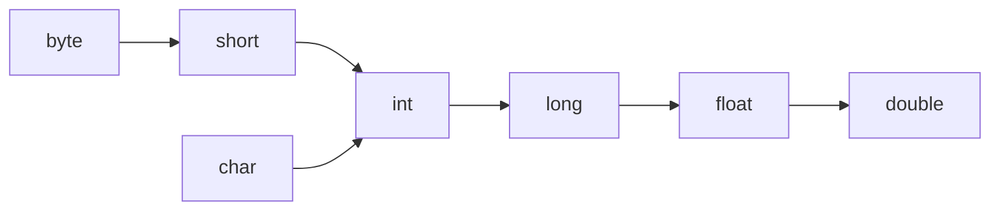
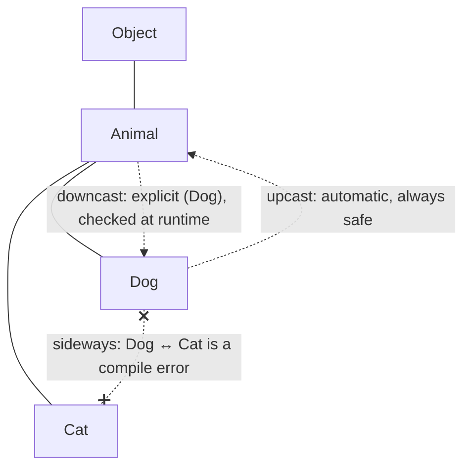
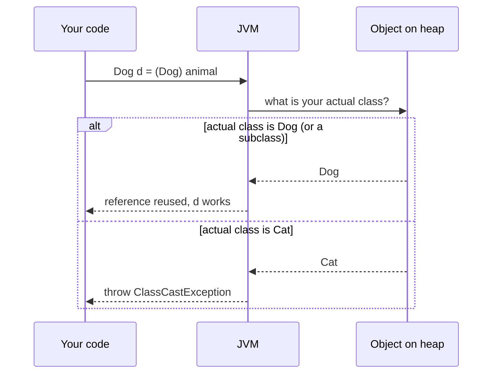
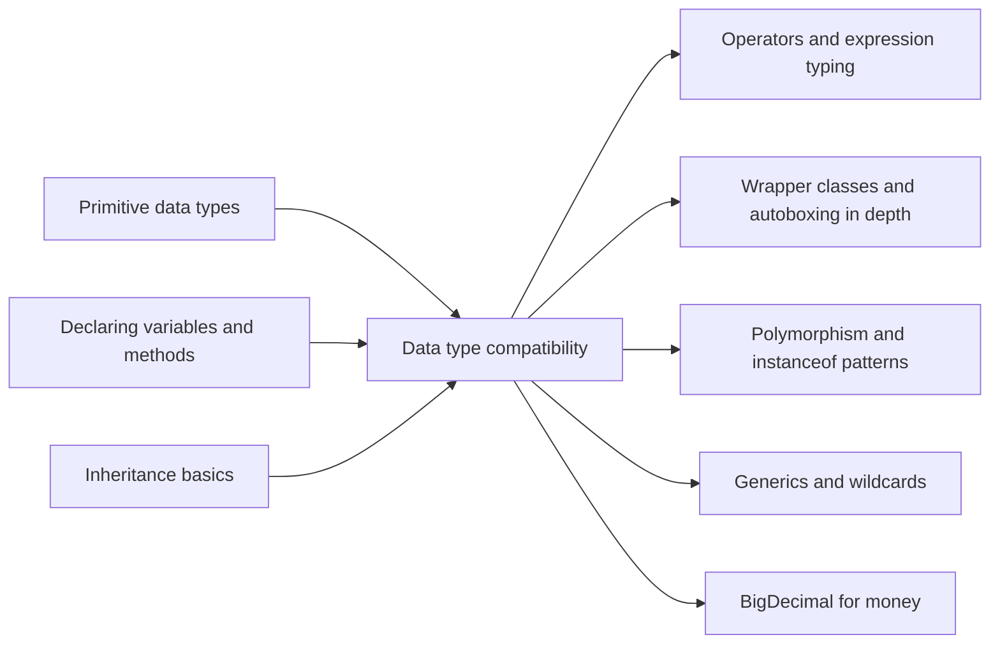

# Data Type Compatibility in Java: Conversions, Casting, Boxing

**TL;DR:** Two types are **compatible** when Java can convert a value of one into the other. Some conversions happen **automatically** (widening `int → long`, boxing `int → Integer`, upcasting `Dog → Animal`), some need an **explicit cast** and can lose data or fail at runtime (`(byte) 300`, `(Dog) animal`), and some are **never allowed** (`boolean ↔ int`, `String ↔ int` by casting). Which ones are allowed depends on the **context**: assignment, method call, return, cast, string concatenation or arithmetic.

## Table of Contents

1. [TL;DR](#1-tldr)
2. [Why it matters](#2-why-it-matters)
3. [Prerequisites](#3-prerequisites)
4. [Mental model](#4-mental-model)
5. [Core concepts](#5-core-concepts)
6. [How it works](#6-how-it-works)
7. [Examples](#7-examples)
8. [Comparisons](#8-comparisons)
9. [Trade-offs](#9-trade-offs)
10. [Gotchas](#10-gotchas)
11. [Practical application](#11-practical-application)
12. [Interview prep](#12-interview-prep)
13. [Interview question bank](#13-interview-question-bank)
14. [Tricky code snippets](#14-tricky-code-snippets)
15. [Connections](#15-connections)
16. [Summary](#16-summary)
17. [Answers](#answers)

---

## 1. TL;DR

**Type compatibility** answers one question: *can a value of type A be used where type B is expected?* Java's answer comes from a fixed list of **conversions** defined in Chapter 5 of the Java Language Specification (JLS), and a list of **contexts** that decide which conversions are allowed where.

**The analogy: plugs, sockets and adapters.**

| Plugs and sockets | Java |
|---|---|
| A small plug fits a big universal socket with no adapter | **Widening**: `int` value into a `long` variable, automatically |
| Forcing a big plug into a small socket needs an adapter, and things may get damaged | **Narrowing**: `(byte) 300` needs a cast and loses data (`44`) |
| A plug with a completely different shape: no adapter exists | **Incompatible**: `boolean` ↔ `int`, `String` ↔ `int` (cast is a compile error) |
| Putting the plug in a protective case, or taking it out | **Boxing / unboxing**: `int` ↔ `Integer` |
| Calling a Labrador "a dog": always true | **Upcasting**: `Animal a = new Dog();` |
| Assuming "this dog is a Labrador": checked when you try it | **Downcasting**: `(Dog) animal`, may throw `ClassCastException` |

**Running example:** a payment parser that reads values out of a `Map<String, Object>` (like parsed JSON), converts them, and computes a total. It hits widening, narrowing, boxing, unboxing, downcasting and a real `ClassCastException`.

---

## 2. Why it matters

**The problem.** Real programs constantly move values between types: an `int` count into a `long` total, a `double` price into whole cents, an `Object` from a JSON map into an `Integer`. Java is **strongly typed**, so it only allows moves it can reason about, and it makes you write a cast when data might be lost.

**What goes wrong when compatibility is misunderstood** (all verified on Java 21):

| Code | Result | Cause |
|---|---|---|
| `long cents = (long) (19.99 * 100);` | `1998`, not `1999` | `19.99 * 100` is `1998.9999999999998`; a cast **truncates** |
| `long l = (Long) json.get("id");` | `ClassCastException` | The value was boxed as `Integer`, and `Integer` is not a `Long` |
| `users.get(42)` on a `Map<Long, String>` | `null` | `42` boxes to `Integer`; `Integer.equals(Long)` is false |
| `int n = map.get("count");` | `NullPointerException` | Unboxing a `null` `Integer` |
| `m(10)` where `m(byte b)` | Compile error | Method calls never narrow, even constants |
| `Arrays.asList(new int[]{1,2,3}).size()` | `1` | An `int[]` is one object; primitives can't be generic type arguments |
| `true ? Integer.valueOf(1) : Double.valueOf(2)` | `1.0` | The ternary unboxes and promotes both to `double` |

**Why interviewers ask.** This is where Java's type system shows up in day-to-day bugs. Fresher rounds ask "implicit vs explicit casting" and "widening vs narrowing"; harder rounds use output puzzles about casts, boxing, ternaries and `==` across wrapper types.

---

## 3. Prerequisites

| Prerequisite | One-line refresher | Importance |
|---|---|---|
| Primitive types and ranges | `byte` −128..127, `int` ≈ ±2.1 billion, etc. ([Primitive Data Types notes]) | Essential |
| Two's complement | Integers wrap around; narrowing keeps the low bits. | Essential |
| Wrapper classes | `Integer`, `Long`, `Double`… are object versions of primitives. | Essential |
| Inheritance basics | `class Dog extends Animal`: every `Dog` is an `Animal`. | Essential |
| Variable declaration and overloading | Covered in [Declaring Variables and Methods notes]. | Nice-to-have |

---

## 4. Mental model

> **The one picture to keep in your head:** every conversion is either *safe and automatic*, *risky and explicit*, or *impossible*, and the context decides which ones Java will try for you.

**Primitive widening (automatic, arrows only go "up"):**


*Follow the arrows: any path is an automatic widening conversion. Going against the arrows needs a cast. `boolean` has no arrows at all.*

**Reference conversions:**


*Up the hierarchy is automatic; down needs a cast and may throw `ClassCastException`; across unrelated classes doesn't compile.*

**The three outcomes of any conversion:**

```
                   ┌──────────────────────────────┐
  value of type A ─┤  Is A → B a widening/upcast  ├── yes ──► AUTOMATIC (implicit)
                   │  or allowed boxing/unboxing? │
                   └──────────────┬───────────────┘
                                  no
                   ┌──────────────▼───────────────┐
                   │  Can a cast express it?      ├── yes ──► EXPLICIT CAST: (B) value
                   │  (narrowing, downcast)       │           may lose data / throw CCE
                   └──────────────┬───────────────┘
                                  no
                                  ▼
                        INCOMPATIBLE: compile error
                (boolean ↔ numeric, String ↔ int, Dog ↔ Cat)
```
*Decision tree for any "can I put an A where a B is expected?" question.*

---

## 5. Core concepts

### 5.1 Glossary

| Term | Meaning (1 line) | Tiny example |
|---|---|---|
| **Type conversion** | Changing a value from one type to another. | `int` 5 → `long` 5L |
| **Implicit conversion** (automatic, coercion) | Done by the compiler without you writing anything. | `long l = 5;` |
| **Explicit conversion** (casting) | You write `(Type)` to request it. | `int i = (int) 3.9;` |
| **Widening primitive conversion** | To a type with a larger range. Automatic. | `int → long`, `char → int` |
| **Narrowing primitive conversion** | To a type with a smaller range. Needs a cast. | `(byte) 300` → `44` |
| **Widening reference conversion (upcast)** | Subclass → superclass/interface. Automatic. | `Animal a = dog;` |
| **Narrowing reference conversion (downcast)** | Superclass → subclass. Needs a cast; checked at runtime. | `Dog d = (Dog) a;` |
| **Boxing** | Primitive → its wrapper (Java 5+). | `Integer i = 5;` |
| **Unboxing** | Wrapper → its primitive. | `int n = i;` |
| **String conversion** | Any value → `String` when concatenated with a `String`. | `"" + 5` → `"5"` |
| **Numeric promotion** | Operands widened before arithmetic (`byte + byte` → `int`). | `short + short` is `int` |
| **Compile-time constant** | An expression of literals and `final` constants, computed by the compiler. | `10`, `'a' + 1`, `final int K = 100` |
| **Lossy conversion** | One that can change the value. | `(int) 3.99` → `3` |
| **`ClassCastException`** | Runtime error when a downcast's object isn't actually that type. | `(Dog) new Cat()` |
| **`ArrayStoreException`** | Runtime error storing the wrong type into a covariant array. | `Object[] o = new String[1]; o[0] = 1;` |
| **`instanceof`** | Tests whether an object is of a type; returns `false` for `null`. | `a instanceof Dog` |
| **Pattern matching for `instanceof`** | Test and cast in one step (Java 16+). | `if (a instanceof Dog d) d.fetch();` |
| **Parsing** | Converting **text** to a number with a method, not a cast. | `Integer.parseInt("42")` |

### 5.2 Which primitive conversions are allowed?

✅ = automatic, 🔶 = needs a cast, ❌ = impossible. (Rows = from, columns = to.)

| From \ To | byte | short | char | int | long | float | double | boolean |
|---|---|---|---|---|---|---|---|---|
| **byte** | — | ✅ | 🔶 | ✅ | ✅ | ✅ | ✅ | ❌ |
| **short** | 🔶 | — | 🔶 | ✅ | ✅ | ✅ | ✅ | ❌ |
| **char** | 🔶 | 🔶 | — | ✅ | ✅ | ✅ | ✅ | ❌ |
| **int** | 🔶 | 🔶 | 🔶 | — | ✅ | ✅* | ✅ | ❌ |
| **long** | 🔶 | 🔶 | 🔶 | 🔶 | — | ✅* | ✅* | ❌ |
| **float** | 🔶 | 🔶 | 🔶 | 🔶 | 🔶 | — | ✅ | ❌ |
| **double** | 🔶 | 🔶 | 🔶 | 🔶 | 🔶 | 🔶 | — | ❌ |
| **boolean** | ❌ | ❌ | ❌ | ❌ | ❌ | ❌ | ❌ | — |

\* Automatic but can **lose precision**: `float f = 16_777_217;` gives `1.6777216E7`.

> [!NOTE]
> `char` is **unsigned** (0..65535) while `byte` and `short` are **signed**, so neither range contains the other. That's why `char ↔ short` and `byte → char` all need casts, even though `short` and `char` are both 16 bits.

### 5.3 Conversion contexts (where conversions happen)

| Context | Example | Conversions allowed |
|---|---|---|
| **Assignment** | `long l = 5;` | Identity, widening (primitive and reference), boxing (+ upcast), unboxing (+ widening), **plus constant narrowing** (see below) |
| **Return** | `return 10;` in a `byte` method | Same as assignment (verified: `static byte f() { return 10; }` compiles) |
| **Method invocation** | `m(5)` | Identity, widening; then boxing/unboxing. **No narrowing, not even for constants** |
| **Casting** | `(byte) x`, `(Dog) a` | Almost anything except `boolean ↔ numeric` and provably impossible reference casts |
| **String** | `"total: " + x` | Any type → `String` |
| **Numeric** | `a + b`, `a < b` | Promotion to `int`, `long`, `float` or `double` |

**The constant-narrowing rule (assignment and return only).** If the right side is a **compile-time constant** of type `byte`, `short`, `char` or `int`, and its value fits the target `byte`, `short` or `char`, the narrowing happens automatically:

```java
byte b = 10;           // ✅ int constant 10 fits in byte
char c = 97;           // ✅ prints 'a'
byte b2 = 'a';         // ✅ 97 fits
final int K = 100;
byte b3 = K;           // ✅ K is a constant
byte big = 128;        // ❌ doesn't fit
int i = 10;
byte b4 = i;           // ❌ i is not a constant
final long L = 10;
int x = L;             // ❌ rule doesn't cover long constants
```

It also combines with boxing for `Byte`, `Short` and `Character`: `Character ch = 97;` compiles, but `Long l = 5;` and `Integer i = 'a';` don't (Java never does **widening followed by boxing**).

### 5.4 Boxing and unboxing combinations

| Conversion | Allowed? | Example (verified) |
|---|---|---|
| Boxing to the matching wrapper | ✅ | `Integer i = 5;` |
| Boxing then upcast | ✅ | `Object o = 5;` (an `Integer`), `Number n = 3.5;` (a `Double`) |
| Unboxing then widening | ✅ | `long l = Integer.valueOf(7);` → `7` |
| **Widening then boxing** | ❌ | `Long l = 5;` → *int cannot be converted to Long* |
| Wrapper to a different wrapper | ❌ | `Long l = Integer.valueOf(5);` → *Integer cannot be converted to Long* |
| Unboxing `null` | 💥 runtime | `int n = (Integer) null;` → `NullPointerException` |

### 5.5 How narrowing casts actually compute

| Cast | Rule | Example (verified) |
|---|---|---|
| Integer → smaller integer | Keep the **low-order bits** | `(byte) 300` → `44`; `(short) 40000` → `-25536`; `(int) Long.MAX_VALUE` → `-1` |
| Floating → integer | **Truncate toward zero**, then clamp to the target's range | `(int) 3.99` → `3`; `(int) -3.99` → `-3`; `(int) 1e20` → `2147483647` |
| `NaN` → integer | `0` | `(int) Double.NaN` → `0` |
| Floating → `byte`/`short`/`char` | First to `int` (as above), then keep low bits | `(byte) 1e20` → `-1` (via `Integer.MAX_VALUE`) |
| `double` → `float` | Round to nearest; overflow becomes `Infinity` | `(float) 1e40` → `Infinity` |
| Integer → `char` | Low 16 bits, read as unsigned | `(char) -1` → `'￿'` (65535) |

---

## 6. How it works

### 6.1 How the compiler decides

For each place a value meets a type, `javac`:

1. Identifies the **context** (assignment, method call, cast…).
2. Looks for a **permitted conversion sequence** for that context, e.g. "unboxing then widening".
3. If none exists, reports `incompatible types: …` (often with *possible lossy conversion from X to Y* for numeric narrowing).
4. For casts between reference types, rejects casts that can **never** succeed (`(String) Integer.valueOf(1)`, or casting a `final` class like `String` to an interface it doesn't implement).
5. Otherwise, emits bytecode: a conversion instruction (`i2l`, `d2i`, `i2b`…), a boxing call (`Integer.valueOf`), an unboxing call (`intValue()`), or a runtime type check (`checkcast`).

### 6.2 What happens at runtime

| Conversion | Bytecode / runtime behaviour |
|---|---|
| Widening primitive | Conversion instruction (`i2l`, `i2d`…); never fails |
| Narrowing primitive | Conversion instruction (`l2i`, `d2i`, `i2b`…); never throws, may change the value |
| Boxing | Calls `Integer.valueOf(x)` (cached for −128..127) |
| Unboxing | Calls `x.intValue()`; throws `NullPointerException` if `x` is `null` |
| Upcast | Nothing at all: the reference is reused |
| Downcast | `checkcast`: throws `ClassCastException` if the object isn't that type |
| Store into array | Array store check: throws `ArrayStoreException` for a wrong element type |


*A downcast doesn't change the object; it's a runtime check that the object already is that type.*

### 6.3 Worked example: a payment parser, traced

```java
// PaymentParser.java  —  run with: javac PaymentParser.java && java PaymentParser
import java.util.*;

public class PaymentParser {
    static long toCents(int dollars) { return dollars * 100L; }   // int widened to long

    static void log(Object value) {                                 // any value boxes/upcasts to Object
        System.out.println("LOG " + value.getClass().getSimpleName() + ": " + value);
    }

    public static void main(String[] args) {
        Map<String, Object> json = new HashMap<>();   // like a parsed JSON object
        json.put("amount", 499);                      // boxed to Integer, upcast to Object
        json.put("rate", 0.18);                       // boxed to Double
        json.put("vip", true);                        // boxed to Boolean

        int dollars = (Integer) json.get("amount");   // downcast Object → Integer, then unbox
        double rate = (Double) json.get("rate");
        boolean vip = (Boolean) json.get("vip");

        long cents = toCents(dollars);                // method returns long
        long tax = Math.round(cents * rate);          // long → double, round → long
        int discount = vip ? 5000 : 0;
        long total = cents + tax - discount;          // int discount widened to long
        char grade = (char) ('A' + (total > 50000 ? 0 : 1));  // int → char narrowing
        byte flags = (byte) (vip ? 1 : 0);                    // int → byte narrowing

        log(total);   // long boxed to Long
        log(grade);   // char boxed to Character
        log(flags);   // byte boxed to Byte
        System.out.println("Total cents: " + total);

        try {
            long wrong = (Long) json.get("amount");   // it's an Integer, not a Long!
        } catch (ClassCastException e) {
            System.out.println("CCE: " + e.getMessage());
        }
    }
}
```

**Expected output** (verified):
```
LOG Long: 53882
LOG Character: A
LOG Byte: 1
Total cents: 53882
CCE: class java.lang.Integer cannot be cast to class java.lang.Long (java.lang.Integer and java.lang.Long are in module java.base of loader 'bootstrap')
```

**Trace of every conversion:**

| # | Expression | Conversion(s) | Value after | Type after |
|---|---|---|---|---|
| 1 | `json.put("amount", 499)` | boxing `int → Integer`, upcast `Integer → Object` | `499` | `Object` (really `Integer`) |
| 2 | `(Integer) json.get("amount")` | downcast `Object → Integer` (runtime check passes) | `499` | `Integer` |
| 3 | `int dollars = …` | unboxing `Integer → int` | `499` | `int` |
| 4 | `dollars * 100L` | numeric promotion `int → long` | `49900` | `long` |
| 5 | `cents * rate` | promotion `long → double` | `8982.0` | `double` |
| 6 | `Math.round(…)` | `Math.round(double)` returns `long` | `8982` | `long` |
| 7 | `cents + tax - discount` | `discount` widened `int → long` | `49900 + 8982 − 5000 = 53882` | `long` |
| 8 | `'A' + (… ? 0 : 1)` | `char` promoted to `int` | `65` | `int` |
| 9 | `(char) 65` | narrowing `int → char` | `'A'` | `char` |
| 10 | `(byte) 1` | narrowing `int → byte` | `1` | `byte` |
| 11 | `log(total)` | boxing `long → Long`, upcast to `Object` | `53882` | `Object` (really `Long`) |
| 12 | `(Long) json.get("amount")` | downcast check **fails**: the object is an `Integer` | — | `ClassCastException` |

**Things to notice:**
- Step 12 is the classic JSON bug. **Boxing preserves the original primitive type.** An `Integer` object can only be cast to `Integer`, `Number`, `Comparable` or `Object`, never to `Long`. To get a `long` safely from "some number", use `((Number) json.get("amount")).longValue()`.
- `log(grade)` printed `Character`, and `log(flags)` printed `Byte`: boxing picks the wrapper of the **static type** of the expression.

---

## 7. Examples

### 7.1 Toy example: one line per conversion kind

```java
public class Conversions {
    public static void main(String[] args) {
        byte b = 10; short s = b; int i = s; long l = i; float f = l; double d = f;  // widening chain
        System.out.println(s + " " + i + " " + l + " " + f + " " + d);

        System.out.println((byte) 300 + " " + (int) 3.99 + " " + (char) 65.7);     // narrowing
        Integer boxed = 7; long fromBox = boxed;                                     // boxing, unboxing + widening
        System.out.println(boxed + " " + fromBox);
        System.out.println("" + 1 + 2 + " vs " + (1 + 2));                           // string conversion
        System.out.println(Integer.parseInt("42") + 1);                              // parsing, not casting
    }
}
```
**Expected output:**
```
10 10 10 10.0 10.0
44 3 A
7 7
12 vs 3
43
```

### 7.2 Real-world examples

| System | Compatibility issue | What people do |
|---|---|---|
| **JSON libraries (e.g. Jackson) reading into `Map<String, Object>`** | ⚠️ By default a JSON whole number becomes an `Integer` if it fits, otherwise a `Long` (or `BigInteger`). Code that casts `(Long) map.get("id")` works for big IDs and throws `ClassCastException` for small ones. | Cast to `Number` and call `.longValue()`, or bind JSON to typed classes instead of `Map<String, Object>`. |
| **JDBC `ResultSet.getInt(...)`** | Returns a primitive `int`, so a SQL `NULL` comes back as `0`. | Call `wasNull()` afterwards, or use `getObject(col, Integer.class)` to keep `null`. |
| **Money from user input** | `(long) (19.99 * 100)` is `1998` because the `double` is `1998.9999999999998`. | Parse to `BigDecimal` from the string, or at least use `Math.round`. |
| **Ariane 5 rocket, 1996** (not Java, same concept) | A 64-bit floating value was converted to a 16-bit signed integer that couldn't hold it; the overflow led to the loss of the rocket. | The textbook reason to treat narrowing conversions as dangerous and check ranges (`Math.toIntExact`). |
| **`List<Integer>.remove(...)`** (JDK) | `list.remove(1)` calls `remove(int index)`, not `remove(Object)`, because no boxing is needed. | Write `list.remove(Integer.valueOf(1))` to remove by value. |

---

## 8. Comparisons

### 8.1 Implicit vs explicit conversion

| | Implicit (automatic) | Explicit (cast) |
|---|---|---|
| Who does it | Compiler | You, with `(Type)` |
| Data loss | Never, except precision for `int/long → float`, `long → double` | Possible |
| Primitive examples | `int → long`, `char → int`, `float → double` | `long → int`, `double → int`, `int → char` |
| Reference examples | `Dog → Animal` (upcast) | `Animal → Dog` (downcast) |
| Can fail at runtime? | No | Downcasts can (`ClassCastException`); primitive casts never throw |

### 8.2 Upcasting vs downcasting

| | Upcasting | Downcasting |
|---|---|---|
| Direction | Subclass → superclass/interface | Superclass → subclass |
| Syntax | Automatic: `Animal a = new Dog();` | Explicit: `Dog d = (Dog) a;` |
| Safe? | Always | Only if the object really is that type |
| What you lose/gain | Lose access to subclass-only methods (`a.fetch()` doesn't compile) | Regain them |
| Overridden methods | Still run the subclass version (`a.sound()` → `"Woof"`) | Same |
| Check first with | — | `instanceof` / pattern matching |

### 8.3 Casting vs parsing vs converting methods

| Goal | Wrong | Right |
|---|---|---|
| `String` → `int` | `(int) "42"` (compile error) | `Integer.parseInt("42")` |
| `int` → `String` | `(String) 42` (compile error) | `String.valueOf(42)`, `Integer.toString(42)`, `"" + 42` |
| `Integer` → `Long` | `(Long) integerObj` (compile error) | `integerObj.longValue()` or `Long.valueOf(integerObj)` |
| Any `Number` → `long` | Guessing the wrapper type | `((Number) obj).longValue()` |
| `double` → nearest `long` | `(long) d` (truncates) | `Math.round(d)` |
| `long` → `int` safely | `(int) l` (silently wraps) | `Math.toIntExact(l)` (throws on overflow) |

### 8.4 `==` vs `equals` across numeric types

| Expression (verified) | Result | Why |
|---|---|---|
| `Integer i = 1; i.equals(1)` | `true` | `1` boxes to `Integer` |
| `i.equals(1L)` | `false` | `1L` boxes to `Long`: different class |
| `Long l = 1L; l == 1` | `true` | `l` unboxes, numeric comparison |
| `i == l` (`Integer` vs `Long`) | Compile error: *incomparable types* | Unrelated reference types |
| `0.1f == 0.1` | `false` | `float` 0.1 widened to `double` is `0.10000000149011612` |
| `0.5f == 0.5` | `true` | 0.5 is exact in binary |
| `new BigDecimal("2.0").equals(new BigDecimal("2.00"))` | `false` | `equals` compares scale too; use `compareTo` (returns `0`) |

**Use implicit conversion when…** going to a wider type: just assign.
**Use a cast when…** you've checked the value fits (or truncation is intended), or after an `instanceof` check for references.
**Use parse/convert methods when…** the source is text, or a different wrapper type.

---

## 9. Trade-offs

| Design choice in Java | Benefit | Cost |
|---|---|---|
| **Narrowing requires an explicit cast** | Forces you to notice possible data loss | Casts don't *check* anything: `(int) 3_000_000_000L` silently gives `-1294967296`. Use `Math.toIntExact` to get an exception. |
| **`int/long → float` and `long → double` are automatic** | Mixed arithmetic is convenient | Silent precision loss: `float f = 16_777_217;` is `1.6777216E7`; integers above 2⁵³ aren't exact in `double`. |
| **Autoboxing** (Java 5) | Primitives work with collections and generics | Hidden allocations; `NullPointerException` on unboxing; `==` compares references; boxing picks the static type's wrapper (`Integer` vs `Long` mismatches). |
| **No widening-then-boxing** | Keeps overload resolution predictable | `Long l = 5;` and `m(5)` for `m(Long)` don't compile; you need `5L`. |
| **Array covariance** (`String[]` is an `Object[]`) | Methods like `Arrays.sort(Object[])` work on any array | Runtime `ArrayStoreException`; type errors move from compile time to runtime. |
| **Generic invariance** (`List<String>` is not a `List<Object>`) | Type safety at compile time | Needs wildcards (`List<? extends Number>`) for flexible APIs. |
| **`boolean` incompatible with numbers** | Prevents C's `if (x = 0)` bug class | `if (count)` must be written `if (count != 0)`. |
| **Downcasts checked at runtime** | Memory safety: you can never treat a `Cat` as a `Dog` | A failed check is a runtime crash; prefer designs that don't need downcasts (polymorphism, typed data). |

---

## 10. Gotchas

### Myths

| ❌ Myth | ✅ Reality |
|---|---|
| Casting a `double` rounds it. | It **truncates toward zero**: `(int) 3.99` → `3`, `(int) -3.99` → `-3`. Use `Math.round`. |
| A cast checks that the value fits. | Primitive casts never fail; they silently keep low bits: `(byte) 300` → `44`. |
| `char` and `short` are interchangeable (both 16 bits). | `char` is unsigned, `short` is signed: both directions need a cast. |
| `byte b = 10;` proves int → byte is automatic. | Only for **constants that fit**, in assignment/return. `byte b = i;` and `m(10)` for `m(byte)` fail. |
| `Long l = 5;` compiles. | No: Java won't widen then box. Write `5L`. |
| `Integer` can be cast to `Long`. | Different classes. `(Long) integerObj` won't compile; from `Object` it throws `ClassCastException`. |
| Widening is always lossless. | `int → float`, `long → float` and `long → double` can lose precision. |
| A downcast converts the object. | It only checks the type and changes how you're allowed to use the reference. The object is untouched. |
| `(String) 42` turns a number into text. | Compile error. Use `String.valueOf(42)`. |
| `instanceof` throws on `null`. | It returns `false`. |
| Since `String[]` is an `Object[]`, `List<String>` is a `List<Object>`. | Arrays are covariant; generics are invariant. |
| `int[]` is an `Object[]`. | `int[]` is an `Object`, but **not** an `Object[]`. |

### Common mistakes and edge cases

**1. Integer division before widening.**
```java
double avg = 7 / 2;            // 3.0  — int division happens first
double avg2 = 7 / 2.0;         // 3.5
double avg3 = (double) 7 / 2;  // 3.5  — cast binds to 7 before dividing
double avg4 = (double) (7 / 2);// 3.0  — cast applied to the already-truncated result
```

**2. Overflow before widening.**
```java
long micros = 24 * 60 * 60 * 1000 * 1000;   // 500654080  (computed in int, then widened)
long ok     = 24L * 60 * 60 * 1000 * 1000;  // 86400000000
```

**3. Compound assignment hides a narrowing cast.**
```java
short s = 1;  s += 70000;  // 4465   (70001 wrapped into a short)
char c = 'a'; c += 1.7;    // 'b'    (97 + 1.7 = 98.7, cast to char 98)
int i = 10;   i *= 2.5;    // 25
byte b = 127; b++;         // -128
// but: s = s + 1;  → compile error: possible lossy conversion from int to short
```

**4. The ternary operator converts both branches to one type.**
```java
Object o = true ? Integer.valueOf(1) : Double.valueOf(2);  // 1.0  (unboxed, promoted to double, reboxed)
Integer x = null;
Integer y = flag ? x : 0;                                  // NullPointerException: x is unboxed because 0 is an int
```

**5. Boxing picks the wrapper of the expression's type.**
```java
Set<Short> set = new HashSet<>();
for (short i = 0; i < 100; i++) {
    set.add(i);          // boxes to Short
    set.remove(i - 1);   // i - 1 is an int → boxes to Integer → never matches a Short
}
System.out.println(set.size());   // 100, not 1
```

**6. Primitive arrays aren't generic-friendly.**
```java
int[] nums = {1, 2, 3};
Arrays.asList(nums).size();   // 1  — a List<int[]> holding one array
Integer[] boxed = {1, 2, 3};
Arrays.asList(boxed).size();  // 3
```

**7. Array indexes and sizes must be `int` (or narrower).** `arr[5L]` and `new int[n]` with a `long n` don't compile; `counts['a']++` does (`char` widens to `int`).

**8. Raw types defer the `ClassCastException`.** Adding a `String` through a raw `List` into a `List<Integer>` compiles with a warning and runs; the exception appears only when you read the element.

---

## 11. Practical application

### Safe-conversion checklist
- [ ] Widen **before** arithmetic that might overflow (`24L * …`, `(long) a * b`)
- [ ] Use `Math.toIntExact` / `Math.multiplyExact` instead of a bare narrowing cast where overflow would be a bug
- [ ] Use `Math.round` for rounding; a cast truncates
- [ ] Never `==` two wrappers; never compare wrappers of different types with `equals`
- [ ] Check for `null` before unboxing (`map.get`, JDBC, JSON)
- [ ] For unknown numeric objects, cast to `Number` and call `longValue()` / `doubleValue()`
- [ ] Use `instanceof` pattern matching before downcasting
- [ ] Parse text with `Integer.parseInt`, `Long.parseLong`, `new BigDecimal(String)`; handle `NumberFormatException`
- [ ] Use `5L`, `2.5f`, `(byte) x` deliberately; let literal suffixes match the target type
- [ ] Avoid raw types and covariant array writes

### Safe downcasting with pattern matching (Java 16+)

```java
Object o = 42;
String description = switch (o) {          // pattern-matching switch, Java 21
    case Integer i when i > 40 -> "big int " + i;
    case Integer i             -> "int " + i;
    case String s              -> "string " + s;
    default                    -> "other";
};
System.out.println(description);           // big int 42
```

### Hands-on exercise: fix the conversions

This method should convert a price string like `"19.99"` and a quantity into **total cents**, and look up a customer by ID. It has three conversion bugs.

```java
import java.util.*;

public class Fixer {
    static Map<Long, String> customers = new HashMap<>(Map.of(42L, "Asha"));

    static long totalCents(String price, int qty) {
        double p = Double.parseDouble(price);
        return (long) (p * 100) * qty;
    }

    static String customerName(int id) {
        return customers.get(id);
    }

    public static void main(String[] args) {
        System.out.println(totalCents("19.99", 3));   // should be 5997
        System.out.println(customerName(42));         // should be Asha
        int big = 2_000_000_000;
        long doubled = big * 2;                        // should be 4000000000
        System.out.println(doubled);
    }
}
```

**Expected outcome:** current output is `5994`, `null`, `-294967296`. After fixing, it prints `5997`, `Asha`, `4000000000`.

<details><summary>Answer</summary>

1. **Truncating cast:** `19.99 * 100` is `1998.9999999999998`, so `(long)` gives `1998` and the total is `5994`. Fix with exact decimal arithmetic or rounding:
   ```java
   static long totalCents(String price, int qty) {
       return new java.math.BigDecimal(price).movePointRight(2).longValueExact() * qty;
   }
   ```
   (`Math.round(p * 100) * qty` also works for typical prices.)
2. **Wrong wrapper type:** `customers.get(id)` boxes `id` to `Integer`, which never equals a `Long` key, so it returns `null`. Fix: `customers.get((long) id)` (boxes to `Long`), or make the parameter `long`.
3. **Overflow before widening:** `big * 2` is computed in `int` and wraps. Fix: `long doubled = big * 2L;` or `(long) big * 2`.

All three fixes were verified to produce `5997`, `Asha`, `4000000000`.
</details>

---

## 12. Interview prep

### Likely questions with model answers

**Q1. What is type casting? Explain implicit vs explicit casting.**
> "Type casting is converting a value from one type to another. Implicit casting, or widening, happens automatically when the target type can hold every value of the source, like `int` to `long`, `char` to `int`, or `Dog` to `Animal`. Explicit casting, written `(type) value`, is required when data might be lost, like `long` to `int`, `double` to `int`, or `Animal` to `Dog`. Primitive narrowing casts never throw; they just truncate or keep the low bits, so `(byte) 300` is `44`. Reference downcasts are checked at runtime and throw `ClassCastException` if the object isn't really that type."

- *Follow-ups:* Is `int` to `float` lossless? (No, precision.) What is `(int) -3.99`? (`-3`.)
- *Red flags:* "Casting rounds"; "a cast validates the range".

**Q2. Why does `byte b = 10;` compile when `int i = 10; byte b = i;` doesn't?**
> "Because of the constant-narrowing rule in assignment contexts. If the right-hand side is a compile-time constant of type `int`, `short`, `char` or `byte`, and its value fits in the target `byte`, `short` or `char`, Java narrows it automatically. `10` is a constant that fits; `i` is a variable, so the compiler can't prove it fits and demands a cast. The rule doesn't apply to method arguments, so `m(10)` for `m(byte)` fails, and it doesn't apply to `long` constants."

**Q3. What are autoboxing and unboxing? What can go wrong?**
> "Autoboxing, since Java 5, automatically converts a primitive to its wrapper, like `int` to `Integer`, using `Integer.valueOf`; unboxing calls `intValue()` the other way. Problems: unboxing `null` throws `NullPointerException`, for example `int n = map.get(key)`; `==` on wrappers compares references, and only −128 to 127 are cached; boxing uses the wrapper of the expression's exact type, so an `int` key never matches a `Long` in a `Map<Long, …>`; and Java won't widen then box, so `Long l = 5;` doesn't compile. In loops, boxing also creates garbage."

**Q4. What is upcasting and downcasting?**
> "Upcasting treats a subclass object as its superclass type, like `Animal a = new Dog();`. It's automatic and always safe, though you can only call `Animal` methods; overridden ones still run the `Dog` version. Downcasting goes back: `Dog d = (Dog) a;`. It needs an explicit cast and the JVM checks it at runtime, throwing `ClassCastException` if the object is actually a `Cat`. You guard it with `instanceof`, ideally with pattern matching: `if (a instanceof Dog d) d.fetch();`. A cast between unrelated classes, like `Dog` to `Cat`, doesn't even compile."

**Q5. Can you cast a `String` to an `int`?**
> "No. They're unrelated types, so `(int) \"42\"` is a compile error. Converting text to a number is parsing: `Integer.parseInt(\"42\")` or `Integer.valueOf`, which throw `NumberFormatException` for invalid input like `\"4.2\"` or `\" 42\"`. The other direction uses `String.valueOf(42)`, `Integer.toString(42)` or concatenation."

**Q6. Why is `0.1f == 0.1` false?**
> "In the comparison, the `float` is widened to `double`. But `0.1f` was already rounded to the nearest float, which as a double is `0.10000000149011612`, while the `double` literal `0.1` is a closer approximation. Different values, so `false`. Values exactly representable in binary, like `0.5`, compare equal. Avoid comparing floating values of different precision, and compare with a tolerance."

**Q7. What does `true ? Integer.valueOf(1) : Double.valueOf(2)` evaluate to?**
> "`1.0`, as a `Double`. When both branches of a ternary are convertible to numeric types, Java applies numeric promotion: it unboxes both, promotes the `int` to `double`, and the result is a `double`, which gets boxed if assigned to `Object`. The same rule causes a `NullPointerException` in `flag ? nullInteger : 0`, because the `Integer` branch is unboxed to match the `int`."

**Q8. Why can't you assign a `List<String>` to a `List<Object>`, when a `String[]` can go into an `Object[]`?**
> "Arrays are covariant: `String[]` is a subtype of `Object[]`. That's unsafe, so the JVM checks every array store at runtime and throws `ArrayStoreException` if you put an `Integer` into what is really a `String[]`. Generics were designed later to be invariant, so the compiler simply forbids `List<Object> objs = strings;`; otherwise you could add an `Integer` to a list of strings with no runtime check, because of type erasure. For flexibility you use wildcards: `List<? extends Number>` to read, `List<? super Integer>` to write."

### What interviewers watch for
- Correct **direction** vocabulary: widening/narrowing, upcast/downcast.
- Knowing that primitive casts **truncate or wrap silently**, and only downcasts throw.
- The constant-narrowing rule and its limits.
- Boxing traps: `null`, `==`, wrapper-type mismatch (`Integer` vs `Long`).
- Safe alternatives: `Math.toIntExact`, `Math.round`, `Number.longValue()`, `instanceof` patterns, `BigDecimal`.

---

## 13. Interview question bank

Short answers are hidden. 🟢 fresher, 🟡 intermediate, 🔴 senior/FAANG follow-up.

### 13.1 Basics

**1. 🟢 What is type conversion? What is type casting?**
<details><summary>Answer</summary>

Conversion = changing a value's type (automatic or explicit). Casting = explicit conversion written `(Type) value`. People often use "implicit casting" for automatic conversion.
</details>

**2. 🟢 What is widening (implicit) conversion? Give examples.**
<details><summary>Answer</summary>

Converting to a type that can hold all source values; done automatically. `byte → short → int → long → float → double`, `char → int`.
</details>

**3. 🟢 What is narrowing (explicit) conversion? Give examples.**
<details><summary>Answer</summary>

Converting to a smaller range; needs a cast. `long → int`, `double → int`, `int → char`. May lose data.
</details>

**4. 🟢 What is the order of automatic widening for primitives?**
<details><summary>Answer</summary>

`byte → short → int → long → float → double`, and `char → int`.
</details>

**5. 🟢 Can you convert `boolean` to `int` in Java?**
<details><summary>Answer</summary>

No, not even with a cast (*boolean cannot be converted to int*). Use `b ? 1 : 0`.
</details>

**6. 🟢 What happens when you cast a `double` to an `int`?**
<details><summary>Answer</summary>

The fraction is truncated toward zero: `(int) 3.99` → `3`, `(int) -3.99` → `-3`. Out-of-range values clamp (`(int) 1e20` → `2147483647`); `NaN` → `0`.
</details>

**7. 🟢 What is `(byte) 200`? `(byte) 300`?**
<details><summary>Answer</summary>

`-56` and `44`. Only the low 8 bits are kept (200 − 256; 300 − 256).
</details>

**8. 🟢 What is autoboxing? Unboxing?**
<details><summary>Answer</summary>

Automatic primitive → wrapper (`Integer i = 5;`) and wrapper → primitive (`int n = i;`), since Java 5.
</details>

**9. 🟢 How do you convert a `String` to an `int` and back?**
<details><summary>Answer</summary>

`Integer.parseInt("42")` / `Integer.valueOf("42")`; back with `String.valueOf(42)`, `Integer.toString(42)` or `"" + 42`.
</details>

**10. 🟢 What is upcasting? Downcasting?**
<details><summary>Answer</summary>

Upcasting: subclass → superclass reference, automatic. Downcasting: superclass → subclass reference, explicit, checked at runtime.
</details>

### 13.2 Primitive rules

**11. 🟡 Why does `float f = 3.14;` fail but `float f = 3;` work?**
<details><summary>Answer</summary>

`3.14` is a `double` literal; `double → float` is narrowing. `3` is an `int`; `int → float` is widening. (`float f = 1L;` and `float f = 'a';` also compile.)
</details>

**12. 🟡 Is `int → float` lossless?**
<details><summary>Answer</summary>

No. `float` has 24 bits of precision; `float f = 16_777_217;` prints `1.6777216E7`. Same for `long → float` and `long → double` (above 2⁵³).
</details>

**13. 🟡 Why do `char ↔ short` conversions need casts when both are 16 bits?**
<details><summary>Answer</summary>

`char` is unsigned (0..65535), `short` is signed (−32768..32767); neither range contains the other.
</details>

**14. 🟡 Why does `byte b = 10;` compile but `byte b = i;` doesn't?**
<details><summary>Answer</summary>

Constant narrowing in assignment: a compile-time constant that fits is narrowed automatically. A variable isn't a constant.
</details>

**15. 🟡 Does the constant rule apply to method arguments?**
<details><summary>Answer</summary>

No. `m(10)` for `m(byte b)` fails; write `m((byte) 10)`. It does apply to `return` statements (`byte f() { return 10; }` compiles).
</details>

**16. 🟡 Why does `short s = 1; s = s + 1;` fail but `s += 1;` compile?**
<details><summary>Answer</summary>

`s + 1` is promoted to `int`; assigning it back needs a cast. Compound assignment includes an implicit cast: `s = (short) (s + 1)`.
</details>

**17. 🟡 What is `(char) -1`? What is `(int) (char) -1`?**
<details><summary>Answer</summary>

`'￿'`; as an `int`, `65535`. The low 16 bits are read as unsigned.
</details>

**18. 🟡 What does `double avg = 7 / 2;` store?**
<details><summary>Answer</summary>

`3.0`. Integer division happens before widening. Use `7 / 2.0` or `(double) 7 / 2`.
</details>

**19. 🔴 Why is `long micros = 24 * 60 * 60 * 1000 * 1000;` wrong?**
<details><summary>Answer</summary>

All operands are `int`, so the product overflows to `500654080` before being widened. Write `24L * …`.
</details>

**20. 🔴 How do you safely convert a `long` to an `int`?**
<details><summary>Answer</summary>

`Math.toIntExact(l)`: throws `ArithmeticException: integer overflow` instead of silently wrapping (`(int) 3_000_000_000L` → `-1294967296`).
</details>

**21. 🔴 How do you read a `byte` as an unsigned value 0..255?**
<details><summary>Answer</summary>

`b & 0xFF` or `Byte.toUnsignedInt(b)`. For `(byte) 200`: `b` prints `-56`, both expressions give `200`.
</details>

### 13.3 Boxing and wrappers

**22. 🟡 Does `Long l = 5;` compile?**
<details><summary>Answer</summary>

No: *int cannot be converted to Long*. Java never widens then boxes. Use `5L`.
</details>

**23. 🟡 Does `long l = Integer.valueOf(7);` compile?**
<details><summary>Answer</summary>

Yes: unboxing then widening is allowed. Result `7`.
</details>

**24. 🟡 Can you assign an `Integer` to a `Long` variable?**
<details><summary>Answer</summary>

No: *Integer cannot be converted to Long*. Use `integer.longValue()` or `Long.valueOf(integer)`.
</details>

**25. 🟡 What happens when you unbox `null`?**
<details><summary>Answer</summary>

`NullPointerException`. Common sources: `int n = map.get(key);`, a `null` `Integer` field, a ternary with mixed `Integer`/`int` branches.
</details>

**26. 🟡 What does `Integer.valueOf(1).equals(1L)` return?**
<details><summary>Answer</summary>

`false`. `1L` boxes to `Long`; `Integer.equals` requires an `Integer`.
</details>

**27. 🔴 A `Map<Long, String>` has key `42L`. Why does `map.get(42)` return `null`?**
<details><summary>Answer</summary>

`get(Object)` accepts anything, so `42` boxes to `Integer`, which isn't equal to the `Long` key. Use `map.get(42L)`.
</details>

**28. 🔴 Does `Integer i = 1; Long l = 1L; i == l` compile?**
<details><summary>Answer</summary>

No: *incomparable types: Integer and Long*. But `l == 1` compiles (unboxes) and is `true`.
</details>

**29. 🔴 Why does `Character c = 97;` compile but `Integer i = 'a';` doesn't?**
<details><summary>Answer</summary>

Assignment allows "constant narrowing then boxing" for `Byte`, `Short` and `Character` (97 → `char` → `Character`). `Integer i = 'a'` would need widening then boxing, which is never allowed.
</details>

### 13.4 References, arrays and generics

**30. 🟡 When does `ClassCastException` occur?**
<details><summary>Answer</summary>

When a downcast's object isn't an instance of the target type at runtime, e.g. `(Dog) new Cat()` via an `Animal` reference, or `(Long)` on an `Integer` stored as `Object`.
</details>

**31. 🟡 How do you avoid `ClassCastException`?**
<details><summary>Answer</summary>

Check with `instanceof` first (Java 16+: `if (o instanceof Dog d)`), use generics instead of `Object`, and prefer polymorphism over downcasting.
</details>

**32. 🟡 What does `null instanceof Animal` return?**
<details><summary>Answer</summary>

`false`.
</details>

**33. 🟡 Can you cast between unrelated classes, like `Integer` to `String`?**
<details><summary>Answer</summary>

No: compile error (*Integer cannot be converted to String*). Going through `Object`, `(String) (Object) i` compiles but throws `ClassCastException`.
</details>

**34. 🔴 Why does `(Runnable) new Plain()` compile (`Plain` doesn't implement `Runnable`) while `(Runnable) "hi"` doesn't?**
<details><summary>Answer</summary>

A non-final class might have a subclass that implements `Runnable`, so the cast could succeed at runtime (it throws CCE here). `String` is `final` and doesn't implement `Runnable`, so the cast can never succeed: compile error.
</details>

**35. 🔴 What is array covariance? What exception can it cause?**
<details><summary>Answer</summary>

`String[]` is a subtype of `Object[]`. Storing a wrong type through the `Object[]` reference throws `ArrayStoreException` at runtime.
</details>

**36. 🔴 Why isn't `List<String>` a `List<Object>`?**
<details><summary>Answer</summary>

Generics are invariant. If it were allowed, you could add an `Integer` to a list of strings, and erasure means no runtime check would catch it. Use `List<? extends Object>` / `List<?>` to read.
</details>

**37. 🔴 Is `int[]` an `Object`? An `Object[]`? Can it go into a `long[]`?**
<details><summary>Answer</summary>

It's an `Object` (verified class name `int[]`), but not an `Object[]`, and not a `long[]`. Primitive arrays don't convert element by element.
</details>

**38. 🔴 Why does `Arrays.asList(new int[]{1, 2, 3}).size()` return 1?**
<details><summary>Answer</summary>

Generics can't hold primitives, so `T` becomes `int[]` and you get a `List<int[]>` with one element. Use `Integer[]`, or `IntStream.of(…).boxed().toList()`.
</details>

### 13.5 Expressions, ternary and strings

**39. 🟡 What does `"" + 1 + 2` vs `1 + 2 + ""` give?**
<details><summary>Answer</summary>

`"12"` and `"3"`. Evaluation is left to right; once one operand is a `String`, `+` concatenates.
</details>

**40. 🟡 What does `'a' + 'b' + "c"` give?**
<details><summary>Answer</summary>

`"195c"`: `'a' + 'b'` is `int` 195 first. `"c" + 'a' + 'b'` gives `"cab"`.
</details>

**41. 🔴 What does `true ? 'a' : 0` print? And `true ? 'a' : i` with `int i = 0`?**
<details><summary>Answer</summary>

`a` and `97`. If one branch is `char` and the other an `int` **constant** that fits in `char`, the result is `char`. With an `int` variable, it's `int`.
</details>

**42. 🔴 What is the result type of `true ? Integer.valueOf(1) : Double.valueOf(2)`?**
<details><summary>Answer</summary>

`double` (prints `1.0`). Both are unboxed and numeric promotion applies. Cast one branch to `Object` to keep `1`.
</details>

**43. 🔴 Why does `Integer y = flag ? x : 0;` throw NPE when `x` is a `null` `Integer`?**
<details><summary>Answer</summary>

One branch is `int`, so the result type is `int`; `x` is unboxed (NPE) before reboxing to `Integer`.
</details>

**44. 🔴 What does `Math.round` return for `double` vs `float`?**
<details><summary>Answer</summary>

`long` for `double`, `int` for `float` (verified). Also `Math.round(-2.5)` is `-2` (rounds half up).
</details>

**45. 🔴 Why is `switch` on a `long` not allowed?**
<details><summary>Answer</summary>

Classic `switch` supports `char`, `byte`, `short`, `int`, their wrappers, `String` and enums (plus patterns in Java 21). `long` is not allowed: *selector type long is not allowed* (verified on 21; ⚠️ primitive patterns are previewed in later versions).
</details>

**46. 🔴 Why is `a - b` a buggy comparator for `int`s?**
<details><summary>Answer</summary>

It can overflow: `Integer.MIN_VALUE - 1` is `2147483647` (positive), reversing the order. Use `Integer.compare(a, b)`.
</details>

---

## 14. Tricky code snippets

All compiled and run on OpenJDK 21. Predict first.

**Snippet 1 🟢**
```java
System.out.println((byte) 300);
System.out.println((short) 40000);
System.out.println((int) Long.MAX_VALUE);
```
<details><summary>Answer</summary>

```
44
-25536
-1
```
Integer narrowing keeps the low bits: 300 − 256; 40000 − 65536; `Long.MAX_VALUE` is `0x7FFF…FFFF`, whose low 32 bits are all 1s (`-1`).
</details>

**Snippet 2 🟡**
```java
System.out.println((int) 1e20);
System.out.println((long) 1e30);
System.out.println((int) Double.NaN);
System.out.println((int) Float.POSITIVE_INFINITY);
System.out.println((byte) 1e20);
```
<details><summary>Answer</summary>

```
2147483647
9223372036854775807
0
2147483647
-1
```
Floating → `int`/`long` clamps to the range; `NaN` → `0`. For `byte`, Java first goes to `int` (`MAX_VALUE`), then keeps the low 8 bits (`0xFF` → `-1`).
</details>

**Snippet 3 🟢**
```java
System.out.println((char) 65.7);
System.out.println((int) (char) -1);
System.out.println((short) 'A');
```
<details><summary>Answer</summary>

```
A
65535
65
```
</details>

**Snippet 4 🟡**
```java
int big = 16_777_217;
float f = big;
System.out.println(f);
System.out.println((int) f);
```
<details><summary>Answer</summary>

```
1.6777216E7
16777216
```
Automatic widening, but `float` can't represent 2²⁴ + 1; the value changed.
</details>

**Snippet 5 🟡** Which lines compile?
```java
short s = 65;  char c = s;     // (a)
char c2 = 'A'; short s2 = c2;  // (b)
byte b = 65;   char c3 = b;    // (c)
```
<details><summary>Answer</summary>

None. All three: *possible lossy conversion* (short→char, char→short, byte→char). Signed/unsigned ranges don't nest.
</details>

**Snippet 6 🟡**
```java
byte b = 10;
short s = 1000;
char c = 97;
byte b2 = 'a';
final int K = 100;
byte b3 = K;
System.out.println(b + " " + s + " " + c + " " + b2 + " " + b3);
```
<details><summary>Answer</summary>

Compiles; prints `10 1000 a 97 100`. All right-hand sides are constants that fit.
</details>

**Snippet 7 🟡** Which compile?
```java
byte a = 128;               // (a)
int i = 10; byte b = i;     // (b)
final long L = 10; int x = L; // (c)
char c = -1;                // (d)
```
<details><summary>Answer</summary>

None. (a) doesn't fit; (b) not a constant; (c) the constant rule excludes `long`; (d) `char` can't hold −1.
</details>

**Snippet 8 🔴**
```java
static void m(byte b) { System.out.println("byte " + b); }
static byte f() { return 10; }
// in main:
m(10);
System.out.println(f());
```
<details><summary>Answer</summary>

`m(10)` doesn't compile: *possible lossy conversion from int to byte* (method arguments never narrow). `f()` alone is fine and prints `10`: `return` uses assignment rules.
</details>

**Snippet 9 🟢**
```java
float a = 1;
float b = 1L;
float c = 'a';
System.out.println(a + " " + b + " " + c);
// float d = 1.0;
```
<details><summary>Answer</summary>

`1.0 1.0 97.0`. The commented line wouldn't compile (`double → float`).
</details>

**Snippet 10 🟢**
```java
boolean b = 0;
int i = (int) true;
int x = 1; if (x) { }
```
<details><summary>Answer</summary>

Three compile errors: *int cannot be converted to boolean*, *boolean cannot be converted to int*, *int cannot be converted to boolean*.
</details>

**Snippet 11 🟡**
```java
Integer i = 5;
Byte b = 10;
Character c = 97;
Short s = 'a';
Object o = 5;
Number n = 3.5;
System.out.println(i + " " + b + " " + c + " " + s + " " + o.getClass().getSimpleName() + " " + n.getClass().getSimpleName());
```
<details><summary>Answer</summary>

`5 10 a 97 Integer Double`. Constant narrowing + boxing works for `Byte`, `Character`, `Short`; boxing + upcast for `Object` and `Number`.
</details>

**Snippet 12 🔴** Which compile? (a) `Long l = 5;` (b) `Double d = 5;` (c) `Integer i = 'a';` (d) `Integer i = 5; Long l = i;`
<details><summary>Answer</summary>

None. (a) *int cannot be converted to Long* (b) *int cannot be converted to Double* (c) *char cannot be converted to Integer* (d) *Integer cannot be converted to Long*. Java never widens then boxes, and wrappers don't convert to each other.
</details>

**Snippet 13 🟡**
```java
Integer boxed = 7;
long l = boxed;
double d = boxed;
Character ch = 'x';
int code = ch;
System.out.println(l + " " + d + " " + code);
```
<details><summary>Answer</summary>

`7 7.0 120`. Unboxing followed by widening is allowed.
</details>

**Snippet 14 🟡**
```java
Integer count = null;
int n = count;
```
<details><summary>Answer</summary>

Compiles, then `NullPointerException` at runtime (unboxing calls `count.intValue()`).
</details>

**Snippet 15 🔴**
```java
Integer i = 1;
Long l = 1L;
System.out.println(i.equals(1));
System.out.println(i.equals(1L));
System.out.println(l.equals(1));
System.out.println(l == 1);
System.out.println(i.longValue() == l);
```
<details><summary>Answer</summary>

```
true
false
false
true
true
```
`equals` requires the same wrapper class. `l == 1` and `i.longValue() == l` unbox and compare numbers. (`i == l` wouldn't compile: *incomparable types*.)
</details>

**Snippet 16 🔴**
```java
Map<Long, String> users = new HashMap<>();
users.put(42L, "Asha");
int id = 42;
System.out.println(users.get(id));
System.out.println(users.get((long) id));
```
<details><summary>Answer</summary>

```
null
Asha
```
`get(Object)` boxes `id` to `Integer`, which never equals a `Long` key.
</details>

**Snippet 17 🔴** (the "Dos Equis" puzzle from *Java Puzzlers*)
```java
char x = 'X';
int i = 0;
System.out.print(true ? x : 0);
System.out.print(false ? i : x);
```
<details><summary>Answer</summary>

`X88`. With a `char` and an `int` **constant**, the ternary's type is `char`. With a `char` and an `int` **variable**, it's `int`, so `x` prints as 88.
</details>

**Snippet 18 🔴**
```java
Object o = true ? Integer.valueOf(1) : Double.valueOf(2);
System.out.println(o);
Object o2 = true ? (Object) Integer.valueOf(1) : Double.valueOf(2);
System.out.println(o2);
```
<details><summary>Answer</summary>

```
1.0
1
```
Numeric operands are unboxed and promoted to `double`. Casting one branch to `Object` stops the numeric treatment.
</details>

**Snippet 19 🔴**
```java
Integer x = null;
boolean flag = true;
Integer y = flag ? x : 0;
System.out.println(y);
```
<details><summary>Answer</summary>

`NullPointerException`. The result type is `int` (because of `0`), so `x` is unboxed. Use `flag ? x : Integer.valueOf(0)`.
</details>

**Snippet 20 🟢**
```java
System.out.println("" + 1 + 2);
System.out.println(1 + 2 + "");
System.out.println('a' + 'b' + "c");
System.out.println("c" + 'a' + 'b');
System.out.println(1 + 'a');
```
<details><summary>Answer</summary>

```
12
3
195c
cab
98
```
</details>

**Snippet 21 🟡**
```java
String s = null;
System.out.println(s + "!");
System.out.println("" + 1.0f + 2L + true + null);
```
<details><summary>Answer</summary>

```
null!
1.02truenull
```
String conversion turns `null` into `"null"`; each value is converted with its own `toString` rules.
</details>

**Snippet 22 🟢** Which compile? (a) `int x = "5";` (b) `String s = (String) 5;`
<details><summary>Answer</summary>

Neither. (a) *String cannot be converted to int* (b) *int cannot be converted to String*. Use `Integer.parseInt("5")` and `String.valueOf(5)`.
</details>

**Snippet 23 🟡**
```java
Integer.parseInt("4.2");
Integer.parseInt(" 42");
```
<details><summary>Answer</summary>

Both throw `NumberFormatException: For input string: "4.2"` / `" 42"`. `parseInt` doesn't accept decimals or surrounding spaces; use `.trim()` first.
</details>

**Snippet 24 🟡**
```java
Animal a = new Dog();
System.out.println(a.sound());     // Dog overrides sound() → "Woof"
Dog d = (Dog) a;
d.fetch();
Animal c = new Cat();
Dog wrong = (Dog) c;
```
<details><summary>Answer</summary>

Prints `Woof`, then `fetching`, then throws `ClassCastException` on the last line. The upcast keeps the `Dog` behaviour; the downcast of a `Cat` fails at runtime.
</details>

**Snippet 25 🟢**
```java
Animal a = new Dog();
Dog d = a;
```
<details><summary>Answer</summary>

Compile error: *incompatible types: Animal cannot be converted to Dog*. Downcasts must be explicit.
</details>

**Snippet 26 🔴** Which compile, and what happens?
```java
Integer i = 5;
String s1 = (String) i;            // (a)
String s2 = (String) (Object) i;   // (b)
```
<details><summary>Answer</summary>

(a) compile error: *Integer cannot be converted to String*. (b) compiles and throws `ClassCastException` at runtime: through `Object`, the compiler can no longer prove it's impossible.
</details>

**Snippet 27 🔴**
```java
class Plain { }
Runnable r1 = (Runnable) new Plain();   // (a)
Runnable r2 = (Runnable) "hi";          // (b)
```
<details><summary>Answer</summary>

(a) compiles, throws `ClassCastException` at runtime (a subclass of `Plain` *could* implement `Runnable`). (b) compile error: `String` is `final` and doesn't implement `Runnable`.
</details>

**Snippet 28 🔴**
```java
Object[] objs = new String[2];
objs[0] = "ok";
objs[1] = 42;
```
<details><summary>Answer</summary>

Compiles; the last line throws `ArrayStoreException: java.lang.Integer`. Arrays are covariant and check stores at runtime.
</details>

**Snippet 29 🟡**
```java
List<String> strings = new ArrayList<>();
List<Object> objs = strings;
```
<details><summary>Answer</summary>

Compile error: *List<String> cannot be converted to List<Object>*. Generics are invariant.
</details>

**Snippet 30 🔴** Which compile?
```java
int[] ints = {1, 2};
long[] longs = ints;     // (a)
Object o = ints;         // (b)
Object[] arr = ints;     // (c)
```
<details><summary>Answer</summary>

Only (b). (a) *int[] cannot be converted to long[]*; (c) *int[] cannot be converted to Object[]*. A primitive array is an `Object`, not an `Object[]`.
</details>

**Snippet 31 🔴**
```java
int[] nums = {1, 2, 3};
System.out.println(Arrays.asList(nums).size());
Integer[] boxed = {1, 2, 3};
System.out.println(Arrays.asList(boxed).size());
```
<details><summary>Answer</summary>

`1` then `3`. With `int[]`, `T` becomes `int[]` and the list holds one array.
</details>

**Snippet 32 🔴**
```java
short s = 1;  s += 70000;  System.out.println(s);
char c = 'a'; c += 1.7;    System.out.println(c);
int i = 10;   i *= 2.5;    System.out.println(i);
byte b = 127; b++;         System.out.println(b);
```
<details><summary>Answer</summary>

```
4465
b
25
-128
```
Compound assignments and `++` include a hidden narrowing cast back to the variable's type.
</details>

**Snippet 33 🟡** Which compile?
```java
short s = 1;  s = s + 1;      // (a)
char c = 'a'; char d = c + 1; // (b)
char e = 'a' + 1;             // (c)
final char f = 'a'; char g = f + 1;  // (d)
```
<details><summary>Answer</summary>

(c) and (d) compile (constant expressions; both give `'b'`). (a) and (b) fail: `s + 1` and `c + 1` are non-constant `int`s.
</details>

**Snippet 34 🔴**
```java
List<Integer> list = new ArrayList<>(List.of(10, 20, 30, 1));
list.remove(1);
System.out.println(list);
list.remove(Integer.valueOf(1));
System.out.println(list);
```
<details><summary>Answer</summary>

```
[10, 30, 1]
[10, 30]
```
`remove(1)` matches `remove(int index)` without boxing, so it removes index 1 (`20`).
</details>

**Snippet 35 🔴**
```java
Set<Short> set = new HashSet<>();
for (short i = 0; i < 100; i++) {
    set.add(i);
    set.remove(i - 1);
}
System.out.println(set.size());
```
<details><summary>Answer</summary>

`100`. `i - 1` is an `int`, boxed to `Integer`, which never equals a `Short` element, so nothing is removed.
</details>

**Snippet 36 🟢**
```java
double avg = 7 / 2;
double avg2 = 7 / 2.0;
double avg3 = (double) 7 / 2;
double avg4 = (double) (7 / 2);
```
<details><summary>Answer</summary>

`3.0`, `3.5`, `3.5`, `3.0`. Only conversions **before** the division change the result.
</details>

**Snippet 37 🔴**
```java
double price = 19.99;
long cents = (long) (price * 100);
long centsRounded = Math.round(price * 100);
System.out.println(price * 100);
System.out.println(cents + " " + centsRounded);
```
<details><summary>Answer</summary>

```
1998.9999999999998
1998 1999
```
A cast truncates the slightly-too-small `double`. Money should be parsed with `BigDecimal` (or at least rounded).
</details>

**Snippet 38 🟡**
```java
var a = 10;
var b = 10L;
var c = 10.0f;
var d = 'x' + 1;
var e = (short) 5;
// print each boxed class name
```
<details><summary>Answer</summary>

`Integer Long Float Integer Short`. `'x' + 1` is promoted to `int`.
</details>

**Snippet 39 🟡**
```java
static void m(Object o) { System.out.println("Object " + o.getClass().getSimpleName()); }
static void n(long x)   { System.out.println("long " + x); }
// in main:
byte b = 5;
m(b);
n('A');
```
<details><summary>Answer</summary>

```
Object Byte
long 65
```
`byte` boxes to `Byte` then upcasts to `Object`; `char` widens to `long`.
</details>

**Snippet 40 🔴**
```java
static void print(char c) { System.out.println("char " + c); }
static void print(int i)  { System.out.println("int " + i); }
// in main:
char c = 'A';
print(c);
print(c + 1);
print((char) (c + 1));
print(c++);
```
<details><summary>Answer</summary>

```
char A
int 66
char B
char A
```
`c + 1` is an `int`; `c++` is still a `char` expression (and evaluates to the old value).
</details>

**Snippet 41 🟡**
```java
float f = 0.1f;
double d = 0.1;
System.out.println(f == d);
System.out.println((double) f);
System.out.println(f == (float) d);
System.out.println(0.5f == 0.5);
```
<details><summary>Answer</summary>

```
false
0.10000000149011612
true
true
```
</details>

**Snippet 42 🔴**
```java
int a = Integer.MIN_VALUE, b = 1;
System.out.println(a - b);
System.out.println(Integer.compare(a, b));
```
<details><summary>Answer</summary>

```
2147483647
-1
```
Subtraction overflows, so `a - b` claims `a > b`. That's why `(x, y) -> x - y` is a broken comparator.
</details>

**Snippet 43 🟡**
```java
int[] arr = new int[10];
long i = 5;
System.out.println(arr[i]);       // (a)
int[] counts = new int[128];
counts['a']++;                    // (b)
```
<details><summary>Answer</summary>

(a) compile error: *possible lossy conversion from long to int* (indexes must be `int`). (b) compiles: `'a'` widens to index 97.
</details>

**Snippet 44 🔴**
```java
List raw = new ArrayList();
raw.add("hello");
List<Integer> ints = raw;          // unchecked warning only
System.out.println(ints.size());
Integer x = ints.get(0);
```
<details><summary>Answer</summary>

Prints `1`, then the last line throws `ClassCastException`. Raw types bypass compile-time checks; the failure appears only when the element is read as an `Integer`.
</details>

**Snippet 45 🟡**
```java
long id = 1;
switch (id) {
    case 1: System.out.println("one");
}
```
<details><summary>Answer</summary>

Compile error on Java 21: *selector type long is not allowed*.
</details>

**Snippet 46 🔴**
```java
byte b = 1;
switch (b) {
    case 1: System.out.println("one"); break;
    case 200: System.out.println("big"); break;
}
```
<details><summary>Answer</summary>

Compile error: *possible lossy conversion from int to byte*. Each case constant must fit the selector's type.
</details>

**Snippet 47 🔴**
```java
var r1 = Math.round(2.5);
var r2 = Math.round(2.5f);
System.out.println(Math.round(-2.5));
System.out.println(Math.floor(-2.5) + " " + Math.ceil(-2.5));
```
<details><summary>Answer</summary>

`r1` is a `long` (3), `r2` is an `int` (3). Then `-2` (round half up toward positive infinity) and `-3.0 -2.0`.
</details>

**Snippet 48 🔴**
```java
System.out.println(new BigDecimal("2.0").equals(new BigDecimal("2.00")));
System.out.println(new BigDecimal("2.0").compareTo(new BigDecimal("2.00")));
Object a = 1, b = 1.0;
System.out.println(a.equals(b));
```
<details><summary>Answer</summary>

```
false
0
false
```
`BigDecimal.equals` compares scale; `compareTo` compares value. An `Integer` never equals a `Double`.
</details>

---

## 15. Connections


*Compatibility rules connect primitives, OOP and generics.*

- **Operators:** every arithmetic and comparison operator applies promotion rules from this topic.
- **Wrapper classes and autoboxing:** caching, `valueOf` vs constructors, and performance in depth.
- **Polymorphism and `instanceof` patterns:** upcasting is how polymorphism works; pattern matching replaces risky downcasts.
- **Generics and wildcards:** the type-safe answer to array covariance; PECS (`extends` to read, `super` to write).
- **BigDecimal:** the correct tool whenever a decimal conversion must be exact.

---

## 16. Summary

**One-line essence:** Java converts automatically only when it's safe (widening, upcasting, boxing to the matching wrapper), demands a cast when data could be lost (narrowing, downcasting), and refuses outright when types are unrelated (`boolean` ↔ numbers, `String` ↔ numbers, unrelated classes).

### 60-second revision card
- Widening: `byte → short → int → long → float → double`, `char → int`; automatic (`int/long → float` may lose precision).
- Narrowing needs a cast; integers keep **low bits**, floating → integer **truncates** and clamps; never throws.
- `boolean` converts to nothing; `String` ↔ number needs parsing methods.
- Constant narrowing: `byte b = 10;` OK in assignment/return, **not** in method arguments, not for `long` constants.
- Boxing: no widening-then-boxing (`Long l = 5;` ❌); wrappers don't convert to each other; unboxing `null` → NPE.
- Upcast automatic; downcast explicit, checked at runtime (`ClassCastException`); unrelated classes don't compile.
- Arrays are covariant (`ArrayStoreException`); generics are invariant.
- Ternary: mixed numeric branches are unboxed and promoted (`1.0`, NPE traps).

### Cheat sheet

| Want | Write |
|---|---|
| Widen | Just assign: `long l = i;` |
| Narrow (accept loss) | `(int) l`, `(byte) x` |
| Narrow safely | `Math.toIntExact(l)` |
| Round to whole number | `Math.round(d)` → `long` (or `int` for `float`) |
| Text → number | `Integer.parseInt(s)`, `Double.parseDouble(s)`, `new BigDecimal(s)` |
| Number → text | `String.valueOf(x)` |
| Unknown number object → long | `((Number) obj).longValue()` |
| Unsigned byte | `b & 0xFF` or `Byte.toUnsignedInt(b)` |
| Safe downcast | `if (o instanceof Dog d) { … }` |
| Compare ints | `Integer.compare(a, b)` |
| Compare wrappers | `a.equals(b)` (same wrapper type!) |

| Error / exception | Usual cause |
|---|---|
| *possible lossy conversion from X to Y* | Narrowing without a cast |
| *X cannot be converted to Y* | Incompatible types (boolean, String, wrappers, unrelated classes) |
| *incomparable types* | `==` between unrelated reference types |
| `ClassCastException` | Failed downcast at runtime |
| `ArrayStoreException` | Wrong element type in a covariant array |
| `NullPointerException` | Unboxing `null` |
| `NumberFormatException` | Parsing invalid text |

### Self-test questions

1. 🟢 Give the automatic widening order for primitive numeric types.
2. 🟢 What does `(int) -7.8` evaluate to, and how is that different from `Math.round(-7.8)`?
3. 🟡 Why does `char c = 97;` compile but `int n = 97; char c = n;` doesn't?
4. 🟡 Why doesn't `Long total = 0;` compile, and what are two fixes?
5. 🟡 What's the difference between upcasting and downcasting? Which one can throw, and what?
6. 🟡 What does `"" + 'a' + 1` print, and what does `'a' + 1 + ""` print?
7. 🔴 **Spot the bug.** This method sometimes throws `ClassCastException` in production. Why, and how do you fix it?
   ```java
   long readId(Map<String, Object> json) {
       return (Long) json.get("id");
   }
   ```
8. 🔴 Explain why `List<Object> objs = new ArrayList<String>();` doesn't compile while `Object[] objs = new String[3];` does, and what risk the array version has.

### Flashcards (Anki)

```
Primitive widening order? :: byte → short → int → long → float → double; char → int
What does a narrowing cast between integer types keep? :: The low-order bits (e.g. (byte) 300 = 44)
How does (int) cast a double? :: Truncates toward zero and clamps to the int range; NaN → 0
Can boolean be cast to int? :: No — boolean is incompatible with every numeric type
Why does byte b = 10; compile? :: Constant narrowing: an int constant that fits is narrowed automatically in assignment/return contexts
Does constant narrowing apply to method arguments? :: No — m(10) for m(byte) is a compile error
Does Long l = 5; compile? :: No — Java never widens then boxes; write 5L
What happens when you unbox null? :: NullPointerException
Upcast vs downcast? :: Upcast (sub → super) is automatic and safe; downcast (super → sub) needs a cast and may throw ClassCastException
Why is List<String> not a List<Object>? :: Generics are invariant (arrays are covariant and check stores at runtime)
```

### Resources
- **The Java Language Specification**, Chapter 5 "Conversions and Contexts" (the official list of every conversion and where it's allowed): https://docs.oracle.com/javase/specs/
- **The Java Tutorials: Autoboxing and Unboxing** (Oracle): https://docs.oracle.com/javase/tutorial/java/data/autoboxing.html
- **Java Puzzlers** by Joshua Bloch and Neal Gafter: the "Dos Equis" ternary puzzle (Snippet 17) and many more conversion puzzles.
- **Effective Java**, 3rd edition, by Joshua Bloch: items on preferring primitives to boxed primitives, generics vs arrays, and avoiding `float`/`double` for exact answers.

---

## Answers

<details><summary>1. Widening order</summary>

`byte → short → int → long → float → double`, plus `char → int` (and onward).
</details>

<details><summary>2. (int) -7.8 vs Math.round(-7.8)</summary>

`(int) -7.8` is `-7` (truncation toward zero). `Math.round(-7.8)` is `-8` (nearest whole number, returned as a `long`).
</details>

<details><summary>3. char c = 97 vs char c = n</summary>

`97` is a compile-time constant that fits in `char`, so assignment narrows it automatically. `n` is a variable; the compiler can't prove it fits, so a cast is required: `char c = (char) n;`.
</details>

<details><summary>4. Long total = 0</summary>

`0` is an `int`; Java won't widen `int → long` and then box to `Long`. Fixes: `Long total = 0L;` or `long total = 0;` (primitive, usually better).
</details>

<details><summary>5. Upcasting vs downcasting</summary>

Upcasting (subclass → superclass) is automatic and always safe. Downcasting (superclass → subclass) needs an explicit cast and is checked at runtime; it throws `ClassCastException` if the object isn't actually that subclass.
</details>

<details><summary>6. "" + 'a' + 1 vs 'a' + 1 + ""</summary>

`"" + 'a' + 1` → `"a1"` (string first, so everything concatenates). `'a' + 1 + ""` → `"98"` (`char + int` is numeric addition first, then converted to text).
</details>

<details><summary>7. Spot the bug: (Long) json.get("id")</summary>

JSON parsers often store whole numbers as `Integer` when they fit and `Long` only when they don't. A small ID is an `Integer`, and an `Integer` can never be cast to `Long`, so the cast throws `ClassCastException` for small IDs and works for big ones. Fix:
```java
long readId(Map<String, Object> json) {
    return ((Number) json.get("id")).longValue();
}
```
(and check for `null` first if the field may be missing).
</details>

<details><summary>8. List<Object> vs Object[]</summary>

Arrays are **covariant** (`String[]` is an `Object[]`), so the assignment compiles, but the JVM checks every store: `objs[0] = 42;` throws `ArrayStoreException`. Generics are **invariant**: if `List<String>` were a `List<Object>`, you could add an `Integer` to it, and because of type erasure there'd be no runtime check, so the compiler forbids it. Use `List<?>` or `List<? extends Object>` for read-only flexibility.
</details>
