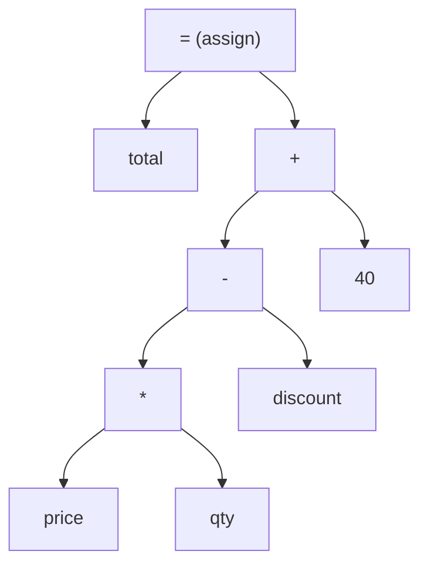
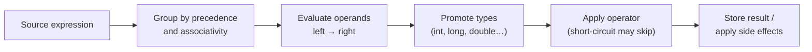
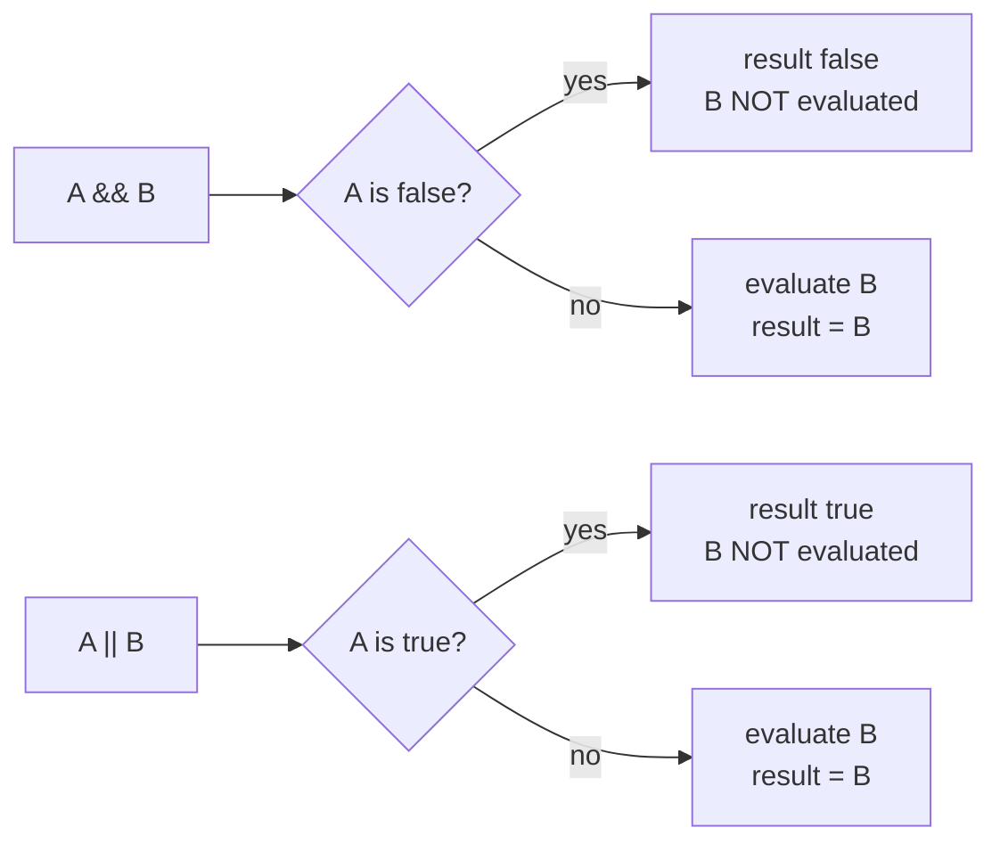
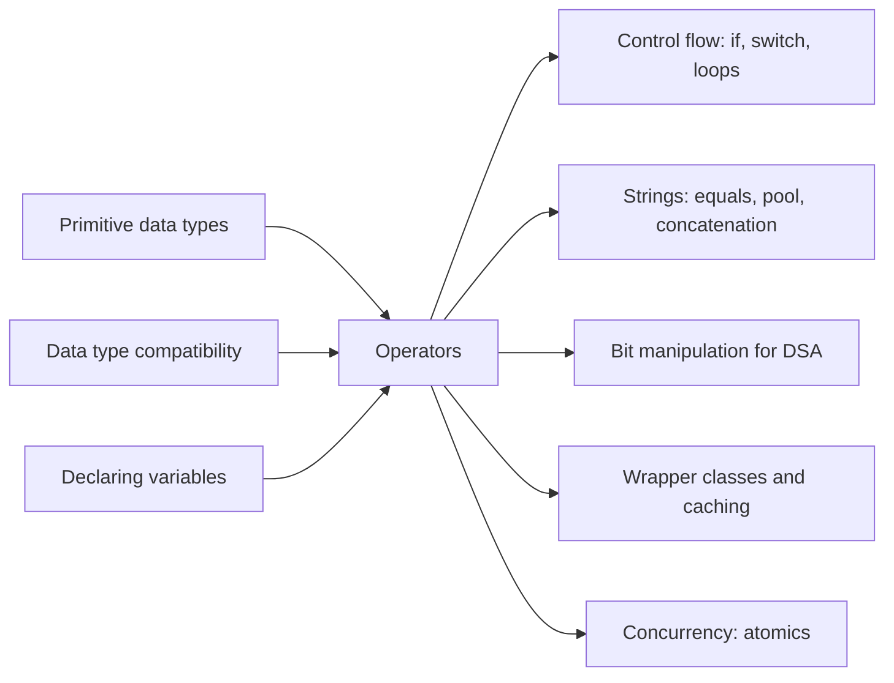

# Operators in Java

**TL;DR:** An **operator** is a symbol that computes a value from one, two or three **operands** (`a + b`, `!done`, `x > 0 ? x : -x`). To predict any Java expression you need three rules: **precedence** decides how the expression is grouped, **associativity** breaks ties between operators of the same precedence, and **evaluation order** is always **left to right** for operands. Almost every "what does this print?" question is one of these three rules plus `++`/`--`, short-circuiting, or integer division.

## Table of Contents

1. [TL;DR](#1-tldr)
2. [Why it matters](#2-why-it-matters)
3. [Prerequisites](#3-prerequisites)
4. [Mental model](#4-mental-model)
5. [Core concepts](#5-core-concepts)
6. [How it works](#6-how-it-works)
7. [Examples](#7-examples)
8. [Comparisons](#8-comparisons)
9. [Trade-offs](#9-trade-offs)
10. [Gotchas](#10-gotchas)
11. [Practical application](#11-practical-application)
12. [Interview prep](#12-interview-prep)
13. [Interview question bank](#13-interview-question-bank)
14. [Tricky code snippets](#14-tricky-code-snippets)
15. [Connections](#15-connections)
16. [Summary](#16-summary)
17. [Answers](#answers)

---

## 1. TL;DR

Java's operators fall into a handful of families: **arithmetic** (`+ - * / %`), **unary** (`++ -- + - ! ~`), **assignment** (`= += -=`…), **relational** (`< > <= >= instanceof`), **equality** (`== !=`), **logical** (`&& || !`), **bitwise** (`& | ^ ~`), **shift** (`<< >> >>>`), the **ternary** (`? :`), plus `+` for **string concatenation** and `->` for lambdas.

**The analogy: a calculator that follows BODMAS, with a security checkpoint.**

| Calculator idea | Java idea |
|---|---|
| Calculator keys | **Operators** |
| The numbers you type | **Operands** |
| BODMAS: brackets, then ×÷, then +− | **Precedence**: `*` before `+`; parentheses override |
| When two keys have the same rank, work left to right (`10 − 4 − 3 = 3`) | **Associativity**: most operators group left-to-right |
| You always *read* the numbers left to right, even if you multiply first | **Evaluation order**: operands are evaluated left to right |
| A security checkpoint that stops at the first failed check | **Short-circuit** `&&` / `||` skip the right side when the answer is known |
| A memory button that shows the old value, then adds 1 | **Post-increment** `x++`: the expression's value is the *old* value |

**Running example:** a store-rules program that computes a bill (arithmetic), decides free shipping (relational + logical), counts items (`++`), labels the order (ternary) and checks permissions stored as bit flags (bitwise and shift).

---

## 2. Why it matters

**The problem.** Expressions are everywhere: prices, conditions, loop counters, hash codes. Java defines exactly how each one is grouped and evaluated so it gives the same result on every machine. When your mental model differs from the rules, you get bugs that compile perfectly.

**What goes wrong** (all verified on Java 21):

| Code | Result | Rule you missed |
|---|---|---|
| `int mid = (lo + hi) / 2;` with large `lo`, `hi` | Negative index (`-397483648`) | `int` addition overflows; use `lo + (hi - lo) / 2` or `>>> 1` |
| `i = i++;` | `i` never changes | Post-increment's value is the old value, which is then assigned back |
| `n % 2 == 1` as an odd check | `false` for `-3` | `%` keeps the sign of the left operand: `-3 % 2` is `-1` |
| `s != null & s.length() > 0` | `NullPointerException` | `&` doesn't short-circuit; `&&` does |
| `if (done = true)` | Always runs | `=` assigns; `==` compares |
| `2 ^ 3` meant as 2³ | `1` | `^` is bitwise XOR; use `Math.pow` |
| `"a == b: " + a == b` | `false` | `+` binds tighter than `==` |
| `5 & 3 == 3` | Compile error | `==` binds tighter than `&` |

**Why interviewers ask.** Operator questions are cheap to ask and reveal precision quickly. Fresher rounds use `++`/`--` output puzzles and `&&` vs `&`; DSA rounds use bit manipulation (`n & (n - 1)`, `>>>`, XOR swap) and overflow-safe midpoints.

---

## 3. Prerequisites

| Prerequisite | One-line refresher | Importance |
|---|---|---|
| Primitive types | `int`, `long`, `double`, `char`, `boolean` and their ranges ([Primitive Data Types notes]) | Essential |
| Numeric promotion | `byte`/`short`/`char` become `int` in arithmetic ([Data Type Compatibility notes]) | Essential |
| Binary numbers and two's complement | Integers are bit patterns; the top bit is the sign | Essential for bitwise/shift |
| Variables and assignment | `int x = 5; x = 7;` ([Declaring Variables and Methods notes]) | Essential |
| `String` basics | `"text"`; `equals` compares content | Nice-to-have |

---

## 4. Mental model

> **The one picture to keep in your head:** first *group* the expression into a tree using precedence and associativity, then *evaluate* that tree's operands strictly **left to right**, applying side effects (`++`, `=`) the moment each one is evaluated.

For `total = price * qty - discount + 40`:


*Precedence builds the tree (`*` lowest in the tree means it runs first); evaluation then walks the leaves left to right: `price`, `qty`, `discount`, `40`.*

**Precedence and evaluation order are different things.** In `a() + b() * c()`, `*` binds tighter, but Java still *calls* `a()`, then `b()`, then `c()` (verified: prints `a b c = 7`). Precedence only decides which results are combined with which.

**The precedence ladder** (highest at the top):

```
 HIGHEST   postfix      x++  x--
     │     unary        ++x  --x  +x  -x  ~  !  (cast)
     │     multiply     *  /  %
     │     add          +  -          (also string concatenation)
     │     shift        <<  >>  >>>
     │     relational   <  >  <=  >=  instanceof
     │     equality     ==  !=
     │     bitwise AND  &
     │     bitwise XOR  ^
     │     bitwise OR   |
     │     logical AND  &&
     │     logical OR   ||
     │     ternary      ? :
  LOWEST   assignment   =  +=  -=  *=  /=  %=  &=  ^=  |=  <<=  >>=  >>>=   (and lambda ->)
```
*Mnemonic: **PUMA'S REBL TA** = Postfix, Unary, Multiplicative, Additive, Shift, Relational, Equality, Bitwise (& ^ |), Logical (&& ||), Ternary, Assignment.*

---

## 5. Core concepts

### 5.1 Glossary

| Term | Meaning (1 line) | Tiny example |
|---|---|---|
| **Operator** | A symbol that performs an operation and produces a value. | `+`, `&&`, `>>` |
| **Operand** | A value an operator works on. | In `a + b`: `a`, `b` |
| **Expression** | A combination of operands and operators that evaluates to a value. | `price * qty` |
| **Unary / binary / ternary** | Takes one / two / three operands. | `-x` / `x - y` / `c ? a : b` |
| **Precedence** | Which operator binds tighter when different operators meet. | `1 + 2 * 3` = 7 |
| **Associativity** | Grouping direction for operators of equal precedence. | `10 - 4 - 3` = `(10 - 4) - 3` = 3 |
| **Evaluation order** | Java evaluates operands left to right (JLS §15.7). | `a() + b() * c()` calls `a`, `b`, `c` |
| **Side effect** | An expression that also changes state. | `x++`, `y = 5` |
| **Pre-increment** | `++x`: increment, then use the **new** value. | `x = 5; y = ++x;` → `y = 6` |
| **Post-increment** | `x++`: use the **old** value, then increment. | `x = 5; y = x++;` → `y = 5`, `x = 6` |
| **Short-circuit** | `&&` / `\|\|` skip the right operand when the result is already known. | `s != null && s.isEmpty()` |
| **Compound assignment** | `x op= y` means `x = (T)(x op y)` with an implicit cast. | `b += 1` on a `byte` |
| **Bitwise operator** | Works on each bit of integer operands. | `12 & 10` = 8 |
| **Shift operator** | Moves bits left or right. | `1 << 3` = 8 |
| **Signed right shift `>>`** | Fills with copies of the sign bit (keeps negatives negative). | `-16 >> 2` = `-4` |
| **Unsigned right shift `>>>`** | Fills with zeros. | `-16 >>> 28` = 15 |
| **Ternary (conditional) operator** | `cond ? a : b`, an expression that picks a value. | `score >= 60 ? "pass" : "fail"` |
| **`instanceof`** | Tests an object's runtime type; `false` for `null`. | `o instanceof String` |

### 5.2 All operators at a glance

| Family | Operators | Operand types | Notes |
|---|---|---|---|
| Arithmetic | `+ - * / %` | Numeric (and `char`) | Integer `/` truncates toward zero; `%` keeps the left operand's sign |
| Unary | `+ - ++ -- !` `~` | Numeric; `!` boolean; `~` integral | `++`/`--` need a variable |
| Assignment | `= += -= *= /= %= &= \|= ^= <<= >>= >>>=` | Any (compound: numeric/boolean/String for `+=`) | Right-associative; compound forms include a cast |
| Relational | `< > <= >=` | Numeric | Not for `boolean`, no chaining (`1 < x < 10` doesn't compile) |
| Type test | `instanceof` | Reference | Pattern form `o instanceof String s` (Java 16+) |
| Equality | `== !=` | Numeric, boolean, references | On objects compares **references** |
| Logical | `&& \|\| !` | boolean | `&&`, `\|\|` short-circuit |
| Bitwise / boolean logical | `& \| ^` | Integral **or** boolean | On booleans: non-short-circuit AND/OR, and XOR |
| Bitwise complement | `~` | Integral | `~x == -x - 1` |
| Shift | `<< >> >>>` | Integral | Distance masked: low 5 bits for `int`, 6 for `long` |
| Conditional | `? :` | boolean condition | Result type follows special rules (see Data Type Compatibility) |
| String concatenation | `+` | If either operand is a `String` | Left to right: `1 + 2 + "3"` = `"33"` |
| Lambda | `->` | — | Lowest precedence |

### 5.3 Arithmetic rules worth memorising

| Expression | Result | Rule |
|---|---|---|
| `7 / 2`, `-7 / 2` | `3`, `-3` | Integer division truncates toward zero |
| `7 % 3`, `-7 % 3`, `7 % -3` | `1`, `-1`, `1` | Remainder has the **sign of the left operand** |
| `Math.floorDiv(-7, 2)`, `Math.floorMod(-7, 3)` | `-4`, `2` | "Mathematical" floor versions |
| `5.5 % 2`, `10 % 1.5` | `1.5`, `1.0` | `%` works on floating-point too |
| `1 / 0`, `5 % 0` | `ArithmeticException: / by zero` | Integer division by zero throws |
| `1.0 / 0`, `0.0 / 0`, `5.0 % 0` | `Infinity`, `NaN`, `NaN` | Floating-point never throws |
| `Integer.MAX_VALUE + 1` | `-2147483648` | Integer overflow wraps silently |

---

## 6. How it works

### 6.1 Evaluating an expression, step by step

1. **Parse with precedence and associativity** to decide grouping (as if Java inserted parentheses).
2. **Evaluate operands left to right.** For each binary operator, the left operand is fully evaluated (including its side effects) before the right one.
3. **Apply numeric promotion** to each arithmetic operator's operands (`byte + byte` → `int`, `int + double` → `double`).
4. **Apply the operator.** For `&&`/`||`/`?:`, skip the operand that isn't needed.
5. **For assignments**, evaluate the left-hand side's location first (e.g. the array index), then the right-hand side, then store.


*The pipeline the compiler and JVM follow for every expression.*

### 6.2 Tracing `++` and `--` precisely

Treat each `x++` as "**read `x` (that's the value), then write `x + 1`**", and each `++x` as "**write `x + 1`, then read it**". Then walk left to right.

**Trace of `x = x++ + x++` with `x = 10`:**

| Step | Sub-expression | Value produced | `x` after |
|---|---|---|---|
| 1 | first `x++` | `10` | `11` |
| 2 | second `x++` | `11` | `12` |
| 3 | `10 + 11` | `21` | `12` |
| 4 | `x = 21` (assignment last) | `21` | **`21`** |

Verified output: `21`. The two increments happened, then the assignment overwrote them.

**Trace of `i = i++` with `i = 5`:** `i++` produces `5` and sets `i` to `6`; then `i = 5` stores the old value back. Result `5`, forever. A loop doing `count = count++` 100 times leaves `count` at `0` (verified).

### 6.3 Short-circuit evaluation


*`&&` stops at the first `false`; `||` stops at the first `true`. `&` and `|` always evaluate both sides.*

Verified with tracing methods:

| Expression | Printed (methods called) | Result |
|---|---|---|
| `check("A", false) && check("B", true)` | `A` | `false` |
| `check("A", false) & check("B", true)` | `A B` | `false` |
| `check("A", true) \|\| check("B", true)` | `A` | `true` |
| `check("A", true) \| check("B", true)` | `A B` | `true` |

### 6.4 Bitwise and shift operators

```
 a = 12  →  0000 1100
 b = 10  →  0000 1010
 ─────────────────────
 a & b   →  0000 1000  =  8    (1 only where BOTH are 1)
 a | b   →  0000 1110  = 14    (1 where EITHER is 1)
 a ^ b   →  0000 0110  =  6    (1 where they DIFFER)
 ~a      →  1111 0011  = -13   (flip every bit; ~x == -x - 1)
```
*Bitwise operators act on each bit position independently (shown with the low 8 bits).*

```
  x = -16    11111111 11111111 11111111 11110000

  x << 2     11111111 11111111 11111111 11000000  = -64       (zeros enter on the right)
  x >> 2     11111111 11111111 11111111 11111100  = -4        (sign bit copied on the left)
  x >>> 28   00000000 00000000 00000000 00001111  = 15        (zeros enter on the left)
```
*`>>` preserves the sign; `>>>` treats the number as unsigned.*

> [!WARNING]
> **Shift distances are masked.** For an `int`, only the low 5 bits of the distance are used (0–31); for a `long`, the low 6 bits (0–63). So `1 << 32` is `1`, `1 << 33` is `2`, `8 >> -1` is `0` (shift by 31), and `-1 << 32` is still `-1`, which makes `while (-1 << i != 0) i++;` loop forever (verified: it ran past 1000 iterations).

### 6.5 Worked example: `StoreRules`, traced

```java
// StoreRules.java  —  run with: javac StoreRules.java && java StoreRules
public class StoreRules {
    static final int READ = 1, WRITE = 2, ADMIN = 4;          // bit flags: 001, 010, 100

    public static void main(String[] args) {
        int price = 250, qty = 3;
        int subtotal = price * qty;                 // arithmetic
        int discount = subtotal / 10;               // integer division
        int total = subtotal - discount + 40;       // left-to-right: (750 - 75) + 40
        int leftover = total % 7;                   // remainder
        boolean freeShip = total >= 500 && qty > 2; // relational + short-circuit AND
        int items = qty++;                          // post-increment: old value
        int next = ++qty;                           // pre-increment: new value
        String label = total > 1000 ? "BIG" : "NORMAL";   // ternary
        int perms = READ | WRITE;                   // combine flags: 011
        boolean canWrite = (perms & WRITE) != 0;    // test a flag (parentheses needed!)
        boolean isAdmin = (perms & ADMIN) != 0;
        perms ^= READ;                              // toggle READ off: 010
        int doubled = total << 1;                   // ×2
        int halved = total >> 1;                    // ÷2 (rounds toward −∞)
        System.out.println(subtotal + " " + discount + " " + total + " " + leftover);
        System.out.println(freeShip + " " + items + " " + next + " " + qty);
        System.out.println(label + " " + canWrite + " " + isAdmin + " " + perms);
        System.out.println(doubled + " " + halved);
    }
}
```

**Expected output** (verified):
```
750 75 715 1
true 3 5 5
NORMAL true false 2
1430 357
```

**Trace:**

| # | Statement | Grouping / rule | Intermediate values | Result |
|---|---|---|---|---|
| 1 | `price * qty` | multiplicative | `250 * 3` | `subtotal = 750` |
| 2 | `subtotal / 10` | integer division | `750 / 10` | `discount = 75` |
| 3 | `subtotal - discount + 40` | same precedence → left to right | `(750 − 75) = 675`, `+ 40` | `total = 715` |
| 4 | `total % 7` | remainder | `715 = 7 × 102 + 1` | `leftover = 1` |
| 5 | `total >= 500 && qty > 2` | relational binds tighter than `&&` | `true && true` | `freeShip = true` |
| 6 | `items = qty++` | post-increment | value `3`, then `qty = 4` | `items = 3` |
| 7 | `next = ++qty` | pre-increment | `qty = 5`, value `5` | `next = 5` |
| 8 | `total > 1000 ? … : …` | ternary | `715 > 1000` is `false` | `label = "NORMAL"` |
| 9 | `READ \| WRITE` | bitwise OR | `001 \| 010 = 011` | `perms = 3` |
| 10 | `(perms & WRITE) != 0` | parentheses force `&` first | `011 & 010 = 010 = 2`, `2 != 0` | `canWrite = true` |
| 11 | `(perms & ADMIN) != 0` | | `011 & 100 = 0` | `isAdmin = false` |
| 12 | `perms ^= READ` | XOR toggles | `011 ^ 001 = 010` | `perms = 2` |
| 13 | `total << 1`, `total >> 1` | shifts | `715 × 2`, `715 / 2` rounded down | `1430`, `357` |

**Things to notice:**
- Step 10 **needs** parentheses: `perms & WRITE != 0` would parse as `perms & (WRITE != 0)`, which is `int & boolean`, a compile error.
- In step 3, `-` and `+` have equal precedence and are left-associative. `subtotal - (discount + 40)` would give `635`.
- `>> 1` equals `/ 2` only for non-negative numbers: `-5 >> 1` is `-3`, but `-5 / 2` is `-2` (verified).

---

## 7. Examples

### 7.1 Toy example: precedence and associativity in one screen

```java
public class Precedence {
    public static void main(String[] args) {
        System.out.println(1 + 2 * 3);              // 7
        System.out.println((1 + 2) * 3);            // 9
        System.out.println(10 - 4 - 3);             // 3   (left-associative)
        System.out.println(100 / 10 / 5);           // 2   (left-associative)
        System.out.println(2 + 3 + "x" + 2 + 3);    // 5x23
        System.out.println(true || false && false); // true  (&& before ||)
        System.out.println(5 / 2 * 2.0);            // 4.0 (5/2 is int 2 first)
        System.out.println(5 / 2.0 * 2);            // 5.0
        System.out.println(1 << 2 + 1);             // 8   (+ before <<)
        int y, z;
        y = z = 5 * 2;                              // assignment is right-associative
        System.out.println(y + " " + z);            // 10 10
    }
}
```
**Expected output:**
```
7
9
3
2
5x23
true
4.0
5.0
8
10 10
```

### 7.2 Real-world examples

| System | Operators used | How |
|---|---|---|
| **JDK `HashMap`** | `^`, `>>>`, `&` | It spreads hash bits with `h ^ (h >>> 16)` and picks a bucket with `(n - 1) & hash` instead of `%`. Because the table size `n` is a power of two, `& (n - 1)` equals a non-negative modulo and is cheaper. Verified: `"hello"` → bucket `11` in a 16-bucket table. |
| **JDK `Arrays.binarySearch`** | `>>>` | Uses `(low + high) >>> 1` for the midpoint. The classic `(low + high) / 2` overflows for large arrays; Joshua Bloch's 2006 post "Nearly All Binary Searches and Mergesorts are Broken" described this bug in the JDK and many textbooks. |
| **`java.util.regex.Pattern` flags** | `\|`, `&` | Options combine as bit flags: `Pattern.compile(p, Pattern.CASE_INSENSITIVE \| Pattern.MULTILINE)`. `java.lang.reflect.Modifier` uses the same idea for `public`, `static`, etc. |
| **Null-safe checks everywhere** | `&&` | `if (user != null && user.isActive())` relies on short-circuiting to avoid `NullPointerException`. |
| **Hash codes** (`String.hashCode`, `Objects.hash`) | `*`, `+` with overflow | `31 * h + c` deliberately lets `int` overflow wrap; only consistency matters for hashing. |

---

## 8. Comparisons

### 8.1 `&&` vs `&`, `||` vs `|`

| | `&&` / `\|\|` | `&` / `\|` |
|---|---|---|
| Operand types | `boolean` only | `boolean` **or** integers |
| On booleans | Short-circuit | Always evaluate both sides |
| On integers | Not allowed | Bitwise AND / OR |
| Precedence | Lower (`&&` above `\|\|`) | Higher (`&` > `^` > `\|`), but below `==` |
| Typical use | Conditions, null guards | Bit flags; booleans when both sides **must** run |

### 8.2 `x++` vs `++x`

| | Post-increment `x++` | Pre-increment `++x` |
|---|---|---|
| Expression value | Old value | New value |
| `x = 5; y = x++;` | `y = 5`, `x = 6` | — |
| `x = 5; y = ++x;` | — | `y = 6`, `x = 6` |
| As a standalone statement | Same effect | Same effect |
| Works on | Variables only (not `5++`, not `final`, not `(x++)++`) | Same |

### 8.3 `>>` vs `>>>` vs `/ 2`

| Expression | `>>` (signed) | `>>>` (unsigned) | Division |
|---|---|---|---|
| `8` by 1 / `8 / 2` | `4` | `4` | `4` |
| `-8` by 1 / `-8 / 2` | `-4` | `2147483644` | `-4` |
| `-5` by 1 / `-5 / 2` | `-3` (rounds toward −∞) | `2147483645` | `-2` (toward 0) |

### 8.4 `==` vs `equals()`

| | `==` | `equals()` |
|---|---|---|
| Primitives | Compares values | Not available |
| Objects | Compares **references** (same object?) | Compares **content** (if the class overrides it) |
| `String` literals | Often `true` (string pool), unreliable | Always correct |
| Wrappers | Works only inside the cache (−128..127 for `Integer`) | Always correct for the same wrapper type |
| `NaN` | `NaN == NaN` is `false` | `Double.valueOf(NaN).equals(NaN)` is `true` |
| `0.0` vs `-0.0` | `0.0 == -0.0` is `true` | `Double.valueOf(0.0).equals(-0.0)` is `false` |

### 8.5 Ternary vs `if-else`

| | Ternary `?:` | `if-else` |
|---|---|---|
| Is | An **expression** (has a value) | A **statement** |
| Use for | Choosing a value | Choosing actions |
| Can stand alone? | No: `a > 0 ? print(…) : print(…);` → *not a statement* | Yes |
| Typing | Both branches converted to one type (`true ? 1 : 2.0` → `1.0`) | No conversion |

**Use `&&`/`||` when…** writing conditions (almost always).
**Use `&`/`|`/`^` when…** manipulating bits, or when both boolean operands must be evaluated for their side effects (rare; prefer separate statements).
**Use `>>>` when…** you need unsigned behaviour: midpoints, hash spreading, unsigned bytes.
**Use the ternary when…** you're choosing between two values and both branches are short.

---

## 9. Trade-offs

| Choice | Benefit | Cost |
|---|---|---|
| **Relying on precedence** | Shorter expressions | Readers misjudge it, especially `&`/`\|` vs `==` and `+` vs `==` with strings. Add parentheses when mixing families. |
| **`++`/`--` inside larger expressions** | Compact code (`arr[i++] = x`) | Hard to reason about; `x = x++ + ++x` is a code smell. Keep side effects in their own statements. |
| **Bitwise tricks instead of arithmetic** | Speed and compactness for flags, masks, hashing | Readability; most "`x >> 1` is faster than `x / 2`" micro-optimisations are already done by the JIT. Use them for clarity of intent (flags), not speed. |
| **`& (n - 1)` instead of `% n`** | Fast, always non-negative | Only correct when `n` is a power of two. |
| **Compound assignment** | Concise, works on `byte`/`short`/`char` | Hides a narrowing cast: `byte b = 10; b *= 30;` silently gives `44`. |
| **Ternary chains** | One expression for small mappings | Nested ternaries (`a ? b : c ? d : e`) are hard to read; prefer `switch` expressions (Java 14+). |
| **Floating-point `==`** | Simple | Almost always wrong for computed values (`0.1 + 0.2 == 0.3` is `false`); compare with a tolerance. |
| **Integer `/` and `%`** | Fast, exact | Truncation toward zero and sign rules differ from math (`-7 % 3` = `-1`); use `Math.floorMod` for "always non-negative". |

---

## 10. Gotchas

### Myths

| ❌ Myth | ✅ Reality |
|---|---|
| Higher precedence means "evaluated first". | It means "binds tighter". Operands are always **evaluated left to right**: `a() + b() * c()` calls `a` first. |
| `i = i++` increments `i`. | It leaves `i` unchanged: the old value is assigned back. |
| `x++` and `++x` are the same. | Same effect as a statement; different **value** inside an expression. |
| `^` means "power". | It's XOR: `2 ^ 3` is `1`. Use `Math.pow(2, 3)` (returns `double` 8.0). |
| `&` and `&&` are interchangeable for booleans. | `&` evaluates both sides; `s != null & s.length() > 0` throws NPE when `s` is null. |
| `%` always returns a non-negative number. | It takes the sign of the left operand: `-7 % 3` is `-1`. Use `Math.floorMod`. |
| `n % 2 == 1` tests for odd numbers. | Fails for negatives (`-3 % 2 == -1`). Use `n % 2 != 0` or `(n & 1) == 1`. |
| Dividing by zero always throws. | Only for integer `/` and `%`. `1.0 / 0` is `Infinity`, `0.0 / 0` is `NaN`. |
| `x >> 1` is the same as `x / 2`. | Not for negative odd numbers: `-5 >> 1` is `-3`, `-5 / 2` is `-2`. |
| `1 << 32` is 4294967296. | For `int`, the distance is masked to 0–31, so it's `1`. Use `1L << 32`. |
| `==` compares strings. | It compares references. Literals and compile-time constants are pooled, so it *sometimes* looks right. |
| Relational operators can be chained like math. | `1 < x < 10` doesn't compile: `1 < x` is a `boolean`. Write `1 < x && x < 10`. |
| `NaN == NaN` is true. | It's `false`; `NaN` is unequal to everything. Use `Double.isNaN`. |
| The ternary is just a short `if`. | It's an expression with its own typing rules and can't be used as a statement. |

### Common mistakes and edge cases

**1. Assignment instead of comparison.**
```java
boolean done = false;
if (done = true) { /* always runs */ }   // compiles for booleans!
int x = 5;
if (x = 10) { }                          // compile error: int cannot be converted to boolean
```

**2. String concatenation vs addition.**
```java
System.out.println(1 + 2 + "3" + 4 + 5);   // 3345
System.out.println("" + 1 + 2 * 3);        // 16   (* first)
System.out.println("a == b: " + a == b);   // false: ("a == b: " + a) == b
```

**3. Compile-time constants make `==` on strings look like it works.**
```java
String a = "hello";
String d = "hel" + "lo";            // constant → pooled → a == d is true
String part = "hel";
String e = part + "lo";             // computed at runtime → a == e is false
final String fpart = "hel";
String f = fpart + "lo";            // fpart is a constant → a == f is true
System.out.println("10" + 20 == "1020");   // true (constant expression)
```

**4. The `Integer` comparison puzzle.**
```java
Integer a = 1000, b = 1000;
System.out.println(a <= b && a >= b && a != b);   // true!
```
`<=` and `>=` unbox and compare values; `!=` on two objects compares references.

**5. Unary minus promotes to `int`.**
```java
short s = 1;
s = -s;          // compile error: possible lossy conversion from int to short
s = (short) -s;  // OK
System.out.println(-Integer.MIN_VALUE == Integer.MIN_VALUE);  // true (overflow)
```

**6. `++` needs a real variable.** `5++`, `(x++)++` → *unexpected type*; `final int x = 5; x++;` → *cannot assign a value to final variable x*.

**7. Floating-point accumulation.**
```java
double sum = 0;
for (int i = 0; i < 10; i++) sum += 0.1;
System.out.println(sum);   // 0.9999999999999999
```

**8. A `float` loop counter can get stuck.**
```java
for (float f = 16777210f; f < 16777220f; f++) { … }
```
At `16777216f` (2²⁴), adding 1 rounds back to the same value, so `f` never reaches the limit (verified: the guard stopped it at 21 iterations).

---

## 11. Practical application

### Writing clear expressions: checklist
- [ ] Add parentheses whenever you mix bitwise (`& | ^`) with comparison (`== !=`), or shifts with `+`/`-`
- [ ] Put `++`/`--` in their own statements unless the idiom is very standard (`arr[i++]`)
- [ ] Use `&&`/`||` for conditions; put the null check (or cheapest check) first
- [ ] Compare objects with `equals`, floating-point with a tolerance, `NaN` with `Double.isNaN`
- [ ] Use `Math.floorMod` for array/bucket indexes from possibly-negative numbers
- [ ] Use `lo + (hi - lo) / 2` or `(lo + hi) >>> 1` for midpoints
- [ ] Use `Math.addExact` / `multiplyExact` where overflow would be a bug
- [ ] Use `long` (`1L << 40`) for shifts beyond 31 bits
- [ ] Prefer `switch` expressions over nested ternaries
- [ ] Use bit flags or `EnumSet` for sets of options; `EnumSet` is clearer and nearly as fast

### Bit-manipulation patterns (common in DSA interviews)

| Goal | Expression | Example (verified) |
|---|---|---|
| Is `n` odd? | `(n & 1) == 1` (or `n % 2 != 0`) | `-3` → `true` |
| Is `n` a power of two? (`n > 0`) | `(n & (n - 1)) == 0` | `64` → `true`, `40` → `false` |
| Clear the lowest set bit | `n & (n - 1)` | `40` (101000) → `32` |
| Isolate the lowest set bit | `n & -n` | `40` → `8` |
| Count set bits | `Integer.bitCount(n)` | `40` → `2` |
| Set bit `k` | `n \| (1 << k)` | |
| Clear bit `k` | `n & ~(1 << k)` | |
| Toggle bit `k` | `n ^ (1 << k)` | |
| Test bit `k` | `(n >> k) & 1` | |
| Swap without a temp | `x ^= y; y ^= x; x ^= y;` | `7, 9` → `9, 7` (breaks if `x` and `y` are the same variable/array slot) |
| Find the single non-duplicate | XOR all elements | `a ^ a = 0`, `a ^ 0 = a` |

### Hands-on exercise: predict, then verify

**Part A.** Predict each line's output, then run it.

```java
public class OpsQuiz {
    public static void main(String[] args) {
        int x = 10;
        int y = x++ + x-- - --x + ++x;
        System.out.println(x + " " + y);

        int a = 3;
        a = a++ + a;
        System.out.println(a);

        int k = 1;
        k = k++ + k++ + k++;
        System.out.println(k);

        System.out.println(-5 >> 1);
        System.out.println(-5 / 2);
        System.out.println(-1 >>> 28);
        System.out.println(true ? 1 : 2.0);
    }
}
```

**Part B.** This method should return the bucket index (0 to `size - 1`) for any `int` hash, including negatives. It sometimes returns a negative number. Find two different correct fixes, and explain why `Math.abs(hash) % size` is **not** a full fix.

```java
static int bucket(int hash, int size) {
    return hash % size;
}
```

**Expected outcome:** Part A output is `10 22`, `7`, `6`, `-3`, `-2`, `15`, `1.0`. Part B: `bucket(-7, 5)` returns `3` after the fix, and you can name the one input that breaks the `Math.abs` version.

<details><summary>Answer</summary>

**Part A** (verified):
- `x = 10`: `x++` → 10 (x=11); `x--` → 11 (x=10); `--x` → 9 (x=9); `++x` → 10 (x=10). `y = 10 + 11 − 9 + 10 = 22`, `x = 10`.
- `a = a++ + a` with `a = 3`: `3` (a becomes 4) `+ 4` = `7`; then assigned.
- `k = k++ + k++ + k++` with `k = 1`: `1 + 2 + 3 = 6`; the final assignment overwrites the increments.
- `-5 >> 1` = `-3` (arithmetic shift rounds toward −∞); `-5 / 2` = `-2` (toward 0).
- `-1 >>> 28` = `15`: all 32 bits are 1, shifting in 28 zeros leaves four 1s.
- `true ? 1 : 2.0` = `1.0`: the ternary's type is `double`.

**Part B:** `%` keeps the sign of the left operand, so `-7 % 5` is `-2`.
- Fix 1: `return Math.floorMod(hash, size);` → `3`.
- Fix 2: `int r = hash % size; return r < 0 ? r + size : r;`
- Fix 3 (only if `size` is a power of two): `return hash & (size - 1);` (what `HashMap` does).

`Math.abs(hash) % size` fails for `hash == Integer.MIN_VALUE`, because `Math.abs(Integer.MIN_VALUE)` is still `-2147483648`; with `size = 5` it returns `-3` (verified).
</details>

---

## 12. Interview prep

### Likely questions with model answers

**Q1. What types of operators does Java have?**
> "Arithmetic `+ - * / %`; unary `+ - ++ -- !` and `~`; assignment `=` plus compound forms like `+=`; relational `< > <= >=` and `instanceof`; equality `==` and `!=`; logical `&&`, `||` and `!`; bitwise `&`, `|`, `^` and `~`; shift `<<`, `>>` and `>>>`; the ternary `? :`; `+` doubles as string concatenation; and `->` for lambdas. The ternary is the only operator with three operands."

**Q2. What's the difference between `x++` and `++x`?**
> "Both add one to `x`. The difference is the value of the expression: `x++` evaluates to the old value and then increments, `++x` increments first and evaluates to the new value. So with `x = 5`, `y = x++` gives `y = 5, x = 6`, while `y = ++x` gives `6` and `6`. As a standalone statement they're equivalent. A classic trap is `i = i++`, which leaves `i` unchanged because the old value is assigned back after the increment."

- *Follow-ups:* What is `x = x++ + x++` with `x = 10`? (`21`.) Can you write `5++`? (No.)

**Q3. Explain precedence, associativity and evaluation order.**
> "Precedence decides grouping between different operators, like `*` before `+`. Associativity decides grouping between operators of the same precedence: most binary operators are left-associative, so `10 - 4 - 3` is `3`, while assignment and the ternary are right-associative, so `a = b = c` assigns `c` to `b` first. Evaluation order is separate: Java always evaluates operands left to right, so in `a() + b() * c()` it calls `a`, `b`, then `c`, even though the multiplication happens first."

**Q4. What's the difference between `&&` and `&`?**
> "`&&` is logical AND and short-circuits: if the left side is `false`, the right side isn't evaluated, which makes guards like `s != null && s.isEmpty()` safe. `&` on booleans always evaluates both sides, so the same guard with `&` throws a `NullPointerException`. `&` also works on integers as bitwise AND, which `&&` can't. The same pairing applies to `||` and `|`."

**Q5. `>>` vs `>>>`?**
> "Both shift right. `>>` is the signed, arithmetic shift: it copies the sign bit into the vacated positions, so negative numbers stay negative; `-16 >> 2` is `-4`. `>>>` is the unsigned shift: it fills with zeros, so `-16 >>> 28` is `15`. `>>>` is used for overflow-safe midpoints `(lo + hi) >>> 1` and hash spreading in `HashMap`. Also, shift distances are masked to 0–31 for `int`, so `1 << 32` is `1`. One more trap: on a `byte`, `b >>>= 1` promotes to `int`, shifts, and casts back, so `-8` becomes `-4`, not a positive number."

**Q6. How does `%` work with negative numbers? How do you check if a number is odd?**
> "The result of `%` has the sign of the left operand, because Java's integer division truncates toward zero: `-7 % 3` is `-1`, and `7 % -3` is `1`. So `n % 2 == 1` fails for negative odd numbers. Correct checks are `n % 2 != 0` or `(n & 1) == 1`. When you need a non-negative remainder, such as a bucket index, use `Math.floorMod`."

**Q7. Why is `(low + high) / 2` dangerous, and what do you use instead?**
> "If `low` and `high` are large `int`s, their sum can exceed `Integer.MAX_VALUE` and wrap to a negative number, giving a negative index. That bug existed in the JDK's own `Arrays.binarySearch` until 2006. Use `low + (high - low) / 2`, or `(low + high) >>> 1`, which treats the overflowed sum as unsigned and gives the right answer."

**Q8. What does the ternary operator return, and how is it different from `if-else`?**
> "`cond ? a : b` is an expression that evaluates to `a` or `b`, and only the chosen branch is evaluated. Unlike `if-else`, it must produce a value, can't stand alone as a statement, and its result type is computed from both branches: `true ? 1 : 2.0` is `1.0`, and mixing `Integer` with `int` can throw `NullPointerException` through unboxing. It's right-associative, so `a ? b : c ? d : e` means `a ? b : (c ? d : e)`."

### What interviewers watch for
- Tracing `++`/`--` correctly, step by step, instead of guessing.
- Knowing **evaluation order ≠ precedence**.
- Short-circuit awareness in null checks.
- Bit tricks for DSA: `n & (n - 1)`, `n & -n`, XOR properties, `>>>`.
- Overflow awareness: midpoints, `Math.abs(Integer.MIN_VALUE)`, `1 << 32`.
- `==` vs `equals` for strings and wrappers.

---

## 13. Interview question bank

Short answers are hidden. 🟢 fresher, 🟡 intermediate, 🔴 senior/FAANG follow-up.

### 13.1 Basics

**1. 🟢 What is an operator? What is an operand?**
<details><summary>Answer</summary>

An operator is a symbol that computes a value (`+`, `&&`); operands are the values it works on.
</details>

**2. 🟢 List the categories of operators in Java.**
<details><summary>Answer</summary>

Arithmetic, unary, assignment (incl. compound), relational (incl. `instanceof`), equality, logical, bitwise, shift, ternary; plus string concatenation `+` and lambda `->`.
</details>

**3. 🟢 What are unary, binary and ternary operators?**
<details><summary>Answer</summary>

One operand (`-x`, `!b`, `x++`), two (`a + b`), three (`c ? a : b`). Java has exactly one ternary operator.
</details>

**4. 🟢 What is the difference between `=` and `==`?**
<details><summary>Answer</summary>

`=` assigns; `==` compares. `if (done = true)` compiles for booleans and always runs; for `int` it's a compile error.
</details>

**5. 🟢 What does `%` do?**
<details><summary>Answer</summary>

Remainder after integer (or floating-point) division. Sign follows the left operand: `-7 % 3` is `-1`.
</details>

**6. 🟢 What is `7 / 2` and `7 / 2.0`?**
<details><summary>Answer</summary>

`3` (integer division truncates) and `3.5`.
</details>

**7. 🟢 What happens on `1 / 0` vs `1.0 / 0`?**
<details><summary>Answer</summary>

`ArithmeticException: / by zero` vs `Infinity`. `0.0 / 0` is `NaN`.
</details>

**8. 🟢 What are compound assignment operators?**
<details><summary>Answer</summary>

`+=`, `-=`, `*=`, `/=`, `%=`, `&=`, `|=`, `^=`, `<<=`, `>>=`, `>>>=`. `x op= y` means `x = (T)(x op y)`, including an implicit cast.
</details>

**9. 🟢 Difference between `x++` and `++x`?**
<details><summary>Answer</summary>

Post returns the old value then increments; pre increments then returns the new value.
</details>

**10. 🟢 What is the ternary operator?**
<details><summary>Answer</summary>

`condition ? valueIfTrue : valueIfFalse`; an expression that picks one value and evaluates only that branch.
</details>

### 13.2 Precedence, associativity and evaluation order

**11. 🟢 What is operator precedence?**
<details><summary>Answer</summary>

The rule deciding which operators bind tighter: `1 + 2 * 3` is `7`.
</details>

**12. 🟡 What is associativity? Which operators are right-associative?**
<details><summary>Answer</summary>

Grouping for equal precedence. Most binary operators are left-to-right; assignment, compound assignment, the ternary and unary prefix operators are right-to-left.
</details>

**13. 🟡 Give the precedence order from highest to lowest.**
<details><summary>Answer</summary>

Postfix → unary → `* / %` → `+ -` → shifts → relational/`instanceof` → `== !=` → `&` → `^` → `|` → `&&` → `||` → `?:` → assignment/`->`. Mnemonic: PUMA'S REBL TA.
</details>

**14. 🟡 Does higher precedence mean that part is evaluated first?**
<details><summary>Answer</summary>

No. Operands are evaluated left to right; precedence only groups. `a() + b() * c()` calls `a`, `b`, `c` in order.
</details>

**15. 🟡 What is `true || false && false`?**
<details><summary>Answer</summary>

`true`: `&&` binds tighter, so it's `true || (false && false)`.
</details>

**16. 🟡 Why does `a & 3 == 3` not compile for an `int a`?**
<details><summary>Answer</summary>

`==` binds tighter than `&`, so it's `a & (3 == 3)` → `int & boolean`: *bad operand types for binary operator '&'*. Write `(a & 3) == 3`.
</details>

**17. 🟡 What is `1 << 2 + 1`?**
<details><summary>Answer</summary>

`8`: `+` binds tighter than `<<`, so it's `1 << 3`.
</details>

**18. 🔴 In `arr[idx] = idx = 2;` with `idx = 0`, which element changes?**
<details><summary>Answer</summary>

`arr[0]`. The array index on the left is evaluated **before** the right-hand side runs (verified: `arr[0]` becomes 2).
</details>

### 13.3 Increment and decrement

**19. 🟡 What is `i` after `int i = 5; i = i++;`?**
<details><summary>Answer</summary>

`5`. The old value is assigned back after the increment.
</details>

**20. 🟡 What is `int i = 1; int r = i++ + ++i;`?**
<details><summary>Answer</summary>

`r = 4` (`1 + 3`), `i = 3`.
</details>

**21. 🟡 What is `x` after `int x = 10; x = x++ + x++;`?**
<details><summary>Answer</summary>

`21` (`10 + 11`), overwriting the increments.
</details>

**22. 🟡 Can you write `5++`, `(x++)++`, or `x++` on a `final` variable?**
<details><summary>Answer</summary>

No. The first two give *unexpected type* (need a variable); the last gives *cannot assign a value to final variable x*.
</details>

**23. 🔴 Does `++` work on `char`, `double` and `byte`? Does it need a cast?**
<details><summary>Answer</summary>

Yes, on all numeric types including `char` (`'y'` → `'z'`) and `double` (`1.5` → `2.5`). It includes an implicit cast, so `byte b = 127; b++;` gives `-128` without error.
</details>

**24. 🔴 Is `x++` atomic in multithreaded code?**
<details><summary>Answer</summary>

No. It's read-modify-write; concurrent increments can be lost. Use `AtomicInteger.incrementAndGet()` or synchronisation.
</details>

### 13.4 Logical, relational and equality

**25. 🟢 What's the difference between `&&` and `&`?**
<details><summary>Answer</summary>

`&&` short-circuits and only works on booleans. `&` always evaluates both sides and also works on integers (bitwise).
</details>

**26. 🟢 What is short-circuit evaluation?**
<details><summary>Answer</summary>

`&&` skips its right operand when the left is `false`; `||` skips it when the left is `true`.
</details>

**27. 🟡 When would you use `&` or `|` on booleans?**
<details><summary>Answer</summary>

When both operands must always be evaluated (e.g. both have side effects you need). It's rare and usually clearer as separate statements.
</details>

**28. 🟡 What does `^` do on booleans?**
<details><summary>Answer</summary>

Exclusive OR: `true` when exactly one side is `true`. `true ^ true` is `false`.
</details>

**29. 🟡 Can you write `1 < x < 10`?**
<details><summary>Answer</summary>

No: `1 < x` is `boolean`, and `boolean < int` is invalid. Write `1 < x && x < 10`.
</details>

**30. 🟡 Can relational operators compare booleans? Can `==`?**
<details><summary>Answer</summary>

`<`/`>` no (*bad operand types*); `==` and `!=` yes.
</details>

**31. 🟡 Why should you not compare strings with `==`?**
<details><summary>Answer</summary>

`==` compares references. Literals and compile-time constants are pooled, so it sometimes works, but strings built at runtime (`part + "lo"`, `new String(…)`) are different objects. Use `equals`.
</details>

**32. 🔴 Why is `Integer a = 1000, b = 1000; a <= b && a >= b && a != b` true?**
<details><summary>Answer</summary>

`<=`/`>=` unbox and compare values (equal); `!=` compares two different objects' references (outside the −128..127 cache).
</details>

**33. 🔴 What are `NaN == NaN` and `0.0 == -0.0`?**
<details><summary>Answer</summary>

`false` and `true`. But `Double.equals` gives the opposite for both (`true` for NaN, `false` for ±0.0), and `Double.compare(0.0, -0.0)` is `1`.
</details>

**34. 🔴 What does `instanceof` return for `null`? What is pattern matching for `instanceof`?**
<details><summary>Answer</summary>

`false`. Java 16+: `if (o instanceof String s && s.length() > 2)` tests, casts and binds `s` in one step.
</details>

### 13.5 Bitwise and shift

**35. 🟡 What do `&`, `|`, `^`, `~` do on integers? Compute them for 12 and 10.**
<details><summary>Answer</summary>

AND, OR, XOR per bit; `~` flips all bits. `12 & 10 = 8`, `12 | 10 = 14`, `12 ^ 10 = 6`, `~12 = -13`.
</details>

**36. 🟡 Why is `~x` equal to `-x - 1`?**
<details><summary>Answer</summary>

In two's complement, `-x = ~x + 1`, so `~x = -x - 1`. `~0` is `-1`, `~-1` is `0`.
</details>

**37. 🟡 Difference between `<<`, `>>` and `>>>`?**
<details><summary>Answer</summary>

Left shift (zeros in); signed right shift (sign bit copied in); unsigned right shift (zeros in).
</details>

**38. 🟡 Is `x << 1` the same as `x * 2`? Is `x >> 1` the same as `x / 2`?**
<details><summary>Answer</summary>

`x << 1` equals `x * 2` (both overflow the same way). `x >> 1` differs from `x / 2` for negative odd numbers: `-5 >> 1` is `-3`, `-5 / 2` is `-2`.
</details>

**39. 🔴 What is `1 << 32` for an `int`? Why?**
<details><summary>Answer</summary>

`1`. Shift distances are masked to the low 5 bits for `int` (6 for `long`). `1L << 32` is `4294967296`.
</details>

**40. 🔴 What happens with `byte b = -8; b >>>= 1;`?**
<details><summary>Answer</summary>

`b` is promoted to `int` (`0xFFFFFFF8`), shifted to `0x7FFFFFFC`, then cast back to `byte`: `-4`. Use `(b & 0xFF) >>> 1` (`124`) for an unsigned byte shift.
</details>

**41. 🔴 How do you check if a number is a power of two?**
<details><summary>Answer</summary>

`n > 0 && (n & (n - 1)) == 0`. `n & (n - 1)` clears the lowest set bit; a power of two has exactly one.
</details>

**42. 🔴 How do you swap two integers without a temp? What's the catch?**
<details><summary>Answer</summary>

`x ^= y; y ^= x; x ^= y;`. If `x` and `y` refer to the same storage (e.g. `a[i]` and `a[j]` with `i == j`), it zeroes the value. A temp variable is clearer and as fast.
</details>

**43. 🔴 How do you find the one element that appears once when every other appears twice?**
<details><summary>Answer</summary>

XOR all elements: `a ^ a = 0` and `a ^ 0 = a`, so pairs cancel. O(n) time, O(1) space.
</details>

**44. 🔴 How does `HashMap` compute a bucket index, and why not `%`?**
<details><summary>Answer</summary>

`(n - 1) & (h ^ (h >>> 16))`. The table size is a power of two, so `& (n - 1)` equals a non-negative modulo and is cheaper; the `>>> 16` XOR mixes high bits into the low bits used for indexing.
</details>

### 13.6 Ternary, strings and overflow

**45. 🟡 What is `1 + 2 + "3" + 4 + 5`?**
<details><summary>Answer</summary>

`"3345"`: `1 + 2 = 3` first, then concatenation left to right.
</details>

**46. 🟡 What does `String s = null; s += "a";` produce?**
<details><summary>Answer</summary>

`"nulla"`. String conversion turns `null` into `"null"`.
</details>

**47. 🟡 Can a ternary be used as a statement?**
<details><summary>Answer</summary>

No: `a > 0 ? System.out.println("pos") : System.out.println("neg");` → *not a statement*.
</details>

**48. 🔴 What is the type of `true ? 1 : 2.0`? Of `false ? 1 : 'x'`?**
<details><summary>Answer</summary>

`double` (prints `1.0`) and `char` (prints `x`, because `1` is an `int` constant that fits in `char`).
</details>

**49. 🔴 Why is `(lo + hi) / 2` buggy, and what are two safe alternatives?**
<details><summary>Answer</summary>

The sum can overflow to a negative number (`1_500_000_000 + 2_000_000_000` → midpoint `-397483648`). Use `lo + (hi - lo) / 2` or `(lo + hi) >>> 1` (both give `1750000000`).
</details>

**50. 🔴 Why is `Math.abs(hash) % n` not safe for bucket indexes?**
<details><summary>Answer</summary>

`Math.abs(Integer.MIN_VALUE)` is still negative, so the result can be negative. Use `Math.floorMod(hash, n)` or `hash & (n - 1)` for power-of-two `n`.
</details>

**51. 🔴 Why is `-Integer.MIN_VALUE == Integer.MIN_VALUE`?**
<details><summary>Answer</summary>

+2,147,483,648 doesn't fit in an `int`, so negation wraps back to `MIN_VALUE`.
</details>

**52. 🔴 Does `x += y` behave exactly like `x = x + y`?**
<details><summary>Answer</summary>

No. `x += y` includes a cast to `x`'s type and evaluates `x` only once. `short s = 1; s += 1;` compiles; `s = s + 1;` doesn't.
</details>

---

## 14. Tricky code snippets

All compiled and run on OpenJDK 21. Predict first.

**Snippet 1 🟢**
```java
int i = 5;
int a = i++;
int b = ++i;
int c = i--;
int d = --i;
System.out.println(a + " " + b + " " + c + " " + d + " " + i);
```
<details><summary>Answer</summary>

`5 7 7 5 5`. `a` gets 5 (i→6); `b`: i→7, gets 7; `c` gets 7 (i→6); `d`: i→5, gets 5.
</details>

**Snippet 2 🟡**
```java
int i = 5;
i = i++;
System.out.println(i);
int count = 0;
for (int k = 0; k < 100; k++) count = count++;
System.out.println(count);
```
<details><summary>Answer</summary>

`5` and `0`. Each `x = x++` reads the old value, increments, then assigns the old value back.
</details>

**Snippet 3 🟡**
```java
int i = 1;
int r = i++ + ++i;
System.out.println(r + " " + i);
```
<details><summary>Answer</summary>

`4 3`. Left operand: value 1, `i` → 2. Right operand: `i` → 3, value 3. `1 + 3 = 4`.
</details>

**Snippet 4 🟡**
```java
int x = 10;
x = x++ + x++;
System.out.println(x);
```
<details><summary>Answer</summary>

`21`. `10 + 11`, then the assignment overwrites `x` (which was 12).
</details>

**Snippet 5 🔴**
```java
int y = 5;
y = y++ * 2 + y--;
System.out.println(y);
```
<details><summary>Answer</summary>

`16`. `y++` → 5 (y=6); `5 * 2 = 10`; `y--` → 6 (y=5); `10 + 6 = 16`; assigned.
</details>

**Snippet 6 🔴**
```java
int z = 3;
z += z++ + ++z;
System.out.println(z);
```
<details><summary>Answer</summary>

`11`. `z += expr` saves the old `z` (3) first: `3 + (3 + 5) = 11`.
</details>

**Snippet 7 🔴**
```java
int a = 2;
int b = a++ + a++ * a++;
System.out.println(a + " " + b);
```
<details><summary>Answer</summary>

`5 14`. Operands evaluated left to right: 2, 3, 4 (a ends at 5). Then precedence: `2 + 3 * 4 = 14`.
</details>

**Snippet 8 🔴**
```java
int m = 10;
int n = m-- - --m;
System.out.println(m + " " + n);
```
<details><summary>Answer</summary>

`8 2`. `m--` → 10 (m=9); `--m` → 8 (m=8); `10 − 8 = 2`.
</details>

**Snippet 9 🔴**
```java
int x = 10;
int y = x++ + x-- - --x + ++x;
System.out.println(x + " " + y);
```
<details><summary>Answer</summary>

`10 22`. Values 10, 11, 9, 10 → `10 + 11 − 9 + 10 = 22`; `x` ends at 10.
</details>

**Snippet 10 🔴**
```java
int a = 3;
a = a++ + a;
int k = 1;
k = k++ + k++ + k++;
System.out.println(a + " " + k);
```
<details><summary>Answer</summary>

`7 6`. `3 + 4`; `1 + 2 + 3`. The final assignment discards the last increment.
</details>

**Snippet 11 🟢**
```java
System.out.println(1 + 2 * 3);
System.out.println(10 - 4 - 3);
System.out.println(100 / 10 / 5);
System.out.println(10 % 3 * 2);
System.out.println(- - 3);
```
<details><summary>Answer</summary>

`7`, `3`, `2`, `2`, `3`. Equal-precedence operators group left to right; `- - 3` is two unary minuses.
</details>

**Snippet 12 🟡**
```java
System.out.println(5 / 2 * 2.0);
System.out.println(5 / 2.0 * 2);
```
<details><summary>Answer</summary>

`4.0` and `5.0`. Left to right: `5 / 2` is integer `2` before meeting `2.0`.
</details>

**Snippet 13 🟢**
```java
System.out.println(2 + 3 + "x" + 2 + 3);
System.out.println(1 + 2 + "3" + 4 + 5);
System.out.println("" + 1 + 2 * 3);
System.out.println("x" + (1 + 2));
```
<details><summary>Answer</summary>

`5x23`, `3345`, `16`, `x3`. Addition until the first `String`, concatenation after; `*` and parentheses bind first.
</details>

**Snippet 14 🟡**
```java
System.out.println('a' + 'b');
System.out.println("" + 'a' + 'b');
System.out.println('7' - '0');
System.out.println('7' + 0);
```
<details><summary>Answer</summary>

`195`, `ab`, `7`, `55`. `char` arithmetic promotes to `int` (`'7'` is 55).
</details>

**Snippet 15 🟡**
```java
int a = 5;
System.out.println(a & 3 == 3);
```
<details><summary>Answer</summary>

Compile error: *bad operand types for binary operator '&'*. `==` binds tighter: `a & (3 == 3)`. `(a & 3) == 1` is `true`.
</details>

**Snippet 16 🟡**
```java
System.out.println(true || false && false);
System.out.println((true || false) && false);
```
<details><summary>Answer</summary>

`true` then `false`. `&&` has higher precedence than `||`.
</details>

**Snippet 17 🔴**
```java
static int trace(String name, int v) { System.out.print(name + " "); return v; }
// in main:
int r = trace("a", 1) + trace("b", 2) * trace("c", 3);
System.out.println("= " + r);
```
<details><summary>Answer</summary>

`a b c = 7`. Operands are evaluated left to right even though `*` happens before `+`.
</details>

**Snippet 18 🔴**
```java
int[] arr = {10, 20, 30};
int idx = 0;
arr[idx] = idx = 2;
System.out.println(arr[0] + " " + arr[2] + " " + idx);
```
<details><summary>Answer</summary>

`2 30 2`. The left side `arr[idx]` is located (index 0) before `idx = 2` runs.
</details>

**Snippet 19 🟢**
```java
System.out.println(7 / 2 + " " + -7 / 2 + " " + 7 / -2 + " " + -7 / -2);
System.out.println(7 % 3 + " " + -7 % 3 + " " + 7 % -3 + " " + -7 % -3);
```
<details><summary>Answer</summary>

```
3 -3 -3 3
1 -1 1 -1
```
Division truncates toward zero; `%` takes the left operand's sign.
</details>

**Snippet 20 🟡**
```java
System.out.println(Math.floorDiv(-7, 2) + " " + Math.floorMod(-7, 3));
System.out.println(5.5 % 2 + " " + -5.5 % 2 + " " + 10 % 1.5);
```
<details><summary>Answer</summary>

```
-4 2
1.5 -1.5 1.0
```
</details>

**Snippet 21 🟢**
```java
System.out.println(1.0 / 0 + " " + -1.0 / 0 + " " + 0.0 / 0);
System.out.println(5.0 % 0);
System.out.println(5 % 0);
```
<details><summary>Answer</summary>

`Infinity -Infinity NaN`, then `NaN`, then `ArithmeticException: / by zero`.
</details>

**Snippet 22 🟡**
```java
static boolean isOddBroken(int n) { return n % 2 == 1; }
static boolean isOdd(int n)       { return n % 2 != 0; }
static boolean isOddBit(int n)    { return (n & 1) == 1; }
// print all three for -3
```
<details><summary>Answer</summary>

`false true true`. `-3 % 2` is `-1`, not `1`.
</details>

**Snippet 23 🟡**
```java
double nan = Double.NaN;
System.out.println(nan == nan);
System.out.println(nan != nan);
System.out.println(nan < 1 || nan >= 1);
System.out.println(Double.valueOf(nan).equals(nan));
```
<details><summary>Answer</summary>

`false`, `true`, `false`, `true`. Every comparison with `NaN` is false except `!=`; `Double.equals` treats NaN as equal to itself.
</details>

**Snippet 24 🔴**
```java
System.out.println(0.0 == -0.0);
System.out.println(Double.valueOf(0.0).equals(-0.0));
System.out.println(Double.compare(0.0, -0.0));
System.out.println(10 == 10.0);
System.out.println('A' == 65);
```
<details><summary>Answer</summary>

`true`, `false`, `1`, `true`, `true`. `==` on primitives compares numerically after promotion; `equals`/`compare` distinguish the two zeros.
</details>

**Snippet 25 🔴**
```java
String a = "hello";
String b = "hello";
String c = new String("hello");
String d = "hel" + "lo";
String part = "hel";
String e = part + "lo";
final String fpart = "hel";
String f = fpart + "lo";
System.out.println(a == b);
System.out.println(a == c);
System.out.println(a.equals(c));
System.out.println(a == d);
System.out.println(a == e);
System.out.println(a == f);
System.out.println(a == e.intern());
```
<details><summary>Answer</summary>

`true false true true false true true`. Literals and compile-time constant expressions are pooled; runtime concatenation creates a new object; `intern()` returns the pooled one.
</details>

**Snippet 26 🔴**
```java
String a = "hello", b = "hello";
System.out.println("a == b: " + a == b);
System.out.println("10" + 20 == "1020");
```
<details><summary>Answer</summary>

`false` then `true`. First: `("a == b: " + a) == b` compares a new string with `b`. Second: `"10" + 20` is a compile-time constant, pooled as the same object as the literal `"1020"`.
</details>

**Snippet 27 🔴**
```java
Integer a = 1000, b = 1000;
System.out.println(a <= b && a >= b && a != b);
Integer c = 100, d = 100;
System.out.println(c == d);
```
<details><summary>Answer</summary>

`true` then `true`. `<=`/`>=` unbox; `!=` compares references (1000 isn't cached). `100` is in the `Integer` cache, so `c == d`.
</details>

**Snippet 28 🟡**
```java
static boolean check(String name, boolean result) { System.out.print(name + " "); return result; }
// in main:
boolean r1 = check("A", false) && check("B", true);
boolean r2 = check("A", false) & check("B", true);
boolean r3 = check("A", true) || check("B", true);
boolean r4 = check("A", true) | check("B", true);
```
<details><summary>Answer</summary>

Prints `A`, `A B`, `A`, `A B` (results `false`, `false`, `true`, `true`). `&&`/`||` short-circuit; `&`/`|` don't.
</details>

**Snippet 29 🟡**
```java
String s = null;
System.out.println(s != null && s.length() > 0);
System.out.println(s != null & s.length() > 0);
```
<details><summary>Answer</summary>

`false`, then `NullPointerException`. `&` evaluates `s.length()` even though the left side is `false`.
</details>

**Snippet 30 🔴**
```java
int i = 0;
boolean r5 = (i > 0) && (++i > 0);
System.out.println(i);
boolean r6 = (i == 0) || (++i > 0);
System.out.println(i);
boolean r7 = (i == 0) | (++i > 0);
System.out.println(i);
```
<details><summary>Answer</summary>

`0`, `0`, `1`. Side effects on the right of `&&`/`||` may never happen.
</details>

**Snippet 31 🟢**
```java
System.out.println(true ^ true);
System.out.println(true ^ false);
System.out.println(!true == false);
```
<details><summary>Answer</summary>

`false`, `true`, `true` (`!` binds tighter than `==`).
</details>

**Snippet 32 🟡**
```java
boolean done = false;
if (done = true) System.out.println("runs! done=" + done);
int x = 5;
// if (x = 10) { }
```
<details><summary>Answer</summary>

Prints `runs! done=true`: assignment returns the assigned value. The commented `int` version is a compile error: *int cannot be converted to boolean*.
</details>

**Snippet 33 🟢**
```java
int a = 12, b = 10;
System.out.println((a & b) + " " + (a | b) + " " + (a ^ b) + " " + (~a));
System.out.println(~0 + " " + ~-1 + " " + ~5);
```
<details><summary>Answer</summary>

```
8 14 6 -13
-1 0 -6
```
</details>

**Snippet 34 🟢**
```java
System.out.println(2 ^ 3);
System.out.println(Math.pow(2, 3));
```
<details><summary>Answer</summary>

`1` (XOR: `10 ^ 11 = 01`) and `8.0` (`Math.pow` returns `double`).
</details>

**Snippet 35 🟡**
```java
int x = 7, y = 9;
x ^= y; y ^= x; x ^= y;
System.out.println(x + " " + y);
int n = 40;
System.out.println((n & (n - 1)) == 0);
System.out.println(n & -n);
System.out.println(n & (n - 1));
```
<details><summary>Answer</summary>

`9 7`, `false` (40 isn't a power of two), `8` (lowest set bit), `32` (lowest set bit cleared).
</details>

**Snippet 36 🟡**
```java
System.out.println(1 << 3);
System.out.println(-16 >> 2);
System.out.println(-16 >>> 28);
System.out.println(-1 >> 28);
System.out.println(-1 >>> 28);
```
<details><summary>Answer</summary>

`8`, `-4`, `15`, `-1`, `15`.
</details>

**Snippet 37 🔴**
```java
System.out.println(1 << 31);
System.out.println(1 << 32);
System.out.println(1 << 33);
System.out.println(1L << 32);
System.out.println(8 >> -1);
System.out.println(1 << -1);
```
<details><summary>Answer</summary>

```
-2147483648
1
2
4294967296
0
-2147483648
```
`int` shift distances use only the low 5 bits: 32 → 0, 33 → 1, −1 → 31.
</details>

**Snippet 38 🔴** ("Shifty i's", *Java Puzzlers*)
```java
int i = 0;
while (-1 << i != 0) i++;
System.out.println(i);
```
<details><summary>Answer</summary>

It **never terminates**. You might expect 32, but `-1 << 32` is `-1 << 0` = `-1`. (Verified: still looping after 1000 iterations.)
</details>

**Snippet 39 🔴**
```java
System.out.println(5 >> 1);
System.out.println(-5 >> 1);
System.out.println(-5 / 2);
System.out.println(-8 >>> 1);
```
<details><summary>Answer</summary>

`2`, `-3`, `-2`, `2147483644`.
</details>

**Snippet 40 🔴**
```java
byte b = -8;
b >>>= 1;
System.out.println(b);
byte c = -8;
System.out.println(c >>> 1);
System.out.println((c & 0xFF) >>> 1);
```
<details><summary>Answer</summary>

`-4`, `2147483644`, `124`. The `byte` is promoted to `int` before shifting; `>>>=` then casts back, keeping the low 8 bits.
</details>

**Snippet 41 🔴**
```java
int lo = 1_500_000_000, hi = 2_000_000_000;
System.out.println((lo + hi) / 2);
System.out.println(lo + (hi - lo) / 2);
System.out.println((lo + hi) >>> 1);
```
<details><summary>Answer</summary>

`-397483648`, `1750000000`, `1750000000`. The sum overflows; `>>>` reinterprets it as unsigned.
</details>

**Snippet 42 🟡**
```java
int score = 72;
String grade = score >= 90 ? "A" : score >= 75 ? "B" : score >= 60 ? "C" : "F";
System.out.println(grade);
boolean a = true, b = false;
System.out.println(!a ? "x" : b ? "y" : "z");
```
<details><summary>Answer</summary>

`C` and `z`. The ternary is right-associative: `a ? b : (c ? d : e)`.
</details>

**Snippet 43 🔴**
```java
System.out.println(true ? 1 : 2.0);
System.out.println(false ? 1 : 'x');
int k = 0;
int r = true ? k++ : k--;
System.out.println(r + " " + k);
```
<details><summary>Answer</summary>

`1.0`, `x`, `0 1`. Only the chosen branch runs (`k++`, value 0).
</details>

**Snippet 44 🟢**
```java
int a = 1;
a > 0 ? System.out.println("pos") : System.out.println("neg");
```
<details><summary>Answer</summary>

Compile error: *not a statement*. A ternary must produce a value used somewhere (and `println` returns `void`).
</details>

**Snippet 45 🟢**
```java
Object o = "text";
System.out.println(o instanceof String);
System.out.println(o instanceof CharSequence);
System.out.println(o instanceof Integer);
Object n = null;
System.out.println(n instanceof Object);
```
<details><summary>Answer</summary>

`true`, `true`, `false`, `false`. `null` is never an instance of anything.
</details>

**Snippet 46 🟡**
```java
String s = null;
s += "a";
System.out.println(s);
char c = 'A';
c += 2;
System.out.println(c);
```
<details><summary>Answer</summary>

`nulla` and `C`.
</details>

**Snippet 47 🔴**
```java
int x = 10;
x += 5; x -= 3; x *= 2; x /= 5; x %= 3; x <<= 3; x >>= 1; x |= 1; x &= 6; x ^= 7;
System.out.println(x);
int y = 5;
y += y++ + ++y;
System.out.println(y);
byte b = 10;
b *= 30;
System.out.println(b);
```
<details><summary>Answer</summary>

`3`, `17`, `44`. Steps for `x`: 15, 12, 24, 4, 1, 8, 4, 5, 4, 3. `y`: `5 + (5 + 7)`. `b`: `300` cast to `byte` is `44`.
</details>

**Snippet 48 🟡**
```java
short s = 1;
s = -s;
```
<details><summary>Answer</summary>

Compile error: *possible lossy conversion from int to short*. Unary `-` promotes to `int`. Use `s = (short) -s;`.
</details>

**Snippet 49 🔴**
```java
System.out.println(-Integer.MIN_VALUE == Integer.MIN_VALUE);
System.out.println(Math.abs(Integer.MIN_VALUE));
int big = Integer.MAX_VALUE;
big += 1;
System.out.println(big);
```
<details><summary>Answer</summary>

`true`, `-2147483648`, `-2147483648`. All overflow silently.
</details>

**Snippet 50 🟢** Which compile? (a) `int x = 5++;` (b) `int y = (x++)++;` (c) `final int z = 5; z++;` (d) `int w = true + 1;` (e) `true > false` (f) `1 < x < 10`
<details><summary>Answer</summary>

None. (a), (b) *unexpected type*; (c) *cannot assign a value to final variable*; (d) *bad operand types for binary operator '+'*; (e) *bad operand types for binary operator '>'*; (f) *bad operand types for binary operator '<'*.
</details>

**Snippet 51 🟡**
```java
double d = 1.5;
d++;
char c = 'y';
c++; c++;
System.out.println(d + " " + c);
double sum = 0;
for (int i = 0; i < 10; i++) sum += 0.1;
System.out.println(sum);
```
<details><summary>Answer</summary>

`2.5 {` (`'y'` + 2 is `'{'`, code 123), then `0.9999999999999999`.
</details>

**Snippet 52 🔴**
```java
int count = 0;
for (float f = 16777210f; f < 16777220f; f++) {
    count++;
    if (count > 20) break;
}
System.out.println(count);
```
<details><summary>Answer</summary>

`21`: without the guard it would loop forever. At `16777216f` (2²⁴) a `float` can't represent the next integer, so `f++` rounds back to the same value.
</details>

**Snippet 53 🔴**
```java
long big = 9_007_199_254_740_993L;
double d = big;
System.out.println(big == d);
System.out.println(big == (long) d);
```
<details><summary>Answer</summary>

`true` then `false`. In `big == d`, `big` is also converted to `double`, losing the same precision, so they compare equal even though `d` isn't exactly `big`.
</details>

**Snippet 54 🔴**
```java
int hash = -7, size = 5;
System.out.println(hash % size);
System.out.println(Math.floorMod(hash, size));
System.out.println(Math.abs(Integer.MIN_VALUE) % size);
```
<details><summary>Answer</summary>

`-2`, `3`, `-3`. Only `floorMod` always gives a valid non-negative index.
</details>

**Snippet 55 🟡**
```java
static int calls = 0;
static boolean expensive() { calls++; return true; }
// in main:
int n = 0;
for (int i = 0; i < 10; i++) {
    if (i % 2 == 0 && expensive()) n++;
}
System.out.println(n + " " + calls);
```
<details><summary>Answer</summary>

`5 5`. `expensive()` runs only when the cheap left condition is true. Put cheap checks first.
</details>

---

## 15. Connections


*Operators combine everything learned so far and feed directly into control flow and DSA.*

- **Control flow:** conditions in `if`, `while` and `for` are operator expressions; short-circuiting shapes how you write them.
- **Strings:** `==` vs `equals`, the string pool, and `StringBuilder` vs `+` in loops.
- **Bit manipulation for DSA:** subsets via bitmasks, counting bits, XOR tricks; common in FAANG coding rounds.
- **Wrapper classes and caching:** why `==` works for `100` but not `1000`.
- **Concurrency:** `count++` isn't atomic; `AtomicInteger` and `LongAdder` replace it in shared code.

---

## 16. Summary

**One-line essence:** Group with precedence and associativity, evaluate operands left to right, remember that `x++` yields the old value, `&&`/`||` short-circuit, integer `/` and `%` truncate toward zero, and shifts mask their distance.

### 60-second revision card
- Precedence ladder: **PUMA'S REBL TA** (Postfix, Unary, ×÷%, +−, shifts, relational, equality, & ^ |, && ||, ternary, assignment).
- Binary operators are left-associative; assignment and ternary are right-associative.
- **Operands are evaluated left to right**, regardless of precedence.
- `x++` → old value; `++x` → new value; `i = i++` leaves `i` unchanged.
- `&&`/`||` short-circuit; `&`/`|` don't (and also work on bits).
- Integer `/` truncates toward 0; `%` takes the left operand's sign; `/ 0` throws only for integers.
- `>>` keeps the sign, `>>>` fills zeros; shift distances are masked (`1 << 32 == 1`).
- `==` on objects compares references; compound assignment includes a hidden cast.

### Cheat sheet

| Precedence (high → low) | Operators | Associativity |
|---|---|---|
| 1 | `x++` `x--` | left → right |
| 2 | `++x` `--x` `+x` `-x` `~` `!` `(cast)` | right → left |
| 3 | `*` `/` `%` | left → right |
| 4 | `+` `-` | left → right |
| 5 | `<<` `>>` `>>>` | left → right |
| 6 | `<` `>` `<=` `>=` `instanceof` | left → right |
| 7 | `==` `!=` | left → right |
| 8 | `&` | left → right |
| 9 | `^` | left → right |
| 10 | `\|` | left → right |
| 11 | `&&` | left → right |
| 12 | `\|\|` | left → right |
| 13 | `? :` | right → left |
| 14 | `=` `+=` `-=` `*=` `/=` `%=` `&=` `^=` `\|=` `<<=` `>>=` `>>>=` `->` | right → left |

| Bit trick | Expression |
|---|---|
| Odd? | `(n & 1) == 1` |
| Power of two? | `n > 0 && (n & (n - 1)) == 0` |
| Lowest set bit | `n & -n` |
| Clear lowest set bit | `n & (n - 1)` |
| Set / clear / toggle bit k | `n \| (1 << k)` / `n & ~(1 << k)` / `n ^ (1 << k)` |
| Safe midpoint | `lo + (hi - lo) / 2` or `(lo + hi) >>> 1` |
| Non-negative modulo | `Math.floorMod(a, n)` |

### Self-test questions

1. 🟢 What is the difference between `x++` and `++x`? Give a one-line example where they differ.
2. 🟢 What does `-7 % 3` evaluate to, and why?
3. 🟡 Explain why `a() + b() * c()` calls `a` first even though `*` has higher precedence.
4. 🟡 What is the difference between `>>` and `>>>`? Give the result of each for `-16` shifted by 2 and by 28.
5. 🟡 When does `&` behave differently from `&&` for booleans? Give an example that throws with one and not the other.
6. 🟡 What is `1 << 32` for an `int`, and how do you shift a 1 into bit 32?
7. 🔴 **Spot the bug.** This binary search sometimes returns a wrong index or throws for very large arrays. Why?
   ```java
   static int search(int[] a, int key) {
       int lo = 0, hi = a.length - 1;
       while (lo <= hi) {
           int mid = (lo + hi) / 2;
           if (a[mid] < key) lo = mid + 1;
           else if (a[mid] > key) hi = mid - 1;
           else return mid;
       }
       return -1;
   }
   ```
8. 🔴 Predict: `int x = 5; x = x++ * 2 + x--;` What is `x`? Trace each step.

### Flashcards (Anki)

```
Value of x++ vs ++x? :: x++ evaluates to the old value; ++x to the new value
Result of i = i++ ? :: i is unchanged (old value assigned back)
Does precedence decide evaluation order? :: No — operands are always evaluated left to right; precedence only groups
&& vs & on booleans? :: && short-circuits; & always evaluates both sides (and also works bitwise on integers)
Sign of a % b in Java? :: Same sign as the left operand a (-7 % 3 == -1)
>> vs >>>? :: >> copies the sign bit (signed); >>> fills with zeros (unsigned)
What is 1 << 32 for an int? :: 1 — int shift distances are masked to 0–31
Which operators are right-associative? :: Assignment (incl. compound), the ternary ?:, and unary prefix operators
Is n % 2 == 1 a correct odd check? :: No — fails for negatives; use n % 2 != 0 or (n & 1) == 1
Overflow-safe midpoint? :: lo + (hi - lo) / 2 or (lo + hi) >>> 1
```

### Resources
- **The Java Tutorials: Operators** (Oracle; includes the precedence table): https://docs.oracle.com/javase/tutorial/java/nutsandbolts/operators.html
- **The Java Language Specification**, Chapter 15 "Expressions" (evaluation order §15.7, shifts §15.19, conditional §15.25): https://docs.oracle.com/javase/specs/
- **Java Puzzlers** by Joshua Bloch and Neal Gafter: "Shifty i's" and many increment/precedence puzzles.
- **Hacker's Delight** by Henry S. Warren Jr.: the classic reference for bit-manipulation tricks.

---

## Answers

<details><summary>1. x++ vs ++x</summary>

`x++` evaluates to the old value then increments; `++x` increments then evaluates to the new value. With `x = 5`: `y = x++` gives `y = 5`; `y = ++x` gives `y = 6`.
</details>

<details><summary>2. -7 % 3</summary>

`-1`. Java's integer division truncates toward zero (`-7 / 3` is `-2`), and `a % b == a - (a / b) * b` = `-7 - (-6)` = `-1`. The remainder takes the sign of the left operand.
</details>

<details><summary>3. Evaluation order vs precedence</summary>

Precedence only decides grouping: `a() + (b() * c())`. Java's evaluation rule is that the left operand of every binary operator is fully evaluated before the right one, so `a()` (the left operand of `+`) runs first, then `b()`, then `c()`.
</details>

<details><summary>4. >> vs >>></summary>

`>>` fills from the left with the sign bit; `>>>` fills with zeros. `-16 >> 2` = `-4`, `-16 >>> 2` = `1073741820`; `-16 >> 28` = `-1`, `-16 >>> 28` = `15`.
</details>

<details><summary>5. & vs && on booleans</summary>

`&` always evaluates both sides; `&&` skips the right side when the left is `false`. With `String s = null;`, `s != null && s.length() > 0` is `false`, but `s != null & s.length() > 0` throws `NullPointerException`.
</details>

<details><summary>6. 1 << 32</summary>

`1`: for `int`, only the low 5 bits of the distance are used, so 32 becomes 0. Use a `long`: `1L << 32` = `4294967296`.
</details>

<details><summary>7. Spot the bug: binary search midpoint</summary>

`(lo + hi) / 2` overflows when `lo + hi > Integer.MAX_VALUE` (arrays with over about 1 billion elements), giving a negative `mid` and an `ArrayIndexOutOfBoundsException`. Fix: `int mid = lo + (hi - lo) / 2;` or `int mid = (lo + hi) >>> 1;`. This exact bug was in the JDK's `Arrays.binarySearch` until 2006.
</details>

<details><summary>8. x = x++ * 2 + x-- with x = 5</summary>

`x++` → value 5, `x` = 6. `5 * 2 = 10`. `x--` → value 6, `x` = 5. `10 + 6 = 16`. Assignment: `x = 16` (verified).
</details>
