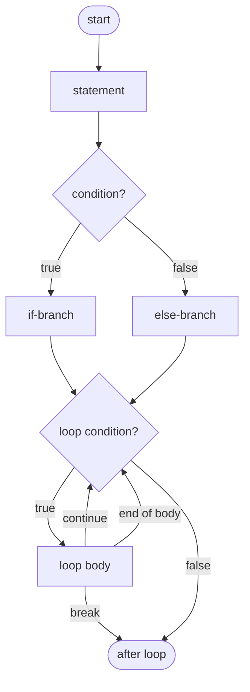
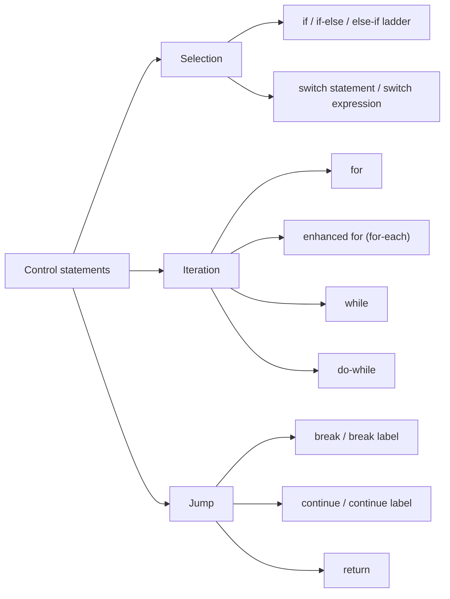
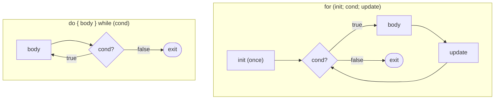
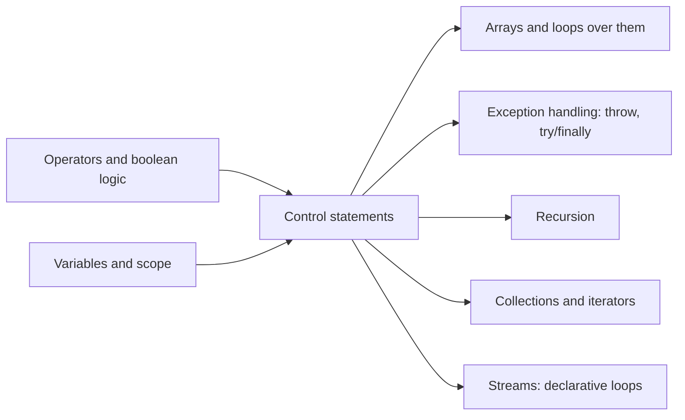

# Control Statements in Java

**TL;DR:** **Control statements** decide *which* code runs and *how many times*. Java has three families: **selection** (`if`, `if-else`, `switch`), **iteration** (`for`, enhanced `for`, `while`, `do-while`) and **jump** (`break`, `continue`, `return`, plus labels). Modern Java adds **switch expressions** (Java 14) and **pattern matching in `switch`** (Java 21). Most interview traps come from stray semicolons, missing braces, `switch` fall-through, and loops whose counters overflow or never change.

## Table of Contents

1. [TL;DR](#1-tldr)
2. [Why it matters](#2-why-it-matters)
3. [Prerequisites](#3-prerequisites)
4. [Mental model](#4-mental-model)
5. [Core concepts](#5-core-concepts)
6. [How it works](#6-how-it-works)
7. [Examples](#7-examples)
8. [Comparisons](#8-comparisons)
9. [Trade-offs](#9-trade-offs)
10. [Gotchas](#10-gotchas)
11. [Practical application](#11-practical-application)
12. [Interview prep](#12-interview-prep)
13. [Interview question bank](#13-interview-question-bank)
14. [Tricky code snippets](#14-tricky-code-snippets)
15. [Connections](#15-connections)
16. [Summary](#16-summary)
17. [Answers](#answers)

---

## 1. TL;DR

Without control statements, Java runs every statement once, top to bottom. Control statements change that flow:

- **Selection** picks a path: `if (cond) … else …`, `switch (value) { case … }`.
- **Iteration** repeats: `for`, `for (x : collection)`, `while`, `do { } while`.
- **Jumps** leave early: `break` (exit a loop/switch), `continue` (skip to the next iteration), `return` (exit the method).

**The analogy: driving through a city.**

| Driving… | Java… |
|---|---|
| A fork in the road with a signpost: "if raining, take the tunnel, else the bridge" | `if` / `else` |
| A roundabout with numbered exits: you take exactly the exit that matches your destination | `switch` |
| A roundabout where, once you take an exit, you keep driving through every later exit unless you hit a stop sign | Old-style `switch` **fall-through** without `break` |
| Laps around a race track until a condition is met | Loops: `for`, `while` |
| Driving at least one lap before checking the fuel gauge | `do-while` (body runs at least once) |
| Skipping the rest of this lap and starting the next | `continue` |
| Taking the exit ramp off the track | `break` |
| Leaving the whole motorway system, not just the current ramp | **Labeled** `break outer` |
| Going home entirely | `return` |

**Running example:** a daily order processor that loops over orders, skips cancelled ones (`continue`), stops at a sentinel (`break`), routes each order with a `switch`, computes the day's label with nested ternaries and a switch expression, and searches a 2-D shelf grid with a labeled `break`.

---

## 2. Why it matters

**The problem.** Every real program makes decisions and repeats work: validate input, process each order, retry until success, stop at the first match. Control statements are how you express that, and they're the backbone of every coding-round solution.

**What goes wrong when control flow is misunderstood** (all verified on Java 21):

| Code | Result | Cause |
|---|---|---|
| `if (x > 5); { print(); }` | Always prints | The `;` is an empty statement that *is* the `if` body |
| `if (x > 5) a(); b();` (no braces) | `b()` always runs | Without braces only one statement belongs to the `if` |
| `switch` cases without `break` | Several cases run | **Fall-through** |
| `for (byte b = 0; b < 200; b++)` | Never ends | A `byte` is always `< 200`; it wraps from 127 to −128 |
| `for (double d = 0; d < 1.0; d += 0.1)` | Runs **11** times | `0.1` added ten times is `0.9999999999999999` |
| `while (i < 5) { if (i == 2) continue; i++; }` | Never ends | `continue` skips the `i++` |
| Removing from a `List` inside for-each | `ConcurrentModificationException` (usually) | The iterator detects the change |
| `if (score >= 60) … else if (score >= 75) …` | 95 gets `"C"` | Conditions checked in order; first match wins |

**Why interviewers ask.** Fresher rounds ask the definitions (`while` vs `do-while`, `break` vs `continue`, what types `switch` accepts). Every coding round uses loops, and good candidates are expected to know modern `switch`, labeled breaks, and the classic "what does this print?" traps.

---

## 3. Prerequisites

| Prerequisite | One-line refresher | Importance |
|---|---|---|
| `boolean` expressions | Conditions must be `boolean`: `x > 0`, `a && b` ([Operators notes]) | Essential |
| Variables and scope | A variable declared in a block exists only in that block ([Declaring Variables notes]) | Essential |
| Primitive ranges and overflow | `byte` max is 127; `int` wraps ([Primitive Data Types notes]) | Essential |
| Arrays and `String` basics | `arr[i]`, `arr.length`, `s.equals(t)` | Essential |
| Enums and records | Fixed set of constants; compact data classes | Nice-to-have (Java 21 `switch` patterns) |

---

## 4. Mental model

> **The one picture to keep in your head:** control flow is a path through a flowchart. Selection adds **diamonds** (branch points); loops add **arrows back up**; jumps add **arrows out**.


*Selection branches; loops go back to their condition; `continue` jumps back to the condition; `break` jumps out.*

**The three families:**


*(`throw` also transfers control; it's covered with exception handling.)*

---

## 5. Core concepts

### 5.1 Glossary

| Term | Meaning (1 line) | Tiny example |
|---|---|---|
| **Control statement** | A statement that changes the order in which code executes. | `if`, `for`, `break` |
| **Condition** | A `boolean` expression that controls a branch or loop. | `total >= 500` |
| **Block** | Statements grouped in `{ }`; treated as one statement. | `{ a(); b(); }` |
| **Empty statement** | A lone `;` that does nothing. | `if (x); ` |
| **`if-else` ladder** | A chain of `else if` checks; the first true branch runs. | `if … else if … else …` |
| **Dangling else** | An `else` always pairs with the **nearest** unmatched `if`. | See Snippet 4 |
| **`switch` statement** | Jumps to the `case` matching a value. | `switch (day) { case 1: … }` |
| **Fall-through** | In colon-style `case X:` blocks, execution continues into the next case unless `break`. | Missing `break` |
| **Switch expression** | A `switch` that produces a value (Java 14+). | `String s = switch (k) { case 1 -> "one"; default -> "?"; };` |
| **Arrow label `->`** | `case X ->` runs only its own code: no fall-through. | `case 1 -> print("one");` |
| **`yield`** | Returns a value from a block inside a switch expression. | `case 2 -> { yield 20; }` |
| **Exhaustive** | A switch expression must handle every possible value. | `default`, or all enum constants |
| **Pattern matching switch** | `case Type var` tests a type and binds a variable (Java 21). | `case Integer i -> …` |
| **Guard (`when`)** | Extra condition on a pattern case (Java 21). | `case Integer i when i > 10 ->` |
| **Loop** | Repeats a block while a condition holds. | `while (i < 5)` |
| **Iteration** | One execution of a loop body. | |
| **Enhanced for (for-each)** | Loops over every element of an array or `Iterable` (Java 5). | `for (int x : arr)` |
| **Entry-controlled loop** | Checks the condition **before** the body (`for`, `while`). | May run 0 times |
| **Exit-controlled loop** | Checks the condition **after** the body (`do-while`). | Runs at least once |
| **Infinite loop** | A loop whose condition never becomes false. | `while (true)`, `for (;;)` |
| **`break`** | Exits the innermost `switch` or loop (or a labeled statement). | |
| **`continue`** | Skips to the next iteration of the innermost (or labeled) loop. | |
| **Label** | A name before a statement, used by `break label` / `continue label`. | `outer: for (…)` |
| **`return`** | Exits the current method (optionally with a value). | `return i;` |
| **Unreachable statement** | Code the compiler can prove never runs; a compile error. | Code after `while (true) {}` |

### 5.2 Selection statements

```java
if (cond) { … }                                     // simple if

if (cond) { … } else { … }                          // if-else

if (a) { … } else if (b) { … } else { … }           // else-if ladder: first true branch wins

if (a) { if (b) { … } }                             // nested if
```

**`switch`: the four forms** (all verified):

| Form | Syntax | Fall-through? | Produces a value? | Since |
|---|---|---|---|---|
| Classic statement | `case 1: …; break;` | **Yes**, without `break` | No | Java 1.0 |
| Arrow statement | `case 1 -> …;` | No | No | Java 14 |
| Arrow expression | `x = switch (k) { case 1 -> 10; default -> 0; };` | No | Yes; must be exhaustive | Java 14 |
| Colon expression | `x = switch (k) { case 1: yield 10; default: yield 0; };` | Yes, but must `yield` | Yes | Java 14 |

> [!WARNING]
> You can't mix `case X:` and `case X ->` in one switch: *different case kinds used in the switch*. And a switch **expression** can't contain `return`: *attempt to return out of a switch expression*.

**What can a `switch` select on?**

| Selector type | Allowed? |
|---|---|
| `byte`, `short`, `char`, `int` and their wrappers | ✅ |
| `String` (Java 7+) | ✅ (uses `hashCode()` then `equals()`) |
| `enum` | ✅ (constants can be written unqualified; qualified `Light.RED` also works in Java 21) |
| Any reference type with **patterns** (Java 21) | ✅ `case Integer i ->`, `case String s ->`, `case null ->` |
| `long`, `float`, `double`, `boolean` | ❌ *selector type … is not allowed* (verified on 21; ⚠️ primitive patterns are previewed in later versions) |

**Case label rules:** each label must be a **compile-time constant** (a literal, or a `final` variable initialised with a constant), labels must be **unique**, and they must **fit** the selector type (`case 200` for a `byte` selector fails). `default` can appear anywhere; it runs when no case matches.

### 5.3 Iteration statements

| Loop | Syntax | Checks condition | Minimum runs | Best for |
|---|---|---|---|---|
| `for` | `for (init; condition; update) body` | Before each iteration | 0 | Known number of iterations, index needed |
| Enhanced `for` | `for (Type x : arrayOrIterable) body` | — (until elements run out) | 0 | Visiting every element, no index |
| `while` | `while (condition) body` | Before each iteration | 0 | Unknown count; condition-driven |
| `do-while` | `do body while (condition);` | After each iteration | **1** | Must run at least once (menus, retries) |

`for` details:
- Any of the three parts may be empty: `for (;;)` is an infinite loop.
- Several variables are allowed if they share one type: `for (int i = 0, j = 10; i < j; i++, j--)`. Mixing types (`int i = 0, long j = 0`) is a syntax error.
- The loop variable's scope ends with the loop.

### 5.4 Jump statements

| Statement | Effect | Valid inside |
|---|---|---|
| `break;` | Exit the innermost loop or `switch` | Loop or `switch` (else: *break outside switch or loop*) |
| `break label;` | Exit the labeled statement (any labeled block, not just loops) | The labeled statement |
| `continue;` | Skip to the next iteration of the innermost loop | Loop only |
| `continue label;` | Skip to the next iteration of the labeled **loop** | Labeled loop only (else: *not a loop label*) |
| `return;` / `return value;` | Exit the method | Any method (value required unless `void`) |

> [!NOTE]
> Inside a `switch` inside a loop, a plain `break` exits only the **switch**; `continue` still affects the **loop**. Verified in Snippet 33.

---

## 6. How it works

### 6.1 How each loop executes


*In a `for` loop, `continue` jumps to the **update** step; in `while`/`do-while`, straight to the condition.*

That one difference explains a classic bug: converting a `for` loop that uses `continue` into a `while` loop can create an infinite loop if the increment sits after the `continue` (Snippet 37).

### 6.2 How `switch` executes

1. Evaluate the selector **once** (for `String`, enum or patterns, a `null` selector throws `NullPointerException` unless there's a `case null`).
2. Jump to the matching label (or `default`).
3. **Colon style:** run statements from there **downwards** until `break`, `yield`, `return`, `continue`, `throw` or the end of the switch.
4. **Arrow style:** run only that case's expression, block or `throw`.
5. **Pattern switch:** cases are checked **top to bottom**; the first matching pattern (and guard) wins, so a more general pattern can't come before a more specific one (*this case label is dominated by a preceding case label*).

Behind the scenes, `javac` compiles integer switches to a `tableswitch` (a jump table for dense values) or a `lookupswitch` (a sorted table for sparse values), and `String` switches to a `hashCode()` switch followed by `equals()` checks. That's why strings with the same hash, like `"Aa"` and `"BB"` (both `2112`), still work correctly (verified).

### 6.3 Worked example: the daily order processor, traced

```java
// OrderProcessor.java  —  run with: javac OrderProcessor.java && java OrderProcessor
public class OrderProcessor {
    public static void main(String[] args) {
        String[] orders = {"PAID:120", "CANCELLED:80", "PENDING:200", "PAID:300", "STOP", "PAID:999"};
        int revenue = 0, pending = 0, processed = 0;

        for (String order : orders) {                 // enhanced for
            if (order.equals("STOP")) {               // sentinel
                System.out.println("Stop marker reached");
                break;                                // leave the loop entirely
            }
            String[] parts = order.split(":");
            String status = parts[0];
            int amount = Integer.parseInt(parts[1]);
            if (status.equals("CANCELLED")) {
                continue;                             // skip the rest of this iteration
            }
            switch (status) {                         // arrow switch: no fall-through
                case "PAID" -> revenue += amount;
                case "PENDING" -> pending += amount;
                default -> System.out.println("Unknown status " + status);
            }
            processed++;
        }

        String verdict = revenue >= 400 ? "good day" : revenue > 0 ? "slow day" : "no sales";

        int day = 3;
        String dayName = switch (day) {               // switch expression
            case 1, 7 -> "weekend";                   // several labels in one case
            case 2, 3, 4, 5, 6 -> {
                String d = "weekday";
                yield d + " #" + (day - 1);           // yield from a block
            }
            default -> throw new IllegalArgumentException("bad day " + day);
        };

        int[][] shelves = {{4, 8, 15}, {16, 23, 42}};
        int target = 23, foundRow = -1, foundCol = -1;
        search:                                       // label on the outer loop
        for (int r = 0; r < shelves.length; r++) {
            for (int c = 0; c < shelves[r].length; c++) {
                if (shelves[r][c] == target) {
                    foundRow = r; foundCol = c;
                    break search;                     // exits BOTH loops
                }
            }
        }

        int attempts = 0;
        do {
            attempts++;
        } while (attempts < 3);                       // body runs before the first check

        System.out.println("Revenue " + revenue + ", pending " + pending + ", processed " + processed);
        System.out.println(verdict + ", " + dayName);
        System.out.println("Found " + target + " at [" + foundRow + "][" + foundCol + "]");
        System.out.println("Attempts " + attempts);
    }
}
```

**Expected output** (verified):
```
Stop marker reached
Revenue 420, pending 200, processed 3
good day, weekday #2
Found 23 at [1][1]
Attempts 3
```

**Trace of the main loop:**

| Iteration | `order` | Path taken | `revenue` | `pending` | `processed` |
|---|---|---|---|---|---|
| 1 | `"PAID:120"` | switch → `PAID` | 120 | 0 | 1 |
| 2 | `"CANCELLED:80"` | `continue` (switch and `processed++` skipped) | 120 | 0 | 1 |
| 3 | `"PENDING:200"` | switch → `PENDING` | 120 | 200 | 2 |
| 4 | `"PAID:300"` | switch → `PAID` | 420 | 200 | 3 |
| 5 | `"STOP"` | `break`: loop ends | 420 | 200 | 3 |
| — | `"PAID:999"` | **never visited** | | | |

**Trace of the labeled search:**

| `r` | `c` | `shelves[r][c]` | Action |
|---|---|---|---|
| 0 | 0, 1, 2 | 4, 8, 15 | no match |
| 1 | 0 | 16 | no match |
| 1 | 1 | 23 | match → `break search` exits **both** loops; `c = 2` is never checked |

**Things to notice:**
- `continue` in iteration 2 also skipped `processed++`, which is usually what you want for cancelled orders, but a common source of bugs when the counter update is placed after the `continue`.
- `verdict` uses a nested ternary (right-associative): `revenue >= 400 ? … : (revenue > 0 ? … : …)`.
- The switch expression's `default` throws, which is allowed: a switch expression must produce a value **or** throw on every path.
- `do-while` checked `attempts < 3` only *after* each run, so it ran 3 times.

---

## 7. Examples

### 7.1 Toy example: classic loop programs

```java
public class LoopBasics {
    public static void main(String[] args) {
        // Sum and reverse the digits of a number
        int n = 9045, sum = 0, rev = 0;
        while (n > 0) {
            int d = n % 10;
            sum += d;
            rev = rev * 10 + d;
            n /= 10;
        }
        System.out.println(sum + " " + rev);                 // 18 5409

        // FizzBuzz
        StringBuilder sb = new StringBuilder();
        for (int i = 1; i <= 15; i++) {
            if (i % 15 == 0) sb.append("FizzBuzz");          // most specific check first!
            else if (i % 3 == 0) sb.append("Fizz");
            else if (i % 5 == 0) sb.append("Buzz");
            else sb.append(i);
            sb.append(i < 15 ? "," : "\n");
        }
        System.out.print(sb);

        // Pyramid pattern with nested logic
        int rows = 4;
        for (int i = 1; i <= rows; i++) {
            System.out.println(" ".repeat(rows - i) + "*".repeat(2 * i - 1));
        }
    }
}
```
**Expected output:**
```
18 5409
1,2,Fizz,4,Buzz,Fizz,7,8,Fizz,Buzz,11,Fizz,13,14,FizzBuzz
   *
  ***
 *****
*******
```

### 7.2 Real-world examples

| System | Control-flow pattern | Why |
|---|---|---|
| **Web servers and message consumers** (e.g. Kafka consumer loops) | `while (running) { poll(); process(); }` | An event loop runs until a shutdown flag flips; the flag must be `volatile` or atomic so the loop sees the change. |
| **Retry logic** (HTTP clients, database reconnects) | `do { attempt(); } while (failed && tries < max);` | The call must run at least once; a cap prevents infinite retries. |
| **JDK `String` switch compilation** | `hashCode()` switch + `equals()` | Lets `switch` on text run in close to constant time instead of comparing every label. |
| **Parsers and state machines** (lexers, protocol handlers) | `switch` on the current state or character inside a loop | Clear, table-like code; `javac` can turn dense cases into a jump table. |
| **Modern domain code with sealed types** | Pattern-matching `switch` over a `sealed` hierarchy | The compiler checks exhaustiveness, so adding a new subtype breaks the build until every switch handles it. |

---

## 8. Comparisons

### 8.1 `if-else` vs `switch`

| | `if-else` | `switch` |
|---|---|---|
| Conditions | Any `boolean` expression, ranges (`x > 10`) | Equality against constants, or type patterns (Java 21) |
| Selector types | Anything | `int`-family, wrappers, `String`, enums, patterns; not `long`/`float`/`double`/`boolean` |
| Readability | Best for 2–3 branches or ranges | Best for many discrete values |
| Can produce a value | Only via the ternary `?:` | Yes, switch expressions |
| Compiler checks | None for completeness | Duplicate labels, exhaustiveness (expressions, sealed types, enums) |
| Performance | Checks conditions in order | Can use a jump table (`tableswitch`); rarely a deciding factor |

### 8.2 `while` vs `do-while` vs `for` vs for-each

| | `while` | `do-while` | `for` | Enhanced `for` |
|---|---|---|---|---|
| Condition check | Before | **After** | Before | Implicit |
| Minimum iterations | 0 | **1** | 0 | 0 |
| Index available | Manual | Manual | Yes | No |
| Can modify array elements | Yes (via index) | Yes | Yes | **No** (the variable is a copy) |
| Can remove from a collection | Use `Iterator.remove()` | Same | Via index (carefully) | No (`ConcurrentModificationException`) |
| Typical use | Unknown count | Menus, retries, input validation | Counting, index math | Read every element |

### 8.3 `break` vs `continue` vs `return`

| | `break` | `continue` | `return` |
|---|---|---|---|
| Exits | Innermost loop/switch (or labeled statement) | Current iteration only | Whole method |
| Next statement executed | First statement after the loop | The loop's update/condition | Caller |
| Works in `switch`? | Yes | Only if the switch is inside a loop (affects the loop) | Yes |
| With labels | `break label` (any labeled statement) | `continue label` (loops only) | — |

### 8.4 Classic `switch` vs arrow `switch`

| | `case X:` | `case X ->` |
|---|---|---|
| Fall-through | Yes (need `break`) | No |
| Multiple labels | `case 1: case 2:` | `case 1, 2 ->` |
| Scope | One shared block for all cases | Each case has its own scope |
| In an expression | `yield value;` | value directly, or `{ … yield value; }` |

**Use `if-else` when…** conditions are ranges or combine several variables.
**Use `switch` when…** you're choosing among many discrete values or types; prefer the arrow form.
**Use `for` when…** you need an index or a known count; **for-each** when you just read elements.
**Use `while` when…** the number of iterations depends on a condition; **`do-while`** when the body must run first.

---

## 9. Trade-offs

| Choice | Benefit | Cost / limitation |
|---|---|---|
| **Classic switch fall-through** | Lets several cases share code | The #1 switch bug; forgotten `break`s. Prefer arrow labels or `case 1, 2 ->`. |
| **Switch expressions** | Value-producing, no fall-through, compiler-checked exhaustiveness | Java 14+ only; no `return` inside; must cover every value. |
| **Pattern-matching switch** (Java 21) | Replaces `instanceof` chains; exhaustive with sealed types | Case order matters (dominance); newer syntax unfamiliar to some teams. |
| **Labeled `break`/`continue`** | Clean exit from nested loops without flags | Can look like `goto`; often a sign the nested loop belongs in its own method with `return`. |
| **Enhanced `for`** | No index bugs, works on any `Iterable` | No index, can't modify array elements or remove from collections; ⚠️ creates an `Iterator` for collections (negligible in most code). |
| **Deeply nested `if`s** | Straightforward to write | Hard to read ("arrow code"); use guard clauses (`if (bad) return;`) and early `continue`. |
| **`while (true)` + `break`** | Natural for loops whose exit condition is in the middle | Exit conditions are hidden in the body; easy to create real infinite loops. |
| **Nested loops** | Simple for 2-D data | Cost multiplies: two nested loops over `n` items are O(n²); `for i, for j = i..n` runs n(n+1)/2 times (15 for n = 5, verified). |

---

## 10. Gotchas

### Myths

| ❌ Myth | ✅ Reality |
|---|---|
| Indentation decides what belongs to an `if`. | Only braces do. Without them, the `if` controls exactly one statement. |
| `else` pairs with the `if` it's lined up with. | It pairs with the **nearest** unmatched `if` (dangling else). |
| `if (x > 5);` is a harmless typo. | The `;` is the whole body; the following block always runs. |
| `switch` runs only the matching case. | Classic colon-style cases **fall through** until `break`. Arrow cases don't. |
| `default` must be last. | It can be anywhere; with fall-through, its position affects what runs next (Snippet 15). |
| `switch` works on `long`, `double`, `boolean`. | Not allowed (*selector type … is not allowed*). |
| `switch` on a `null` `String` goes to `default`. | Classic switch throws `NullPointerException`; Java 21 allows `case null`. |
| Case labels can be any variable. | They must be compile-time constants (a `final` local with a constant initialiser works). |
| `while (false)` and `if (false)` are both fine. | `if (false)` compiles (allowed for "conditional compilation"); `while (false) { … }` is an *unreachable statement* error. |
| `do-while` checks first. | It checks **after**: the body always runs at least once. |
| For-each lets you change array elements. | The loop variable is a **copy**; `x *= 10` changes nothing in the array. |
| Removing from a list in for-each always throws. | Usually `ConcurrentModificationException`, but removing the **second-to-last** element exits the loop silently (Snippet 41). |
| `continue` works inside any block. | Only inside loops; `continue label` needs a **loop** label. |
| `break` exits all nested loops. | Only the innermost one (unless labeled). |
| `https://example.com` in code is a syntax error. | `https:` is a **label** and `//example.com` a comment; it compiles (Snippet 47). |

### Common mistakes and edge cases

**1. Wrong order in an else-if ladder.** Put the most specific (or highest) condition first. `if (s >= 60) "C" else if (s >= 75) "B"` gives `"C"` for 95.

**2. Loop counter types that can't reach the limit.**
```java
for (byte b = 0; b < 200; b++) { }                                          // infinite: byte max is 127
for (int i = Integer.MAX_VALUE - 2; i <= Integer.MAX_VALUE; i++) { }        // infinite: i wraps to MIN_VALUE
for (double d = 0.0; d != 1.0; d += 0.1) { }                                // infinite: never exactly 1.0
```

**3. `continue` skipping the update in a `while` loop.**
```java
int i = 0;
while (i < 5) {
    if (i == 2) continue;   // i is never incremented again: infinite loop
    i++;
}
```

**4. Shared scope in a classic switch.** All `case X:` blocks share one scope, so declaring `int x` in two cases is *variable x is already defined*. Use braces per case or arrow labels.

**5. `return` inside a switch expression** is a compile error; use `yield`.

**6. A `break` inside a `try` still runs `finally`.** `try { if (i == 1) break; } finally { print("finally"); }` prints the `finally` text before leaving the loop (Snippet 45).

**7. Unboxing in conditions.** `Boolean flag = null; if (flag)` throws `NullPointerException`.

---

## 11. Practical application

### Writing clean control flow: checklist
- [ ] Always use braces, even for one-line bodies
- [ ] Prefer **guard clauses** (`if (invalid) return;`) over deep nesting
- [ ] Order else-if conditions from most to least specific
- [ ] Prefer arrow `switch` / switch expressions; add `default` (or rely on exhaustiveness for enums/sealed types)
- [ ] Use pattern-matching `switch` instead of long `instanceof` chains (Java 21)
- [ ] Use for-each for reading, index `for` for writing, `Iterator.remove()` or `removeIf` for removal
- [ ] Make sure every loop's condition can actually become false: check types, overflow and floating-point counters
- [ ] Never use `float`/`double` loop counters; loop over integers and compute the decimal
- [ ] Extract nested loops into a method and `return` instead of using labels, when it's clearer
- [ ] For shared loop flags across threads, use `volatile` or `AtomicBoolean`

### Hands-on exercise: fix the loop

This method should return the **sum of the positive, even numbers** in an array, stopping early if it meets a `0` (end marker). It has three bugs. Find them without running it, then fix them.

```java
static int sumPositiveEvens(int[] nums) {
    int sum = 0;
    int i = 0;
    while (i < nums.length) {
        if (nums[i] == 0);
            break;
        if (nums[i] < 0 || nums[i] % 2 == 1) {
            continue;
        }
        sum += nums[i];
        i++;
    }
    return sum;
}
// sumPositiveEvens(new int[]{4, -2, 3, 6, -5, 0, 8}) should return 10
```

**Expected outcome:** after fixing, the call returns `10` (4 + 6; stops at 0, so 8 is excluded).

<details><summary>Answer</summary>

1. **Stray semicolon:** `if (nums[i] == 0);` has an empty body, so the `break` on the next line is **unconditional**. The compiler notices that everything after it in the loop can never run and rejects the method with *unreachable statement* (verified). Remove the `;` and add braces.
2. **`continue` skips `i++`:** when a negative or odd number is seen, `i` never advances, causing an infinite loop. Increment before `continue`, or use a `for` loop, where `continue` jumps to the update.
3. **Odd check fails for negatives:** `-5 % 2` is `-1`, not `1`. Here negatives are already excluded by `nums[i] < 0`, but `% 2 != 0` is the correct habit.

Fixed version (verified to return `10`):
```java
static int sumPositiveEvens(int[] nums) {
    int sum = 0;
    for (int i = 0; i < nums.length; i++) {
        if (nums[i] == 0) {
            break;
        }
        if (nums[i] < 0 || nums[i] % 2 != 0) {
            continue;          // in a for loop, continue still runs i++
        }
        sum += nums[i];
    }
    return sum;
}
```
</details>

---

## 12. Interview prep

### Likely questions with model answers

**Q1. What are the types of control statements in Java?**
> "Three families. Selection statements choose a path: `if`, `if-else`, the else-if ladder, nested `if`, and `switch`. Iteration statements repeat code: `for`, the enhanced for-each loop, `while` and `do-while`. Jump statements transfer control: `break`, `continue` and `return`, and `break` and `continue` can take labels for nested loops. Since Java 14 `switch` can also be an expression that returns a value, and since Java 21 it supports pattern matching."

**Q2. What's the difference between `while` and `do-while`?**
> "`while` is entry-controlled: it checks the condition first, so the body may run zero times. `do-while` is exit-controlled: it runs the body first and checks afterwards, so the body always runs at least once. `do { } while (false);` runs once. `do-while` fits menus, input validation and retries, where you need one attempt before deciding whether to repeat. Syntax detail: `do-while` ends with a semicolon after the condition."

**Q3. What is fall-through in `switch`? How do you avoid it?**
> "In a classic colon-style switch, once a case matches, execution continues into the following cases until it hits a `break`, `return` or the end. So with `day = 2` and no breaks, cases 2, 3 and `default` all run. It's occasionally useful for sharing code, but usually a bug. Avoid it with `break` after each case, or better, use arrow labels `case 2 ->`, which never fall through, and `case 1, 2 ->` to share a branch."

**Q4. Which types can be used in a `switch`?**
> "`byte`, `short`, `char`, `int` and their wrappers, `String` since Java 7, and enums. Since Java 21, any reference type with type patterns, including `case null`. `long`, `float`, `double` and `boolean` aren't allowed. Case labels must be distinct compile-time constants that fit the selector type. A `String` switch is compiled to a `hashCode()` switch plus `equals()` checks, and a classic switch on a `null` reference throws `NullPointerException`."

**Q5. What are switch expressions and `yield`?**
> "Since Java 14, `switch` can be an expression that produces a value: `String name = switch (day) { case 1, 7 -> \"weekend\"; default -> \"weekday\"; };`. Arrow cases don't fall through, several labels can share a case, and the compiler requires exhaustiveness, so you need `default` unless the cases cover every enum constant or every subtype of a sealed type. When a case needs several statements, you use a block and `yield` the value. You can't `return` from inside a switch expression."

**Q6. What's the difference between `break` and `continue`? What are labeled statements?**
> "`break` exits the innermost loop or switch; `continue` skips the rest of the current iteration and goes to the next one, which in a `for` loop means running the update step first. In nested loops, both only affect the innermost loop, so Java lets you label a loop, like `outer:`, and write `break outer` to exit both loops or `continue outer` to jump to the outer loop's next iteration. `break` can target any labeled block, but `continue` only a labeled loop."

**Q7. When would you use a for-each loop, and what are its limitations?**
> "When you just need every element of an array or `Iterable`. It avoids index errors and reads cleanly. Limitations: there's no index; assigning to the loop variable doesn't change the array because it's a copy; you can't remove from a collection while iterating, which usually throws `ConcurrentModificationException`, so use `Iterator.remove()` or `removeIf`; you can't iterate two collections in parallel; and iterating a `null` array or collection throws `NullPointerException`."

**Q8. What is pattern matching for `switch` in Java 21?**
> "It lets a case match on type and bind a variable, like `case Circle c -> Math.PI * c.r() * c.r();`, add guards with `when`, and handle `null` with `case null`. Cases are checked top to bottom, so a general pattern can't precede a more specific one; the compiler reports it as dominated. Combined with sealed interfaces and records, the compiler can verify the switch covers every subtype, so no `default` is needed and adding a new subtype causes compile errors until every switch handles it."

### What interviewers watch for
- Tracing loops precisely, including the update step after `continue`.
- Spotting stray semicolons, missing braces, fall-through and dangling `else`.
- Knowing what `switch` accepts and how modern switch differs.
- Choosing the right loop and writing loops that always terminate.
- Clean code: guard clauses, no deep nesting, labels only where they help.

---

## 13. Interview question bank

Short answers are hidden. 🟢 fresher, 🟡 intermediate, 🔴 senior/FAANG follow-up.

### 13.1 Selection: `if` and `switch`

**1. 🟢 What are control statements? Name the three categories.**
<details><summary>Answer</summary>

Statements that alter the order of execution: selection (`if`, `switch`), iteration (`for`, for-each, `while`, `do-while`), jump (`break`, `continue`, `return`).
</details>

**2. 🟢 What's the syntax of `if-else`? Can the condition be an `int`?**
<details><summary>Answer</summary>

`if (cond) { … } else { … }`. No: the condition must be `boolean` (*int cannot be converted to boolean*).
</details>

**3. 🟢 What is an else-if ladder? In what order are conditions checked?**
<details><summary>Answer</summary>

A chain of `if … else if … else`. Top to bottom; the first true branch runs and the rest are skipped.
</details>

**4. 🟢 What is a nested `if`?**
<details><summary>Answer</summary>

An `if` inside another `if`'s body. The inner one is checked only if the outer condition is true.
</details>

**5. 🟡 What is the dangling-else problem? How does Java resolve it?**
<details><summary>Answer</summary>

When nested `if`s lack braces, an `else` could seem to belong to either. Java pairs it with the **nearest** unmatched `if`. Use braces.
</details>

**6. 🟡 What happens with `if (x > 5); { … }`?**
<details><summary>Answer</summary>

The `;` is an empty statement forming the `if`'s body; the block runs unconditionally.
</details>

**7. 🟢 What is a `switch` statement? When is it better than `if-else`?**
<details><summary>Answer</summary>

It jumps to the case matching a value. Better for many discrete values (or types); `if-else` is better for ranges and compound conditions.
</details>

**8. 🟢 What is fall-through?**
<details><summary>Answer</summary>

In colon-style cases, execution continues into the next cases until `break` (or `return`, `throw`, end).
</details>

**9. 🟢 Is `default` mandatory? Must it be last?**
<details><summary>Answer</summary>

Not mandatory in a switch statement (if nothing matches, nothing runs). It can be anywhere. Switch **expressions** must be exhaustive, so they usually need it.
</details>

**10. 🟡 Which data types are allowed in `switch`?**
<details><summary>Answer</summary>

`byte`, `short`, `char`, `int`, their wrappers, `String`, enums; any reference type with patterns (Java 21). Not `long`, `float`, `double`, `boolean`.
</details>

**11. 🟡 Why can't `switch` use `long`?**
<details><summary>Answer</summary>

The original design targeted `int`-sized jump tables (`tableswitch`/`lookupswitch` operate on `int`). `long`, `float`, `double` and `boolean` were never added to the classic switch. (⚠️ Primitive patterns are previewed in later versions.)
</details>

**12. 🟡 Can case labels be variables? Duplicates?**
<details><summary>Answer</summary>

Only compile-time constants (`final int ONE = 1;` works; a plain variable gives *constant expression required*). Duplicates: *duplicate case label*.
</details>

**13. 🟡 How does `switch` on `String` work internally? Is it case-sensitive?**
<details><summary>Answer</summary>

`javac` switches on `hashCode()`, then confirms with `equals()`, so hash collisions (`"Aa"`/`"BB"`) still work. It's case-sensitive; normalise with `toLowerCase()` first.
</details>

**14. 🟡 What happens if the `switch` selector is `null`?**
<details><summary>Answer</summary>

Classic switch on `String`/enum/wrapper throws `NullPointerException`. Java 21 pattern switches can handle it with `case null`.
</details>

**15. 🟡 What is a switch expression? How is it different from a switch statement?**
<details><summary>Answer</summary>

Java 14+: a switch that produces a value. It must be exhaustive, arrow cases don't fall through, and it can't contain `return`.
</details>

**16. 🟡 What does `yield` do?**
<details><summary>Answer</summary>

Returns a value from a block (or a colon-style case) inside a switch expression. `yield` is a contextual keyword, so `int yield = 5;` still compiles.
</details>

**17. 🟡 Can you mix `case 1:` and `case 2 ->` in one switch?**
<details><summary>Answer</summary>

No: *different case kinds used in the switch*.
</details>

**18. 🟡 How do you handle several values in one case?**
<details><summary>Answer</summary>

Arrow: `case 1, 7 ->`. Classic: stacked labels `case 1: case 7:` (fall-through).
</details>

**19. 🔴 What is pattern matching for `switch`? What is a guard?**
<details><summary>Answer</summary>

Java 21: `case Type var ->` matches by type and binds a variable; `when` adds a condition (`case Integer i when i > 10 ->`).
</details>

**20. 🔴 What is case dominance?**
<details><summary>Answer</summary>

A case that can never be reached because an earlier, more general case always matches first: *this case label is dominated by a preceding case label*. Put specific cases (and guarded ones) first.
</details>

**21. 🔴 When does a switch expression not need `default`?**
<details><summary>Answer</summary>

When cases cover all values: every constant of an enum, or every permitted subtype of a sealed type. Otherwise: *the switch expression does not cover all possible input values*.
</details>

**22. 🔴 How are `switch` statements compiled to bytecode?**
<details><summary>Answer</summary>

`tableswitch` (indexed jump table for dense values, O(1)) or `lookupswitch` (sorted key table for sparse values, binary search). `String` switches add a `hashCode`/`equals` step.
</details>

### 13.2 Loops

**23. 🟢 What loops does Java have?**
<details><summary>Answer</summary>

`for`, enhanced `for` (for-each), `while`, `do-while`.
</details>

**24. 🟢 Difference between `while` and `do-while`?**
<details><summary>Answer</summary>

`while` checks first (0+ runs); `do-while` checks after (1+ runs).
</details>

**25. 🟢 What are the three parts of a `for` loop? Are they mandatory?**
<details><summary>Answer</summary>

Initialisation, condition, update. All optional: `for (;;)` is infinite.
</details>

**26. 🟢 What is an infinite loop? How do you write one intentionally?**
<details><summary>Answer</summary>

A loop whose condition never becomes false: `while (true)` or `for (;;)`, exited with `break`/`return`.
</details>

**27. 🟡 Entry-controlled vs exit-controlled loops?**
<details><summary>Answer</summary>

Entry-controlled check before the body (`for`, `while`); exit-controlled check after (`do-while`).
</details>

**28. 🟡 Can you declare multiple variables in a `for` loop?**
<details><summary>Answer</summary>

Yes, of the same type: `for (int i = 0, j = 10; i < j; i++, j--)`. Different types aren't allowed.
</details>

**29. 🟡 What is the enhanced `for` loop? What can it iterate?**
<details><summary>Answer</summary>

Java 5's `for (T x : source)`; works on arrays and anything implementing `Iterable`.
</details>

**30. 🟡 Can you modify array elements in a for-each loop?**
<details><summary>Answer</summary>

No; the loop variable is a copy. Use an index loop (`arr[i] *= 10`). For object elements, you can mutate the objects themselves.
</details>

**31. 🟡 How do you safely remove elements while iterating a list?**
<details><summary>Answer</summary>

`Iterator.remove()`, `list.removeIf(predicate)`, or iterate backwards by index. Removing via the list inside for-each usually throws `ConcurrentModificationException`.
</details>

**32. 🔴 Why doesn't removing the second-to-last element in a for-each throw `ConcurrentModificationException`?**
<details><summary>Answer</summary>

`ArrayList`'s iterator checks for modification in `next()`. After the removal, `hasNext()` compares the cursor with the new, smaller size and returns `false`, so `next()` is never called and the check never runs. The last element is silently skipped.
</details>

**33. 🟡 Why is `while (false) { … }` a compile error but `if (false) { … }` isn't?**
<details><summary>Answer</summary>

The JLS reachability rules make the body of `while (false)` unreachable (an error). `if` is deliberately exempt so that `if (DEBUG) { … }` with a constant flag can act as conditional compilation.
</details>

**34. 🟡 What happens to code after `while (true) { }` with no `break`?**
<details><summary>Answer</summary>

Compile error: *unreachable statement*. With a `break` inside, the code after it is reachable.
</details>

**35. 🔴 Why does `for (byte b = 0; b < 200; b++)` never end?**
<details><summary>Answer</summary>

`b` is promoted to `int` for the comparison, but a `byte` can only hold −128..127, so it's always `< 200`; `b++` wraps from 127 to −128.
</details>

**36. 🔴 Why does `for (int i = Integer.MAX_VALUE - 2; i <= Integer.MAX_VALUE; i++)` never end?**
<details><summary>Answer</summary>

Every `int` is `<= Integer.MAX_VALUE`; after `MAX_VALUE`, `i++` wraps to `MIN_VALUE`. Use `<` or a `long`.
</details>

**37. 🔴 Why avoid floating-point loop counters?**
<details><summary>Answer</summary>

Rounding: `d += 0.1` never makes `d == 1.0` (infinite loop with `!=`), and `d < 1.0` runs 11 times. Loop over integers and compute `i / 10.0`.
</details>

**38. 🔴 What is the time complexity of nested loops `for i in 0..n, for j in i..n`?**
<details><summary>Answer</summary>

n(n+1)/2 iterations, O(n²). For n = 5: 15.
</details>

### 13.3 Jump statements

**39. 🟢 Difference between `break` and `continue`?**
<details><summary>Answer</summary>

`break` exits the loop/switch; `continue` skips to the next iteration.
</details>

**40. 🟢 Difference between `break` and `return`?**
<details><summary>Answer</summary>

`break` exits the innermost loop/switch and continues after it; `return` exits the whole method.
</details>

**41. 🟡 Can you use `break` outside a loop or switch?**
<details><summary>Answer</summary>

Only with a label on an enclosing block (`block: { … break block; }`). An unlabeled one gives *break outside switch or loop*.
</details>

**42. 🟡 What are labeled `break` and `continue`?**
<details><summary>Answer</summary>

`break outer` exits the labeled statement; `continue outer` starts the labeled loop's next iteration. Used for nested loops.
</details>

**43. 🟡 Can `continue` target a labeled block that isn't a loop?**
<details><summary>Answer</summary>

No: *not a loop label*.
</details>

**44. 🟡 In a `for` loop, where does `continue` jump? In a `while` loop?**
<details><summary>Answer</summary>

`for`: to the update expression, then the condition. `while`/`do-while`: straight to the condition (so an increment after `continue` is skipped).
</details>

**45. 🟡 Inside a `switch` inside a loop, what do `break` and `continue` do?**
<details><summary>Answer</summary>

`break` exits only the switch; `continue` goes to the loop's next iteration.
</details>

**46. 🔴 Does `finally` run when you `break` or `continue` out of a `try`?**
<details><summary>Answer</summary>

Yes. `finally` runs before control leaves the `try`, for `break`, `continue` and `return` alike.
</details>

**47. 🔴 Does Java have `goto`?**
<details><summary>Answer</summary>

`goto` is a reserved, unused keyword. Labeled `break`/`continue` cover the structured use cases.
</details>

**48. 🔴 How would you exit nested loops without labels?**
<details><summary>Answer</summary>

Extract the loops into a method and `return`, or use a boolean flag checked by the outer loop. The method approach is usually cleanest.
</details>

---

## 14. Tricky code snippets

All compiled and run on OpenJDK 21. Predict first.

**Snippet 1 🟢**
```java
int x = 3;
if (x > 5); {
    System.out.println("printed anyway");
}
```
<details><summary>Answer</summary>

`printed anyway`. The `;` is the `if`'s (empty) body; the block is a separate statement.
</details>

**Snippet 2 🟢**
```java
int x = 3;
if (x > 5)
    System.out.println("big");
    System.out.println("also printed");
```
<details><summary>Answer</summary>

`also printed`. Only the first statement belongs to the `if`; indentation means nothing.
</details>

**Snippet 3 🟡**
```java
int x = 1;
if (x > 0)
    System.out.println("a");
    System.out.println("b");
else
    System.out.println("c");
```
<details><summary>Answer</summary>

Compile error: *'else' without 'if'*. The `if` ended after `"a"`; the `"b"` line separates the `else` from it.
</details>

**Snippet 4 🔴**
```java
int a = 1, b = -1;
if (a > 0)
    if (b > 0)
        System.out.println("both positive");
else
    System.out.println("which if?");
int c = -1;
if (c > 0)
    if (b > 0)
        System.out.println("x");
else
    System.out.println("y");
System.out.println("done");
```
<details><summary>Answer</summary>

```
which if?
done
```
Each `else` belongs to the nearest `if` (the inner one). In the second block the outer `if` is false, so nothing inside runs, including the `else`.
</details>

**Snippet 5 🟢**
```java
int x = 1;
if (x) System.out.println("yes");
```
<details><summary>Answer</summary>

Compile error: *incompatible types: int cannot be converted to boolean*.
</details>

**Snippet 6 🟡**
```java
boolean flag = false;
if (flag = true) System.out.println("assigned, then true");
Boolean boxed = null;
if (boxed) System.out.println("x");
```
<details><summary>Answer</summary>

Prints `assigned, then true`, then throws `NullPointerException` (unboxing the `null` `Boolean`).
</details>

**Snippet 7 🟡**
```java
static String grade(int s) {
    if (s >= 60) return "C";
    else if (s >= 75) return "B";
    else if (s >= 90) return "A";
    else return "F";
}
// grade(95)
```
<details><summary>Answer</summary>

`C`. The first true condition wins; check the highest threshold first.
</details>

**Snippet 8 🟢**
```java
int day = 2;
switch (day) {
    case 1: System.out.println("Mon");
    case 2: System.out.println("Tue");
    case 3: System.out.println("Wed");
    default: System.out.println("Other");
}
```
<details><summary>Answer</summary>

```
Tue
Wed
Other
```
Fall-through from the matching case to the end.
</details>

**Snippet 9 🟡**
```java
int k = 5;
switch (k) {
    case 1: System.out.println("one"); break;
    default: System.out.println("default");
    case 2: System.out.println("two");
}
```
<details><summary>Answer</summary>

```
default
two
```
`default` matches, then falls through into `case 2`.
</details>

**Snippet 10 🟢**
```java
int k = 9;
switch (k) {
    case 1: System.out.println("one");
}
System.out.println("after");
```
<details><summary>Answer</summary>

`after`. No match and no `default`: the switch does nothing.
</details>

**Snippet 11 🟡** Which compile?
```java
switch (k) { case 1: break; case 1: break; }         // (a)
int one = 1;       switch (k) { case one: break; }    // (b)
final int ONE = 1; switch (k) { case ONE: break; }    // (c)
```
<details><summary>Answer</summary>

Only (c). (a) *duplicate case label*; (b) *constant expression required*. A `final` local with a constant initialiser is a constant.
</details>

**Snippet 12 🟡**
```java
String cmd = "STOP";
switch (cmd.toLowerCase()) {
    case "stop": System.out.println("stopping"); break;
    case "STOP": System.out.println("never"); break;
}
```
<details><summary>Answer</summary>

`stopping`. String switches are case-sensitive and compare with `equals`.
</details>

**Snippet 13 🟡**
```java
String s = null;
switch (s) {
    case "a": System.out.println("a"); break;
    default: System.out.println("default");
}
```
<details><summary>Answer</summary>

`NullPointerException`, not `default`. (In Java 21, a switch with `case null ->` handles it: verified to print `got null`.)
</details>

**Snippet 14 🔴**
```java
System.out.println("Aa".hashCode() + " " + "BB".hashCode());
String s = "BB";
switch (s) {
    case "Aa": System.out.println("Aa"); break;
    case "BB": System.out.println("BB"); break;
}
```
<details><summary>Answer</summary>

```
2112 2112
BB
```
Same hash, but the compiled switch checks `equals` after matching the hash.
</details>

**Snippet 15 🟡** Which compile?
```java
boolean b = true; switch (b) { case true: }   // (a)
double d = 1.0;   switch (d) { case 1.0: }    // (b)
long id = 1;      switch (id) { case 1: }     // (c)
```
<details><summary>Answer</summary>

None: *selector type boolean / double / long is not allowed*.
</details>

**Snippet 16 🟡**
```java
char grade = 'B';
switch (grade) {
    case 'A': case 'B': System.out.println("good"); break;
    case 67: System.out.println("C via int 67"); break;
    default: System.out.println("other");
}
```
<details><summary>Answer</summary>

`good`. Stacked labels share a body; `case 67` is legal for a `char` selector (67 is `'C'`).
</details>

**Snippet 17 🟡**
```java
int k = 1;
switch (k) {
    case 1:
        int x = 10;
        System.out.println(x);
        break;
    case 2:
        int x = 20;
        break;
}
```
<details><summary>Answer</summary>

Compile error: *variable x is already defined*. All colon-style cases share one scope. Use `{ }` per case or arrow labels.
</details>

**Snippet 18 🟢**
```java
int k = 1;
switch (k) {
    case 1 -> System.out.println("one");
    case 2 -> System.out.println("two");
    default -> System.out.println("other");
}
```
<details><summary>Answer</summary>

`one`. Arrow cases never fall through.
</details>

**Snippet 19 🟡**
```java
int k = 1;
switch (k) {
    case 1 -> System.out.println("a");
    case 2: System.out.println("b");
}
```
<details><summary>Answer</summary>

Compile error: *different case kinds used in the switch*.
</details>

**Snippet 20 🟡**
```java
int k = 1;
String s = switch (k) {
    case 1 -> "one";
};
```
<details><summary>Answer</summary>

Compile error: *the switch expression does not cover all possible input values*. Add `default`.
</details>

**Snippet 21 🔴**
```java
int k = 2;
int r = switch (k) {
    case 1:
        yield 10;
    case 2:
        System.out.println("in case 2");
        yield 20;
    default:
        yield 0;
};
System.out.println(r);
```
<details><summary>Answer</summary>

```
in case 2
20
```
Colon-style cases are allowed in switch expressions; each path must `yield`.
</details>

**Snippet 22 🔴**
```java
static int f(int k) {
    return switch (k) {
        case 1 -> { return 5; }
        default -> 0;
    };
}
```
<details><summary>Answer</summary>

Compile error: *attempt to return out of a switch expression*. Use `yield 5;`.
</details>

**Snippet 23 🟡**
```java
int k = 1;
switch (k) {
    case 1 -> "one";
    default -> "other";
}
```
<details><summary>Answer</summary>

Compile error: *not a statement* (twice). A switch **statement**'s arrow cases must be statements; a bare value only makes sense in a switch **expression**.
</details>

**Snippet 24 🟢**
```java
int yield = 5;
System.out.println(yield);
```
<details><summary>Answer</summary>

`5`. `yield` is contextual; it's only special inside switch expressions.
</details>

**Snippet 25 🟡**
```java
enum Light { RED, YELLOW, GREEN }
Light l = Light.YELLOW;
String action = switch (l) {
    case RED -> "stop";
    case YELLOW -> "slow";
    case GREEN -> "go";
};
System.out.println(action);
```
<details><summary>Answer</summary>

`slow`. No `default` needed: all enum constants are covered.
</details>

**Snippet 26 🔴**
```java
static String describe(Object o) {
    return switch (o) {
        case Integer i when i > 10 -> "big int";
        case Integer i -> "int " + i;
        case String str -> "string of length " + str.length();
        case null -> "null!";
        default -> "something else";
    };
}
// describe(42), describe(7), describe("hey"), describe(null), describe(3.0)
```
<details><summary>Answer</summary>

`big int, int 7, string of length 3, null!, something else`. Patterns are tried top to bottom; guards refine them; `case null` prevents the NPE.
</details>

**Snippet 27 🔴**
```java
return switch (o) {
    case Integer i -> "int";
    case Integer i when i > 10 -> "big";
    default -> "other";
};
```
<details><summary>Answer</summary>

Compile error: *this case label is dominated by a preceding case label*. Every `Integer` matches the first case, so the guarded one is unreachable.
</details>

**Snippet 28 🔴**
```java
sealed interface Shape permits Circle, Square {}
record Circle(double r) implements Shape {}
record Square(double side) implements Shape {}
static double area(Shape s) {
    return switch (s) {
        case Circle c when c.r() == 0 -> 0;
        case Circle c -> Math.PI * c.r() * c.r();
        case Square sq -> sq.side() * sq.side();
    };
}
// printf("%.2f %.2f", area(new Circle(1)), area(new Square(2)))
```
<details><summary>Answer</summary>

`3.14 4.00`. No `default` needed: the sealed interface's permitted subtypes are all covered.
</details>

**Snippet 29 🟡** Which compile?
```java
while (false) { System.out.println("never"); }   // (a)
if (false) { System.out.println("never"); }      // (b)
for (;false;) { System.out.println("x"); }       // (c)
do { System.out.println("once"); } while (false); // (d)
```
<details><summary>Answer</summary>

(b) and (d). (a) and (c): *unreachable statement*. (d) prints `once`.
</details>

**Snippet 30 🟡**
```java
while (true) { }
System.out.println("unreachable");
```
<details><summary>Answer</summary>

Compile error: *unreachable statement*. (Add a `break` inside the loop and it compiles.)
</details>

**Snippet 31 🔴**
```java
int i = 0, guard = 0;
while (i < 3 && guard++ < 1000); {
    i++;
}
System.out.println("i=" + i + " guard=" + guard);
```
<details><summary>Answer</summary>

`i=1 guard=1001`. The `;` makes the loop body empty, so it spins until the guard stops it; the block runs once afterwards. (Without the guard, it would be an infinite loop.)
</details>

**Snippet 32 🟡**
```java
int sum = 0;
for (int i = 0; i < 5; i++); {
    sum++;
}
System.out.println(sum);
```
<details><summary>Answer</summary>

`1`. Empty loop body; the block runs once after the loop.
</details>

**Snippet 33 🔴**
```java
for (int i = 0; i < 4; i++) {
    switch (i) {
        case 1: break;
        case 2: continue;
        default: System.out.print("i=" + i + " ");
    }
    System.out.print("after-switch(" + i + ") ");
}
```
<details><summary>Answer</summary>

`i=0 after-switch(0) after-switch(1) i=3 after-switch(3)`. `break` leaves the switch only; `continue` skips the rest of the loop body for `i = 2`.
</details>

**Snippet 34 🟢**
```java
for (int i = 0, j = 10; i < j; i += 3, j -= 3) {
    System.out.print(i + ":" + j + " ");
}
```
<details><summary>Answer</summary>

`0:10 3:7`. After that, `i = 6`, `j = 4`, so the loop stops.
</details>

**Snippet 35 🟡**
```java
for (int i = 0, long j = 0; i < 3; i++) { }
```
<details><summary>Answer</summary>

Compile error (several syntax errors). Multiple loop variables must share one type.
</details>

**Snippet 36 🔴**
```java
int iterations = 0;
for (byte b = 0; b < 200; b++) {
    if (++iterations > 1000) break;
}
System.out.println(iterations);
```
<details><summary>Answer</summary>

`1001`: the guard stopped an infinite loop. A `byte` never reaches 200; it wraps from 127 to −128.
</details>

**Snippet 37 🔴**
```java
int i = 0, guard = 0;
while (i < 5 && guard++ < 50) {
    if (i == 2) continue;
    System.out.print(i + " ");
    i++;
}
System.out.println("| i=" + i + " guard=" + guard);
```
<details><summary>Answer</summary>

`0 1 | i=2 guard=51`. Once `i == 2`, `continue` skips `i++` forever; only the guard ends it. In a `for` loop with `i++` in the header this bug can't happen.
</details>

**Snippet 38 🔴**
```java
int count = 0;
for (int i = Integer.MAX_VALUE - 2; i <= Integer.MAX_VALUE; i++) {
    if (++count > 10) break;
}
System.out.println(count);
```
<details><summary>Answer</summary>

`11` (guard). Without it: infinite, since every `int` is `<= MAX_VALUE`.
</details>

**Snippet 39 🔴**
```java
int count = 0;
for (double d = 0.0; d != 1.0; d += 0.1) {
    if (++count > 20) break;
}
System.out.println(count);
count = 0;
for (double d = 0.0; d < 1.0; d += 0.1) count++;
System.out.println(count);
```
<details><summary>Answer</summary>

`21` (guard: `d` skips over 1.0) and `11` (the 11th value is `0.9999999999999999`).
</details>

**Snippet 40 🟡**
```java
for (int i = 0; i < 10; i++) {
    System.out.print(i + " ");
    i += 2;
}
```
<details><summary>Answer</summary>

`0 3 6 9`. The body adds 2 and the update adds 1 each time.
</details>

**Snippet 41 🔴**
```java
List<String> names = new ArrayList<>(List.of("a", "b", "c", "d"));
for (String n : names) if (n.equals("a")) names.remove(n);   // (1)

List<String> names2 = new ArrayList<>(List.of("a", "b", "c"));
for (String n : names2) if (n.equals("b")) names2.remove(n);  // (2)
System.out.println(names2);
```
<details><summary>Answer</summary>

(1) throws `ConcurrentModificationException`. (2) prints `[a, c]` with **no** exception: after removing the second-to-last element, `hasNext()` returns false, so the modification check in `next()` never runs (and `"c"` is never visited). Use `removeIf` or `Iterator.remove()`.
</details>

**Snippet 42 🟡**
```java
int[] arr = {1, 2, 3};
for (int x : arr) x *= 10;
System.out.println(Arrays.toString(arr));
```
<details><summary>Answer</summary>

`[1, 2, 3]`. `x` is a copy of each element.
</details>

**Snippet 43 🟡**
```java
for (int i = 1; i <= 10; i++) {
    if (i % 2 == 0) continue;
    if (i > 7) break;
    System.out.print(i + " ");
}
```
<details><summary>Answer</summary>

`1 3 5 7`. Evens are skipped; at `i = 9`, `break`.
</details>

**Snippet 44 🔴**
```java
outer:
for (int i = 1; i <= 3; i++) {
    for (int j = 1; j <= 3; j++) {
        if (j == 2) continue outer;
        if (i == 3) break outer;
        System.out.print(i + "" + j + " ");
    }
}
```
<details><summary>Answer</summary>

`11 21`. For each `i`, only `j = 1` prints before `continue outer`; at `i = 3`, `j = 1` hits `break outer`.
</details>

**Snippet 45 🔴**
```java
for (int i = 0; i < 3; i++) {
    try {
        if (i == 1) break;
        System.out.print("try" + i + " ");
    } finally {
        System.out.print("finally" + i + " ");
    }
}
```
<details><summary>Answer</summary>

`try0 finally0 finally1`. `finally` runs even when `break` leaves the `try`.
</details>

**Snippet 46 🟡**
```java
block: {
    System.out.println("in block");
    if (true) break block;
    System.out.println("skipped");
}
System.out.println("after block");
```
<details><summary>Answer</summary>

```
in block
after block
```
`break` works with any labeled statement. (`continue block` would be *not a loop label*.)
</details>

**Snippet 47 🔴**
```java
System.out.print("start ");
https://www.example.com
System.out.println("end");
```
<details><summary>Answer</summary>

Compiles; prints `start end`. `https:` is a label and `//www.example.com` is a comment.
</details>

**Snippet 48 🟢**
```java
int x = 1;
if (x > 0) break;
```
<details><summary>Answer</summary>

Compile error: *break outside switch or loop*.
</details>

**Snippet 49 🟡**
```java
int a = 10, b = 10, wc = 0, dc = 0;
while (a < 5) { wc++; a++; }
do { dc++; b++; } while (b < 5);
System.out.println(wc + " " + dc);
```
<details><summary>Answer</summary>

`0 1`. The `do-while` body runs once before its false condition is checked.
</details>

**Snippet 50 🟡**
```java
int count = 0;
for (int i = 0; i < 5; i++)
    for (int j = i; j < 5; j++)
        count++;
System.out.println(count);
```
<details><summary>Answer</summary>

`15` = 5 + 4 + 3 + 2 + 1 = n(n+1)/2.
</details>

**Snippet 51 🟢**
```java
int i = 5;
for (int i = 0; i < 2; i++) { }
```
<details><summary>Answer</summary>

Compile error: *variable i is already defined*. (Two separate `for (int i…)` loops one after the other are fine.)
</details>

**Snippet 52 🟡**
```java
int[] arr = null;
for (int x : arr) System.out.println(x);
```
<details><summary>Answer</summary>

`NullPointerException`. For-each doesn't treat `null` as empty.
</details>

---

## 15. Connections


*Control flow is the bridge from expressions to algorithms.*

- **Arrays:** the main thing loops iterate over; index bounds and nested loops for 2-D data.
- **Exception handling:** `throw` is another way to transfer control; `finally` interacts with `break`/`return`.
- **Recursion:** an alternative to loops; base case = loop exit condition.
- **Collections and iterators:** how for-each works under the hood and safe removal.
- **Streams:** `filter`/`map`/`forEach` replace many loops with declarative pipelines.

---

## 16. Summary

**One-line essence:** Selection picks a path (`if`, `switch`), iteration repeats (`for`, for-each, `while`, `do-while`), jumps leave early (`break`, `continue`, `return`, labels); use braces, arrow switches and loops whose conditions can actually become false.

### 60-second revision card
- Conditions must be `boolean`; braces define bodies, not indentation; `else` binds to the nearest `if`.
- Classic `case X:` falls through without `break`; arrow `case X ->` never does.
- `switch` accepts `int`-family, wrappers, `String`, enums, and patterns (Java 21); not `long`/`float`/`double`/`boolean`.
- Switch expressions (Java 14) return values, must be exhaustive, use `yield` in blocks, can't `return`.
- `while` checks first (0+ runs), `do-while` checks after (1+ runs).
- In `for`, `continue` runs the update; in `while`, it doesn't.
- For-each: variable is a copy; no removal (use `removeIf`/`Iterator.remove`).
- `break label` exits nested loops; `continue label` needs a loop label.

### Cheat sheet

| Syntax | Meaning |
|---|---|
| `if (c) {…} else if (d) {…} else {…}` | Ladder; first true branch runs |
| `switch (x) { case 1: …; break; default: … }` | Classic switch (fall-through) |
| `switch (x) { case 1, 2 -> …; default -> … }` | Arrow switch (no fall-through) |
| `T v = switch (x) { case 1 -> a; default -> { yield b; } };` | Switch expression |
| `case Integer i when i > 0 ->` / `case null ->` | Patterns, guards, null (Java 21) |
| `for (int i = 0; i < n; i++)` | Counting loop |
| `for (T x : items)` | For-each |
| `while (c) {…}` / `do {…} while (c);` | Condition loops |
| `for (;;)` / `while (true)` | Infinite loop |
| `outer: for (…) { … break outer; … continue outer; }` | Labeled jumps |

| Compiler error | Cause |
|---|---|
| *'else' without 'if'* | Extra statement between `if` body and `else` |
| *duplicate case label* | Same constant twice |
| *constant expression required* | Non-constant case label |
| *selector type X is not allowed* | `long`/`float`/`double`/`boolean` switch |
| *different case kinds used in the switch* | Mixing `:` and `->` |
| *the switch expression does not cover all possible input values* | Missing `default` |
| *attempt to return out of a switch expression* | `return` instead of `yield` |
| *this case label is dominated by a preceding case label* | General pattern before specific one |
| *unreachable statement* | Code after an infinite loop, `while (false)` body |
| *break outside switch or loop* | Unlabeled `break` elsewhere |
| *not a loop label* | `continue` with a non-loop label |

### Self-test questions

1. 🟢 Name the three categories of control statements and give two examples of each.
2. 🟢 What's the minimum number of times a `do-while` body runs? A `while` body?
3. 🟡 What does fall-through mean, and how do arrow labels change it?
4. 🟡 List the selector types `switch` supports in Java 21, and four it doesn't.
5. 🟡 Why can a `continue` cause an infinite loop in a `while` loop but not in an equivalent `for` loop?
6. 🟡 When does a switch expression not need a `default`?
7. 🔴 **Spot the bug.** What does this print for `level = 2`, and how do you fix it?
   ```java
   switch (level) {
       case 1: System.out.println("Bronze");
       case 2: System.out.println("Silver");
       case 3: System.out.println("Gold");
   }
   ```
8. 🔴 You need to find the first pair of numbers in a 2-D grid whose sum equals a target and stop searching immediately. Write the loop structure two ways: with a label, and without one.

### Flashcards (Anki)

```
Three categories of control statements? :: Selection (if, switch), iteration (for, for-each, while, do-while), jump (break, continue, return)
while vs do-while? :: while checks before (0+ runs); do-while checks after (at least 1 run)
What is switch fall-through? :: In colon-style cases, execution continues into later cases until break
Do arrow (->) cases fall through? :: No
Types allowed in a classic switch? :: byte, short, char, int, their wrappers, String, enums (patterns on any reference type in Java 21)
Types NOT allowed as switch selectors? :: long, float, double, boolean
What does yield do? :: Returns a value from a block inside a switch expression
Where does continue jump in a for loop? :: To the update expression, then the condition
Can you modify array elements via a for-each variable? :: No — the loop variable is a copy
How do you exit nested loops at once? :: Labeled break (break outer;) or return from an extracted method
```

### Resources
- **The Java Tutorials: Control Flow Statements** (Oracle): https://docs.oracle.com/javase/tutorial/java/nutsandbolts/flow.html
- **JEP 361: Switch Expressions** and **JEP 441: Pattern Matching for switch** (OpenJDK): https://openjdk.org/jeps/361 and https://openjdk.org/jeps/441
- **The Java Language Specification**, Chapter 14 "Blocks, Statements, and Patterns" (including reachability rules §14.22): https://docs.oracle.com/javase/specs/
- **Java Puzzlers** by Joshua Bloch and Neal Gafter: loop puzzles such as the `Integer.MAX_VALUE` and URL-label examples.

---

## Answers

<details><summary>1. Three categories</summary>

Selection: `if-else`, `switch`. Iteration: `for`, `while` (also for-each, `do-while`). Jump: `break`, `continue` (also `return`).
</details>

<details><summary>2. Minimum runs</summary>

`do-while`: 1 (checks after the body). `while`: 0 (checks before).
</details>

<details><summary>3. Fall-through</summary>

In a classic colon-style switch, after the matching case runs, execution continues into the following cases until a `break` (or `return`/`throw`/end). Arrow labels (`case X ->`) execute only their own code, so there's no fall-through.
</details>

<details><summary>4. Selector types</summary>

Supported: `byte`, `short`, `char`, `int`, `Byte`, `Short`, `Character`, `Integer`, `String`, enums, and any reference type with patterns. Not supported: `long`, `float`, `double`, `boolean`.
</details>

<details><summary>5. continue in while vs for</summary>

In a `for` loop, `continue` jumps to the update expression (`i++`), so the counter still advances. In a `while` loop, `continue` jumps straight to the condition; if the increment is written after the `continue`, it's skipped and the counter never changes.
</details>

<details><summary>6. Switch expression without default</summary>

When the cases are exhaustive: all constants of an enum, all permitted subtypes of a sealed type, or an unguarded pattern that matches the selector's whole type (e.g. `case Object o`). Otherwise the compiler requires `default`.
</details>

<details><summary>7. Spot the bug: missing break</summary>

For `level = 2` it prints `Silver` **and** `Gold` (fall-through). Fix with breaks, or use arrow labels:
```java
switch (level) {
    case 1 -> System.out.println("Bronze");
    case 2 -> System.out.println("Silver");
    case 3 -> System.out.println("Gold");
}
```
</details>

<details><summary>8. Exiting nested loops</summary>

With a label:
```java
found:
for (int r = 0; r < grid.length; r++) {
    for (int c = 0; c + 1 < grid[r].length; c++) {
        if (grid[r][c] + grid[r][c + 1] == target) {
            System.out.println(r + "," + c);
            break found;
        }
    }
}
```
Without a label (extract a method and `return`):
```java
static int[] findPair(int[][] grid, int target) {
    for (int r = 0; r < grid.length; r++)
        for (int c = 0; c + 1 < grid[r].length; c++)
            if (grid[r][c] + grid[r][c + 1] == target) return new int[]{r, c};
    return null;
}
```
</details>
