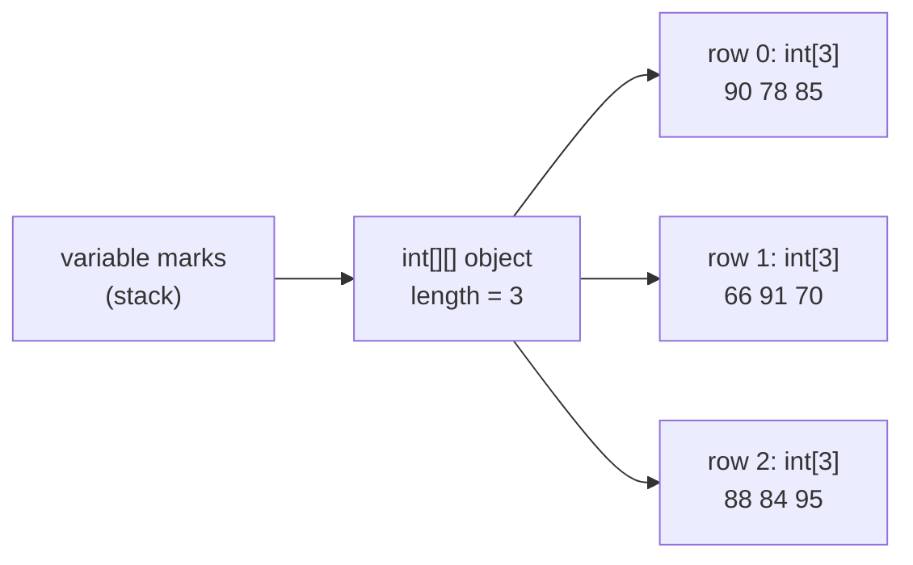
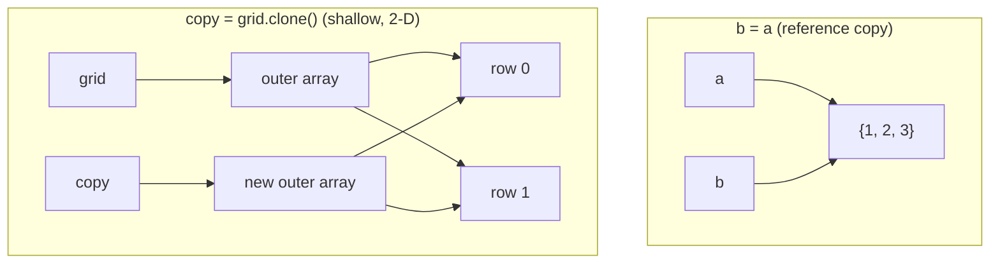
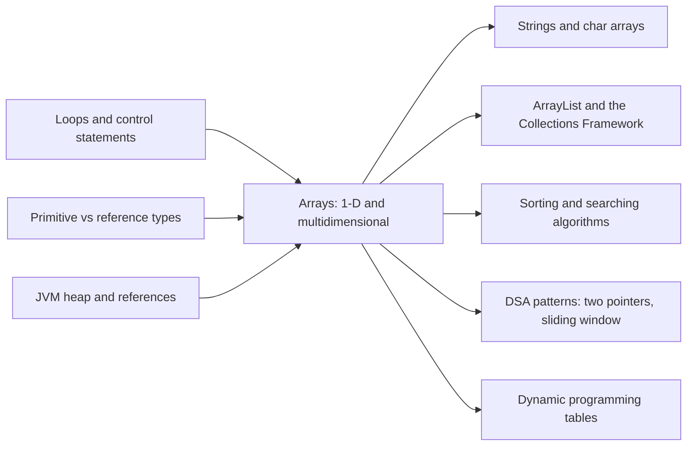

# Arrays in Java: 1-D and Multidimensional

**TL;DR:** An **array** is a fixed-size, ordered block of elements of **one type**, accessed by a zero-based **index** in O(1) time. In Java an array is an **object** on the heap: the variable holds a *reference*, `length` is a field, and out-of-range access throws `ArrayIndexOutOfBoundsException`. A **2-D array is an array of arrays**: each row is a separate object, so rows can have different lengths (**jagged arrays**). Arrays are also the most common data structure in coding interviews.

## Table of Contents

1. [TL;DR](#1-tldr)
2. [Why it matters](#2-why-it-matters)
3. [Prerequisites](#3-prerequisites)
4. [Mental model](#4-mental-model)
5. [Core concepts](#5-core-concepts)
6. [How it works](#6-how-it-works)
7. [Examples](#7-examples)
8. [Comparisons](#8-comparisons)
9. [Trade-offs](#9-trade-offs)
10. [Gotchas](#10-gotchas)
11. [Practical application](#11-practical-application)
12. [Interview prep](#12-interview-prep)
13. [Interview question bank](#13-interview-question-bank)
14. [Tricky code snippets](#14-tricky-code-snippets)
15. [Connections](#15-connections)
16. [Summary](#16-summary)
17. [Answers](#answers)

---

## 1. TL;DR

- **1-D array:** `int[] scores = {72, 95, 58};` holds a row of values; `scores[0]` is `72`; `scores.length` is `3`.
- **2-D array:** `int[][] marks = new int[3][4];` is 3 rows, each an `int[4]`; `marks[1][2]` is row 1, column 2.
- **Jagged array:** `int[][] tri = {{1}, {1, 1}, {1, 2, 1}};` rows of different lengths.
- Arrays have a **fixed length** once created. For a growable list, use `ArrayList`.
- `java.util.Arrays` provides `toString`, `sort`, `binarySearch`, `fill`, `copyOf`, `equals`, `deepToString` and more.

**The analogy: lockers in a corridor.**

| Lockers | Arrays |
|---|---|
| A corridor with a fixed number of identical lockers, numbered from **0** | An array of fixed `length`, indexed from 0 |
| Every locker holds the same kind of thing | One element type (`int[]` holds only `int`s) |
| You walk straight to locker 37 without opening 0–36 | **O(1)** random access by index |
| Asking for locker 50 in a 50-locker corridor | `ArrayIndexOutOfBoundsException` (valid indexes 0–49) |
| Your **key card** says which corridor is yours; giving a copy of the card to a friend doesn't copy the lockers | The variable holds a **reference**; `b = a` shares the same array |
| A hotel: floors × rooms per floor | 2-D array: rows × columns |
| A building where each floor has a different number of rooms | **Jagged** array |
| Adding a locker means building a new, longer corridor and moving everything | Arrays can't grow; you allocate a new one and copy (`Arrays.copyOf`) |

**Running example:** a gradebook. A 1-D array of scores (sum, average, max, sort, binary search), a 2-D `marks[student][subject]` table (column totals), and a jagged array of retake attempts where each student took a different number of tests.

---

## 2. Why it matters

**The problem arrays solve.** Without them you'd need a separate variable for every value (`score1`, `score2`, …) and couldn't loop over them. An array gives you **many values under one name**, stored next to each other in memory, with **constant-time access** by position.

**What goes wrong when arrays are misunderstood** (all verified on Java 21):

| Code | Result | Cause |
|---|---|---|
| `for (int i = 0; i <= a.length; i++)` | `ArrayIndexOutOfBoundsException` | Last valid index is `length - 1` |
| `int[] b = a; b[0] = 99;` | `a[0]` is also `99` | Assignment copies the **reference**, not the array |
| `a == b` / `a.equals(b)` for equal contents | `false` / `false` | Both compare references; use `Arrays.equals` |
| `System.out.println(arr)` | `[I@1b6d3586`-style text | Arrays don't override `toString`; use `Arrays.toString` |
| `int[][] copy = grid.clone(); copy[0][0] = 99;` | `grid[0][0]` changes too | `clone` of a 2-D array is **shallow** |
| `Arrays.binarySearch` on an unsorted array | Wrong answer (`-1` for a present value) | Binary search requires sorted input |
| `int max = 0;` then scan `{-5, -2, -9}` | `0` | Wrong initial value; start from `a[0]` or `Integer.MIN_VALUE` |
| `Arrays.asList(new int[]{1, 2, 3}).size()` | `1` | A primitive array is one object; generics need wrapper types |

**Why interviewers ask.** Arrays are the foundation of DSA rounds: two pointers, sliding window, prefix sums, binary search, Kadane's algorithm and matrix traversal all run on arrays. Language rounds ask about declaration syntax, default values, memory layout, copying and `java.util.Arrays`.

---

## 3. Prerequisites

| Prerequisite | One-line refresher | Importance |
|---|---|---|
| Primitive and reference types | `int` holds a value; objects are accessed through references ([Primitive Data Types notes]) | Essential |
| Loops | `for`, for-each, nested loops ([Control Statements notes]) | Essential |
| Stack vs heap | Locals live in stack frames; objects (arrays included) on the heap ([JVM Architecture notes]) | Essential |
| Pass-by-value | Methods receive a copy of the reference ([Declaring Variables and Methods notes]) | Essential |
| Big-O notation | O(1) constant, O(n) linear, O(n log n), O(n²) | Essential for DSA |
| Generics basics | `List<Integer>` needs a wrapper type | Nice-to-have |

---

## 4. Mental model

> **The one picture to keep in your head:** the array variable is a **reference** on the stack; the array itself is an **object** on the heap holding its `length` and a contiguous block of elements. A 2-D array is an array **of references to row arrays**.

```
 1-D:  int[] scores = {72, 95, 58, 88, 64};

   STACK                      HEAP (one array object)
 ┌──────────────┐        ┌──────────┬────┬────┬────┬────┬────┐
 │ scores ──────┼───────►│ header   │ 72 │ 95 │ 58 │ 88 │ 64 │
 └──────────────┘        │ length=5 │ [0]│ [1]│ [2]│ [3]│ [4]│
                         └──────────┴────┴────┴────┴────┴────┘
 element address = start + index × 4 bytes   →  O(1) access
```
*The index is an offset; that's why lookup is O(1) and why indexing starts at 0.*

```
 2-D (jagged):  int[][] attempts = { {40}, {55, 61}, {30, 45, 70} };

   STACK                 HEAP
 ┌──────────────┐    ┌──────────────────┐
 │ attempts ────┼───►│ int[][] length=3 │
 └──────────────┘    │ [0] ─────────────┼──► int[] {40}
                     │ [1] ─────────────┼──► int[] {55, 61}
                     │ [2] ─────────────┼──► int[] {30, 45, 70}
                     └──────────────────┘
```
*An outer array of references to separate row arrays. Rows needn't be the same length or next to each other in memory.*


*`marks[1][2]` follows the reference to row 1, then reads index 2: `70`.*

---

## 5. Core concepts

### 5.1 Glossary

| Term | Meaning (1 line) | Tiny example |
|---|---|---|
| **Array** | Fixed-size, ordered collection of elements of one type. | `int[] a = new int[5];` |
| **Element** | One value stored in the array. | `a[2]` |
| **Index** | Zero-based position of an element; must be an `int` (or narrower). | `0` to `length - 1` |
| **`length`** | Final field holding the number of elements (not a method). | `a.length` |
| **Array creation expression** | `new` + type + size, allocating the array on the heap. | `new int[5]` |
| **Array initialiser** | Braces listing the elements; size inferred. | `{1, 2, 3}` |
| **Anonymous array** | Creation + initialiser without a variable. | `sum(new int[]{1, 2})` |
| **Default value** | Value elements get on creation. | `0`, `0.0`, `false`, `'\u0000'`, `null` |
| **Multidimensional array** | An array whose elements are arrays. | `int[][] m` |
| **Rectangular array** | All rows the same length. | `new int[3][4]` |
| **Jagged (ragged) array** | Rows of different lengths. | `new int[3][]` + separate rows |
| **Shallow copy** | Copies the top-level elements (for 2-D: the row **references**). | `grid.clone()` |
| **Deep copy** | Copies nested arrays too. | Clone each row |
| **`ArrayIndexOutOfBoundsException`** | Runtime error for an index `< 0` or `>= length`. | `a[a.length]` |
| **`NegativeArraySizeException`** | Runtime error for a negative size. | `new int[-1]` |
| **`ArrayStoreException`** | Storing a wrong type into a covariant array. | `Object[] o = new String[1]; o[0] = 1;` |
| **Covariance** | `String[]` is a subtype of `Object[]`. | `Object[] o = new String[2];` |
| **Row-major order** | Traversing row by row (`[i][j]` with `j` inner). | Cache-friendly in Java |

### 5.2 Declaring and creating arrays

| Syntax | Meaning | Notes (verified) |
|---|---|---|
| `int[] a;` | Declare a reference (no array yet) | Preferred style |
| `int a[];` | Same, C-style | Legal, discouraged |
| `int[] a = new int[5];` | Create 5 elements, all `0` | Size can be any `int` expression ≥ 0 |
| `int[] a = {1, 2, 3};` | Declare + initialise | Only allowed **in a declaration** |
| `a = new int[]{1, 2, 3};` | Assign a new initialised array later | `a = {1, 2, 3};` is a syntax error |
| `int[] a = new int[3]{1, 2, 3};` | ❌ | *array creation with both dimension expression and initialization is illegal* |
| `int[5] a;` | ❌ | Size never goes in the type |
| `int[] d, e;` | Two `int[]` variables | |
| `int f[], g;` | **`f` is `int[]`, `g` is plain `int`** | Classic trap |
| `int[] x, y[];` | `x` is `int[]`, `y` is `int[][]` | Legal but confusing |
| `int[] a = {1, 2, 3,};` | Trailing comma allowed | length 3 |
| `new int[0]` | Empty array | Useful instead of returning `null` |

**Default values** (verified: `0 0.0 false 0 null`):

| Element type | Default |
|---|---|
| `byte`, `short`, `int`, `long` | `0` |
| `float`, `double` | `0.0` |
| `char` | `'\u0000'` |
| `boolean` | `false` |
| Any reference (`String`, `Integer`, `int[]`…) | `null` |

### 5.3 Multidimensional arrays

```java
int[][] m = new int[3][4];            // 3 rows × 4 columns, all 0
int rows = m.length;                  // 3
int cols = m[0].length;               // 4

int[][] jag = new int[3][];           // rows not created yet: jag[0] is null
jag[0] = new int[1];
jag[1] = new int[2];
jag[2] = new int[3];

int[][] tri = {{1}, {1, 1}, {1, 2, 1}};   // jagged initialiser
int[][][] cube = new int[2][3][4];        // 3-D: 2 × 3 × 4 = 24 ints
```

- The **first** dimension is required: `new int[][3]` doesn't compile.
- `m.length` is the number of **rows**; `m[i].length` is the length of row `i`.
- Accessing a row that was never created (`jag[0][0]` before `jag[0] = …`) throws `NullPointerException`.

### 5.4 The `java.util.Arrays` toolbox

| Method | What it does | Example result (verified) |
|---|---|---|
| `Arrays.toString(a)` | Readable string | `[1, 2, 3]` |
| `Arrays.deepToString(m)` | Nested arrays | `[[1, 2], [3, 4]]` |
| `Arrays.sort(a)` | Sort ascending (in place) | `[1, 2, 5, 7, 9]` |
| `Arrays.sort(a, from, to)` | Sort a range `[from, to)` | `{9,8,7,6,5}` range 1..4 → `[9, 6, 7, 8, 5]` |
| `Arrays.sort(objs, comparator)` | Custom order (objects only) | `Collections.reverseOrder()` on `Integer[]` |
| `Arrays.binarySearch(a, key)` | Index if found, else `-(insertionPoint) - 1` | `7` → `3`; `6` → `-4` |
| `Arrays.fill(a, v)` | Set every element | `[7, 7, 7, 7, 7]` |
| `Arrays.setAll(a, i -> f(i))` | Compute each element from its index | `[0, 1, 4, 9, 16]` |
| `Arrays.copyOf(a, n)` | New array of length `n` (pads/truncates) | `[99, 2, 3, 0, 0]` |
| `Arrays.copyOfRange(a, from, to)` | New array from a range | `[2, 3]` |
| `System.arraycopy(src, sp, dst, dp, len)` | Fast copy, overlap-safe | |
| `Arrays.equals(a, b)` / `deepEquals` | Compare contents (1-D / nested) | `true` |
| `Arrays.hashCode(a)` | Content-based hash | Equal arrays → equal hashes |
| `Arrays.compare(a, b)` / `mismatch(a, b)` | Lexicographic compare / first differing index (Java 9+) | `-1` / `1` |
| `Arrays.asList(objs)` | Fixed-size `List` **view** backed by the array | Writes go through; `add` throws |
| `Arrays.stream(a)` | Stream for sum, max, filter… | `sum` 15, `max` 7 |

### 5.5 Time complexity of array operations

| Operation | Time | Why |
|---|---|---|
| Read / write `a[i]` | O(1) | Address arithmetic |
| Linear search | O(n) | Check each element |
| Binary search (sorted) | O(log n) | Halve the range each step |
| Insert / delete in the middle | O(n) | Shift elements |
| Append when full | O(n) | Allocate a bigger array and copy |
| `Arrays.sort` (primitives) | O(n log n) | Dual-pivot quicksort (⚠️ since JDK 14 with a heapsort fallback guaranteeing O(n log n)) |
| `Arrays.sort` (objects) | O(n log n), **stable** | TimSort |
| Traverse an n × m matrix | O(n·m) | Every cell once |

---

## 6. How it works

### 6.1 What happens on `new int[5]`

1. The JVM allocates one **object** on the heap: a header (type + `length`) plus 5 × 4 bytes for elements.
2. All elements are set to the default value (`0`).
3. A **reference** to the object is returned and stored in the variable.
4. Every access `a[i]` is checked: if `i < 0 || i >= length`, the JVM throws `ArrayIndexOutOfBoundsException` (verified message: *Index 3 out of bounds for length 3*). This bounds check is part of Java's memory safety.

> [!NOTE]
> ⚠️ On 64-bit HotSpot an array object has a 16-byte header (12 bytes plus a 4-byte length, with compressed pointers), so `new int[1000]` takes about 4,016 bytes. The maximum length is close to `Integer.MAX_VALUE`; the exact VM limit is slightly lower.

### 6.2 What happens on `new int[3][4]`

1. Create the outer `int[][]` of length 3 (elements are **references**).
2. Create three separate `int[4]` row objects and store their references in the outer array.
3. Total: **4 objects**. With `new int[3][]`, only the outer array is created and every row is `null` until you assign one.

Because each row is a separate object, **row-major** traversal (`for i … for j … m[i][j]`) reads memory sequentially and is much faster than column-major (`for j … for i …`). ⚠️ On the test machine, summing a 2000 × 2000 matrix column-by-column was about 7× slower than row-by-row; the exact ratio depends on hardware.

### 6.3 Copying: reference copy vs shallow copy vs deep copy


*`b = a` shares everything; `clone()` on a 2-D array copies only the outer array, so rows are still shared.*

| Copy method | 1-D result | 2-D result |
|---|---|---|
| `b = a` | Same array | Same array |
| `a.clone()`, `Arrays.copyOf`, `System.arraycopy` | Independent copy of the elements | **Shallow**: new outer array, same row objects |
| Loop `deep[i] = orig[i].clone()` | — | Deep copy (rows independent) |

### 6.4 Worked example: the gradebook, traced

```java
// Gradebook.java  —  run with: javac Gradebook.java && java Gradebook
import java.util.*;

public class Gradebook {
    public static void main(String[] args) {
        // 1-D: one score per student
        int[] scores = {72, 95, 58, 88, 64};
        int sum = 0, max = scores[0], maxIdx = 0;       // start max from a real element
        for (int i = 0; i < scores.length; i++) {
            sum += scores[i];
            if (scores[i] > max) { max = scores[i]; maxIdx = i; }
        }
        double avg = (double) sum / scores.length;      // cast to avoid integer division
        int[] sorted = scores.clone();                  // sort a copy, keep the original
        Arrays.sort(sorted);
        int pos = Arrays.binarySearch(sorted, 88);      // only valid on sorted data

        // 2-D: marks[student][subject]
        String[] subjects = {"Math", "Physics", "Chem"};
        int[][] marks = {
            {90, 78, 85},
            {66, 91, 70},
            {88, 84, 95}
        };
        int[] subjectTotals = new int[subjects.length];
        for (int s = 0; s < marks.length; s++) {
            for (int sub = 0; sub < marks[s].length; sub++) {
                subjectTotals[sub] += marks[s][sub];    // column totals
            }
        }

        // Jagged: each student took a different number of retakes
        int[][] attempts = new int[3][];
        attempts[0] = new int[]{40};
        attempts[1] = new int[]{55, 61};
        attempts[2] = new int[]{30, 45, 70};
        int best = 0;
        for (int[] row : attempts) for (int a : row) best = Math.max(best, a);

        System.out.printf("sum=%d avg=%.1f max=%d at index %d%n", sum, avg, max, maxIdx);
        System.out.println("sorted=" + Arrays.toString(sorted) + " original=" + Arrays.toString(scores)
                + " index of 88=" + pos);
        System.out.println("subject totals=" + Arrays.toString(subjectTotals));
        System.out.println("marks=" + Arrays.deepToString(marks));
        System.out.println("attempt row lengths=" + attempts[0].length + "," + attempts[1].length + ","
                + attempts[2].length + " best=" + best);
    }
}
```

**Expected output** (verified):
```
sum=377 avg=75.4 max=95 at index 1
sorted=[58, 64, 72, 88, 95] original=[72, 95, 58, 88, 64] index of 88=3
subject totals=[244, 253, 250]
marks=[[90, 78, 85], [66, 91, 70], [88, 84, 95]]
attempt row lengths=1,2,3 best=70
```

**Trace of the 1-D loop:**

| `i` | `scores[i]` | `sum` | `max` | `maxIdx` |
|---|---|---|---|---|
| start | — | 0 | 72 | 0 |
| 0 | 72 | 72 | 72 | 0 |
| 1 | 95 | 167 | 95 | 1 |
| 2 | 58 | 225 | 95 | 1 |
| 3 | 88 | 313 | 95 | 1 |
| 4 | 64 | 377 | 95 | 1 |

`avg = 377.0 / 5 = 75.4`. Without the `(double)` cast it would be `75`.

**Trace of the column totals** (`subjectTotals` after each student row):

| After row `s` | Math | Physics | Chem |
|---|---|---|---|
| 0 (`90, 78, 85`) | 90 | 78 | 85 |
| 1 (`66, 91, 70`) | 156 | 169 | 155 |
| 2 (`88, 84, 95`) | 244 | 253 | 250 |

**Things to notice:**
- `scores.clone()` let us sort without destroying the original order.
- `binarySearch` returned index `3` in the **sorted** copy, not the original.
- Outer loop over students, inner over subjects: row-major order (cache-friendly).
- For the jagged array, the inner loop must use each row's own length (the for-each does this automatically).

---

## 7. Examples

### 7.1 Toy example: matrix operations

```java
import java.util.*;

public class Matrix {
    static int[][] transpose(int[][] m) {
        int[][] t = new int[m[0].length][m.length];
        for (int i = 0; i < m.length; i++)
            for (int j = 0; j < m[0].length; j++)
                t[j][i] = m[i][j];
        return t;
    }

    static int[][] multiply(int[][] a, int[][] b) {         // (n×k) · (k×p) = n×p
        int n = a.length, k = b.length, p = b[0].length;
        int[][] c = new int[n][p];
        for (int i = 0; i < n; i++)
            for (int j = 0; j < p; j++)
                for (int x = 0; x < k; x++)
                    c[i][j] += a[i][x] * b[x][j];
        return c;
    }

    static void rotate90(int[][] m) {                       // clockwise, in place: transpose + reverse rows
        int n = m.length;
        for (int i = 0; i < n; i++)
            for (int j = i + 1; j < n; j++) { int t = m[i][j]; m[i][j] = m[j][i]; m[j][i] = t; }
        for (int[] row : m)
            for (int l = 0, r = n - 1; l < r; l++, r--) { int t = row[l]; row[l] = row[r]; row[r] = t; }
    }

    public static void main(String[] args) {
        int[][] a = {{1, 2, 3}, {4, 5, 6}};
        System.out.println(Arrays.deepToString(transpose(a)));
        int[][] b = {{1, 0}, {0, 1}, {2, 2}};
        System.out.println(Arrays.deepToString(multiply(a, b)));
        int[][] sq = {{1, 2, 3}, {4, 5, 6}, {7, 8, 9}};
        rotate90(sq);
        System.out.println(Arrays.deepToString(sq));
    }
}
```
**Expected output:**
```
[[1, 4], [2, 5], [3, 6]]
[[7, 8], [16, 17]]
[[7, 4, 1], [8, 5, 2], [9, 6, 3]]
```

### 7.2 Real-world examples

| System | How it uses arrays | Why |
|---|---|---|
| **`java.util.ArrayList`** (JDK) | Stores elements in an internal `Object[]`; when full, allocates a bigger array (about 1.5×) and copies with `Arrays.copyOf` | Gives a growable list on top of fixed-size arrays; appends are amortised O(1). |
| **`java.util.HashMap`** (JDK) | Its bucket table is an array of nodes; the index is `(n - 1) & hash` | O(1) average lookups come from array indexing. |
| **Image processing** (e.g. `java.awt.image.BufferedImage`) | Pixels are stored as `int` values in arrays, rows × width | Row-major traversal keeps processing cache-friendly. |
| **Game boards, spreadsheets, dynamic programming tables** | 2-D arrays `grid[row][col]`, `dp[i][j]` | Natural fit for grid-shaped data. |
| **Network and file I/O** | `byte[]` buffers (`InputStream.read(byte[])`) | Raw bytes are read in chunks into reusable arrays. |

---

## 8. Comparisons

### 8.1 Array vs `ArrayList`

| | Array (`int[]`, `String[]`) | `ArrayList<T>` |
|---|---|---|
| Size | Fixed at creation | Grows automatically |
| Element types | Primitives **or** objects | Objects only (`Integer`, not `int`) |
| Memory | Compact (an `int[]` uses 4 bytes per element) | Wrapper objects plus references for primitives |
| Length | `arr.length` (field) | `list.size()` (method) |
| Access | `arr[i]` | `list.get(i)` |
| Printing | `Arrays.toString(arr)` | `list` prints itself |
| Type safety | Covariant: runtime `ArrayStoreException` possible | Generic: compile-time checked |
| Multidimensional | Built in (`int[][]`) | `List<List<Integer>>` |
| Use when | Size known, primitives, performance-critical | Size changes, you need list operations |

### 8.2 Rectangular vs jagged 2-D arrays

| | Rectangular `new int[3][4]` | Jagged `new int[3][]` |
|---|---|---|
| Row lengths | All equal | Any |
| Rows created | Immediately | Manually, one by one (`null` until then) |
| Memory | Rows × max columns | Exactly what's needed |
| Use for | Matrices, grids, DP tables | Triangles (Pascal's), adjacency lists, variable-length data |

### 8.3 Ways to copy an array

| Method | New array? | Can resize? | Overlapping ranges in the same array | Speed |
|---|---|---|---|---|
| `b = a` | No | — | — | — |
| `a.clone()` | Yes | No | — | Fast |
| `Arrays.copyOf(a, n)` | Yes | Yes (pad/truncate) | — | Fast |
| `Arrays.copyOfRange(a, i, j)` | Yes | Range | — | Fast |
| `System.arraycopy(...)` | Into an existing array | — | **Handled correctly** | Fastest (native) |
| Manual loop | Into an existing array | — | Can corrupt data (see Snippet 33) | Slower |

### 8.4 `==` vs `equals` vs `Arrays.equals` vs `Arrays.deepEquals`

| Comparison | `int[]` with equal contents | `int[][]` with equal contents |
|---|---|---|
| `a == b` | `false` | `false` |
| `a.equals(b)` | `false` (inherited from `Object`) | `false` |
| `Arrays.equals(a, b)` | `true` | `false` (compares row references) |
| `Arrays.deepEquals(a, b)` | `true` | `true` |

**Use an array when…** the size is fixed or known, you store primitives in bulk, or you're solving a DSA problem.
**Use an `ArrayList` when…** the size changes or you need collection APIs.
**Use a jagged array when…** rows naturally have different lengths.

---

## 9. Trade-offs

| Aspect | Benefit | Cost |
|---|---|---|
| **Fixed size** | Predictable memory, no resizing overhead | Can't grow; resizing means allocating and copying, O(n) |
| **Contiguous storage** | O(1) access; cache-friendly sequential scans | Insert/delete in the middle shifts elements, O(n) |
| **Primitive arrays** | Compact: ⚠️ `int[1_000_000]` ≈ 4 MB vs ≈ 20 MB for `Integer[]` with distinct values | Can't be used with generics/collections without boxing |
| **Bounds checking** | Memory safety: no silent buffer overflows | Small per-access cost (often removed by the JIT inside loops) |
| **Covariance** (`String[]` is an `Object[]`) | Generic-looking utility methods (`Arrays.sort(Object[])`) | Runtime `ArrayStoreException`; no generic arrays (`new List<String>[3]` doesn't compile) |
| **2-D as array of arrays** | Jagged rows, row swaps in O(1) (swap references) | More objects, rows not contiguous, extra pointer per row, shallow `clone` |
| **`Arrays.asList` view** | No copying | Fixed size (`add` throws `UnsupportedOperationException`); writes go through to the array |

---

## 10. Gotchas

### Myths

| ❌ Myth | ✅ Reality |
|---|---|
| `length()` gives the array size. | Arrays use the **field** `length`; `String` uses the **method** `length()`. Mixing them up is *cannot find symbol*. |
| `int f[], g;` declares two arrays. | `g` is a plain `int`. Use `int[] f, g;`. |
| Arrays are primitives. | Every array is an **object**, even `int[]`; it lives on the heap. |
| `b = a` copies the array. | It copies the reference; both names see the same array. |
| `clone()` deep-copies a 2-D array. | It's shallow: rows are shared. |
| `a.equals(b)` compares contents. | It compares references; use `Arrays.equals` / `deepEquals`. |
| `println(arr)` prints the elements. | It prints something like `[I@1b6d3586`. Exception: `println(char[])` prints the characters. |
| Local array elements need initialising before use. | Elements always get default values, even in a local array; it's the **reference** that must be assigned. |
| `binarySearch` works on any array. | Only on sorted arrays; otherwise the result is undefined (verified wrong). |
| A 2-D array is one block of memory. | It's an array of references to separate row arrays. |
| `new int[3][]` creates 3 empty rows. | It creates 3 `null` rows; using one throws `NullPointerException`. |
| `Arrays.fill(grid, row)` gives independent rows. | Every slot gets the **same** row object. |
| `Arrays.sort(intArr, Collections.reverseOrder())` sorts descending. | Doesn't compile: comparators need object arrays (`Integer[]`). |
| `String[] args` is `null` when no arguments are passed. | It's an empty array (`args.length == 0`). |

### Common mistakes and edge cases

**1. Off-by-one.** Valid indexes are `0` to `length - 1`; loop with `i < a.length`.

**2. Wrong starting value for max/min.** `int max = 0;` fails for all-negative arrays. Start with `a[0]` or `Integer.MIN_VALUE`.

**3. Integer average.** `sum / a.length` truncates; cast first: `(double) sum / a.length`.

**4. Modifying while shifting.** Shifting right in place must go **backwards** (`for (i = n - 1; i > 0; i--) a[i] = a[i - 1];`), or use `System.arraycopy`, which handles overlap.

**5. Index evaluation order.** In `a[i++] = i;`, the index is evaluated before the right side (Snippet 40).

**6. Sizes and indexes must be `int`.** `new int[3L]` and `a[5L]` don't compile; `byte`, `short` and `char` widen fine (`new int['A']` has length 65).

**7. Generic arrays.** `new List<String>[3]` → *generic array creation*. Use `List<List<String>>`, or `new List<?>[3]`.

**8. Returning `null` instead of an empty array** forces every caller to null-check. Return `new int[0]`.

---

## 11. Practical application

### Array checklist
- [ ] Declare as `Type[] name` (not `Type name[]`)
- [ ] Loop bounds `i < arr.length`; for jagged arrays use `arr[i].length`
- [ ] Print with `Arrays.toString` / `deepToString`; compare with `Arrays.equals` / `deepEquals`
- [ ] Copy deliberately: `clone`/`copyOf` for 1-D, per-row clone for 2-D
- [ ] Sort before `binarySearch`; sort a copy if the original order matters
- [ ] Prefer `ArrayList` when the size changes
- [ ] Return empty arrays, not `null`
- [ ] Traverse 2-D arrays row by row (outer `i`, inner `j`)
- [ ] Use `System.arraycopy` for overlapping shifts
- [ ] Guard empty arrays before reading `a[0]`

### Hands-on exercise

**Part A.** Predict the output.

```java
int[] a = {3, 1, 2};
int[] b = a;
Arrays.sort(b);
System.out.println(Arrays.toString(a));

int[][] grid = new int[2][2];
int[][] g2 = grid.clone();
g2[0][0] = 4;
System.out.println(grid[0][0]);

char[] cs = {'o', 'k'};
System.out.println(cs);
System.out.println("" + cs.length + cs[0]);

int[] c = new int[3];
c[c.length - 1] = c.length;
System.out.println(Arrays.toString(c));
```

**Part B.** Write `int[] merge(int[] a, int[] b)` that merges two **sorted** arrays into one sorted array in O(n + m) time (the merge step of merge sort).

**Expected outcome:** Part A prints `[1, 2, 3]`, `4`, `ok`, `2o`, `[0, 0, 3]`. Part B: `merge({1, 4, 6, 8}, {2, 3, 5})` returns `[1, 2, 3, 4, 5, 6, 8]`, and `merge({}, {7})` returns `[7]`.

<details><summary>Answer</summary>

**Part A** (verified):
- `[1, 2, 3]`: `b` and `a` are the same array.
- `4`: `clone()` on a 2-D array is shallow, so `g2[0]` and `grid[0]` are the same row.
- `ok`: `println(char[])` has its own overload that prints the characters.
- `2o`: `"" + 2 + 'o'` (string concatenation from the start).
- `[0, 0, 3]`: index 2 gets the length 3.

**Part B** (verified, two pointers):
```java
static int[] merge(int[] a, int[] b) {
    int[] out = new int[a.length + b.length];
    int i = 0, j = 0, k = 0;
    while (i < a.length && j < b.length) out[k++] = a[i] <= b[j] ? a[i++] : b[j++];
    while (i < a.length) out[k++] = a[i++];   // leftovers from a
    while (j < b.length) out[k++] = b[j++];   // leftovers from b
    return out;
}
```
Time O(n + m), extra space O(n + m). Using `<=` keeps the merge stable.
</details>

---

## 12. Interview prep

### Likely questions with model answers

**Q1. What is an array in Java? How is it stored?**
> "An array is a fixed-size, ordered collection of elements of one type, accessed by a zero-based index. In Java every array is an object on the heap, even `int[]`: it has a header with its type and a final `length` field, followed by the elements stored contiguously. The variable holds a reference to it. Because elements are contiguous and the same size, the address of `a[i]` is start plus `i` times the element size, which is why access is O(1). Every access is bounds-checked, throwing `ArrayIndexOutOfBoundsException` for invalid indexes."

- *Follow-ups:* Default values? Why zero-based? (Index is an offset from the start.) Max size? (Close to `Integer.MAX_VALUE`.)

**Q2. What's the difference between an array and an `ArrayList`?**
> "An array has a fixed length, can hold primitives directly, and uses the `length` field and `[]` syntax. An `ArrayList` is a resizable list backed internally by an array; it only holds objects, so `int`s get boxed, and it offers methods like `add`, `remove` and `contains`. When an `ArrayList` fills up, it allocates a larger array and copies, so appends are amortised O(1). I'd use an array for a fixed size, primitives in bulk, or performance-sensitive code, and an `ArrayList` when the size changes."

**Q3. How are 2-D arrays stored in Java? What is a jagged array?**
> "Java doesn't have true matrices: a 2-D array is an array of references, each pointing to a separate 1-D row array. So `new int[3][4]` creates four objects, and rows don't have to be next to each other in memory. Since each row is independent, rows can have different lengths; that's a jagged array, created with `new int[3][]` and assigning each row. Consequences: `m.length` is the row count, `m[i].length` is that row's length, rows can be swapped by swapping references, `clone()` is shallow, and row-major traversal is faster because it reads each row sequentially."

**Q4. How do you copy an array? Explain shallow vs deep copy.**
> "`b = a` copies only the reference. For a real copy: `a.clone()`, `Arrays.copyOf(a, n)` which can also resize, `Arrays.copyOfRange`, or `System.arraycopy` into an existing array, which is the fastest and handles overlapping ranges. All of these are shallow: for a 2-D array they copy the outer array of row references, so rows are still shared. For a deep copy you clone each row, and if elements are mutable objects, you'd copy those objects too."

**Q5. How do you compare and print arrays?**
> "`==` and `equals` both compare references, because arrays don't override `equals`. For contents, use `Arrays.equals`, and for nested arrays `Arrays.deepEquals`. Printing is similar: `toString` gives the type and hash, like `[I@...`, so use `Arrays.toString` or `Arrays.deepToString`. The odd exception is `System.out.println(char[])`, which has its own overload and prints the characters."

**Q6. What does `Arrays.sort` use? Is it stable?**
> "For primitive arrays it uses a dual-pivot quicksort, O(n log n) on average; stability doesn't matter for primitives because equal values are indistinguishable. For object arrays it uses TimSort, which is stable and O(n log n) worst case, and works especially well on partially sorted data. `Arrays.binarySearch` requires a sorted array and returns `-(insertionPoint) - 1` when the key isn't found."

**Q7. Why can't you create a generic array like `new T[10]` or `new List<String>[10]`?**
> "Arrays are reified and covariant: they know their element type at runtime and check every store, throwing `ArrayStoreException` for a wrong type. Generics are erased at runtime, so a `List<String>[]` would really be a `List[]` and the JVM couldn't enforce the `String` part, breaking type safety. So the compiler rejects generic array creation. Workarounds are using `List<List<String>>`, an unbounded wildcard `List<?>[]`, or an unchecked cast from `Object[]` inside a generic class, which is how `ArrayList` works internally."

**Q8. Walk me through solving "maximum subarray sum".**
> "Brute force checks every subarray, O(n²) or O(n³). Kadane's algorithm is O(n) time and O(1) space: keep `cur`, the best sum of a subarray ending at the current index, and `best`, the overall maximum. At each element, either extend the previous subarray or start fresh: `cur = max(a[i], cur + a[i])`, then `best = max(best, cur)`. Initialise both to `a[0]` so all-negative arrays work. For `{-2, 1, -3, 4, -1, 2, 1, -5, 4}` the answer is 6, from `{4, -1, 2, 1}`."

### DSA: array patterns

| If the problem says… | Think | Typical complexity |
|---|---|---|
| Sorted array, find a pair/triple with a sum | **Two pointers** from both ends | O(n) after sorting |
| Contiguous subarray of size k / longest window with a property | **Sliding window** | O(n) |
| Many range-sum queries | **Prefix sums** `p[r+1] - p[l]` | O(n) build, O(1) query |
| Maximum/minimum contiguous sum | **Kadane's algorithm** | O(n), O(1) space |
| Sorted array, find a target or boundary | **Binary search** | O(log n) |
| Unsorted array, find a pair with a sum / duplicates | **HashMap / HashSet** | O(n) time, O(n) space |
| Rearrange in place (move zeros, remove duplicates) | **Read/write pointers** | O(n), O(1) space |
| Rotate array by k | **Three reversals** | O(n), O(1) space |
| Matrix traversal (spiral, rotate, search) | Boundaries `top/bottom/left/right`; transpose + reverse | O(n·m) |
| "Product except self", "running max" | **Prefix and suffix passes** | O(n) |

**Templates** (all verified):

```java
// Two pointers on a sorted array: pair with sum == target
int l = 0, r = a.length - 1;
while (l < r) {
    int s = a[l] + a[r];
    if (s == target) return new int[]{l, r};
    if (s < target) l++; else r--;
}
// {1, 3, 4, 6, 9}, target 10 → [0, 4]

// Sliding window: max sum of k consecutive elements
int window = 0;
for (int i = 0; i < k; i++) window += a[i];
int best = window;
for (int i = k; i < a.length; i++) {
    window += a[i] - a[i - k];           // add the new element, drop the old one
    best = Math.max(best, window);
}
// {2, 1, 5, 1, 3, 2}, k = 3 → 9

// Prefix sums: sum of a[l..r] in O(1)
int[] p = new int[a.length + 1];
for (int i = 0; i < a.length; i++) p[i + 1] = p[i] + a[i];
// sum(l..r) = p[r + 1] - p[l];   {3, 1, 4, 1, 5}: sum(1..3) = 6

// Kadane: maximum subarray sum
int best = a[0], cur = a[0];
for (int i = 1; i < a.length; i++) {
    cur = Math.max(a[i], cur + a[i]);
    best = Math.max(best, cur);
}
// {-2, 1, -3, 4, -1, 2, 1, -5, 4} → 6

// Binary search (overflow-safe midpoint)
int lo = 0, hi = a.length - 1;
while (lo <= hi) {
    int mid = lo + (hi - lo) / 2;
    if (a[mid] == key) return mid;
    if (a[mid] < key) lo = mid + 1; else hi = mid - 1;
}
return -1;

// Rotate right by k with three reversals
k %= a.length;
reverse(a, 0, a.length - 1); reverse(a, 0, k - 1); reverse(a, k, a.length - 1);
// {1..7}, k = 3 → [5, 6, 7, 1, 2, 3, 4]

// Two Sum on an unsorted array with a HashMap
Map<Integer, Integer> seen = new HashMap<>();
for (int i = 0; i < nums.length; i++) {
    Integer j = seen.get(target - nums[i]);
    if (j != null) return new int[]{j, i};
    seen.put(nums[i], i);
}
// {2, 7, 11, 15}, 9 → [0, 1]
```

**Practice problems** (LeetCode, ordered by difficulty):
1. 🟢 #1 Two Sum (HashMap)
2. 🟢 #121 Best Time to Buy and Sell Stock (running minimum; `{7, 1, 5, 3, 6, 4}` → 5, verified)
3. 🟢 #283 Move Zeroes (read/write pointers)
4. 🟡 #53 Maximum Subarray (Kadane)
5. 🟡 #238 Product of Array Except Self (prefix/suffix; `{1, 2, 3, 4}` → `[24, 12, 8, 6]`, verified)
6. 🟡 #48 Rotate Image and #54 Spiral Matrix (2-D traversal)
7. 🟡 #11 Container With Most Water and #15 3Sum (two pointers)

### What interviewers watch for
- Clean index handling: no off-by-one errors, empty-array checks.
- Knowing reference vs copy semantics, and shallow 2-D copies.
- Using `java.util.Arrays` correctly (`toString`, `equals`, `sort`, `binarySearch` preconditions).
- Recognising patterns and stating time/space complexity before coding.
- In-place solutions with O(1) extra space where asked.

---

## 13. Interview question bank

Short answers are hidden. 🟢 fresher, 🟡 intermediate, 🔴 senior/FAANG follow-up.

### 13.1 Basics

**1. 🟢 What is an array? What are its characteristics?**
<details><summary>Answer</summary>

A fixed-size, zero-indexed, ordered collection of elements of one type, stored contiguously, with O(1) access. In Java it's an object with a `length` field.
</details>

**2. 🟢 How do you declare, create and initialise an array?**
<details><summary>Answer</summary>

`int[] a;` (declare), `a = new int[5];` (create), `int[] b = {1, 2, 3};` or `new int[]{1, 2, 3}` (initialise).
</details>

**3. 🟢 What are the default values of array elements?**
<details><summary>Answer</summary>

`0` for integer types, `0.0` for floating types, `'\u0000'` for `char`, `false` for `boolean`, `null` for references.
</details>

**4. 🟢 Why does indexing start at 0?**
<details><summary>Answer</summary>

The index is an offset from the start of the array: element `i` is at `start + i × elementSize`.
</details>

**5. 🟢 How do you find an array's length? Is it a method?**
<details><summary>Answer</summary>

`arr.length`, a final field. (`String` uses `length()`; collections use `size()`.)
</details>

**6. 🟢 What happens if you access an invalid index?**
<details><summary>Answer</summary>

`ArrayIndexOutOfBoundsException` at runtime, e.g. *Index 3 out of bounds for length 3*. Java never reads outside the array.
</details>

**7. 🟢 Can an array's size change after creation?**
<details><summary>Answer</summary>

No. Create a new array and copy (`Arrays.copyOf`), or use `ArrayList`.
</details>

**8. 🟢 Can arrays hold different types?**
<details><summary>Answer</summary>

No, one declared type. An `Object[]` can hold any object, but that's still one type (`Object`).
</details>

**9. 🟡 Is an array a primitive or an object? Where is it stored?**
<details><summary>Answer</summary>

Always an object (even `int[]`), on the heap. The variable holds a reference (on the stack if it's a local).
</details>

**10. 🟡 What is the difference between `int[] a, b;` and `int a[], b;`?**
<details><summary>Answer</summary>

First: both are `int[]`. Second: `a` is `int[]`, `b` is `int`.
</details>

**11. 🟡 Can you create an array of size 0? Negative size?**
<details><summary>Answer</summary>

Size 0: yes (`new int[0]`, length 0). Negative: compiles, throws `NegativeArraySizeException` at runtime.
</details>

**12. 🟡 What types can be used as array sizes and indexes?**
<details><summary>Answer</summary>

`int` and anything that widens to it (`byte`, `short`, `char`). Not `long` (*possible lossy conversion*).
</details>

**13. 🟡 What is an anonymous array?**
<details><summary>Answer</summary>

`new int[]{1, 2, 3}` used without a variable, e.g. as a method argument. A bare `{1, 2, 3}` only works in a declaration.
</details>

**14. 🟡 Can a local array be used without initialising its elements?**
<details><summary>Answer</summary>

Yes: once the array is created, its elements have default values. The reference variable itself must be assigned before use.
</details>

**15. 🔴 What is the maximum size of an array?**
<details><summary>Answer</summary>

Indexes are `int`, so at most about `Integer.MAX_VALUE` elements; ⚠️ the JVM limit is slightly lower, and available heap usually limits you first.
</details>

### 13.2 Operations and the `Arrays` class

**16. 🟢 How do you print an array?**
<details><summary>Answer</summary>

`Arrays.toString(a)` (1-D), `Arrays.deepToString(m)` (nested). `println(a)` prints a type/hash string, except for `char[]`.
</details>

**17. 🟢 How do you sort an array? In descending order?**
<details><summary>Answer</summary>

`Arrays.sort(a)`. Descending needs objects: `Arrays.sort(boxed, Collections.reverseOrder())` on an `Integer[]`, or sort ascending and reverse.
</details>

**18. 🟡 How do you compare two arrays?**
<details><summary>Answer</summary>

`Arrays.equals(a, b)` for 1-D; `Arrays.deepEquals` for nested. `==` and `equals` compare references.
</details>

**19. 🟡 What does `Arrays.binarySearch` return when the key is missing?**
<details><summary>Answer</summary>

`-(insertionPoint) - 1`. For `[1, 2, 5, 7, 9]`, searching `6` returns `-4` (would be inserted at index 3). Requires a sorted array.
</details>

**20. 🟡 What sorting algorithms does `Arrays.sort` use?**
<details><summary>Answer</summary>

Dual-pivot quicksort for primitives; TimSort (stable) for objects. Both O(n log n).
</details>

**21. 🟡 Difference between `Arrays.copyOf` and `System.arraycopy`?**
<details><summary>Answer</summary>

`copyOf` creates a new array (and can resize). `System.arraycopy` copies into an existing array, supports ranges and overlapping regions, and is native/fast.
</details>

**22. 🟡 What does `Arrays.asList` return? What are its limits?**
<details><summary>Answer</summary>

A fixed-size `List` **view** backed by the array: `set` writes through to the array, `add`/`remove` throw `UnsupportedOperationException`. With an `int[]` you get a `List<int[]>` of size 1.
</details>

**23. 🟡 How do you convert between `int[]` and `List<Integer>`?**
<details><summary>Answer</summary>

`Arrays.stream(arr).boxed().toList()` and `list.stream().mapToInt(Integer::intValue).toArray()`.
</details>

**24. 🟡 How do you fill an array with a value or a formula?**
<details><summary>Answer</summary>

`Arrays.fill(a, v)`; `Arrays.setAll(a, i -> i * i)`.
</details>

**25. 🔴 Why does `Arrays.sort(int[], Comparator)` not exist?**
<details><summary>Answer</summary>

Comparators work on objects; generics can't take primitives. Use `Integer[]` or sort then reverse.
</details>

### 13.3 Copying and references

**26. 🟢 What happens with `int[] b = a;`?**
<details><summary>Answer</summary>

Both variables refer to the same array; changes through one are visible through the other.
</details>

**27. 🟡 Shallow vs deep copy for arrays?**
<details><summary>Answer</summary>

Shallow copies top-level elements (for 2-D, row references). Deep copies nested arrays (and objects if needed).
</details>

**28. 🟡 Is `clone()` on a 2-D array a deep copy?**
<details><summary>Answer</summary>

No; the new outer array points to the same rows.
</details>

**29. 🟡 What happens when you pass an array to a method and modify it?**
<details><summary>Answer</summary>

The method gets a copy of the reference: element changes are visible to the caller; reassigning the parameter isn't.
</details>

**30. 🟡 Can a `final` array be modified?**
<details><summary>Answer</summary>

Its elements, yes; the variable can't be reassigned (*cannot assign a value to final variable*).
</details>

**31. 🔴 How do you make an array effectively read-only?**
<details><summary>Answer</summary>

You can't make an array immutable. Expose a copy (`arr.clone()`), or wrap it: `List.of(...)`, `Collections.unmodifiableList(Arrays.asList(arr))`.
</details>

### 13.4 Multidimensional arrays

**32. 🟢 How do you declare a 2-D array? How do you get rows and columns?**
<details><summary>Answer</summary>

`int[][] m = new int[3][4];` Rows: `m.length`; columns of row `i`: `m[i].length`.
</details>

**33. 🟢 What is a jagged array?**
<details><summary>Answer</summary>

A 2-D array whose rows have different lengths: `int[][] j = new int[3][]; j[0] = new int[1]; …`.
</details>

**34. 🟡 Is the column size mandatory in `new int[3][]`? The row size in `new int[][3]`?**
<details><summary>Answer</summary>

Column size optional (rows start as `null`); the first dimension is required (`new int[][3]` doesn't compile).
</details>

**35. 🟡 How is a 2-D array stored in memory?**
<details><summary>Answer</summary>

An array of references to separate row arrays; rows are not contiguous with each other.
</details>

**36. 🟡 How do you print and compare 2-D arrays?**
<details><summary>Answer</summary>

`Arrays.deepToString`, `Arrays.deepEquals`.
</details>

**37. 🟡 How many objects does `new int[3][4]` create?**
<details><summary>Answer</summary>

Four: the outer array plus three row arrays.
</details>

**38. 🔴 Why is row-major traversal faster than column-major?**
<details><summary>Answer</summary>

Each row is contiguous, so reading along a row uses CPU cache lines efficiently; jumping across rows touches a different object each step. ⚠️ Measured ~7× here for 2000 × 2000.
</details>

**39. 🔴 How do you rotate an n × n matrix 90° clockwise in place?**
<details><summary>Answer</summary>

Transpose (swap `m[i][j]` and `m[j][i]` for `j > i`), then reverse each row. O(n²) time, O(1) space.
</details>

**40. 🔴 How do you swap two rows in O(1)?**
<details><summary>Answer</summary>

Swap the row references: `int[] t = m[0]; m[0] = m[2]; m[2] = t;`.
</details>

### 13.5 Types, generics and DSA

**41. 🟡 What is `ArrayStoreException`?**
<details><summary>Answer</summary>

Thrown when storing an incompatible type into an array through a covariant reference: `Object[] o = new String[2]; o[0] = 1;`.
</details>

**42. 🔴 Why can't you create generic arrays?**
<details><summary>Answer</summary>

Arrays check element types at runtime; generics are erased, so the JVM couldn't enforce `List<String>[]`. The compiler reports *generic array creation*.
</details>

**43. 🟡 Array vs `ArrayList`: when do you use which?**
<details><summary>Answer</summary>

Array: fixed size, primitives, performance. `ArrayList`: dynamic size, collection APIs.
</details>

**44. 🟡 How does `ArrayList` grow?**
<details><summary>Answer</summary>

When full, it allocates a larger internal array (about 1.5×) and copies; appends are amortised O(1).
</details>

**45. 🟡 What's the time complexity of inserting into the middle of an array?**
<details><summary>Answer</summary>

O(n): elements after the position must shift.
</details>

**46. 🔴 How do you find the second largest element in one pass?**
<details><summary>Answer</summary>

Track `first` and `second` (start at `Integer.MIN_VALUE`); for each `x`: if `x > first`, `second = first; first = x;` else if `x > second && x != first`, `second = x`. O(n), O(1).
</details>

**47. 🔴 How do you find a missing number in 1..n?**
<details><summary>Answer</summary>

Expected sum `n(n+1)/2` minus actual sum (watch overflow: use `long`), or XOR all indexes and values.
</details>

**48. 🔴 How do you remove duplicates from a sorted array in place?**
<details><summary>Answer</summary>

Write pointer `w`; for each element, if it differs from `a[w - 1]`, write it at `a[w++]`. `{1, 1, 2, 3, 3, 3, 4}` → length 4, `[1, 2, 3, 4]` (verified).
</details>

**49. 🔴 What is the main method's `String[] args` when no arguments are passed?**
<details><summary>Answer</summary>

An empty array (length 0), never `null` (verified).
</details>

**50. 🔴 How do you return multiple values from a method using arrays, and what's the better alternative?**
<details><summary>Answer</summary>

Return an array like `new int[]{min, max}`. A `record MinMax(int min, int max)` is clearer and type-safe.
</details>

---

## 14. Tricky code snippets

All compiled and run on OpenJDK 21. Predict first.

**Snippet 1 🟢**
```java
int[] a = new int[3];
int b[] = {1, 2, 3};
int[] c = new int[]{4, 5};
int[] d, e;
int f[], g;
d = new int[1];
g = 7;
System.out.println(a.length + " " + b.length + " " + c.length + " " + d.length + " " + g);
```
<details><summary>Answer</summary>

`3 3 2 1 7`. Note `g` is a plain `int`.
</details>

**Snippet 2 🟡**
```java
int f[], g;
g = new int[2];
```
<details><summary>Answer</summary>

Compile error: *incompatible types: int[] cannot be converted to int*. The `[]` after `f` applies only to `f`.
</details>

**Snippet 3 🟢** Which compile?
```java
int[5] a;                          // (a)
int[] b = new int[3]{1, 2, 3};     // (b)
int[] c; c = {1, 2, 3};            // (c)
int[] d = {1, 2, 3,};              // (d)
```
<details><summary>Answer</summary>

Only (d) (trailing comma allowed, length 3). (a) syntax error; (b) *array creation with both dimension expression and initialization is illegal*; (c) syntax error: use `c = new int[]{1, 2, 3};`.
</details>

**Snippet 4 🟢**
```java
int[] i = new int[2]; double[] d = new double[2]; boolean[] b = new boolean[2];
char[] c = new char[2]; String[] s = new String[2];
System.out.println(i[0] + " " + d[0] + " " + b[0] + " " + (int) c[0] + " " + s[0]);
```
<details><summary>Answer</summary>

`0 0.0 false 0 null`.
</details>

**Snippet 5 🟢**
```java
int[] a = {1, 2};
System.out.println(a.length());
String s = "hi";
System.out.println(s.length);
```
<details><summary>Answer</summary>

Two compile errors (*cannot find symbol*). Arrays: `length` (field). Strings: `length()` (method).
</details>

**Snippet 6 🟢**
```java
int[] a = {1, 2, 3};
System.out.println(a[3]);
```
<details><summary>Answer</summary>

`ArrayIndexOutOfBoundsException: Index 3 out of bounds for length 3`. (`a[-1]` gives *Index -1 out of bounds for length 3*.)
</details>

**Snippet 7 🟡**
```java
int[] a = new int[-1];
```
<details><summary>Answer</summary>

Compiles; throws `NegativeArraySizeException: -1` at runtime. (`new int[0]` is fine.)
</details>

**Snippet 8 🟢**
```java
int[] a = {1, 2, 3};
int sum = 0;
for (int i = 0; i <= a.length; i++) sum += a[i];
```
<details><summary>Answer</summary>

`ArrayIndexOutOfBoundsException` after summing to 6 (at `i = 3`). Use `<`.
</details>

**Snippet 9 🟡**
```java
int[] a = {1, 2, 3};
int[] b = a;
b[0] = 99;
int[] c = a.clone();
c[1] = 77;
int[] d = Arrays.copyOf(a, 5);
int[] e = Arrays.copyOfRange(a, 1, 3);
System.out.println(Arrays.toString(a) + " " + Arrays.toString(c) + " " + Arrays.toString(d) + " " + Arrays.toString(e));
System.out.println((a == b) + " " + (a == c));
```
<details><summary>Answer</summary>

```
[99, 2, 3] [99, 77, 3] [99, 2, 3, 0, 0] [2, 3]
true false
```
`b` shares `a`; `c` was cloned after the change; `copyOf` pads with zeros.
</details>

**Snippet 10 🟡**
```java
int[] a = {1, 2, 3};
int[] b = {1, 2, 3};
System.out.println(a == b);
System.out.println(a.equals(b));
System.out.println(Arrays.equals(a, b));
int[][] m1 = {{1, 2}, {3}};
int[][] m2 = {{1, 2}, {3}};
System.out.println(Arrays.equals(m1, m2));
System.out.println(Arrays.deepEquals(m1, m2));
```
<details><summary>Answer</summary>

`false false true false true`. `Arrays.equals` on 2-D compares row references.
</details>

**Snippet 11 🟡**
```java
int[] a = {1, 2, 3};
System.out.println(a);                 // (1)
char[] word = {'h', 'i'};
System.out.println(word);              // (2)
System.out.println("word: " + word);   // (3)
```
<details><summary>Answer</summary>

(1) something like `[I@1b6d3586`; (2) `hi` (special `println(char[])` overload); (3) `word: [C@…` (string concatenation calls `toString()`).
</details>

**Snippet 12 🔴**
```java
int[] a = {1, 2};
int[][] m = {{1, 2}, {3, 4}};
String[] names = {"a", "b"};
System.out.println(a.getClass().getName() + " " + m.getClass().getName() + " " + names.getClass().getName());
```
<details><summary>Answer</summary>

`[I [[I [Ljava.lang.String;`. These are the JVM's internal array type names (that's why default `toString` starts with `[I@`).
</details>

**Snippet 13 🟡**
```java
int[] a = {5, 2, 9, 1, 7};
Arrays.sort(a);
System.out.println(Arrays.binarySearch(a, 7));
System.out.println(Arrays.binarySearch(a, 6));
System.out.println(Arrays.binarySearch(a, 100));
```
<details><summary>Answer</summary>

`3`, `-4`, `-6`. Missing key → `-(insertionPoint) - 1`: 6 would go at index 3 → −4; 100 at index 5 → −6.
</details>

**Snippet 14 🔴**
```java
int[] unsorted = {5, 2, 9, 1, 7};
System.out.println(Arrays.binarySearch(unsorted, 1));
```
<details><summary>Answer</summary>

`-1`, even though `1` is present at index 3. Binary search on unsorted data gives undefined results.
</details>

**Snippet 15 🟡**
```java
String[] words = {"banana", "apple", "Cherry"};
Arrays.sort(words);
System.out.println(Arrays.toString(words));
Arrays.sort(words, String.CASE_INSENSITIVE_ORDER);
System.out.println(Arrays.toString(words));
```
<details><summary>Answer</summary>

`[Cherry, apple, banana]` then `[apple, banana, Cherry]`. Natural `String` order compares character codes; uppercase letters come before lowercase.
</details>

**Snippet 16 🟡**
```java
int[] a = {5, 2, 9};
Arrays.sort(a, Collections.reverseOrder());
```
<details><summary>Answer</summary>

Compile error: *no suitable method found for sort(int[],Comparator<Object>)*. Comparators need an object array (`Integer[]`).
</details>

**Snippet 17 🟡**
```java
int[] part = {9, 8, 7, 6, 5};
Arrays.sort(part, 1, 4);
System.out.println(Arrays.toString(part));
```
<details><summary>Answer</summary>

`[9, 6, 7, 8, 5]`. Only indexes 1..3 (`to` is exclusive) are sorted.
</details>

**Snippet 18 🔴**
```java
int[][] shared = new int[2][];
int[] one = {0, 0};
Arrays.fill(shared, one);
shared[0][0] = 5;
System.out.println(Arrays.deepToString(shared));
```
<details><summary>Answer</summary>

`[[5, 0], [5, 0]]`. Both slots hold the **same** row object.
</details>

**Snippet 19 🔴**
```java
String[] arr = {"a", "b", "c"};
List<String> list = Arrays.asList(arr);
list.set(0, "z");
System.out.println(arr[0]);
arr[1] = "y";
System.out.println(list);
list.add("d");
```
<details><summary>Answer</summary>

`z`, then `[z, y, c]`, then `UnsupportedOperationException`. The list is a fixed-size view backed by the array.
</details>

**Snippet 20 🔴**
```java
int[] nums = {1, 2, 3};
System.out.println(Arrays.asList(nums).size());
```
<details><summary>Answer</summary>

`1`. You get a `List<int[]>` with one element. Use `Arrays.stream(nums).boxed().toList()`.
</details>

**Snippet 21 🔴**
```java
Object[] objs = new String[2];
objs[0] = 1;
```
<details><summary>Answer</summary>

Compiles; throws `ArrayStoreException: java.lang.Integer` at runtime.
</details>

**Snippet 22 🔴**
```java
List<String>[] arr = new List<String>[3];
```
<details><summary>Answer</summary>

Compile error: *generic array creation*. (`new List<?>[3]` compiles.)
</details>

**Snippet 23 🟡**
```java
static void modify(int[] arr) { arr[0] = 100; }
static void reassign(int[] arr) { arr = new int[]{-1, -1}; arr[0] = 5; }
// in main:
int[] a = {1, 2};
modify(a);
reassign(a);
System.out.println(Arrays.toString(a));
```
<details><summary>Answer</summary>

`[100, 2]`. Mutation through the reference is visible; reassigning the parameter isn't.
</details>

**Snippet 24 🟢**
```java
final int[] a = {1, 2};
a[0] = 9;
System.out.println(Arrays.toString(a));
a = new int[3];
```
<details><summary>Answer</summary>

The last line is a compile error (*cannot assign a value to final variable a*). Without it, prints `[9, 2]`.
</details>

**Snippet 25 🟡**
```java
String s = "banana";
int[] freq = new int[26];
for (char ch : s.toCharArray()) freq[ch - 'a']++;
System.out.println(freq['a' - 'a'] + " " + freq['b' - 'a'] + " " + freq['n' - 'a']);
```
<details><summary>Answer</summary>

`3 1 2`. `char - char` is an `int`, used as the index: a classic frequency-count idiom.
</details>

**Snippet 26 🔴**
```java
int[] a = {1, 2, 3, 4, 5};
System.arraycopy(a, 0, a, 1, 4);
System.out.println(Arrays.toString(a));
int[] b = {1, 2, 3, 4, 5};
for (int i = 0; i < 4; i++) b[i + 1] = b[i];
System.out.println(Arrays.toString(b));
```
<details><summary>Answer</summary>

```
[1, 1, 2, 3, 4]
[1, 1, 1, 1, 1]
```
`System.arraycopy` behaves as if copying through a temporary array. The forward loop overwrites each value before it's read. Shift right by looping **backwards**.
</details>

**Snippet 27 🟢**
```java
int[][] m = new int[3][4];
System.out.println(m.length + " " + m[0].length);
int[][] j = new int[3][];
System.out.println(j[0]);
```
<details><summary>Answer</summary>

`3 4` then `null`. Rows of `new int[3][]` don't exist yet.
</details>

**Snippet 28 🟢**
```java
int[][] m = new int[][3];
```
<details><summary>Answer</summary>

Compile error. The first dimension is mandatory.
</details>

**Snippet 29 🟡**
```java
int[][] j = new int[2][];
j[0][0] = 1;
```
<details><summary>Answer</summary>

`NullPointerException`: row 0 was never created.
</details>

**Snippet 30 🔴**
```java
int[] a[] = new int[2][2];
int[][] b = new int[2][2];
int c[][] = {{1}};
int[] x, y[];
y = new int[1][1];
x = new int[1];
System.out.println(a.length + " " + b.length + " " + c[0][0] + " " + y.length + " " + x.length);
```
<details><summary>Answer</summary>

`2 2 1 1 1`. All three 2-D declaration styles are legal; in `int[] x, y[];`, `y` is `int[][]`.
</details>

**Snippet 31 🔴**
```java
int[][] orig = {{1, 2}, {3, 4}};
int[][] copy = orig.clone();
copy[0][0] = 99;
copy[1] = new int[]{7, 7};
System.out.println(Arrays.deepToString(orig));
```
<details><summary>Answer</summary>

`[[99, 2], [3, 4]]`. Shared row 0 was modified; replacing `copy[1]` didn't affect `orig[1]`.
</details>

**Snippet 32 🟡**
```java
int[][] m = {{1, 2}, {3, 4}, {5, 6}};
int[] tmp = m[0]; m[0] = m[2]; m[2] = tmp;
System.out.println(Arrays.deepToString(m));
```
<details><summary>Answer</summary>

`[[5, 6], [3, 4], [1, 2]]`. Row swap in O(1) by swapping references.
</details>

**Snippet 33 🟡**
```java
int[][] tri = {{1}, {1, 1}, {1, 2, 1}};
System.out.println(tri[2][1] + " " + tri.length + " " + tri[1].length);
```
<details><summary>Answer</summary>

`2 3 2`.
</details>

**Snippet 34 🟡**
```java
int[][][] cube = new int[2][3][4];
cube[1][2][3] = 9;
int total = 0;
for (int[][] plane : cube) for (int[] row : plane) total += row.length;
System.out.println(cube.length + " " + cube[0].length + " " + cube[0][0].length + " " + total);
```
<details><summary>Answer</summary>

`2 3 4 24`.
</details>

**Snippet 35 🟢**
```java
static int sum(int... nums) { int s = 0; for (int n : nums) s += n; return s; }
// in main:
int[] arr = {1, 2, 3};
System.out.println(sum(arr) + " " + sum(4, 5) + " " + sum());
```
<details><summary>Answer</summary>

`6 9 0`. Varargs accept an existing array, separate values, or nothing (empty array).
</details>

**Snippet 36 🟢**
```java
public static void main(String[] args) {
    System.out.println(args.length);
    System.out.println(args == null);
}
// run with: java Main
```
<details><summary>Answer</summary>

`0` and `false`.
</details>

**Snippet 37 🟡**
```java
int[] temps = {-5, -2, -9};
int max = 0;
for (int t : temps) if (t > max) max = t;
System.out.println(max);
```
<details><summary>Answer</summary>

`0`, which isn't even in the array. Initialise with `temps[0]` or `Integer.MIN_VALUE` (gives `-2`).
</details>

**Snippet 38 🟡** Which compile?
```java
int[] a = new int[3L];           // (a)
byte b = 3; int[] x = new int[b]; // (b)
int[] y = new int['A'];           // (c)
```
<details><summary>Answer</summary>

(b) and (c) (lengths 3 and 65). (a): *possible lossy conversion from long to int*.
</details>

**Snippet 39 🟡**
```java
String[] s = {"b", "a"};
String[] t = s;
Arrays.sort(t);
System.out.println(Arrays.toString(s));
```
<details><summary>Answer</summary>

`[a, b]`. Sorting through `t` sorted the same array.
</details>

**Snippet 40 🔴**
```java
int[] a = {0, 0, 0};
int i = 0;
a[i++] = i;
a[i] = i++;
System.out.println(Arrays.toString(a) + " i=" + i);
```
<details><summary>Answer</summary>

`[1, 1, 0] i=2`. The left side's index is evaluated first: `a[0] = 1`, then `a[1] = 1` (post-increment yields 1, then `i` becomes 2).
</details>

**Snippet 41 🟡**
```java
String[] names = new String[2];
System.out.println(names[0].length());
Integer[] boxed = new Integer[2];
int x = boxed[0];
```
<details><summary>Answer</summary>

`NullPointerException` on the first `println` (elements default to `null`). The unboxing line would also throw NPE.
</details>

**Snippet 42 🟢**
```java
static int sum(int[] a) { return a.length; }
// in main:
System.out.println(sum({1, 2, 3}));
System.out.println(sum(new int[]{1, 2, 3}));
```
<details><summary>Answer</summary>

The first call doesn't compile (braces alone only work in a declaration). The second prints `3`.
</details>

**Snippet 43 🟡**
```java
System.out.println(Arrays.compare(new int[]{1, 2}, new int[]{1, 3}));
System.out.println(Arrays.mismatch(new int[]{1, 2, 3}, new int[]{1, 9, 3}));
```
<details><summary>Answer</summary>

`-1` (first is lexicographically smaller) and `1` (first differing index).
</details>

**Snippet 44 🔴**
```java
static int maxSubarray(int[] a) {
    int best = a[0], cur = a[0];
    for (int i = 1; i < a.length; i++) {
        cur = Math.max(a[i], cur + a[i]);
        best = Math.max(best, cur);
    }
    return best;
}
// maxSubarray(new int[]{-2, 1, -3, 4, -1, 2, 1, -5, 4})
```
<details><summary>Answer</summary>

`6` (subarray `[4, -1, 2, 1]`). Kadane's algorithm.
</details>

**Snippet 45 🔴**
```java
int[] p = new int[6];
int[] a = {3, 1, 4, 1, 5};
for (int i = 0; i < a.length; i++) p[i + 1] = p[i] + a[i];
System.out.println(Arrays.toString(p) + " " + (p[4] - p[1]));
```
<details><summary>Answer</summary>

`[0, 3, 4, 8, 9, 14] 6`. `p[4] - p[1]` is the sum of `a[1..3]` = 1 + 4 + 1.
</details>

**Snippet 46 🔴**
```java
static void reverse(int[] a, int l, int r) {
    while (l < r) { int t = a[l]; a[l++] = a[r]; a[r--] = t; }
}
static void rotateRight(int[] a, int k) {
    k %= a.length;
    reverse(a, 0, a.length - 1); reverse(a, 0, k - 1); reverse(a, k, a.length - 1);
}
// in main:
int[] r = {1, 2, 3, 4, 5, 6, 7};
rotateRight(r, 3);
System.out.println(Arrays.toString(r));
```
<details><summary>Answer</summary>

`[5, 6, 7, 1, 2, 3, 4]`: reverse all → `7 6 5 4 3 2 1`; first 3 → `5 6 7 …`; rest → `… 1 2 3 4`.
</details>

**Snippet 47 🔴**
```java
static List<Integer> spiral(int[][] m) {
    List<Integer> out = new ArrayList<>();
    int top = 0, bottom = m.length - 1, left = 0, right = m[0].length - 1;
    while (top <= bottom && left <= right) {
        for (int j = left; j <= right; j++) out.add(m[top][j]);
        top++;
        for (int i = top; i <= bottom; i++) out.add(m[i][right]);
        right--;
        if (top <= bottom) { for (int j = right; j >= left; j--) out.add(m[bottom][j]); bottom--; }
        if (left <= right) { for (int i = bottom; i >= top; i--) out.add(m[i][left]); left++; }
    }
    return out;
}
// spiral({{1, 2, 3, 4}, {5, 6, 7, 8}, {9, 10, 11, 12}})
```
<details><summary>Answer</summary>

`[1, 2, 3, 4, 8, 12, 11, 10, 9, 5, 6, 7]`. The two `if` checks stop a single remaining row or column from being visited twice.
</details>

**Snippet 48 🟡**
```java
int[] a = {4, 1, 7, 3};
System.out.println(Arrays.stream(a).sum() + " " + Arrays.stream(a).max().getAsInt() + " " + Arrays.stream(a).average().getAsDouble());
System.out.println(Arrays.toString(Arrays.stream(a).filter(x -> x % 2 == 0).toArray()));
```
<details><summary>Answer</summary>

`15 7 3.75` and `[4]`.
</details>

---

## 15. Connections


*Arrays sit at the centre of both Java fundamentals and DSA.*

- **Strings and `char[]`:** strings are backed by arrays; many string problems are array problems.
- **ArrayList and Collections:** the resizable, generic alternative built on arrays.
- **Sorting and searching:** implement merge sort, quicksort and binary search on arrays.
- **DSA patterns:** two pointers, sliding window and prefix sums are the most frequent interview patterns.
- **Dynamic programming:** 1-D and 2-D `dp` arrays store subproblem answers.

---

## 16. Summary

**One-line essence:** A Java array is a fixed-size, zero-indexed object on the heap with O(1) access; a 2-D array is an array of row references (so rows can be jagged and copies are shallow); use `java.util.Arrays` to print, compare, sort, search and copy.

### 60-second revision card
- `int[] a = new int[n];` / `{…}`; elements get defaults (`0`, `false`, `null`); `length` is a field.
- Valid indexes `0` to `length - 1`; otherwise `ArrayIndexOutOfBoundsException`.
- Arrays are objects: `b = a` shares; `==`/`equals` compare references; use `Arrays.equals`/`deepEquals`.
- Print with `Arrays.toString`/`deepToString` (`println(char[])` is the exception).
- `clone`/`copyOf`/`arraycopy` are shallow; deep-copy 2-D arrays row by row.
- 2-D = array of arrays: `m.length` rows, `m[i].length` columns; `new int[3][]` rows are `null`.
- `Arrays.sort`: dual-pivot quicksort (primitives), TimSort (objects, stable); `binarySearch` needs sorted input.
- Access O(1), search O(n) / O(log n) sorted, insert/delete O(n).

### Cheat sheet

| Task | Code |
|---|---|
| Create | `int[] a = new int[5];` / `int[] a = {1, 2, 3};` |
| 2-D / jagged | `new int[r][c]` / `new int[r][]` |
| Length | `a.length`, `m.length`, `m[i].length` |
| Print | `Arrays.toString(a)`, `Arrays.deepToString(m)` |
| Compare | `Arrays.equals(a, b)`, `Arrays.deepEquals(m1, m2)` |
| Sort / search | `Arrays.sort(a)`, `Arrays.binarySearch(a, k)` |
| Copy | `a.clone()`, `Arrays.copyOf(a, n)`, `System.arraycopy(s, sp, d, dp, len)` |
| Fill | `Arrays.fill(a, v)`, `Arrays.setAll(a, i -> …)` |
| To list | `Arrays.stream(a).boxed().toList()` |
| Sum / max | `Arrays.stream(a).sum()`, `.max().getAsInt()` |

| Exception | Cause |
|---|---|
| `ArrayIndexOutOfBoundsException` | Index `< 0` or `>= length` |
| `NegativeArraySizeException` | `new int[-1]` |
| `NullPointerException` | Using a `null` array, `null` row, or `null` element |
| `ArrayStoreException` | Wrong type via a covariant array reference |
| `UnsupportedOperationException` | `add`/`remove` on `Arrays.asList` |

### Self-test questions

1. 🟢 What are the default values in `new boolean[3]` and `new String[3]`?
2. 🟢 What's the difference between `a.length`, `s.length()` and `list.size()`?
3. 🟡 Why does `int[] b = a; b[0] = 5;` change `a`? How do you make an independent copy?
4. 🟡 How is `int[][] m = new int[3][4];` laid out in memory, and how many objects does it create?
5. 🟡 What does `Arrays.binarySearch` return for a missing key, and what's its precondition?
6. 🟡 Why can't you write `new List<String>[10]`?
7. 🔴 **Spot the bug.** This should create a 3 × 3 grid of `-1`s where changing one cell doesn't affect others. What's wrong?
   ```java
   int[][] grid = new int[3][];
   int[] row = new int[3];
   Arrays.fill(row, -1);
   Arrays.fill(grid, row);
   grid[0][0] = 7;   // expected: only grid[0][0] changes
   ```
8. 🔴 Given an array of n integers, return the maximum sum of any 3 consecutive elements. State the brute-force and optimal complexities and write the optimal loop.

### Flashcards (Anki)

```
Is an array an object in Java? :: Yes — every array, even int[], is an object on the heap
How do you get an array's size? :: arr.length (a field, not a method)
Default values of array elements? :: 0 / 0.0 / false / '\u0000' / null depending on type
What does int f[], g; declare? :: f is int[], g is a plain int
Does a == b compare array contents? :: No — use Arrays.equals (1-D) or Arrays.deepEquals (nested)
How is a 2-D array stored? :: As an array of references to separate row arrays (rows can be jagged)
Is clone() on a 2-D array a deep copy? :: No — shallow; rows are shared
What does Arrays.binarySearch return if the key is missing? :: -(insertionPoint) - 1 (array must be sorted)
Sorting algorithms used by Arrays.sort? :: Dual-pivot quicksort for primitives; TimSort (stable) for objects
Why are generic arrays not allowed? :: Arrays check element types at runtime but generics are erased
```

### Resources
- **The Java Tutorials: Arrays** (Oracle): https://docs.oracle.com/javase/tutorial/java/nutsandbolts/arrays.html
- **`java.util.Arrays` API documentation** (Java 21): https://docs.oracle.com/en/java/javase/21/docs/api/java.base/java/util/Arrays.html
- **The Java Language Specification**, Chapter 10 "Arrays": https://docs.oracle.com/javase/specs/
- **Cracking the Coding Interview** by Gayle Laakmann McDowell: the "Arrays and Strings" chapter covers the core interview patterns.

---

## Answers

<details><summary>1. Default values</summary>

`new boolean[3]` → `[false, false, false]`. `new String[3]` → `[null, null, null]`.
</details>

<details><summary>2. length vs length() vs size()</summary>

`a.length` is a field on arrays; `s.length()` is a method on `String`; `list.size()` is a method on collections.
</details>

<details><summary>3. b = a changes a</summary>

The assignment copies the reference, so `a` and `b` point to the same array object. Independent copy: `int[] b = a.clone();` or `Arrays.copyOf(a, a.length)`.
</details>

<details><summary>4. Memory of new int[3][4]</summary>

An outer `int[][]` object of length 3 holding three references, each to a separate `int[4]` row object: 4 objects in total. Rows aren't necessarily contiguous with each other.
</details>

<details><summary>5. binarySearch for a missing key</summary>

It returns `-(insertionPoint) - 1`, where `insertionPoint` is the index where the key would be inserted. The array must be sorted (ascending); otherwise the result is undefined.
</details>

<details><summary>6. new List<String>[10]</summary>

Arrays are reified (they check element types at runtime), but generic type arguments are erased. The JVM couldn't stop a `List<Integer>` being stored in a `List<String>[]`, so generic array creation is forbidden at compile time.
</details>

<details><summary>7. Spot the bug: Arrays.fill with a row</summary>

`Arrays.fill(grid, row)` stores the **same** `row` reference in all three slots, so `grid[0][0] = 7` shows up in every row (verified pattern: `[[5, 0], [5, 0]]`). Create a separate row for each index:
```java
int[][] grid = new int[3][3];
for (int[] r : grid) Arrays.fill(r, -1);
```
</details>

<details><summary>8. Max sum of 3 consecutive elements</summary>

Brute force: sum each window from scratch, O(n·k) (here O(3n), but O(n·k) in general). Optimal sliding window: O(n) time, O(1) space.
```java
int window = a[0] + a[1] + a[2];
int best = window;
for (int i = 3; i < a.length; i++) {
    window += a[i] - a[i - 3];
    best = Math.max(best, window);
}
```
(Verified with the general version: `{2, 1, 5, 1, 3, 2}`, k = 3 → 9.)
</details>
