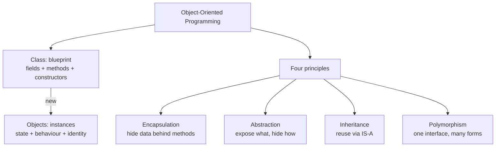
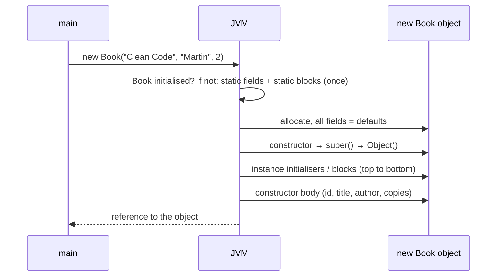
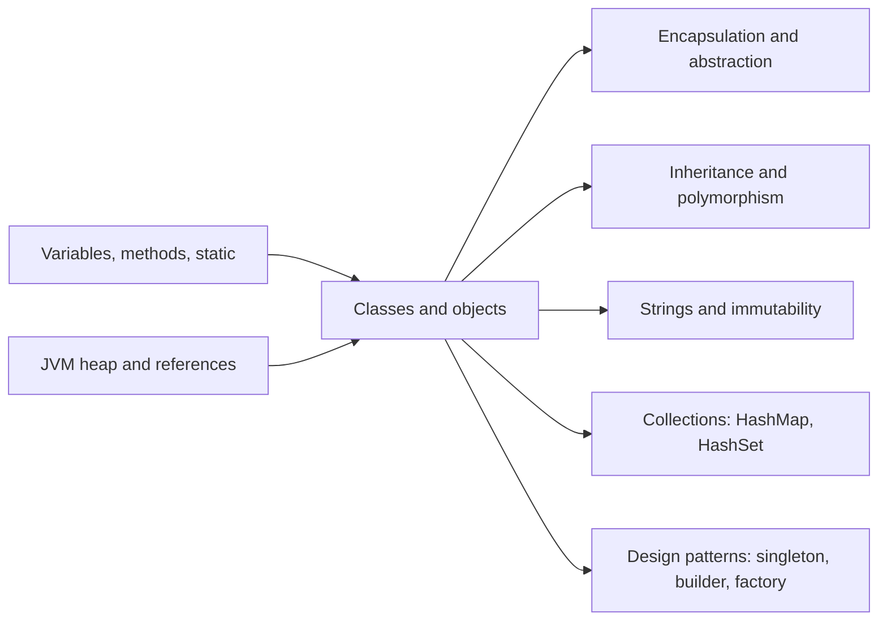

# Introduction to OOP: Classes and Objects in Java

**TL;DR:** **Object-oriented programming (OOP)** organises a program around **objects**: bundles of **state** (fields) and **behaviour** (methods). A **class** is the blueprint; an **object** is one thing built from it with `new`, which runs a **constructor**. Every object has its own copy of instance fields, a unique **identity** (`==`), and inherits `equals`, `hashCode` and `toString` from `Object`, which you usually override together. The four OOP principles (encapsulation, abstraction, inheritance, polymorphism) are introduced here and covered in depth in the next two notes.

## Table of Contents

1. [TL;DR](#1-tldr)
2. [Why it matters](#2-why-it-matters)
3. [Prerequisites](#3-prerequisites)
4. [Mental model](#4-mental-model)
5. [Core concepts](#5-core-concepts)
6. [How it works](#6-how-it-works)
7. [Examples](#7-examples)
8. [Comparisons](#8-comparisons)
9. [Trade-offs](#9-trade-offs)
10. [Gotchas](#10-gotchas)
11. [Practical application](#11-practical-application)
12. [Interview prep](#12-interview-prep)
13. [Interview question bank](#13-interview-question-bank)
14. [Tricky code snippets](#14-tricky-code-snippets)
15. [Connections](#15-connections)
16. [Summary](#16-summary)
17. [Answers](#answers)

---

## 1. TL;DR

- **Class:** a user-defined type describing what data an object holds (fields) and what it can do (methods). `class Book { String title; boolean borrow() {…} }`
- **Object (instance):** a concrete value of that type, created with `new Book(…)`, living on the heap.
- **Constructor:** special block that initialises a new object; same name as the class, **no return type**.
- **`this`:** the current object inside instance methods and constructors.
- **Identity vs equality:** `a == b` asks "same object?"; `a.equals(b)` asks "equal values?" (once you override it).

**The analogy: an architect's blueprint and the houses built from it.**

| Blueprint and houses | Java |
|---|---|
| One blueprint describes rooms, doors and wiring | A **class** declares fields and methods |
| Many houses built from the same blueprint | Many **objects** from one class |
| Each house has its own furniture and paint colour | Each object has its own **instance fields** (state) |
| Every house has a unique street address | Every object has a unique **identity** (`==` compares this) |
| The construction crew's checklist when building a house | A **constructor** |
| A sign at the estate entrance: "Houses built so far: 3" | A **static** field shared by all objects |
| Two houses with identical layout and paint are still two houses | `a.equals(b)` can be `true` while `a == b` is `false` |
| Giving a friend your address doesn't build a new house | Copying a **reference** (`Book alias = a;`) doesn't copy the object |

**Running example:** a `Book` class for a library: a static ID counter, `final` fields, three overloaded constructors (including chaining with `this(...)` and a copy constructor), instance and static initialiser blocks, and properly overridden `equals`, `hashCode` and `toString`.

---

## 2. Why it matters

**The problem OOP solves.** In purely procedural code, data (arrays, variables) and the functions that change it are separate. As programs grow, any function can change any data, and it becomes hard to know who broke what. OOP keeps data and the code that manages it **together**, hides internals, and lets you model the problem in terms of real things (`Book`, `Member`, `Loan`).

**What goes wrong without a solid grasp of classes and objects** (verified on Java 21):

| Code | Result | Cause |
|---|---|---|
| Declaring `Point(int x, int y)` then calling `new Point()` | Compile error | The default constructor disappears once you write any constructor |
| `Person(String name) { name = name; }` | `name` field stays `null` | Parameter shadows field; use `this.name` |
| `Book alias = a; alias.borrow();` | `a` changes too | Both variables reference one object |
| Override `equals` but not `hashCode`, then use a `HashSet` | Duplicates; `contains` returns `false` | Equal objects must have equal hash codes |
| `public boolean equals(Book b)` | `List.contains` doesn't find equal books | That's an **overload**, not an override of `equals(Object)` |
| Modify a field used in `hashCode` after adding to a `HashSet` | Object "disappears" from the set | It now sits in the wrong bucket |

**Why interviewers ask.** "What is OOP?", "class vs object", "types of constructors", "`this` keyword" and "`equals`/`hashCode` contract" are among the most frequently asked Java interview questions, and the `equals`/`hashCode` contract regularly appears in senior rounds because it causes real production bugs.

---

## 3. Prerequisites

| Prerequisite | One-line refresher | Importance |
|---|---|---|
| Variables and methods | Declaring fields, parameters, return types ([Declaring Variables and Methods notes]) | Essential |
| Primitive vs reference types | Objects are reached through references ([Data Type Compatibility notes]) | Essential |
| Stack and heap | Objects live on the heap; references in frames ([JVM Architecture notes]) | Essential |
| Static vs instance members | `static` belongs to the class; instance members to each object | Essential |
| Access modifiers | `private`, package-private, `protected`, `public` | Nice-to-have (deep dive in Encapsulation notes) |

---

## 4. Mental model

> **The one picture to keep in your head:** the class exists **once** (loaded by the JVM); objects exist **many times** on the heap, each with its own fields; variables only hold **references** (arrows) to objects.

```
   CLASS (loaded once)                    HEAP (objects)
 ┌─────────────────────────┐        ┌─────────────────────────────┐
 │ class Book               │        │ Book #1                     │
 │  static nextId = 4 ◄─────┼─ shared│  id=1 title="Clean Code"    │
 │  methods: borrow(),      │        │  author="Martin" copies=0   │
 │  equals(), toString() …  │        └─────────────────────────────┘
 └─────────────────────────┘        ┌─────────────────────────────┐
                                    │ Book #2                     │
   STACK (main's frame)             │  id=2 title="Refactoring"   │
 ┌──────────────┐                   │  author="Fowler" copies=1   │
 │ a ───────────┼──────► Book #1    └─────────────────────────────┘
 │ alias ───────┼──────► Book #1    ┌─────────────────────────────┐
 │ b ───────────┼──────► Book #2    │ Book #3 (copy of #1's data) │
 │ c ───────────┼──────► Book #3    │  id=3 … copies=2            │
 └──────────────┘                   └─────────────────────────────┘
```
*One class, three objects, four references. `a == alias` (same arrow target); `a.equals(c)` (equal data, different objects).*

**OOP in one diagram:**


*Classes and objects are the building blocks; the four principles are how you design with them.*

---

## 5. Core concepts

### 5.1 Glossary

| Term | Meaning (1 line) | Tiny example |
|---|---|---|
| **OOP** | A paradigm that models software as interacting objects combining data and behaviour. | `book.borrow()` |
| **Procedural programming** | A paradigm built around procedures operating on separate data. | `borrow(books, i)` |
| **Class** | Blueprint/type defining fields, methods and constructors. | `class Book { … }` |
| **Object / instance** | A concrete value of a class, created at runtime. | `new Book("Clean Code", "Martin")` |
| **State** | The current values of an object's fields. | `copies = 2` |
| **Behaviour** | What an object can do: its methods. | `borrow()` |
| **Identity** | What makes an object distinct from every other object, even with equal state. | `a == c` is `false` |
| **Field (instance variable)** | Per-object data declared in the class. | `private int copies;` |
| **Method** | A function defined in a class. | `boolean borrow()` |
| **Constructor** | Initialises a new object; same name as the class, no return type. | `Book(String t, String a)` |
| **Default constructor** | No-arg constructor the compiler adds **only if you declare none**. | `new Point()` |
| **No-arg constructor** | Any constructor with no parameters (written by you or the compiler). | `Book() {…}` |
| **Parameterised constructor** | Takes arguments to set initial state. | `Book(String, String, int)` |
| **Copy constructor** | Builds a new object from another of the same class. | `Book(Book other)` |
| **Constructor overloading** | Several constructors with different parameter lists. | 2-arg and 3-arg `Book` |
| **Constructor chaining** | One constructor calling another with `this(...)` (or the parent's with `super(...)`). | `this(title, author, 1);` |
| **`this`** | Reference to the current object. | `this.title = title;` |
| **`new`** | Operator that allocates an object and runs a constructor. | `new Book(…)` |
| **Reference** | A value that points to an object. | `Book a` |
| **Aliasing** | Two references to the same object. | `Book alias = a;` |
| **Instance initialiser block** | `{ … }` in a class body; runs for every object, before the constructor body. | `{ log("creating"); }` |
| **Static initialiser block** | `static { … }`; runs once when the class is initialised. | `static { load(); }` |
| **`equals` / `hashCode`** | Value equality and its matching hash; must be overridden together. | `Objects.hash(title, author)` |
| **`toString`** | Human-readable description; default is `ClassName@hexHash`. | `Book#1(Clean Code …)` |
| **Record** | Concise immutable data class (Java 16+) with generated constructor, accessors, `equals`, `hashCode`, `toString`. | `record Point(int x, int y) {}` |
| **Immutable object** | An object whose state can't change after construction. | `String`, `Money` below |
| **Garbage collection** | Reclaims objects no longer reachable from any reference. | `b1 = b2;` makes old `b1` object collectable |

### 5.2 Anatomy of a class

```java
public class Book {                         // class declaration (one public class per .java file)
    private static int nextId = 1;          // static field: one per class
    private final int id;                   // instance fields: one per object
    private String title;

    static { /* runs once, at class initialisation */ }
    { /* runs for every object, before the constructor body */ }

    public Book(String title) {             // constructor: no return type
        this.id = nextId++;
        this.title = title;
    }

    public String getTitle() { return title; }       // instance method
    public static int created() { return nextId - 1; } // static method

    @Override public String toString() { return "Book(" + title + ")"; }
}
```

### 5.3 Constructors in detail

| Rule | Detail (verified) |
|---|---|
| Name | Exactly the class name |
| Return type | **None**, not even `void`. `void Book() {}` is an ordinary method. A bare `return;` is allowed; `return 1;` is not |
| Default constructor | Added by the compiler only when the class declares **no** constructors |
| Allowed modifiers | `public`, `protected`, package-private, `private` |
| Not allowed | `final`, `static`, `abstract`, `synchronized` (*modifier … not allowed here*) |
| `this(...)` / `super(...)` | Must be the **first** statement; you can't have both; recursive `this()` calls are a compile error |
| Implicit `super()` | If you don't call `this(...)` or `super(...)`, the compiler inserts `super()` |
| Inherited? | No. Constructors are not inherited or overridden |
| `final` fields | Must be assigned exactly once on **every** constructor path |

**Ways to create an object** (verified):

| Way | Calls a constructor? |
|---|---|
| `new Book(...)` | Yes |
| Reflection: `Book.class.getDeclaredConstructor().newInstance()` | Yes |
| `clone()` (class implements `Cloneable`) | **No**; copies fields directly |
| Deserialization (`ObjectInputStream.readObject`) | Not the class's own constructor (⚠️ it runs the no-arg constructor of the first non-serializable superclass) |
| Factory/static methods (`List.of`, `Integer.valueOf`) | Yes, internally (may return cached objects) |

### 5.4 Methods every object inherits from `Object`

Verified list of public/protected methods: `equals`, `hashCode`, `toString`, `getClass`, `clone`, `finalize` (deprecated), `notify`, `notifyAll`, `wait` (3 overloads).

| Method | Default behaviour | Override when |
|---|---|---|
| `toString()` | `getClass().getName() + "@" + Integer.toHexString(hashCode())` | Always useful for logging/debugging |
| `equals(Object)` | `this == obj` (identity) | Objects represent **values** (two `Book`s with the same title and author are "the same book") |
| `hashCode()` | Identity-based number | **Whenever** you override `equals` |
| `clone()` | Shallow field copy; throws `CloneNotSupportedException` unless the class implements `Cloneable` | Rarely; prefer copy constructors |

**The `equals`/`hashCode` contract:**
1. Reflexive: `x.equals(x)`.
2. Symmetric: `x.equals(y)` ⇔ `y.equals(x)`.
3. Transitive.
4. Consistent: same answer while the fields don't change.
5. `x.equals(null)` is `false` (no exception).
6. **If `x.equals(y)`, then `x.hashCode() == y.hashCode()`.** (Equal hashes don't imply equality.)

---

## 6. How it works

### 6.1 What `new Book("Clean Code", "Martin", 2)` does

1. **Class initialisation (first use only):** load `Book`, run static field initialisers and `static {}` blocks in textual order.
2. **Allocate** memory on the heap; every field gets its **default** value (`0`, `null`, `false`).
3. **Call the constructor.** If it starts with `this(...)`, jump to that constructor first.
4. In the constructor that doesn't start with `this(...)`: call `super(...)` (implicitly `Object()` here).
5. **Run instance field initialisers and instance `{}` blocks**, top to bottom.
6. **Run the rest of the constructor body.**
7. `new` returns the **reference**.


*Static setup happens once per class; steps 2–6 happen for every object.*

> [!NOTE]
> When a constructor chains with `this(...)`, the instance initialisers run **once**, as part of the constructor that calls `super(...)`, not once per constructor in the chain (verified: count stays `1`).

### 6.2 Initialisation order, verified

```java
class Demo {
    static int s = log("static field");
    static { log("static block"); }
    int f = log("instance field");
    { log("instance block"); }
    Demo() { log("constructor"); }
    static int log(String msg) { System.out.println(msg); return 0; }
}
// main: new Demo(); new Demo();
```
```
-- first object --
static field
static block
instance field
instance block
constructor
-- second object --
instance field
instance block
constructor
```
Static parts run once; instance parts run per object, in textual order, before the constructor body. (With inheritance, parent parts come first; see the Inheritance notes.)

### 6.3 Worked example: the library `Book`, traced

```java
// Library.java  —  run with: javac Library.java && java Library
import java.util.*;

class Book {
    private static int nextId = 1;                       // shared counter
    static { System.out.println("[static block] Book class initialised"); }

    private final int id;                                // blank finals: set once per object
    private final String title;
    private final String author;
    private int copies;

    { System.out.println("[instance block] creating a Book"); }

    Book(String title, String author, int copies) {      // main constructor
        this.id = nextId++;
        this.title = title;
        this.author = author;
        this.copies = copies;
        System.out.println("[constructor] " + title);
    }

    Book(String title, String author) {                  // overload: default 1 copy
        this(title, author, 1);                          // chaining: must be first
    }

    Book(Book other) {                                   // copy constructor
        this(other.title, other.author, other.copies);
    }

    boolean borrow() {
        if (copies == 0) return false;
        copies--;
        return true;
    }

    int getCopies() { return copies; }

    @Override public String toString() {
        return "Book#" + id + "(" + title + " by " + author + ", copies=" + copies + ")";
    }

    @Override public boolean equals(Object o) {          // same title + author = same book
        if (this == o) return true;
        if (!(o instanceof Book b)) return false;        // also handles null
        return title.equals(b.title) && author.equals(b.author);
    }

    @Override public int hashCode() { return Objects.hash(title, author); }  // same fields as equals
}

public class Library {
    public static void main(String[] args) {
        System.out.println("main starts");
        Book a = new Book("Clean Code", "Martin", 2);
        Book b = new Book("Refactoring", "Fowler");
        Book c = new Book(a);
        Book alias = a;
        a.borrow();
        alias.borrow();
        System.out.println(a + " / " + c);
        System.out.println(a.borrow() + " " + a.getCopies());
        System.out.println((a == alias) + " " + (a == c) + " " + a.equals(c) + " " + (a.hashCode() == c.hashCode()));
        Set<Book> shelf = new HashSet<>(List.of(a, b));
        System.out.println(shelf.contains(c) + " " + shelf.size());
        System.out.println(b);
    }
}
```

**Expected output** (verified):
```
main starts
[static block] Book class initialised
[instance block] creating a Book
[constructor] Clean Code
[instance block] creating a Book
[constructor] Refactoring
[instance block] creating a Book
[constructor] Clean Code
Book#1(Clean Code by Martin, copies=0) / Book#3(Clean Code by Martin, copies=2)
false 0
true false true true
true 2
Book#2(Refactoring by Fowler, copies=1)
```

**Trace:**

| # | Statement | `nextId` | Object state after | Notes |
|---|---|---|---|---|
| 1 | `"main starts"` | — | — | `Book` not used yet, so not initialised |
| 2 | `new Book("Clean Code", "Martin", 2)` | 1 → 2 | #1: copies=2 | First use triggers the static block; then instance block, then constructor |
| 3 | `new Book("Refactoring", "Fowler")` | 2 → 3 | #2: copies=1 | 2-arg constructor chains to the 3-arg one; instance block runs once |
| 4 | `new Book(a)` | 3 → 4 | #3: copies=2 (copied **before** any borrowing) | Copy constructor chains too; new id |
| 5 | `Book alias = a;` | 4 | — | No new object, just another reference to #1 |
| 6 | `a.borrow(); alias.borrow();` | 4 | #1: copies=0 | Both calls hit object #1 |
| 7 | `a.borrow()` | 4 | #1: copies=0 | Returns `false`: none left |
| 8 | Comparisons | — | — | `a == alias` true (same object); `a == c` false; `equals` and `hashCode` agree |
| 9 | `shelf.contains(c)` | — | — | `true`: `c` hashes to #1's bucket and `equals` matches |

**Things to notice:**
- The class was initialised lazily, on first use, **after** `"main starts"`.
- `final` fields `id`, `title` and `author` are assigned in exactly one constructor (the others chain to it).
- `equals` and `hashCode` use the **same** fields. That's why `HashSet.contains(c)` works.
- The copy constructor created an independent object; borrowing from `a` didn't affect `c`.

---

## 7. Examples

### 7.1 Toy example: an immutable value class and a record

```java
import java.util.*;

final class Money {                                  // final: no subclass can break immutability
    private final long cents;
    private final String currency;

    Money(long cents, String currency) { this.cents = cents; this.currency = currency; }

    Money plus(Money o) {                            // returns a NEW object instead of changing this one
        if (!currency.equals(o.currency)) throw new IllegalArgumentException("currency mismatch");
        return new Money(cents + o.cents, currency);
    }

    @Override public String toString() {
        return currency + " " + cents / 100 + "." + String.format("%02d", cents % 100);
    }
}

record Point(int x, int y) {                         // Java 16+: fields, constructor, accessors,
    Point {                                          // equals, hashCode, toString generated
        if (x < 0 || y < 0) throw new IllegalArgumentException("negative");   // compact constructor
    }
    double dist() { return Math.sqrt(x * x + y * y); }
}

public class Values {
    public static void main(String[] args) {
        Money a = new Money(1050, "USD");
        Money b = a.plus(new Money(275, "USD"));
        System.out.println(a + " " + b);

        Point p = new Point(3, 4), q = new Point(3, 4);
        System.out.println(p + " " + p.x() + " " + p.dist() + " " + p.equals(q) + " " + (p == q));
    }
}
```
**Expected output:**
```
USD 10.50 USD 13.25
Point[x=3, y=4] 3 5.0 true false
```

### 7.2 Real-world examples

| System | Class/object practice | Why |
|---|---|---|
| **JDK `String`, `Integer`, `LocalDate`** | Immutable classes with overridden `equals`/`hashCode`/`toString` | Safe to share between threads and use as `HashMap` keys. |
| **JDK `Runtime.getRuntime()`** | Private constructor + static accessor (singleton) | Exactly one `Runtime` per JVM. |
| **Utility classes: `java.lang.Math`, `java.util.Collections`** | Private constructor, only static methods | They model operations, not things, so no instances are needed. |
| **Spring and JPA/Hibernate entities** | Need a no-arg constructor (often non-public), created via reflection | Frameworks instantiate objects reflectively, then fill fields. Defining only a parameterised constructor removes the default one and breaks them. |
| **DTOs in modern codebases** | Java `record`s | Generated `equals`/`hashCode`/`toString` and immutability with almost no code. |

---

## 8. Comparisons

### 8.1 Procedural vs object-oriented

| | Procedural (e.g. C) | Object-oriented (Java) |
|---|---|---|
| Building block | Functions | Objects (data + methods) |
| Data access | Often global or passed everywhere | Hidden in objects, accessed through methods |
| Reuse | Copying/calling functions | Composition, inheritance, polymorphism |
| Modelling | Steps of an algorithm | Things in the problem domain |
| Change impact | A data change can ripple through many functions | Changes are localised behind an object's interface |
| Best for | Small scripts, low-level code, pure algorithms | Large systems with many interacting concepts |

### 8.2 Class vs object

| Class | Object |
|---|---|
| Blueprint / type | Instance of that type |
| Declared once in source code | Created any number of times at runtime |
| Loaded into the JVM once | Lives on the heap |
| No memory for instance fields | Has its own copy of instance fields |
| `class Book { … }` | `new Book(…)` |

### 8.3 Constructor vs method

| | Constructor | Method |
|---|---|---|
| Name | Same as class | Any name |
| Return type | None | Required (`void` if nothing) |
| Called | Automatically by `new` (or `this()`/`super()`) | Explicitly |
| Inherited / overridable | No | Yes (instance methods) |
| Modifiers | Access modifiers only | `static`, `final`, `abstract`, `synchronized`… |
| Purpose | Initialise a new object | Behaviour |

### 8.4 `==` vs `equals()` vs `hashCode()`

| | `==` | `equals()` | `hashCode()` |
|---|---|---|---|
| Question | Same object? | Equal values? | Which bucket? |
| Default | Identity | Identity (from `Object`) | Identity-based |
| Overridable | No | Yes | Yes (must match `equals`) |
| Used by | You | `List.contains`, `HashSet`, `HashMap` | `HashSet`, `HashMap` |

### 8.5 Regular class vs record

| | Regular class | `record` (Java 16+) |
|---|---|---|
| Fields | Any | `private final`, from the header only (extra instance fields not allowed) |
| Mutability | Your choice | Shallowly immutable |
| Boilerplate | Write constructor, getters, `equals`, `hashCode`, `toString` | Generated |
| Accessor names | `getX()` by convention | `x()` |
| Inheritance | Can extend a class | Implicitly `final`; extends `java.lang.Record`; can implement interfaces |
| Use for | Entities with behaviour and changing state | Plain data carriers, value objects, DTOs |

**Use a class when…** the object has identity and changing state (an `Account`, a `Book` copy).
**Use a record when…** the object is just data where equal fields mean equal objects (`Point`, `Money`, API responses).
**Use a static method when…** no object state is involved (`Math.max`).

---

## 9. Trade-offs

| Aspect | Benefit | Cost |
|---|---|---|
| **OOP in general** | Models complex domains, localises change, supports reuse and testing via interfaces | More types and indirection; easy to over-engineer small problems |
| **Many small objects** | Clear responsibilities | Allocation and GC overhead (⚠️ ~16 bytes minimum per object on 64-bit HotSpot) |
| **Overriding `equals`/`hashCode`** | Correct behaviour in collections, value semantics | Must keep them consistent; mutable fields in `hashCode` break hash collections |
| **Constructor overloading** | Convenient creation | Many parameters of the same type are easy to swap by mistake; use builders or static factories |
| **Static factory methods** (`of`, `valueOf`) | Descriptive names, caching, can return subtypes | Not obvious they create objects; can't be subclassed if constructors are private |
| **Immutability** | Thread-safe, safe as map keys, easy reasoning | New object per change (usually cheap) |
| **Records** | Minimal boilerplate | Fixed field set, no extra instance fields, accessor naming differs from JavaBeans |
| **`clone()`** | Built-in copying | Shallow, bypasses constructors, awkward checked exception; prefer copy constructors |

---

## 10. Gotchas

### Myths

| ❌ Myth | ✅ Reality |
|---|---|
| Every class always has a default constructor. | Only if you declare **no** constructors. |
| A constructor returns `void`. | It has no return type. `void ClassName()` is a regular method. |
| Constructors can be `static`, `final` or `abstract`. | None of these is allowed (only access modifiers). |
| `this()` and `super()` can both be used. | Only one, and it must be the first statement. |
| Instance blocks run once per constructor in a `this(...)` chain. | They run once per object. |
| Objects are passed by reference. | References are passed **by value**. |
| `equals` compares fields by default. | It compares identity unless overridden. |
| Overriding `equals` is enough. | You must override `hashCode` too, or hash collections break. |
| `equals(Book b)` overrides `equals`. | It **overloads** it; the parameter must be `Object`. Use `@Override` to catch this. |
| Declaring a variable `Book b;` creates an object. | Only `new` (or a factory) creates objects; a local declared without assignment can't even be read. |
| Declaring a variable of a class type initialises the class. | Only **active use** (creating an instance, calling a static method, reading a non-constant static field) does. |
| `clone()` calls the constructor. | It doesn't, and it's shallow. |
| Inner class objects can be created like any other. | A (non-static) inner class needs an outer instance: `outer.new Inner()`. |
| Two objects with equal fields are the same object. | They're equal (if `equals` is overridden) but distinct (`==` is `false`). |

### Common mistakes and edge cases

**1. Forgetting `this`.** `name = name;` assigns the parameter to itself.

**2. Calling instance members from `static` code.** `static int getX() { return x; }` → *non-static variable x cannot be referenced from a static context*.

**3. Mutable fields in `hashCode`.** Changing them after inserting into a `HashSet`/`HashMap` key makes the object unfindable (Snippet 22).

**4. `equals` without type checks.** Casting blindly throws on `null` or other types; use `if (!(o instanceof Book b)) return false;`.

**5. Shallow copy constructors.** Copying a reference to a mutable list shares it; copy the list (`new ArrayList<>(other.members)`).

**6. A `final` field not set on every path.** `if (special) id = 1;` → *variable id might not have been initialized*.

**7. Two public top-level classes in one file** → *class Other is public, should be declared in a file named Other.java*.

---

## 11. Practical application

### Class design checklist
- [ ] Fields `private` (and `final` where possible); expose behaviour, not raw data
- [ ] Validate arguments in constructors; never leave an object half-built
- [ ] Use `this.field = param;` for same-named parameters
- [ ] Chain constructors with `this(...)` so initialisation logic lives in one place
- [ ] Add a no-arg constructor only if a framework needs it
- [ ] Override `toString` for every class you'll log or debug
- [ ] Override `equals` and `hashCode` **together**, using the same fields; use `@Override`
- [ ] Prefer immutable objects and `record`s for values
- [ ] Prefer copy constructors or static factories over `clone()`
- [ ] Private constructor for utility classes and singletons

### Hands-on exercise: fix the `Student` class

This class should treat two students with the same roll number as equal, so a `HashSet` keeps only one. It has three bugs.

```java
import java.util.*;

class Student {
    private String rollNo;
    private String name;
    Student(String rollNo, String name) { rollNo = rollNo; this.name = name; }
    public boolean equals(Student s) { return s != null && Objects.equals(rollNo, s.rollNo); }
    String getRollNo() { return rollNo; }
}

public class School {
    public static void main(String[] args) {
        Set<Student> set = new HashSet<>();
        set.add(new Student("R1", "Asha"));
        set.add(new Student("R1", "Asha K"));
        System.out.println(set.size() + " " + new Student("R1", "x").getRollNo());
    }
}
```

**Expected outcome:** the buggy version prints `2 null` (verified). After your fixes it should print `1 R1`, and a `toString` should make the set print as `[Student[R1, Asha]]`.

<details><summary>Answer</summary>

1. **Self-assignment:** `rollNo = rollNo;` → `this.rollNo = rollNo;` (that's why `getRollNo()` returned `null`).
2. **Overload instead of override:** `equals(Student)` doesn't override `equals(Object)`, so `HashSet` still uses identity. Declare `equals(Object o)` with `@Override`.
3. **No `hashCode`:** equal students must produce equal hash codes, or the set never even calls `equals` on the second one.

Fixed class (verified output `1 R1 [Student[R1, Asha]]`):
```java
class Student {
    private final String rollNo;
    private final String name;

    Student(String rollNo, String name) { this.rollNo = rollNo; this.name = name; }

    @Override public boolean equals(Object o) {
        if (this == o) return true;
        if (!(o instanceof Student s)) return false;
        return rollNo.equals(s.rollNo);
    }

    @Override public int hashCode() { return rollNo.hashCode(); }

    @Override public String toString() { return "Student[" + rollNo + ", " + name + "]"; }

    String getRollNo() { return rollNo; }
}
```
Making the fields `final` also guarantees the hash can't change after insertion.
</details>

---

## 12. Interview prep

### Likely questions with model answers

**Q1. What is OOP, and what are its main principles?**
> "Object-oriented programming structures software around objects that combine data, their state, with the code that operates on it, their behaviour. You define classes as blueprints and create objects from them. The four principles are: encapsulation, hiding an object's data and exposing it only through methods; abstraction, exposing what an object does while hiding how; inheritance, letting a class reuse and extend another class's code through an IS-A relationship; and polymorphism, letting one interface or method call work with many types, through overloading at compile time and overriding at runtime. Benefits are modularity, reuse, easier maintenance and code that models the problem domain."

**Q2. What's the difference between a class and an object?**
> "A class is a blueprint or type: it declares fields, methods and constructors, exists once in the source, and is loaded once by the JVM. An object is an instance of that class created at runtime with `new`; it lives on the heap and has its own copy of the instance fields. One class can produce many objects. Every object has state, its field values; behaviour, its methods; and identity, which is what `==` compares."

**Q3. What is a constructor? What types are there?**
> "A constructor is a special block with the class's name and no return type that initialises a new object when you call `new`. Types: the default constructor, a no-arg one the compiler adds only if you write no constructors at all; no-arg constructors you write yourself; parameterised constructors; and copy constructors that take another instance. Constructors can be overloaded and chained with `this(...)`, which must be the first statement. They can't be inherited, overridden, or marked `static`, `final`, `abstract` or `synchronized`, but they can be `private`, which is used for singletons and utility classes."

**Q4. What is the `this` keyword used for?**
> "`this` is a reference to the current object. It's used to distinguish fields from parameters with the same name (`this.name = name`), to call another constructor of the same class with `this(...)` as the first statement, to pass the current object to another method, and to return the current object for method chaining, as in builders. It isn't available in static contexts, because static code has no current object."

**Q5. Explain the `equals` and `hashCode` contract.**
> "`equals` decides logical equality and `hashCode` returns an `int` used by hash-based collections to pick a bucket. The contract: `equals` must be reflexive, symmetric, transitive, consistent and return `false` for `null`; and if two objects are equal they must have the same hash code. Unequal objects may share a hash code. If you override `equals` without `hashCode`, two equal objects usually land in different buckets, so a `HashSet` keeps duplicates and `contains` fails. Also, fields used in `hashCode` shouldn't change while the object is in a hash collection, and `equals` must take `Object`, not the specific type, or it's an overload."

**Q6. What is the order of initialisation when an object is created?**
> "Once per class, on first active use: static field initialisers and static blocks in textual order. Then for every object: memory is allocated with default values, the constructor is called, which first calls `super(...)` or chains with `this(...)`; then instance field initialisers and instance blocks run in textual order; and finally the rest of the constructor body. With inheritance, the parent's static parts come before the child's, and the parent's instance parts and constructor finish before the child's instance parts."

**Q7. In how many ways can you create an object in Java?**
> "With `new`; through reflection, `Constructor.newInstance()`; with `clone()` on a `Cloneable` class, which copies fields without calling a constructor; through deserialization; and indirectly through factory methods like `List.of` or `Integer.valueOf`, which may return cached instances. `new` and reflection run a constructor of the class; `clone` and deserialization don't run the class's own constructor."

**Q8. What are records, and when would you use one?**
> "Records, final since Java 16, are concise classes for immutable data. `record Point(int x, int y) {}` generates private final fields, a canonical constructor, accessors `x()` and `y()`, and `equals`, `hashCode` and `toString` based on all components. You can add methods, static members, and a compact constructor for validation, but not extra instance fields, and records are implicitly final. I'd use them for DTOs, value objects and multiple return values; for objects with identity and mutable state, a regular class."

### What interviewers watch for
- Clear definitions with a concrete example, not textbook recitation.
- Constructor rules: default constructor disappearing, `this()` first, no return type, allowed modifiers.
- The `equals`/`hashCode` contract and its practical consequence in `HashSet`/`HashMap`.
- Reference semantics: aliasing, pass-by-value of references.
- Modern Java awareness: records, `instanceof` pattern in `equals`.

---

## 13. Interview question bank

Short answers are hidden. 🟢 fresher, 🟡 intermediate, 🔴 senior/FAANG follow-up.

### 13.1 OOP basics

**1. 🟢 What is object-oriented programming?**
<details><summary>Answer</summary>

A paradigm that models software as objects combining state (fields) and behaviour (methods), designed using encapsulation, abstraction, inheritance and polymorphism.
</details>

**2. 🟢 What are the four pillars of OOP?**
<details><summary>Answer</summary>

Encapsulation, abstraction, inheritance, polymorphism.
</details>

**3. 🟢 What are the advantages of OOP?**
<details><summary>Answer</summary>

Modularity, reuse (composition/inheritance), easier maintenance (changes localised), data hiding, flexibility via polymorphism, and models that match the problem domain.
</details>

**4. 🟢 Difference between procedural and object-oriented programming?**
<details><summary>Answer</summary>

Procedural organises code as functions acting on separate data; OOP bundles data with the functions that manage it into objects.
</details>

**5. 🟡 Is Java a pure object-oriented language?**
<details><summary>Answer</summary>

No: it has 8 primitive types and `static` members that don't belong to objects.
</details>

**6. 🟡 What are state, behaviour and identity of an object?**
<details><summary>Answer</summary>

State: field values. Behaviour: methods. Identity: what distinguishes it from all other objects (compared with `==`).
</details>

**7. 🟡 What is the difference between OOP and object-based programming?**
<details><summary>Answer</summary>

Object-based languages let you create and use objects (encapsulation) but lack class inheritance; ⚠️ Visual Basic 6 is the example most often cited. Object-oriented languages like Java add inheritance and polymorphism.
</details>

### 13.2 Classes and objects

**8. 🟢 What is a class? What is an object?**
<details><summary>Answer</summary>

Class: blueprint/type with fields, methods, constructors. Object: an instance created from it at runtime.
</details>

**9. 🟢 How do you create an object?**
<details><summary>Answer</summary>

`ClassName ref = new ClassName(args);` (also reflection, `clone`, deserialization, factories).
</details>

**10. 🟢 Where are objects stored? Where are references stored?**
<details><summary>Answer</summary>

Objects on the heap. Local references in stack frames; field references inside their containing objects.
</details>

**11. 🟢 Can a `.java` file contain more than one class?**
<details><summary>Answer</summary>

Yes, but at most one top-level `public` class, and it must match the file name.
</details>

**12. 🟡 What is an anonymous object?**
<details><summary>Answer</summary>

An object used without storing a reference: `new Greeter().greet("Asha")`. It becomes eligible for GC right after use.
</details>

**13. 🟡 What happens when you assign one object reference to another?**
<details><summary>Answer</summary>

Both variables refer to the same object (aliasing); no copy is made.
</details>

**14. 🟡 What is the default value of an object reference field? A local reference?**
<details><summary>Answer</summary>

Field: `null`. Local: none; reading it before assignment is a compile error.
</details>

**15. 🟡 What happens if you call a method on a `null` reference?**
<details><summary>Answer</summary>

`NullPointerException` (except static methods, which are resolved from the declared type).
</details>

**16. 🟡 When is an object eligible for garbage collection?**
<details><summary>Answer</summary>

When no live reference chain from a GC root (stack locals, static fields, active threads) reaches it, e.g. after `b1 = b2;` the old `b1` object.
</details>

**17. 🔴 When is a class initialised (static blocks run)?**
<details><summary>Answer</summary>

On first active use: creating an instance, calling a static method, accessing a non-constant static field, initialising a subclass, reflection, or being the main class. Declaring a variable of that type doesn't (verified).
</details>

**18. 🔴 What is the difference between a static nested class and an inner class?**
<details><summary>Answer</summary>

A static nested class doesn't need an outer instance (`new Outer.Nested()`). An inner class holds a reference to an outer instance and can access its fields (`outer.new Inner()`); without one: *an enclosing instance … is required*.
</details>

### 13.3 Constructors

**19. 🟢 What is a constructor? How is it different from a method?**
<details><summary>Answer</summary>

Initialises a new object; same name as the class, no return type, called by `new`, not inherited.
</details>

**20. 🟢 What is a default constructor? When does the compiler provide one?**
<details><summary>Answer</summary>

A no-arg constructor added only when the class declares no constructors. It calls `super()` and leaves fields at their defaults.
</details>

**21. 🟢 What are the types of constructors?**
<details><summary>Answer</summary>

Default (compiler-generated), no-arg, parameterised, copy (by convention).
</details>

**22. 🟢 What is constructor overloading?**
<details><summary>Answer</summary>

Multiple constructors with different parameter lists.
</details>

**23. 🟡 What is constructor chaining? What are the rules for `this()`?**
<details><summary>Answer</summary>

Calling another constructor with `this(...)` (same class) or `super(...)` (parent). Must be the first statement; only one of them; no recursive cycles (*recursive constructor invocation*).
</details>

**24. 🟡 Can a constructor be private? Why?**
<details><summary>Answer</summary>

Yes: for singletons, utility classes, and static factory methods. `new` from outside gives *… has private access*.
</details>

**25. 🟡 Can a constructor be `final`, `static`, `abstract` or `synchronized`?**
<details><summary>Answer</summary>

No; all give *modifier … not allowed here* (verified). Constructors aren't inherited, so `final`/`abstract` are meaningless; they work on an instance, so `static` makes no sense.
</details>

**26. 🟡 Can a constructor return a value? Can it have `return`?**
<details><summary>Answer</summary>

No value (*unexpected return value*), but a bare `return;` is allowed to exit early.
</details>

**27. 🟡 Are constructors inherited? Can they be overridden?**
<details><summary>Answer</summary>

No to both. A subclass calls them with `super(...)`.
</details>

**28. 🟡 What is a copy constructor? Shallow or deep?**
<details><summary>Answer</summary>

A constructor taking an object of the same class to copy its state. It's as deep as you write it: copying a list reference is shallow; `new ArrayList<>(other.list)` makes it deeper.
</details>

**29. 🔴 How many times does an instance initialiser block run when constructors chain with `this(...)`?**
<details><summary>Answer</summary>

Once per object, in the constructor that calls `super(...)` (verified).
</details>

**30. 🔴 Why do frameworks like JPA/Hibernate need a no-arg constructor?**
<details><summary>Answer</summary>

They create objects via reflection before populating fields. If you declare only a parameterised constructor, the default one disappears and instantiation fails.
</details>

**31. 🔴 Is it safe to call overridable methods from a constructor?**
<details><summary>Answer</summary>

No. A subclass override would run before the subclass's fields are initialised (it sees defaults like `null`/`0`). Covered with examples in the Inheritance notes.
</details>

### 13.4 `this`, static and initialisation

**32. 🟢 What is the `this` keyword?**
<details><summary>Answer</summary>

A reference to the current object, used for field/parameter disambiguation, `this(...)` chaining, passing/returning the current object.
</details>

**33. 🟢 Can `this` be used in a static method?**
<details><summary>Answer</summary>

No: *non-static variable this cannot be referenced from a static context*.
</details>

**34. 🟡 What is method chaining with `this`?**
<details><summary>Answer</summary>

Returning `this` from methods so calls can be chained: `c.increment().increment()` (builders use this).
</details>

**35. 🟡 What is the difference between static and instance initialiser blocks?**
<details><summary>Answer</summary>

Static: runs once when the class is initialised. Instance: runs for every object, before the constructor body.
</details>

**36. 🟡 What is the order of execution of static block, instance block and constructor?**
<details><summary>Answer</summary>

Static (once) → instance field initialisers/blocks in textual order → constructor body.
</details>

**37. 🔴 What does a forward reference in an instance block see?**
<details><summary>Answer</summary>

The default value: `{ print(this.x); } int x = 10;` prints `0` (verified).
</details>

### 13.5 `Object` methods

**38. 🟢 Which class is the parent of all classes? Name its methods.**
<details><summary>Answer</summary>

`java.lang.Object`: `equals`, `hashCode`, `toString`, `getClass`, `clone`, `finalize` (deprecated), `wait` (×3), `notify`, `notifyAll`.
</details>

**39. 🟢 What does the default `toString()` return?**
<details><summary>Answer</summary>

`ClassName@hexHashCode`, e.g. `Plain@1b6d3586` (verified format).
</details>

**40. 🟢 Difference between `==` and `equals()`?**
<details><summary>Answer</summary>

`==`: same object. `equals`: logical equality if overridden (otherwise identity).
</details>

**41. 🟡 What is the `equals`/`hashCode` contract?**
<details><summary>Answer</summary>

`equals` is reflexive, symmetric, transitive, consistent, false for `null`; equal objects must have equal hash codes.
</details>

**42. 🟡 What happens if you override `equals` but not `hashCode`?**
<details><summary>Answer</summary>

Hash collections misbehave: `HashSet` keeps duplicates and `contains` returns `false` (verified: size 2, contains false), while `List.contains` (uses only `equals`) works.
</details>

**43. 🟡 Can two unequal objects have the same hash code?**
<details><summary>Answer</summary>

Yes (a collision), e.g. `"Aa"` and `"BB"` both hash to 2112.
</details>

**44. 🔴 Why must `equals` take `Object` as its parameter?**
<details><summary>Answer</summary>

To override `Object.equals(Object)`. `equals(Book b)` is an overload that collections never call. `@Override` turns this mistake into a compile error.
</details>

**45. 🔴 What happens if a field used in `hashCode` changes while the object is in a `HashSet`?**
<details><summary>Answer</summary>

The object is in the bucket for the old hash; lookups use the new hash, so `contains` returns `false` and it can't be removed normally (verified).
</details>

**46. 🔴 What is `clone()`? Why is it considered problematic?**
<details><summary>Answer</summary>

`Object.clone()` makes a shallow field-by-field copy if the class implements `Cloneable` (else `CloneNotSupportedException`). It bypasses constructors, is shallow, and has an awkward API; copy constructors or factories are preferred.
</details>

### 13.6 Design and modern Java

**47. 🟡 What is an immutable class? How do you create one?**
<details><summary>Answer</summary>

One whose state can't change after construction: make the class `final`, fields `private final`, no setters, initialise everything in the constructor, defensively copy mutable inputs/outputs, and return new objects for "changes" (like `Money.plus`).
</details>

**48. 🟡 What is a singleton? How do you implement one?**
<details><summary>Answer</summary>

A class with exactly one instance: private constructor + static instance + static accessor (verified: two `get()` calls return the same object). An `enum` with one constant is the simplest thread-safe form.
</details>

**49. 🟡 What is a record? What does it generate?**
<details><summary>Answer</summary>

A concise immutable data class (Java 16): private final fields, canonical constructor, accessors (`x()`), `equals`, `hashCode`, `toString`. No extra instance fields allowed (*field declaration must be static*).
</details>

**50. 🔴 What is the difference between composition and inheritance? Which is preferred?**
<details><summary>Answer</summary>

Composition = HAS-A (an object holds another); inheritance = IS-A (a class extends another). Composition is usually preferred ("favour composition over inheritance") because it's more flexible and less tightly coupled. Covered in the Inheritance notes.
</details>

---

## 14. Tricky code snippets

All compiled and run on OpenJDK 21. Predict first.

**Snippet 1 🟢**
```java
class Point {
    int x, y;
    Point(int x, int y) { this.x = x; this.y = y; }
}
// in main:
Point p = new Point();
```
<details><summary>Answer</summary>

Compile error: *constructor Point in class Point cannot be applied to given types*. Declaring any constructor removes the default one.
</details>

**Snippet 2 🟢**
```java
class Point { int x; String label; boolean visible; }
// in main:
Point p = new Point();
System.out.println(p.x + " " + p.label + " " + p.visible);
```
<details><summary>Answer</summary>

`0 null false`. The compiler-provided default constructor leaves fields at defaults.
</details>

**Snippet 3 🟡**
```java
class A {
    void A() { System.out.println("method A()"); }
}
// in main:
A a = new A();
System.out.println("constructed");
a.A();
```
<details><summary>Answer</summary>

```
constructed
method A()
```
`void A()` has a return type, so it's a method; `new A()` uses the default constructor.
</details>

**Snippet 4 🟡**
```java
class A {
    int x;
    A() { x = 1; this(5); }
    A(int x) { this.x = x; }
}
```
<details><summary>Answer</summary>

Compile error: *call to this must be first statement in constructor*.
</details>

**Snippet 5 🟡**
```java
class A {
    A() { this(1); }
    A(int x) { this(); }
}
```
<details><summary>Answer</summary>

Compile error: *recursive constructor invocation*.
</details>

**Snippet 6 🟡**
```java
class A {
    A() { super(); this(1); }
    A(int x) { }
}
```
<details><summary>Answer</summary>

Compile error: *call to this must be first statement in constructor*. You can't call both `super()` and `this()`.
</details>

**Snippet 7 🟡** Which compile? (a) `final A() {}` (b) `static A() {}` (c) `abstract A();` (d) `synchronized A() {}` (e) `private A() {}` (f) `A() { return; }`
<details><summary>Answer</summary>

Only (e) and (f). The others: *modifier final/static/abstract/synchronized not allowed here*.
</details>

**Snippet 8 🟢**
```java
class Util {
    private Util() { }
    static int twice(int x) { return 2 * x; }
}
// in main:
Util u = new Util();
```
<details><summary>Answer</summary>

Compile error: *Util() has private access in Util*. `Util.twice(3)` would be fine.
</details>

**Snippet 9 🟡**
```java
class Config {
    private static final Config INSTANCE = new Config();
    private int calls = 0;
    private Config() { System.out.println("Config created"); }
    static Config get() { return INSTANCE; }
    int next() { return ++calls; }
}
// in main:
System.out.println("before");
Config a = Config.get();
Config b = Config.get();
a.next(); b.next();
System.out.println((a == b) + " " + a.next());
```
<details><summary>Answer</summary>

```
before
Config created
true 3
```
The single instance is created when the class is first used (after `"before"`), and both references share it.
</details>

**Snippet 10 🔴**
```java
class Demo {
    static int s = log("static field");
    static { log("static block"); }
    int f = log("instance field");
    { log("instance block"); }
    Demo() { log("constructor"); }
    static int log(String msg) { System.out.println(msg); return 0; }
}
// in main: new Demo(); new Demo();
```
<details><summary>Answer</summary>

```
static field
static block
instance field
instance block
constructor
instance field
instance block
constructor
```
</details>

**Snippet 11 🔴**
```java
class Demo {
    { System.out.println("block 1, x=" + this.x); }
    int x = 10;
    { System.out.println("block 2, x=" + x); }
    Demo() { System.out.println("constructor, x=" + x); x = 30; }
}
// in main: System.out.println("final x=" + new Demo().x);
```
<details><summary>Answer</summary>

```
block 1, x=0
block 2, x=10
constructor, x=10
final x=30
```
Initialisers run in textual order; before `x = 10` runs, `x` has its default `0`.
</details>

**Snippet 12 🔴**
```java
class A {
    int count = 0;
    { count++; }
    A() { }
    A(int x) { this(); }
}
// in main: System.out.println(new A().count + " " + new A(5).count);
```
<details><summary>Answer</summary>

`1 1`. The instance block runs once per object, not once per constructor in a chain.
</details>

**Snippet 13 🟢**
```java
class Plain { }
// in main:
Plain p = new Plain();
System.out.println(p);
```
<details><summary>Answer</summary>

Something like `Plain@1b6d3586`: class name + `@` + hex hash code (verified format).
</details>

**Snippet 14 🟢**
```java
class P { int x; P(int x) { this.x = x; } }
// in main:
P a = new P(1), b = new P(1);
System.out.println((a == b) + " " + a.equals(b) + " " + a.equals(a));
```
<details><summary>Answer</summary>

`false false true`. Without an override, `equals` is identity.
</details>

**Snippet 15 🔴**
```java
class P {
    int x;
    P(int x) { this.x = x; }
    @Override public boolean equals(Object o) { return o instanceof P p && p.x == x; }
    // no hashCode!
}
// in main:
Set<P> set = new HashSet<>();
set.add(new P(1));
set.add(new P(1));
System.out.println(set.size() + " " + set.contains(new P(1)) + " " + new P(1).equals(new P(1)));
System.out.println(new ArrayList<>(List.of(new P(1))).contains(new P(1)));
```
<details><summary>Answer</summary>

```
2 false true
true
```
Equal objects with different (identity-based) hash codes go to different buckets. `ArrayList.contains` only uses `equals`, so it works.
</details>

**Snippet 16 🔴**
```java
class P {
    int x;
    P(int x) { this.x = x; }
    public boolean equals(P other) { return other != null && other.x == x; }
    @Override public int hashCode() { return x; }
}
// in main:
P a = new P(1), b = new P(1);
Object ob = b;
System.out.println(a.equals(b) + " " + a.equals(ob));
System.out.println(new ArrayList<>(List.of(a)).contains(b));
```
<details><summary>Answer</summary>

```
true false
false
```
`equals(P)` is an overload. With an `Object` argument (as collections use), `Object.equals` runs.
</details>

**Snippet 17 🟡**
```java
class Box { int v; }
static void change(Box b) { b.v = 99; }
static void replace(Box b) { b = new Box(); b.v = -1; }
// in main:
Box a = new Box();
Box b = a;
b.v = 5;
change(a);
replace(a);
System.out.println(a.v + " " + b.v + " " + (a == b));
```
<details><summary>Answer</summary>

`99 99 true`. Aliasing plus pass-by-value of references.
</details>

**Snippet 18 🟢**
```java
class Counter {
    private int count;
    Counter increment() { count++; return this; }
    int get() { return count; }
}
// in main:
Counter c = new Counter();
c.increment().increment().increment();
System.out.println(c.get());
```
<details><summary>Answer</summary>

`3`. Returning `this` enables chaining.
</details>

**Snippet 19 🟡**
```java
class Visitor {
    static int total = 0;
    int mine = 0;
    Visitor() { total++; mine++; }
}
// in main:
Visitor a = new Visitor(), b = new Visitor(), c = new Visitor();
System.out.println(Visitor.total + " " + a.mine + " " + c.mine + " " + a.total);
```
<details><summary>Answer</summary>

`3 1 1 3`. One shared static counter; each object has its own `mine`.
</details>

**Snippet 20 🟡**
```java
class Team {
    String name; List<String> members;
    Team(String name, List<String> members) { this.name = name; this.members = members; }
    Team(Team other) { this(other.name, other.members); }
    Team deepCopy() { return new Team(name, new ArrayList<>(members)); }
}
// in main:
Team t1 = new Team("A", new ArrayList<>(List.of("x")));
Team shallow = new Team(t1);
Team deep = t1.deepCopy();
t1.members.add("y");
System.out.println(shallow.members + " " + deep.members);
```
<details><summary>Answer</summary>

`[x, y] [x]`. The copy constructor shared the list.
</details>

**Snippet 21 🟡**
```java
class Person {
    String name;
    Person(String name) { name = name; }
}
// in main: System.out.println(new Person("Asha").name);
```
<details><summary>Answer</summary>

`null`. Self-assignment of the parameter.
</details>

**Snippet 22 🔴**
```java
class P {
    int x;
    P(int x) { this.x = x; }
    @Override public boolean equals(Object o) { return o instanceof P p && p.x == x; }
    @Override public int hashCode() { return x; }
}
// in main:
Set<P> set = new HashSet<>();
P p = new P(1);
set.add(p);
p.x = 2;
System.out.println(set.contains(p) + " " + set.contains(new P(1)) + " " + set.size());
```
<details><summary>Answer</summary>

`false false 1`. `p` is stored in bucket 1 but now hashes to 2; `new P(1)` finds bucket 1 but `equals` fails (x is 2).
</details>

**Snippet 23 🟡**
```java
record Point(int x, int y) {
    Point { if (x < 0 || y < 0) throw new IllegalArgumentException("negative"); }
    double dist() { return Math.sqrt(x * x + y * y); }
}
// in main:
Point p = new Point(3, 4), q = new Point(3, 4);
System.out.println(p + " " + p.x() + " " + p.dist() + " " + p.equals(q) + " " + (p == q) + " " + (p.hashCode() == q.hashCode()));
```
<details><summary>Answer</summary>

`Point[x=3, y=4] 3 5.0 true false true`. Records generate `toString`, accessors, `equals`, `hashCode`.
</details>

**Snippet 24 🟡** Which compile?
```java
record Point(int x, int y) { }
// (a) in main:
Point p = new Point(1, 2);
p.x = 5;
// (b)
record Point2(int x, int y) { int z; }
```
<details><summary>Answer</summary>

Neither. (a) *x has private access in Point* (fields are private and final). (b) *field declaration must be static*.
</details>

**Snippet 25 🟢**
```java
class A { void hello() { System.out.println("hi"); } }
// in main:
A a = null;
a.hello();
```
<details><summary>Answer</summary>

`NullPointerException`.
</details>

**Snippet 26 🔴**
```java
class Sheep implements Cloneable {
    String name;
    Sheep(String n) { name = n; System.out.println("constructor for " + n); }
    Sheep() { this("default"); }
    @Override protected Sheep clone() throws CloneNotSupportedException { return (Sheep) super.clone(); }
}
// in main:
Sheep a = new Sheep("Dolly");
Sheep b = a.clone();
Sheep c = Sheep.class.getDeclaredConstructor().newInstance();
System.out.println(b.name + " " + (a == b) + " " + c.name);
```
<details><summary>Answer</summary>

```
constructor for Dolly
constructor for default
Dolly false default
```
`clone()` didn't print anything: it doesn't run a constructor. Reflection did.
</details>

**Snippet 27 🟡**
```java
class NoClone {
    @Override protected Object clone() throws CloneNotSupportedException { return super.clone(); }
}
// in main: new NoClone().clone();
```
<details><summary>Answer</summary>

`CloneNotSupportedException`: the class doesn't implement `Cloneable`.
</details>

**Snippet 28 🟡**
```java
class Order {
    final int id;
    Order(boolean special) {
        if (special) id = 1;
    }
}
```
<details><summary>Answer</summary>

Compile error: *variable id might not have been initialized*. A `final` field must be set on every path.
</details>

**Snippet 29 🟡**
```java
class Order {
    final int id = 5;
    Order() { id = 6; }
}
```
<details><summary>Answer</summary>

Compile error: *cannot assign a value to final variable id*.
</details>

**Snippet 30 🟢**
```java
class A {
    int x = 5;
    static int getX() { return x; }
}
```
<details><summary>Answer</summary>

Compile error: *non-static variable x cannot be referenced from a static context*.
</details>

**Snippet 31 🟢**
```java
// File Main.java
public class Main { public static void main(String[] args) { } }
public class Other { }
```
<details><summary>Answer</summary>

Compile error: *class Other is public, should be declared in a file named Other.java*.
</details>

**Snippet 32 🟡**
```java
class Animal { }
class Dog extends Animal { }
// in main:
Animal a = new Dog();
System.out.println(a.getClass().getSimpleName() + " " + (a instanceof Animal) + " " + (a.getClass() == Animal.class));
```
<details><summary>Answer</summary>

`Dog true false`. `getClass()` returns the **runtime** class.
</details>

**Snippet 33 🔴**
```java
class A {
    int x = 1;
    @Override public boolean equals(Object o) {
        A other = (A) o;
        return other.x == x;
    }
    @Override public int hashCode() { return x; }
}
// in main:
A a = new A();
a.equals(null);
a.equals("x");
```
<details><summary>Answer</summary>

`a.equals(null)` throws `NullPointerException`; `a.equals("x")` throws `ClassCastException`. Both violate the contract (they must return `false`). Use `if (!(o instanceof A other)) return false;`.
</details>

**Snippet 34 🟡**
```java
class Outer {
    private int secret = 42;
    static class Nested { int show() { return 1; } }
    class Inner { int show() { return secret; } }
}
// in main:
Outer.Nested n = new Outer.Nested();
Outer o = new Outer();
Outer.Inner i = o.new Inner();
System.out.println(n.show() + " " + i.show());
// Outer.Inner bad = new Outer.Inner();
```
<details><summary>Answer</summary>

`1 42`. The commented line would fail: *an enclosing instance that contains Outer.Inner is required*.
</details>

**Snippet 35 🟡**
```java
class A {
    A(String s) { System.out.println("String"); }
    A(Integer i) { System.out.println("Integer"); }
}
// in main: new A(null);
```
<details><summary>Answer</summary>

Compile error: *reference to A is ambiguous*. Overload resolution rules apply to constructors too.
</details>

**Snippet 36 🟡**
```java
class A {
    A(int x) { System.out.println("int"); }
    A(long x) { System.out.println("long"); }
    A(Object o) { System.out.println("Object"); }
}
// in main: new A(5); new A('c'); new A(5.0);
```
<details><summary>Answer</summary>

`int`, `int`, `Object`. `char` widens to `int`; `5.0` can't widen to `int`/`long`, so it boxes to `Double` → `Object`.
</details>

**Snippet 37 🔴**
```java
class Lazy {
    static { System.out.println("Lazy loaded"); }
    static void hello() { System.out.println("hello"); }
}
// in main:
System.out.println("start");
Lazy ref = null;
System.out.println("declared a variable");
Lazy.hello();
```
<details><summary>Answer</summary>

```
start
declared a variable
Lazy loaded
hello
```
Declaring a variable doesn't initialise the class; the static method call does.
</details>

**Snippet 38 🟡**
```java
class Big { byte[] data = new byte[1024]; }
// in main:
Big b1 = new Big();
Big b2 = new Big();
b1 = b2;
b2 = null;
// How many Big objects are reachable now?
```
<details><summary>Answer</summary>

One. The first `Big` lost its only reference (`b1 = b2`) and is eligible for GC; the second is still reachable through `b1`.
</details>

**Snippet 39 🟡**
```java
final class Money {
    private final long cents; private final String currency;
    Money(long cents, String currency) { this.cents = cents; this.currency = currency; }
    Money plus(Money o) { return new Money(cents + o.cents, currency); }
    @Override public String toString() { return currency + " " + cents / 100 + "." + String.format("%02d", cents % 100); }
}
// in main:
Money a = new Money(1050, "USD");
Money b = a.plus(new Money(275, "USD"));
System.out.println(a + " " + b);
```
<details><summary>Answer</summary>

`USD 10.50 USD 13.25`. `a` is unchanged: immutable objects return new instances.
</details>

**Snippet 40 🟢**
```java
String a = "hi";
String b = "hi";
String c = new String("hi");
System.out.println((a == b) + " " + (a == c) + " " + a.equals(c));
```
<details><summary>Answer</summary>

`true false true`. Literals are pooled; `new String` always creates a new object.
</details>

---

## 15. Connections


*Classes and objects are the base for every OOP principle and for collections.*

- **Encapsulation and abstraction:** making fields private, designing immutable classes, abstract classes and interfaces.
- **Inheritance and polymorphism:** `extends`, `super`, constructor chaining across classes, overriding and dynamic dispatch.
- **Strings and immutability:** the most important immutable class in Java.
- **Collections:** `equals`/`hashCode` directly control `HashMap`/`HashSet` behaviour.
- **Design patterns:** singleton, builder and factory are all about how objects are created.

---

## 16. Summary

**One-line essence:** A class is a blueprint, an object is an instance with its own state and identity, constructors initialise objects in a fixed order, and `equals`/`hashCode`/`toString` must be overridden together and consistently for value-like classes.

### 60-second revision card
- OOP = objects with state + behaviour; pillars: encapsulation, abstraction, inheritance, polymorphism.
- Class (once, blueprint) vs object (many, heap, own fields, identity).
- Constructor: class name, no return type; default one only if you write none; can't be `static`/`final`/`abstract`/`synchronized`.
- `this(...)`/`super(...)` must be first; only one; instance blocks run once per object.
- Init order: static (once) → defaults → super → instance initialisers/blocks → constructor body.
- `==` identity; `equals` value (override with `Object` parameter); equal objects ⇒ equal `hashCode`.
- References are copied by value; assignment creates aliases, not copies.
- Records: concise immutable data classes with generated members.

### Cheat sheet

| Syntax | Meaning |
|---|---|
| `class Book { … }` | Declare a class |
| `Book b = new Book("T", "A");` | Create an object |
| `Book(String t) { this.title = t; }` | Constructor |
| `Book(String t) { this(t, "Unknown"); }` | Constructor chaining |
| `private Book() {}` | Prevent outside instantiation |
| `static { … }` / `{ … }` | Static / instance initialiser |
| `@Override public boolean equals(Object o)` | Value equality |
| `@Override public int hashCode() { return Objects.hash(f1, f2); }` | Matching hash |
| `@Override public String toString()` | Readable description |
| `record Point(int x, int y) {}` | Immutable data class |
| `outer.new Inner()` / `new Outer.Nested()` | Inner / static nested instance |

### Self-test questions

1. 🟢 What are the four pillars of OOP? Give one-line definitions.
2. 🟢 When does the compiler add a default constructor?
3. 🟡 What prints, in order, when you create two objects of a class with a static block, an instance block and a constructor?
4. 🟡 What is the difference between `a == b` and `a.equals(b)` for two `Book` objects with the same title and author, before and after overriding `equals`?
5. 🟡 Why can't a constructor be `static` or `final`?
6. 🟡 Give two uses of a private constructor.
7. 🔴 **Spot the bug.** Why does this `HashMap` lookup return `null`?
   ```java
   class Emp {
       String id;
       Emp(String id) { this.id = id; }
       @Override public boolean equals(Object o) { return o instanceof Emp e && e.id.equals(id); }
   }
   Map<Emp, String> m = new HashMap<>();
   m.put(new Emp("E1"), "Asha");
   System.out.println(m.get(new Emp("E1")));
   ```
8. 🔴 Design an immutable `DateRange` class (start and end `LocalDate`). List what you'd do and why.

### Flashcards (Anki)

```
Class vs object? :: Class = blueprint (declared once); object = instance created with new (many, on the heap)
When is the default constructor provided? :: Only when the class declares no constructors at all
Can a constructor have a return type? :: No — with one it becomes an ordinary method
Which modifiers are not allowed on constructors? :: static, final, abstract, synchronized (access modifiers are fine)
Rule for this(...) and super(...)? :: Must be the first statement; only one of them per constructor
Object initialisation order? :: Static parts once → defaults → super() → instance initialisers/blocks (textual order) → constructor body
Default Object.equals? :: Identity (this == obj)
equals/hashCode contract key rule? :: Equal objects must have equal hash codes
Why must equals take Object? :: Otherwise it overloads instead of overriding, and collections ignore it
What does a record generate? :: Private final fields, canonical constructor, accessors, equals, hashCode, toString
```

### Resources
- **The Java Tutorials: Classes and Objects** (Oracle): https://docs.oracle.com/javase/tutorial/java/javaOO/index.html
- **`java.lang.Object` API documentation** (the `equals`/`hashCode` contract): https://docs.oracle.com/en/java/javase/21/docs/api/java.base/java/lang/Object.html
- **Effective Java**, 3rd edition, by Joshua Bloch: items on static factories, builders, singletons, `equals`, `hashCode`, `toString`, `clone`, and minimising mutability.
- **Head First Object-Oriented Analysis and Design** by McLaughlin, Pollice and West: beginner-friendly OOP thinking.

---

## Answers

<details><summary>1. Four pillars</summary>

Encapsulation: hide state behind methods. Abstraction: expose what an object does, hide how. Inheritance: a class reuses and extends another (IS-A). Polymorphism: one interface, many implementations (overloading, overriding).
</details>

<details><summary>2. Default constructor</summary>

Only when the class declares no constructors. Declaring any constructor (even a parameterised one) means no default constructor is added.
</details>

<details><summary>3. Order for two objects</summary>

Static block (once), then for each object: instance block, then constructor. So: static, instance, constructor, instance, constructor (verified in Snippet 10).
</details>

<details><summary>4. == vs equals</summary>

Before overriding: `==` false, `equals` false (default is identity). After overriding `equals` to compare title and author: `==` still false (different objects), `equals` true.
</details>

<details><summary>5. static/final constructors</summary>

`static` belongs to the class, but a constructor initialises a specific instance. `final` prevents overriding, but constructors are never inherited or overridden. The compiler rejects both (*modifier … not allowed here*).
</details>

<details><summary>6. Private constructor uses</summary>

Singletons (only one instance via a static accessor) and utility classes with only static methods (`Math`, `Collections`). Also static factory methods that control instance creation (caching, returning subtypes).
</details>

<details><summary>7. Spot the bug: HashMap returns null</summary>

`equals` is overridden but `hashCode` isn't, so the two equal `Emp` objects have different identity hash codes and the lookup searches the wrong bucket. Add `@Override public int hashCode() { return id.hashCode(); }`; then `get` returns `Asha` (verified).
</details>

<details><summary>8. Immutable DateRange</summary>

Make the class `final` (or a `record`); fields `private final LocalDate start, end`; validate in the constructor (`end` not before `start`, neither `null`); no setters; "modifying" methods like `extendBy(days)` return a new `DateRange`; `LocalDate` is already immutable, so no defensive copies are needed (they would be for `Date` or lists); override `equals`/`hashCode`/`toString` (a record does it for you):
```java
record DateRange(LocalDate start, LocalDate end) {
    DateRange {
        Objects.requireNonNull(start); Objects.requireNonNull(end);
        if (end.isBefore(start)) throw new IllegalArgumentException("end before start");
    }
    DateRange extendBy(int days) { return new DateRange(start, end.plusDays(days)); }
}
```
</details>
