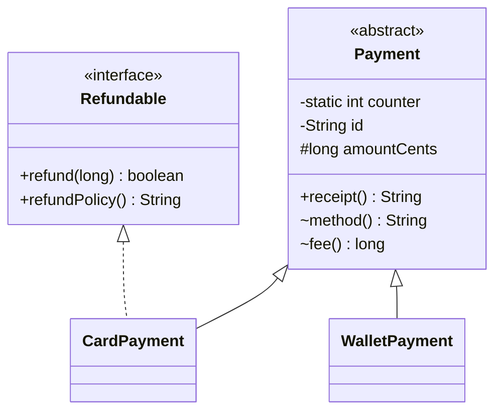
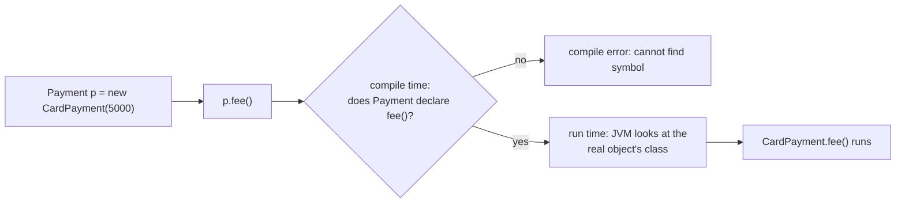
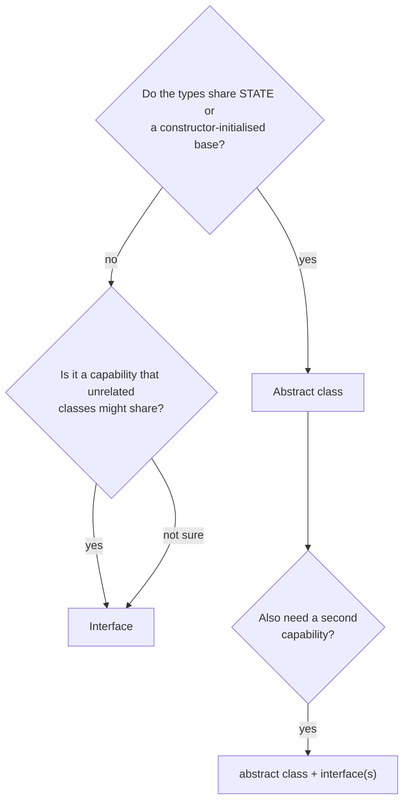
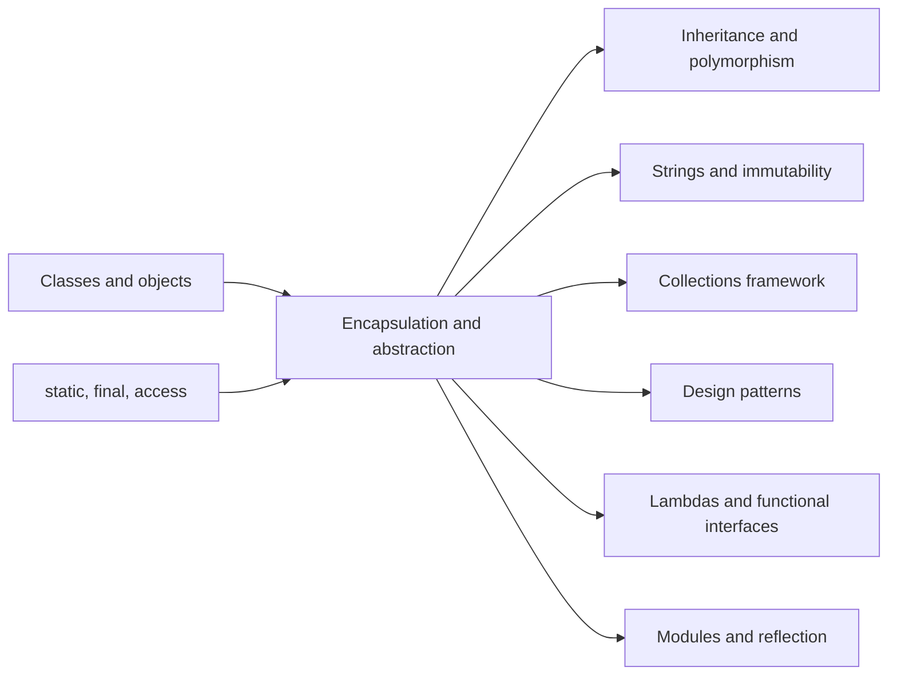

# Encapsulation and Abstraction in Java

**TL;DR:** **Encapsulation** means keeping an object's data **private** and letting the outside world change it only through methods that enforce the rules (so the object can never be put into an invalid state). **Abstraction** means showing callers **what** an object does through a small contract (an **abstract class** or an **interface**) while hiding **how** it does it. Encapsulation protects the inside of one class; abstraction defines the outside that many classes can share. Java gives you `private`/`protected`/`public`, `final`, immutability and defensive copies for the first, and `abstract`, `interface`, `default` methods and `sealed` types for the second.

## Table of Contents

1. [TL;DR](#1-tldr)
2. [Why it matters](#2-why-it-matters)
3. [Prerequisites](#3-prerequisites)
4. [Mental model](#4-mental-model)
5. [Core concepts](#5-core-concepts)
6. [How it works](#6-how-it-works)
7. [Examples](#7-examples)
8. [Comparisons](#8-comparisons)
9. [Trade-offs](#9-trade-offs)
10. [Gotchas](#10-gotchas)
11. [Practical application](#11-practical-application)
12. [Interview prep](#12-interview-prep)
13. [Interview question bank](#13-interview-question-bank)
14. [Tricky code snippets](#14-tricky-code-snippets)
15. [Connections](#15-connections)
16. [Summary](#16-summary)
17. [Answers](#answers)

---

## 1. TL;DR

- **Encapsulation:** bundle data with the methods that use it, and **hide** the data (`private`) so only those methods can change it.
- **Information hiding:** the goal behind encapsulation: outsiders depend on a stable public surface, not on internal fields.
- **Abstraction:** expose **what** (a contract of method signatures), hide **how** (the implementation).
- **Abstract class:** a partly built class (`abstract`) that can hold state and constructors but can't be instantiated.
- **Interface:** a pure contract (plus optional `default`/`static`/`private` methods); a class can implement many.

**The analogy: an ATM.**

| ATM | Java |
|---|---|
| The cash vault and counting machinery are locked inside | **Encapsulation**: `private` fields |
| You can't reach in and take cash; you must go through the card reader and PIN | Access only through **public methods** that validate (`withdraw`) |
| The screen offers "Withdraw", "Deposit", "Balance" | The **public interface** (abstraction): *what* it can do |
| Any bank's ATM has the same buttons even though the internals differ | An **interface**: many classes, one contract |
| A bank's "standard ATM design" that every model extends, with only the cash dispenser left to fill in | An **abstract class** with abstract methods |
| An ATM refuses to dispense a negative amount | A **setter or method that enforces an invariant** |

**Running example:** a payments module. An `abstract class Payment` (private counter and id, `protected final` amount, a validating constructor, a `final` template method `receipt()`), subclasses `CardPayment` (also implements the `Refundable` interface with a `default` method) and `WalletPayment`, and an encapsulated `Wallet` class whose getter returns a read-only copy of its history.

---

## 2. Why it matters

**The problem they solve.** If every field is `public`, any code anywhere can set `balance = -5` or empty your internal list, and when you change the internals every caller breaks. Encapsulation makes the class the **only** place that can break its own rules. Abstraction lets callers depend on a contract (`List`, `Payment`) instead of a concrete class, so you can swap implementations without touching callers.

**What goes wrong without them** (verified on Java 21):

| Code | Result | Cause |
|---|---|---|
| `public int capacity; c.capacity = -5;` | Accepted: prints `-5` | No validation point exists |
| `List<String> getStudents() { return students; }` | Caller can `add`, `clear`, bypass capacity rules | Getter leaks the internal mutable list |
| `Polygon(int[] xs) { this.xs = xs; }` then `data[0] = 99` | Object's "private" array changes | Constructor stores the caller's array (no defensive copy) |
| `Collections.unmodifiableList(internal)` then `internal.add("b")` | The "read-only" view shows `[a, b]` | It's a **view**, not a copy |
| `record Team(String n, List<String> m)` | `t.members().add("c")` works | Records are only shallowly immutable |
| `new Shape()` where `Shape` is abstract or an interface | Compile error | Abstract types can't be instantiated |
| `class C implements A, B` where both have `default hello()` | Compile error | Conflicting defaults must be resolved by you |
| Calling an overridable method from a base constructor | `label=null` seen in the base | Subclass fields aren't initialised yet |

**Why interviewers ask.** "Explain encapsulation with an example", "abstract class vs interface", "how do you make a class immutable" and "can an interface have a constructor / default methods" are near-guaranteed questions in Java rounds, and the immutability and default-method diamond questions separate strong candidates from average ones.

---

## 3. Prerequisites

| Prerequisite | One-line refresher | Importance |
|---|---|---|
| Classes, objects, constructors | `new` runs a constructor; fields are per object ([Introduction to OOP: Classes and Objects notes]) | Essential |
| References and aliasing | Two variables can point at one object ([Data Type Compatibility notes]) | Essential |
| `static` and `final` | Class-level members; `final` fields assigned once ([Declaring Variables and Methods notes]) | Essential |
| `equals`/`hashCode`, records | Value classes and the compact constructor | Nice-to-have |
| Method overriding basics | Subclass replaces a parent method (deep dive in the Inheritance and Polymorphism notes) | Nice-to-have |

---

## 4. Mental model

> **The one picture to keep in your head:** every class has a **wall** and a **doorway**. Encapsulation builds the wall (private state, validated changes). Abstraction designs the doorway (the smallest contract callers need) so that many different rooms can have the same door.

```
        CALLER CODE
            │  only sees the contract
            ▼
 ┌────────────────────────────┐      ┌─────────────────────────────┐
 │ interface / abstract class │      │  interface / abstract class │
 │  (ABSTRACTION: what)       │ ...  │  e.g. Payment, Refundable   │
 └──────────────┬─────────────┘      └─────────────────────────────┘
                │ implemented by
     ┌──────────┴───────────┐
     ▼                      ▼
┌───────────────┐   ┌───────────────┐
│ CardPayment   │   │ WalletPayment │
│┌─────────────┐│   │┌─────────────┐│
││ private     ││   ││ private     ││   ◄── ENCAPSULATION:
││ state       ││   ││ state       ││       the wall
│└─────────────┘│   │└─────────────┘│
└───────────────┘   └───────────────┘
```
*Callers talk to the contract; each implementation guards its own private state behind it.*

**The class design the notes build on:**


*`CardPayment` extends one abstract class and implements one interface; `WalletPayment` isn't refundable.*

---

## 5. Core concepts

### 5.1 Glossary

- **Encapsulation:** bundling data and the methods that operate on it in one class, and restricting direct access to the data.
- **Information hiding:** designing so that internal details can change without affecting callers; the *purpose* of encapsulation.
- **Access modifier:** `private`, (none = package-private), `protected`, `public`: controls who can see a member or class.
- **Invariant:** a rule that must always hold for an object (`balance >= 0`). The class's methods defend it.
- **Getter / setter (accessor / mutator):** methods that read or change a private field, usually named `getX`/`isX`/`setX`.
- **Immutable:** an object whose state can't change after construction (`String`, `Integer`, `LocalDate`).
- **Defensive copy:** copying a mutable argument (on the way in) or field (on the way out) so outsiders can't alias your internals.
- **Abstraction:** exposing essential behaviour while hiding implementation detail.
- **Abstract class:** a class declared `abstract`; can't be instantiated; may have abstract and concrete methods, fields, constructors.
- **Abstract method:** a method with a signature but **no body** (`abstract double area();`); subclasses must implement it.
- **Interface:** a type that declares a contract; a class `implements` it. All members are implicitly `public`; fields are `public static final`.
- **Default method:** an interface method *with* a body, marked `default` (Java 8); lets you add methods without breaking implementers.
- **Static / private interface methods:** utility methods inside an interface (`static` since Java 8, `private` since Java 9).
- **Functional interface:** an interface with exactly one abstract method; the target type of lambdas.
- **Sealed type:** a class or interface that lists exactly which types may extend it (`permits`); final since Java 17.
- **Template method:** a `final` method in an abstract class that calls abstract steps implemented by subclasses.
- **Leaky abstraction:** a contract that forces callers to know implementation details to use it correctly.

### 5.2 Access modifiers

| Modifier | Same class | Same package | Subclass in another package | Everywhere |
|---|:-:|:-:|:-:|:-:|
| `private` | ✅ | ❌ | ❌ | ❌ |
| *(none)*: package-private | ✅ | ✅ | ❌ | ❌ |
| `protected` | ✅ | ✅ | ✅ (through inheritance) | ❌ |
| `public` | ✅ | ✅ | ✅ | ✅ |

- A **top-level** class can only be `public` or package-private. `private`/`protected` apply to members and nested classes.
- `private` is per **class**, not per object: one instance may read another instance's private fields (Snippet 2).
- A nested (inner) class and its outer class can read each other's private members (Snippet 47).
- Access control is a **compile-time design tool**, not security: reflection can bypass it (Snippet 40) unless a module or security manager blocks it.
- Rule of thumb: make everything as restrictive as possible, then open up only what you must.

### 5.3 Encapsulation recipe

1. Make fields `private` (and `final` when they never change).
2. Provide only the accessors callers genuinely need; skip setters for anything that shouldn't change.
3. Validate in constructors and setters; throw `IllegalArgumentException` for bad input.
4. Prefer **behaviour methods** (`withdraw(300)`) over raw setters (`setBalance(...)`).
5. Copy mutable inputs in, copy or wrap mutable outputs out.
6. Make the class `final` (or all constructors private) if subclasses could break the invariants.

### 5.4 Abstract classes

- Declared with `abstract class X`; **cannot** be instantiated with `new` (Snippet 6), but can be the type of a variable.
- May contain abstract methods (no body, no `{}`), concrete methods, fields, static members, and **constructors**: the constructor runs when a subclass is built (Snippet 13).
- A class with even one abstract method **must** itself be `abstract` (Snippet 7). An abstract class can have **zero** abstract methods (Snippet 14).
- A concrete subclass must implement **every** inherited abstract method, or be declared `abstract` too (Snippets 12, 29).
- Illegal modifier combinations for an abstract method: `abstract` + `final`, `private`, `static` (Snippets 9–11). A class can't be both `abstract` and `final`.

### 5.5 Interfaces

- Fields are implicitly `public static final` constants (Snippets 15, 16); methods are `public abstract` unless `default`, `static` or `private`.
- An implementing method must be declared `public` (can't weaken access, Snippet 17).
- **No constructors, no instance fields** (Snippet 18). A class can implement many interfaces; an interface can `extends` many interfaces (Snippet 28).
- `default` (Java 8): has a body, inherited by implementers, can be overridden. `static` (Java 8): called as `Iface.m()`, **not inherited** (Snippet 23). `private` (Java 9): helper shared by default methods (Snippet 25).
- A **functional interface** has exactly one abstract method; `@FunctionalInterface` makes the compiler check it (Snippet 26) and lets you use lambdas (Snippet 46).
- Interfaces can't declare `protected` members (Snippet 36), and can't define a `default` version of `Object`'s methods (Snippet 35).

### 5.6 Sealed types (Java 17+)

- `sealed interface Vehicle permits Car, Bike {}` limits the direct subtypes. Each permitted subtype must be `final`, `sealed` or `non-sealed` (Snippets 32–34).
- Lets `switch` over the type be **exhaustive** without a `default`. ⚠️ Sealed classes were preview features in Java 15–16 and standard from 17.

---

## 6. How it works

### 6.1 Where access is enforced

The **compiler** checks every member access against the modifier table and reports `x has private access in Y` (Snippet 1). The JVM re-checks at link time and on reflection (`setAccessible(true)` lifts the check for code the module system allows). So encapsulation is reliable for honest code and for stopping *accidents*, not for stopping a determined attacker with reflection access.

### 6.2 How a call on an abstract type is resolved


*The compiler checks the **declared** type; the JVM picks the **actual** implementation at run time. That is how an abstract type can have many behaviours.*

**Which method wins when interfaces and classes overlap** (all verified):

1. A method inherited from a **class** (even abstract) beats an interface `default` of the same signature ("class wins", Snippet 21).
2. Otherwise the **most specific interface** wins: if `B extends A` and both define `hello()`, `B`'s is used (Snippet 22).
3. If two unrelated interfaces both supply a `default` with the same signature, the class **must override** it (Snippet 19). Inside, choose with `A.super.hello()` (Snippet 20).

### 6.3 Worked trace: the payments module

Code (all in one file; **public class `Main`** drives it):

```java
import java.util.*;

interface Refundable {
    boolean refund(long cents);
    default String refundPolicy() { return "refunds within 30 days"; }
}

abstract class Payment {
    private static int counter = 0;
    private final String id;
    protected final long amountCents;

    protected Payment(long amountCents) {
        if (amountCents <= 0) throw new IllegalArgumentException("amount must be positive");
        this.amountCents = amountCents;
        this.id = "P" + (++counter);
    }
    abstract String method();
    abstract long fee();

    public final String receipt() {                       // template method
        return id + " " + method() + " " + amountCents + " (fee " + fee() + ")";
    }
}

class CardPayment extends Payment implements Refundable {
    private long refunded = 0;
    CardPayment(long cents) { super(cents); }
    @Override String method() { return "CARD"; }
    @Override long fee() { return amountCents * 2 / 100; }
    @Override public boolean refund(long cents) {
        if (cents <= 0 || refunded + cents > amountCents) return false;
        refunded += cents;
        return true;
    }
}

class WalletPayment extends Payment {
    WalletPayment(long cents) { super(cents); }
    @Override String method() { return "WALLET"; }
    @Override long fee() { return 0; }
}

class Wallet {
    private long balance;
    private final List<String> history = new ArrayList<>();
    public void deposit(long cents) {
        if (cents <= 0) throw new IllegalArgumentException("deposit must be positive");
        balance += cents;
        history.add("+" + cents);
    }
    public boolean withdraw(long cents) {
        if (cents <= 0 || cents > balance) return false;
        balance -= cents;
        history.add("-" + cents);
        return true;
    }
    public long getBalance() { return balance; }
    public List<String> getHistory() { return List.copyOf(history); }   // read-only copy
}

public class Main {
    public static void main(String[] args) {
        List<Payment> payments = List.of(new CardPayment(5000), new WalletPayment(1200));
        for (Payment p : payments) System.out.println(p.receipt());
        Refundable r = (Refundable) payments.get(0);
        System.out.println(r.refund(3000) + " " + r.refund(3000) + " " + r.refundPolicy());

        Wallet w = new Wallet();
        w.deposit(1000);
        System.out.println(w.withdraw(300) + " " + w.withdraw(5000) + " balance=" + w.getBalance());
        try { w.deposit(-50); } catch (IllegalArgumentException e) { System.out.println("rejected: " + e.getMessage()); }
        try { w.getHistory().add("+1000000"); } catch (UnsupportedOperationException e) { System.out.println("history is read-only"); }
        System.out.println(w.getHistory());
        try { new WalletPayment(0); } catch (IllegalArgumentException e) { System.out.println("rejected: " + e.getMessage()); }
    }
}
```

Output (verified, Java 21):

```
P1 CARD 5000 (fee 100)
P2 WALLET 1200 (fee 0)
true false refunds within 30 days
true false balance=700
rejected: deposit must be positive
history is read-only
[+1000, -300]
rejected: amount must be positive
```

**Trace, line by line:**

| Step | What happens | Why |
|---|---|---|
| `new CardPayment(5000)` | `CardPayment(5000)` calls `super(5000)`; `Payment`'s constructor validates, sets `amountCents`, makes id `P1`; then `refunded = 0` | The abstract class's constructor runs even though `Payment` is never instantiated alone |
| `p.receipt()` | `final` method in `Payment` calls `method()` and `fee()` | Template method: fixed algorithm, subclass-supplied steps (dynamic dispatch) |
| `fee()` for card | `5000 * 2 / 100 = 100` | `CardPayment`'s override runs |
| `r.refund(3000)` twice | first `true` (refunded=3000), second `false` (3000+3000 > 5000) | Invariant `refunded <= amountCents` enforced inside the class |
| `r.refundPolicy()` | Returns the interface's default text | `CardPayment` didn't override the `default` method |
| `w.withdraw(5000)` | `false`, balance unchanged | Rule enforced in the method, not by the caller |
| `w.deposit(-50)` | `IllegalArgumentException` | Validation at the single entry point |
| `w.getHistory().add(...)` | `UnsupportedOperationException` | `List.copyOf` returns an unmodifiable copy |
| `new WalletPayment(0)` | Rejected by `Payment`'s constructor | An invalid object can never exist |

---

## 7. Examples

### 7.1 Toy example: a validating setter

```java
class Temperature {
    private double celsius;
    void setCelsius(double c) {
        if (c < -273.15) throw new IllegalArgumentException("below absolute zero");
        celsius = c;
    }
    double getFahrenheit() { return celsius * 9 / 5 + 32; }
}
public class Main {
    public static void main(String[] args) {
        Temperature t = new Temperature();
        t.setCelsius(100);
        System.out.println(t.getFahrenheit());
        try { t.setCelsius(-300); } catch (IllegalArgumentException e) { System.out.println(e.getMessage()); }
    }
}
```
Output:
```
212.0
below absolute zero
```
*Notice there is no `getCelsius()` and no raw `setFahrenheit`: the class exposes only what callers need, and the field can never hold an impossible value.*

### 7.2 Toy example: abstract class calling a constructor chain

```java
abstract class Shape {
    protected final String name;
    Shape(String name) { this.name = name; System.out.println("Shape constructor: " + name); }
    abstract double area();
    String describe() { return name + " area=" + area(); }
}
class Square extends Shape {
    private final double side;
    Square(double side) { super("square"); this.side = side; System.out.println("Square constructor"); }
    double area() { return side * side; }
}
public class Main {
    public static void main(String[] args) {
        Shape s = new Square(3);
        System.out.println(s.describe());
    }
}
```
Output:
```
Shape constructor: square
Square constructor
square area=9.0
```
*The variable's type is the abstract `Shape`, the object is a `Square`. `describe()` is written once in `Shape` but calls the subclass's `area()`.*

### 7.3 Real-world examples

- **`java.util.List` and `ArrayList`/`LinkedList`:** you code against the `List` interface (abstraction); each class hides its own array or node chain (encapsulation).
- **`String`:** immutable, `final`, private `byte[]`: no way to change a `String` after creation, which makes it safe as a `HashMap` key and thread-safe.
- **`List.copyOf` / `Collections.unmodifiableList`:** standard tools for returning collections without leaking them (Snippet 5).
- **`java.io.InputStream`:** an abstract class: subclasses implement `read()`, and the base provides `read(byte[])` and `skip` built on top (template method).
- **`Comparable`, `Runnable`, `Comparator`:** single-method interfaces (functional) that let you plug in behaviour.
- **JDBC (`Connection`, `Statement`):** interfaces; each database vendor ships its own implementation, and your code doesn't change.

---

## 8. Comparisons

### 8.1 Encapsulation vs abstraction

| Aspect | Encapsulation | Abstraction |
|---|---|---|
| Question it answers | "Who can touch my data?" | "What does a caller need to know?" |
| Level | Inside one class (data protection) | Design level (contracts shared by many classes) |
| Achieved with | `private` fields, accessors, validation, immutability | `abstract` classes, `interface`s, well-chosen method names |
| Hides | The **data** and representation | The **implementation** of behaviour |
| Failure mode | Public fields, leaky getters | Callers casting to concrete classes, leaky contracts |
| Example | `private double celsius` + validating setter | `List` interface vs `ArrayList` |

One-line version: **encapsulation hides data; abstraction hides complexity.** They work together: abstraction is the doorway, encapsulation is the wall.

### 8.2 Abstract class vs interface

| Feature | Abstract class | Interface |
|---|---|---|
| Instantiate with `new` | No | No (but can `new Iface() { … }` anonymous or lambda) |
| Instance fields (state) | Yes | No (only `public static final` constants) |
| Constructors | Yes | No |
| Method bodies | Yes (any access) | Only `default`, `static`, `private` |
| Abstract methods | 0 or more | Implicitly abstract unless `default`/`static`/`private` |
| Access modifiers on members | Any | Members are `public` (private helpers since 9) |
| Inheritance | A class `extends` **one** class | A class `implements` **many**; interface `extends` many |
| Use for | Shared state and partial implementation for related classes (IS-A) | A capability or role that unrelated classes can share (CAN-DO) |
| Lambdas | Can't be a lambda target | Functional interface can |


*When in doubt start with an interface; reach for an abstract class only when subclasses need shared fields or constructor logic.*

### 8.3 `private` vs package-private vs `protected` vs `public`

| Choose | When |
|---|---|
| `private` | Default for fields and helpers |
| package-private | Collaborating classes in one package (internal API) |
| `protected` | Hooks you want subclasses to use or override; it also opens the member to the whole package |
| `public` | The deliberate, supported API |

### 8.4 Unmodifiable view vs immutable copy

| Approach | Reflects later changes to the source? | Example |
|---|---|---|
| `Collections.unmodifiableList(src)` | **Yes** (view over the same list) | after `src.add("b")` it shows `[a, b]` |
| `List.copyOf(src)` | **No** (independent snapshot) | after `src.add("b")` it still shows `[a]` |

(Both verified in Snippet 5.)

### 8.5 Class vs record vs enum for value-like types

| Type | Immutability | Notes |
|---|---|---|
| Hand-written `final` class | You design it | Most control |
| `record` | Fields are `final` | Shallow: a `List` component stays mutable unless copied in the compact constructor (Snippets 38, 39) |
| `enum` | Constants are fixed | Can implement interfaces and have per-constant bodies (Snippet 49) |

---

## 9. Trade-offs

| Decision | Benefit | Cost | Use when |
|---|---|---|---|
| Private fields + accessors | Safe to change internals; one place for validation | More code than public fields | Almost always |
| Setters on everything ("Java bean") | Frameworks (JPA, Jackson) can populate objects | Objects are mutable and may be half-initialised | Framework-mandated entities |
| Immutable classes | Thread-safe, safe as map keys, simple to reason about | Each change allocates a new object | Value objects, DTOs, config |
| Defensive copying | Protects invariants | Allocation and copy cost on each call | Mutable inputs/outputs of an API |
| Interface-first design | Easy to mock, swap and extend | Extra types; indirection | Anything with more than one plausible implementation |
| Abstract base class | Reuse state and logic across subclasses | Tight coupling; one parent only | Closely related classes (template method) |
| `default` methods | Evolve an API without breaking implementers | Can create diamond conflicts; blurs interface vs class | Adding a convenience to a widely implemented interface |
| `sealed` hierarchies | Closed set, exhaustive `switch` | Subtypes must be known up front | Domain models like `Shape`, `Result`, `Vehicle` |

---

## 10. Gotchas

### Myths

- ❌ **Myth:** "Encapsulation just means writing getters and setters." ✅ **Reality:** a getter/setter for every field is a public field in disguise. Encapsulation is about enforcing invariants and hiding representation.
- ❌ **Myth:** "`private` makes my data secure." ✅ **Reality:** it's a compile-time contract; reflection can read it (Snippet 40), and it doesn't stop you leaking a reference through a getter (Snippet 3).
- ❌ **Myth:** "`final` on a field makes the object immutable." ✅ **Reality:** `final` fixes the *reference*; the object it points at can still change (`final List` can be `add`ed to).
- ❌ **Myth:** "`private` means private to the object." ✅ **Reality:** private to the *class*: another instance of the same class can read it (Snippet 2).
- ❌ **Myth:** "An interface can't have method bodies." ✅ **Reality:** since Java 8 it can have `default` and `static` methods, and since 9 `private` ones.
- ❌ **Myth:** "An abstract class must have abstract methods." ✅ **Reality:** it can have none; `abstract` just forbids direct instantiation (Snippet 14).
- ❌ **Myth:** "Abstract classes have no constructors." ✅ **Reality:** they do; it runs via `super(...)` when a subclass is built (Snippet 13).
- ❌ **Myth:** "Interfaces replaced abstract classes." ✅ **Reality:** only abstract classes hold instance state and constructors.
- ❌ **Myth:** "Records are fully immutable." ✅ **Reality:** shallowly: components can still be mutable objects (Snippet 38).

### Common mistakes and edge cases

- **Getter returns the internal mutable collection or array**: caller edits internals (Snippet 3). Return `List.copyOf(...)`, `.clone()`.
- **Constructor stores the caller's array/list/`Date`**: later changes to the original change your object (Snippets 4, 41). Copy in.
- **Using `unmodifiableList` as a "copy"**: it's a live view (Snippet 5).
- **`StringBuilder`/`Date` fields in a "final" class**: the reference is final but the object isn't (Snippets 41, 42).
- **Calling an overridable method from a constructor**: the subclass override sees uninitialised fields (Snippet 37).
- **Two interfaces with the same `default`**: must override and choose (Snippets 19, 20).
- **Implementing an interface method without `public`**: compile error, access can't be weaker (Snippet 17).
- **Forgetting `static` interface methods aren't inherited**: `Impl.twice(4)` fails (Snippet 23).
- **Making a `final` field but not assigning it in every constructor**: *variable might not have been initialized* (Snippet 44).
- **Exposing mutable `public static final` arrays**: `final` doesn't stop `ARR[0] = x`.

---

## 11. Practical application

### Class design checklist
- [ ] All fields `private` (and `final` where possible)
- [ ] Constructor validates and establishes every invariant
- [ ] No setter unless a caller truly needs to change that field
- [ ] Mutable arguments copied in; mutable results copied or wrapped out
- [ ] Class is `final` (or constructors are private) unless designed for extension
- [ ] Public API is the smallest set of methods that does the job
- [ ] Callers are typed to the interface (`List`), not the implementation (`ArrayList`)
- [ ] Shared behaviour in an abstract class only when subclasses share state; otherwise `default` methods or composition

### Hands-on exercise: fix the leaky `Course`

This class has three encapsulation bugs. Find them, then rewrite it so that: capacity must be positive, a student can't be enrolled twice, blank names are rejected, the roster can't exceed capacity, and callers can't modify the roster through a getter.

```java
import java.util.*;
class Course {
    public int capacity;
    public List<String> students = new ArrayList<>();
}
public class Main {
    public static void main(String[] args) {
        Course c = new Course();
        c.capacity = -5;
        c.students.add(null);
        System.out.println(c.capacity + " " + c.students);
    }
}
```
Currently prints `-5 [null]` (verified).

<details><summary>Solution</summary>

**Bugs:** (1) public fields mean no validation: capacity `-5` and a `null` student are accepted; (2) nothing enforces the capacity limit; (3) the public list can be modified or replaced by anyone.

```java
import java.util.*;
final class Course {
    private final int capacity;
    private final List<String> students = new ArrayList<>();
    Course(int capacity) {
        if (capacity <= 0) throw new IllegalArgumentException("capacity must be positive");
        this.capacity = capacity;
    }
    boolean enroll(String s) {
        if (s == null || s.isBlank() || students.size() >= capacity || students.contains(s)) return false;
        return students.add(s);
    }
    List<String> getStudents() { return List.copyOf(students); }
}
public class Main {
    public static void main(String[] args) {
        Course c = new Course(2);
        System.out.println(c.enroll("A") + " " + c.enroll("B") + " " + c.enroll("C") + " " + c.enroll("A"));
        try { c.getStudents().add("Z"); } catch (UnsupportedOperationException e) { System.out.println("read-only view"); }
        System.out.println(c.getStudents());
    }
}
```
Output (verified):
```
true true false false
read-only view
[A, B]
```
Why: the constructor makes an invalid `Course` impossible; `enroll` is the only way to add, and it enforces every rule; the getter returns a snapshot so the internal list never escapes. `enroll` returns `boolean` instead of throwing so callers can react to a full course.
</details>

---
## 12. Interview prep

### Likely questions with model answers

**Q1. What is encapsulation? Give an example.**
> "Encapsulation is bundling an object's data with the methods that operate on it and restricting direct access to that data, normally by making fields `private` and exposing controlled methods. The point is to protect invariants and hide representation. For example a `Wallet` keeps `balance` private; `deposit` rejects non-positive amounts and `withdraw` refuses to go below zero, so no caller can put the wallet in an invalid state, and I can change how the balance is stored without breaking anyone."

**Q2. What is abstraction, and how is it different from encapsulation?**
> "Abstraction means exposing what an object does through a simple contract and hiding how it does it. In Java I get it through interfaces and abstract classes: callers use `List` and don't care whether it's an `ArrayList` or a `LinkedList`. Encapsulation is about protecting an object's data inside the class; abstraction is about designing a minimal outside view that many implementations can share. Short version: encapsulation hides data, abstraction hides complexity."

**Q3. How do you create an immutable class?**
> "Declare the class `final` so nobody can subclass it and add mutability; make all fields `private final`; set them only in the constructor; provide no setters or other mutators; and make defensive copies of mutable inputs in the constructor and of mutable fields in getters, or return unmodifiable copies such as `List.copyOf`. `String` and `LocalDate` are examples. A record gives you final fields and generated accessors, but components that are mutable, like a `List`, still need to be copied in the compact constructor."

**Q4. Abstract class vs interface: when do you use which?**
> "An abstract class can hold instance state, constructors and any mix of abstract and concrete methods, but a class can extend only one. An interface defines a contract with no instance state, a class can implement many, and since Java 8 it can carry `default` and `static` methods. I use an abstract class when closely related subclasses share fields or construction logic, like a template-method base. I use an interface for a capability that unrelated classes can share, or when I want callers decoupled from the implementation. Often I use both: an interface for the contract and an abstract class as a convenience base."

**Q5. Can an abstract class have a constructor? Can you instantiate it?**
> "It can have constructors, and they run when a subclass object is created through `super(...)`, so it can initialise shared fields and validate. But you can't write `new Shape()` on an abstract class; that's a compile error. You can use it as a variable type, or create an anonymous subclass, and an abstract class doesn't even need to have abstract methods."

**Q6. What are default methods and why were they added?**
> "A default method is an interface method with a body, added in Java 8 so interfaces could gain new methods, like `List.sort` or `Collection.stream`, without breaking every existing implementing class. If two interfaces provide the same default, the implementing class must override it and can choose one explicitly with `Interface.super.method()`. A method inherited from a class always beats an interface default, and a more specific sub-interface beats its parent."

**Q7. Why can't an interface have a constructor or instance variables?**
> "An interface isn't meant to hold per-object state or to be initialised; it only defines a contract. Fields declared in an interface are implicitly `public static final` constants, and there's no instance to construct. Allowing instance state would bring back multiple inheritance of state and the diamond problem. Only classes, which have single inheritance, carry state."

**Q8. What does `protected` mean, and how is it different from package-private?**
> "`protected` allows access from the same package and from subclasses in other packages, though in another package only through inheritance, meaning on a reference of the subclass type. Package-private, with no modifier, allows only the same package. So `protected` is strictly more open. I use it sparingly for hook methods, because it also becomes part of the API that subclasses can depend on."

**Q9. What is a defensive copy and when do you need one?**
> "It's copying a mutable object so that outsiders can't alias your internals. You need one when a constructor or setter accepts a mutable argument such as an array, `List` or `Date`, and when a getter returns a mutable field. Without it, someone can change the object's state behind its back and break invariants, even though the field is `private final`. For collections I'd copy in with `List.copyOf` or `new ArrayList<>(...)`, and return an unmodifiable copy."

**Q10. What are sealed classes and why use them?**
> "Introduced as standard in Java 17, a sealed class or interface declares exactly which classes may extend or implement it using `permits`, and each permitted subtype must be `final`, `sealed` or `non-sealed`. It models a closed set of alternatives, and the compiler can then check a `switch` over the type for exhaustiveness without a `default`. It gives more control than `final` (no subclasses at all) and more safety than an open hierarchy."

### What interviewers watch for
- That you distinguish encapsulation (data protection) from abstraction (contract design) and give separate examples.
- Knowing getters/setters alone aren't encapsulation: validation, invariants and no leaked references are.
- Immutability checklist, including defensive copies and why `final` alone isn't enough.
- Precise abstract-class and interface rules: constructors, state, `default` conflicts, access of interface methods.
- Modern Java: `default`/`static`/`private` interface methods, records, sealed types.

---

## 13. Interview question bank

Short answers are hidden. 🟢 fresher, 🟡 intermediate, 🔴 senior/FAANG follow-up.

### 13.1 Encapsulation basics

**1. 🟢 What is encapsulation?**
<details><summary>Answer</summary>

Bundling data with the methods that operate on it and restricting direct access to the data (usually `private` fields plus public methods), so the class controls how its state changes.
</details>

**2. 🟢 How do you achieve encapsulation in Java?**
<details><summary>Answer</summary>

Make fields `private`, provide public/protected methods (getters, setters, behaviour methods) as the only access path, validate in them, and keep representation hidden.
</details>

**3. 🟢 What are the benefits of encapsulation?**
<details><summary>Answer</summary>

Protects invariants (validation in one place), lets you change the implementation without breaking callers, reduces coupling, makes code easier to test and maintain, and allows read-only or write-only properties.
</details>

**4. 🟢 What are getters and setters? Are they mandatory?**
<details><summary>Answer</summary>

Methods that read/write a private field (`getX`/`isX`/`setX`). Not mandatory: only expose what callers need. Many good classes have no setters (immutable) or no getter for some fields.
</details>

**5. 🟡 Is a class with private fields and a getter + setter for each field really encapsulated?**
<details><summary>Answer</summary>

Not meaningfully. If the setter does no validation, it's a public field in disguise. Real encapsulation exposes behaviour (`withdraw`) and enforces invariants.
</details>

**6. 🟡 What is information hiding? How does it relate to encapsulation?**
<details><summary>Answer</summary>

Designing modules so that internal decisions are hidden behind a stable interface. Encapsulation is the language mechanism (private + methods); information hiding is the design goal.
</details>

**7. 🟡 How can you make a field read-only from outside?**
<details><summary>Answer</summary>

`private` field with a getter and no setter (and `final` if it never changes after construction). For collections, return an unmodifiable copy.
</details>

**8. 🟡 What is an invariant? Give an example.**
<details><summary>Answer</summary>

A condition that must always hold for an object, e.g. `balance >= 0`, `start <= end`, `refunded <= amount`. The class establishes it in the constructor and preserves it in every method.
</details>

**9. 🟡 Can one object access another object's private fields?**
<details><summary>Answer</summary>

Yes, if both are instances of the same class: `private` is per class, not per instance (Snippet 2). Outer and nested classes can also access each other's privates.
</details>

**10. 🟡 Can encapsulation be broken? How?**
<details><summary>Answer</summary>

Yes: reflection with `setAccessible(true)`, serialization, leaking references through getters, or storing caller-owned mutable arguments. Modules (JPMS) and immutable design reduce these risks.
</details>

**11. 🟡 Why should we avoid `public` fields?**
<details><summary>Answer</summary>

No validation point, no way to change representation later without breaking callers, and no control over concurrent or invalid updates. Exception: `public static final` constants of immutable types.
</details>

**12. 🔴 A getter returns the list field. What's the problem and how do you fix it?**
<details><summary>Answer</summary>

Callers can `add`, `remove` or `clear` and bypass your rules (Snippet 3). Return `List.copyOf(list)`, `Collections.unmodifiableList(list)` (a live view), or an immutable list built when needed.
</details>

### 13.2 Access modifiers

**13. 🟢 List the four access levels in Java.**
<details><summary>Answer</summary>

`private` (class), package-private/default (package), `protected` (package + subclasses), `public` (everywhere).
</details>

**14. 🟢 What is the default access modifier?**
<details><summary>Answer</summary>

Package-private (no keyword) for classes and members of classes. Members of an **interface** are implicitly `public`.
</details>

**15. 🟢 Can a top-level class be `private` or `protected`?**
<details><summary>Answer</summary>

No, only `public` or package-private. `private`/`protected` are allowed on nested classes.
</details>

**16. 🟡 Difference between `protected` and package-private?**
<details><summary>Answer</summary>

`protected` = package access **plus** subclasses in other packages (through inheritance). Package-private = same package only.
</details>

**17. 🟡 Can a subclass in another package access a `protected` member through a parent-type reference?**
<details><summary>Answer</summary>

No. It can access it on `this` or references of its own (sub)type, not on an arbitrary parent-type reference.
</details>

**18. 🟡 Can you reduce access when overriding?**
<details><summary>Answer</summary>

No. An overriding method can't be less accessible than the overridden one (e.g. implementing a `public` interface method as package-private is a compile error, Snippet 17). It can widen access.
</details>

**19. 🟡 Can a class have a `private` constructor? Why?**
<details><summary>Answer</summary>

Yes: singletons, utility classes, static factory methods, and builders (Snippet 43). Code outside the class can't call `new` on it (compile error, Snippet 43).
</details>

**20. 🔴 Can a `private` method be overridden?**
<details><summary>Answer</summary>

No: it isn't inherited, so a same-named subclass method is a new unrelated method. (Covered in the Inheritance notes.)
</details>

**21. 🔴 What is the difference between access control and security?**
<details><summary>Answer</summary>

Access modifiers prevent accidental misuse at compile time; they don't prevent reflection or other privileged access. Real security needs the module system, sandboxing and careful API design.
</details>

### 13.3 Immutability

**22. 🟢 What is an immutable class? Give examples.**
<details><summary>Answer</summary>

A class whose objects can't change after construction: `String`, wrapper classes (`Integer`), `LocalDate`, `BigDecimal`, records with immutable components.
</details>

**23. 🟢 How do you create an immutable class?**
<details><summary>Answer</summary>

`final` class, `private final` fields, set in the constructor, no setters, defensive copies in/out of mutable components.
</details>

**24. 🟡 Why is `String` immutable?**
<details><summary>Answer</summary>

String pool sharing, safe as `HashMap` keys (stable hash), thread-safety, and security (class names, file paths, URLs can't be altered after validation).
</details>

**25. 🟡 Does `final` make an object immutable?**
<details><summary>Answer</summary>

No. `final` prevents reassigning the variable; the referenced object may still change (`final List<String> l; l.add("x")` is fine).
</details>

**26. 🟡 Why make an immutable class `final`?**
<details><summary>Answer</summary>

A subclass could add mutable state or override methods to break immutability while still being a valid instance of the type.
</details>

**27. 🟡 Difference between `Collections.unmodifiableList` and `List.copyOf`?**
<details><summary>Answer</summary>

`unmodifiableList` is a read-only **view** that reflects later changes to the source; `List.copyOf` is an independent immutable **snapshot** (Snippet 5). `List.copyOf` also rejects `null` elements.
</details>

**28. 🟡 Are records immutable?**
<details><summary>Answer</summary>

Their fields are `final`, so the references can't change (shallow immutability). A `List` component can still be mutated unless you copy it in the compact constructor (Snippets 38, 39).
</details>

**29. 🔴 What are the advantages and disadvantages of immutability?**
<details><summary>Answer</summary>

Pros: thread-safe, safe to share and cache, safe as keys, simpler reasoning. Cons: every "change" creates a new object (allocation), awkward for large evolving structures (mitigated by builders or persistent structures).
</details>

**30. 🔴 How do you create an immutable class that holds a `Date` or an array?**
<details><summary>Answer</summary>

Copy on the way in (`new Date(d.getTime())`, `arr.clone()`) and on the way out, or avoid the mutable type (use `java.time.Instant`/`LocalDate`, or an immutable `List`). Snippet 41 shows the leak.
</details>

### 13.4 Abstract classes

**31. 🟢 What is an abstract class? An abstract method?**
<details><summary>Answer</summary>

Abstract class: declared `abstract`, can't be instantiated, may mix abstract and concrete members. Abstract method: signature only (no body) that subclasses must implement.
</details>

**32. 🟢 Can we create an object of an abstract class?**
<details><summary>Answer</summary>

No (compile error: *is abstract; cannot be instantiated*, Snippet 6). You can create objects of concrete subclasses or anonymous subclasses.
</details>

**33. 🟢 Can an abstract class have a constructor?**
<details><summary>Answer</summary>

Yes; it runs via `super(...)` when a subclass is instantiated (Snippet 13). If it has only a parameterised constructor, subclasses must call it explicitly (Snippet 45).
</details>

**34. 🟢 Can an abstract class have no abstract methods?**
<details><summary>Answer</summary>

Yes. It just can't be instantiated directly (Snippet 14). Used as a base class that shouldn't stand alone, or with `protected` constructors.
</details>

**35. 🟡 Can a class with an abstract method be non-abstract?**
<details><summary>Answer</summary>

No: compile error *is not abstract and does not override abstract method* (Snippet 7).
</details>

**36. 🟡 Which modifiers can't be combined with `abstract` on a method?**
<details><summary>Answer</summary>

`final`, `private`, `static` (Snippets 9–11): abstract methods must be overridable and instance-level. Also `abstract final class` is illegal (Snippet 56).
</details>

**37. 🟡 Can an abstract class have `static` methods, fields and `main`?**
<details><summary>Answer</summary>

Yes to all; `main` in an abstract class runs fine (Snippet 53).
</details>

**38. 🟡 Can an abstract class implement an interface without implementing its methods?**
<details><summary>Answer</summary>

Yes; the concrete subclass must implement the remaining ones (Snippet 29).
</details>

**39. 🟡 What is the template method pattern?**
<details><summary>Answer</summary>

A `final` method in an abstract class defines an algorithm's skeleton and calls abstract (or hook) methods that subclasses fill in, like `Payment.receipt()` in the running example.
</details>

**40. 🔴 Why is calling an abstract/overridable method from a constructor dangerous?**
<details><summary>Answer</summary>

The base constructor runs before the subclass's fields are initialised, so the override sees defaults like `null` or `0` (Snippet 37).
</details>

**41. 🔴 Can you make an abstract class `final`? A method `abstract` and `synchronized`?**
<details><summary>Answer</summary>

`abstract final` class: no (can't be both). `abstract synchronized` method: no, `synchronized` is an implementation detail and isn't allowed on abstract methods.
</details>

### 13.5 Interfaces

**42. 🟢 What is an interface? How do you use it?**
<details><summary>Answer</summary>

A type declaring a contract of methods (and constants); a class `implements` it and provides the method bodies.
</details>

**43. 🟢 Can an interface have variables? Of what kind?**
<details><summary>Answer</summary>

Only constants: implicitly `public static final` (Snippets 15, 16); an uninitialised "instance" field is a compile error (Snippet 52).
</details>

**44. 🟢 Can a class implement multiple interfaces? Can a class extend multiple classes?**
<details><summary>Answer</summary>

Yes to multiple interfaces; no to multiple classes. An interface can extend multiple interfaces (Snippet 28).
</details>

**45. 🟢 Can you create an object of an interface?**
<details><summary>Answer</summary>

Not with `new Shape()` (Snippet 55), but you can create an anonymous implementation or a lambda for a functional interface (Snippet 46).
</details>

**46. 🟡 What are default methods? Why were they introduced?**
<details><summary>Answer</summary>

Interface methods with bodies (Java 8) to evolve interfaces without breaking existing implementers, e.g. `Collection.stream()`.
</details>

**47. 🟡 What happens if two interfaces define the same default method?**
<details><summary>Answer</summary>

The implementing class must override it (compile error otherwise, Snippet 19) and may call `A.super.hello()` (Snippet 20).
</details>

**48. 🟡 What if a superclass and an interface both provide the method?**
<details><summary>Answer</summary>

The class's method wins (Snippet 21).
</details>

**49. 🟡 Are static interface methods inherited?**
<details><summary>Answer</summary>

No: call them as `Iface.method()`, not via the implementing class or an instance (Snippets 23, 24).
</details>

**50. 🟡 What are private interface methods for?**
<details><summary>Answer</summary>

Sharing code between default/static methods without exposing it (Java 9, Snippet 25).
</details>

**51. 🟡 What is a functional interface? What is `@FunctionalInterface`?**
<details><summary>Answer</summary>

An interface with exactly one abstract method (default/static/Object-method redeclarations don't count). The annotation makes the compiler enforce it (Snippet 26).
</details>

**52. 🟡 What is a marker interface?**
<details><summary>Answer</summary>

An interface with no methods used to tag a class (`Serializable`, `Cloneable`). Annotations are the modern alternative.
</details>

**53. 🟡 Can an interface method be `protected`? Can an implementing method be package-private?**
<details><summary>Answer</summary>

No to both: interface members are `public`; implementations must be `public` (Snippets 17, 36).
</details>

**54. 🔴 Can an interface define `default String toString()`?**
<details><summary>Answer</summary>

No: *default method toString in interface overrides a member of java.lang.Object* (Snippet 35), because a class's `Object` method would always win anyway.
</details>

**55. 🔴 Why can't an interface have constructors or instance state?**
<details><summary>Answer</summary>

It would reintroduce multiple inheritance of state (the diamond problem). Java allows multiple inheritance of type and behaviour (default methods) but only single inheritance of state.
</details>

**56. 🔴 If a variable has an interface type, which methods can you call?**
<details><summary>Answer</summary>

Only those declared in the interface (plus `Object` methods). A `radius()` that exists only in the implementing class is *cannot find symbol* (Snippet 27).
</details>

### 13.6 Design and modern Java

**57. 🟡 Abstract class or interface for a `Shape` hierarchy where all shapes have a `name`?**
<details><summary>Answer</summary>

Abstract class if shapes share state like `name` and a constructor; or an interface plus an optional abstract base. Interface alone if only behaviour (`area()`) is shared.
</details>

**58. 🟡 What is "program to an interface, not an implementation"?**
<details><summary>Answer</summary>

Declare variables, parameters and return types with the abstract type (`List<String> l = new ArrayList<>()`) so the implementation can change without touching callers.
</details>

**59. 🟡 What is composition vs inheritance for reuse?**
<details><summary>Answer</summary>

Inheritance reuses by IS-A (tight coupling); composition reuses by HAS-A, delegating to a contained object (looser, more flexible). Prefer composition unless there is a true IS-A.
</details>

**60. 🔴 What are sealed classes? When would you use them?**
<details><summary>Answer</summary>

A class/interface restricting its direct subtypes with `permits` (final in Java 17). Use for closed domain models (shapes, results) so `switch` can be exhaustive (Snippet 32); subtypes need `final`/`sealed`/`non-sealed` (Snippet 34).
</details>

**61. 🔴 Can an enum implement an interface?**
<details><summary>Answer</summary>

Yes, with optional per-constant bodies (Snippet 49). Enums can't extend a class (they implicitly extend `Enum`).
</details>

**62. 🔴 What is a leaky abstraction?**
<details><summary>Answer</summary>

A contract whose correct use depends on hidden implementation details, e.g. needing to know a `List` is an `ArrayList` for performance, or an API that exposes SQL-specific exceptions.
</details>

**63. 🔴 How would you evolve a widely used interface without breaking implementers?**
<details><summary>Answer</summary>

Add a `default` method (with a safe behaviour) rather than a new abstract method; or create a new extending interface. Beware default-method name conflicts.
</details>

---
## 14. Tricky code snippets

All compiled and run on OpenJDK 21. Predict first. Unless shown, snippets sit inside a file with `public class Main { public static void main(String[] args) { … } }`.

**Snippet 1 🟢**
```java
class Account { private long balance = 100; }
// in main:
Account a = new Account();
System.out.println(a.balance);
```
<details><summary>Answer</summary>

Compile error: *balance has private access in Account*. `Main` is a different class.
</details>

**Snippet 2 🟡**
```java
class Account {
    private long balance;
    Account(long b) { balance = b; }
    void stealFrom(Account other) { this.balance += other.balance; other.balance = 0; }
    long get() { return balance; }
}
// in main:
Account a = new Account(100), b = new Account(50);
a.stealFrom(b);
System.out.println(a.get() + " " + b.get());
```
<details><summary>Answer</summary>

`150 0`. `private` is per class: one `Account` can read and write another `Account`'s private field.
</details>

**Snippet 3 🟡**
```java
class Course {
    private final List<String> students = new ArrayList<>();
    void enroll(String s) { if (students.size() < 2) students.add(s); }
    List<String> getStudents() { return students; }
}
// in main:
Course c = new Course();
c.enroll("A"); c.enroll("B"); c.enroll("C");
c.getStudents().add("Z");
c.getStudents().clear();
c.getStudents().add("Hacker");
System.out.println(c.getStudents());
```
<details><summary>Answer</summary>

`[Hacker]`. The capacity rule is bypassed because the getter hands out the internal list. Fix: return `List.copyOf(students)`.
</details>

**Snippet 4 🟡**
```java
final class Polygon {
    private final int[] xs;
    Polygon(int[] xs) { this.xs = xs; }
    int first() { return xs[0]; }
}
final class SafePolygon {
    private final int[] xs;
    SafePolygon(int[] xs) { this.xs = xs.clone(); }
    int first() { return xs[0]; }
    int[] xs() { return xs.clone(); }
}
// in main:
int[] data = {1, 2, 3};
Polygon p = new Polygon(data);
SafePolygon s = new SafePolygon(data);
data[0] = 99;
s.xs()[0] = -1;
System.out.println(p.first() + " " + s.first());
```
<details><summary>Answer</summary>

`99 1`. `Polygon` stored the caller's array, so the caller's change shows through. `SafePolygon` copied it in and out, so both `data[0] = 99` and `s.xs()[0] = -1` have no effect.
</details>

**Snippet 5 🟡**
```java
List<String> internal = new ArrayList<>(List.of("a"));
List<String> view = Collections.unmodifiableList(internal);
List<String> copy = List.copyOf(internal);
internal.add("b");
System.out.println(view + " " + copy);
```
<details><summary>Answer</summary>

`[a, b] [a]`. `unmodifiableList` is a live read-only view; `List.copyOf` is a snapshot.
</details>

**Snippet 6 🟢**
```java
abstract class Shape { abstract double area(); }
// in main:
Shape s = new Shape();
```
<details><summary>Answer</summary>

Compile error: *Shape is abstract; cannot be instantiated*.
</details>

**Snippet 7 🟢**
```java
class Shape { abstract double area(); }
```
<details><summary>Answer</summary>

Compile error: *Shape is not abstract and does not override abstract method area() in Shape*. A class with an abstract method must be declared `abstract`.
</details>

**Snippet 8 🟢**
```java
abstract class Shape { abstract double area() { return 0; } }
```
<details><summary>Answer</summary>

Compile error: *abstract methods cannot have a body*.
</details>

**Snippet 9 🟡**
```java
abstract class Shape { abstract final double area(); }
```
<details><summary>Answer</summary>

Compile error: *illegal combination of modifiers: abstract and final*. An abstract method must be overridable.
</details>

**Snippet 10 🟡**
```java
abstract class Shape { private abstract double area(); }
```
<details><summary>Answer</summary>

Compile error: *illegal combination of modifiers: abstract and private*. A private method is invisible to subclasses so it can never be implemented.
</details>

**Snippet 11 🟡**
```java
abstract class Shape { static abstract double area(); }
```
<details><summary>Answer</summary>

Compile error: *illegal combination of modifiers: abstract and static*. Static methods aren't overridden.
</details>

**Snippet 12 🟢**
```java
abstract class Shape { abstract double area(); abstract String name(); }
class Circle extends Shape { double area() { return 3.14; } }
```
<details><summary>Answer</summary>

Compile error: *Circle is not abstract and does not override abstract method name() in Shape*. Implement all abstract methods or make `Circle` abstract.
</details>

**Snippet 13 🟡**
```java
abstract class Shape {
    protected final String name;
    Shape(String name) { this.name = name; System.out.println("Shape constructor: " + name); }
    abstract double area();
    String describe() { return name + " area=" + area(); }
}
class Square extends Shape {
    private final double side;
    Square(double side) { super("square"); this.side = side; System.out.println("Square constructor"); }
    double area() { return side * side; }
}
// in main:
Shape s = new Square(3);
System.out.println(s.describe());
```
<details><summary>Answer</summary>

```
Shape constructor: square
Square constructor
square area=9.0
```
The abstract class's constructor runs first, through `super("square")`.
</details>

**Snippet 14 🟡**
```java
abstract class Base { void hello() { System.out.println("hello"); } }
// in main:
Base b = new Base() { };
b.hello();
System.out.println(b.getClass().getSuperclass().getSimpleName());
```
<details><summary>Answer</summary>

```
hello
Base
```
An abstract class needs no abstract methods, and `new Base() { }` creates an anonymous subclass (whose superclass is `Base`).
</details>

**Snippet 15 🟢**
```java
interface Config { int MAX = 10; }
// in main:
Config.MAX = 20;
```
<details><summary>Answer</summary>

Compile error: *cannot assign a value to static final variable MAX*. Interface fields are `public static final`.
</details>

**Snippet 16 🟡**
```java
interface Config { int MAX = 10; }
class Impl implements Config { }
// in main:
System.out.println(Config.MAX + " " + Impl.MAX + " " + new Impl().MAX);
```
<details><summary>Answer</summary>

`10 10 10`. Interface constants are inherited by implementing classes and accessible three ways (the instance form is poor style).
</details>

**Snippet 17 🟡**
```java
interface Shape { double area(); }
class Circle implements Shape {
    double area() { return 3.14; }
}
```
<details><summary>Answer</summary>

Compile error: *area() in Circle cannot implement area() in Shape; attempting to assign weaker access privileges; was public*. Interface methods are `public`, so implementations must be too.
</details>

**Snippet 18 🟡**
```java
interface Shape {
    Shape() { }
}
```
<details><summary>Answer</summary>

Compile error (*&lt;identifier&gt; expected*). Interfaces have no constructors.
</details>

**Snippet 19 🟡**
```java
interface A { default String hello() { return "A"; } }
interface B { default String hello() { return "B"; } }
class C implements A, B { }
```
<details><summary>Answer</summary>

Compile error: *types A and B are incompatible; class C inherits unrelated defaults for hello() from types A and B*. Override `hello()` in `C`.
</details>

**Snippet 20 🟡**
```java
interface A { default String hello() { return "A"; } }
interface B { default String hello() { return "B"; } }
class C implements A, B {
    @Override public String hello() { return A.super.hello() + B.super.hello(); }
}
// in main:
System.out.println(new C().hello());
```
<details><summary>Answer</summary>

`AB`. `Interface.super.method()` calls a specific interface's default.
</details>

**Snippet 21 🔴**
```java
interface Greeter { default String hello() { return "interface"; } }
class Base { public String hello() { return "class"; } }
class Child extends Base implements Greeter { }
// in main:
System.out.println(new Child().hello());
```
<details><summary>Answer</summary>

`class`. The "class wins" rule: a method inherited from a class beats an interface default.
</details>

**Snippet 22 🔴**
```java
interface A { default String hello() { return "A"; } }
interface B extends A { default String hello() { return "B"; } }
class C implements A, B { }
// in main:
System.out.println(new C().hello());
```
<details><summary>Answer</summary>

`B`. The most specific interface wins, so there's no conflict even though `C` lists both.
</details>

**Snippet 23 🔴**
```java
interface MathUtil { static int twice(int x) { return 2 * x; } }
class Impl implements MathUtil { }
// in main:
System.out.println(MathUtil.twice(4));
System.out.println(Impl.twice(4));
```
<details><summary>Answer</summary>

Compile error at `Impl.twice(4)`: *cannot find symbol*. Static interface methods aren't inherited. `MathUtil.twice(4)` alone would print `8`.
</details>

**Snippet 24 🔴**
```java
interface MathUtil { static int twice(int x) { return 2 * x; } }
class Impl implements MathUtil { }
// in main:
MathUtil m = new Impl();
System.out.println(m.twice(4));
```
<details><summary>Answer</summary>

Compile error: *illegal static interface method call* (the receiver expression must be the interface name).
</details>

**Snippet 25 🟡**
```java
interface Logger {
    default void info(String m) { log("INFO", m); }
    default void warn(String m) { log("WARN", m); }
    private void log(String level, String m) { System.out.println("[" + level + "] " + m); }
}
// in main:
Logger l = new Logger() { };
l.info("started");
l.warn("disk low");
```
<details><summary>Answer</summary>

```
[INFO] started
[WARN] disk low
```
Private interface methods (Java 9) share code between default methods; `new Logger() { }` works because there are no abstract methods to implement.
</details>

**Snippet 26 🟡**
```java
@FunctionalInterface
interface Op { int apply(int a); int other(int b); }
```
<details><summary>Answer</summary>

Compile error: *Unexpected @FunctionalInterface annotation ... Op is not a functional interface (multiple non-overriding abstract methods found)*.
</details>

**Snippet 27 🟡**
```java
interface Shape { double area(); }
class Circle implements Shape {
    public double area() { return 3.14; }
    public double radius() { return 1; }
}
// in main:
Shape s = new Circle();
System.out.println(s.radius());
```
<details><summary>Answer</summary>

Compile error: *cannot find symbol: method radius()*. The compiler checks the declared type (`Shape`). Cast to `Circle` to call it.
</details>

**Snippet 28 🟡**
```java
interface Readable { String read(); }
interface Writable { void write(String s); }
interface ReadWrite extends Readable, Writable { }
class Buffer implements ReadWrite {
    private final StringBuilder sb = new StringBuilder();
    public String read() { return sb.toString(); }
    public void write(String s) { sb.append(s); }
}
// in main:
Buffer b = new Buffer();
b.write("hi"); b.write("!");
Readable r = b;
System.out.println(r.read() + " " + (b instanceof Writable));
```
<details><summary>Answer</summary>

`hi! true`. An interface can extend several interfaces; the class implements all their methods.
</details>

**Snippet 29 🟡**
```java
interface Shape { double area(); double perimeter(); }
abstract class Polygon implements Shape {
    public double perimeter() { return -1; }
}
class Tri extends Polygon { public double area() { return 6; } }
// in main:
Shape s = new Tri();
System.out.println(s.area() + " " + s.perimeter());
```
<details><summary>Answer</summary>

`6.0 -1.0`. The abstract class implements part of the interface; the concrete subclass completes it.
</details>

**Snippet 30 🔴**
```java
interface Main {
    static void main(String[] args) { System.out.println("main inside an interface"); }
}
```
<details><summary>Answer</summary>

It runs and prints `main inside an interface` (compiled as the only/main type of the file). An interface can hold the program's entry point.
</details>

**Snippet 31 🟢**
```java
final class Locked { }
class Child extends Locked { }
```
<details><summary>Answer</summary>

Compile error: *cannot inherit from final Locked*.
</details>

**Snippet 32 🔴**
```java
sealed interface Vehicle permits Car, Bike { }
final class Car implements Vehicle { }
non-sealed class Bike implements Vehicle { }
class EBike extends Bike { }

static String describe(Vehicle v) {
    return switch (v) {
        case Car c -> "car";
        case Bike b -> "bike (" + b.getClass().getSimpleName() + ")";
    };
}
// in main:
System.out.println(describe(new Car()) + ", " + describe(new EBike()));
```
<details><summary>Answer</summary>

`car, bike (EBike)`. The `switch` is exhaustive without `default` because `Vehicle` is sealed. `non-sealed` re-opens `Bike` to further subclasses such as `EBike`.
</details>

**Snippet 33 🔴**
```java
sealed interface Vehicle permits Car { }
final class Car implements Vehicle { }
final class Truck implements Vehicle { }
```
<details><summary>Answer</summary>

Compile error: *class is not allowed to extend sealed class: Vehicle (as it is not listed in its 'permits' clause)*.
</details>

**Snippet 34 🔴**
```java
sealed interface Vehicle permits Car { }
class Car implements Vehicle { }
```
<details><summary>Answer</summary>

Compile error: *sealed, non-sealed or final modifiers expected*. Each permitted subtype must declare one of the three.
</details>

**Snippet 35 🔴**
```java
interface Named {
    default String toString() { return "named"; }
}
```
<details><summary>Answer</summary>

Compile error: *default method toString in interface Named overrides a member of java.lang.Object*.
</details>

**Snippet 36 🟡**
```java
interface Shape {
    protected double area();
}
```
<details><summary>Answer</summary>

Compile error: *modifier protected not allowed here*.
</details>

**Snippet 37 🔴**
```java
abstract class Base {
    Base() { System.out.println("Base sees: " + describe()); }
    abstract String describe();
}
class Impl extends Base {
    private String label = "ready";
    String describe() { return "label=" + label; }
}
// in main:
Impl i = new Impl();
System.out.println("After construction: " + i.describe());
```
<details><summary>Answer</summary>

```
Base sees: label=null
After construction: label=ready
```
`Base`'s constructor runs before `Impl`'s field initialiser, so the override sees `null`.
</details>

**Snippet 38 🔴**
```java
record Team(String name, List<String> members) { }
// in main:
List<String> m = new ArrayList<>(List.of("a"));
Team t = new Team("X", m);
m.add("b");
t.members().add("c");
System.out.println(t.members());
```
<details><summary>Answer</summary>

`[a, b, c]`. A record is only shallowly immutable: it holds the caller's list.
</details>

**Snippet 39 🟡**
```java
record Team(String name, List<String> members) {
    Team { members = List.copyOf(members); }
}
// in main:
List<String> m = new ArrayList<>(List.of("a"));
Team t = new Team("X", m);
m.add("b");
System.out.println(t.members());
try { t.members().add("c"); } catch (UnsupportedOperationException e) { System.out.println("read-only"); }
```
<details><summary>Answer</summary>

```
[a]
read-only
```
The compact constructor copies the list, so both outside changes are blocked.
</details>

**Snippet 40 🔴**
```java
import java.lang.reflect.*;
class Vault { private String code = "1234"; }
// in main (declare: throws Exception):
Vault v = new Vault();
Field f = Vault.class.getDeclaredField("code");
f.setAccessible(true);
System.out.println("read via reflection: " + f.get(v));
```
<details><summary>Answer</summary>

`read via reflection: 1234`. `private` is not security: reflection can lift the check (unless the module system forbids it for that package).
</details>

**Snippet 41 🟡**
```java
final class Event {
    private final Date when;
    Event(Date d) { this.when = d; }
    Date getWhen() { return when; }
}
// in main:
Date d = new Date(0L);
Event e = new Event(d);
d.setTime(86_400_000L);
System.out.println(e.getWhen().getTime());
e.getWhen().setTime(5L);
System.out.println(e.getWhen().getTime());
```
<details><summary>Answer</summary>

```
86400000
5
```
Both the constructor and the getter leak the mutable `Date`. Fix with copies (`new Date(d.getTime())`) or use `Instant`.
</details>

**Snippet 42 🟡**
```java
final class Name {
    private final StringBuilder sb;
    Name(StringBuilder sb) { this.sb = sb; }
    String get() { return sb.toString(); }
}
// in main:
StringBuilder sb = new StringBuilder("Asha");
Name n = new Name(sb);
sb.append("!!");
System.out.println(n.get());
```
<details><summary>Answer</summary>

`Asha!!`. A `final` field holding a mutable object isn't immutable. Store a `String` instead.
</details>

**Snippet 43 🟡**
```java
final class Config {
    private static final Config DEFAULT = new Config("default");
    private final String name;
    private Config(String name) { this.name = name; }
    static Config of(String name) { return name.equals("default") ? DEFAULT : new Config(name); }
    public String toString() { return "Config(" + name + ")"; }
}
// in main:
System.out.println(Config.of("default") == Config.of("default"));
System.out.println(Config.of("x") == Config.of("x"));
System.out.println(Config.of("x"));
```
<details><summary>Answer</summary>

```
true
false
Config(x)
```
A private constructor plus a static factory controls creation (here caching one instance). A direct `new Config()` from another class is a compile error: *Config() has private access in Config*.
</details>

**Snippet 44 🟢**
```java
class P { private final int x; P() { } }
```
<details><summary>Answer</summary>

Compile error: *variable x might not have been initialized*. Every constructor must assign a `final` field.
</details>

**Snippet 45 🟡**
```java
abstract class A { A(int x) { } }
class B extends A { }
```
<details><summary>Answer</summary>

Compile error: *constructor A in class A cannot be applied to given types*. `B`'s implicit `super()` finds no no-arg constructor; write `B() { super(1); }`.
</details>

**Snippet 46 🟡**
```java
interface Shape { double area(); }
// in main:
Shape unit = () -> 1.0;
Shape anon = new Shape() { public double area() { return 2.0; } };
System.out.println(unit.area() + " " + anon.area());
```
<details><summary>Answer</summary>

`1.0 2.0`. A single-abstract-method interface can be implemented by a lambda or an anonymous class.
</details>

**Snippet 47 🟡**
```java
class Outer {
    private int secret = 42;
    class Inner { int peek() { return secret; } }
}
// in main:
Outer o = new Outer();
System.out.println(o.new Inner().peek());
```
<details><summary>Answer</summary>

`42`. A nested class can read its enclosing class's private members.
</details>

**Snippet 48 🟡**
```java
interface I { int X = 1; }
abstract class A { int counter = 0; void inc() { counter++; } }
class B extends A { }
// in main:
B b = new B(); b.inc(); b.inc();
System.out.println(b.counter + " " + I.X);
```
<details><summary>Answer</summary>

`2 1`. An abstract class can hold changing instance state; an interface can only hold constants.
</details>

**Snippet 49 🔴**
```java
interface Fee { long of(long amount); }
enum Plan implements Fee {
    FREE { public long of(long a) { return 0; } },
    PRO  { public long of(long a) { return a / 100; } };
}
// in main:
for (Plan p : Plan.values()) System.out.print(p + "=" + p.of(5000) + " ");
System.out.println();
```
<details><summary>Answer</summary>

`FREE=0 PRO=50 ` (with a trailing space). Enums can implement interfaces, with a body per constant.
</details>

**Snippet 50 🔴**
```java
interface Shape { double area(); }
// in main:
Shape s = () -> 2.5;
System.out.println(s.area() + " " + (s.hashCode() == s.hashCode()) + " " + s.equals(s));
```
<details><summary>Answer</summary>

`2.5 true true`. Interface-typed references still have `Object`'s methods (`hashCode`, `equals`, `toString`).
</details>

**Snippet 51 🟡**
```java
interface Shape {
    double area();
    default String describe() { return getClass().getSimpleName() + " with area " + area(); }
}
record Sq(double s) implements Shape { public double area() { return s * s; } }
// in main:
System.out.println(new Sq(3).describe());
```
<details><summary>Answer</summary>

`Sq with area 9.0`. A default method can call the interface's abstract methods and `Object` methods such as `getClass()`; the call dispatches to the implementation.
</details>

**Snippet 52 🟢**
```java
interface Shape {
    int sides;
}
```
<details><summary>Answer</summary>

Compile error (*= expected*). Interface fields are constants and must be initialised.
</details>

**Snippet 53 🔴**
```java
abstract class Main {
    public static void main(String[] args) { System.out.println("main inside an abstract class"); }
}
```
<details><summary>Answer</summary>

Runs and prints `main inside an abstract class`. `static` methods don't need an instance.
</details>

**Snippet 54 🟢**
```java
class User {
    private boolean active;
    private String name;
    public boolean isActive() { return active; }
    public void setActive(boolean active) { this.active = active; }
    public String getName() { return name; }
    public void setName(String name) { this.name = name == null ? "" : name.trim(); }
}
// in main:
User u = new User();
u.setName("  Asha  ");
u.setActive(true);
System.out.println("[" + u.getName() + "] " + u.isActive());
```
<details><summary>Answer</summary>

`[Asha] true`. The setter normalises input; boolean getters use the `isX` convention.
</details>

**Snippet 55 🟢**
```java
interface Shape { double area(); }
// in main:
Shape s = new Shape();
```
<details><summary>Answer</summary>

Compile error: *Shape is abstract; cannot be instantiated*.
</details>

**Snippet 56 🟡**
```java
abstract final class Shape { }
```
<details><summary>Answer</summary>

Compile error: *illegal combination of modifiers: abstract and final*. Abstract means "must be extended"; final means "can't be extended".
</details>

**Snippet 57 🟡**
```java
abstract class Animal {
    private static int count = 0;
    protected Animal() { count++; }
    static int count() { return count; }
    abstract String sound();
}
class Dog extends Animal { String sound() { return "Woof"; } }
class Cat extends Animal { String sound() { return "Meow"; } }
// in main:
Animal[] zoo = { new Dog(), new Cat(), new Dog() };
StringBuilder sb = new StringBuilder();
for (Animal a : zoo) sb.append(a.sound()).append(' ');
System.out.println(sb.toString().trim() + " | count=" + Animal.count());
```
<details><summary>Answer</summary>

`Woof Meow Woof | count=3`. The abstract base's constructor runs for each subclass instance and updates shared static state.
</details>

---
## 15. Connections


*Encapsulation and abstraction are the design foundation for inheritance, collections, patterns and lambdas.*

- **Inheritance and polymorphism (next notes):** `extends`/`super`, overriding rules, dynamic dispatch, `protected`, and why calling overridable methods from constructors is risky.
- **Strings and immutability:** the canonical immutable class; why `String` is `final`.
- **Collections:** `List`, `Set`, `Map` are interfaces; `List.copyOf` and `Collections.unmodifiableList` for safe exposure.
- **Design patterns:** template method (abstract class), strategy (interface), factory/singleton (private constructors), builder, adapter.
- **Lambdas:** any functional interface can be a lambda target (Snippets 26, 46).
- **Modules and reflection:** where `private` stops being a hard boundary (Snippet 40).

---

## 16. Summary

**One-line essence:** Encapsulation keeps each object's data private and valid behind methods (copying anything mutable that crosses the boundary), while abstraction defines minimal contracts (`interface`, `abstract class`, `sealed`) so callers depend on *what* and not *how*.

### 60-second revision card
- Encapsulation = private state + controlled methods + invariants; getters/setters alone aren't it.
- Access: `private` < package < `protected` < `public`; `private` is per class, not per object.
- Immutable class: `final` class, `private final` fields, no setters, defensive copies in and out.
- `final` fixes the reference, not the object; records are shallowly immutable.
- `unmodifiableList` = live view; `List.copyOf` = snapshot.
- Abstract class: no `new`, may have state, constructors (run via `super`), concrete and abstract methods; no abstract+final/private/static.
- Interface: constants only (`public static final`), no constructors; `default` (8), `static` (8, not inherited), `private` (9) methods; implementers must use `public`.
- Default conflict: class wins > most specific interface > otherwise must override (`A.super.m()`).
- Sealed (17): `permits`, subtypes `final`/`sealed`/`non-sealed`; exhaustive `switch`.
- Never call overridable methods from a constructor.

### Cheat sheet

| Syntax | Meaning |
|---|---|
| `private final List<String> items = new ArrayList<>();` | Hidden, non-reassignable field |
| `List<String> getItems() { return List.copyOf(items); }` | Safe read-only snapshot |
| `this.xs = xs.clone();` | Defensive copy in |
| `public final class Money { … }` | Non-extendable (immutable) class |
| `abstract class Shape { abstract double area(); }` | Abstract class and method |
| `interface Refundable { boolean refund(long c); }` | Interface |
| `default String policy() { … }` | Default method |
| `static int util(int x) { … }` in an interface | Static interface method (call `Iface.util(1)`) |
| `A.super.hello()` | Choose a specific interface default |
| `sealed interface V permits A, B {}` | Closed hierarchy |
| `@FunctionalInterface` | Compiler checks single abstract method |
| `record R(List<String> l) { R { l = List.copyOf(l); } }` | Record with defensive copy |

### Self-test questions

1. 🟢 State the difference between encapsulation and abstraction, and name one Java tool for each.
2. 🟢 List the four access levels from most to least restrictive.
3. 🟡 A class has `private final List<String> items`. Is it immutable? What must you also do?
4. 🟡 Give three differences between an abstract class and an interface.
5. 🟡 `class C implements A, B` where both interfaces have `default String hello()`. What happens, and how do you fix it?
6. 🟡 Why can't an abstract method be `private`, `static` or `final`?
7. 🔴 **Spot the bug.** The `Roster` below is "encapsulated" but still leaks. Find two ways to break it and fix it.
   ```java
   final class Roster {
       private final List<String> names;
       Roster(List<String> names) { this.names = names; }
       List<String> getNames() { return names; }
   }
   ```
8. 🔴 Design a notification API: `Email` and `Sms` senders must share a retry policy, and unrelated classes should be able to accept "anything that can send". Which abstractions do you use and why?

### Flashcards (Anki)

```
Encapsulation vs abstraction? :: Encapsulation hides data (private + methods); abstraction hides implementation behind a contract (interface/abstract class)
Is a getter+setter for every private field real encapsulation? :: No — without validation it is a public field in disguise
Is private per object or per class? :: Per class: another instance of the same class can access it
How to make a class immutable? :: final class, private final fields, no setters, defensive copies of mutable inputs/outputs
Does final make an object immutable? :: No — it only prevents reassigning the reference
unmodifiableList vs List.copyOf? :: unmodifiableList is a live read-only view; List.copyOf is an independent immutable snapshot
Can an abstract class have a constructor? :: Yes; it runs via super(...) when a subclass is created
Illegal abstract method modifiers? :: final, private, static (and the class can't be abstract+final)
What can interface fields be? :: Only public static final constants
Two interfaces with the same default method? :: Class must override it; choose with A.super.method()
Class vs interface default with same signature? :: The class's method wins
Are static interface methods inherited? :: No — call them as Interface.method()
What does sealed do? :: permits limits direct subtypes (final/sealed/non-sealed); enables exhaustive switch (Java 17)
```

### Resources
- **The Java Tutorials: Controlling Access to Members of a Class** (Oracle): https://docs.oracle.com/javase/tutorial/java/javaOO/accesscontrol.html
- **The Java Tutorials: Interfaces and Inheritance** (Oracle), covering interfaces, default methods and abstract classes: https://docs.oracle.com/javase/tutorial/java/IandI/index.html
- **JEP 409: Sealed Classes**: https://openjdk.org/jeps/409
- **Effective Java**, 3rd edition, by Joshua Bloch: items on minimising accessibility and mutability, defensive copies, preferring composition to inheritance, and preferring interfaces to abstract classes.

---

## Answers

<details><summary>1. Encapsulation vs abstraction</summary>

Encapsulation hides an object's **data** and protects its invariants: `private` fields plus validating methods. Abstraction hides **implementation** behind a contract so callers know only *what* happens: interfaces and abstract classes.
</details>

<details><summary>2. Access levels</summary>

`private` (same class) → package-private (same package) → `protected` (package + subclasses) → `public` (everywhere).
</details>

<details><summary>3. Is the class immutable?</summary>

Not by itself: `final` only stops reassigning `items`, and the list can still be changed. Copy mutable inputs in (`List.copyOf(arg)`), never return the internal list (return a copy or unmodifiable view), provide no mutators, and make the class `final` (Snippets 3, 5, 39).
</details>

<details><summary>4. Abstract class vs interface</summary>

Any three of: an abstract class has instance state and constructors, an interface has only constants and no constructors; a class extends one abstract class but implements many interfaces; abstract classes can have any-access concrete methods, interfaces only `default`/`static`/`private`; interface members are `public`; only functional interfaces are lambda targets.
</details>

<details><summary>5. Conflicting defaults</summary>

Compile error: *types A and B are incompatible; class C inherits unrelated defaults for hello()*. Override `hello()` in `C`; to reuse one, call `A.super.hello()` or `B.super.hello()` (Snippets 19, 20, giving `AB`).
</details>

<details><summary>6. Illegal abstract modifiers</summary>

An abstract method must be overridden by a subclass. `private` methods aren't visible to subclasses, `final` forbids overriding, and `static` methods belong to the class and aren't overridden. The compiler reports *illegal combination of modifiers* (Snippets 9–11).
</details>

<details><summary>7. Spot the bug: Roster</summary>

(1) The constructor stores the caller's list, so the caller can keep editing `names` after construction. (2) The getter returns the internal list, so any caller can add or clear. Fix:
```java
Roster(List<String> names) { this.names = List.copyOf(names); }
List<String> getNames() { return names; }   // already an unmodifiable snapshot
```
`List.copyOf` returns an immutable list, so the getter can return it directly (behaviour as in Snippets 5 and 39). `List.copyOf` also throws `NullPointerException` for `null` elements, which is usually desirable.
</details>

<details><summary>8. Design a notification API</summary>

- `interface Notifier { void send(String to, String message); }` is the contract any unrelated class can accept ("anything that can send"); callers depend on this type.
- `abstract class RetryingNotifier implements Notifier` holds the shared retry policy: a `final send(...)` template method that loops and calls `protected abstract void doSend(String to, String message)`. (Same shape as `Payment.receipt()`.)
- `EmailNotifier` and `SmsNotifier` extend the abstract class and implement only `doSend`.
- Unrelated or test classes can implement `Notifier` directly (or via a lambda, since it has one abstract method) without inheriting the retry logic.
- Keep the retry count and credentials as `private final` fields set and validated in constructors (encapsulation). Avoid calling `doSend` from a constructor (Snippet 37).
</details>
