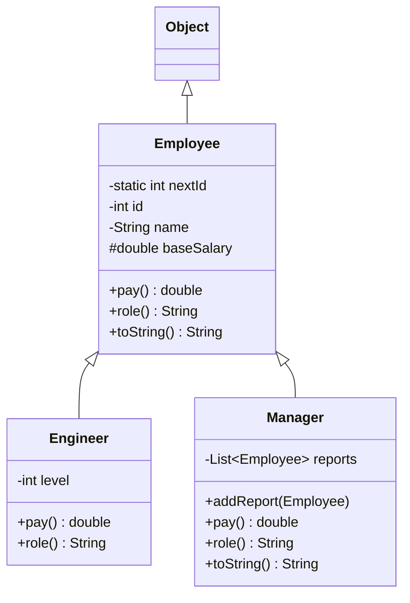
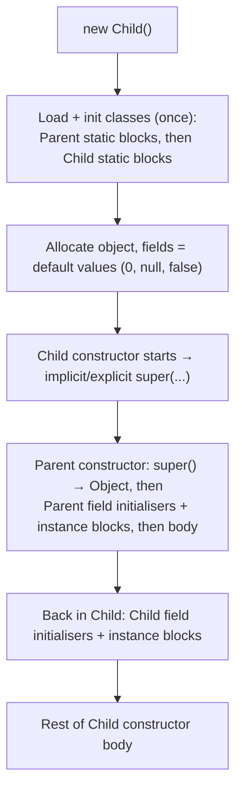
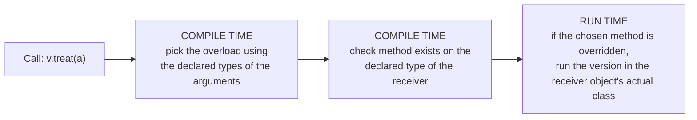
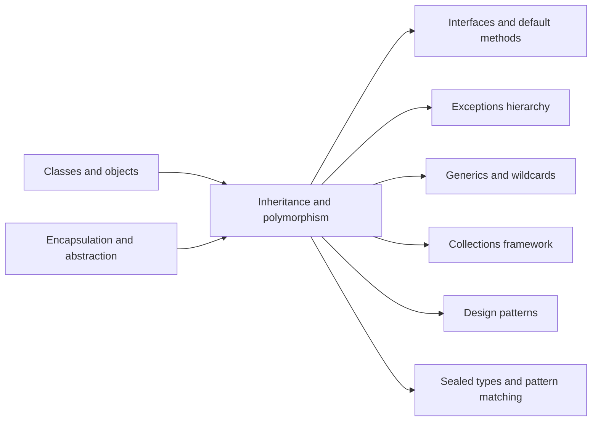

# Inheritance and Polymorphism in Java

**TL;DR:** **Inheritance** lets a class (`extends`) reuse and extend another class's members through an IS-A relationship. **Polymorphism** ("many forms") lets one reference type stand for many actual types: **overloading** picks a method at *compile time* from the argument types, and **overriding** picks it at *run time* from the actual object (**dynamic dispatch**). The rules that trip people up: constructors chain from the top parent down, fields and static methods are *not* polymorphic, overriding has strict signature, access and exception rules, and inheritance is tight coupling, so prefer composition unless a real IS-A exists.

## Table of Contents

1. [TL;DR](#1-tldr)
2. [Why it matters](#2-why-it-matters)
3. [Prerequisites](#3-prerequisites)
4. [Mental model](#4-mental-model)
5. [Core concepts](#5-core-concepts)
6. [How it works](#6-how-it-works)
7. [Examples](#7-examples)
8. [Comparisons](#8-comparisons)
9. [Trade-offs](#9-trade-offs)
10. [Gotchas](#10-gotchas)
11. [Practical application](#11-practical-application)
12. [Interview prep](#12-interview-prep)
13. [Interview question bank](#13-interview-question-bank)
14. [Tricky code snippets](#14-tricky-code-snippets)
15. [Connections](#15-connections)
16. [Summary](#16-summary)
17. [Answers](#answers)

---

## 1. TL;DR

- **Inheritance:** `class Dog extends Animal` gives `Dog` all accessible members of `Animal`. Java allows **one** parent class.
- **Overriding:** a subclass supplies its own version of an inherited instance method (same signature). Chosen at **run time**.
- **Overloading:** several methods with the same name but different parameters in one class. Chosen at **compile time**.
- **Polymorphism:** `Animal a = new Dog(); a.sound();` runs `Dog`'s `sound()`.
- **`super`:** refers to the parent part of the current object (`super(...)`, `super.method()`, `super.field`).

**The analogy: a restaurant franchise.**

| Franchise | Java |
|---|---|
| Head office provides the standard menu, recipes and procedures | The **parent class** |
| A branch automatically follows all of it | `extends` **inherits** members |
| A branch bakes its own version of the "house special" | **Overriding** a method |
| A branch adds a dish the head office never had | A new method in the subclass |
| The head office's building is never part of the branch | **Private** members and **constructors** aren't inherited |
| Customer says "one house special" and any branch serves its local version | **Polymorphism**: a parent-type reference runs the child's method |
| The menu offers "coffee" as small, medium or large | **Overloading**: same name, different parameters |
| New branches first run head office's onboarding, then their own | **Constructor chaining**: parent constructor runs first |

**Running example:** a payroll module. `Employee` (private static id counter, `protected final` base salary, `pay()` and `role()` that subclasses override, `toString()` that uses them), `Engineer` (adds a level, `pay()` calls `super.pay()`) and `Manager` (keeps a list of reports, extends `toString()` via `super.toString()`), plus a `payroll` method that totals any list of employees.

---

## 2. Why it matters

**The problem they solve.** Without inheritance and polymorphism you copy code between similar classes and write `if (type == ...)` chains everywhere. With them you write shared logic once in a parent, let each subclass vary only what differs, and write callers (`payroll`, a `for` loop over `Animal`s) that work with types that don't exist yet.

**What goes wrong when the rules are misunderstood** (verified on Java 21):

| Code | Result | Cause |
|---|---|---|
| `class Child extends Parent { Child() { } }` where `Parent` has only `Parent(int)` | Compile error | Implicit `super()` finds no no-arg constructor |
| `Parent p = new Child(); p.name` where both declare `name` | Reads **Parent's** field | Fields are hidden, not overridden |
| `Parent p = new Child(); p.who()` for a `static who()` in both | Runs **Parent's** method | Static methods are resolved by the declared type |
| Base constructor calls an overridable method | Override sees `0`/`null` fields | Child fields aren't initialised yet |
| `class Square extends Rectangle` with a "keeps it square" setter | `stretch` returns 16, not 20 | Violates substitutability (Liskov) |
| Subclass `HashSet` that counts `add` calls | `addAll` of 3 items counts **6** | `HashSet.addAll` calls the overridden `add` |
| `v.treat(a)` with `treat(Animal)` and `treat(Dog)` and `Animal a = new Dog()` | Calls `treat(Animal)` | Overloads are chosen by static type |
| `equals` using `instanceof` in parent and child | `p.equals(cp)` true, `cp.equals(p)` false | Broken symmetry |
| `(Dog) animalThatIsACat` | `ClassCastException` at run time | Downcast to the wrong subtype |

**Why interviewers ask.** "Overloading vs overriding", "what is dynamic dispatch", "can you override static/private methods", "constructor chaining and initialisation order", "can a constructor call an overridable method", "inheritance vs composition" and "upcasting/downcasting" are among the most reliably asked Java questions at every level.

---

## 3. Prerequisites

| Prerequisite | One-line refresher | Importance |
|---|---|---|
| Classes, objects, constructors | `new` runs a constructor, `this(...)` chaining ([Classes and Objects notes]) | Essential |
| Access modifiers | `private`/package/`protected`/`public` decide what a subclass can see ([Encapsulation and Abstraction notes]) | Essential |
| Abstract classes and interfaces | Types with unimplemented methods; `default` methods ([Encapsulation and Abstraction notes]) | Essential |
| Method overloading basics | Same name, different parameter lists ([Declaring Variables and Methods notes]) | Essential |
| Primitive widening and boxing | `int` → `long`, `int` → `Integer` ([Data Type Compatibility notes]) | Important for overload resolution |
| Exceptions: checked vs unchecked | Needed for the overriding `throws` rule | Nice-to-have |

---

## 4. Mental model

> **The one picture to keep in your head:** every object is built in layers, parent first, and has **two types**: the *declared* type of the variable (what the compiler checks) and the *actual* class of the object (what the JVM uses to pick overridden methods).

```
   Employee e = new Manager("Meera", 7000);
   ───────────┬──                 ───┬──────
   declared (static) type          actual (runtime) type
   compiler checks: "does Employee    JVM picks the method from here:
   have pay()?"                       Manager.pay() runs

   THE OBJECT ON THE HEAP (layers, built parent-first)
 ┌───────────────────────────────────────────────┐
 │ Manager part:  reports                         │ ◄── built second
 │ ┌───────────────────────────────────────────┐ │
 │ │ Employee part: id, name, baseSalary        │ │ ◄── built first (super(...))
 │ │ ┌───────────────────────────────────────┐ │ │
 │ │ │ Object part                            │ │ │ ◄── built before that
 │ │ └───────────────────────────────────────┘ │ │
 │ └───────────────────────────────────────────┘ │
 └───────────────────────────────────────────────┘
```
*One object, three layers. A parent-type variable sees only the parent's declared members, but method calls are dispatched on the whole object.*

**The class hierarchy used in the notes:**


*Every class implicitly extends `Object`. `Engineer` and `Manager` override `pay()` and `role()`.*

---

## 5. Core concepts

### 5.1 Glossary

- **Inheritance:** a class acquiring the accessible members of another via `extends`. Models IS-A.
- **Superclass / parent / base class:** the class being extended. **Subclass / child / derived class:** the class doing the extending.
- **IS-A / HAS-A:** IS-A is inheritance (`Dog` is an `Animal`); HAS-A is composition (a `Car` has an `Engine`).
- **Overriding:** a subclass instance method with the same signature as an inherited one, replacing it for that class.
- **Overloading:** several methods with the same name but different parameter lists in the same class (or inherited).
- **Polymorphism:** one name or type, many behaviours. **Compile-time:** overloading. **Run-time:** overriding.
- **Dynamic dispatch (late binding):** the JVM choosing which overridden method to run based on the object's actual class.
- **Static (early) binding:** the compiler choosing at compile time: overloads, `static`, `private`, `final` methods, and fields.
- **Upcasting:** treating a subclass object as its parent type. Implicit and always safe (`Animal a = new Dog()`).
- **Downcasting:** treating a parent-typed reference as a subclass. Explicit; may throw `ClassCastException`.
- **`instanceof`:** run-time type test; `x instanceof Dog d` (Java 16+) also declares a typed variable.
- **Hiding:** a field or `static` method with the same name in a subclass; chosen by the declared type, not the object.
- **Covariant return type:** an overriding method may return a subtype of the original return type.
- **Constructor chaining:** `super(...)`/`this(...)` linking constructors; parent constructors always run first.
- **Liskov substitution principle (LSP):** code that works with a parent type must keep working with any subclass.
- **`Object`:** root of all classes; supplies `equals`, `hashCode`, `toString`, `getClass`, etc.

### 5.2 What a subclass gets

| Member of the parent | Inherited by the subclass? |
|---|---|
| `public`, `protected` instance members | ✅ Yes |
| package-private members | ✅ Only if the subclass is in the **same package** |
| `private` members | ❌ Not accessible (the data still exists inside the object, reachable only via parent methods, Snippet 16) |
| Constructors | ❌ Never inherited (Snippet 8); use `super(...)` |
| `static` members | ✅ Accessible, but can only be **hidden**, not overridden (Snippet 12) |
| Instance/static initialiser blocks | ❌ Not inherited, but they run as part of the parent's initialisation (Snippet 7) |

### 5.3 Overriding rules (all verified)

| Rule | Detail | Snippet |
|---|---|---|
| Same name and parameter types | Otherwise it's an overload or a new method | 25, 26 |
| Return type | Same, or a **subtype** (covariant); primitives must match exactly | 19, 20 |
| Access | Same or **wider**; never narrower | 17, 18 |
| Checked exceptions | Same, narrower, or none; **not broader**. Unchecked: anything | 21, 22, 23 |
| Can't override | `final` methods, `static` methods (hidden), `private` methods (not inherited) | 24, 14–16 |
| Instance vs static | Instance can't override static and vice versa | 14, 15 |
| `@Override` | Optional but always use it: the compiler checks you're really overriding | 25 |

### 5.4 `super` and `this`

| Form | Meaning |
|---|---|
| `super(args)` | Call a parent constructor. Must be the **first** statement (Snippet 4). If you write none, the compiler inserts `super()` (Snippet 3). |
| `this(args)` | Call another constructor of the same class. First statement; can't be combined with `super(...)` (Snippet 5); no cycles (Snippet 6). |
| `super.method()` | Call the parent's version of an overridden method (Snippet 36). |
| `super.field` | Read the parent's hidden field (Snippet 37). |
| `super.super.m()` | **Not allowed** (Snippet 38). |
| `super` in `static` code | **Not allowed** (Snippet 39). |

### 5.5 Casting and `instanceof`

- **Upcast:** implicit, no check, loses access to subclass-only members (Snippet 34).
- **Downcast:** explicit; the JVM checks the actual class and throws `ClassCastException` on mismatch (Snippet 32).
- **Unrelated types:** the compiler rejects casts between classes with no subtype relation (Snippet 33).
- `x instanceof T` is `false` for `null` (Snippet 35). Guard downcasts with it, or use the pattern form `x instanceof Dog d`.

### 5.6 The `Object` class

Every class extends `Object` (directly or not); arrays, enums and records too (Snippet 54). Key methods: `toString()`, `equals(Object)`, `hashCode()`, `getClass()`, `clone()`, `finalize()` (deprecated for removal), and `wait`/`notify`/`notifyAll`. Overriding `toString` makes `println(obj)` polymorphic (Snippet 42); overriding `equals` in a hierarchy is delicate (Snippets 43, 44).

---

## 6. How it works

### 6.1 Constructor chaining and initialisation order

When `new Child()` runs, the JVM first loads and initialises the class chain (parent statics, then child statics, **once**), then for every object builds it parent-first:


*The parent finishes completely before the child's own fields are initialised: that is why an overridden method called from the parent constructor sees default values.*

Verified output (Snippet 7):

```
main start
1 Parent static
2 Child static
3 Parent instance block
4 Parent constructor
5 Child instance block
6 Child constructor
-- second object --
3 Parent instance block
4 Parent constructor
5 Child instance block
6 Child constructor
```
Static blocks run once, at first use of the class; instance blocks and constructors run for every object.

### 6.2 Compile-time choice vs run-time choice


*Overload = decided by what the compiler sees. Override = decided by what the object is.*

**Overload resolution phases** (the first phase that finds a match wins):

1. **No boxing, no varargs:** exact match, widening primitive (`int` → `long`) or subtype (Snippet 30: `m(5)` prints `long`).
2. **Boxing/unboxing** (`m(Integer)` for `Integer.valueOf(5)`, Snippet 30).
3. **Varargs.** (Snippet 31: `m(Object)` via boxing beats `m(int...)`.)

If two candidates are equally specific the call is **ambiguous** and does not compile (Snippet 29, with `null`). `null` picks the **most specific** type when one exists (Snippet 28 prints `String`).

### 6.3 Worked trace: the payroll module

```java
import java.util.*;

class Employee {
    private static int nextId = 1;
    private final int id;
    private final String name;
    protected final double baseSalary;
    Employee(String name, double baseSalary) {
        this.id = nextId++;
        this.name = name;
        this.baseSalary = baseSalary;
    }
    String getName() { return name; }
    double pay() { return baseSalary; }
    String role() { return "Employee"; }
    @Override public String toString() { return role() + "#" + id + " " + name + " pay=" + pay(); }
}

class Engineer extends Employee {
    private final int level;
    Engineer(String name, double base, int level) { super(name, base); this.level = level; }
    @Override double pay() { return super.pay() + level * 1000; }
    @Override String role() { return "Engineer"; }
}

class Manager extends Employee {
    private final List<Employee> reports = new ArrayList<>();
    Manager(String name, double base) { super(name, base); }
    void addReport(Employee e) { reports.add(e); }
    @Override double pay() { return super.pay() + 500 * reports.size(); }
    @Override String role() { return "Manager"; }
    @Override public String toString() { return super.toString() + " reports=" + reports.size(); }
}

public class Main {
    static double payroll(List<? extends Employee> staff) {
        double total = 0;
        for (Employee e : staff) total += e.pay();
        return total;
    }
    public static void main(String[] args) {
        Engineer a = new Engineer("Asha", 5000, 2);
        Engineer b = new Engineer("Ben", 4000, 1);
        Manager m = new Manager("Meera", 7000);
        m.addReport(a); m.addReport(b);
        List<Employee> staff = List.of(a, b, m);
        for (Employee e : staff) System.out.println(e);
        System.out.println("total=" + payroll(staff));
        Employee e = m;
        System.out.println(e.role() + " " + (e instanceof Manager mm ? mm.pay() : -1));
        System.out.println(a instanceof Employee);
    }
}
```

Output (verified, Java 21):

```
Engineer#1 Asha pay=7000.0
Engineer#2 Ben pay=5000.0
Manager#3 Meera pay=8000.0 reports=2
total=20000.0
Manager 8000.0
true
```

| Step | What happens | Why |
|---|---|---|
| `new Engineer("Asha", 5000, 2)` | `Engineer(...)` calls `super(name, base)`; `Employee` assigns `id=1`, the name, the base; then `level = 2` | Parent first, then child |
| `staff` holds `Engineer, Engineer, Manager` | The `List<Employee>` variable type is parent; objects keep their actual class | Upcasting is implicit |
| `System.out.println(e)` → `e.toString()` | `Employee.toString()` runs; inside it `role()` and `pay()` dispatch on the actual object | Dynamic dispatch, even inside the parent's code |
| `Asha`'s `pay()` | `super.pay()` = 5000, `+ 2*1000` = 7000 | `super.` calls the parent version |
| `Manager.toString()` | `super.toString()` + `" reports=2"` | Extending, not replacing, parent behaviour |
| `payroll(staff)` | 7000 + 5000 + 8000 = 20000 | One loop works for every `Employee` subtype, even future ones |
| `e instanceof Manager mm` | `true`; `mm` is a `Manager` variable, so `mm.pay()` | Type test + safe downcast in one step |

---

## 7. Examples

### 7.1 Toy example: dynamic dispatch

```java
class Animal { String sound() { return "..."; } }
class Dog extends Animal { @Override String sound() { return "Woof"; } }
class Cat extends Animal { @Override String sound() { return "Meow"; } }
public class Main {
    public static void main(String[] args) {
        Animal[] zoo = { new Animal(), new Dog(), new Cat() };
        for (Animal a : zoo) System.out.print(a.sound() + " ");
        System.out.println();
    }
}
```
Output:
```
... Woof Meow 
```
*One loop, one declared type, three behaviours. Add a `Cow` class later and this loop needs no changes.*

### 7.2 Toy example: calling the parent's version

```java
class Parent { String hi() { return "parent hi"; } }
class Child extends Parent {
    @Override String hi() { return "child + " + super.hi(); }
}
public class Main { public static void main(String[] args) { System.out.println(new Child().hi()); } }
```
Output:
```
child + parent hi
```
*`super.hi()` lets an override add to the parent's behaviour instead of replacing it.*

### 7.3 Real-world examples

- **Exception hierarchy:** `catch (RuntimeException e)` also catches `IllegalArgumentException`, since it IS-A `RuntimeException` (Snippet 58). A broader `catch (Exception)` placed before a narrower one doesn't compile (Snippet 57).
- **`InputStream`/`FileInputStream`/`BufferedInputStream`:** code that accepts an `InputStream` works with any subclass.
- **Collections:** `List<String> l = new ArrayList<>()`: variable type is the parent, behaviour comes from the object.
- **Swing/JavaFX `Component`s, servlet `HttpServlet.doGet`, JUnit lifecycle hooks:** frameworks call methods you override.
- **`Object.toString`/`equals`/`hashCode`:** every collection and printing routine relies on you overriding them.
- **Spring/Jakarta EE:** beans typed by interface or parent class, with the concrete subclass chosen at configuration time.

---

## 8. Comparisons

### 8.1 Overloading vs overriding

| Aspect | Overloading | Overriding |
|---|---|---|
| Where | Same class (or inherited methods) | Subclass vs superclass |
| Signature | Same name, **different** parameters | **Same** name and parameters |
| Return type | Can differ | Same or covariant subtype |
| Resolved | **Compile time** (declared argument types) | **Run time** (actual receiver class) |
| Polymorphism kind | Static / compile-time | Dynamic / run-time |
| Access/exceptions | Free to differ | Access can't narrow; checked exceptions can't broaden |
| `static`/`private`/`final` | Can overload them | Can't override them |
| Constructors | Can overload | Can't override |

```java
class Animal { }
class Dog extends Animal { }
class Vet {
    String treat(Animal a) { return "animal"; }
    String treat(Dog d) { return "dog"; }
}
// Animal a = new Dog();  Dog d = new Dog();
// v.treat(a) → "animal"   v.treat(d) → "dog"   v.treat((Animal) d) → "animal"   (Snippet 26)
```
*The static type of the argument chooses the overload, even though the object is a `Dog`.*

### 8.2 Overriding vs hiding

| Member | Same name in subclass is... | Chosen by | Example (Snippets 11, 12) |
|---|---|---|---|
| Instance method | **Overrides** | Actual object | `p.getName()` → child's |
| Instance field | **Hides** | Declared type | `p.name` → "parent" |
| `static` method | **Hides** | Declared type | `p.who()` → "parent" |
| `private` method | A brand new method | Declared type / scope | Snippet 16 |

### 8.3 Inheritance vs composition

| Aspect | Inheritance (IS-A) | Composition (HAS-A) |
|---|---|---|
| Coupling | Tight: child depends on parent's internals | Loose: depends on the contained type's public API |
| Reuse | White-box (sees `protected` internals) | Black-box (delegates) |
| Changes in parent | Can break subclasses | Contained type can be swapped |
| Run-time flexibility | Fixed at compile time | Can change the delegate at run time |
| Multiple reuse | One parent class only | Any number of components |
| Example | `Dog extends Animal` | `Car` has an `Engine`; `InstrumentedSet` wraps a `Set` |

*The classic proof (Snippets 48, 49):* a `HashSet` subclass that counts adds reports **6** after `addAll` of three items, because `HashSet.addAll` calls the overridden `add` again; the composition version reports the correct **3**.

### 8.4 Upcasting vs downcasting

| | Upcast | Downcast |
|---|---|---|
| Direction | Child → parent | Parent → child |
| Syntax | Implicit | Explicit `(Dog) a` |
| Safe? | Always | Only if the object really is that type; else `ClassCastException` |
| Guard | None needed | `if (a instanceof Dog d)` |

### 8.5 Abstract class vs interface vs concrete parent for a hierarchy

| Use | When |
|---|---|
| Concrete parent class | The parent is meaningful on its own and subclasses specialise |
| Abstract class | Parent has shared state/logic but isn't a complete thing (Encapsulation and Abstraction notes) |
| Interface | Shared capability without shared state; multiple types |
| `final` / `sealed` | You don't want (or want to control) subclassing |

---

## 9. Trade-offs

| Decision | Benefit | Cost | Use when |
|---|---|---|---|
| Inheritance for reuse | Less duplicate code; polymorphic callers | Tight coupling, fragile base class (Snippet 48) | A true IS-A that honours LSP |
| Composition + delegation | Flexible, testable, no fragile-base problem | Boilerplate forwarding methods | Reuse without a real IS-A |
| Deep hierarchies | Fine-grained reuse | Hard to understand where behaviour lives | Rarely; keep depth ≤ 2–3 |
| `protected` fields | Convenient access for subclasses | Breaks encapsulation | Prefer `protected` methods or private fields |
| `final` on class/method | Prevents misuse; allows reasoning | Blocks extension and some mocking | Value types, security-sensitive code, template methods |
| Overriding `equals` in a hierarchy | Value semantics | Easy to break symmetry/transitivity (Snippets 43, 44) | Prefer final value classes or composition |
| Overloading many variants | Convenient API | Ambiguity and surprising choices (Snippets 26–31) | Keep overloads clearly distinct |
| Runtime `instanceof` chains | Quick handling of subtypes | Defeats polymorphism; must update everywhere | Prefer dispatch, sealed types + pattern `switch` |

---

## 10. Gotchas

### Myths

- ❌ **Myth:** "Overloading is polymorphism that happens at run time." ✅ **Reality:** overloads are selected by the compiler using declared types (Snippet 26).
- ❌ **Myth:** "Fields are overridden like methods." ✅ **Reality:** fields are hidden; the declared type picks which one (Snippet 11).
- ❌ **Myth:** "You can override a `static` method." ✅ **Reality:** you can only hide it; the declared type decides (Snippet 12), and even a `null` reference works (Snippet 13).
- ❌ **Myth:** "Private methods can be overridden." ✅ **Reality:** they aren't inherited; a same-named child method is unrelated (Snippet 16).
- ❌ **Myth:** "Constructors are inherited." ✅ **Reality:** never; the subclass must declare its own and call `super(...)` (Snippet 8).
- ❌ **Myth:** "A subclass of a class with a private constructor is fine." ✅ **Reality:** the implicit `super()` can't access it (Snippet 9).
- ❌ **Myth:** "Java supports multiple inheritance." ✅ **Reality:** not of classes. It supports multiple inheritance of **type** (interfaces) and behaviour (default methods), never of state.
- ❌ **Myth:** "`super.super.method()` reaches the grandparent." ✅ **Reality:** compile error (Snippet 38).
- ❌ **Myth:** "Overriding can freely change the `throws` clause." ✅ **Reality:** no broader checked exceptions (Snippet 21).
- ❌ **Myth:** "A cast changes the object." ✅ **Reality:** a cast changes only the reference type; the object is the same (and a bad cast throws).

### Common mistakes and edge cases

- **Missing no-arg constructor in the parent:** subclass constructors must call `super(...)` explicitly (Snippet 3).
- **Typo in the overriding method name** (`Wheels` vs `wheels`): silently creates a new method unless you use `@Override` (Snippet 25, and the exercise).
- **Narrowing access when overriding** (`public` → package): compile error (Snippet 17).
- **Calling overridable methods in a constructor:** the child's override runs on a half-built object (Snippet 40).
- **Subclassing a class not designed for it** (`HashSet`): self-use of overridable methods leaks implementation details (Snippet 48).
- **Same-named field in child:** `Parent` code sees its own field, child code sees its own (Snippets 11, 52).
- **Covariant arrays:** `Object[] arr = new String[1]; arr[0] = 1;` compiles and fails at run time with `ArrayStoreException` (Snippet 45). Generics are invariant and catch this at compile time (Snippet 46).
- **`equals` with `instanceof` in a hierarchy:** asymmetric (Snippet 43); with `getClass()` it's symmetric but subclasses never equal parents (Snippet 44).
- **Chained calls returning the parent type:** `h.add("z").bold("w")` doesn't compile because `add` returns `Builder` (Snippet 53). Use covariant returns.
- **Two parents' constants with the same name:** ambiguous reference (Snippet 51).

---

## 11. Practical application

### Design checklist
- [ ] Is it a real IS-A that holds for every parent behaviour (Liskov)? If not, use composition
- [ ] Is the parent designed for extension (documented hooks) or `final`?
- [ ] All overrides marked `@Override`
- [ ] No overridable method called from a constructor
- [ ] Fields `private`; subclasses use `protected` methods if needed
- [ ] `equals`/`hashCode` consistent; avoid overriding `equals` across a hierarchy
- [ ] Callers typed to the parent/interface; no `instanceof` chains where dispatch would do
- [ ] Hierarchy shallow; shared constants and logic in the lowest sensible common parent

### Hands-on exercise: fix the `Vehicle` hierarchy

This code does not compile. Find the problems, then redesign so that `Vehicle` can't be created on its own, `describe()` can't be overridden, and a typo in a subclass method name is caught by the compiler.

```java
class Vehicle {
    protected String name;
    Vehicle(String name) { this.name = name; }
    int wheels() { return 0; }
    String describe() { return name + " has " + wheels() + " wheels"; }
}
class Car extends Vehicle {
    Car() { }
    int Wheels() { return 4; }
}
public class Main {
    public static void main(String[] args) {
        Vehicle v = new Car();
        System.out.println(v.describe());
    }
}
```

<details><summary>Solution</summary>

**Bugs:**
1. `Car() { }` has an implicit `super()` but `Vehicle` only has `Vehicle(String)`: compile error *constructor Vehicle in class Vehicle cannot be applied to given types* (verified).
2. After fixing that with `super("Car")`, the program compiles but prints **`Car has 0 wheels`** (verified), because `Wheels()` (capital W) is a brand-new method, not an override of `wheels()`. Without `@Override` nobody warns you.
3. `name` is a `protected` mutable field and `Vehicle` is instantiable even though a plain `Vehicle` makes little sense.

```java
abstract class Vehicle {
    private final String name;
    protected Vehicle(String name) { this.name = name; }
    abstract int wheels();
    final String describe() { return name + " has " + wheels() + " wheels"; }
}
class Car extends Vehicle {
    Car() { super("Car"); }
    @Override int wheels() { return 4; }
}
class Bike extends Vehicle {
    Bike() { super("Bike"); }
    @Override int wheels() { return 2; }
}
public class Main {
    public static void main(String[] args) {
        for (Vehicle v : new Vehicle[] { new Car(), new Bike() }) System.out.println(v.describe());
    }
}
```
Output (verified):
```
Car has 4 wheels
Bike has 2 wheels
```
Why: `abstract` forbids `new Vehicle()` and forces every subclass to implement `wheels()`; `@Override` turns the `Wheels` typo into a compile error; `final describe()` is a template method that subclasses can't break; the `private final` name is set once through the constructor.
</details>

---
## 12. Interview prep

### Likely questions with model answers

**Q1. What is inheritance? What are its types in Java?**
> "Inheritance lets a class acquire the accessible fields and methods of another using `extends`, modelling an IS-A relationship, so common code lives in one place. Java supports single inheritance of classes, multilevel inheritance (A → B → C) and hierarchical inheritance (many children of one parent). It doesn't support multiple inheritance of classes, to avoid the diamond problem, but a class can implement multiple interfaces, which gives multiple inheritance of type and, with default methods, of behaviour. Constructors and private members aren't inherited."

**Q2. What is polymorphism? What kinds are there?**
> "Polymorphism means one interface, many forms. In Java there's compile-time polymorphism, which is method overloading, where the compiler picks the method from the argument types, and run-time polymorphism, which is method overriding, where the JVM picks the method from the actual object's class through dynamic dispatch. For example, with `Animal a = new Dog(); a.sound();` the compiler checks that `Animal` has `sound()`, but at run time `Dog.sound()` executes. It lets me write code against a parent type that works for every subtype, including ones added later."

**Q3. What's the difference between overloading and overriding?**
> "Overloading is several methods with the same name but different parameter lists in one class; it's resolved at compile time from the declared argument types and the return type can differ. Overriding is a subclass redefining an inherited instance method with the same signature; it's resolved at run time from the actual object. An override must keep the same parameters, may use a covariant return type, can't reduce access, and can't throw broader checked exceptions. Static, private and final methods and constructors can't be overridden."

**Q4. What is dynamic method dispatch?**
> "It's how Java chooses which overridden method to run at run time. The compiler checks the call against the variable's declared type, but the JVM looks at the object's actual class and runs that class's version. That's why `Employee e = new Manager(...); e.pay()` runs `Manager.pay()`. It doesn't apply to fields, static methods, private methods or overloads. Those are bound at compile time using the declared types."

**Q5. In what order are constructors and initialisers executed with inheritance?**
> "Class initialisation happens once, parent first: parent static blocks and fields, then the child's. For each `new Child()`: fields get default values; the child constructor starts and immediately calls `super(...)`, explicit or implicit, so the parent runs its field initialisers, instance blocks and constructor body completely; then the child's field initialisers and instance blocks run, then the rest of the child constructor. Because of that, calling an overridable method from a parent constructor is dangerous: the child's fields aren't set yet, so the override sees `0` or `null`."

**Q6. What's the use of `super`? Can you call `super.super.method()`?**
> "`super(...)` calls a parent constructor and must be the first statement, and if I don't write it the compiler inserts `super()`, which fails if the parent has no no-arg constructor. `super.method()` calls the parent's version of an overridden method, and `super.field` reads a hidden parent field. `super.super.method()` isn't legal Java; and `super` can't be used in static context."

**Q7. Can you override static or private methods? What about fields?**
> "No. A static method with the same signature in a subclass hides the parent's, and which one runs depends on the declared type, not the object; you can't even use `@Override` on it. A private method isn't inherited, so a same-named child method is just a new method. Fields are never overridden either; a field with the same name hides the parent's, and the declared type picks which one you see. Only instance methods that are non-private, non-static and non-final take part in run-time polymorphism."

**Q8. Inheritance or composition? When would you choose each?**
> "Inheritance is for a true IS-A relationship where the subclass honours everything the parent promises. It gives reuse and polymorphism but couples the child to the parent's implementation, and changes in the parent can break it. A classic example is a `HashSet` subclass that counts additions: `addAll` calls `add` internally, so the count is doubled. Composition holds an instance of another class and delegates to it. It's looser and more flexible, so it's my default for reuse, and I choose inheritance when I own the parent, have designed it for extension, and the IS-A is genuine."

### What interviewers watch for
- Correct vocabulary: compile-time vs run-time binding, declared vs actual type.
- Overriding rules recited accurately (access, return, exceptions, static/private/final).
- Initialisation order, and the constructor-calls-overridable-method trap.
- Knowing that fields, static methods and overloads are **not** dynamically dispatched.
- Judgement: composition over inheritance, Liskov substitution, `final`/`sealed` as design tools.

---

## 13. Interview question bank

Short answers are hidden. 🟢 fresher, 🟡 intermediate, 🔴 senior/FAANG follow-up.

### 13.1 Inheritance basics

**1. 🟢 What is inheritance? Why use it?**
<details><summary>Answer</summary>

A class acquiring members of another via `extends` (IS-A). Reuse, a natural type hierarchy, and polymorphism.
</details>

**2. 🟢 Which keyword is used for inheritance? For interfaces?**
<details><summary>Answer</summary>

`extends` for class-to-class (and interface-to-interface); `implements` for class-to-interface.
</details>

**3. 🟢 Does Java support multiple inheritance?**
<details><summary>Answer</summary>

Not of classes (avoids the diamond problem). A class can implement many interfaces, and an interface can extend many interfaces.
</details>

**4. 🟢 What are the types of inheritance in Java?**
<details><summary>Answer</summary>

Single, multilevel and hierarchical (via classes); multiple only through interfaces. "Hybrid" is a combination expressible with interfaces.
</details>

**5. 🟢 What is the superclass of all classes?**
<details><summary>Answer</summary>

`java.lang.Object`. Every class without an explicit `extends` extends it; arrays too (Snippet 54).
</details>

**6. 🟢 What members are not inherited?**
<details><summary>Answer</summary>

Constructors, private members (not accessible), package-private members when the subclass is in a different package, and initialiser blocks.
</details>

**7. 🟡 Why doesn't Java support multiple inheritance of classes?**
<details><summary>Answer</summary>

Ambiguity (the diamond problem) when two parents define the same member, and the complexity of multiple state inheritance. Interfaces avoid state; conflicting defaults must be resolved explicitly (Encapsulation notes).
</details>

**8. 🟡 What is the difference between IS-A and HAS-A?**
<details><summary>Answer</summary>

IS-A = inheritance (`Dog` is an `Animal`); HAS-A = composition/aggregation (a `Car` has an `Engine`).
</details>

**9. 🟡 Can a class extend a `final` class? Can a `final` method be overridden?**
<details><summary>Answer</summary>

No to both (Snippets 41, 24). `final` stops inheritance or overriding.
</details>

**10. 🟡 Can you inherit from an `abstract` or sealed class?**
<details><summary>Answer</summary>

Yes from an abstract class (must implement its abstract methods or be abstract). A sealed class only from its `permits` list.
</details>

**11. 🟡 Can a subclass access the parent's private fields?**
<details><summary>Answer</summary>

Not directly (compile error). It can through the parent's `protected`/`public` methods. The fields still exist in the object (Snippet 16 shows private methods behaving independently).
</details>

**12. 🔴 What is the diamond problem and how does Java handle it?**
<details><summary>Answer</summary>

Two parents provide the same member and a child inherits both. Java forbids multiple class inheritance; for interface defaults the class must override and may pick one via `A.super.m()`. Rules: class beats interface, more specific interface wins (Encapsulation notes, Snippets 55, 56).
</details>

**13. 🔴 Are static members inherited?**
<details><summary>Answer</summary>

They're accessible through the subclass name, but can only be hidden, not overridden; calls are bound to the declared type (Snippets 12, 13).
</details>

### 13.2 Constructors and `super`

**14. 🟢 Are constructors inherited?**
<details><summary>Answer</summary>

No (Snippet 8). The child declares its own and calls the parent's with `super(...)`.
</details>

**15. 🟢 What does the compiler do if I don't call `super()` explicitly?**
<details><summary>Answer</summary>

Inserts `super()` as the first statement. If the parent has no accessible no-arg constructor: compile error (Snippets 3, 9).
</details>

**16. 🟢 In what order do constructors run in `C extends B extends A`?**
<details><summary>Answer</summary>

`A()`, then `B()`, then `C()` (Snippet 2).
</details>

**17. 🟡 Can you use `this()` and `super()` together in one constructor?**
<details><summary>Answer</summary>

No: each must be the first statement (Snippet 5). `this(...)` leads to another constructor that will call `super(...)`.
</details>

**18. 🟡 Can a constructor call itself recursively?**
<details><summary>Answer</summary>

Not via `this(...)` cycles: compile error *recursive constructor invocation* (Snippet 6).
</details>

**19. 🟡 Why must `super(...)` be first?**
<details><summary>Answer</summary>

The parent part of the object must be initialised before the child touches the object (Snippet 4). ⚠️ Java 22+ previews relaxing this for statements that don't use `this`; on Java 21 it is an error.
</details>

**20. 🟡 Give the full initialisation order for static blocks, instance blocks and constructors with inheritance.**
<details><summary>Answer</summary>

Parent static → child static (once) → parent instance block → parent constructor → child instance block → child constructor (Snippet 7).
</details>

**21. 🔴 What happens if a parent constructor calls an overridden method?**
<details><summary>Answer</summary>

The child's override runs before the child's fields are initialised: it sees defaults (`null`, `0`). Snippet 40 prints `Parent sees size=0` then `Child sees size=5`.
</details>

**22. 🔴 Can a constructor in the parent be `private`? Effect on subclasses?**
<details><summary>Answer</summary>

Yes; then only the parent (and nested classes) can call it. A top-level subclass fails: *Parent() has private access* (Snippet 9). Used to prevent subclassing.
</details>

**23. 🔴 Can the parent's `static` and instance blocks run without creating a child?**
<details><summary>Answer</summary>

Static blocks run once when the class is first initialised (including as part of initialising a child). Instance blocks run only per object creation.
</details>

### 13.3 Overriding

**24. 🟢 What is method overriding?**
<details><summary>Answer</summary>

A subclass providing its own implementation of an inherited instance method with the same name and parameters.
</details>

**25. 🟢 What is `@Override` for?**
<details><summary>Answer</summary>

Makes the compiler verify that the method really overrides something, catching typos and wrong parameter types (Snippet 25).
</details>

**26. 🟢 Can we override `final`, `static` or `private` methods?**
<details><summary>Answer</summary>

No (Snippets 24, 14, 15, 16).
</details>

**27. 🟡 Overriding rules for access modifiers?**
<details><summary>Answer</summary>

Same or wider, never narrower: `protected` → `public` is fine (Snippet 18); `public` → package-private is an error (Snippet 17).
</details>

**28. 🟡 Overriding rules for return types?**
<details><summary>Answer</summary>

Primitives and `void` must match exactly (Snippet 20); reference types may be a subtype (covariant, Snippet 19).
</details>

**29. 🟡 Overriding rules for exceptions?**
<details><summary>Answer</summary>

May throw the same or narrower checked exceptions, or none; never broader (Snippets 21, 22). Unchecked exceptions are unrestricted (Snippet 23).
</details>

**30. 🟡 What is a covariant return type? Why is it useful?**
<details><summary>Answer</summary>

An override returning a subtype of the parent's return type. It avoids casts and enables chaining (`Dog self()`, Snippet 19; compare Snippet 53 where the parent type breaks the chain).
</details>

**31. 🟡 Can a static method hide an instance method (or vice versa)?**
<details><summary>Answer</summary>

No: compile error either way (Snippets 14, 15).
</details>

**32. 🟡 How do you call the parent's overridden method?**
<details><summary>Answer</summary>

`super.methodName(...)` (Snippet 36). For interface defaults: `Interface.super.method()`.
</details>

**33. 🟡 Is field hiding the same as overriding?**
<details><summary>Answer</summary>

No. Fields are resolved by the declared type: `Parent p = new Child(); p.name` is the parent's (Snippet 11).
</details>

**34. 🔴 What does this print: parent calls `init()` in its constructor, the child overrides `init()` and also redeclares a field with an initialiser?**
<details><summary>Answer</summary>

Snippet 52: the override runs during the parent constructor and assigns the child's field, then the child's field initialiser overwrites it afterwards. Result `2 1`.
</details>

**35. 🔴 Can you override a method with a different parameter type (e.g. `Object` vs `String`)?**
<details><summary>Answer</summary>

No: that's an overload. `equals(Student)` doesn't override `equals(Object)`. Use `@Override` to catch it.
</details>

**36. 🔴 What's the Liskov substitution principle? Example of a violation?**
<details><summary>Answer</summary>

A subclass must be usable wherever the parent is without breaking expectations. `Square extends Rectangle` with setters that change both sides breaks code expecting independent width/height: `stretch` gives 20 for a `Rectangle` and 16 for a `Square` (Snippet 50).
</details>

### 13.4 Overloading and polymorphism

**37. 🟢 What is method overloading? Can you overload by return type only?**
<details><summary>Answer</summary>

Same name, different parameter lists. Return type alone isn't enough: compile error.
</details>

**38. 🟢 What is compile-time vs run-time polymorphism?**
<details><summary>Answer</summary>

Compile-time = overloading (and generics/operators); run-time = overriding via dynamic dispatch.
</details>

**39. 🟢 What is dynamic method dispatch?**
<details><summary>Answer</summary>

Run-time selection of an overridden method based on the actual object's class (Snippet 10).
</details>

**40. 🟡 With `treat(Animal)` and `treat(Dog)`, and `Animal a = new Dog()`, which runs for `treat(a)`?**
<details><summary>Answer</summary>

`treat(Animal)`: overloads are chosen by static type (Snippet 26).
</details>

**41. 🟡 `m(Object)` and `m(String)` called with `null`: which? What if the two are `String` and `Integer`?**
<details><summary>Answer</summary>

`String` is chosen (most specific, Snippet 28). With `String` and `Integer`, neither is more specific: *reference to m is ambiguous* (Snippet 29).
</details>

**42. 🟡 `m(long)`, `m(Integer)`, `m(Object)`, `m(int...)`: what does `m(5)` call?**
<details><summary>Answer</summary>

`m(long)`: widening beats boxing beats varargs (Snippet 30).
</details>

**43. 🟡 Are `static`/`private` methods subject to dynamic dispatch?**
<details><summary>Answer</summary>

No: bound at compile time.
</details>

**44. 🟡 Can main be overloaded? Can constructors?**
<details><summary>Answer</summary>

Yes to both; only `public static void main(String[])` is the entry point. Constructors can be overloaded but not overridden.
</details>

**45. 🔴 Parent has `m(Object)`; child overrides it and adds `m(String)`. `Parent p = new Child(); p.m("x")`?**
<details><summary>Answer</summary>

Compile time: only `m(Object)` is visible on `Parent`, so it's chosen. Run time: the child's override of `m(Object)` runs → `Child.m(Object)` (Snippet 27). `((Child)p).m("x")` would call `m(String)`.
</details>

**46. 🔴 Is Java's method call fully polymorphic like in Smalltalk?**
<details><summary>Answer</summary>

No: overload selection, field access, static/private/final calls and constructors are statically bound. Only virtual (non-private, non-static, non-final) instance methods dispatch dynamically.
</details>

**47. 🔴 How does the JVM implement dynamic dispatch?**
<details><summary>Answer</summary>

Typically via a per-class method table (vtable) consulted by `invokevirtual`; interface calls use `invokeinterface`. The JIT can inline monomorphic call sites after profiling. ⚠️ Details are implementation-specific.
</details>

### 13.5 Casting and `instanceof`

**48. 🟢 What are upcasting and downcasting?**
<details><summary>Answer</summary>

Upcast: child to parent, implicit, safe. Downcast: parent to child, explicit, checked at run time (Snippet 32).
</details>

**49. 🟢 What exception can a bad downcast throw?**
<details><summary>Answer</summary>

`ClassCastException` (Snippet 32).
</details>

**50. 🟡 What does `instanceof` return for `null`?**
<details><summary>Answer</summary>

`false` (Snippet 35).
</details>

**51. 🟡 After `Animal a = new Dog();` can you call `a.bark()`?**
<details><summary>Answer</summary>

No: compile error *cannot find symbol*; the compiler checks the declared type (Snippet 34). Cast first.
</details>

**52. 🟡 Can you cast `Integer` to `String`?**
<details><summary>Answer</summary>

No: *incompatible types* at compile time (Snippet 33); the classes are unrelated.
</details>

**53. 🟡 What is the pattern-matching form of `instanceof`?**
<details><summary>Answer</summary>

`if (a instanceof Dog d) d.bark();` tests and binds a typed variable in one step (Java 16+, Snippet 35).
</details>

**54. 🔴 Why do arrays allow `Object[] arr = new String[1]` and what's the risk?**
<details><summary>Answer</summary>

Arrays are covariant. Storing the wrong type compiles and throws `ArrayStoreException` at run time (Snippet 45). Generics are invariant and catch it at compile time (Snippet 46); use `List<? extends Number>` for read-only flexibility (Snippet 47).
</details>

**55. 🔴 Does a downcast copy or convert the object?**
<details><summary>Answer</summary>

No, the same object gets a different reference type; a failed cast throws.
</details>

### 13.6 `Object` methods and design

**56. 🟢 Name the methods of `Object`.**
<details><summary>Answer</summary>

`toString`, `equals`, `hashCode`, `getClass`, `clone`, `finalize` (deprecated for removal), `wait`, `notify`, `notifyAll`.
</details>

**57. 🟡 Why is `toString()` polymorphic through `println`?**
<details><summary>Answer</summary>

`println(Object)` calls `String.valueOf(o)` → `o.toString()`, dispatched on the actual class (Snippet 42).
</details>

**58. 🟡 What goes wrong with `equals` in a class hierarchy?**
<details><summary>Answer</summary>

Using `instanceof` in both parent and child breaks symmetry (`p.equals(cp)` true, `cp.equals(p)` false, Snippet 43). Using `getClass()` is symmetric but a subclass instance never equals a parent instance, violating LSP (Snippet 44). Prefer final value classes or composition.
</details>

**59. 🟡 Why prefer composition over inheritance?**
<details><summary>Answer</summary>

Looser coupling, no fragile-base-class problem, swap behaviour at run time, and you only expose what you choose (Snippets 48, 49).
</details>

**60. 🔴 What is the fragile base class problem?**
<details><summary>Answer</summary>

Seemingly safe changes in a parent break subclasses, because subclasses depend on its internal call patterns, e.g. `HashSet.addAll` calling `add` (Snippet 48 counts 6, not 3).
</details>

**61. 🔴 When should a class be `final` or `sealed`?**
<details><summary>Answer</summary>

`final` when it's not designed for extension (value types, security-critical). `sealed` when you want a closed, known set of subtypes, enabling exhaustive pattern `switch`. Otherwise document override hooks.
</details>

**62. 🔴 What is the template method pattern and how does it use inheritance?**
<details><summary>Answer</summary>

A `final` method in the parent defines an algorithm and calls overridable steps (Vehicle `describe()` calls `wheels()`; see the exercise).
</details>

**63. 🔴 Can an interface default method conflict with a superclass method?**
<details><summary>Answer</summary>

The superclass method wins ("class wins"), even if abstract (Snippet 55). A sub-interface that re-declares a default as abstract forces implementers to provide it (Snippet 56).
</details>

**64. 🔴 What should you not do in a constructor?**
<details><summary>Answer</summary>

Call overridable methods, leak `this` (e.g. register as a listener), or start threads: the object isn't fully built (Snippet 40).
</details>

**65. 🔴 Can an enum extend a class? Can a record?**
<details><summary>Answer</summary>

Neither can extend a class (enums implicitly extend `Enum`, records extend `Record`). Both can implement interfaces (Snippet 59 shows the `Enum` parent).
</details>

---
## 14. Tricky code snippets

All compiled and run on OpenJDK 21. Predict first. Unless shown, snippets sit inside a file with `public class Main { public static void main(String[] args) { … } }`.

**Snippet 1 🟢**
```java
class Animal { void eat() { System.out.println("eating"); } }
class Dog extends Animal { void bark() { System.out.println("woof"); } }
// in main:
Dog d = new Dog();
d.eat(); d.bark();
```
<details><summary>Answer</summary>

```
eating
woof
```
`Dog` inherits `eat()` and adds `bark()`.
</details>

**Snippet 2 🟢**
```java
class A { A() { System.out.println("A()"); } }
class B extends A { B() { System.out.println("B()"); } }
class C extends B { C() { System.out.println("C()"); } }
// in main:
new C();
```
<details><summary>Answer</summary>

```
A()
B()
C()
```
Each constructor starts with an implicit `super()`, so execution reaches the top first.
</details>

**Snippet 3 🟢**
```java
class Parent { Parent(int x) { } }
class Child extends Parent { Child() { } }
```
<details><summary>Answer</summary>

Compile error: *constructor Parent in class Parent cannot be applied to given types*. The implicit `super()` has no matching constructor. Write `Child() { super(0); }`.
</details>

**Snippet 4 🟡**
```java
class Parent { Parent(int x) { } }
class Child extends Parent {
    Child() { System.out.println("hi"); super(1); }
}
```
<details><summary>Answer</summary>

Compile error: *call to super must be first statement in constructor* (Java 21).
</details>

**Snippet 5 🟡**
```java
class Parent { Parent() { } }
class Child extends Parent {
    Child() { this(1); super(); }
    Child(int x) { }
}
```
<details><summary>Answer</summary>

Compile error (reported as *call to super must be first statement in constructor*). Only one of `this(...)`/`super(...)` is allowed, and it must come first.
</details>

**Snippet 6 🟡**
```java
class A {
    A() { this(1); }
    A(int x) { this(); }
}
```
<details><summary>Answer</summary>

Compile error: *recursive constructor invocation*.
</details>

**Snippet 7 🟡**
```java
class Parent {
    static { System.out.println("1 Parent static"); }
    { System.out.println("3 Parent instance block"); }
    Parent() { System.out.println("4 Parent constructor"); }
}
class Child extends Parent {
    static { System.out.println("2 Child static"); }
    { System.out.println("5 Child instance block"); }
    Child() { System.out.println("6 Child constructor"); }
}
// in main:
System.out.println("main start");
new Child();
System.out.println("-- second object --");
new Child();
```
<details><summary>Answer</summary>

```
main start
1 Parent static
2 Child static
3 Parent instance block
4 Parent constructor
5 Child instance block
6 Child constructor
-- second object --
3 Parent instance block
4 Parent constructor
5 Child instance block
6 Child constructor
```
Statics run once, at first use; the rest runs per object, parent first.
</details>

**Snippet 8 🟢**
```java
class Parent { Parent(String s) { } }
class Child extends Parent { Child() { super("x"); } }
// in main:
new Child("y");
```
<details><summary>Answer</summary>

Compile error: *constructor Child in class Child cannot be applied to given types*. Constructors aren't inherited.
</details>

**Snippet 9 🟡**
```java
class Parent { private Parent() { } }
class Child extends Parent { }
```
<details><summary>Answer</summary>

Compile error: *Parent() has private access in Parent*. The implicit `super()` can't reach the constructor.
</details>

**Snippet 10 🟢**
```java
class Animal { String sound() { return "..."; } }
class Dog extends Animal { @Override String sound() { return "Woof"; } }
class Cat extends Animal { @Override String sound() { return "Meow"; } }
// in main:
Animal[] zoo = { new Animal(), new Dog(), new Cat() };
for (Animal a : zoo) System.out.print(a.sound() + " ");
System.out.println();
```
<details><summary>Answer</summary>

`... Woof Meow ` (trailing space). Dynamic dispatch picks each object's own `sound()`.
</details>

**Snippet 11 🟡**
```java
class Parent { String name = "parent"; String getName() { return name; } }
class Child extends Parent { String name = "child"; @Override String getName() { return name; } }
// in main:
Parent p = new Child();
System.out.println(p.name + " " + p.getName() + " " + ((Child) p).name);
```
<details><summary>Answer</summary>

`parent child child`. The field `p.name` uses the declared type (`Parent`); the method is dispatched on the object. The cast switches to `Child`'s field.
</details>

**Snippet 12 🟡**
```java
class Parent { static String who() { return "parent"; } }
class Child extends Parent { static String who() { return "child"; } }
// in main:
Parent p = new Child();
System.out.println(p.who() + " " + Child.who() + " " + ((Child) p).who());
```
<details><summary>Answer</summary>

`parent child child`. Static methods are hidden, and the declared type picks the version.
</details>

**Snippet 13 🔴**
```java
class Parent { static String who() { return "parent"; } }
// in main:
Parent p = null;
System.out.println(p.who());
```
<details><summary>Answer</summary>

`parent`, with no `NullPointerException`. A static call through a reference never evaluates the reference's object. (Style warning: call it as `Parent.who()`.)
</details>

**Snippet 14 🟡**
```java
class Parent { static void m() { } }
class Child extends Parent { void m() { } }
```
<details><summary>Answer</summary>

Compile error: *m() in Child cannot override m() in Parent; overridden method is static*. An instance method can't override a static one.
</details>

**Snippet 15 🟡**
```java
class Parent { void m() { } }
class Child extends Parent { static void m() { } }
```
<details><summary>Answer</summary>

Compile error: *m() in Child cannot override m() in Parent; overriding method is static*. A static method can't hide an instance method.
</details>

**Snippet 16 🟡**
```java
class Parent {
    private String who() { return "parent"; }
    String call() { return who(); }
}
class Child extends Parent {
    String who() { return "child"; }
}
// in main:
System.out.println(new Child().call() + " " + new Child().who());
```
<details><summary>Answer</summary>

`parent child`. `Parent.who()` is private and not inherited, so `Child.who()` is an unrelated method; `call()` always uses the parent's.
</details>

**Snippet 17 🟡**
```java
class Parent { public void m() { } }
class Child extends Parent { void m() { } }
```
<details><summary>Answer</summary>

Compile error: *m() in Child cannot override m() in Parent; attempting to assign weaker access privileges; was public*.
</details>

**Snippet 18 🟢**
```java
class Parent { protected String m() { return "p"; } }
class Child extends Parent { @Override public String m() { return "c"; } }
// in main:
System.out.println(new Child().m());
```
<details><summary>Answer</summary>

`c`. Widening access (`protected` → `public`) is allowed.
</details>

**Snippet 19 🟡**
```java
class Animal { Animal self() { return this; } }
class Dog extends Animal {
    @Override Dog self() { return this; }
    void bark() { System.out.println("woof"); }
}
// in main:
new Dog().self().bark();
```
<details><summary>Answer</summary>

`woof`. The covariant return type means `Dog.self()` returns `Dog`, so `bark()` is visible without a cast.
</details>

**Snippet 20 🟡**
```java
class Parent { int m() { return 1; } }
class Child extends Parent { long m() { return 1L; } }
```
<details><summary>Answer</summary>

Compile error: *m() in Child cannot override m() in Parent; return type long is not compatible with int*. Primitive return types must match exactly.
</details>

**Snippet 21 🟡**
```java
class Parent { void m() { } }
class Child extends Parent { void m() throws Exception { } }
```
<details><summary>Answer</summary>

Compile error: *overridden method does not throw Exception*. An override can't add broader checked exceptions.
</details>

**Snippet 22 🟡**
```java
import java.io.*;
class Parent { void m() throws IOException { } }
class Child extends Parent {
    @Override void m() throws FileNotFoundException { System.out.println("narrower ok"); }
}
// in main (declare: throws Exception):
new Child().m();
```
<details><summary>Answer</summary>

`narrower ok`. `FileNotFoundException` is a subclass of `IOException`.
</details>

**Snippet 23 🟡**
```java
class Parent { void m() { } }
class Child extends Parent {
    @Override void m() throws IllegalStateException { System.out.println("unchecked ok"); }
}
// in main:
new Child().m();
```
<details><summary>Answer</summary>

`unchecked ok`. Unchecked exceptions in `throws` aren't restricted.
</details>

**Snippet 24 🟢**
```java
class Parent { final void m() { } }
class Child extends Parent { void m() { } }
```
<details><summary>Answer</summary>

Compile error: *m() in Child cannot override m() in Parent; overridden method is final*.
</details>

**Snippet 25 🟢**
```java
class Parent { void greet() { } }
class Child extends Parent { @Override void greeet() { } }
```
<details><summary>Answer</summary>

Compile error: *method does not override or implement a method from a supertype*. This is exactly why you always use `@Override`.
</details>

**Snippet 26 🟡**
```java
class Animal { }
class Dog extends Animal { }
class Vet {
    String treat(Animal a) { return "animal"; }
    String treat(Dog d) { return "dog"; }
}
// in main:
Vet v = new Vet();
Animal a = new Dog();
Dog d = new Dog();
System.out.println(v.treat(a) + " " + v.treat(d) + " " + v.treat((Animal) d));
```
<details><summary>Answer</summary>

`animal dog animal`. Overloads are picked from the static types of the arguments.
</details>

**Snippet 27 🔴**
```java
class Parent {
    String m(Object o) { return "Parent.m(Object)"; }
}
class Child extends Parent {
    @Override String m(Object o) { return "Child.m(Object)"; }
    String m(String s) { return "Child.m(String)"; }
}
// in main:
Parent p = new Child();
Child c = new Child();
Object o = "text";
System.out.println(p.m("text") + " | " + c.m("text") + " | " + c.m(o));
```
<details><summary>Answer</summary>

`Child.m(Object) | Child.m(String) | Child.m(Object)`.
- `p.m("text")`: the compiler only sees `Parent.m(Object)`; at run time the override in `Child` runs.
- `c.m("text")`: `Child` has the more specific `m(String)`.
- `c.m(o)`: the static type of `o` is `Object`.
</details>

**Snippet 28 🟡**
```java
static String m(Object o) { return "Object"; }
static String m(String s) { return "String"; }
// in main:
System.out.println(m(null));
```
<details><summary>Answer</summary>

`String`. With `null`, the most specific applicable overload wins.
</details>

**Snippet 29 🔴**
```java
static String m(String o) { return "String"; }
static String m(Integer s) { return "Integer"; }
// in main:
System.out.println(m(null));
```
<details><summary>Answer</summary>

Compile error: *reference to m is ambiguous*. Neither `String` nor `Integer` is more specific.
</details>

**Snippet 30 🔴**
```java
static String m(long x) { return "long"; }
static String m(Integer x) { return "Integer"; }
static String m(Object x) { return "Object"; }
static String m(int... x) { return "varargs"; }
// in main:
System.out.println(m(5));
System.out.println(m(Integer.valueOf(5)));
```
<details><summary>Answer</summary>

```
long
Integer
```
Phase 1 (widening, no boxing) finds `m(long)` for `5`. For an `Integer` argument an exact match exists.
</details>

**Snippet 31 🔴**
```java
static String m(Object x) { return "Object"; }
static String m(int... x) { return "varargs"; }
// in main:
System.out.println(m(5));
```
<details><summary>Answer</summary>

`Object`. Boxing (phase 2) beats varargs (phase 3).
</details>

**Snippet 32 🟢**
```java
class Animal { }
class Dog extends Animal { void bark() { System.out.println("woof"); } }
class Cat extends Animal { }
// in main:
Animal a = new Dog();
((Dog) a).bark();
Animal c = new Cat();
Dog d = (Dog) c;
```
<details><summary>Answer</summary>

Prints `woof`, then the program ends with `java.lang.ClassCastException: class Cat cannot be cast to class Dog`. The first cast is valid; the second object is a `Cat`.
</details>

**Snippet 33 🟡**
```java
Integer i = 5;
String s = (String) i;
```
<details><summary>Answer</summary>

Compile error: *incompatible types: Integer cannot be converted to String*. Casts between unrelated classes are rejected at compile time.
</details>

**Snippet 34 🟢**
```java
class Animal { }
class Dog extends Animal { void bark() { } }
// in main:
Animal a = new Dog();
a.bark();
```
<details><summary>Answer</summary>

Compile error: *cannot find symbol*. The declared type `Animal` has no `bark()`, even though the object is a `Dog`.
</details>

**Snippet 35 🟡**
```java
class Animal { }
class Dog extends Animal { String bark() { return "woof"; } }
class Cat extends Animal { }
static String describe(Animal a) {
    if (a instanceof Dog d) return "dog says " + d.bark();
    else if (a instanceof Cat) return "cat";
    return "unknown";
}
// in main:
System.out.println(describe(new Dog()) + ", " + describe(new Cat()) + ", " + describe(new Animal()) + ", " + (null instanceof Animal));
```
<details><summary>Answer</summary>

`dog says woof, cat, unknown, false`. `instanceof` is `false` for `null`.
</details>

**Snippet 36 🟢**
```java
class Parent { String hi() { return "parent hi"; } }
class Child extends Parent {
    @Override String hi() { return "child + " + super.hi(); }
}
// in main:
System.out.println(new Child().hi());
```
<details><summary>Answer</summary>

`child + parent hi`.
</details>

**Snippet 37 🟡**
```java
class Parent { int x = 10; }
class Child extends Parent {
    int x = 20;
    void show() { System.out.println(x + " " + this.x + " " + super.x + " " + ((Parent) this).x); }
}
// in main:
new Child().show();
```
<details><summary>Answer</summary>

`20 20 10 10`. `super.x` and the cast both select the parent's hidden field.
</details>

**Snippet 38 🟡**
```java
class A { String m() { return "A"; } }
class B extends A { String m() { return "B"; } }
class C extends B { String m() { return super.super.m(); } }
```
<details><summary>Answer</summary>

Compile error (*&lt;identifier&gt; expected*). `super.super` is not valid Java.
</details>

**Snippet 39 🟡**
```java
class A { int x = 1; }
class B extends A {
    static void m() { System.out.println(super.x); }
}
```
<details><summary>Answer</summary>

Compile error: *non-static variable super cannot be referenced from a static context*.
</details>

**Snippet 40 🔴**
```java
class Parent {
    Parent() { System.out.println("Parent sees size=" + size()); }
    int size() { return 0; }
}
class Child extends Parent {
    private int size = 5;
    @Override int size() { return size; }
}
// in main:
Child c = new Child();
System.out.println("Child sees size=" + c.size());
```
<details><summary>Answer</summary>

```
Parent sees size=0
Child sees size=5
```
The parent constructor runs while `Child.size` still has its default `0`.
</details>

**Snippet 41 🟢**
```java
final class A { }
class B extends A { }
```
<details><summary>Answer</summary>

Compile error: *cannot inherit from final A*.
</details>

**Snippet 42 🟢**
```java
class Animal { public String toString() { return "Animal"; } }
class Dog extends Animal { public String toString() { return "Dog"; } }
// in main:
Animal a = new Dog();
Object o = a;
System.out.println(a + " " + o + " " + String.valueOf(o));
```
<details><summary>Answer</summary>

`Dog Dog Dog`. `toString()` is dispatched on the actual object whatever the variable type.
</details>

**Snippet 43 🔴**
```java
class Point {
    final int x, y;
    Point(int x, int y) { this.x = x; this.y = y; }
    @Override public boolean equals(Object o) {
        if (!(o instanceof Point p)) return false;
        return p.x == x && p.y == y;
    }
    @Override public int hashCode() { return 31 * x + y; }
}
class ColorPoint extends Point {
    final String color;
    ColorPoint(int x, int y, String color) { super(x, y); this.color = color; }
    @Override public boolean equals(Object o) {
        if (!(o instanceof ColorPoint c)) return false;
        return super.equals(o) && c.color.equals(color);
    }
}
// in main:
Point p = new Point(1, 2);
ColorPoint cp = new ColorPoint(1, 2, "red");
System.out.println(p.equals(cp) + " " + cp.equals(p));
```
<details><summary>Answer</summary>

`true false`. `equals` is not symmetric, violating its contract.
</details>

**Snippet 44 🔴**
```java
class Point {
    final int x, y;
    Point(int x, int y) { this.x = x; this.y = y; }
    @Override public boolean equals(Object o) {
        if (o == null || getClass() != o.getClass()) return false;
        Point p = (Point) o;
        return p.x == x && p.y == y;
    }
    @Override public int hashCode() { return 31 * x + y; }
}
class Point3 extends Point { Point3(int x, int y) { super(x, y); } }
// in main:
Point a = new Point(1, 2), b = new Point3(1, 2);
System.out.println(a.equals(b) + " " + b.equals(a) + " " + a.equals(new Point(1, 2)));
```
<details><summary>Answer</summary>

`false false true`. Symmetric, but a subclass instance never equals a parent instance, which violates the Liskov principle.
</details>

**Snippet 45 🔴**
```java
Object[] arr = new String[1];
arr[0] = 1;
```
<details><summary>Answer</summary>

Compiles; fails at run time with `java.lang.ArrayStoreException: java.lang.Integer`. Arrays are covariant and checked at run time.
</details>

**Snippet 46 🟡**
```java
List<String> strings = new ArrayList<>();
List<Object> objects = strings;
```
<details><summary>Answer</summary>

Compile error: *incompatible types: List&lt;String&gt; cannot be converted to List&lt;Object&gt;*. Generics are invariant.
</details>

**Snippet 47 🟡**
```java
static void print(List<? extends Number> nums) { for (Number n : nums) System.out.print(n + " "); System.out.println(); }
// in main:
print(List.of(1, 2, 3));
print(List.of(1.5, 2.5));
```
<details><summary>Answer</summary>

```
1 2 3 
1.5 2.5 
```
The wildcard `? extends Number` accepts a list of any `Number` subtype (read-only).
</details>

**Snippet 48 🔴**
```java
class InstrumentedHashSet<E> extends HashSet<E> {
    private int addCount = 0;
    @Override public boolean add(E e) { addCount++; return super.add(e); }
    @Override public boolean addAll(Collection<? extends E> c) { addCount += c.size(); return super.addAll(c); }
    int getAddCount() { return addCount; }
}
// in main:
InstrumentedHashSet<String> s = new InstrumentedHashSet<>();
s.addAll(List.of("a", "b", "c"));
System.out.println(s.getAddCount());
```
<details><summary>Answer</summary>

`6`. `addAll` adds 3, then `HashSet.addAll` (inherited from `AbstractCollection`) calls the overridden `add` three more times. (⚠️ Depends on the JDK implementation; on this JDK it printed 6.)
</details>

**Snippet 49 🟡**
```java
class InstrumentedSet<E> {
    private final Set<E> set = new HashSet<>();
    private int addCount = 0;
    boolean add(E e) { addCount++; return set.add(e); }
    boolean addAll(Collection<? extends E> c) { addCount += c.size(); return set.addAll(c); }
    int getAddCount() { return addCount; }
}
// in main:
InstrumentedSet<String> s = new InstrumentedSet<>();
s.addAll(List.of("a", "b", "c"));
System.out.println(s.getAddCount());
```
<details><summary>Answer</summary>

`3`. Composition: the wrapped set's internal calls don't come back to our `add`.
</details>

**Snippet 50 🔴**
```java
class Rectangle {
    protected int w, h;
    void setWidth(int w) { this.w = w; }
    void setHeight(int h) { this.h = h; }
    int area() { return w * h; }
}
class Square extends Rectangle {
    @Override void setWidth(int w) { this.w = w; this.h = w; }
    @Override void setHeight(int h) { this.w = h; this.h = h; }
}
static int stretch(Rectangle r) { r.setWidth(5); r.setHeight(4); return r.area(); }
// in main:
System.out.println(stretch(new Rectangle()) + " " + stretch(new Square()));
```
<details><summary>Answer</summary>

`20 16`. A `Square` can't honour the `Rectangle` contract, so it shouldn't extend it. This is the Liskov substitution principle.
</details>

**Snippet 51 🔴**
```java
interface A { int X = 1; }
interface B { int X = 2; }
class C implements A, B { void p() { System.out.println(X); } }
```
<details><summary>Answer</summary>

Compile error: *reference to X is ambiguous*. Use `A.X` or `B.X`.
</details>

**Snippet 52 🔴**
```java
class Parent { int v = 1; Parent() { init(); } void init() { v = 10; } }
class Child extends Parent {
    int v = 2;
    @Override void init() { v = 20; }
}
// in main:
Child c = new Child();
System.out.println(c.v + " " + ((Parent) c).v);
```
<details><summary>Answer</summary>

`2 1`. During `Parent()`, the override sets `Child.v = 20`; then `Child`'s initialiser sets it to 2. `Parent.v` stays 1 because `Parent.init()` (which would set it to 10) is overridden and never runs.
</details>

**Snippet 53 🟡**
```java
class Builder {
    protected StringBuilder sb = new StringBuilder();
    Builder add(String s) { sb.append(s); return this; }
}
class HtmlBuilder extends Builder {
    HtmlBuilder bold(String s) { sb.append("<b>").append(s).append("</b>"); return this; }
}
// in main:
HtmlBuilder h = new HtmlBuilder();
h.bold("x").add("y");
System.out.println(h.sb);
h.add("z").bold("w");
```
<details><summary>Answer</summary>

Compile error at the last line: *cannot find symbol*. `add` returns `Builder`, which has no `bold`. Fix with a covariant override in `HtmlBuilder`: `@Override HtmlBuilder add(String s)`.
</details>

**Snippet 54 🟡**
```java
class A { }   // local class inside main
System.out.println(new A() instanceof Object);
System.out.println(A.class.getSuperclass().getName());
System.out.println(int[].class.getSuperclass().getName());
System.out.println(Object.class.getSuperclass());
```
<details><summary>Answer</summary>

```
true
java.lang.Object
java.lang.Object
null
```
Every class and array extends `Object`; `Object` itself has no superclass.
</details>

**Snippet 55 🔴**
```java
interface I { default String m() { return "I"; } }
abstract class A { public abstract String m(); }
class C extends A implements I { public String m() { return "C"; } }
// in main:
System.out.println(new C().m());
```
<details><summary>Answer</summary>

`C`. Compiles and runs: `C` overrides `m()`. Note that if `C` did not implement `m()`, the abstract class method would win over the interface default and `C` would still have to implement it ("class wins").
</details>

**Snippet 56 🔴**
```java
interface I { default String m() { return "I"; } }
interface J extends I { String m(); }
class C implements J { }
```
<details><summary>Answer</summary>

Compile error: *C is not abstract and does not override abstract method m() in J*. Re-declaring a default method as abstract in a sub-interface forces implementers to provide it.
</details>

**Snippet 57 🟡**
```java
try { } catch (Exception e) { } catch (RuntimeException e) { }
```
<details><summary>Answer</summary>

Compile error: *exception RuntimeException has already been caught*. Order catch blocks from most specific to most general.
</details>

**Snippet 58 🟢**
```java
try {
    throw new IllegalArgumentException("bad");
} catch (RuntimeException e) {
    System.out.println("runtime: " + e.getMessage());
} catch (Exception e) {
    System.out.println("exception");
}
```
<details><summary>Answer</summary>

`runtime: bad`. `IllegalArgumentException` IS-A `RuntimeException`, so the first matching catch runs.
</details>

**Snippet 59 🟡**
```java
enum Level { LOW, HIGH }
// in main:
Object o = Level.HIGH;
System.out.println((o instanceof Enum<?>) + " " + (o instanceof Comparable<?>) + " " + Level.HIGH.getClass().getSuperclass().getSimpleName());
```
<details><summary>Answer</summary>

`true true Enum`. Every enum extends `java.lang.Enum`, which implements `Comparable`.
</details>

---
## 15. Connections


*Inheritance and polymorphism underpin exceptions, generics, collections and nearly every design pattern.*

- **Interfaces and default methods:** multiple inheritance of type; conflict rules (Snippets 51, 55, 56).
- **Exceptions:** the `Throwable` hierarchy decides `catch` order (Snippets 57, 58) and the overriding `throws` rule.
- **Generics:** invariance (Snippet 46) vs covariant arrays (Snippet 45); wildcards (Snippet 47).
- **Collections:** programming to `List`/`Map`; `equals`/`hashCode` contracts in hierarchies.
- **Design patterns:** template method, strategy, factory, decorator, adapter all rely on polymorphism and composition.
- **Sealed types and pattern-matching `switch`:** a modern alternative to `instanceof` chains.

---

## 16. Summary

**One-line essence:** Inheritance builds a class from its parent outward (parent constructors first) and polymorphism lets a parent-typed reference run the child's overridden instance methods at run time, while overloads, fields, static, private and final members are fixed at compile time from the declared type.

### 60-second revision card
- `extends` = IS-A; single class inheritance; constructors and private members are not inherited.
- Constructor chain: every constructor begins with `super(...)`/`this(...)`; parent finishes first; missing parent no-arg constructor = compile error.
- Init order: parent statics → child statics (once) → parent instance init + constructor → child instance init + constructor.
- Overriding: same signature; return same/covariant; access same/wider; checked exceptions same/narrower; not static/private/final; always `@Override`.
- Overloading is chosen by **declared** argument types: widening → boxing → varargs; `null` can be ambiguous.
- Dynamic dispatch applies to instance methods only. Fields and static methods use the declared type.
- Upcast implicit, downcast explicit (`ClassCastException`); use `instanceof` patterns.
- Never call overridable methods from constructors.
- Prefer composition; use `final`/`sealed` to control inheritance; keep `equals` simple in hierarchies.

### Cheat sheet

| Syntax | Meaning |
|---|---|
| `class Dog extends Animal { }` | Inherit from `Animal` |
| `super(name);` | Call parent constructor (first statement) |
| `this(name, 0);` | Call sibling constructor (first statement) |
| `@Override String sound() { … }` | Override (compiler-checked) |
| `super.sound()` | Parent's version of an overridden method |
| `Animal a = new Dog();` | Upcast (implicit) |
| `Dog d = (Dog) a;` | Downcast (may throw `ClassCastException`) |
| `if (a instanceof Dog d) { … }` | Type test with binding (Java 16+) |
| `final class X` / `final void m()` | No subclass / no override |
| `sealed class S permits A, B` | Restricted subclasses (Java 17+) |
| `Dog self()` overriding `Animal self()` | Covariant return |
| `Iface.super.m()` | Call a specific interface default |

### Self-test questions

1. 🟢 What are the rules of constructor execution in a three-level hierarchy?
2. 🟢 Difference between overloading and overriding (three points)?
3. 🟡 `Parent p = new Child();` both declare `String name` and `static String who()`, and a method `getName()`. What do `p.name`, `p.who()` and `p.getName()` use?
4. 🟡 Which of these override rules are wrong? (a) `public` → package-private, (b) `int` → `long` return, (c) `IOException` → `FileNotFoundException` in `throws`, (d) `Animal` → `Dog` return type.
5. 🟡 Which method runs: `m(Object)`, `m(long)`, `m(Integer)` or `m(int...)` for `m(5)`?
6. 🟡 Why does `Object[] arr = new String[1]; arr[0] = 1;` compile but fail?
7. 🔴 **Spot the bug.** What does this print and why is it a problem?
   ```java
   class Base {
       Base() { System.out.println("Base: " + label()); }
       String label() { return "base"; }
   }
   class Derived extends Base {
       private String text = "derived";
       @Override String label() { return text; }
   }
   // new Derived();
   ```
8. 🔴 You need a `Stack` with the operations `push`, `pop` and `peek`. Would you extend `ArrayList`? Why or why not?

### Flashcards (Anki)

```
Are constructors inherited? :: No — a subclass declares its own and calls super(...)
What does the compiler insert if a constructor has no explicit this(...)/super(...)? :: super() — fails if the parent has no accessible no-arg constructor
Constructor order in C extends B extends A? :: A, then B, then C
Where must super(...) / this(...) appear? :: As the first statement of the constructor, and only one of them
Overloading is resolved when? :: At compile time, from the declared types of the arguments
Overriding is resolved when? :: At run time, from the actual class of the receiver object (dynamic dispatch)
Overriding access rule? :: Same or wider, never narrower
Overriding checked exception rule? :: Same or narrower; no broader checked exceptions (unchecked unrestricted)
Overriding return type rule? :: Same, or a subtype (covariant) for references; primitives must match
Can static, private, final methods be overridden? :: No — static are hidden, private aren't inherited, final is forbidden
Are fields polymorphic? :: No — field access uses the declared type (hiding)
Overload phase order? :: Widening/subtyping → boxing → varargs
Downcast to the wrong type? :: ClassCastException at run time
instanceof null? :: false
Why avoid calling overridable methods in constructors? :: The child's fields aren't initialised yet, so the override sees defaults
Composition over inheritance — why? :: Looser coupling; avoids the fragile base class problem (e.g. HashSet addAll double count)
```

### Resources
- **The Java Tutorials: Inheritance** and **Polymorphism** (Oracle): https://docs.oracle.com/javase/tutorial/java/IandI/index.html
- **Java Language Specification, chapter 8 (Classes)**, covering inheritance, overriding and hiding, and **chapter 15.12** (method invocation): https://docs.oracle.com/javase/specs/jls/se21/html/index.html
- **Effective Java**, 3rd edition, by Joshua Bloch: items on composition over inheritance, designing for inheritance or prohibiting it, `equals`, and overloading.
- **Head First Java** by Sierra and Bates: beginner-friendly chapters on inheritance and polymorphism.

---

## Answers

<details><summary>1. Constructor execution rules</summary>

Every constructor starts with `this(...)` or `super(...)` (the compiler inserts `super()` if absent). So the chain runs `Object`, then the top parent, then the middle class, then the child, each running its own field initialisers and instance blocks before its constructor body (Snippets 2, 7).
</details>

<details><summary>2. Overloading vs overriding</summary>

Any three: overloading = same name, different parameters in the same class, resolved at compile time from static types; overriding = same signature in a subclass, resolved at run time by the object's class; overriding has access/return/exception constraints and can't apply to static/private/final or constructors; overloading may change the return type freely.
</details>

<details><summary>3. Field, static, method</summary>

`p.name` and `p.who()` use the **declared** type (`Parent`), so they return the parent's values. `p.getName()` is an instance method and is dispatched on the actual object (`Child`), so it returns the child's (Snippets 11, 12; output `parent child child` for `p.name`, `p.getName()`, `((Child) p).name`).
</details>

<details><summary>4. Wrong override rules</summary>

(a) wrong (can't narrow access, Snippet 17); (b) wrong (primitive return must match, Snippet 20); (c) correct (narrower checked exception, Snippet 22); (d) correct (covariant return, Snippet 19).
</details>

<details><summary>5. m(5)</summary>

`m(long)`: widening in phase 1 beats boxing (`m(Integer)`/`m(Object)`) in phase 2, which beats varargs in phase 3 (Snippets 30, 31).
</details>

<details><summary>6. Covariant arrays</summary>

Arrays are covariant (`String[]` is an `Object[]`), so the assignment compiles, but each array remembers its element type and the store of an `Integer` fails with `ArrayStoreException` at run time (Snippet 45). Generics (`List<Object> = List<String>`) are invariant and rejected at compile time (Snippet 46).
</details>

<details><summary>7. Spot the bug: Base calls label()</summary>

It prints `Base: null`. `Base()` runs before `Derived`'s field initialisers, so `text` is still `null` when the overridden `label()` runs (same mechanism as Snippet 40; verified). Fix: don't call overridable methods from constructors, make `label()` `final`/`private`, or pass the value up through the constructor: `Base(String label)`.

**Bonus trap (verified):** if you declare the field `private final String text = "derived";` it prints `Base: derived`, because a `final` field initialised with a compile-time constant is a *constant variable* and the compiler inlines its value. With `private final String text = new String("derived");` it prints `Base: null` again. So `final` alone doesn't make this safe.
</details>

<details><summary>8. Stack: extend ArrayList?</summary>

No. A `Stack extends ArrayList` would expose `add(int, E)`, `remove(int)`, `clear()` and everything else, letting callers break stack discipline (not an honest IS-A: it fails Liskov in spirit), and it couples you to `ArrayList`'s internals (compare the `HashSet` counting problem, Snippet 48). Use composition: hold a private `ArrayList` (or `ArrayDeque`) and expose only `push`, `pop`, `peek` (Snippet 49 shows the pattern). In real code prefer `java.util.ArrayDeque` as a stack.
</details>
