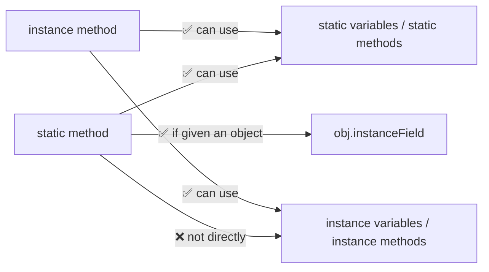
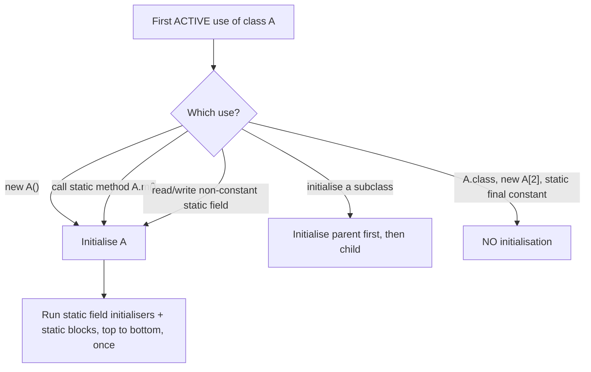
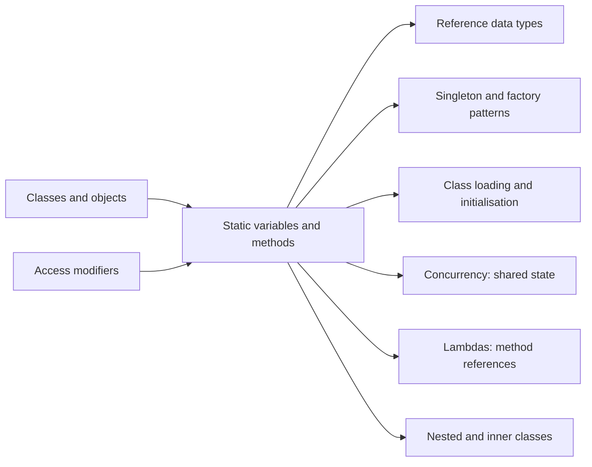

# Static Variables and Methods in Java (and Accessing Them from Other Classes)

**TL;DR:** A **`static`** member belongs to the **class**, not to any object. A **static variable** exists once and is shared by every instance; a **static method** can be called without creating an object, so it has no `this` and can't touch instance members directly. From another class you reach static members with **`ClassName.member`** (calling them through a reference compiles but is misleading) or with a **`static` import**, subject to the normal access modifiers. Static state is created when the class is **initialised** (once, lazily, in textual order), which is the source of most interview trick questions.

## Table of Contents

1. [TL;DR](#1-tldr)
2. [Why it matters](#2-why-it-matters)
3. [Prerequisites](#3-prerequisites)
4. [Mental model](#4-mental-model)
5. [Core concepts](#5-core-concepts)
6. [How it works](#6-how-it-works)
7. [Examples](#7-examples)
8. [Comparisons](#8-comparisons)
9. [Trade-offs](#9-trade-offs)
10. [Gotchas](#10-gotchas)
11. [Practical application](#11-practical-application)
12. [Interview prep](#12-interview-prep)
13. [Interview question bank](#13-interview-question-bank)
14. [Tricky code snippets](#14-tricky-code-snippets)
15. [Connections](#15-connections)
16. [Summary](#16-summary)
17. [Answers](#answers)

---

## 1. TL;DR

- **Static variable (class variable):** one copy per class, shared by all objects. `static int count;`
- **Static method:** called on the class, no object needed, no `this`. `Math.max(3, 9)`.
- **Static block:** `static { … }` runs once when the class is initialised.
- **Access from another class:** `Ticket.totalIssued()`, `Ticket.PREFIX`, or `import static`.
- **Rule of thumb:** static code can't see instance members unless it is given an object.

**The analogy: a hotel and its rooms.**

| Hotel | Java |
|---|---|
| Each room has its own bed, minibar and guest | **Instance** fields: one set per object |
| The lobby clock, the front-desk bell and the "rooms booked today" board exist once for the whole hotel | **Static** members: one per class |
| Any guest can read the lobby board without being in a particular room | Static members are reached through the **class name** |
| The board can't tell you what's in room 12's minibar unless you go and look | A static method needs an **object reference** to read instance fields |
| The hotel's rules are set up when the hotel opens, once | **Static initialisation** happens once, when the class is first used |
| If everyone edits the board at the same time, numbers get garbled | Shared mutable static state needs thread-safety |

**Running example:** a ticket desk. `Ticket` has a `static final String PREFIX`, a private `static int nextId` and `issued` counter, a static block that announces class loading, instance fields `id` and `holder`, and a static `totalIssued()`. A separate `TicketUtil` class (private constructor, static `summary()`) reaches `Ticket`'s statics from outside.

---

## 2. Why it matters

**The problem static solves.** Some data and behaviour belong to the *concept* rather than to any single object: how many tickets exist, the next ID to hand out, the value of π, a function that needs no state (`Integer.parseInt`). Without `static` you would need a dummy object just to call such code, or you would copy shared data into every object and keep the copies in sync.

**What goes wrong when static is misunderstood** (verified on Java 21):

| Code | Result | Cause |
|---|---|---|
| Static method reads an instance field | Compile error *non-static variable x cannot be referenced from a static context* | No object, no `this` |
| `main` calls an instance method `hello()` directly | Same compile error | `main` is `static` |
| `static int a = b + 1; static int b = 5;` | Compile error *illegal forward reference* | Statics initialise in textual order |
| `static int a = getB(); static int b = 5;` | `a` is **0**, not 5 | `getB()` runs before `b` is assigned |
| `A.K` where `static final int K = 10` | `A`'s static block does **not** run | Compile-time constants are inlined |
| A static initialiser throws | First use: `ExceptionInInitializerError`, every later use: `NoClassDefFoundError` | The class is marked failed |
| `A a = null; a.count` | Works: prints the value | Static access never touches the object |
| `Config.secret` where `secret` is `private static` | Compile error *has private access* | Access modifiers still apply |
| `static final List` field then `.add(...)` | Allowed | `final` fixes the reference, not the contents |

**Why interviewers ask.** "Can we override static methods?", "Why is `main` static?", "static block vs instance block", "can a static method access non-static members", "when is a class initialised" and "what is a static import" appear in virtually every Java fresher and mid-level round.

---

## 3. Prerequisites

| Prerequisite | One-line refresher | Importance |
|---|---|---|
| Classes, objects, instance fields | Objects hold their own copies of fields ([Classes and Objects notes]) | Essential |
| Methods, parameters, overloading | Declaring and calling methods ([Declaring Variables and Methods notes]) | Essential |
| Access modifiers | `private`/package/`protected`/`public` ([Encapsulation and Abstraction notes]) | Essential |
| `final` | Variable assigned once | Essential |
| Initialisation order of an object | Instance blocks and constructors ([Classes and Objects notes]) | Important |
| Inheritance basics | Static hiding vs overriding ([Inheritance and Polymorphism notes]) | Nice-to-have |

---

## 4. Mental model

> **The one picture to keep in your head:** the **class** is a single box that holds the static variables and static methods. Each **object** is a separate box with only instance fields. Objects don't *copy* statics; they just look them up in the class box.

```
        CLASS box  (exists once, created when class is initialised)
 ┌────────────────────────────────────────────┐
 │ class Ticket                               │
 │   static final String PREFIX = "TK-"       │
 │   static int nextId = 3   ◄── shared       │
 │   static int issued = 2   ◄── shared       │
 │   static totalIssued()                     │
 └───────▲───────────────────────▲────────────┘
         │ (lookup)              │ (lookup)
 ┌───────┴────────┐      ┌───────┴────────┐
 │ Ticket object  │      │ Ticket object  │      OBJECT boxes (many, on the heap)
 │ id = 1         │      │ id = 2         │      hold instance fields only
 │ holder="Asha"  │      │ holder="Ben"   │
 └────────────────┘      └────────────────┘
```
*Statics live once in the class; each object holds only its own instance fields.*

**Who can see whom:**


*Instance code can see everything; static code can see only static things unless it is handed an object.*

---

## 5. Core concepts

### 5.1 Glossary

- **`static`:** a modifier meaning "belongs to the class, not to an instance".
- **Static variable / class variable:** a field declared `static`; one copy, shared. Gets a default value (`0`, `false`, `null`).
- **Instance variable:** a non-static field; each object has its own.
- **Static method / class method:** a method declared `static`; has no `this` or `super`.
- **Static initialiser (static block):** `static { … }`; code that runs once when the class is initialised.
- **Class initialisation:** the JVM running a class's static initialisers and static field initialisers, once, in textual order, the first time the class is actively used.
- **Active use (triggers initialisation):** `new`, calling a static method, reading or writing a non-constant static field, initialising a subclass.
- **Constant variable:** a `static final` primitive or `String` initialised with a compile-time constant. The compiler inlines its value at use sites.
- **Static import:** `import static pkg.Class.member;` lets you use a static member without the class-name prefix.
- **Static nested class:** a class declared `static` inside another class; doesn't need an enclosing instance.
- **Utility class:** a class of only static members with a private constructor (`Math`, `Collections`).
- **Singleton:** a class designed to have exactly one instance, usually held in a private static field.

### 5.2 Static variables

- Declared with `static`; allocated once per class (not per object).
- Every instance sees the same value: change via one object, visible via all (Snippet 1).
- Default values apply if you don't initialise (Snippet 2).
- Access forms: `ClassName.var` (preferred), `obj.var` (legal, misleading, works even with a `null` reference, Snippet 9), or bare `var` inside the class.
- `static final` = a constant, by convention `UPPER_SNAKE_CASE`. A *blank* `static final` must be assigned in a static block (Snippets 31, 32). Reassigning is an error (Snippet 33).
- `static final` fixes the **reference**; the object it points to can still change (Snippets 34, 35).

### 5.3 Static methods

- Called as `ClassName.method()`; no object needed.
- **Cannot** use `this`, `super`, instance fields or instance methods directly (Snippets 3–6). They *can* use them through an object reference (Snippet 8).
- **Can** call other static methods, read/write static fields, create objects, and be recursive (Snippet 39).
- **Not overridden:** a same-signature static method in a subclass *hides* it, and the declared type decides which runs (Snippet 22).
- Can be overloaded (but not by changing only `static`, Snippet 41).
- Can be used as a method reference: `Integer::parseInt`, `Main::twice` (Snippet 40).
- `main` is `static` because the JVM must call it **before any object exists**.

### 5.4 Static blocks and initialisation order

- A static block runs **once**, when the class is initialised, not per object (Snippet 10).
- Static field initialisers and static blocks run in **textual order** (Snippet 11).
- A static initialiser can't use a field declared *later* by simple name (*illegal forward reference*, Snippet 12), but calling a method that reads it compiles and sees the default value (Snippet 13).
- If a static initialiser throws, the class is unusable: first an `ExceptionInInitializerError`, afterwards `NoClassDefFoundError` (Snippet 43).
- Circular initialisation between two classes can expose default values (Snippet 45).

### 5.5 Accessing statics of a different class

| Situation | Code | Works? |
|---|---|---|
| Public/package-private static member, same package | `Ticket.totalIssued()` | ✅ |
| Via an instance | `a.totalIssued()` | ✅ compiles; bad style (Snippet 9) |
| `private static` member from another class | `Config.secret` | ❌ *has private access* (Snippets 18, 19) |
| Static member of a **parent**, via the child | `Child.count` | ✅ same variable as `Parent.count` (Snippet 23) |
| Without class prefix | `import static java.lang.Math.max;` | ✅ (Snippet 20) |
| Two static imports with the same member name | `import static Integer.*; import static Long.*;` | ❌ *ambiguous* when used (Snippet 21) |
| Static member of an **interface** | `K.LIMIT`, `K.twice()` | ✅ (Snippet 48) |
| Static member of an **enum** | `Color.first()` | ✅ (Snippet 47) |
| From another package | needs `public` (or `protected` + subclass) and an `import` | ✅ |

### 5.6 Static nested classes

- `static class SNested` inside `Outer` is created with `new Outer.SNested()`, no outer object (Snippet 24).
- A non-static (inner) class needs an enclosing instance: `o.new Inner()` (Snippets 24, 25).
- A static nested class can't read the outer class's **instance** members (Snippet 26).
- Since Java 16, inner classes may declare static members (Snippet 27). Before that, they could only have constant statics. ⚠️ If you target Java 8–15, this fails to compile.

### 5.7 Things that can't be static

- Local variables (Snippet 29), constructors (Snippet 30), top-level classes (only nested ones), and type parameters: `static T make()` in `Box<T>` is an error (Snippet 28).
- Abstract methods (can't be `abstract` and `static`) and interface instance methods (see Encapsulation notes).

---

## 6. How it works

### 6.1 When is a class initialised?


*Classes are initialised lazily. Mentioning a class isn't the same as using it.*

Verified behaviours:

| Use | Triggers `A`'s static block? | Snippet |
|---|---|---|
| `A.K` where `static final int K = 10` | **No** (inlined constant) | 14 |
| `A.K` where `static final int K = Integer.parseInt("10")` | **Yes** | 15 |
| `A.class`, `new A[2]` | **No** | 16 |
| `new A()` | **Yes** | 16 |
| `Child.p` where `p` is declared in `Parent` | Initialises **Parent only** | 17 |
| `new Child()` | Parent, then Child | 17 |

### 6.2 Static vs instance in memory

- Static variables are initialised once, at class initialisation, and live as long as the class is loaded (usually the whole program). ⚠️ In HotSpot they are stored with the class's `Class` object on the heap; the older "static is in the method area / PermGen" explanation is a simplification.
- Instance variables are created inside each object when `new` runs and become garbage with it.
- Because statics are reachable from the class, anything they reference stays alive: a `static List` that only grows is a classic **memory leak**.

### 6.3 Worked trace: the ticket desk

```java
class Ticket {
    static final String PREFIX = "TK-";
    private static int nextId = 1;
    private static int issued;
    static { System.out.println("Ticket class loaded"); }
    private final int id;
    private final String holder;
    Ticket(String holder) { this.id = nextId++; this.holder = holder; issued++; }
    String label() { return PREFIX + id + " (" + holder + ")"; }
    static int totalIssued() { return issued; }
}
class TicketUtil {
    private TicketUtil() { }
    static String summary() { return Ticket.totalIssued() + " tickets issued"; }
}
public class Main {
    public static void main(String[] args) {
        System.out.println("start");
        Ticket a = new Ticket("Asha");
        Ticket b = new Ticket("Ben");
        System.out.println(a.label() + " " + b.label());
        System.out.println(Ticket.totalIssued() + " | " + TicketUtil.summary() + " | " + Ticket.PREFIX);
        System.out.println(a.totalIssued());
    }
}
```

Output (verified, Java 21):

```
start
Ticket class loaded
TK-1 (Asha) TK-2 (Ben)
2 | 2 tickets issued | TK-
2
```

| Step | What happens | Why |
|---|---|---|
| `System.out.println("start")` | Prints `start` | `Ticket` hasn't been used yet |
| `new Ticket("Asha")` | First active use: class initialised, `PREFIX`, `nextId = 1`, `issued = 0`, then the static block prints `Ticket class loaded` | Lazy, once |
| Constructor body | `id = nextId++` (1, `nextId` becomes 2), `issued++` (1) | Statics shared, `id` per object |
| `new Ticket("Ben")` | No second "loaded" message; `id = 2`, `issued = 2` | Static init happens once |
| `a.label()` | Uses `PREFIX` + its own `id` and `holder` | Instance method sees both |
| `Ticket.totalIssued()` | `2` | Static method returns the shared counter |
| `TicketUtil.summary()` | Calls `Ticket.totalIssued()` from another class → `2 tickets issued` | Access by class name |
| `Ticket.PREFIX` | `TK-` | Constant, accessible directly |
| `a.totalIssued()` | `2` (same as `Ticket.totalIssued()`) | Legal but misleading; the compiler ignores `a` |

---

## 7. Examples

### 7.1 Toy example: shared vs per-object

```java
class Counter {
    static int shared = 0;
    int own = 0;
    void hit() { shared++; own++; }
}
public class Main {
    public static void main(String[] args) {
        Counter a = new Counter(), b = new Counter();
        a.hit(); a.hit(); b.hit();
        System.out.println(a.own + " " + b.own + " " + a.shared + " " + b.shared + " " + Counter.shared);
    }
}
```
Output:
```
2 1 3 3 3
```
*`own` is separate for each object; `shared` is one variable seen three different ways.*

### 7.2 Toy example: static import

```java
import static java.lang.Math.max;
import static java.lang.Math.PI;
import static java.lang.System.out;
public class Main {
    public static void main(String[] args) {
        out.println(max(3, 9) + " " + (int) (PI * 100));
    }
}
```
Output:
```
9 314
```
*Static imports shorten code but hide where a name comes from; use them sparingly (constants, test assertions).*

### 7.3 Real-world examples

- **`Math`, `Collections`, `Arrays`, `Objects`, `Integer.parseInt`, `String.valueOf`:** utility classes of static methods.
- **`System.out`:** a `public static final PrintStream` field you access from every class.
- **Factory methods:** `List.of(...)`, `LocalDate.now()`, `Optional.empty()`: static methods that create or return objects.
- **Constants:** `Integer.MAX_VALUE`, `Math.PI`, `File.separator`.
- **Singletons and registries:** `Runtime.getRuntime()`, logger factories (`LoggerFactory.getLogger(...)`).
- **ID generators and counters:** exactly the `Ticket` example (in production prefer `AtomicInteger`/database sequences).
- **`public static void main`:** the entry point (Snippets 6, 7).

---

## 8. Comparisons

### 8.1 Static vs instance members

| Aspect | Static | Instance |
|---|---|---|
| Belongs to | The class | Each object |
| Copies | One | One per object |
| Created | When the class is initialised | When `new` runs |
| Accessed with | `ClassName.member` | `object.member` |
| `this` available? | No | Yes |
| Can access | Statics directly; instance members only via an object | Everything |
| Overridden? | No (hidden) | Yes (instance methods) |
| Lives until | Class unloaded (usually program end) | Object garbage-collected |
| Typical use | Constants, counters, utilities, factories | Per-object state and behaviour |

### 8.2 Static block vs instance block vs constructor

| | Static block | Instance block | Constructor |
|---|---|---|---|
| Syntax | `static { … }` | `{ … }` | `ClassName(…) { … }` |
| Runs | Once, at class initialisation | Before the constructor body, every `new` | Every `new` |
| Can use `this` | No | Yes | Yes |
| Typical use | Load constants, one-time setup | Shared setup for all constructors | Initialise this object |

(Snippet 10 shows the order: `static block`, then `instance block` + `constructor` for each object.)

### 8.3 Static method vs static nested class vs inner class

| | Static method | Static nested class | Inner class |
|---|---|---|---|
| Needs outer instance? | No | No | **Yes** (Snippet 25) |
| Sees outer instance fields? | No | No (Snippet 26) | Yes |
| Created with | n/a (call it) | `new Outer.Nested()` | `outer.new Inner()` |
| Use | Utility behaviour | Helper type tied to outer | Object that belongs to one outer object (iterators) |

### 8.4 Hiding vs overriding (recap)

| | Instance method | Static method |
|---|---|---|
| Same signature in subclass | Overrides: object decides | Hides: **declared type** decides |
| Example (Snippet 22) | n/a | `new C().call()` (defined in `P`, calls `who()`) prints `P`, while `C.who()` prints `C` |

### 8.5 Eager vs lazy singleton

| Approach | Created | Thread-safe | Snippet |
|---|---|---|---|
| `private static final X INSTANCE = new X();` | At class initialisation (first use of the class) | Yes (class init is thread-safe) | 36 |
| Holder idiom: `private static class Holder { static final X I = new X(); }` | On first call to `get()` | Yes | 37 |
| `if (instance == null) instance = new X();` | Lazily | **No** without synchronisation | not shown |

*Eager prints `before` then `Eager created` only when `Eager` is first used; the holder defers until `get()` is called.*

---

## 9. Trade-offs

| Decision | Benefit | Cost | Use when |
|---|---|---|---|
| Static utility methods | Simple, no object needed, easy to call | Hard to mock/replace; no polymorphism | Pure functions with no state (`Math.max`) |
| Static constants (`static final`) | One copy, inlined by the compiler | Changing one requires recompiling dependants (⚠️ inlining) | True constants |
| Mutable static state | Easy global sharing | Hidden coupling, test pollution, thread-safety, memory leaks | Almost never; use dependency injection |
| Static counters/ID generators | Simple | Not thread-safe with `++`; resets on restart | Demos; use `AtomicLong`/DB in production |
| Singleton via static field | One shared instance | Global state; hard to test | Truly single resources (config, registry) |
| Static factory methods | Names, caching, return subtypes | Not overridable | Instead of public constructors (Effective Java Item 1) |
| Static nested class | No hidden reference to the outer object | Can't use outer instance state | Helper types, builders |
| `static` import | Less typing | Hides origin of names, name clashes (Snippet 21) | Constants and test assertions |

---

## 10. Gotchas

### Myths

- ❌ **Myth:** "Static methods can be overridden." ✅ **Reality:** they are hidden; the declared type picks the version (Snippet 22).
- ❌ **Myth:** "Static members are copied into every object." ✅ **Reality:** one copy, in the class (Snippet 1).
- ❌ **Myth:** "You need an object to call a static method." ✅ **Reality:** the class name is enough; an object reference is ignored, even `null` (Snippet 9).
- ❌ **Myth:** "A static method can never use instance data." ✅ **Reality:** it can, via an object reference passed in or created (Snippet 8).
- ❌ **Myth:** "A class is initialised the moment the program starts, or when it is mentioned." ✅ **Reality:** lazily, on first active use (Snippets 14–17).
- ❌ **Myth:** "`static final` means the object can't change." ✅ **Reality:** only the reference (Snippets 34, 35).
- ❌ **Myth:** "`main` is static by convention only." ✅ **Reality:** the JVM invokes it before any object exists.
- ❌ **Myth:** "A static field of a parent is a separate variable in each subclass." ✅ **Reality:** one variable; `Child.count++` changes `Parent.count` (Snippet 23).

### Common mistakes and edge cases

- **Calling an instance method from `main`** without an object (Snippet 6). Create an object (Snippet 7).
- **Using `this` in static code** (Snippet 5).
- **Forward references** between static fields (Snippets 12, 13).
- **Parameter shadowing a static field:** `count = 99;` changes the parameter, not the field. Use `ClassName.count` (Snippet 44).
- **Static constant not triggering the static block** (Snippet 14).
- **Static initialiser exceptions:** `ExceptionInInitializerError`, then `NoClassDefFoundError` (Snippet 43).
- **Circular static initialisation** can show default values (Snippet 45).
- **Shared mutable static collections** grow forever (memory leak) and aren't thread-safe.
- **Non-atomic `count++` on a static** from many threads can lose updates. Use `AtomicInteger` or synchronisation. (Not shown: nondeterministic.)
- **Overloading by `static` only:** `static void m(int)` and `void m(int)` clash (Snippet 41).
- **String constants and `==`:** `"a" + "b"` and a `static final String S = "ab"` are the same interned constant (Snippet 46).

---

## 11. Practical application

### Design checklist
- [ ] Is this really class-level data/behaviour, or does it belong to an object?
- [ ] Constants: `public static final` with an immutable type
- [ ] Utility class: `final`, private constructor, only static methods (Snippet 38)
- [ ] No mutable public static fields
- [ ] Thread-safe if shared and mutable (`AtomicInteger`, `synchronized`, or avoid)
- [ ] Prefer `ClassName.member` over `object.member`
- [ ] Static initialisers short, can't throw, don't depend on other classes' statics (cycles)
- [ ] Prefer dependency injection to static globals in application code

### Hands-on exercise: fix the `IdGenerator`

The class below should hand out unique, increasing IDs starting at 1 and let you ask how many IDs were issued. It has bugs. Find them, then fix it.

```java
class IdGenerator {
    int next = 1;
    int issued = 0;
    int nextId() { issued++; return next++; }
    static int count() { return issued; }
}
public class Main {
    public static void main(String[] args) {
        IdGenerator a = new IdGenerator();
        IdGenerator b = new IdGenerator();
        System.out.println(a.nextId() + " " + b.nextId());
        System.out.println(IdGenerator.count());
    }
}
```

<details><summary>Solution</summary>

**Bugs:**
1. `count()` is `static` but reads the instance field `issued`: compile error *non-static variable issued cannot be referenced from a static context* (same error as Snippet 3).
2. Even if that compiled, `next` and `issued` are per-object, so two generators would both return `1` and IDs wouldn't be unique across objects.

**Fix:** make the shared state static (and keep it private):

```java
class IdGenerator {
    private static int next = 1;
    private static int issued = 0;
    static int nextId() { issued++; return next++; }
    static int count() { return issued; }
}
public class Main {
    public static void main(String[] args) {
        System.out.println(IdGenerator.nextId() + " " + IdGenerator.nextId());
        System.out.println(IdGenerator.count());
    }
}
```
Expected output: `1 2` then `2`. For multi-threaded code, replace the two ints with an `AtomicInteger` (`next.getAndIncrement()`).

*(Behaviour follows directly from Snippets 1, 3 and 8; compare the `Ticket` class in the worked trace, which keeps the counters private and static while the per-ticket `id` stays an instance field.)*
</details>

---
## 12. Interview prep

### Likely questions with model answers

**Q1. What does `static` mean in Java? Where can you use it?**
> "`static` means a member belongs to the class itself, not to any instance. You can apply it to fields, methods, initialiser blocks and nested classes, plus static imports. A static field has a single copy shared by all objects; a static method can be called as `ClassName.method()` without creating an object. You can't make local variables, constructors or top-level classes static."

**Q2. Why is `main` static?**
> "The JVM has to start the program before any object of your class exists, so it needs an entry point it can call on the class alone. If `main` were an instance method, the JVM would first have to decide how to construct the object, which constructor to use and with what arguments. Making it `public static void main(String[] args)` removes that problem."

**Q3. Can a static method access non-static members?**
> "Not directly, because a static method has no `this`: it isn't running on behalf of any particular object, so there's no instance whose field or method it could mean. It gets a compile error. But it can access them through an object reference, for example `static int read(A a) { return a.x; }`, or after creating an object with `new`. The reverse is always fine: instance methods can use static members."

**Q4. Can you override a static method?**
> "No. If a subclass declares a static method with the same signature, it hides the parent's method rather than overriding it. Which one runs is decided at compile time by the declared type of the reference, not by the actual object, so there's no polymorphism. A static method can't override an instance method either, and the other way round, and both are compile errors."

**Q5. When does static initialisation happen, and in what order?**
> "A class is initialised lazily, the first time it is actively used: creating an instance, calling a static method, or touching a non-constant static field; or when a subclass is initialised. Initialisation happens once, parent class first, and runs static field initialisers and static blocks in the textual order they appear. A `static final` compile-time constant doesn't trigger it, because the compiler inlines the value, and neither does `A.class`. If a static initialiser throws, the first use gets `ExceptionInInitializerError` and later uses get `NoClassDefFoundError`."

**Q6. How do you access static members of another class?**
> "By the class name: `Ticket.totalIssued()` or `Ticket.PREFIX`. It's legal to use an instance, `a.totalIssued()`, but the compiler ignores the instance, even if it's `null`, so it's misleading and I avoid it. The access modifiers still apply: a `private static` member is invisible outside its class, and from another package it must be `public`, or `protected` for subclasses. I can also write `import static java.lang.Math.max;` to use `max(...)` without the prefix, which I'd keep for constants and a few well-known utilities."

**Q7. Static variable vs instance variable?**
> "A static variable has one copy per class, created when the class is initialised, and every object shares it. An instance variable has one copy per object, created when the object is constructed. Static is for class-wide data such as constants and counters; instance is for each object's own state. Static state is global, so mutable statics create hidden coupling and thread-safety problems."

**Q8. What's the difference between a static block and an instance block, and what's a singleton's static role?**
> "A static block runs once when the class is initialised and can't use `this`; an instance block runs before the constructor body for every object created. For singletons, the instance is held in a `private static` field and exposed through a static method, with a private constructor so nobody else can create one. The eager version creates it during class initialisation, which the JVM guarantees is thread-safe; the lazy holder idiom defers creation until the first call by putting the field in a private static nested class."

### What interviewers watch for
- Can you explain *why* statics can't touch instance members, not just recite it.
- Static hiding vs overriding, and that statics ignore the object reference.
- Class initialisation: laziness, textual order, constants, exceptions.
- Access modifiers for statics in another class, plus static imports.
- Judgement: when statics are fine (constants, pure utilities) and when they hurt (mutable global state).

---

## 13. Interview question bank

Short answers are hidden. 🟢 fresher, 🟡 intermediate, 🔴 senior/FAANG follow-up.

### 13.1 Static basics

**1. 🟢 What is the `static` keyword?**
<details><summary>Answer</summary>

A modifier making a member belong to the class rather than to instances.
</details>

**2. 🟢 What can be declared static?**
<details><summary>Answer</summary>

Fields, methods, initialiser blocks, nested classes/interfaces/enums/records (and static imports). Not local variables, constructors or top-level classes.
</details>

**3. 🟢 What is a static variable? How many copies exist?**
<details><summary>Answer</summary>

A class variable; exactly one copy, shared by all instances (Snippet 1).
</details>

**4. 🟢 What are the default values of static variables?**
<details><summary>Answer</summary>

Same as instance fields: `0`, `0.0`, `false`, `'\u0000'`, `null` (Snippet 2).
</details>

**5. 🟢 How do you call a static method?**
<details><summary>Answer</summary>

`ClassName.method(args)`; inside the same class just `method(args)`.
</details>

**6. 🟢 Why is `main` static?**
<details><summary>Answer</summary>

The JVM calls it before any object exists (Snippets 6, 7).
</details>

**7. 🟢 Can a static method use `this` or `super`?**
<details><summary>Answer</summary>

No: *non-static variable this cannot be referenced from a static context* (Snippet 5).
</details>

**8. 🟡 Can a static method access instance variables?**
<details><summary>Answer</summary>

Not directly (Snippets 3, 4); through an object reference, yes (Snippet 8).
</details>

**9. 🟡 Can a non-static method access static variables?**
<details><summary>Answer</summary>

Yes, always.
</details>

**10. 🟡 Is it possible to call a static method on a null reference?**
<details><summary>Answer</summary>

Yes, no `NullPointerException`: the compiler resolves it using the declared type (Snippet 9).
</details>

**11. 🟡 Can a class have more than one static block?**
<details><summary>Answer</summary>

Yes; they run in textual order with static field initialisers (Snippet 11).
</details>

**12. 🟡 Can we overload static methods? Overload `main`?**
<details><summary>Answer</summary>

Yes to both. Only `public static void main(String[])` is the entry point. You can't overload by `static` alone (Snippet 41).
</details>

**13. 🟡 Can a static method be `abstract`, `final` or `synchronized`?**
<details><summary>Answer</summary>

Not `abstract` (compile error). `final` is allowed but redundant (can't be overridden anyway). `synchronized` is allowed and locks on the `Class` object.
</details>

**14. 🟡 Where is a static variable stored in memory?**
<details><summary>Answer</summary>

Per class, not per object, initialised when the class is initialised. ⚠️ Pre-Java 8 it was in PermGen; in HotSpot today it lives with the class mirror object on the heap/metadata. Interviewers usually accept "the class/method area".
</details>

### 13.2 Initialisation

**15. 🟢 When does a static block run?**
<details><summary>Answer</summary>

Once, when the class is initialised, before first use (Snippet 10).
</details>

**16. 🟡 Order: static block, instance block, constructor?**
<details><summary>Answer</summary>

Static block (once) → then per object: instance block → constructor (Snippet 10).
</details>

**17. 🟡 In what order do static fields and blocks run?**
<details><summary>Answer</summary>

Textual order (Snippet 11).
</details>

**18. 🟡 What is a forward reference error?**
<details><summary>Answer</summary>

Using a static field by simple name in an initialiser before its declaration: *illegal forward reference* (Snippet 12). Indirect use via a method compiles but sees the default (Snippet 13).
</details>

**19. 🔴 Which actions initialise a class?**
<details><summary>Answer</summary>

`new`, static method call, non-constant static field read/write, subclass initialisation, `Class.forName`, and running it as the main class.
</details>

**20. 🔴 Which actions do NOT initialise a class?**
<details><summary>Answer</summary>

Reading a compile-time constant (Snippet 14), `A.class`, creating an array of `A` (Snippet 16), declaring a variable of that type, and referencing a parent's static through a subclass only initialises the parent (Snippet 17).
</details>

**21. 🔴 What happens if a static initialiser throws?**
<details><summary>Answer</summary>

`ExceptionInInitializerError` on first use; any later use throws `NoClassDefFoundError` (Snippet 43).
</details>

**22. 🔴 Parent and child both have static blocks. When do they run?**
<details><summary>Answer</summary>

When the child is first used: parent static first, then child static. Using only a parent static member via the child initialises only the parent (Snippet 17).
</details>

**23. 🔴 What happens with circular static dependencies between two classes?**
<details><summary>Answer</summary>

The second class sees the first's fields at their current (possibly default) values: Snippet 45 gives `2 1`.
</details>

**24. 🔴 Is class initialisation thread-safe?**
<details><summary>Answer</summary>

Yes: the JVM guarantees a class is initialised once, with other threads blocking until done. This is why static-final singletons and the holder idiom are safe.
</details>

### 13.3 Accessing statics from other classes

**25. 🟢 How do you access a static variable of another class?**
<details><summary>Answer</summary>

`OtherClass.variable` (Snippet in the worked trace: `Ticket.PREFIX`).
</details>

**26. 🟢 Can you access a private static member from another class?**
<details><summary>Answer</summary>

No: *has private access* (Snippets 18, 19). Provide a public static getter.
</details>

**27. 🟡 What is a static import? Syntax?**
<details><summary>Answer</summary>

`import static java.lang.Math.max;` or `import static java.lang.Math.*;` lets you use static members without the class-name prefix (Snippet 20).
</details>

**28. 🟡 What if two static imports supply the same name?**
<details><summary>Answer</summary>

Using the name is *ambiguous* (Snippet 21).
</details>

**29. 🟡 Is `Child.count` the same variable as `Parent.count`?**
<details><summary>Answer</summary>

Yes if `Child` doesn't redeclare it (Snippet 23).
</details>

**30. 🟡 Does `object.staticMethod()` call the method of the object's class?**
<details><summary>Answer</summary>

No, of the declared type of the reference (Snippet 22).
</details>

**31. 🟡 What access is needed to use a static member from another package?**
<details><summary>Answer</summary>

`public` (or `protected` inside a subclass), plus an import of the class (or fully qualified name).
</details>

**32. 🟡 Can an interface have static variables and methods?**
<details><summary>Answer</summary>

Fields are implicitly `public static final`; static methods are allowed (Java 8) and must be called on the interface name (Snippet 48).
</details>

**33. 🔴 Why prefer `ClassName.member` over `instance.member`?**
<details><summary>Answer</summary>

Clarity (the reader sees it's static), no false impression that the instance matters, no misleading `null` cases (Snippet 9); IDEs warn.
</details>

### 13.4 static final, constants, and nested classes

**34. 🟢 What is a constant in Java?**
<details><summary>Answer</summary>

Conventionally a `public static final` field in `UPPER_SNAKE_CASE`.
</details>

**35. 🟡 Can a `static final` variable be assigned in a static block?**
<details><summary>Answer</summary>

Yes if declared without initialiser (blank final) (Snippet 32); never assigned = error (Snippet 31).
</details>

**36. 🟡 Is a `static final List` immutable?**
<details><summary>Answer</summary>

No: the reference is fixed, contents can change (Snippet 34). Use `List.of(...)` or `Collections.unmodifiableList`.
</details>

**37. 🟡 Static nested class vs inner class?**
<details><summary>Answer</summary>

Static nested: no outer instance needed or available; inner: tied to an outer instance (Snippets 24–26).
</details>

**38. 🔴 Can an inner (non-static) class have static members?**
<details><summary>Answer</summary>

Since Java 16, yes (Snippet 27). ⚠️ Earlier versions only allowed constants.
</details>

**39. 🔴 Can a static method use the class's generic type parameter?**
<details><summary>Answer</summary>

No: type parameters belong to instances (Snippet 28). Declare a method-level `<T>` instead.
</details>

**40. 🔴 Compile-time constant inlining: what can go wrong?**
<details><summary>Answer</summary>

Other classes embed the constant's value at compile time. If you change it and recompile only the defining class, dependants keep the old value until recompiled (⚠️ real build-system pitfall; not demonstrated here since it needs separate compilation).
</details>

### 13.5 Design: singleton, utility, global state

**41. 🟢 What is a utility class? How do you prevent instantiation?**
<details><summary>Answer</summary>

A class of static members only; `final` with a private constructor (Snippet 38).
</details>

**42. 🟡 How do you implement a singleton using static?**
<details><summary>Answer</summary>

Private constructor + `private static final` instance + static `get()` (Snippet 36), or the holder idiom (Snippet 37). An `enum` singleton is another robust option.
</details>

**43. 🟡 Difference between eager and lazy initialisation here?**
<details><summary>Answer</summary>

Eager: created when the class is first used. Lazy holder: created at the first `get()` call (Snippets 36, 37).
</details>

**44. 🟡 Why are static counters risky in multi-threaded code?**
<details><summary>Answer</summary>

`count++` isn't atomic (read-modify-write), so concurrent updates can be lost. Use `AtomicInteger`/`LongAdder` or synchronisation.
</details>

**45. 🟡 Why are mutable static fields discouraged?**
<details><summary>Answer</summary>

Hidden global state: tests influence each other, classes are coupled, concurrency bugs, and objects referenced from statics never get collected.
</details>

**46. 🟡 Can static methods be used as method references?**
<details><summary>Answer</summary>

Yes: `Integer::parseInt`, `Main::twice` (Snippet 40).
</details>

**47. 🔴 How can static fields cause a memory leak?**
<details><summary>Answer</summary>

A static collection or cache that is only added to keeps every element reachable for the life of the class (often the whole application, or the class loader in app servers).
</details>

**48. 🔴 What is the problem with static methods for unit testing?**
<details><summary>Answer</summary>

They can't be overridden or injected, so mocking requires special tools; hide behind an interface where behaviour varies.
</details>

**49. 🔴 A parameter has the same name as a static field. What does `count = 99;` change?**
<details><summary>Answer</summary>

The parameter. Use `ClassName.count` to reach the field (Snippet 44).
</details>

**50. 🔴 Are `String` constants with `static final` interned?**
<details><summary>Answer</summary>

Compile-time constant strings are interned, so `"a" + "b" == A.S` where `S = "ab"` is `true` (Snippet 46).
</details>

---
## 14. Tricky code snippets

All compiled and run on OpenJDK 21. Predict first. Unless shown, snippets sit inside a file with `public class Main { public static void main(String[] args) { … } }`.

**Snippet 1 🟢**
```java
class Counter {
    static int shared = 0;
    int own = 0;
    void hit() { shared++; own++; }
}
// in main:
Counter a = new Counter(), b = new Counter();
a.hit(); a.hit(); b.hit();
System.out.println(a.own + " " + b.own + " " + a.shared + " " + b.shared + " " + Counter.shared);
```
<details><summary>Answer</summary>

`2 1 3 3 3`. `own` is per object; `shared` is one variable.
</details>

**Snippet 2 🟢**
```java
class D { static int i; static boolean b; static String s; static double d; static char c; }
// in main:
System.out.println(D.i + " " + D.b + " " + D.s + " " + D.d + " " + (int) D.c);
```
<details><summary>Answer</summary>

`0 false null 0.0 0`.
</details>

**Snippet 3 🟢**
```java
class A {
    int x = 5;
    static void m() { System.out.println(x); }
}
```
<details><summary>Answer</summary>

Compile error: *non-static variable x cannot be referenced from a static context*.
</details>

**Snippet 4 🟢**
```java
class A {
    void hello() { }
    static void m() { hello(); }
}
```
<details><summary>Answer</summary>

Compile error: *non-static method hello() cannot be referenced from a static context*.
</details>

**Snippet 5 🟢**
```java
class A {
    int x;
    static void m() { System.out.println(this.x); }
}
```
<details><summary>Answer</summary>

Compile error: *non-static variable this cannot be referenced from a static context*.
</details>

**Snippet 6 🟢**
```java
public class Main {
    void hello() { System.out.println("hello"); }
    public static void main(String[] args) {
        hello();
    }
}
```
<details><summary>Answer</summary>

Compile error: *non-static method hello() cannot be referenced from a static context*. `main` is static.
</details>

**Snippet 7 🟢**
```java
public class Main {
    void hello() { System.out.println("hello"); }
    public static void main(String[] args) {
        new Main().hello();
    }
}
```
<details><summary>Answer</summary>

`hello`. Create an object, then call the instance method.
</details>

**Snippet 8 🟡**
```java
class A {
    int x = 5;
    static int read(A a) { return a.x; }
    int twice() { return helper() * 2; }
    static int helper() { return 21; }
}
// in main:
System.out.println(A.read(new A()) + " " + new A().twice());
```
<details><summary>Answer</summary>

`5 42`. A static method may read instance fields through an object; an instance method may call static methods.
</details>

**Snippet 9 🔴**
```java
class A { static int count = 7; static String hi() { return "hi"; } }
// in main:
A a = null;
System.out.println(a.count + " " + a.hi());
```
<details><summary>Answer</summary>

`7 hi`, with no `NullPointerException`. Static access is resolved from the declared type; the object isn't evaluated.
</details>

**Snippet 10 🟡**
```java
class A {
    static { System.out.println("static block"); }
    { System.out.println("instance block"); }
    A() { System.out.println("constructor"); }
}
// in main:
new A(); new A();
```
<details><summary>Answer</summary>

```
static block
instance block
constructor
instance block
constructor
```
</details>

**Snippet 11 🟡**
```java
class A {
    static int x = init("x");
    static { System.out.println("block 1"); }
    static int y = init("y");
    static { System.out.println("block 2"); }
    static int init(String n) { System.out.println("init " + n); return 1; }
}
// in main:
System.out.println(A.x + A.y);
```
<details><summary>Answer</summary>

```
init x
block 1
init y
block 2
2
```
Textual order.
</details>

**Snippet 12 🟡**
```java
class A {
    static int a = b + 1;
    static int b = 5;
}
```
<details><summary>Answer</summary>

Compile error: *illegal forward reference*.
</details>

**Snippet 13 🔴**
```java
class A {
    static int a = getB();
    static int b = 5;
    static int getB() { return b; }
}
// in main:
System.out.println(A.a + " " + A.b);
```
<details><summary>Answer</summary>

`0 5`. The method hides the forward reference from the compiler, and runs while `b` still has its default `0`.
</details>

**Snippet 14 🔴**
```java
class A {
    static final int K = 10;
    static { System.out.println("A initialised"); }
}
// in main:
System.out.println(A.K);
```
<details><summary>Answer</summary>

Just `10`. `K` is a compile-time constant and is inlined, so `A` is never initialised.
</details>

**Snippet 15 🔴**
```java
class A {
    static final int K = Integer.parseInt("10");
    static { System.out.println("A initialised"); }
}
// in main:
System.out.println(A.K);
```
<details><summary>Answer</summary>

```
A initialised
10
```
Not a constant expression, so reading `K` triggers initialisation.
</details>

**Snippet 16 🔴**
```java
class A { static { System.out.println("A initialised"); } }
// in main:
Class<?> c = A.class;
System.out.println("got class " + c.getSimpleName());
A[] arr = new A[2];
System.out.println("array created");
new A();
```
<details><summary>Answer</summary>

```
got class A
array created
A initialised
```
Neither `A.class` nor creating an array of `A` initialises the class; `new A()` does.
</details>

**Snippet 17 🔴**
```java
class Parent { static int p = 1; static { System.out.println("Parent init"); } }
class Child extends Parent { static { System.out.println("Child init"); } }
// in main:
System.out.println(Child.p);
System.out.println("now new Child");
new Child();
```
<details><summary>Answer</summary>

```
Parent init
1
now new Child
Child init
```
`Child.p` is really `Parent.p`, so only `Parent` initialises. `new Child()` then initialises `Child` (the parent is already done).
</details>

**Snippet 18 🟢**
```java
class Config { private static int secret = 1; }
// in main:
System.out.println(Config.secret);
```
<details><summary>Answer</summary>

Compile error: *secret has private access in Config*.
</details>

**Snippet 19 🟢**
```java
class Config { private static int hidden() { return 2; } }
// in main:
System.out.println(Config.hidden());
```
<details><summary>Answer</summary>

Compile error: *hidden() has private access in Config*.
</details>

**Snippet 20 🟡**
```java
import static java.lang.Math.max;
import static java.lang.Math.PI;
import static java.lang.System.out;
// in main:
out.println(max(3, 9) + " " + (int) (PI * 100));
```
<details><summary>Answer</summary>

`9 314`.
</details>

**Snippet 21 🟡**
```java
import static java.lang.Integer.*;
import static java.lang.Long.*;
// in main:
System.out.println(MAX_VALUE);
```
<details><summary>Answer</summary>

Compile error: *reference to MAX_VALUE is ambiguous*. Both classes have a `MAX_VALUE`.
</details>

**Snippet 22 🔴**
```java
class P { static String who() { return "P"; } String call() { return who(); } }
class C extends P { static String who() { return "C"; } }
// in main:
System.out.println(new C().call() + " " + C.who());
```
<details><summary>Answer</summary>

`P C`. `call()` is compiled inside `P`, so its `who()` is `P.who()`; static methods aren't dispatched on the object.
</details>

**Snippet 23 🟡**
```java
class P { static int count = 3; static String hi() { return "hi"; } }
class C extends P { }
// in main:
C.count++;
System.out.println(P.count + " " + C.count + " " + C.hi());
```
<details><summary>Answer</summary>

`4 4 hi`. `C.count` is the same variable as `P.count`.
</details>

**Snippet 24 🟡**
```java
class Outer {
    private int v = 7;
    static class SNested { String hi() { return "static nested"; } }
    class Inner { int peek() { return v; } }
}
// in main:
System.out.println(new Outer.SNested().hi());
Outer o = new Outer();
System.out.println(o.new Inner().peek());
```
<details><summary>Answer</summary>

```
static nested
7
```
</details>

**Snippet 25 🟡**
```java
class Outer { class Inner { } }
// in main:
Outer.Inner i = new Outer.Inner();
```
<details><summary>Answer</summary>

Compile error: *an enclosing instance that contains Outer.Inner is required*.
</details>

**Snippet 26 🟡**
```java
class Outer {
    int v = 7;
    static class SNested { int peek() { return v; } }
}
```
<details><summary>Answer</summary>

Compile error: *non-static variable v cannot be referenced from a static context*.
</details>

**Snippet 27 🔴**
```java
class Outer {
    class Inner {
        static int counter = 0;
        static int next() { return ++counter; }
    }
}
// in main:
System.out.println(Outer.Inner.next() + " " + Outer.Inner.next());
```
<details><summary>Answer</summary>

`1 2` on Java 16 and later (including 21). ⚠️ Older Java versions reject static members in inner classes.
</details>

**Snippet 28 🔴**
```java
class Box<T> {
    static T make() { return null; }
}
```
<details><summary>Answer</summary>

Compile error: *non-static type variable T cannot be referenced from a static context*. Use `static <T> T make()`.
</details>

**Snippet 29 🟡**
```java
public static void main(String[] args) {
    static int x = 1;
}
```
<details><summary>Answer</summary>

Compile error: *illegal start of expression*. Local variables can't be `static`.
</details>

**Snippet 30 🟡**
```java
class A { static A() { } }
```
<details><summary>Answer</summary>

Compile error: *modifier static not allowed here*. (Use a `static { }` block instead.)
</details>

**Snippet 31 🟢**
```java
class A { static final int K; }
```
<details><summary>Answer</summary>

Compile error: *variable K might not have been initialized*.
</details>

**Snippet 32 🟡**
```java
class A {
    static final int K;
    static { K = 42; }
}
// in main:
System.out.println(A.K);
```
<details><summary>Answer</summary>

`42`. A blank `static final` can be assigned once in a static block.
</details>

**Snippet 33 🟢**
```java
class A { static final int K = 1; static void m() { K = 2; } }
```
<details><summary>Answer</summary>

Compile error: *cannot assign a value to static final variable K*.
</details>

**Snippet 34 🟡**
```java
class A { static final List<String> NAMES = new ArrayList<>(); }
// in main:
A.NAMES.add("x"); A.NAMES.add("y");
System.out.println(A.NAMES);
```
<details><summary>Answer</summary>

`[x, y]`. `final` protects the reference only.
</details>

**Snippet 35 🟡**
```java
class A { static int[] data = {1, 2, 3}; }
// in main:
int[] ref = A.data;
ref[0] = 99;
System.out.println(A.data[0]);
```
<details><summary>Answer</summary>

`99`. `ref` and `A.data` are the same array.
</details>

**Snippet 36 🟡**
```java
class Eager {
    private static final Eager INSTANCE = new Eager();
    private Eager() { System.out.println("Eager created"); }
    static Eager get() { return INSTANCE; }
}
// in main:
System.out.println("before");
System.out.println(Eager.get() == Eager.get());
```
<details><summary>Answer</summary>

```
before
Eager created
true
```
</details>

**Snippet 37 🔴**
```java
class Lazy {
    private Lazy() { System.out.println("Lazy created"); }
    private static class Holder { static final Lazy INSTANCE = new Lazy(); }
    static Lazy get() { return Holder.INSTANCE; }
}
// in main:
System.out.println("before");
Lazy a = Lazy.get(), b = Lazy.get();
System.out.println(a == b);
```
<details><summary>Answer</summary>

```
before
Lazy created
true
```
`Holder` is only initialised on the first `get()`. Both calls return the same object.
</details>

**Snippet 38 🟢**
```java
final class Util { private Util() { } static int twice(int x) { return 2 * x; } }
// in main:
System.out.println(Util.twice(4));
new Util();
```
<details><summary>Answer</summary>

Compile error: *Util() has private access in Util*. Without the `new Util()` line it prints `8`.
</details>

**Snippet 39 🟢**
```java
static long fact(int n) { return n <= 1 ? 1 : n * fact(n - 1); }
// in main:
System.out.println(fact(10) + " " + fact(20));
```
<details><summary>Answer</summary>

`3628800 2432902008176640000`. `fact(21)` would overflow `long`.
</details>

**Snippet 40 🟡**
```java
static int twice(int x) { return 2 * x; }
// in main:
Function<String, Integer> p = Integer::parseInt;
IntUnaryOperator f = Main::twice;
System.out.println(p.apply("41") + 1 + " " + f.applyAsInt(21));
```
<details><summary>Answer</summary>

`42 42`. The first part is `41 + 1` (numeric addition, left to right) before the string is attached.
</details>

**Snippet 41 🟡**
```java
class A {
    static void m(int x) { }
    void m(int y) { }
}
```
<details><summary>Answer</summary>

Compile error: *method m(int) is already defined in class A*. `static` is not part of the signature.
</details>

**Snippet 42 🟡**
```java
class Item {
    private static int next = 100;
    final int id;
    Item() { id = next++; }
    Item(Item other) { this(); }
}
// in main:
Item a = new Item(); Item b = new Item(a);
System.out.println(a.id + " " + b.id);
```
<details><summary>Answer</summary>

`100 101`. The "copy constructor" chains to `this()` and takes a fresh ID, because the counter is shared.
</details>

**Snippet 43 🔴**
```java
class Bad {
    static int x = 1 / Integer.parseInt("0");
    static void hi() { System.out.println("hi"); }
}
// in main:
try { Bad.hi(); } catch (Throwable t) { System.out.println(t.getClass().getSimpleName()); }
try { Bad.hi(); } catch (Throwable t) { System.out.println(t.getClass().getSimpleName()); }
```
<details><summary>Answer</summary>

```
ExceptionInInitializerError
NoClassDefFoundError
```
The first use fails initialisation (wrapping the `ArithmeticException`); the class stays unusable.
</details>

**Snippet 44 🟡**
```java
class A {
    static int count = 10;
    static void set(int count) { count = 99; }
    static void set2(int count) { A.count = count; }
}
// in main:
A.set(1); System.out.print(A.count + " ");
A.set2(1); System.out.println(A.count);
```
<details><summary>Answer</summary>

`10 1`. `set` assigns to the parameter; `set2` uses `A.count` to reach the field.
</details>

**Snippet 45 🔴**
```java
class A { static int a = B.b + 1; }
class B { static int b = A.a + 1; }
// in main:
System.out.println(A.a + " " + B.b);
```
<details><summary>Answer</summary>

`2 1`. Starting `A` begins `B`'s initialisation, which reads `A.a` while it is still `0` (so `b = 1`); then `a = b + 1 = 2`.
</details>

**Snippet 46 🔴**
```java
class A { static final String S = "ab"; }
// in main:
String x = "a" + "b";
String y = A.S;
System.out.println((x == y) + " " + (x == "ab"));
```
<details><summary>Answer</summary>

`true true`. Constant expressions are interned at compile time.
</details>

**Snippet 47 🟢**
```java
enum Color { RED, GREEN; static Color first() { return values()[0]; } }
// in main:
System.out.println(Color.first() + " " + Color.RED.ordinal());
```
<details><summary>Answer</summary>

`RED 0`. Enum constants are `public static final` fields; enums can have static methods.
</details>

**Snippet 48 🟢**
```java
interface K { int LIMIT = 5; static int twice() { return LIMIT * 2; } }
// in main:
System.out.println(K.LIMIT + " " + K.twice());
```
<details><summary>Answer</summary>

`5 10`.
</details>

---
## 15. Connections


*Statics connect object design, JVM class loading, concurrency and functional-style code.*

- **Reference data types (next notes):** static fields hold references too; `static final` fixes the reference, not the object.
- **Design patterns:** singleton, static factory methods, builder (static nested class).
- **JVM architecture:** class loading, linking and initialisation phases ([JVM Architecture notes]).
- **Concurrency:** shared mutable statics, `volatile`, `AtomicInteger`, class-init locking.
- **Lambdas:** `Integer::parseInt` style method references use static methods.
- **Inheritance:** static hiding vs overriding ([Inheritance and Polymorphism notes]).

---

## 16. Summary

**One-line essence:** `static` members belong to the class (one copy, reached via `ClassName.member`, initialised once and lazily in textual order); static code has no `this` and sees instance members only through an object.

### 60-second revision card
- Static variable: one shared copy; static method: no `this`, no direct instance access.
- Instance code can use statics; static code needs an object to use instance members.
- `main` is static so the JVM can call it before any object exists.
- Static methods are **hidden**, not overridden; the declared type decides; `null.staticCall()` works.
- Class init: lazy, once, parent first, textual order; constants and `A.class` don't trigger it.
- Failed static init: `ExceptionInInitializerError`, then `NoClassDefFoundError`.
- From another class: `ClassName.member`; `private static` is hidden; `import static` shortens names.
- `static final` fixes the reference only; blank finals are assigned in a static block.
- Static nested class: no outer instance; inner class: needs one (statics allowed in inner classes from Java 16).
- Avoid mutable global statics; make them atomic or use dependency injection.

### Cheat sheet

| Syntax | Meaning |
|---|---|
| `static int count;` | Shared field |
| `static final double TAX = 0.18;` | Constant |
| `static int total() { … }` | Static method |
| `static { … }` | Static initialiser block |
| `Ticket.totalIssued()` | Call from another class |
| `import static java.lang.Math.max;` | Static import |
| `static class Helper { }` | Static nested class |
| `private static final X INSTANCE = new X();` | Eager singleton |
| `private Util() { }` | Prevent instantiation |
| `Integer::parseInt` | Static method reference |
| `static <T> T pick(T a)` | Static generic method (own type parameter) |

### Self-test questions

1. 🟢 Why can't a static method read an instance field directly? How can it still use one?
2. 🟢 What is printed: two `Counter` objects, one `static int shared` and one `int own`, each `hit()` increments both; `a` hits twice, `b` once?
3. 🟡 What is the order of output for a class with a static block, an instance block and a constructor when two objects are created?
4. 🟡 Give two ways to access a static member of another class, and one way that is legal but poor style.
5. 🟡 `static final int K = 10;` in `A`. Does `System.out.println(A.K)` run `A`'s static block? What if `K = Integer.parseInt("10")`?
6. 🟡 Can you override a static method? What happens if a subclass declares the same static method?
7. 🔴 **Spot the bug.** What does this print and why?
   ```java
   class A { static int a = getB(); static int b = 5; static int getB() { return b; } }
   // System.out.println(A.a + " " + A.b);
   ```
8. 🔴 Compare the eager singleton, the holder idiom and the check-then-create lazy singleton. Which are thread-safe and why?

### Flashcards (Anki)

```
static variable :: One copy per class, shared by all instances
Can a static method use this? :: No — there is no current object
Why is main static? :: The JVM calls it before any object exists
Static method vs instance field? :: Needs an object reference to access instance fields
Static methods: override or hide? :: Hidden — the declared type decides, not the object
null.staticMethod()? :: Works — the reference is ignored
When is a class initialised? :: Lazily, on first active use: new, static method, non-constant static field, subclass init
Does reading a static final compile-time constant initialise the class? :: No — the value is inlined
Static init order? :: Parent first, then child; static fields and blocks in textual order, once
Static initialiser throws? :: ExceptionInInitializerError, then NoClassDefFoundError on later use
How to access another class's static? :: ClassName.member (private static is not accessible)
static import syntax? :: import static java.lang.Math.max;
Static nested vs inner class? :: Nested needs no outer instance; inner does
static final List add? :: Allowed — final fixes the reference, not the contents
Utility class recipe? :: final class + private constructor + static methods
Why are mutable statics risky? :: Hidden global state, thread-safety, memory leaks, test coupling
```

### Resources
- **The Java Tutorials: Understanding Class Members** (static fields and methods, Oracle): https://docs.oracle.com/javase/tutorial/java/javaOO/classvars.html
- **Java Language Specification, §12.4 "Initialization of Classes and Interfaces"**: https://docs.oracle.com/javase/specs/jls/se21/html/jls-12.html#jls-12.4
- **Effective Java**, 3rd edition, by Joshua Bloch: items on static factory methods, singletons, non-instantiable utility classes, and avoiding mutable state.

---

## Answers

<details><summary>1. Static method and instance fields</summary>

A static method runs without any object, so there is no `this` to say whose field is meant. It can use an instance field through an explicit reference (`a.x`, Snippet 8) or an object it creates.
</details>

<details><summary>2. Counter output</summary>

`a.own = 2`, `b.own = 1`, and `shared = 3` seen from anywhere: `2 1 3 3 3` (Snippet 1).
</details>

<details><summary>3. Output order</summary>

`static block`, then `instance block`, `constructor`, `instance block`, `constructor` (Snippet 10).
</details>

<details><summary>4. Accessing another class's statics</summary>

`Ticket.totalIssued()` and `import static …` then `totalIssued()`. Legal but poor style: `a.totalIssued()` through an object reference (even `null` works, Snippet 9).
</details>

<details><summary>5. Constant vs non-constant</summary>

With a compile-time constant (`= 10`) the value is inlined and `A` isn't initialised (Snippet 14). With `Integer.parseInt("10")` it isn't a constant, so `A` is initialised and the static block runs (Snippet 15).
</details>

<details><summary>6. Override a static method?</summary>

No. A subclass's same-signature static method hides the parent's, and the declared type decides which is called (Snippet 22). A static method can't override an instance method, and vice versa (compile errors).
</details>

<details><summary>7. Spot the bug: forward reference through a method</summary>

It prints `0 5`. The static initialisers run top to bottom: `a = getB()` is evaluated while `b` still has its default `0`, and only then is `b` set to 5 (Snippet 13). Fix: declare `b` before `a`, or make `b` a constant (`static final int b = 5`, which is inlined).
</details>

<details><summary>8. Singleton styles</summary>

Eager (`private static final X INSTANCE = new X()`): thread-safe, because the JVM runs class initialisation once under a lock; created when the class is first used (Snippet 36). Holder idiom: thread-safe for the same reason and also lazy, because `Holder` initialises only on the first `get()` (Snippet 37). Check-then-create (`if (instance == null) instance = new X();`): **not** thread-safe without `synchronized` (or double-checked locking with `volatile`), since two threads can both see `null` and each create an instance.
</details>
