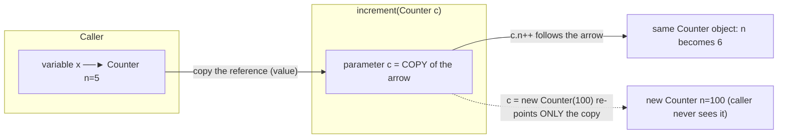
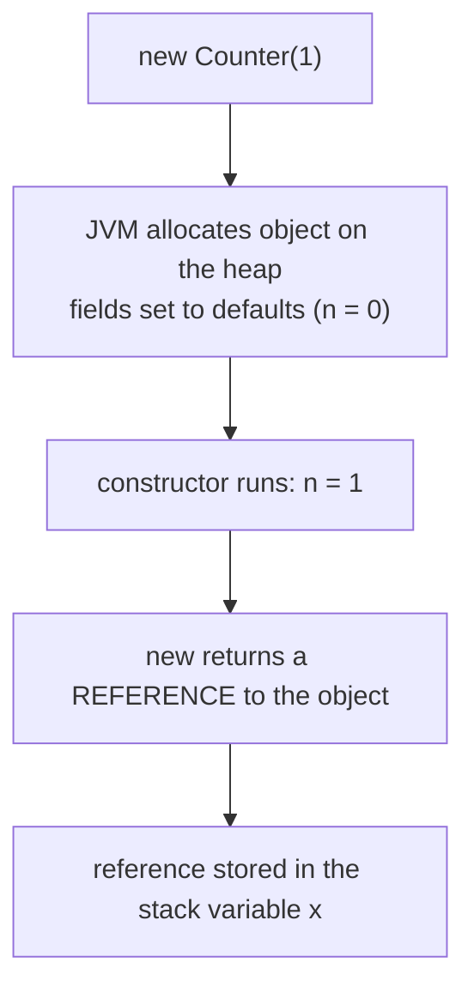
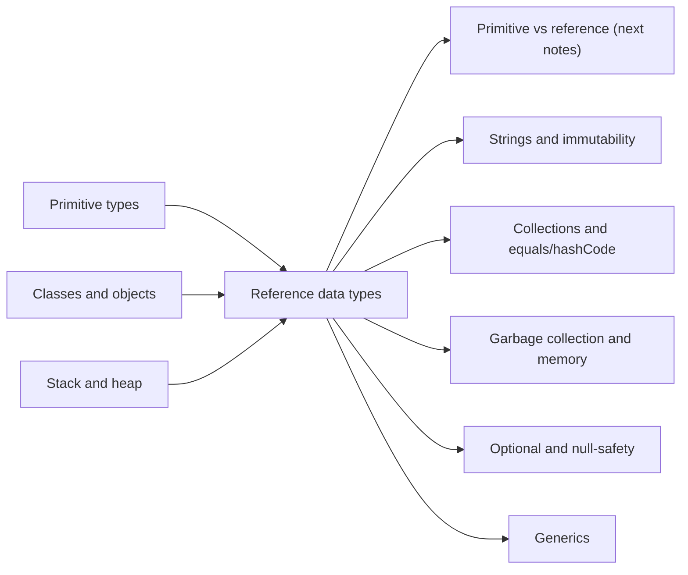

# Reference Data Types, Reference Variables and Methods in Java

**TL;DR:** Every type in Java that is not one of the 8 primitives is a **reference type**: classes (`String`, your own), interfaces, arrays, enums and records. A **reference variable** doesn't hold the object; it holds a *reference* (a handle, effectively an address) to an object on the heap, or `null` for "no object". Copying a reference makes an **alias** to the *same* object. Java is always **pass-by-value**, but for reference types the value passed is the reference, so a method can **mutate** the caller's object yet can never **re-point** the caller's variable. `==` compares references; `equals()` compares content.

## Table of Contents

1. [TL;DR](#1-tldr)
2. [Why it matters](#2-why-it-matters)
3. [Prerequisites](#3-prerequisites)
4. [Mental model](#4-mental-model)
5. [Core concepts](#5-core-concepts)
6. [How it works](#6-how-it-works)
7. [Examples](#7-examples)
8. [Comparisons](#8-comparisons)
9. [Trade-offs](#9-trade-offs)
10. [Gotchas](#10-gotchas)
11. [Practical application](#11-practical-application)
12. [Interview prep](#12-interview-prep)
13. [Interview question bank](#13-interview-question-bank)
14. [Tricky code snippets](#14-tricky-code-snippets)
15. [Connections](#15-connections)
16. [Summary](#16-summary)
17. [Answers](#answers)

---

## 1. TL;DR

- **Reference type:** any non-primitive type: class, interface, array, enum, record. Its values are references to objects (or `null`).
- **Reference variable:** a variable of a reference type. It stores a reference, not the object itself.
- **`new`:** creates an object on the heap and returns a reference to it.
- **Alias:** `b = a` copies the reference; both variables now refer to one object.
- **Pass by value, always:** methods receive a *copy of the reference*; they can change the object but not the caller's variable.

**The analogy: a TV remote and the TV.**

| Remote and TV | Java |
|---|---|
| The TV is the actual device in your living room | The **object** on the heap |
| The remote only controls a TV; it isn't the TV | The **reference variable** |
| A remote that isn't paired with any TV | A **`null`** reference |
| Two remotes paired with the same TV | Two variables, one object (**aliasing**) |
| Changing the channel with either remote affects the one TV | **Mutating** the object through either reference |
| Pairing your remote with a different TV | **Reassigning** the variable (`x = new …`); the old TV is untouched |
| Giving a friend a *duplicate remote* for your TV | **Passing a reference** to a method: they can change your channel, but re-pairing their duplicate doesn't re-pair yours |
| Pressing buttons on an unpaired remote | **`NullPointerException`** |
| A TV nobody holds a remote to is eventually thrown out | **Garbage collection** of unreachable objects |

**Running example:** a tiny `Counter` object with an `int n`. We alias it, pass it to methods that mutate it, replace it and "swap" it, and finally dereference a `null` (full program in 6.3).

---

## 2. Why it matters

**The problem.** Objects can be large and shared. If every assignment or method call copied the entire object, programs would be slow and sharing impossible. References make passing and sharing objects cheap (copy a small handle), at the cost of aliasing surprises and `null`.

**What goes wrong without a clear picture of references** (verified on Java 21):

| Code | Result | Cause |
|---|---|---|
| `Counter b = a; b.n = 5;` then read `a.n` | `5` | Alias: one object |
| `void replace(Counter c) { c = new Counter(100); }` | Caller's variable unchanged | Pass-by-value: the copy was re-pointed |
| `swap(a, b)` swapping two parameters | Nothing swaps | Only local copies are swapped |
| `String s = null; s.length()` | `NullPointerException` | Dereferencing `null` |
| `new String("hi") == "hi"` | `false` | `==` compares references, not content |
| `Integer a = 128, b = 128; a == b` | `false` (but `127` gives `true`) | Wrapper cache covers −128…127 only |
| `Integer i = null; int j = i;` | `NullPointerException` | Auto-unboxing a `null` |
| `Arrays.fill(arr, new StringBuilder())` | All slots are the **same** object | One object, many references |
| `int[][] b = a.clone();` then `b[0][0] = 99` | `a[0][0]` also changes | `clone()` is shallow |
| Mutating a `HashMap` key's fields | `get` returns `null`, entry is lost | Hash bucket no longer matches |

**Why interviewers ask.** "Is Java pass-by-value or pass-by-reference?", "what is a NullPointerException and how do you avoid it?", "`==` vs `equals`", "String pool and `new String`", "shallow vs deep copy" and "what is the Integer cache" are standard questions at every level.

---

## 3. Prerequisites

| Prerequisite | One-line refresher | Importance |
|---|---|---|
| Primitive types | The 8 built-in value types ([Primitive Data Types notes]) | Essential |
| Variables and methods | Declaring, assigning, calling, returning ([Declaring Variables and Methods notes]) | Essential |
| Classes and objects | `new`, fields, constructors ([Classes and Objects notes]) | Essential |
| Stack and heap | Locals on the stack; objects on the heap ([JVM Architecture notes]) | Essential |
| Arrays | Fixed-size indexed containers ([Arrays notes]) | Important |
| `equals` / `hashCode` | Value equality contract ([Classes and Objects notes]) | Important |

---

## 4. Mental model

> **The one picture to keep in your head:** variables are small boxes on the **stack**. A primitive box holds the value itself. A reference box holds an **arrow** to an object on the **heap** (or no arrow: `null`). Assignment copies what is *in the box*, so copying a reference copies the arrow, not the object.

```
   STACK (main's frame)                    HEAP
 ┌───────────────────┐
 │ x      ──────────────────────────►  ┌──────────────┐
 │ alias  ──────────────────────────►  │ Counter  n=5 │   ← ONE object, two arrows
 │                   │                 └──────────────┘
 │ y      ──────────────────────────►  ┌──────────────┐
 │                   │                 │ Counter n=50 │
 │ z      (null) ✗   │                 └──────────────┘
 │ count  [ 7 ]      │  ← primitive: the value is IN the box
 └───────────────────┘
```
*Reference boxes hold arrows; primitive boxes hold values. `x` and `alias` point at the same object.*

**What happens when you call a method with an object:**


*The callee's parameter is a separate arrow to the same object. Following it changes the shared object; re-pointing it affects nothing outside.*

---

## 5. Core concepts

### 5.1 Glossary

- **Reference type:** a type whose values are references to objects: classes, interfaces, arrays, enums, records (and the `null` type).
- **Reference (value):** what a reference variable stores; in practice a handle the JVM uses to find the object. Not a visible memory address.
- **Reference variable:** a variable (local, field, parameter) of a reference type.
- **Object:** a chunk of heap memory created by `new`, holding fields (and for arrays, elements).
- **`null`:** the special reference value meaning "no object".
- **Dereference:** following a reference to use the object: `x.field`, `x.method()`, `arr[i]`.
- **Alias:** another reference to the same object.
- **Pass by value:** the argument's value is copied into the parameter. For references, the *reference* is copied.
- **Mutation:** changing an object's state. **Reassignment:** changing which object a variable refers to.
- **Identity vs equality:** `==` (same object?) vs `equals()` (same content?).
- **Shallow copy:** copies the top-level object; nested objects are still shared. **Deep copy:** copies the whole object graph.
- **Reachable:** an object that can be reached through some chain of references from a live variable; unreachable objects are eligible for garbage collection.
- **Helpful NullPointerException message:** the JVM text that says exactly what was null (Java 14+, on by default from 15).
- **Wrapper class:** the reference-type counterpart of a primitive (`Integer` for `int`).
- **String pool (intern pool):** a cache of unique `String` literals.

### 5.2 Kinds of reference types

| Kind | Examples | Notes |
|---|---|---|
| Class | `String`, `Scanner`, `Counter` | Instantiated with `new` (or literals for `String`) |
| Interface | `List`, `Runnable` | Variable type only; the object is some implementing class |
| Array | `int[]`, `String[][]` | Always objects, even of primitives (Snippet 28) |
| Enum | `enum Level { LOW }` | Constants are objects |
| Record | `record P(int x)` | Immutable data class |
| Wrapper | `Integer`, `Double`, `Boolean` | Boxed primitives, can be `null` |
| Type variable | `T` in `List<T>` | Always a reference type (no `List<int>`, Snippet "primitive generics" in the next notes) |

Everything in this table is an `Object` (Snippet 28 and the earlier Inheritance notes).

### 5.3 Declaring, creating and assigning

```java
Counter c;              // declare: a box that can hold a Counter reference (no object yet)
c = new Counter(1);     // create object, store reference
Counter d = c;          // copy the reference: alias
Counter e = null;       // explicitly "no object"
```
- A **field** of reference type defaults to `null` (Snippet 1). An **array** of references starts as all `null` (Snippet 22).
- A **local** variable has no default: using it before assigning is a compile error (Snippet 2).
- `var` infers the type from the right-hand side; `var x = null;` doesn't compile (Snippet 26); `var list = new ArrayList<String>()` is still a reference to an `ArrayList` (Snippet 27).

### 5.4 `null` and `NullPointerException`

- Dereferencing `null` (calling a method, reading a field, indexing an array, `throw null`, unboxing, `synchronized(null)`) throws `NullPointerException` (Snippets 3, 4, 19).
- Safe with `null`: `==`/`!=`, `instanceof` (gives `false`), casting (`(String) null`), string concatenation (`"x" + null` is `"xnull"`), passing it as an argument (Snippets 17, 18).
- **Helpful NPE messages** name the culprit: `Cannot invoke "String.length()" because "<local1>" is null`. Local variable names show as `<local1>` unless compiled with `javac -g` (⚠️ Snippet outputs below were compiled without `-g`).
- Defences: check early with `Objects.requireNonNull(x, "msg")` (Snippet 31), return empty collections instead of `null`, use `Optional` for "may be absent" return values, call `"literal".equals(x)` (Snippet 17), and be careful with unboxing (Snippets 19, 20).
- `switch` on a `null` String throws NPE unless you use Java 21's `case null` (Snippets 34, 35).

### 5.5 Aliasing, identity and equality

- Assignment copies references: both variables see mutations (Snippet 5).
- `==` on references = "same object?". For content comparison use `equals` (Snippet 11).
- `String` literals are pooled, so identical literals are the same object; `new String("hello")` always makes a new one; `intern()` returns the pooled one (Snippet 11).
- Compile-time constant concatenations are pooled; run-time concatenations aren't (Snippet 12).
- Wrapper caches: `Integer` (and `Long`, `Short`, `Byte`, `Character`) values in −128…127 are cached by `valueOf`, so `==` appears to work for small numbers and fails for larger ones (Snippet 13). ⚠️ The upper bound of the `Integer` cache is configurable, but the default is 127.
- Default `Object.equals` is identity (Snippet 14 shows `new Object().equals(new Object())` is `false`).

### 5.6 Reference variables and methods

"Methods" in this topic means how reference variables interact with methods:

| Situation | What really happens |
|---|---|
| Calling an instance method `x.m()` | Follow the reference, run the method on that object (`this` = that object). `null` → NPE |
| Passing an object to a method | A copy of the reference is passed (pass-by-value) |
| Mutating inside the method (`c.n++`) | Visible to the caller (same object) (Snippet 10) |
| Reassigning the parameter (`c = new …`) | Invisible to the caller (Snippets 7, 8, 10) |
| "Swap" method | Cannot work; swaps only local copies (Snippet 10) |
| Immutable argument (`String`, `Integer`) | Can't be changed in place, so the caller never sees a change (Snippets 6, 9) |
| Returning a reference | Caller gets another alias; returning an internal mutable field leaks it (Snippet 16) |
| Method chaining | A method returns `this` (or a new object) so calls can be strung together (Snippet 32) |
| Arrays as arguments | Reference to the same array: element changes are shared (Snippet 8) |
| `final` parameter/variable | The *reference* can't change; the object can (Snippet 15) |

### 5.7 Copying objects

| Copy kind | How | Result |
|---|---|---|
| Alias | `b = a` | Same object |
| Shallow copy | `new ArrayList<>(a)`, `arr.clone()`, copy constructor copying references | New container, **shared** elements (Snippets 24, 25) |
| Deep copy | Copy constructor/`clone` that recursively copies nested objects, serialisation, or libraries | Fully independent |
| Immutable snapshot | `List.copyOf(a)` | Unmodifiable shallow copy |

### 5.8 Object lifetime

An object lives as long as it is reachable through some reference. When the last reference disappears (variable goes out of scope, set to `null`, or overwritten), the object becomes *eligible* for garbage collection. When it is actually collected is up to the JVM; `System.gc()` is only a hint. ⚠️ A `WeakReference` demo is non-deterministic: on one run the object was collected after a `gc()` request, but that is not guaranteed. Long-lived references (static fields, caches, listeners) are the usual cause of Java "memory leaks".

---

## 6. How it works

### 6.1 What `Counter x = new Counter(1);` does


*Two separate things get created: the object (heap) and the variable's reference to it (stack, or a field inside another object).*

### 6.2 Why Java is pass-by-value

- **By value:** the callee gets a copy of the argument's value.
- For primitives the value is the number; for reference types it is the reference.
- Evidence: if Java were pass-by-*reference*, `swap(a, b)` would swap the caller's variables, and `replace(c)` would change which object the caller sees. Neither happens (Snippet 10).
- The distinction "object passed by reference" is a common mis-statement; the accurate description is "references are passed by value".

### 6.3 Worked trace: the `Counter` program

```java
class Counter {
    int n;
    Counter(int n) { this.n = n; }
}
public class Main {
    static void increment(Counter c) { c.n++; }
    static void replace(Counter c) { c = new Counter(100); c.n++; }
    static void swap(Counter a, Counter b) { Counter t = a; a = b; b = t; }
    static Counter make(int n) { return new Counter(n); }
    public static void main(String[] args) {
        Counter x = new Counter(1);
        Counter alias = x;
        alias.n = 5;
        System.out.println(x.n + " " + (x == alias));
        increment(x);
        System.out.println(x.n);
        replace(x);
        System.out.println(x.n);
        Counter y = make(50);
        swap(x, y);
        System.out.println(x.n + " " + y.n);
        Counter z = null;
        System.out.println(z == null);
        System.out.println(z.n);
    }
}
```

Output (verified, Java 21):

```
5 true
6
6
6 50
true
Exception in thread "main" java.lang.NullPointerException: Cannot read field "n" because "<local4>" is null
```

| Step | What happens | Why |
|---|---|---|
| `Counter x = new Counter(1)` | Object (`n=1`) on heap; `x` points to it | `new` returns a reference |
| `alias = x; alias.n = 5` | One object, `n=5`; `x == alias` is `true` | Copying the arrow |
| `increment(x)` | `c` is a copy of `x`'s arrow; `c.n++` → `6` | Mutation through a shared object is visible |
| `replace(x)` | `c` re-pointed to a new `Counter(100)`, incremented to 101; caller's `x` still `n=6` | Re-pointing a copy doesn't affect `x` |
| `y = make(50)` | `make` returns a reference to a new object; `y` holds it | Returning a reference |
| `swap(x, y)` | `a` and `b` are swapped; `x` and `y` untouched (`6 50`) | Only copies swapped |
| `z == null` | `true` | `==` on references is safe with `null` |
| `z.n` | `NullPointerException` ... `"<local4>" is null` | Reading a field of nothing |

---

## 7. Examples

### 7.1 Toy example: aliases vs copies

```java
List<String> a = new ArrayList<>(List.of("x"));
List<String> b = a;
b.add("y");
System.out.println(a + " " + (a == b));
List<String> c = new ArrayList<>(a);
c.add("z");
System.out.println(a + " " + c + " " + a.equals(c));
```
Output:
```
[x, y] true
[x, y] [x, y, z] false
```
*`b` is an alias of `a`; `c` is a separate list (a shallow copy).*

### 7.2 Toy example: immutable vs mutable arguments

```java
static void change(String s) { s = s + "!"; }
static void change(StringBuilder sb) { sb.append("!"); }
// in main:
String t = "hi";     change(t);  // t is still "hi"
StringBuilder sb = new StringBuilder("hi");  change(sb);  // sb is now "hi!"
```
Verified: `String` stays `hi` (Snippet 6), the `StringBuilder` becomes `hi!` (Snippet 7). A method can only change an object if the object is mutable.

### 7.3 Real-world examples

- **Collections** (`List`, `Map`): you pass references to lists around; callers see changes (and sometimes should not, so defensive copies).
- **DTO/entity objects** shared between layers of an application: mutating one reference changes what everyone sees.
- **`Optional<T>`** and `Objects.requireNonNull`: modern ways to model and check absence.
- **Caching with `HashMap`**: keys must be effectively immutable, or entries get lost (Snippet 33).
- **Builder/fluent APIs** (`StringBuilder`, streams): each call returns a reference so you can chain (Snippet 32).
- **Callbacks and listeners:** you hand a reference to an object to some framework, which holds it (and keeps it alive) until released.

---

## 8. Comparisons

### 8.1 `==` vs `equals()` for references

| Expression | Compares | Typical use |
|---|---|---|
| `a == b` | Whether both refer to the **same object** (or both `null`) | Null checks, identity, enums |
| `a.equals(b)` | Content equality as defined by the class | Strings, wrappers, value classes |
| `Objects.equals(a, b)` | Same as `a.equals(b)` but null-safe | When either may be `null` |

Verified: `"hello" == "hello"` is `true` (pooled), `"hello" == new String("hello")` is `false`, `.equals` is `true` (Snippet 11).

### 8.2 Pass by value vs pass by reference

| | Pass by value (Java) | Pass by reference (e.g. C++ `&`) |
|---|---|---|
| Callee gets | A copy of the value (for objects: of the reference) | An alias of the caller's variable |
| Can callee mutate the object? | Yes (if mutable) | Yes |
| Can callee re-point the caller's variable? | **No** | Yes |
| `swap(a, b)` works? | No (Snippet 10) | Yes |

### 8.3 Mutating vs reassigning

| Action | Effect on the caller | Example |
|---|---|---|
| Mutate the object via the parameter | **Visible** | `c.n++`, `list.add(x)`, `arr[0] = 9` (Snippets 8, 10) |
| Reassign the parameter | **Not visible** | `c = new Counter(100)`, `arr = new int[]{7,7,7}` (Snippets 8, 10) |
| Return a new object | Visible only if the caller assigns the result | `s = changed(s)` (Snippet 6) |

### 8.4 Shallow vs deep copy

| | Shallow | Deep |
|---|---|---|
| Top-level object | New | New |
| Nested objects | **Shared** | Copied too |
| Cost | Cheap | Proportional to graph size |
| Examples | `new ArrayList<>(a)`, `int[][].clone()` (Snippets 24, 25) | Custom copy constructors, serialisation round trip |

### 8.5 `null` vs empty vs `Optional`

| Representation | Meaning | Risk |
|---|---|---|
| `null` | No object | NPE if dereferenced |
| Empty collection / `""` | An object with nothing in it | Safe to iterate |
| `Optional.empty()` | Explicit "no value" return | Don't use as a field/parameter type |

---

## 9. Trade-offs

| Decision | Benefit | Cost | Use when |
|---|---|---|---|
| Passing mutable objects | Cheap, lets callee update state | Hidden side effects | Callee is meant to mutate it; document it |
| Defensive copies | Protects invariants | Allocation | API boundaries with mutable data |
| Immutable objects | No aliasing bugs, thread-safe | New object per change | Value types, keys, shared config |
| Allowing `null` | Simple "absent" signal | NPEs, ambiguity | Rarely; prefer empty/Optional |
| `Optional` returns | Forces callers to handle absence | Extra object, not for fields/params | Query-style methods that may find nothing |
| `==` for identity | Fast | Easy to misuse on strings/wrappers | Enums, singleton checks, `null` checks |
| Shallow copy | Fast | Shared nested state | Elements are immutable |
| Long-lived static references | Convenient | Memory leaks | Caches with eviction |

---

## 10. Gotchas

### Myths

- ❌ **Myth:** "Java passes objects by reference." ✅ **Reality:** Java is always pass-by-value; for objects the value is the reference (Snippet 10).
- ❌ **Myth:** "A reference variable contains the object." ✅ **Reality:** it contains a reference; the object is on the heap.
- ❌ **Myth:** "`b = a` copies the object." ✅ **Reality:** it copies the reference (Snippet 5).
- ❌ **Myth:** "`==` compares strings' contents." ✅ **Reality:** it compares references; it only appears to work for pooled literals (Snippet 11).
- ❌ **Myth:** "`Integer a = 128, b = 128; a == b` is `true`." ✅ **Reality:** `false`; only −128…127 are cached (Snippet 13).
- ❌ **Myth:** "`final` makes the object constant." ✅ **Reality:** `final` fixes the reference (Snippet 15).
- ❌ **Myth:** "`null` is an object / `null instanceof Object` is true." ✅ **Reality:** `null` is the absence of an object; `instanceof` gives `false` (Snippet 18).
- ❌ **Myth:** "Setting a reference to `null` frees the memory immediately." ✅ **Reality:** it only makes the object eligible for collection when nothing else refers to it.
- ❌ **Myth:** "A `String` method changes the string." ✅ **Reality:** strings are immutable; methods return new strings (Snippet 6).

### Common mistakes and edge cases

- **Forgetting to initialise:** reference fields are `null`; arrays of objects are full of `null`s (Snippets 1, 22).
- **Auto-unboxing `null`:** `int j = nullInteger;` and the ternary `flag ? nullInteger : 0` both throw NPE (Snippets 19, 20).
- **Ternary type promotion:** `true ? Integer.valueOf(1) : Double.valueOf(2)` yields `1.0` (numeric promotion), but with a `String` as the other operand it yields `1` (Snippet 21).
- **`Arrays.fill` / `Collections.nCopies` with a new object:** all slots share one object (Snippet 23).
- **Shallow copies:** `int[][].clone()` shares rows; copying a list shares elements (Snippets 24, 25).
- **Returning internal mutable state:** use a copy or unmodifiable wrapper (Snippet 16).
- **Mutable `HashMap` keys:** mutating a field used in `hashCode` after insertion loses the entry (Snippet 33).
- **`println(char[])` prints characters**, but `"v=" + charArray` prints `[C@…` (Snippet 29).
- **Default `toString`:** `ClassName@hex-hash`, rarely useful (Snippet 30).
- **`NaN` and `Double` wrappers:** `NaN == NaN` is `false` but `Double.NaN.equals(NaN)` is `true`; `0.0 == -0.0` is `true` but `Double.equals` says `false` (Snippet 36).
- **`switch` on a null String:** NPE (Snippet 34).

---

## 11. Practical application

### Checklist for working with references
- [ ] Which variables can be `null`? Check or prevent it (`requireNonNull`, empty collections, `Optional`)
- [ ] Do I want to mutate or just read the argument? Document it
- [ ] Strings/wrappers compared with `equals`, never `==`
- [ ] Constructors and getters copy mutable data
- [ ] Copies are deep where nested objects are mutable
- [ ] No mutable objects as map keys / set elements
- [ ] No long-lived references that keep large objects alive

### Hands-on exercise: fix the `Playlist`

This class is meant to be a read-only playlist whose caller-supplied list can't affect it. It has three reference bugs. Predict the output (the buggy version prints `[Outro, Bonus] false`, verified), find the bugs, and fix them.

```java
import java.util.*;
class Playlist {
    private final List<String> songs;
    Playlist(List<String> songs) { this.songs = songs; }
    List<String> getSongs() { return songs; }
    boolean has(String s) { return songs.get(0) == s; }
}
public class Main {
    public static void main(String[] args) {
        List<String> mine = new ArrayList<>(List.of("Intro", "Outro"));
        Playlist p = new Playlist(mine);
        mine.add("Bonus");
        p.getSongs().remove(0);
        System.out.println(p.getSongs() + " " + p.has(new String("Outro")));
    }
}
```

<details><summary>Solution</summary>

**Bugs:**
1. The constructor stores the caller's list (aliasing): `mine.add("Bonus")` changes the playlist.
2. The getter returns the internal mutable list: `p.getSongs().remove(0)` modifies it.
3. `has` compares strings with `==` (and only checks the first song).

```java
import java.util.*;
class Playlist {
    private final List<String> songs;
    Playlist(List<String> songs) { this.songs = List.copyOf(songs); }   // snapshot in
    List<String> getSongs() { return songs; }                           // already unmodifiable
    boolean has(String s) { return songs.contains(s); }                 // equals, any position
}
public class Main {
    public static void main(String[] args) {
        List<String> mine = new ArrayList<>(List.of("Intro", "Outro"));
        Playlist p = new Playlist(mine);
        mine.add("Bonus");
        try { p.getSongs().remove(0); } catch (UnsupportedOperationException e) { System.out.println("read-only"); }
        System.out.println(p.getSongs() + " " + p.has(new String("Outro")));
    }
}
```
Output (verified):
```
read-only
[Intro, Outro] true
```
`List.copyOf` takes a snapshot on the way in and returns an unmodifiable list, so neither the caller's later `add` nor `getSongs().remove(0)` can change the playlist; `contains` uses `equals`, so the `new String("Outro")` is found.
</details>

---
## 12. Interview prep

### Likely questions with model answers

**Q1. What are reference data types in Java?**
> "Reference types are every type that isn't one of the eight primitives: classes such as `String` and user-defined classes, interfaces, arrays, enums and records. A variable of a reference type doesn't contain the object; it contains a reference to an object on the heap, or `null` if there's none. Their default value as fields is `null`, they can call methods through the dot operator, and they can be used as generic type arguments, which primitives can't."

**Q2. Is Java pass-by-value or pass-by-reference?**
> "Always pass-by-value. When I pass an object, the method receives a copy of the reference, so both the caller's variable and the parameter point to the same object. The method can therefore mutate that object and the caller sees it, but if the method assigns a new object to its parameter, only its local copy changes. That's why a `swap(a, b)` method can't swap the caller's variables. Primitives are also passed by value, where the value is the data itself."

**Q3. What is a NullPointerException and how do you avoid it?**
> "It's thrown when you dereference a `null` reference: calling a method or accessing a field on it, indexing a `null` array, or unboxing a `null` wrapper. Modern JVMs print a helpful message saying exactly what was null. To avoid it I initialise fields, validate arguments with `Objects.requireNonNull`, return empty collections or `Optional` instead of `null`, compare with `\"literal\".equals(x)` or `Objects.equals`, and watch for auto-unboxing. I wouldn't catch NPE as a control-flow tool; I'd fix its cause."

**Q4. What's the difference between `==` and `equals()` for objects?**
> "`==` compares references, so it's true only if both operands are the same object, or both `null`. `equals()` compares logical content as defined by the class; by default `Object.equals` is the same as `==`, but classes like `String`, wrappers and records override it. So `new String(\"a\") == \"a\"` is false while `.equals` is true. With `==` on strings it only works by accident for pooled literals, so I always use `equals`, or `Objects.equals` when either side may be null."

**Q5. Explain the String pool and `new String("x")`.**
> "String literals are interned in a pool, so identical literals share one object and compile-time constant expressions like `\"a\" + \"b\"` are pooled too. `new String(\"x\")` always creates a separate object on the heap, so it isn't `==` to the literal, though it is `equals`. `intern()` returns the pooled instance. Strings are immutable, which is what makes sharing them safe."

**Q6. What is the Integer cache?**
> "`Integer.valueOf`, which autoboxing uses, returns cached objects for values from -128 to 127, so two boxed values in that range are the same object and `==` is true, while outside that range each boxing creates a new object, so `==` is false even though `equals` is true. The same applies to `Long`, `Short`, `Byte` and `Character`. It's why you should compare wrappers with `equals` or unbox them."

**Q7. What's the difference between shallow and deep copy?**
> "A shallow copy duplicates the top-level object, but any objects it references are shared between original and copy. A deep copy duplicates the whole graph. For example `int[][].clone()` or `new ArrayList<>(list)` are shallow: changing an element object or an inner array through the copy changes the original. For independent copies I'd write a copy constructor that copies nested objects, or, better, use immutable objects so sharing is harmless."

**Q8. How does garbage collection relate to references?**
> "An object stays alive while it's reachable through references from live roots such as local variables on thread stacks and static fields. When no chain of references reaches it, it's eligible for collection, but when it's actually reclaimed is up to the JVM, and `System.gc()` is only a suggestion. Setting a variable to `null` helps only if it was the last reference. Most memory leaks in Java are objects kept reachable by accident, for example in a static collection or a listener list."

### What interviewers watch for
- "Pass-by-value of the reference" stated precisely, with the mutate-vs-reassign distinction.
- Correct `==` vs `equals`, string pool and Integer cache explanations.
- Practical `null` handling: `requireNonNull`, `Optional`, unboxing traps.
- Awareness of aliasing and shallow copies, and defensive copying.
- Understanding of reachability and what keeps objects alive.

---

## 13. Interview question bank

Short answers are hidden. 🟢 fresher, 🟡 intermediate, 🔴 senior/FAANG follow-up.

### 13.1 Reference types and variables

**1. 🟢 What is a reference data type? Give examples.**
<details><summary>Answer</summary>

A type whose variables hold references to objects: classes (`String`), interfaces (`List`), arrays (`int[]`), enums, records.
</details>

**2. 🟢 How many primitive types are there? What are all other types?**
<details><summary>Answer</summary>

Eight (`byte, short, int, long, float, double, char, boolean`). Everything else is a reference type.
</details>

**3. 🟢 What is a reference variable?**
<details><summary>Answer</summary>

A variable that stores a reference to an object (or `null`), not the object itself.
</details>

**4. 🟢 What is the default value of a reference field?**
<details><summary>Answer</summary>

`null` (Snippet 1). Local variables have no default (Snippet 2).
</details>

**5. 🟢 Where are objects and reference variables stored?**
<details><summary>Answer</summary>

Objects on the heap; local reference variables (the reference itself) in stack frames; reference fields inside their object on the heap.
</details>

**6. 🟡 Are arrays primitives or objects?**
<details><summary>Answer</summary>

Objects (reference types), even arrays of primitives; they have `length`, extend `Object` and have a class like `[I` (Snippet 28).
</details>

**7. 🟡 Are `String` and wrapper classes primitive types?**
<details><summary>Answer</summary>

No, they are reference types. Wrappers box primitives; strings are immutable objects with special literal syntax and a pool.
</details>

**8. 🟡 What does `var` do with reference types?**
<details><summary>Answer</summary>

Infers the variable's static type from the initialiser; it's still a reference of that type (Snippet 27). `var x = null;` is an error (Snippet 26).
</details>

**9. 🟡 What is the difference between declaring and creating an object?**
<details><summary>Answer</summary>

`Counter c;` declares a reference variable (no object yet); `new Counter()` creates the object; the assignment connects them.
</details>

**10. 🟡 Can a reference variable of an interface type exist? What does it point to?**
<details><summary>Answer</summary>

Yes; it points to an object of some implementing class (`List<String> l = new ArrayList<>()`).
</details>

**11. 🔴 Does a reference store a memory address?**
<details><summary>Answer</summary>

Conceptually a handle to the object; the JVM may use a compressed pointer and the GC can move objects, so Java exposes no address. `hashCode()` isn't the address.
</details>

**12. 🔴 How big is a reference?**
<details><summary>Answer</summary>

⚠️ JVM-dependent: commonly 4 bytes with compressed oops (heaps up to ~32 GB on 64-bit HotSpot), otherwise 8 bytes. The spec doesn't fix it.
</details>

### 13.2 null and NullPointerException

**13. 🟢 What is `null`?**
<details><summary>Answer</summary>

A special literal meaning "refers to no object"; assignable to any reference type, not to primitives (Snippet "null to int" in the next notes).
</details>

**14. 🟢 When is a NullPointerException thrown?**
<details><summary>Answer</summary>

Calling a method or reading/writing a field of `null`, indexing a `null` array, unboxing `null`, `throw null`, synchronising on `null` (Snippets 3, 4, 19).
</details>

**15. 🟡 What does `null instanceof Object` return? What does `(String) null` do?**
<details><summary>Answer</summary>

`false`; the cast succeeds and yields `null` (Snippet 18).
</details>

**16. 🟡 What does `"x" + null` give?**
<details><summary>Answer</summary>

`"xnull"` (Snippet 17).
</details>

**17. 🟡 `"a".equals(s)` vs `s.equals("a")` when `s` is null?**
<details><summary>Answer</summary>

First returns `false`; second throws NPE (Snippet 17).
</details>

**18. 🟡 Why does `int j = nullInteger;` throw NPE?**
<details><summary>Answer</summary>

Auto-unboxing calls `intValue()` on `null` (Snippet 19). The same happens in `flag ? nullInteger : 0` (Snippet 20).
</details>

**19. 🟡 What is a "helpful NullPointerException" message?**
<details><summary>Answer</summary>

JVM message (Java 14+, default from 15) such as `Cannot invoke "String.length()" because "<local1>" is null`; local names appear only if compiled with `-g` (Snippets 3, 4).
</details>

**20. 🟡 How can you avoid NPEs?**
<details><summary>Answer</summary>

Initialise fields, `Objects.requireNonNull` for arguments (Snippet 31), empty collections instead of `null`, `Optional` for optional results, null-safe `equals`, annotations/static analysis.
</details>

**21. 🟡 What does `switch` do with a `null` selector?**
<details><summary>Answer</summary>

Throws NPE (Snippet 34), unless Java 21 pattern switch declares `case null` (Snippet 35).
</details>

**22. 🔴 Is it good to use `Optional` for fields and parameters?**
<details><summary>Answer</summary>

Generally no: it's designed for return values; it isn't serialisable and adds overhead; use overloads or non-null conventions for parameters.
</details>

**23. 🔴 What does `new String[3]` contain? What happens at `names[1].length()`?**
<details><summary>Answer</summary>

Three `null`s; NPE with message `"<local1>[1]" is null` (Snippet 22).
</details>

### 13.3 Pass by value, aliasing and methods

**24. 🟢 Is Java pass-by-value or pass-by-reference?**
<details><summary>Answer</summary>

Pass-by-value always; for objects the copied value is the reference (Snippet 10).
</details>

**25. 🟢 Can a method change an object passed to it?**
<details><summary>Answer</summary>

Yes if the object is mutable (`list.add`, `c.n++`, `arr[0] = 9`) (Snippets 8, 10).
</details>

**26. 🟢 Can a method make the caller's variable point to a different object?**
<details><summary>Answer</summary>

No (Snippets 7, 8, 10). Return the new object and let the caller assign it.
</details>

**27. 🟡 Why can't you write a `swap(a, b)` method for two objects/ints?**
<details><summary>Answer</summary>

It would swap local copies only (Snippet 10). Swap fields, elements in an array/list, or return a pair.
</details>

**28. 🟡 What happens to a `String` or `Integer` argument modified inside a method?**
<details><summary>Answer</summary>

Nothing visible to the caller: they're immutable, and `s = s + "!"` just re-points the local parameter (Snippets 6, 9).
</details>

**29. 🟡 What is aliasing?**
<details><summary>Answer</summary>

Two or more references to the same object; changes through one show through the other (Snippet 5).
</details>

**30. 🟡 What does a method returning an internal list/array risk?**
<details><summary>Answer</summary>

Callers can modify the object's internals (Snippet 16). Return a copy or unmodifiable view.
</details>

**31. 🟡 What does `final` on a reference variable or parameter mean?**
<details><summary>Answer</summary>

The reference can't be reassigned; the object can still be mutated (Snippet 15).
</details>

**32. 🟡 How does method chaining work?**
<details><summary>Answer</summary>

Each method returns a reference (often `this`) so the next call applies to it (Snippet 32).
</details>

**33. 🔴 How would you write a method that returns two values?**
<details><summary>Answer</summary>

Return a small record/object, an array, or a `Map.Entry`; Java has no output parameters.
</details>

**34. 🔴 Can a method receive "the address of" an int to modify it?**
<details><summary>Answer</summary>

No; use a return value, a one-element array, or a mutable holder such as `AtomicInteger`.
</details>

### 13.4 Equality, strings and wrappers

**35. 🟢 `==` vs `equals()`?**
<details><summary>Answer</summary>

Identity vs logical equality (Snippet 11).
</details>

**36. 🟢 What is the output of `new String("a") == "a"`?**
<details><summary>Answer</summary>

`false`: a new heap object vs the pooled literal.
</details>

**37. 🟡 What does `intern()` do?**
<details><summary>Answer</summary>

Returns the canonical pooled instance equal to the string (Snippet 11: `a == d` is true).
</details>

**38. 🟡 Is `"a" + "b" == "ab"`? What if one operand is a non-final variable?**
<details><summary>Answer</summary>

True for constants; with a non-final variable the concatenation happens at run time, so `false`; with a `final` constant variable it's `true` (Snippet 12).
</details>

**39. 🟡 What is the Integer cache range?**
<details><summary>Answer</summary>

−128 to 127 by default (Snippet 13).
</details>

**40. 🟡 What does `Long.equals(Integer)` return for equal numbers?**
<details><summary>Answer</summary>

`false`: different classes (Snippet 14).
</details>

**41. 🔴 Why do `NaN == NaN` and `Double.equals` disagree?**
<details><summary>Answer</summary>

Primitive `==` follows IEEE (NaN ≠ NaN, 0.0 == −0.0); `Double.equals` compares bit patterns so NaN equals NaN and 0.0 ≠ −0.0 (Snippet 36).
</details>

**42. 🔴 What is the result of `true ? Integer.valueOf(1) : Double.valueOf(2)`?**
<details><summary>Answer</summary>

`1.0`, via binary numeric promotion; with a `String` as the other operand the result is `1` (Snippet 21).
</details>

**43. 🔴 Why can mutating a key in a `HashMap` break lookups?**
<details><summary>Answer</summary>

The entry stays in the bucket for the old hash; lookups with the new state compute a different hash, and lookups with the old state find the entry but fail `equals` (Snippet 33).
</details>

### 13.5 Copying, arrays and lifetime

**44. 🟢 Does `b = a` copy the object?**
<details><summary>Answer</summary>

No, it copies the reference (Snippet 5).
</details>

**45. 🟡 What is a shallow copy? Give two Java examples.**
<details><summary>Answer</summary>

Copies the container but shares the elements: `new ArrayList<>(list)`, `array.clone()` (Snippets 24, 25).
</details>

**46. 🟡 What happens with `Arrays.fill(arr, new StringBuilder())`?**
<details><summary>Answer</summary>

All slots reference one object (Snippet 23). Use a loop creating a new object per slot.
</details>

**47. 🟡 `Collections.nCopies(3, new ArrayList<>())`?**
<details><summary>Answer</summary>

Three references to the same list (Snippet 23).
</details>

**48. 🟡 What does `System.out.println(charArray)` print? And `"" + charArray`?**
<details><summary>Answer</summary>

Content for the `println(char[])` overload; `[C@hash` for string concatenation (Snippet 29).
</details>

**49. 🟡 What is the default `toString()`?**
<details><summary>Answer</summary>

`ClassName@hexHashCode` (Snippet 30).
</details>

**50. 🟡 When does an object become eligible for garbage collection?**
<details><summary>Answer</summary>

When it is no longer reachable from any live reference path (GC roots).
</details>

**51. 🔴 Name the four reference strengths in Java.**
<details><summary>Answer</summary>

Strong (normal), soft (cleared under memory pressure), weak (cleared at the next GC if only weakly reachable), phantom (post-finalisation notification). Used by caches and `WeakHashMap`.
</details>

**52. 🔴 Can you force garbage collection?**
<details><summary>Answer</summary>

No: `System.gc()` is a request. Behaviour depends on the JVM and flags.
</details>

**53. 🔴 What common patterns cause memory leaks despite GC?**
<details><summary>Answer</summary>

Static collections that only grow, unremoved listeners/callbacks, `ThreadLocal`s on pooled threads, caches without eviction, inner-class instances capturing their outer object.
</details>

**54. 🔴 What does `clone()` do for arrays of objects?**
<details><summary>Answer</summary>

Shallow copy: new array, same element references (Snippet 24).
</details>

---
## 14. Tricky code snippets

All compiled and run on OpenJDK 21. Predict first. Unless shown, snippets sit inside a file with `public class Main { public static void main(String[] args) { … } }`. NullPointerException messages show `<localN>` because the code was compiled without `-g`.

**Snippet 1 🟢**
```java
class H { String s; int[] arr; Object o; Integer i; }
// in main:
H h = new H();
System.out.println(h.s + " " + h.arr + " " + h.o + " " + h.i);
```
<details><summary>Answer</summary>

`null null null null`. Reference fields default to `null`, including wrapper types.
</details>

**Snippet 2 🟢**
```java
String s;
System.out.println(s);
```
<details><summary>Answer</summary>

Compile error: *variable s might not have been initialized*. Local variables have no default.
</details>

**Snippet 3 🟡**
```java
String s = null;
System.out.println(s.length());
```
<details><summary>Answer</summary>

`NullPointerException: Cannot invoke "String.length()" because "<local1>" is null`. With `javac -g` the message says `"s"`.
</details>

**Snippet 4 🟡**
```java
class Address { String city; }
class Person { Address address; }
// in main:
Person p = new Person();
System.out.println(p.address.city);
```
<details><summary>Answer</summary>

`NullPointerException: Cannot read field "city" because "<local1>.address" is null`. The message pinpoints which part of the chain was null.
</details>

**Snippet 5 🟡**
```java
List<String> a = new ArrayList<>(List.of("x"));
List<String> b = a;
b.add("y");
System.out.println(a + " " + (a == b));
List<String> c = new ArrayList<>(a);
c.add("z");
System.out.println(a + " " + c + " " + a.equals(c));
```
<details><summary>Answer</summary>

```
[x, y] true
[x, y] [x, y, z] false
```
</details>

**Snippet 6 🟡**
```java
static void change(String s) { s = s + "!"; }
static String changed(String s) { return s + "!"; }
// in main:
String t = "hi";
change(t);
System.out.println(t + " " + changed(t));
```
<details><summary>Answer</summary>

`hi hi!`. Strings are immutable; `change` only re-points its own parameter.
</details>

**Snippet 7 🟡**
```java
static void change(StringBuilder sb) { sb.append("!"); }
static void reassign(StringBuilder sb) { sb = new StringBuilder("new"); }
// in main:
StringBuilder sb = new StringBuilder("hi");
change(sb); reassign(sb);
System.out.println(sb);
```
<details><summary>Answer</summary>

`hi!`. Mutation is visible; reassignment isn't.
</details>

**Snippet 8 🟡**
```java
static void fill(int[] a) { a[0] = 9; }
static void replace(int[] a) { a = new int[]{7, 7, 7}; }
// in main:
int[] arr = {1, 2, 3};
fill(arr); replace(arr);
System.out.println(Arrays.toString(arr));
```
<details><summary>Answer</summary>

`[9, 2, 3]`.
</details>

**Snippet 9 🟡**
```java
static void inc(Integer x) { x++; }
static void inc(int x) { x++; }
// in main:
Integer a = 5; inc(a);
int b = 5; inc(b);
System.out.println(a + " " + b);
```
<details><summary>Answer</summary>

`5 5`. `x++` on an `Integer` unboxes, increments and boxes a **new** object into the local `x`; the wrapper is immutable.
</details>

**Snippet 10 🟡**
```java
class Counter { int n; Counter(int n) { this.n = n; } }
static void increment(Counter c) { c.n++; }
static void replace(Counter c) { c = new Counter(100); c.n++; }
static void swap(Counter a, Counter b) { Counter t = a; a = b; b = t; }
static Counter make(int n) { return new Counter(n); }
// in main:
Counter x = new Counter(1);
Counter alias = x;
alias.n = 5;
System.out.println(x.n + " " + (x == alias));
increment(x);
System.out.println(x.n);
replace(x);
System.out.println(x.n);
Counter y = make(50);
swap(x, y);
System.out.println(x.n + " " + y.n);
Counter z = null;
System.out.println(z == null);
System.out.println(z.n);
```
<details><summary>Answer</summary>

```
5 true
6
6
6 50
true
Exception in thread "main" java.lang.NullPointerException: Cannot read field "n" because "<local4>" is null
```
Mutation is shared; reassignment and swapping of parameters are local; `z.n` dereferences `null`.
</details>

**Snippet 11 🟡**
```java
String a = "hello";
String b = "hello";
String c = new String("hello");
String d = c.intern();
System.out.println((a == b) + " " + (a == c) + " " + a.equals(c) + " " + (a == d));
```
<details><summary>Answer</summary>

`true false true true`.
</details>

**Snippet 12 🔴**
```java
String a = "ab";
String x = "a";
final String fx = "a";
System.out.println((a == "a" + "b") + " " + (a == x + "b") + " " + (a == fx + "b"));
```
<details><summary>Answer</summary>

`true false true`. `"a" + "b"` and `fx + "b"` are constant expressions folded and pooled at compile time; `x + "b"` is built at run time into a new `String`.
</details>

**Snippet 13 🔴**
```java
Integer a = 127, b = 127, c = 128, d = 128;
System.out.println((a == b) + " " + (c == d) + " " + c.equals(d));
Long l1 = 127L, l2 = 127L;
System.out.println(l1 == l2);
```
<details><summary>Answer</summary>

```
true false true
true
```
Values −128…127 are cached; 128 isn't. `Long` has the same cache.
</details>

**Snippet 14 🔴**
```java
Long a = 1000L;
Integer b = 1000;
System.out.println(a.equals(b) + " " + a.equals(1000L) + " " + (a == 1000) + " " + new Object().equals(new Object()));
```
<details><summary>Answer</summary>

`false true true false`. `Long.equals(Integer)` is false (different classes); `a == 1000` unboxes `a` and compares numerically; default `Object.equals` is identity.
</details>

**Snippet 15 🟢**
```java
class C { int n; }
// in main:
final C c = new C();
c.n++;
System.out.println(c.n);
c = new C();
```
<details><summary>Answer</summary>

Compile error: *cannot assign a value to final variable c*. (Without the last line it prints `1`: the object can change, the reference can't.)
</details>

**Snippet 16 🟡**
```java
class Box {
    private final int[] data = {1, 2, 3};
    int[] raw() { return data; }
    int[] copy() { return data.clone(); }
    int first() { return data[0]; }
}
// in main:
Box b = new Box();
b.copy()[0] = 99;
System.out.print(b.first() + " ");
b.raw()[0] = 99;
System.out.println(b.first());
```
<details><summary>Answer</summary>

`1 99`. Changing a copy is harmless; changing the leaked internal array isn't.
</details>

**Snippet 17 🟡**
```java
String s = null;
System.out.println("a".equals(s));
System.out.println(java.util.Objects.equals(s, null));
System.out.println("x" + s);
System.out.println(s.equals("a"));
```
<details><summary>Answer</summary>

```
false
true
xnull
Exception in thread "main" java.lang.NullPointerException: Cannot invoke "String.equals(Object)" because "<local1>" is null
```
</details>

**Snippet 18 🟡**
```java
Object o = null;
String s = (String) o;
System.out.println(s + " " + (o instanceof String) + " " + (s == null));
```
<details><summary>Answer</summary>

`null false true`. Casting `null` is legal; `instanceof` is false for `null`.
</details>

**Snippet 19 🟡**
```java
Integer i = null;
int j = i;
```
<details><summary>Answer</summary>

NPE: `Cannot invoke "java.lang.Integer.intValue()" because "<local1>" is null`. Auto-unboxing dereferences the wrapper.
</details>

**Snippet 20 🔴**
```java
Integer i = null;
boolean flag = true;
int x = flag ? i : 0;
```
<details><summary>Answer</summary>

NPE (same `intValue()` message). With one `int` operand the conditional's type is `int`, so `i` is unboxed even though you only wanted "i or 0".
</details>

**Snippet 21 🔴**
```java
Object o1 = true ? Integer.valueOf(1) : Double.valueOf(2);
Object o2 = true ? Integer.valueOf(1) : "s";
System.out.println(o1 + " " + o2);
```
<details><summary>Answer</summary>

`1.0 1`. Two numeric operand types get binary numeric promotion to `double`; with a `String` operand there's no promotion.
</details>

**Snippet 22 🟢**
```java
String[] names = new String[3];
System.out.println(Arrays.toString(names));
names[0] = "a";
System.out.println(names[1].length());
```
<details><summary>Answer</summary>

```
[null, null, null]
Exception in thread "main" java.lang.NullPointerException: Cannot invoke "String.length()" because "<local1>[1]" is null
```
</details>

**Snippet 23 🔴**
```java
StringBuilder[] arr = new StringBuilder[3];
Arrays.fill(arr, new StringBuilder());
arr[0].append("x");
System.out.println(Arrays.toString(arr));
List<List<Integer>> ncopies = Collections.nCopies(3, new ArrayList<>());
ncopies.get(0).add(1);
System.out.println(ncopies);
```
<details><summary>Answer</summary>

```
[x, x, x]
[[1], [1], [1]]
```
One object, three references.
</details>

**Snippet 24 🔴**
```java
int[][] a = {{1, 2}, {3, 4}};
int[][] b = a.clone();
b[0][0] = 99;
b[1] = new int[]{7, 7};
System.out.println(Arrays.deepToString(a) + " " + Arrays.deepToString(b));
```
<details><summary>Answer</summary>

`[[99, 2], [3, 4]] [[99, 2], [7, 7]]`. The row arrays are shared; replacing a row in `b` only affects `b`.
</details>

**Snippet 25 🟡**
```java
List<StringBuilder> a = new ArrayList<>(List.of(new StringBuilder("x")));
List<StringBuilder> b = new ArrayList<>(a);
b.get(0).append("!");
b.add(new StringBuilder("y"));
System.out.println(a + " " + b);
```
<details><summary>Answer</summary>

`[x!] [x!, y]`. Shared element, separate lists.
</details>

**Snippet 26 🟡**
```java
var x = null;
```
<details><summary>Answer</summary>

Compile error: *cannot infer type for local variable x*.
</details>

**Snippet 27 🟢**
```java
var list = new ArrayList<String>();
var s = "text";
var arr = new int[]{1, 2};
System.out.println(list.getClass().getSimpleName() + " " + s.getClass().getSimpleName() + " " + arr.getClass().getSimpleName());
```
<details><summary>Answer</summary>

`ArrayList String int[]`.
</details>

**Snippet 28 🟡**
```java
int[] a = {1, 2, 3};
int[][] m = new int[2][];
Object o = a;
System.out.println(a.length + " " + a.getClass().getName() + " " + (o instanceof int[]) + " " + m[0] + " " + m.getClass().getSimpleName());
```
<details><summary>Answer</summary>

`3 [I true null int[][]`. Arrays are objects; the rows of a partially created 2D array are `null`.
</details>

**Snippet 29 🔴**
```java
char[] cs = {'h', 'i'};
System.out.println(cs);
System.out.println("" + cs.length);
System.out.println(String.valueOf(cs));
System.out.println(("v=" + cs).startsWith("v=[C@"));
```
<details><summary>Answer</summary>

```
hi
2
hi
true
```
`println(char[])` prints the characters; string concatenation uses the default `toString`, giving `[C@hash`.
</details>

**Snippet 30 🟡**
```java
class Plain { }
// in main:
Plain p = new Plain();
String s = p.toString();
System.out.println(s.startsWith("Plain@") + " " + s.equals(p.getClass().getName() + "@" + Integer.toHexString(p.hashCode())));
```
<details><summary>Answer</summary>

`true true`. Default `toString` is `getClass().getName() + "@" + hex(hashCode())`.
</details>

**Snippet 31 🟡**
```java
static void greet(String name) { Objects.requireNonNull(name, "name must not be null"); System.out.println("hi " + name); }
// in main:
greet("Asha");
try { greet(null); } catch (NullPointerException e) { System.out.println(e.getMessage()); }
Optional<String> o = Optional.ofNullable(null);
System.out.println(o.orElse("default") + " " + o.isPresent());
```
<details><summary>Answer</summary>

```
hi Asha
name must not be null
default false
```
</details>

**Snippet 32 🟢**
```java
StringBuilder sb = new StringBuilder();
sb.append("a").append(1).append('c').insert(0, "<").append(">");
System.out.println(sb + " " + sb.length());
```
<details><summary>Answer</summary>

`<a1c> 5`. Every call returns the same builder.
</details>

**Snippet 33 🔴**
```java
class Key {
    int id;
    Key(int id) { this.id = id; }
    @Override public boolean equals(Object o) { return o instanceof Key k && k.id == id; }
    @Override public int hashCode() { return id; }
}
// in main:
Map<Key, String> m = new HashMap<>();
Key k = new Key(1);
m.put(k, "v");
k.id = 2;
System.out.println(m.get(k) + " " + m.get(new Key(1)) + " " + m.containsKey(k) + " " + m.size());
```
<details><summary>Answer</summary>

`null null false 1`. The entry sits in the bucket for hash 1. Looking up with `k` (now hash 2) searches the wrong bucket; looking up `new Key(1)` finds the bucket but the stored key (now `id=2`) isn't `equals`. The entry is stranded.
</details>

**Snippet 34 🟡**
```java
String s = null;
switch (s) { case "a": System.out.println("a"); break; default: System.out.println("other"); }
```
<details><summary>Answer</summary>

NPE (`Cannot invoke "String.hashCode()" ...`). A classic string `switch` dereferences the selector.
</details>

**Snippet 35 🔴**
```java
String s = null;
String r = switch (s) { case null -> "null!"; case "a" -> "a"; default -> "other"; };
System.out.println(r);
```
<details><summary>Answer</summary>

`null!`. Java 21 allows `case null` in a switch.
</details>

**Snippet 36 🔴**
```java
double a = Double.NaN;
Double x = Double.NaN, y = Double.NaN;
System.out.println((a == a) + " " + x.equals(y) + " " + (0.0 == -0.0) + " " + Double.valueOf(0.0).equals(-0.0));
```
<details><summary>Answer</summary>

`false true true false`.
</details>

---
## 15. Connections


*Reference semantics underlie strings, collections, memory management and generics.*

- **Primitive vs reference (next notes):** side-by-side comparison, wrappers, and reference variable vs object.
- **Strings:** immutable references, pool, `equals`.
- **Collections:** store references; `equals`/`hashCode` and mutable keys (Snippet 33).
- **JVM memory and GC:** reachability, roots, generations ([JVM Architecture notes]).
- **Generics:** type arguments must be reference types; wrappers fill the gap.
- **Concurrency:** sharing mutable objects between threads needs synchronisation or immutability.

---

## 16. Summary

**One-line essence:** A reference variable holds an arrow to a heap object (or `null`); assignment and argument passing copy the arrow (pass-by-value), so objects are shared and mutable through aliases, `==` tests identity, `equals` tests content, and dereferencing `null` is the classic failure.

### 60-second revision card
- Reference types = classes, interfaces, arrays, enums, records (+ wrappers); everything but the 8 primitives.
- A reference variable stores a reference or `null`; fields default to `null`, locals have no default.
- `b = a` makes an alias; `new X(a)`/`clone()` make shallow copies; deep copies need extra work.
- Java is pass-by-value: methods can **mutate** the object but not **re-point** the caller's variable; `swap` can't work.
- `==` compares identity (use for `null`, enums); `equals` compares content (strings, wrappers).
- String literals are pooled; `new String(...)` isn't; `intern()` returns the pooled one; constant concatenation is pooled.
- `Integer` cache −128…127: `==` works there only.
- NPE: dereferencing `null` or unboxing `null`; use `requireNonNull`, empty collections, `Optional`, `"lit".equals(x)`.
- `final` reference ≠ immutable object; returning/accepting mutable internals needs defensive copies.
- Objects are collected when unreachable; static/long-lived references cause leaks.

### Cheat sheet

| Syntax | Meaning |
|---|---|
| `Counter c = new Counter(1);` | Create object, store reference |
| `Counter d = c;` | Alias |
| `Counter e = null;` | No object |
| `a == b` / `a.equals(b)` | Identity / content equality |
| `Objects.equals(a, b)` | Null-safe equality |
| `Objects.requireNonNull(x, "msg")` | Fail fast on null |
| `Optional.ofNullable(x).orElse(d)` | Default for null |
| `List.copyOf(list)` | Immutable snapshot (shallow) |
| `arr.clone()` | Shallow array copy |
| `final Counter c = …;` | Fixed reference, mutable object |
| `"lit".equals(s)` | Null-safe comparison trick |
| `str.intern()` | Pooled string |

### Self-test questions

1. 🟢 What does a reference variable contain? What does `null` mean?
2. 🟢 Is Java pass-by-value or pass-by-reference? One-sentence justification.
3. 🟡 After `replace(c)` where `replace` does `c = new Counter(100)`, what is the caller's `c`?
4. 🟡 Why is `new String("a") == "a"` false but `"a" + "b" == "ab"` true?
5. 🟡 `Integer a = 128, b = 128; a == b`? And for 127? Why?
6. 🟡 Name three situations that throw `NullPointerException`.
7. 🔴 **Spot the bug.** What is wrong with this class (two things)?
   ```java
   class Schedule {
       private final List<String> days;
       Schedule(List<String> days) { this.days = days; }
       List<String> getDays() { return days; }
   }
   ```
8. 🔴 Explain why mutating a `HashMap` key after insertion breaks lookups, and how to prevent it.

### Flashcards (Anki)

```
What does a reference variable hold? :: A reference to an object on the heap, or null — not the object
Default value of a reference field? :: null (locals have no default)
b = a for objects? :: Copies the reference — both variables point to the same object
Pass-by-value or pass-by-reference? :: Always pass-by-value; for objects the value is the reference
Can a method change the caller's object? :: Yes if mutable; it cannot re-point the caller's variable
== vs equals for objects? :: Identity vs content equality (equals must be overridden to mean content)
new String("a") == "a"? :: false — new heap object vs pooled literal
Integer cache range? :: -128 to 127 — == is true only inside it
Auto-unboxing null? :: NullPointerException
final reference means? :: Reference can't be reassigned; the object can still change
Shallow vs deep copy? :: Shallow shares nested objects; deep copies them too
Arrays.fill(arr, new X())? :: All slots reference the same X
When is an object eligible for GC? :: When no reachable reference path leads to it
Safe way to compare to a literal? :: "literal".equals(s) — no NPE when s is null
println(char[]) vs "" + charArray? :: println prints the characters; concatenation gives [C@hash
```

### Resources
- **The Java Tutorials: Primitive Data Types** and **Classes and Objects** (Oracle): https://docs.oracle.com/javase/tutorial/java/nutsandbolts/datatypes.html
- **Java Language Specification, §4.3 "Reference Types and Values"**: https://docs.oracle.com/javase/specs/jls/se21/html/jls-4.html#jls-4.3
- **JEP 358: Helpful NullPointerExceptions**: https://openjdk.org/jeps/358
- **Effective Java**, 3rd edition, by Joshua Bloch: items on avoiding unnecessary objects, defensive copies, `Optional`, and returning empty collections.

---

## Answers

<details><summary>1. Reference variable and null</summary>

A reference variable holds a reference to an object on the heap (the object lives elsewhere). `null` is the reference value meaning "no object".
</details>

<details><summary>2. Pass-by-value or reference</summary>

Pass-by-value: a method receives a copy of the argument's value, which for objects is the reference. Mutation through it is visible; reassigning the parameter isn't (Snippet 10).
</details>

<details><summary>3. Caller's c after replace</summary>

Unchanged: it still points to the original object. `replace` re-pointed its own copy of the reference to a new `Counter(100)` (Snippet 10 shows `n` staying 6).
</details>

<details><summary>4. new String vs constant concat</summary>

`new String("a")` always creates a new heap object, while the literal is the pooled one, so `==` is false. `"a" + "b"` is a compile-time constant expression folded to `"ab"` and pooled, so it's the same object as the literal `"ab"` (Snippets 11, 12).
</details>

<details><summary>5. Integer cache</summary>

`128 == 128` (boxed) is `false`; for `127` it's `true`. `Integer.valueOf` caches −128…127, so values in that range share one object and others get a new one each time (Snippet 13). Use `equals`.
</details>

<details><summary>6. Three NPE situations</summary>

Any three: calling a method on `null` (Snippet 3), reading a field of `null` (Snippet 4), indexing a `null` array, unboxing a `null` wrapper (Snippets 19, 20), `switch` on a `null` string (Snippet 34), `throw null`, `synchronized (null)`.
</details>

<details><summary>7. Spot the bug: Schedule</summary>

(1) The constructor stores the caller's list, so the caller can still mutate `days` afterwards (aliasing). (2) The getter returns the internal mutable list, so any caller can modify it. Fix: `this.days = List.copyOf(days);` and return `days` (already unmodifiable). Same pattern as the `Playlist` exercise and Snippet 16.
</details>

<details><summary>8. Mutating a HashMap key</summary>

The entry is stored in a bucket chosen by the key's hash when inserted. If a field used by `hashCode`/`equals` changes later, lookups compute a different hash (bucket) or fail `equals`, so the entry is stranded: `get` returns `null`, `containsKey` is false, but `size()` still counts it (Snippet 33). Prevent it by using immutable keys (`String`, records, `Integer`, final value classes) or never mutating fields involved in `equals`/`hashCode` after insertion.
</details>
