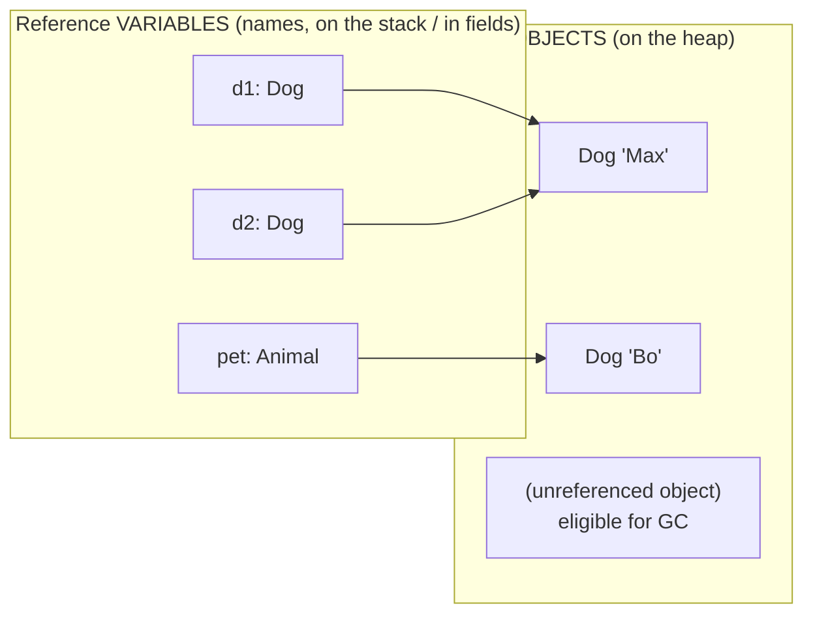
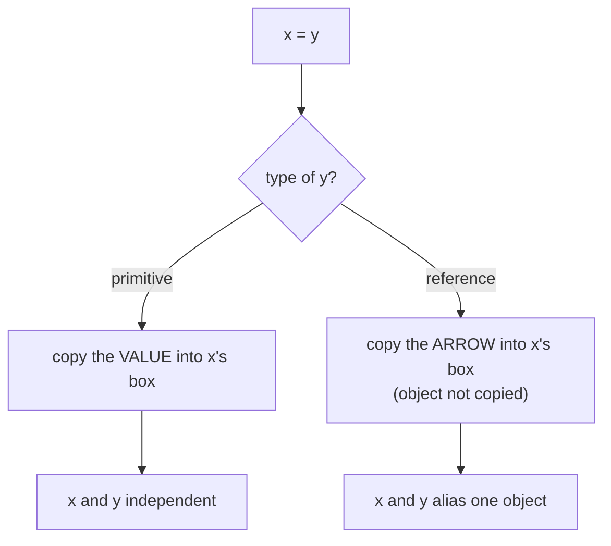
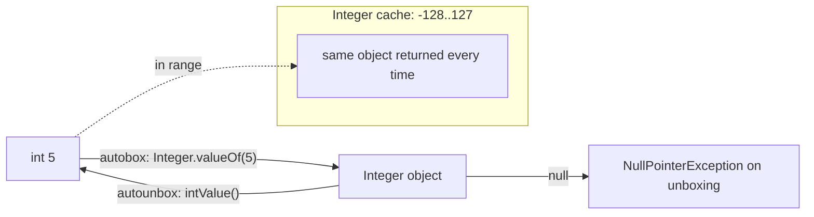
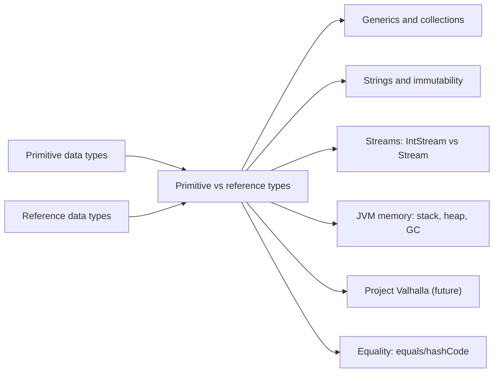

# Primitive vs Reference Types, and Reference Variable vs Object, in Java

**TL;DR:** A **primitive** variable holds the **value itself** (8 built-in types, never `null`, no methods, copied by value). A **reference** variable holds a **handle to an object** on the heap (or `null`), so copies share one object, `==` tests identity and the object has methods. A **wrapper class** (`Integer`, `Long`, …) turns a primitive into an object when you need `null`, generics or methods. Separately: the **reference variable** is the named box (it can be reassigned or `null`); the **object** is the thing on the heap (it can have many variables, or none).

> Assumption: your topic list ended mid-sentence at "Difference between reference variable…". I read it as **reference variable vs object**. If you meant something else (for example reference variable vs *instance* variable), tell me and I'll add it.

## Table of Contents

1. [TL;DR](#1-tldr)
2. [Why it matters](#2-why-it-matters)
3. [Prerequisites](#3-prerequisites)
4. [Mental model](#4-mental-model)
5. [Core concepts](#5-core-concepts)
6. [How it works](#6-how-it-works)
7. [Examples](#7-examples)
8. [Comparisons](#8-comparisons)
9. [Trade-offs](#9-trade-offs)
10. [Gotchas](#10-gotchas)
11. [Practical application](#11-practical-application)
12. [Interview prep](#12-interview-prep)
13. [Interview question bank](#13-interview-question-bank)
14. [Tricky code snippets](#14-tricky-code-snippets)
15. [Connections](#15-connections)
16. [Summary](#16-summary)
17. [Answers](#answers)

---

## 1. TL;DR

- **Primitive types (8):** `byte`, `short`, `int`, `long`, `float`, `double`, `char`, `boolean`. The variable *is* the value.
- **Reference types:** everything else (classes, interfaces, arrays, enums, records). The variable holds a reference.
- **Wrappers:** `Byte, Short, Integer, Long, Float, Double, Character, Boolean`: object versions of the primitives. **Autoboxing** converts automatically.
- **Reference variable vs object:** the variable is a labelled box that holds an arrow; the object is what the arrow points at.
- **Equality:** primitives `==` compares values; references `==` compares identity; `equals` compares content.

**The analogy: a sticky note vs a locker slip.**

| Sticky note vs slip | Java |
|---|---|
| A sticky note with "5" written on it **is** the number | A **primitive variable** holds the value itself |
| Photocopy the note: two independent notes. Scribbling on one doesn't change the other | **Copying a primitive** gives an independent copy |
| A slip that says "Locker 42" tells you where the stuff is | A **reference variable** holds a reference to the object |
| Photocopy the slip: two slips, one locker | **Copying a reference** gives an alias to the same object |
| Putting new stuff in locker 42 changes what both slips lead to | **Mutating the object** is visible through both variables |
| Crossing out "Locker 42" and writing "Locker 7" on your slip | **Reassigning** the variable; the other slip is unaffected |
| A blank slip | `null` |
| A sticky note can't be blank: it always shows some number | A primitive always has a value |
| The locker exists even if you lose all your slips (until the janitor clears it) | An object exists independently of variables; unreachable ones are garbage-collected |

**Running example:** a short program with an `int` copy, two `Dog` variables pointing at one `Dog`, a reassignment, a `null`, and a pair of `Integer`s compared with `==` and `equals` (full program in 6.3).

---

## 2. Why it matters

**The problem.** Programs need cheap, fast numeric values *and* flexible, shareable objects. Java gives you both: primitives for speed and simplicity, references for structure. Mixing them (collections hold only objects, wrappers can be `null`) creates a set of well-known traps.

**What goes wrong when the difference is misunderstood** (verified on Java 21):

| Code | Result | Cause |
|---|---|---|
| `void doubleIt(int x) { x = x * 2; }` | Caller's value unchanged | Primitives are copied |
| `void doubleAll(int[] a) { a[i] *= 2; }` | Caller's array changes | The array is an object; the reference is copied |
| `int x = null;` | Compile error | Primitives can't be `null` |
| `5.toString()` / `x.toString()` for `int x` | Compile error *int cannot be dereferenced* | Primitives have no methods |
| `List<int>` | Compile error | Generics need reference types |
| `Integer a = 1000, b = 1000; a == b` | `false` | Distinct objects, outside the cache |
| `list.remove(1)` on `List<Integer>` | Removes **index** 1, not the value 1 | Overload picks `remove(int)` |
| `Long l = 5;` | Compile error | `int` can't box to `Long` |
| `Object o = 5; (long) o` | `ClassCastException` | The object is an `Integer` |
| `Integer i = null; int j = i;` | `NullPointerException` | Unboxing `null` |

**Why interviewers ask.** "Primitive vs wrapper", "why do we need wrapper classes", "autoboxing/unboxing pitfalls", "what is the difference between a reference variable and an object", "is `String` a primitive" and "stack vs heap" are staple questions from freshers to seniors.

---

## 3. Prerequisites

| Prerequisite | One-line refresher | Importance |
|---|---|---|
| Primitive data types | The 8 types, sizes, ranges ([Primitive Data Types notes]) | Essential |
| Variables and assignment | Declare, initialise, copy ([Declaring Variables and Methods notes]) | Essential |
| Reference data types | References, `null`, aliasing, pass-by-value ([Reference Data Types notes]) | Essential |
| Classes and objects | `new` creates objects ([Classes and Objects notes]) | Essential |
| Data type conversion | Widening, narrowing, boxing ([Data Type Compatibility notes]) | Important |
| Stack and heap | Where variables and objects live ([JVM Architecture notes]) | Important |

---

## 4. Mental model

> **The one picture to keep in your head:** every variable is a box on the stack (or a field slot inside an object). A *primitive* box contains the **number**. A *reference* box contains an **arrow** to an object on the heap. Assignment always copies *the contents of the box*.

```
   STACK (variables)                         HEAP (objects)
 ┌──────────────────────┐
 │ int a      [  5  ]   │  ← value in the box
 │ int b      [  6  ]   │  ← independent copy (then incremented)
 │                      │
 │ Dog d1  ───────────────────────────►  ┌──────────────┐
 │ Dog d2  ───────────────────────────►  │ Dog "Max"    │   one object, two arrows
 │                      │                └──────────────┘
 │ Dog d3  [  null  ]   │   ← arrow to nothing
 │                      │
 │ Integer i1 ────────────────────────►  ┌──────────────┐
 │ Integer i2 ────────────────────────►  │ Integer 1000 │ ← two separate objects
 │ int    p   [ 1000 ]  │                └──────────────┘    (i1 and i2 each have their own)
 └──────────────────────┘
```
*Primitive boxes hold values; reference boxes hold arrows. An object can have several arrows, one, or none.*

**Reference variable vs object:**


*Variables are names with a declared type; objects have a real class and identity. One object may have many variables; some objects have none.*

---

## 5. Core concepts

### 5.1 Glossary

- **Primitive type:** one of 8 built-in types whose variables store the value directly.
- **Reference type:** a class, interface, array, enum or record; variables store a reference or `null`.
- **Wrapper class:** an object type corresponding to a primitive (`int` ↔ `Integer`).
- **Boxing / unboxing:** converting a primitive to its wrapper (`Integer.valueOf(5)`) / back (`intValue()`); the compiler does it automatically (**autoboxing**).
- **Reference variable:** a named variable of a reference type. **Object:** the heap instance it may refer to.
- **Declared (static) type:** the type written on the variable. **Actual (runtime) type:** the object's real class.
- **Default value:** what a field gets automatically: `0`, `0.0`, `false`, `'\u0000'` for primitives, `null` for references.
- **Identity / equality:** same object / same content.
- **Garbage collection:** automatic reclaiming of unreachable objects.
- **Immutable:** can't change after creation (wrappers, `String`).

### 5.2 The eight primitives

| Type | Size (bits) | Default | Example |
|---|---|---|---|
| `byte` | 8 | `0` | `byte b = 10;` |
| `short` | 16 | `0` | `short s = 1;` |
| `int` | 32 | `0` | `int n = 5;` |
| `long` | 64 | `0L` | `long l = 5L;` |
| `float` | 32 | `0.0f` | `float f = 1.5f;` |
| `double` | 64 | `0.0` | `double d = 2.5;` |
| `char` | 16 | `'\u0000'` | `char c = 'a';` |
| `boolean` | JVM-dependent ⚠️ | `false` | `boolean ok = true;` |

(Bit sizes verified with `Byte.SIZE`, `Short.SIZE`, … in Snippet 26: `8 16 32 64 32 64 16`. `boolean` has no `SIZE` constant; the spec doesn't fix its storage size.)

### 5.3 Wrapper classes

| Primitive | Wrapper | Notes |
|---|---|---|
| `byte` | `Byte` | Cache for all values |
| `short` | `Short` | Cache −128…127 |
| `int` | `Integer` | Cache −128…127 (default) |
| `long` | `Long` | Cache −128…127 |
| `float` | `Float` | No cache |
| `double` | `Double` | No cache |
| `char` | `Character` | Cache 0…127 |
| `boolean` | `Boolean` | `TRUE`/`FALSE` constants |

Why wrappers exist:
1. **Generics and collections** need objects: `List<Integer>` (Snippet 10 shows `List<int>` fails).
2. **`null`** to mean "no value" (Snippet 6: `Integer` field is `null`, `int` is `0`).
3. **Methods and constants**: `Integer.parseInt`, `x.compareTo(7)`, `Integer.MAX_VALUE` (Snippet 9).
4. **Reflection / APIs taking `Object`** (`Object o = 5`).

Boxing rules to remember:
- `Integer i = 5;` compiles (int → Integer). `Long l = 5;` does **not**: `int` can't box to `Long` (Snippet 16). `Double d = 5;` doesn't either (Snippet 17).
- Constant narrowing + boxing is allowed for `Byte`, `Short`, `Character` with fitting constants (Snippet 18).
- `Integer == int` unboxes and compares numerically (Snippet 11); `Integer == Integer` compares references (Snippet in the previous notes).
- Wrapper `equals` requires the same wrapper class: `Long.equals(Integer)` is false (Snippet 12).
- Wrappers are immutable: `a++` creates a new object for `a` (Snippet 13).
- Arithmetic on wrappers unboxes, computes and (if assigned) re-boxes. A `null` wrapper throws NPE on unboxing.

### 5.4 Key differences at a glance

| Aspect | Primitive | Reference |
|---|---|---|
| Holds | The value | A reference to an object (or `null`) |
| Types | 8 fixed | Unlimited (classes, interfaces, arrays, …) |
| Default (field/array element) | `0`/`false`/`'\u0000'` (Snippet 5) | `null` (Snippet 5) |
| Can be `null`? | No (Snippet 7) | Yes |
| Has methods/fields? | No (Snippet 8) | Yes |
| Can be a generic argument? | No (Snippet 10) | Yes |
| Copy by `=` | Independent copy (Snippet 1) | Alias to same object (Snippet 2) |
| `==` compares | Values | Identities |
| Passed to methods | Copy of the value; callee can't change caller's | Copy of the reference; callee can mutate the object |
| Memory | Inline in the variable/field/array | Reference + separate object (header + fields) |
| Created by | Literal/assignment | `new` (or literal for `String`, factory) |
| Mutability | A variable can be reassigned | Object may be mutable or immutable |

### 5.5 Reference variable vs object

| Aspect | Reference variable | Object |
|---|---|---|
| What it is | A named storage slot holding a reference | An instance of a class created at run time |
| Where | Stack (locals/params) or inside another object (fields) | Heap |
| Created by | Declaration: `Dog d;` | `new Dog()` |
| Has a name? | Yes | No (only reachable through references) |
| Type | Declared type (what the compiler checks) | Actual class (what the JVM runs) |
| Can change? | Reassigned to another object or `null` | Its **fields** change (if mutable); its identity never does |
| Count | One variable can hold one reference at a time | Many variables can refer to one object |
| Lifetime | Until its scope ends | Until unreachable and collected |
| `final` means | The variable can't be reassigned | (Nothing: `final` applies to variables/fields) |

Relationships (all verified):
- **Many variables, one object:** `Dog d2 = d1;` (Snippet 2).
- **One variable, many objects over time:** reassigning in a loop (Snippet 3).
- **Object with no variable:** `new StringBuilder("temp").reverse()` creates a temporary object used once (Snippet 4).
- **Variable with no object:** `Dog d = null;`.
- **Declared vs actual type:** `CharSequence cs = new StringBuilder("abc");` compiles calls only to `CharSequence` methods (Snippets 23, 24); `cs.getClass()` is still `StringBuilder`.

---

## 6. How it works

### 6.1 What assignment does


*Same syntax, different meaning, because of what's inside the box.*

### 6.2 Boxing, unboxing and the cache


*`Integer.valueOf` returns cached objects in a small range and new objects otherwise. That's why `==` on wrappers is unreliable.*

### 6.3 Worked trace

```java
class Dog { String name; Dog(String name) { this.name = name; } }
public class Main {
    public static void main(String[] args) {
        int a = 5; int b = a; b++;
        System.out.println(a + " " + b);
        Dog d1 = new Dog("Rex");
        Dog d2 = d1;
        d2.name = "Max";
        System.out.println(d1.name + " " + (d1 == d2));
        d1 = new Dog("Bo");
        System.out.println(d1.name + " " + d2.name + " " + (d1 == d2));
        d2 = null;
        System.out.println(d1.name + " " + d2);
        Integer i1 = 1000, i2 = 1000; int p = 1000;
        System.out.println((i1 == i2) + " " + (i1 == p) + " " + i1.equals(i2));
    }
}
```

Output (verified, Java 21):

```
5 6
Max true
Bo Max false
Bo null
false true true
```

| Step | What happens | Why |
|---|---|---|
| `int b = a; b++;` | `a` stays 5, `b` becomes 6 | Primitive copy is independent |
| `Dog d2 = d1;` | Both variables point at one `Dog("Rex")` | Reference copy = alias |
| `d2.name = "Max"` | The one object now says `Max`, seen through `d1` too; `d1 == d2` is `true` | Mutating the shared object |
| `d1 = new Dog("Bo")` | `d1` re-pointed to a new object; `d2` still points at the `Max` dog; `d1 == d2` is `false` | **Variable** changed, the old **object** untouched |
| `d2 = null` | `d2` points at nothing; the `Max` dog now has no variable and is eligible for GC | Variable without object / object without variable |
| `i1 == i2` | `false`: two separate `Integer` objects (1000 is outside the cache) | Reference comparison |
| `i1 == p` | `true`: `i1` is unboxed to compare with an `int` | Mixed primitive/wrapper `==` is numeric |
| `i1.equals(i2)` | `true` | Content equality |

---

## 7. Examples

### 7.1 Toy example: primitive vs array parameter

```java
static void doubleIt(int x) { x = x * 2; }
static void doubleAll(int[] a) { for (int i = 0; i < a.length; i++) a[i] *= 2; }
// in main:
int n = 5; int[] arr = {1, 2, 3};
doubleIt(n); doubleAll(arr);
// n is still 5; arr is now [2, 4, 6]   (see the exercise for the verified output)
```
*Same call syntax: the int is copied, the array's reference is copied.*

### 7.2 Toy example: default values

```java
int[] a = new int[3];
Integer[] b = new Integer[3];
boolean[] c = new boolean[2];
System.out.println(Arrays.toString(a) + " " + Arrays.toString(b) + " " + Arrays.toString(c));
```
Output:
```
[0, 0, 0] [null, null, null] [false, false]
```
*Primitive arrays start with zeros; arrays of wrappers or objects start with `null`s.*

### 7.3 Real-world examples

- **Database/JSON mapping:** a nullable column maps to `Integer`/`Long`, not `int`/`long`, because "no value" must be representable.
- **Collections:** `List<Integer>`, `Map<String, Double>` store wrapper objects; for large numeric data use primitive arrays or specialised streams (`IntStream`) to avoid boxing overhead. ⚠️ Performance differences depend on the JVM and workload; measure before optimising.
- **Counters and flags:** local `int`/`boolean` for speed.
- **API parameters:** `Optional<T>`/wrapper types for optional values; primitives for required ones.
- **`List.remove`**: the primitive/wrapper overload trap (Snippet 14).

---

## 8. Comparisons

### 8.1 Primitive vs wrapper (`int` vs `Integer`)

| Aspect | `int` | `Integer` |
|---|---|---|
| Kind | Primitive | Reference (immutable object) |
| Can be `null` | No | Yes |
| Default as a field | `0` | `null` (Snippet 6) |
| In collections/generics | No | Yes |
| Methods | None | Many (`compareTo`, `toString`, …) |
| `==` | Value | Identity (cache −128…127), but `Integer == int` is numeric (Snippet 11) |
| Memory/speed | Compact, fast | Object overhead, possible boxing cost |
| Arithmetic | Direct | Unbox → compute → (re)box |

### 8.2 `==` and `equals` across kinds

| Left | Right | `==` | `.equals` |
|---|---|---|---|
| `int` | `int` | numeric | n/a |
| `int` | `long` | numeric (widening) (Snippet 12) | n/a |
| `Integer` | `int` | numeric (unbox) (Snippet 11) | `i.equals(x)` boxes `x` |
| `Integer` | `Integer` | identity | content |
| `Long` | `Integer` | compile error *incomparable types: Long and Integer* | **false** always (Snippet 12) |
| `int[]` | `int[]` | identity | identity (use `Arrays.equals`, Snippet 25) |

### 8.3 Stack vs heap (simplified)

| | Stack | Heap |
|---|---|---|
| Holds | Local variables (primitive values and references), call frames | Objects (including arrays), their fields |
| Lifetime | Until the method returns | Until unreachable and collected |
| Speed | Very fast to allocate/free | Slower, managed by GC |
| Access | Thread-private | Shared by threads |
| Note | ⚠️ JIT escape analysis may place some objects on the stack; the model above is a conceptual one | |

### 8.4 Declared type vs actual type

| | Declared (static) type | Actual (runtime) type |
|---|---|---|
| Decided | Compile time, by the variable declaration | Run time, by `new` |
| Controls | Which members the compiler lets you use (Snippets 23, 24) | Which overridden method runs; `getClass()` |
| Example | `CharSequence cs` | `StringBuilder` |

### 8.5 Final primitive vs final reference

| | `final int a = 1;` | `final int[] arr = {1, 2};` |
|---|---|---|
| Reassign | ❌ (Snippet 20) | ❌ |
| Change content | n/a | ✅ `arr[0] = 9` (Snippet 20) |

---

## 9. Trade-offs

| Decision | Benefit | Cost | Use when |
|---|---|---|---|
| Use primitives | Fast, compact, no `null` bugs | Can't be generic args or `null` | Local calculations, loops, required values |
| Use wrappers | `null`, generics, methods | Boxing overhead, NPE risk, `==` traps | Collections, optional values, APIs |
| Primitive arrays vs `List<Integer>` | Much less memory/overhead | Fixed size, fewer utilities | Large numeric datasets |
| `int` instead of `Integer` fields in entities | No accidental `null` | Can't represent "unknown" | Value is always present |
| Mutable objects | Efficient in-place updates | Aliasing surprises | Local scope, builders |
| Immutable objects | Safe sharing | Allocation per change | Values, keys, shared state |
| Wide types (`long`, `double`) | Range/precision | More memory | When ranges need it |
| `BigInteger`/`BigDecimal` (reference types) | No overflow, exact decimals | Slower, verbose | Money, huge numbers (Snippet 21) |

---

## 10. Gotchas

### Myths

- ❌ **Myth:** "`String` is a primitive." ✅ **Reality:** a reference type (an immutable class with literal syntax).
- ❌ **Myth:** "Primitives are stored on the stack and objects on the heap, always." ✅ **Reality:** a primitive *field* lives inside its object on the heap; a primitive array's elements live in the array object.
- ❌ **Myth:** "`Integer` and `int` are interchangeable." ✅ **Reality:** `null`, `==` identity, and overload resolution (`remove(int)` vs `remove(Object)`) differ.
- ❌ **Myth:** "Wrappers are mutable like regular objects." ✅ **Reality:** immutable; `a++` re-boxes (Snippet 13).
- ❌ **Myth:** "Java passes primitives by value and objects by reference." ✅ **Reality:** both by value; for objects the value is the reference.
- ❌ **Myth:** "A reference variable is the object." ✅ **Reality:** the variable is a separate thing that points at an object.
- ❌ **Myth:** "Assigning `null` deletes the object." ✅ **Reality:** it only removes one reference; the object lives while other references exist.
- ❌ **Myth:** "`0.1 + 0.2 == 0.3`." ✅ **Reality:** `false` (Snippet 21); use a tolerance or `BigDecimal`.

### Common mistakes and edge cases

- **`List<Integer>.remove(int)` vs `remove(Object)`** (Snippet 14).
- **Mixing wrappers with `==`** (Snippets 11, 12; plus the cache note).
- **Assigning an `int` literal to `Long`/`Double`** (Snippets 16, 17).
- **Casting `Object` to the wrong numeric type** (`(long) o` when `o` holds an `Integer`) → `ClassCastException` (Snippet 15).
- **Unboxing `null`** in arithmetic or ternaries (see previous notes).
- **`short`/`byte` arithmetic promotes to `int`:** `s = s + 1` fails (Snippet 19).
- **Overflow is silent for `int`:** `Integer.MAX_VALUE + 1` wraps to `−2147483648`; `BigInteger` doesn't (Snippet 21).
- **Autoboxing in loops:** `Long sum` works but allocates (Snippet 22). Use `long` for hot loops. ⚠️ Cost varies.
- **Array `equals`:** `a.equals(b)` is identity; use `Arrays.equals` (Snippet 25).
- **Using the declared type's limits:** `Object o = "text"; o.length()` doesn't compile (Snippet 23).

---

## 11. Practical application

### Choosing between primitive and reference
- [ ] Always has a value, used in math/loops → primitive
- [ ] May be absent (database column, optional input) → wrapper or `Optional`
- [ ] Goes into a collection or generic → wrapper
- [ ] Compared → primitives with `==`, wrappers and objects with `equals`
- [ ] Parameter needs to be changed by the callee → use an object/array holder or return the result
- [ ] Large numeric data → primitive arrays

### Hands-on exercise: "why didn't my method change it?"

A student expects every method below to change the caller's data. Predict the output, explain each surprise, and fix the code so that the caller sees `10 10 [2, 4, 6] [0, 0, 0]`.

```java
import java.util.*;
public class Main {
    static void doubleIt(int x) { x = x * 2; }
    static void doubleBox(Integer x) { x = x * 2; }
    static void doubleAll(int[] a) { for (int i = 0; i < a.length; i++) a[i] *= 2; }
    static void resetAll(int[] a) { a = new int[a.length]; }
    public static void main(String[] args) {
        int n = 5; Integer boxed = 5; int[] arr = {1, 2, 3}; int[] arr2 = {1, 2, 3};
        doubleIt(n); doubleBox(boxed); doubleAll(arr); resetAll(arr2);
        System.out.println(n + " " + boxed + " " + Arrays.toString(arr) + " " + Arrays.toString(arr2));
    }
}
```

<details><summary>Solution</summary>

Buggy output (verified): `5 5 [2, 4, 6] [1, 2, 3]`.

- `doubleIt`: the `int` is copied; the method doubles its own copy.
- `doubleBox`: `Integer` is an immutable object; `x = x * 2` unboxes, multiplies, boxes a new `Integer` and re-points the local `x`. The caller's reference is untouched.
- `doubleAll`: works. The parameter is a copy of the array reference, so `a[i] *= 2` mutates the caller's array.
- `resetAll`: `a = new int[...]` re-points the local copy of the reference; the caller's array is unchanged.

Fixed version: return new values for primitives and wrappers, and mutate in place (not reassign) for arrays.

```java
import java.util.*;
public class Main {
    static int doubleIt(int x) { return x * 2; }
    static Integer doubleBox(Integer x) { return x * 2; }
    static void doubleAll(int[] a) { for (int i = 0; i < a.length; i++) a[i] *= 2; }
    static void resetAll(int[] a) { Arrays.fill(a, 0); }
    public static void main(String[] args) {
        int n = 5; Integer boxed = 5; int[] arr = {1, 2, 3}; int[] arr2 = {1, 2, 3};
        n = doubleIt(n); boxed = doubleBox(boxed); doubleAll(arr); resetAll(arr2);
        System.out.println(n + " " + boxed + " " + Arrays.toString(arr) + " " + Arrays.toString(arr2));
    }
}
```
Output (verified): `10 10 [2, 4, 6] [0, 0, 0]`.
</details>

---
## 12. Interview prep

### Likely questions with model answers

**Q1. What's the difference between primitive and reference data types?**
> "A primitive variable stores the actual value, and there are exactly eight: `byte`, `short`, `int`, `long`, `float`, `double`, `char`, `boolean`. They can't be `null`, have no methods, and default to zero or false. A reference variable stores a reference to an object on the heap, or `null`; the types are classes, interfaces, arrays, enums and records, and objects have methods and fields. Copying a primitive gives an independent copy; copying a reference gives another variable pointing at the same object. `==` compares values for primitives and identity for references, so for objects I use `equals`."

**Q2. Why do we need wrapper classes?**
> "Because some places need objects: generics and collections can't hold primitives, so `List<Integer>` not `List<int>`; wrappers can be `null` to represent a missing value; and they bring utility methods and constants such as `Integer.parseInt` and `Integer.MAX_VALUE`. Autoboxing converts between primitive and wrapper automatically, but wrappers are immutable, can throw a `NullPointerException` when unboxed, and have the Integer cache gotcha with `==`."

**Q3. What are autoboxing and unboxing? What can go wrong?**
> "Autoboxing is the compiler's automatic conversion of a primitive to its wrapper, via `Integer.valueOf`, and unboxing is the reverse via `intValue()`. Pitfalls: unboxing `null` throws an NPE, including in a ternary like `flag ? nullInteger : 0`; `==` on two wrappers compares references and only works inside the −128 to 127 cache; `Long l = 5` doesn't compile because `int` doesn't box to `Long`; `list.remove(1)` on `List<Integer>` removes by index, not by value; and boxing in tight loops creates garbage."

**Q4. What's the difference between a reference variable and an object?**
> "The object is the instance on the heap, created by `new`; it has a real class, state and identity. The reference variable is a separate named slot, on the stack or inside another object, that holds a reference to an object or `null`. One object can have many variables, as in `Dog d2 = d1;`; one variable can point to different objects over time; an object can end up with no variables, and then it's eligible for garbage collection; and a variable can be `null` with no object at all. The variable also has a declared type that the compiler checks, while the object has the actual type that determines which overridden method runs."

**Q5. Where are primitives and objects stored?**
> "Local primitives and local references live in the method's stack frame. Objects, including arrays, live on the heap, and their fields, whether primitive or reference, live inside that heap object. So the common rule 'primitives on the stack, objects on the heap' is only true for locals. Strictly, that's the conceptual model: the JIT can optimise, for instance by scalar-replacing short-lived objects, so the exact placement isn't guaranteed."

**Q6. Is `String` a primitive?**
> "No. It's a reference type, an immutable class in `java.lang`, though it has literal syntax, the `+` operator and a string pool, which is why it feels primitive-like. The primitive types are the eight listed in the language spec."

**Q7. What happens when you pass a primitive and an object to a method?**
> "Both are passed by value. For a primitive the value is copied, so the callee can't change the caller's variable. For an object the reference is copied, so the callee can mutate the same object, for example `list.add` or `arr[0] = 9`, and the caller sees it, but if it reassigns its parameter to a new object, the caller's variable is unaffected. Immutable objects such as `String` or `Integer` can't be changed in place, so the caller never sees a change."

**Q8. Compare `==` and `equals` across `int`, `Integer` and `Long`.**
> "For two `int`s, `==` compares values. For an `Integer` and an `int`, `==` unboxes and compares numerically. For two `Integer` objects, `==` compares references, which looks right only inside the cache range of −128 to 127, so I use `equals`. `Integer.equals(Long)` is false because wrapper `equals` requires the same class, and comparing `Long == Integer` doesn't even compile. For arrays, both `==` and `equals` are identity, so I use `Arrays.equals`."

### What interviewers watch for
- Clear contrast of value vs reference semantics, with copy and pass-to-method consequences.
- Wrapper pitfalls: cache, unboxing NPE, `remove` overload, `Long l = 5`.
- Precise stack/heap claims (locals vs fields), not just the slogan.
- Distinguishing the variable, the declared type, the object and the actual type.
- Knowing when each is the right design choice (primitives for required numeric values, wrappers for optional ones).

---

## 13. Interview question bank

Short answers are hidden. 🟢 fresher, 🟡 intermediate, 🔴 senior/FAANG follow-up.

### 13.1 Primitive vs reference basics

**1. 🟢 How many primitive types are there? Name them.**
<details><summary>Answer</summary>

Eight: `byte`, `short`, `int`, `long`, `float`, `double`, `char`, `boolean`.
</details>

**2. 🟢 What are reference types?**
<details><summary>Answer</summary>

Classes, interfaces, arrays, enums, records (and annotations); variables hold references to objects.
</details>

**3. 🟢 What's the default value of primitives and references?**
<details><summary>Answer</summary>

Primitives: `0`, `0.0`, `false`, `'\u0000'`; references: `null` (Snippets 5, 6).
</details>

**4. 🟢 Can a primitive be `null`?**
<details><summary>Answer</summary>

No (Snippet 7).
</details>

**5. 🟢 Do primitives have methods?**
<details><summary>Answer</summary>

No: `x.toString()` on an `int` is a compile error (Snippet 8). Use wrappers or static helpers (`Integer.toString(x)`).
</details>

**6. 🟢 What is the size of each primitive?**
<details><summary>Answer</summary>

`byte` 8 bits, `short` 16, `int` 32, `long` 64, `float` 32, `double` 64, `char` 16 (Snippet 26); `boolean` isn't precisely specified.
</details>

**7. 🟢 Is `String` primitive? Is an array primitive?**
<details><summary>Answer</summary>

Neither: both are reference types (objects).
</details>

**8. 🟡 What happens when you assign one primitive to another vs one reference to another?**
<details><summary>Answer</summary>

Primitive: independent value copy (Snippet 1). Reference: both refer to one object (Snippet 2).
</details>

**9. 🟡 What does `==` do for primitives vs references?**
<details><summary>Answer</summary>

Values vs identity. Mixed `Integer == int` unboxes and compares values (Snippet 11).
</details>

**10. 🟡 Where are primitives stored?**
<details><summary>Answer</summary>

Locals in stack frames; fields inside the owning object on the heap; array elements inside the array object.
</details>

**11. 🟡 Which is faster, `int` or `Integer`? Why?**
<details><summary>Answer</summary>

`int`: no object allocation, no indirection, no unboxing. ⚠️ The JIT removes some of the gap; measure real workloads.
</details>

**12. 🔴 Why does Java keep primitives instead of making everything an object?**
<details><summary>Answer</summary>

Performance and memory: contiguous numeric arrays, no object headers or GC pressure. Valhalla (value classes) is the long-term effort to reduce this split. ⚠️ Not yet in standard Java 21.
</details>

### 13.2 Wrappers and boxing

**13. 🟢 What is a wrapper class? List them.**
<details><summary>Answer</summary>

Object version of a primitive: `Byte, Short, Integer, Long, Float, Double, Character, Boolean`.
</details>

**14. 🟢 What is autoboxing/unboxing?**
<details><summary>Answer</summary>

Automatic conversion primitive ↔ wrapper by the compiler (Snippet 13).
</details>

**15. 🟢 Why do generics not support primitives?**
<details><summary>Answer</summary>

Type arguments must be reference types (erasure to `Object`); use wrappers (Snippet 10).
</details>

**16. 🟡 Are wrapper objects mutable?**
<details><summary>Answer</summary>

No: `a++` creates a new `Integer` and rebinds the variable (Snippet 13).
</details>

**17. 🟡 What does `Integer a = 1000, b = 1000; a == b` give? And for 100?**
<details><summary>Answer</summary>

`false` for 1000, `true` for 100 (cache −128…127). `a.equals(b)` is always true. See the running example (6.3).
</details>

**18. 🟡 What happens with `Long l = 5;`? And `Long l = 5L;`?**
<details><summary>Answer</summary>

First: compile error *int cannot be converted to Long* (Snippet 16). Second is fine. Same for `Double d = 5;` (Snippet 17).
</details>

**19. 🟡 Does `Byte b = 10; Character c = 65;` compile?**
<details><summary>Answer</summary>

Yes, constants that fit are allowed (Snippet 18).
</details>

**20. 🟡 Does `Long.equals(Integer)` work?**
<details><summary>Answer</summary>

Returns `false` (Snippet 12); `Long == Integer` doesn't compile.
</details>

**21. 🟡 What does `list.remove(1)` do on a `List<Integer>`?**
<details><summary>Answer</summary>

Removes the element at **index** 1; use `remove(Integer.valueOf(1))` for the value (Snippet 14).
</details>

**22. 🟡 What exception can unboxing throw?**
<details><summary>Answer</summary>

`NullPointerException` when the wrapper is `null`.
</details>

**23. 🔴 Why does `Object o = 5; long l = (long) o;` fail?**
<details><summary>Answer</summary>

`o` refers to an `Integer`; a cast to `long` unboxes via `Long`, so it throws `ClassCastException` (Snippet 15). `(int) o` works.
</details>

**24. 🔴 What are the cached ranges of wrapper types?**
<details><summary>Answer</summary>

`Byte` all, `Short`/`Integer`/`Long` −128…127, `Character` 0…127, `Boolean` two constants, `Float`/`Double` none. ⚠️ The `Integer` high bound can be changed by a JVM flag.
</details>

**25. 🔴 Do wrapper `valueOf` and `new` differ?**
<details><summary>Answer</summary>

`valueOf` may return cached instances; `new Integer(5)` always creates a new object but is deprecated for removal. Prefer `valueOf` or autoboxing.
</details>

**26. 🔴 What are the performance risks of boxing?**
<details><summary>Answer</summary>

Allocation and GC in hot loops (Snippet 22 shows a boxed sum), cache misses from pointer chasing, hidden `valueOf` calls. Use primitive streams/arrays for heavy numeric work.
</details>

### 13.3 Reference variable vs object

**27. 🟢 What's the difference between a reference variable and an object?**
<details><summary>Answer</summary>

Variable: named slot holding a reference. Object: the heap instance. Many variables can refer to one object.
</details>

**28. 🟢 What does `Dog d;` do? What does `new Dog()` do?**
<details><summary>Answer</summary>

First declares a reference variable (no object); the second creates an object and returns its reference.
</details>

**29. 🟡 After `Dog a = new Dog("Rex"); Dog b = a; a = new Dog("Bo");`, what does `b` refer to?**
<details><summary>Answer</summary>

The original "Rex" dog; reassigning `a` doesn't affect `b` (running example 6.3, Snippet 2).
</details>

**30. 🟡 Can an object exist without a reference variable?**
<details><summary>Answer</summary>

Yes briefly: temporary objects (`new StringBuilder("x").reverse()`, Snippet 4); once nothing refers to it, it's eligible for GC.
</details>

**31. 🟡 Can a variable exist without an object?**
<details><summary>Answer</summary>

Yes: it holds `null` (or isn't yet assigned, for locals).
</details>

**32. 🟡 How many objects are created by `Dog d1 = new Dog("a"); Dog d2 = d1;`?**
<details><summary>Answer</summary>

One object, two reference variables.
</details>

**33. 🟡 What is the difference between declared type and actual type?**
<details><summary>Answer</summary>

Declared type = type of the variable (compile-time checks); actual type = the object's class (run-time behaviour). `CharSequence cs = new StringBuilder()`: only `CharSequence` methods compile (Snippets 23, 24).
</details>

**34. 🟡 What does `final` on a reference variable do?**
<details><summary>Answer</summary>

Prevents reassigning the variable; the object can still change (Snippet 20).
</details>

**35. 🟡 What is the effect of setting a reference to `null`?**
<details><summary>Answer</summary>

Removes that reference only. The object is collectable once it's unreachable.
</details>

**36. 🔴 What does `==` compare on two reference variables? What do they "contain"?**
<details><summary>Answer</summary>

Whether both refer to the same object. They contain references (handles), not addresses visible to programs.
</details>

**37. 🔴 Can two different objects have the same reference?**
<details><summary>Answer</summary>

No: a reference identifies exactly one object (identity). Different objects can be `equals`.
</details>

**38. 🔴 How do you detect if two variables alias the same object?**
<details><summary>Answer</summary>

`a == b`. Not `equals` (content) or `hashCode()` (can collide).
</details>

### 13.4 Methods, copying and equality

**39. 🟢 Does a method that changes an `int` parameter affect the caller?**
<details><summary>Answer</summary>

No: the `int` is copied (exercise in 11).
</details>

**40. 🟢 Does a method that changes elements of an `int[]` parameter affect the caller?**
<details><summary>Answer</summary>

Yes: same array object. Reassigning the parameter doesn't.
</details>

**41. 🟡 Why can't `Integer` arguments be modified by a method?**
<details><summary>Answer</summary>

Immutable, and the method only re-points its local copy (exercise).
</details>

**42. 🟡 How do you "return" two values from a method?**
<details><summary>Answer</summary>

Return a record/object/array, since primitives can't be passed by reference.
</details>

**43. 🟡 `0.1 + 0.2 == 0.3`?**
<details><summary>Answer</summary>

`false` (result `0.30000000000000004`); compare with a tolerance or use `BigDecimal` (Snippet 21).
</details>

**44. 🟡 What does `Integer.MAX_VALUE + 1` give? How to avoid?**
<details><summary>Answer</summary>

`-2147483648` (silent overflow); use `Math.addExact`, `long`, or `BigInteger` (Snippet 21).
</details>

**45. 🟡 `short s = 1; s = s + 1;`?**
<details><summary>Answer</summary>

Compile error: lossy conversion from `int` to `short`; `s += 1` compiles (implicit cast) (Snippet 19).
</details>

**46. 🟡 Does `a.equals(b)` work for arrays?**
<details><summary>Answer</summary>

It's identity; use `Arrays.equals` / `Arrays.deepEquals` (Snippet 25).
</details>

**47. 🔴 `Long sum = 0L; for (int i...) sum += i;`: correct? Concern?**
<details><summary>Answer</summary>

Correct (Snippet 22) but each iteration unboxes, adds and boxes a new `Long`; use `long`.
</details>

**48. 🔴 Shallow vs deep copy for objects containing primitives and references?**
<details><summary>Answer</summary>

Primitive fields are copied by value either way; reference fields are shared in a shallow copy and recursively copied in a deep copy.
</details>

**49. 🔴 Which of `int`, `Integer`, `Optional<Integer>` for an optional database column?**
<details><summary>Answer</summary>

`Integer` in the entity/DTO (null = missing) and `Optional<Integer>` for return values from lookups; never `int` if "unknown" is a legitimate state.
</details>

**50. 🔴 What is `hashCode()` for a reference vs a primitive?**
<details><summary>Answer</summary>

Primitives have none; wrappers define it from the value; objects use `Object.hashCode` (identity) unless overridden.
</details>

---
## 14. Tricky code snippets

All compiled and run on OpenJDK 21. Predict first. Unless shown, snippets sit inside a file with `public class Main { public static void main(String[] args) { … } }`.

**Snippet 1 🟢**
```java
int a = 5;
int b = a;
b++;
int[] x = {5};
int[] y = x;
y[0]++;
System.out.println(a + " " + b + " " + x[0] + " " + y[0]);
```
<details><summary>Answer</summary>

`5 6 6 6`. `b` is an independent copy; `y` is an alias of `x`.
</details>

**Snippet 2 🟢**
```java
class Dog { String name; Dog(String n) { name = n; } }
// in main:
Dog a = new Dog("Rex");
Dog b = a;
a = new Dog("Max");
b.name = "Rexy";
System.out.println(a.name + " " + b.name);
a = null;
System.out.println(b.name);
```
<details><summary>Answer</summary>

```
Max Rexy
Rexy
```
`b` kept pointing at the first dog. Setting `a = null` doesn't affect `b`'s object.
</details>

**Snippet 3 🟡**
```java
StringBuilder ref = null;
StringBuilder first = null;
for (int i = 0; i < 3; i++) {
    ref = new StringBuilder("obj" + i);
    if (i == 0) first = ref;
}
System.out.println(ref + " " + first + " " + (ref == first));
```
<details><summary>Answer</summary>

`obj2 obj0 false`. One variable pointed to three objects in turn; `first` remembered the first.
</details>

**Snippet 4 🟡**
```java
System.out.println(new StringBuilder("temp").reverse());
System.out.println(new int[]{4, 5, 6}.length);
```
<details><summary>Answer</summary>

```
pmet
3
```
Objects can be created and used without ever being stored in a variable.
</details>

**Snippet 5 🟢**
```java
int[] a = new int[3];
Integer[] b = new Integer[3];
boolean[] c = new boolean[2];
System.out.println(Arrays.toString(a) + " " + Arrays.toString(b) + " " + Arrays.toString(c));
```
<details><summary>Answer</summary>

`[0, 0, 0] [null, null, null] [false, false]`.
</details>

**Snippet 6 🟢**
```java
class F { int a; Integer b; long c; Long d; boolean e; Boolean f; }
// in main:
F f = new F();
System.out.println(f.a + " " + f.b + " " + f.c + " " + f.d + " " + f.e + " " + f.f);
```
<details><summary>Answer</summary>

`0 null 0 null false null`.
</details>

**Snippet 7 🟢**
```java
int x = null;
```
<details><summary>Answer</summary>

Compile error: *incompatible types: &lt;null&gt; cannot be converted to int*.
</details>

**Snippet 8 🟢**
```java
int x = 5;
System.out.println(x.toString());
```
<details><summary>Answer</summary>

Compile error: *int cannot be dereferenced*. Use `Integer.toString(x)` or `String.valueOf(x)`.
</details>

**Snippet 9 🟢**
```java
Integer x = 5;
System.out.println(x.toString() + " " + x.compareTo(7) + " " + Integer.toBinaryString(x) + " " + Integer.MAX_VALUE);
```
<details><summary>Answer</summary>

`5 -1 101 2147483647`. Wrappers bring methods and constants.
</details>

**Snippet 10 🟢**
```java
List<int> l = new ArrayList<>();
```
<details><summary>Answer</summary>

Compile error: *unexpected type; required: reference, found: int*. Use `List<Integer>`.
</details>

**Snippet 11 🟡**
```java
Integer a = 1000;
int b = 1000;
Integer c = 1000;
System.out.println((a == b) + " " + (a == c) + " " + a.equals(c));
```
<details><summary>Answer</summary>

`true false true`. `a == b` unboxes `a` and compares numbers; `a == c` compares two distinct objects.
</details>

**Snippet 12 🔴**
```java
int i = 1000; long l = 1000L; Integer bi = 1000; Long bl = 1000L;
System.out.println((i == l) + " " + (bi == i) + " " + bi.equals(i) + " " + bl.equals(i) + " " + bl.equals((long) i));
```
<details><summary>Answer</summary>

`true true true false true`. `bl.equals(i)` boxes `i` to an `Integer`, and `Long.equals(Integer)` is false; casting to `long` boxes to a `Long`.
</details>

**Snippet 13 🟡**
```java
Integer a = 127;
Integer b = a;
a++;
System.out.println(a + " " + b + " " + (a == b));
int x = 5; long y = x; Integer z = x;
System.out.println(y + " " + z);
```
<details><summary>Answer</summary>

```
128 127 false
5 5
```
`a++` creates a new `Integer` (128); `b` still refers to the old 127.
</details>

**Snippet 14 🔴**
```java
List<Integer> a = new ArrayList<>(List.of(10, 20, 1, 30));
List<Integer> b = new ArrayList<>(List.of(10, 20, 1, 30));
a.remove(1);
b.remove(Integer.valueOf(1));
System.out.println(a + " " + b);
```
<details><summary>Answer</summary>

`[10, 1, 30] [10, 20, 30]`. `remove(int)` removes by index (the 20); `remove(Object)` removes the value 1.
</details>

**Snippet 15 🔴**
```java
Object o = 5;
int i = (int) o;
System.out.println(i);
long l = (long) o;
```
<details><summary>Answer</summary>

Prints `5`, then `ClassCastException: class java.lang.Integer cannot be cast to class java.lang.Long`. The object is an `Integer`.
</details>

**Snippet 16 🟡**
```java
Long l = 5;
```
<details><summary>Answer</summary>

Compile error: *incompatible types: int cannot be converted to Long*. Use `5L`.
</details>

**Snippet 17 🟡**
```java
Double d = 5;
```
<details><summary>Answer</summary>

Compile error: *incompatible types: int cannot be converted to Double*. Use `5.0`.
</details>

**Snippet 18 🔴**
```java
Byte b = 10;
Character c = 65;
Short s = 1;
Long l = 5L;
Double d = 5.0;
System.out.println(b + " " + c + " " + s + " " + l + " " + d);
```
<details><summary>Answer</summary>

`10 A 1 5 5.0`. Fitting constants can be narrowed and boxed to `Byte`, `Short` and `Character`.
</details>

**Snippet 19 🟡**
```java
short s = 1;
s += 1;
s = s + 1;
```
<details><summary>Answer</summary>

The second line compiles (compound assignment casts implicitly); the third fails: *incompatible types: possible lossy conversion from int to short*.
</details>

**Snippet 20 🟡**
```java
final int a = 1;
final int[] arr = {1, 2};
arr[0] = 9;
System.out.println(arr[0]);
a = 2;
```
<details><summary>Answer</summary>

Compile error: *cannot assign a value to final variable a*. (Without the last line it prints `9`: `final` fixes the reference, not the array contents.)
</details>

**Snippet 21 🟡**
```java
System.out.println((0.1 + 0.2 == 0.3) + " " + (0.1 + 0.2) + " " + (Math.abs(0.1 + 0.2 - 0.3) < 1e-9));
System.out.println(Integer.MAX_VALUE + 1);
System.out.println(new java.math.BigInteger("2147483647").add(java.math.BigInteger.ONE));
```
<details><summary>Answer</summary>

```
false 0.30000000000000004 true
-2147483648
2147483648
```
Floating-point error, silent `int` overflow, and `BigInteger` (a reference type) with no overflow.
</details>

**Snippet 22 🟡**
```java
Long sum = 0L;
for (int i = 1; i <= 100; i++) sum += i;
System.out.println(sum + " " + sum.getClass().getSimpleName());
```
<details><summary>Answer</summary>

`5050 Long`. Correct, but each iteration unboxes and boxes; use `long sum`.
</details>

**Snippet 23 🟡**
```java
Object o = "text";
CharSequence cs = new StringBuilder("abc");
System.out.println(cs.length() + " " + cs.getClass().getSimpleName() + " " + ((String) o).length());
System.out.println(o.length());
```
<details><summary>Answer</summary>

Compile error at `o.length()`: *cannot find symbol*. `Object` has no `length()`. Without it, the first line prints `3 StringBuilder 4`.
</details>

**Snippet 24 🟡**
```java
CharSequence cs = new StringBuilder("abc");
System.out.println(cs.reverse());
```
<details><summary>Answer</summary>

Compile error: *cannot find symbol*. The declared type `CharSequence` has no `reverse()` even though the object is a `StringBuilder`.
</details>

**Snippet 25 🟡**
```java
int[] a = {1}, b = {1};
System.out.println((a == b) + " " + a.equals(b) + " " + Arrays.equals(a, b));
```
<details><summary>Answer</summary>

`false false true`.
</details>

**Snippet 26 🟢**
```java
System.out.println(Byte.SIZE + " " + Short.SIZE + " " + Integer.SIZE + " " + Long.SIZE + " " + Float.SIZE + " " + Double.SIZE + " " + Character.SIZE);
```
<details><summary>Answer</summary>

`8 16 32 64 32 64 16`. (There is no `Boolean.SIZE` in Java 21: *cannot find symbol*.)
</details>

**Snippet 27 🟡**
```java
List<String> l = new ArrayList<>();
l.add("a");
System.out.println(l.getClass().getName());
l = new LinkedList<>(l);
System.out.println(l.getClass().getName() + " " + l);
```
<details><summary>Answer</summary>

```
java.util.ArrayList
java.util.LinkedList [a]
```
The variable's declared type stays `List`; the object it refers to changed class.
</details>

**Snippet 28 🔴**
```java
Long a = 1L; Integer b = 1;
System.out.println(a == b);
```
<details><summary>Answer</summary>

Compile error: *incomparable types: Long and Integer*.
</details>

---
## 15. Connections


*Choosing between primitives and references touches collections, streams, memory and equality.*

- **Generics and collections:** wrappers fill the gap between primitives and generic type arguments.
- **Strings:** immutable reference type with pooling.
- **Streams:** `IntStream`, `LongStream` avoid boxing; `Stream<Integer>` boxes.
- **JVM memory:** variables, objects, reachability ([JVM Architecture notes]).
- **Project Valhalla:** ⚠️ ongoing OpenJDK work on value classes to reduce the primitive/object gap. Not part of standard Java 21.
- **equals/hashCode:** wrappers and records have value semantics; arrays don't.

---

## 16. Summary

**One-line essence:** Primitives store values and copy independently; references store arrows to heap objects and copy as aliases; wrappers bridge the two (with `null`, cache and unboxing traps); and a reference variable is only a name for an object, never the object itself.

### 60-second revision card
- 8 primitives hold values; everything else is a reference type holding a reference or `null`.
- Primitive copy = independent; reference copy = alias to one object.
- Primitives: no `null`, no methods, no generics; defaults `0`/`false`; fields/array elements inline.
- Wrappers: `Integer` etc., immutable objects; autobox via `valueOf`; unbox `null` → NPE.
- `==`: values for primitives, identity for references, numeric for `Integer == int`; wrappers need `equals` (same class: `Long.equals(Integer)` is false).
- Integer cache −128…127; `Long l = 5` fails; `Byte b = 10` works.
- `List<Integer>.remove(1)` removes index 1.
- Passing: both pass-by-value; primitives can't be changed by callee, objects can be mutated but not re-pointed.
- Reference variable ≠ object: many variables per object, objects without variables, variables with `null`; declared vs actual type.
- Prefer primitives for required numeric values and hot loops; wrappers for optional values and generics.

### Cheat sheet

| Syntax | Meaning |
|---|---|
| `int n = 5;` | Primitive: value in the variable |
| `Integer i = 5;` | Autobox to a wrapper object |
| `int j = i;` | Auto-unbox (NPE if `i` is null) |
| `Integer.valueOf(5)` | Explicit boxing (cached −128…127) |
| `i.intValue()` | Explicit unboxing |
| `Dog d2 = d1;` | Alias, one object |
| `d1 == d2` / `d1.equals(d2)` | Identity / content |
| `Dog d = null;` | Variable with no object |
| `list.remove(Integer.valueOf(1))` | Remove by value |
| `Arrays.equals(a, b)` | Compare arrays by content |
| `Long l = 5L;` | Correct literal for `Long` |
| `CharSequence cs = new StringBuilder();` | Declared type vs actual type |

### Self-test questions

1. 🟢 Give three differences between primitive and reference types.
2. 🟢 What do `int b = a;` and `Dog d2 = d1;` each copy?
3. 🟡 Why can't `List<int>` exist, and what do you use instead?
4. 🟡 `Integer a = 100, b = 100; Integer c = 1000, d = 1000;` What are `a == b` and `c == d`?
5. 🟡 In `Dog a = new Dog("x"); Dog b = a; a = null;`, how many objects exist and what is `b`?
6. 🟡 What is the difference between `list.remove(1)` and `list.remove(Integer.valueOf(1))`?
7. 🔴 **Spot the bug.** Why does this fail to compile, and why would `Integer count = null; int n = count;` fail differently?
   ```java
   Long total = 0;
   ```
8. 🔴 Explain "variable vs object" using `CharSequence cs = new StringBuilder("abc");`. What can the compiler check, and what decides runtime behaviour?

### Flashcards (Anki)

```
How many primitives? :: 8 — byte, short, int, long, float, double, char, boolean
What does a primitive variable hold? :: The value itself
What does a reference variable hold? :: A reference to a heap object, or null
Default for int / Integer field? :: 0 / null
Can a primitive be null? :: No (compile error)
Why wrapper classes? :: Generics/collections, null, utility methods
Autoboxing method? :: Integer.valueOf(int); unboxing is intValue()
Integer cache range? :: -128 to 127
Long l = 5; compiles? :: No — int doesn't box to Long; use 5L
Long.equals(Integer)? :: false — wrapper equals needs the same class
list.remove(1) on List<Integer>? :: Removes index 1 (use remove(Integer.valueOf(1)) for value)
Pass-by-value for objects? :: The reference is copied; callee can mutate but not re-point
Reference variable vs object? :: Variable = named slot holding a reference; object = heap instance, can have many variables or none
Declared vs actual type? :: Declared = variable's type (compile-time); actual = object's class (run-time behaviour)
final on a reference? :: Can't reassign the variable; object can still change
Array equals? :: Identity — use Arrays.equals
```

### Resources
- **The Java Tutorials: Primitive Data Types**, **Autoboxing and Unboxing**, **Numbers** (Oracle): https://docs.oracle.com/javase/tutorial/java/data/autoboxing.html
- **Java Language Specification, Chapter 4 "Types, Values, and Variables"** (primitive vs reference types, §4.2, §4.3) and **§5.1.7 Boxing Conversion**: https://docs.oracle.com/javase/specs/jls/se21/html/jls-4.html
- **Effective Java**, 3rd edition, by Joshua Bloch: Item 61, "Prefer primitive types to boxed primitives", and Item 6, avoiding unnecessary object creation.

---

## Answers

<details><summary>1. Three differences</summary>

Any three: primitives hold the value / references hold a reference; primitives can't be `null` / references can; primitives have no methods / objects do; primitives can't be generic arguments; `==` compares values vs identity; copy is independent vs alias; defaults `0`/`false` vs `null`.
</details>

<details><summary>2. What each copies</summary>

`int b = a;` copies the number (independent). `Dog d2 = d1;` copies the reference, so both variables point to one `Dog` (Snippets 1, 2).
</details>

<details><summary>3. List&lt;int&gt;</summary>

Generic type arguments must be reference types (Snippet 10). Use `List<Integer>` (wrappers), or primitive arrays/`IntStream` when boxing is too costly.
</details>

<details><summary>4. Integer cache</summary>

`a == b` is `true` (100 is cached, same object); `c == d` is `false` (1000 creates two objects). Use `equals`. Rule: cache covers −128…127.
</details>

<details><summary>5. Objects and b</summary>

One object. `a = null` only clears `a`; `b` still refers to the dog, which stays alive (Snippet 2).
</details>

<details><summary>6. remove overloads</summary>

`remove(1)` calls `remove(int index)` and deletes the element at index 1; `remove(Integer.valueOf(1))` calls `remove(Object)` and deletes the first element equal to 1 (Snippet 14).
</details>

<details><summary>7. Spot the bug: Long total = 0</summary>

`0` is an `int` literal and `int` can't be boxed to `Long`: compile error *incompatible types: int cannot be converted to Long* (Snippet 16). Write `0L`. The second case compiles but fails at run time with `NullPointerException` because unboxing a `null` `Integer` calls `intValue()` on `null`.
</details>

<details><summary>8. Variable vs object</summary>

`cs` is a reference variable with declared type `CharSequence`; the object on the heap is a `StringBuilder`. The compiler allows only `CharSequence` members on `cs` (`length()`, `charAt()`; `cs.reverse()` doesn't compile, Snippet 24). At run time, calls dispatch to the `StringBuilder` implementation and `cs.getClass()` says `StringBuilder` (Snippet 23). You can point `cs` at a different object later without changing the first object.
</details>
