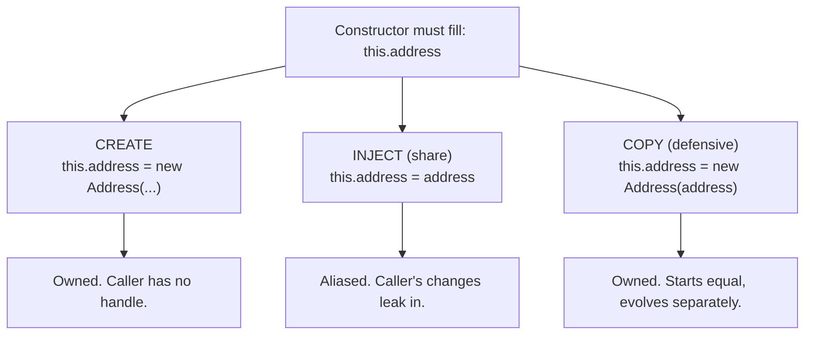
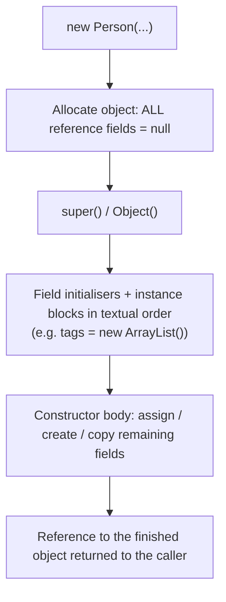
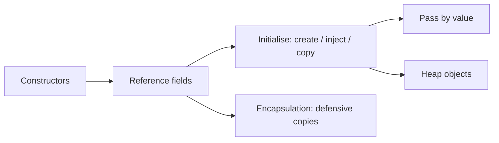

# Constructors and Initializing Reference Variables (Including Objects of Other Classes)

**TL;DR:** A reference variable is born `null` (as a field) or unassigned (as a local) and only becomes useful once it points at an object. You initialise it **at the declaration** (`List<String> tags = new ArrayList<>();`), **in a constructor** (`this.engine = new Engine();`), by **receiving an object** through the constructor (dependency injection: `this.address = address;`), or **lazily** on first use. When a class has a field of **another class's type** (HAS-A, composition), the constructor decides whether the field is **created** (owned), **copied** (defensive), or **shared** (aliased). That choice, plus the initialisation order and `null` handling, is where most bugs hide.

## Table of Contents

1. [TL;DR](#1-tldr)
2. [Why it matters](#2-why-it-matters)
3. [Prerequisites](#3-prerequisites)
4. [Mental model](#4-mental-model)
5. [Core concepts](#5-core-concepts)
6. [How it works](#6-how-it-works)
7. [Examples](#7-examples)
8. [Comparisons](#8-comparisons)
9. [Trade-offs](#9-trade-offs)
10. [Gotchas](#10-gotchas)
11. [Practical application](#11-practical-application)
12. [Interview prep](#12-interview-prep)
13. [Interview question bank](#13-interview-question-bank)
14. [Tricky code snippets](#14-tricky-code-snippets)
15. [Connections](#15-connections)
16. [Summary](#16-summary)
17. [Answers](#answers)

---

## 1. TL;DR

- **Reference field default:** `null`. A constructor (or an initialiser) must give it an object before you use it.
- **Four ways to initialise:** at declaration, in an instance block/constructor, via a constructor parameter, lazily.
- **Object of another class:** `private final Engine engine;` is a *reference to an Engine*, not an Engine inside the Car. The Car's constructor makes or receives that Engine.
- **Create vs inject:** `new Engine()` inside the constructor (the Car owns it) vs `Car(Engine e)` (the caller supplies it, and may still hold a reference).
- **Safe handoff:** copy mutable objects you receive; validate with `Objects.requireNonNull`.

**The analogy: assembling a car at a factory.**

| Factory | Java |
|---|---|
| A car shell with empty sockets for engine, radio, seats | An object whose **reference fields are `null`** |
| The assembly line fits a brand-new engine built on site | `this.engine = new Engine();` (**create inside the constructor**) |
| The customer brings their own radio and you install it | `Car(Radio r) { this.radio = r; }` (**inject**; the customer may still hold a handle on it) |
| You photocopy the customer's radio spec and build your own radio from it | **Defensive copy**: `new Radio(r)` |
| Two cars fitted with the same shared battery | **Aliasing**: two objects hold one reference |
| Starting the car with an empty socket | `NullPointerException` |
| A car handed out before assembly is finished | **`this` escaping** the constructor |
| Car needs a driver, driver needs a car, each built by the other | **Circular construction** → `StackOverflowError` |

**Running example:** a `Person` with a `String name`, an `Address` (another class), an `Engine`-like helper created inside the constructor, and a `List<String>` field initialised at declaration. We trace how each reference field gets its object, what's shared with the caller and what isn't (full program in 6.3).

---

## 2. Why it matters

**The problem.** Objects rarely stand alone: a `Person` has an `Address`, a `Car` has an `Engine`, an `Order` has `Customer` and `Items`. Each of those fields is a reference. If the constructor doesn't establish them properly you get `null` pointer errors, accidental sharing between objects, half-built objects, or invalid state that survives for the object's lifetime.

**What goes wrong** (verified on Java 21):

| Code | Result | Cause |
|---|---|---|
| `Person p = new Person(); p.address.city` | `NullPointerException` | Reference field never initialised |
| Two `Person`s built with the same `Address` object, then `a.address.city = "Goa"` | `b.address.city` is also `Goa` | Injected object is shared |
| `Car() { Engine engine = new Engine(); }` | Field `engine` stays `null` | Local variable shadows the field |
| `Person(String name, …) { name = name; }` | Field stays `null` | Parameter shadows the field |
| `static final List<String> DEFAULTS` assigned to every instance | All instances share and mutate one list | Shared mutable default |
| `new Person(null)` with `Person(String)` and `Person(Address)` | Compile error *ambiguous* | Both fit `null` |
| `class A { B b = new B(); } class B { A a = new A(); }` | `StackOverflowError` | Infinite mutual construction |
| Constructor registers `this` somewhere before fields are set | Listener sees `name = null` | `this` escapes early |
| Base constructor calls an override that uses a subclass list field | `NullPointerException` | Subclass fields not yet initialised |
| `Person(Person other) { address = other.address; }` | Copy shares the original's address | Shallow copy |

**Why interviewers ask.** "How do you initialise an object of another class inside a class?", "composition vs inheritance", "what's the difference between `new` in the constructor and passing it in", "shallow vs deep copy constructors" and "why is my field `null`" appear regularly, usually as live-coding or debugging questions.

---

## 3. Prerequisites

| Prerequisite | One-line refresher | Importance |
|---|---|---|
| Classes, objects, constructors | `new`, constructor basics, `this(...)` ([Classes and Objects notes]) | Essential |
| Reference data types | References, `null`, aliasing, pass-by-value ([Reference Data Types notes]) | Essential |
| Encapsulation | `private final`, defensive copies ([Encapsulation and Abstraction notes]) | Essential |
| Static vs instance members | Initialisation of statics vs instance fields ([Static Members notes]) | Important |
| Inheritance basics | `super(...)`, init order ([Inheritance and Polymorphism notes]) | Important |

---

## 4. Mental model

> **The one picture to keep in your head:** a field of another class's type is an **arrow slot**, not a nested object. The constructor's job is to put a valid arrow into every slot (and decide whether that arrow leads to a private object or a shared one).

```
 new Person("Asha", home)                         HEAP
 ┌──────────────────────────┐
 │ Person                   │
 │  name    ───────────────────────────►  "Asha"            (String object)
 │  address ───────────────────────────►  Address("Pune")    ← OWN copy (new Address(home))
 │  engine  ───────────────────────────►  Engine             ← created inside the ctor
 │  tags    ───────────────────────────►  ArrayList []       ← created at declaration
 └──────────────────────────┘
        home (caller's variable) ───────►  Address("Pune")    ← the caller's original, not shared
```
*Four arrows, four different origins. Only the arrows the constructor copies or creates are private to the `Person`.*

**Three ways a constructor can fill a reference field:**


*Choose deliberately; the default `this.x = x` is the aliasing one.*

---

## 5. Core concepts

### 5.1 Glossary

- **Reference field:** an instance variable whose type is a class, interface, array, enum or record.
- **HAS-A / composition:** a class contains (refers to) objects of other classes as part of its state. Compare IS-A (inheritance).
- **Aggregation vs composition:** both are HAS-A. Composition implies the part's life belongs to the whole (created inside, not shared); aggregation lets parts outlive or be shared. ⚠️ Terminology varies between textbooks.
- **Object graph:** the web of objects reachable from one object through its reference fields.
- **Dependency injection (constructor injection):** passing collaborators into the constructor instead of creating them inside.
- **Defensive copy:** copying a mutable object received (or returned) to avoid aliasing.
- **Copy constructor:** a constructor taking another instance of the same class: `Person(Person other)`.
- **Shallow / deep copy:** copy only the top-level object, sharing nested objects / copy the whole graph.
- **Lazy initialisation:** creating the object on first use rather than in the constructor.
- **`this` escape:** letting a reference to the object leak (to another object, a thread, a registry) before the constructor finishes.
- **Fail-fast validation:** rejecting bad arguments immediately (`Objects.requireNonNull`).
- **Blank final:** a `final` field without an initialiser; must be assigned exactly once in every constructor.

### 5.2 The ways to initialise a reference variable

| Way | Example | When |
|---|---|---|
| Declaration initialiser | `private final List<String> tags = new ArrayList<>();` | The same fresh object for every instance |
| Instance initialiser block | `{ cache = new HashMap<>(); }` | Shared setup across constructors |
| Constructor creates | `this.engine = new Engine();` (Snippet 2) | The class owns the part |
| Constructor receives | `this.address = address;` (Snippet 3) | Caller supplies/shares the part |
| Constructor copies | `this.address = new Address(address);` (Snippet 4) | Mutable part you must own |
| `this(...)` chaining with defaults | `Person(String n) { this(n, new Address("Unknown")); }` | Convenience constructors |
| Lazy getter | `if (lines == null) lines = new ArrayList<>();` (Snippet 25) | Rarely used, expensive part |
| Static factory / builder | `Color.of("red")`, `new Pizza.Builder()…build()` (Snippets 29, 30) | Controlled creation, many optional parts |
| Local variable | `Engine e = new Engine();` | Only inside a method; **never** assigned a default |

Field defaults are `null` (Snippet 1); locals have no default. Strings are references too: `String name;` is `null` until assigned, and `name.length()` throws (Snippet 35).

### 5.3 Objects of different classes

Inside `Person`, `private Address address;` means "a reference that may point to an `Address` object". The `Address` class is a separate class with its own constructor and fields. To use it:
1. Make sure the slot holds an object (constructor).
2. Reach through it with the dot operator: `person.address.city` (Snippet 34).
3. Respect each class's access rules (`private` fields need getters).
4. Remember a chain `a.b.c` fails with NPE at the first `null` link (the helpful message says which, Snippet 34).

A longer graph (`Employee → Company → Address`) works the same way: each constructor passes or creates the next object in the chain (Snippet 34).

### 5.4 Sharing, copying and ownership

| Approach | Code | Effect |
|---|---|---|
| Share (alias) | `this.address = address;` | Both objects see each other's changes (Snippet 3) |
| Defensive copy | `this.address = new Address(address);` | Caller's later changes don't leak in (Snippet 4) |
| Copy on the way out | `Address getAddress() { return new Address(address); }` | Callers can't mutate internals |
| Immutable part | `record Address(String city)` or all-`final` class | Sharing is safe, no copy needed |
| Copy a collection | `List.copyOf(list)` / `new ArrayList<>(list)` | Snapshot of the elements (shallow) |
| Copy array | `arr.clone()` | Snapshot (shallow for object arrays) (Snippet 19) |
| Copy constructor | `Person(Person o) {…}` | Shallow if it copies references (Snippet 17), deep if it recurses (Snippet 18) |

### 5.5 Rules and traps specific to constructors

- **`final` reference fields** must be assigned exactly once on every path (Snippets 11, 12, 13). The object may still be mutable.
- **Shadowing:** a local variable or parameter with the field's name hides the field (Snippets 5, 6). Use `this.field`.
- **Reassigning a parameter** inside a constructor changes only the local (Snippet 7).
- **Overload ambiguity with `null`:** cast the argument (Snippets 20, 21).
- **Exceptions:** if the constructor throws, the variable never receives the object (Snippet 22).
- **`super(...)` arguments** can create objects but can't use `this` or instance fields (Snippets 32, 33).
- **Enum constructors** run when the enum class initialises (Snippet 28).
- **Records:** a compact constructor can validate and copy reference components (Snippet 27).

---

## 6. How it works

### 6.1 What `new Person("Asha", home)` does for reference fields


*Every reference field exists as `null` from the moment of allocation until something assigns it. Code that runs earlier (a parent constructor, an instance initialiser) can observe those `null`s.*

Verified order (Snippet 8):

```
Part field a
instance block
Part field b
ctor start
Part in ctor
ctor end
```
Field initialisers and instance blocks run in textual order, then the constructor body.

### 6.2 Forward references

An instance initialiser can't use a field declared later by simple name (*illegal forward reference*, Snippet 9). Hiding it behind a method compiles but reads the default (`0`/`null`) (Snippet 10).

### 6.3 Worked trace: `Person`, `Address`, `Engine`

```java
import java.util.*;

class Address {
    private String city;
    Address(String city) { this.city = city; }
    Address(Address other) { this(other.city); }     // copy constructor
    void setCity(String c) { city = c; }
    String getCity() { return city; }
    @Override public String toString() { return city; }
}
class Engine {
    Engine() { System.out.println("  Engine() created"); }
}
class Person {
    private final String name;
    private final Address address;
    private final Engine engine;
    private final List<String> tags = new ArrayList<>();
    Person(String name, Address address) {
        System.out.println("  Person ctor start");
        this.name = Objects.requireNonNull(name, "name");
        this.address = new Address(Objects.requireNonNull(address, "address"));
        this.engine = new Engine();
        System.out.println("  Person ctor end");
    }
    Person(String name) { this(name, new Address("Unknown")); }
    Address getAddress() { return new Address(address); }
    List<String> tags() { return tags; }
    @Override public String toString() { return name + "@" + address + " tags=" + tags; }
}
public class Main {
    public static void main(String[] args) {
        Address home = new Address("Pune");
        System.out.println("creating asha");
        Person asha = new Person("Asha", home);
        home.setCity("Delhi");
        asha.getAddress().setCity("Goa");
        System.out.println(asha);
        Person ben = new Person("Ben");
        ben.tags().add("new");
        System.out.println(ben);
        try { new Person(null, home); } catch (NullPointerException e) { System.out.println("rejected: " + e.getMessage()); }
    }
}
```

Output (verified, Java 21):

```
creating asha
  Person ctor start
  Engine() created
  Person ctor end
Asha@Pune tags=[]
  Person ctor start
  Engine() created
  Person ctor end
Ben@Unknown tags=[new]
  Person ctor start
rejected: name
```

| Step | What happens | Why |
|---|---|---|
| `new Person("Asha", home)` | Object allocated; `name`, `address`, `engine` are `null`; `tags` is initialised to a new `ArrayList` before the body runs | Field initialiser first, body second |
| `requireNonNull(name)` | Passes; `this.name = "Asha"` | Fail-fast validation |
| `new Address(home)` | The Person gets its **own** `Address("Pune")` copy | Defensive copy |
| `new Engine()` | Prints `Engine() created` while `Person ctor` is still running | The part is created *inside* the owner's constructor |
| `home.setCity("Delhi")` | Person still says `Pune` | No aliasing: copy was made |
| `asha.getAddress().setCity("Goa")` | Person still says `Pune` | The getter returns a copy |
| `new Person("Ben")` | `this(name, new Address("Unknown"))` supplies the default address | Constructor chaining with a default part |
| `ben.tags().add("new")` | Allowed; the list is per-instance | Declaration initialiser creates a separate list each time |
| `new Person(null, home)` | `NullPointerException: name` before anything else is built | `requireNonNull` fails fast; no half-built object escapes |

---

## 7. Examples

### 7.1 Toy example: create inside the constructor

```java
class Engine { String type; Engine(String t) { type = t; } }
class Car {
    private final Engine engine;
    Car(String type) { this.engine = new Engine(type); }
    String describe() { return "Car with " + engine.type; }
}
// new Car("V8").describe()  →  Car with V8
```
*The caller never sees the `Engine`; `Car` owns it.*

### 7.2 Toy example: inject and share

```java
class Address { String city; Address(String c) { city = c; } }
class Person {
    final String name; final Address address;
    Person(String name, Address address) { this.name = name; this.address = address; }
}
// Address shared = new Address("Pune");
// Person a = new Person("A", shared), b = new Person("B", shared);
// a.address.city = "Goa";
// b.address.city  →  Goa    (a.address == b.address is true)
```
Verified (Snippet 3). *Sharing is correct for housemates who really live at the same address; it's a bug when each person should own theirs.*

### 7.3 Real-world examples

- **Service classes with injected collaborators:** `OrderService(PaymentGateway gateway, OrderRepository repo)`: constructor injection in Spring, Guice, or by hand.
- **Domain objects:** `Order` holds `Customer`, `List<OrderLine>`, `Address` (billing/shipping).
- **Immutable value objects:** `record Money(BigDecimal amount, Currency currency)`: components are references, shared safely because they're immutable.
- **Builders:** `HttpRequest.newBuilder().uri(...).build()` assemble complex object graphs step by step.
- **Collections as fields:** every `List`/`Map` field must be created somewhere: usually at declaration.
- **Copy constructors:** `new ArrayList<>(other)`, `new HashSet<>(other)` are shallow copies by design.

---

## 8. Comparisons

### 8.1 Create inside vs inject vs copy

| Aspect | Create inside (`new` in ctor) | Inject (`this.x = x`) | Inject + copy (`new X(x)`) |
|---|---|---|---|
| Who owns the part | The class | Shared with caller | The class |
| Caller's later changes leak in? | No (caller has no handle) | **Yes** | No |
| Testability | Hard to substitute | Easy | Moderate |
| Coupling | To the concrete class | To the type passed | To the copy mechanism |
| Cost | One allocation | None | One allocation + copy |
| Best for | Private helper parts | Services, shared resources | Mutable data parts |

### 8.2 Field initialiser vs constructor vs initialiser block

| | Declaration initialiser | Instance block | Constructor |
|---|---|---|---|
| Runs | Before the ctor body, textual order | Before the ctor body, textual order | After the above |
| Access to ctor parameters | No | No | Yes |
| Good for | Constants, empty collections | Common setup for many constructors | Anything depending on arguments |

### 8.3 Shallow vs deep copy constructors

```java
// shallow: Person(Person o) { name = o.name; address = o.address; tags = o.tags; }
// deep:    Person(Person o) { name = o.name; address = new Address(o.address); tags = new ArrayList<>(o.tags); }
```
After `Person b = new Person(a); b.address.city = "Goa"; b.tags.add("x");` the original `a` shows:
- shallow (Snippet 17): `A Goa [x]`, so it was altered through the copy;
- deep (Snippet 18): `Pune []` for `a` and `Goa [x]` for `b`.
`String` is immutable, so sharing it is safe either way.

### 8.4 `null` object vs empty object vs `Optional`

| Style | Field default | Usage | Snippet |
|---|---|---|---|
| `null` | `String nick;` | Must null-check everywhere | 35 |
| Empty object | `String nick = "";`, `List<String> tags = new ArrayList<>();` | Always safe to call methods | 35 |
| `Optional` | `Optional<String> nick` built from `ofNullable` | Explicit "may be absent"; good for returns, debated for fields | 36 |

### 8.5 Constructor vs static factory vs builder

| | Constructor | Static factory | Builder |
|---|---|---|---|
| Name | Class name | Descriptive (`of`, `from`) | Fluent setters |
| Can return cached/subtype objects | No | **Yes** (Snippet 30) | Via `build()` |
| Many optional parts | Telescoping overloads | Overloads | **Best** (Snippet 29) |
| Failure | Throws; no object | Can return `null`/Optional | `build()` validates |

---

## 9. Trade-offs

| Decision | Benefit | Cost | Use when |
|---|---|---|---|
| Create parts inside the constructor | Simple; full ownership; no leaks | Hard-wired to the concrete class; harder to test | Private, trivial helper objects |
| Constructor injection | Flexible, testable, explicit dependencies | Caller must wire everything; aliasing risk | Services and collaborators |
| Defensive copy on the way in | Protects invariants | Allocation | Mutable value-like parts |
| Immutable parts | Share freely | New object per change | Value objects |
| Eager initialisation | No `null` windows | Cost even if unused | Cheap or always needed |
| Lazy initialisation | Pay only on use | Not thread-safe unless synchronised; `null` checks | Expensive, rarely used parts |
| `requireNonNull` in constructors | Failures at the cause | Slight verbosity | Required collaborators |
| Deep copy constructor | True independence | Maintenance (new field → update copy) | When copies must be separate |
| Builder | Readable construction of big graphs | Extra class | More than ~4 parameters/optional parts |

---

## 10. Gotchas

### Myths

- ❌ **Myth:** "Declaring `Engine engine;` creates an Engine." ✅ **Reality:** it creates a `null` reference slot (Snippet 1).
- ❌ **Myth:** "`this.address = address;` copies the address." ✅ **Reality:** it copies the *reference*; both names refer to one object (Snippet 3).
- ❌ **Myth:** "A copy constructor always makes an independent copy." ✅ **Reality:** only if it copies nested objects too (Snippets 17, 18).
- ❌ **Myth:** "`final` on a reference field makes the whole object immutable." ✅ **Reality:** the object can still change.
- ❌ **Myth:** "If a constructor throws, you get a half-built object." ✅ **Reality:** the `new` expression produces nothing; the variable stays as it was (`null` in Snippet 22).
- ❌ **Myth:** "Fields are initialised before the parent's constructor runs." ✅ **Reality:** the parent's constructor finishes first, so a subclass field (such as a `List`) is still `null` if the parent calls an override (Snippet 31).
- ❌ **Myth:** "Passing `null` to an overloaded constructor picks the first one." ✅ **Reality:** compile error if ambiguous (Snippet 20).
- ❌ **Myth:** "An array `new Address[2]` contains two Addresses." ✅ **Reality:** two `null`s (Snippet 23).

### Common mistakes and edge cases

- **Local variable shadows the field** in the constructor: field stays `null` (Snippet 5).
- **Parameter shadows the field:** `name = name;` is a no-op (Snippet 6).
- **Forgetting to initialise a collection field** then calling `add` → NPE.
- **Initialising an array of objects but not its elements** (Snippet 23); or filling it with the same object (Snippet 24).
- **Shared `static` default** objects mutated by instances (Snippet 26).
- **Circular construction** (Snippet 15): pass `this` to the child instead (Snippet 16).
- **`this` escaping the constructor:** `Registry.all.add(this)` before assignments: observers see `name = null` (Snippet 14).
- **Constructor calls an overridable method** that touches a subclass field (Snippet 31).
- **Using `this` in `super(...)` arguments** (Snippet 33).
- **Records with reference components** need a compact constructor copy (Snippet 27).
- **`Optional` as a field** is allowed but often unnecessary; don't pass `null` for an `Optional`.

---

## 11. Practical application

### Constructor checklist for reference fields
- [ ] Every reference field is assigned (or initialised) before the constructor ends
- [ ] Required arguments validated with `Objects.requireNonNull`
- [ ] Mutable arguments copied (or the type is immutable)
- [ ] Collections created per instance, never from a shared static
- [ ] `final` where the reference never changes
- [ ] `this` not passed anywhere until construction is complete
- [ ] No calls to overridable methods
- [ ] Copy constructor (if any) is deep for mutable parts; documented otherwise
- [ ] Getters return copies or unmodifiable views

### Hands-on exercise: fix the `Order`

```java
import java.util.*;
class Customer {
    String name;
    Customer(String name) { this.name = name; }
}
class Order {
    private Customer customer;
    private List<String> items;
    Order(Customer customer, List<String> items) {
        Customer customer = customer;
        this.items = items;
    }
    Customer getCustomer() { return customer; }
    List<String> getItems() { return items; }
}
```
(a) Predict what's wrong. (b) Rewrite `Order` so the customer is required and not shared by reference with the caller, the item list is a private snapshot, and the getters can't be abused.

<details><summary>Solution</summary>

**Bugs:**
1. `Customer customer = customer;` is a compile error here (variable `customer` is already defined, since it is the parameter). If you rename the parameter, the same shape (`Customer c = c`) creates a local and the **field stays `null`** (the `shadow_local` effect, Snippet 5). Use `this.customer = …`.
2. `items` is stored directly, so the caller's list is aliased (Snippet 3 pattern); `getItems()` hands out the internal list (Snippet 3 / 19).
3. Nothing is validated; `customer` or `items` may be `null`.

```java
import java.util.*;
class Customer {
    private final String name;
    Customer(String name) { this.name = Objects.requireNonNull(name); }
    Customer(Customer other) { this(other.name); }
    String getName() { return name; }
}
final class Order {
    private final Customer customer;
    private final List<String> items;
    Order(Customer customer, List<String> items) {
        this.customer = new Customer(Objects.requireNonNull(customer, "customer"));
        this.items = List.copyOf(items);             // throws NPE for null list or null elements
    }
    Customer getCustomer() { return new Customer(customer); }
    List<String> getItems() { return items; }         // already unmodifiable
}
```
`List.copyOf` snapshots the list on the way in and is unmodifiable on the way out, so callers can neither feed in nor pull out a mutable reference (Snippets 4, 18 for the copy pattern; `List.copyOf` behaviour was verified in earlier notes). If `Customer` were an immutable `record`, the copies would be unnecessary.

Verified on Java 21: with a caller list `[a]` later extended to `[a, b]`, `getItems()` still prints `[a]`, `getCustomer()` returns a different object, and `getItems().add(...)` throws `UnsupportedOperationException`.
</details>

---

## 12. Interview prep

Eight model answers, written the way you would say them aloud. Expand the ones you can't recite.

<details><summary>1. How do you initialise a reference variable of another class inside a class?</summary>

Three ways: create it (`this.engine = new Engine();`), receive it through the constructor (`this.address = address;`) or copy what you receive (`this.address = new Address(address);`). Which one you pick decides ownership. Create means the class owns it, receive means it is shared with the caller, copy means it is owned but starts equal to the caller's.

Until one of these runs, the field is `null` (Snippet 1), so any use before that throws `NullPointerException`.
</details>

<details><summary>2. What is the default value of a reference field, and what about a local reference?</summary>

A reference field defaults to `null`. A local variable has **no** default, and using it before assignment is a compile error (*variable might not have been initialized*). Arrays of objects also hold `null`s: `new Address[2]` creates two empty slots, not two addresses (Snippet 23).
</details>

<details><summary>3. Creating the object inside the constructor vs passing it in: what's the difference?</summary>

Creating inside hard-wires the concrete class and gives the class sole ownership. Passing in (dependency injection) lets callers supply any implementation, which makes testing easy, but the caller still holds a reference, so changes made there leak in (Snippet 3).

Rule of thumb: create trivial private helpers inside; inject services and shared collaborators; copy mutable data.
</details>

<details><summary>4. What is a copy constructor, and is it a deep copy?</summary>

It is a constructor that takes an instance of its own class (`Person(Person other)`) and builds a new object from it. It is only as deep as you write it. Copying references (`address = other.address`) gives a shallow copy that shares nested objects (Snippet 17). Constructing new nested objects (`new Address(other.address)`) gives a deep copy (Snippet 18).
</details>

<details><summary>5. Why can `this.name = name;` be wrong for a mutable argument?</summary>

It stores the caller's reference, not a copy. The caller can keep mutating the object and your class's internal state changes without going through your methods. The fix is a defensive copy (`new Address(address)`, `List.copyOf(list)`, `array.clone()`), or making the argument type immutable (Snippets 4, 19).
</details>

<details><summary>6. What happens if a constructor throws an exception?</summary>

The `new` expression does not produce a value, so the variable keeps what it had (`null` in Snippet 22). No half-built object is visible to the caller. One exception to that: if the constructor already leaked `this` somewhere (a registry, a thread), the partly built object can still be reached (Snippet 14).
</details>

<details><summary>7. Why shouldn't a constructor call an overridable method?</summary>

The parent constructor runs before the subclass's field initialisers, so an override sees subclass fields as `null`/`0`. In Snippet 31 the override calls `items.add(...)` and fails with a `NullPointerException`. Call only `private`, `static` or `final` methods from a constructor.
</details>

<details><summary>8. How do you avoid `NullPointerException` when building object graphs?</summary>

Validate required arguments up front with `Objects.requireNonNull` so failures point to the cause (see the worked trace in 6.3). Initialise collections at declaration. Prefer empty objects (`""`, empty list) to `null`. Use `Optional` for return values that may be absent. Read the helpful NPE message: it names the exact null link in a chain like `e.company.hq.city` (Snippet 34).
</details>

---

## 13. Interview question bank

Grouped by level. Answers are short on purpose; the snippet numbers point to the proof in section 14.

### 13.1 Basics (Q1–Q12)

<details><summary>Q1. What is a constructor?</summary>

A special block with the class's name and no return type, run by `new` to initialise a newly allocated object. It can't be called like a method, and it isn't inherited.
</details>

<details><summary>Q2. What is a default constructor, and when does the compiler add it?</summary>

A no-argument constructor the compiler inserts only when you write **no** constructor at all. As soon as you declare any constructor, the default disappears.
</details>

<details><summary>Q3. What does a reference field contain right after `new`?</summary>

`null`. Primitives get `0`/`false`/`'\u0000'` and references get `null` (Snippet 1).
</details>

<details><summary>Q4. Does `Engine engine;` create an Engine?</summary>

No. It declares a variable that can refer to an Engine. The object exists only after `new Engine()`.
</details>

<details><summary>Q5. How do you give a class a field of another class's type?</summary>

Declare it (`private Address address;`) and assign it in the constructor, an initialiser, or later through a method. This is composition (HAS-A).
</details>

<details><summary>Q6. How do you access a member of an object held in a field?</summary>

Use the dot operator through the reference: `person.address.city` (needs the field to be non-null and accessible). With private fields, use getters.
</details>

<details><summary>Q7. Can a constructor be `private`? Why would you do that?</summary>

Yes. It forces creation through static factories, builders or singletons (Snippets 29, 30), or prevents instantiation altogether (utility classes).
</details>

<details><summary>Q8. Can a constructor be `final`, `static` or `abstract`?</summary>

No. Constructors aren't inherited, so `final` is meaningless; they run per object, so `static` is wrong; they must have a body, so `abstract` is wrong.
</details>

<details><summary>Q9. What does `this(...)` do inside a constructor?</summary>

It calls another constructor of the same class. It must be the first statement, and it is how you supply defaults (`this(name, new Address("Unknown"))` in the worked trace).
</details>

<details><summary>Q10. What does `super(...)` do?</summary>

It calls a superclass constructor, first statement only. If you omit it, the compiler inserts `super()` (the no-arg version).
</details>

<details><summary>Q11. Can a constructor return a value?</summary>

No. It has no return type. A "constructor" with `void` is just a method that happens to share the class name.
</details>

<details><summary>Q12. Can you have both `this(...)` and `super(...)` in one constructor?</summary>

No. Both must be first, so only one can appear. The `this(...)` target eventually calls `super(...)`.
</details>

### 13.2 Initialising reference variables (Q13–Q26)

<details><summary>Q13. What are all the places a reference field can be initialised?</summary>

The declaration, an instance initialiser block, the constructor, a setter or other method, or lazily in a getter. Order: declarations and blocks (textual order), then the constructor body (Snippet 8).
</details>

<details><summary>Q14. What's the order when a class has several initialisers and a constructor?</summary>

Super constructor, then field initialisers and instance blocks in textual order, then the constructor body (Snippet 8).
</details>

<details><summary>Q15. Can an initialiser use a field declared later?</summary>

Not by simple name: *illegal forward reference* (Snippet 9). Through a method it compiles but reads the default value (Snippet 10).
</details>

<details><summary>Q16. How does a `final` reference field get its value?</summary>

At the declaration or exactly once in each constructor (Snippets 11, 12, 13). It can't be reassigned, though the object it points to can change.
</details>

<details><summary>Q17. Why does `Engine engine = new Engine();` inside a constructor leave the field `null`?</summary>

It declares a **local** variable that shadows the field (Snippet 5). Use `this.engine = new Engine();`.
</details>

<details><summary>Q18. Why does `name = name;` not set the field?</summary>

Both sides are the parameter. Use `this.name = name;` (Snippet 6).
</details>

<details><summary>Q19. If a constructor reassigns its parameter, does the caller's variable change?</summary>

No. Java passes the reference by value; reassigning the parameter only changes the constructor's local copy (Snippet 7).
</details>

<details><summary>Q20. How do you initialise an array field that holds objects?</summary>

Allocate the array, then each element: `new Address[n]` gives `n` `null`s (Snippet 23). Filling with one shared object makes all slots alias (Snippet 24).
</details>

<details><summary>Q21. How do you initialise a collection field safely?</summary>

Create a new one per instance at declaration or in the constructor. Never share one through a `static` default (Snippet 26).
</details>

<details><summary>Q22. When is lazy initialisation appropriate?</summary>

When the object is expensive or rarely needed (Snippet 25). It isn't thread-safe unless you synchronise, and adds `null` checks everywhere.
</details>

<details><summary>Q23. How do enums initialise their reference fields?</summary>

Through a constructor that runs once per constant, when the enum class initialises (Snippet 28). Enum constructors are implicitly private.
</details>

<details><summary>Q24. How do records handle reference components?</summary>

The canonical constructor assigns them. A compact constructor can validate and copy (`members = List.copyOf(members)`, Snippet 27).
</details>

<details><summary>Q25. Can a constructor create objects to pass to `super(...)`?</summary>

Yes (`super(new Engine("diesel"))`, Snippet 32). It can't touch `this` or instance fields there (Snippet 33).
</details>

<details><summary>Q26. How do you initialise an object of another class that itself needs arguments?</summary>

Pass them down: `this.engine = new Engine(type);` (Snippet 2), or accept a ready-made `Engine`. Deep graphs repeat the same pattern at each level (Snippet 34).
</details>

### 13.3 Sharing, copying, immutability (Q27–Q36)

<details><summary>Q27. What is aliasing?</summary>

Two references to the same object. Changes through one are visible through the other (Snippet 3).
</details>

<details><summary>Q28. Shallow vs deep copy?</summary>

Shallow copies the top object and shares what it refers to; deep copies the nested mutable objects too (Snippets 17, 18).
</details>

<details><summary>Q29. Is `new ArrayList<>(other)` a deep copy?</summary>

No. The list is new but its elements are the same objects.
</details>

<details><summary>Q30. Is `array.clone()` deep?</summary>

No. For primitives it effectively copies the values (Snippet 19); for object arrays it copies the references.
</details>

<details><summary>Q31. Why are `String` fields safe to share?</summary>

`String` is immutable, so nobody can change it through an alias.
</details>

<details><summary>Q32. What's a defensive copy, and when do you need two?</summary>

Copy on the way in (constructor/setter) and on the way out (getter), otherwise either door lets outsiders mutate internals.
</details>

<details><summary>Q33. Does `final` make an object immutable?</summary>

No. `final` freezes the reference, not the object's state.
</details>

<details><summary>Q34. Composition vs inheritance: which when?</summary>

Use inheritance for a true IS-A with substitutability; composition for HAS-A and when you want to swap parts or avoid coupling to a parent's internals. "Favor composition over inheritance" is the usual guidance.
</details>

<details><summary>Q35. Aggregation vs composition?</summary>

Both HAS-A. In composition the whole creates and owns the part (the part dies with it); in aggregation the part is supplied from outside and can outlive or be shared. Definitions vary by source ⚠️, so state yours in the interview.
</details>

<details><summary>Q36. What is dependency injection at its simplest?</summary>

Passing collaborators into a constructor instead of constructing them inside. Frameworks automate it; the idea is just `this.repo = repo;` plus not hard-coding `new SqlRepo()`.
</details>

### 13.4 Edge cases and traps (Q37–Q50)

<details><summary>Q37. `new Person(null)` with `Person(String)` and `Person(Address)`: what happens?</summary>

Compile error: *reference to Person is ambiguous* (Snippet 20). Cast the argument (Snippet 21).
</details>

<details><summary>Q38. What if the constructor throws, what does the variable hold?</summary>

Whatever it held before (`null` in Snippet 22).
</details>

<details><summary>Q39. Why does circular construction crash?</summary>

`class A { B b = new B(); } class B { A a = new A(); }` recurses forever → `StackOverflowError` (Snippet 15). Break the cycle by passing `this` (Snippet 16) or setting the link afterwards.
</details>

<details><summary>Q40. What is `this` escape, and why is it dangerous?</summary>

Publishing `this` before the constructor finishes. Others may see fields as `null` (Snippet 14), and with threads, unsafely published state.
</details>

<details><summary>Q41. Why does a subclass's list field appear `null` inside the parent's constructor?</summary>

The parent runs first, so the subclass initialiser hasn't executed (Snippet 31).
</details>

<details><summary>Q42. A static default list is assigned to every instance. What goes wrong?</summary>

All instances share and mutate one list (Snippet 26).
</details>

<details><summary>Q43. Can two objects share one `Address`? Is that a bug?</summary>

They can (Snippet 3). It is a bug only if each should own its address; correct for genuinely shared data.
</details>

<details><summary>Q44. What does `Objects.requireNonNull(x, "x")` give you?</summary>

Fail-fast with a clear message, so the failure is at the construction site, not later at first use (worked trace).
</details>

<details><summary>Q45. Constructor vs static factory: pros of the factory?</summary>

Descriptive names, can return cached or subtype instances, can return `Optional`/fail softly (Snippet 30).
</details>

<details><summary>Q46. When is a builder better than constructors?</summary>

With many optional parts. It avoids telescoping constructors and can build immutable objects (Snippet 29).
</details>

<details><summary>Q47. After `b.add("olives")` on the builder, did the earlier `Pizza` change?</summary>

No; the constructor took `List.copyOf` (Snippet 29).
</details>

<details><summary>Q48. How does the helpful NPE message identify the null link?</summary>

It names the exact expression (`"<local2>.company.hq" is null`, Snippet 34). Local names appear as `<localN>` when compiled without `-g`.
</details>

<details><summary>Q49. Is `Optional` appropriate for fields?</summary>

It works (Snippet 36), but it isn't serialisable and adds wrapper overhead; many style guides prefer it for return types only. ⚠️ Opinion varies.
</details>

<details><summary>Q50. Where does an object created by `new` in a constructor live, and how long?</summary>

On the heap, until nothing references it. If the owner is garbage-collected and no one else holds the part, the part goes too (see the Heap and Stack notes).
</details>

---

## 14. Tricky code snippets

Thirty-six snippets, each compiled and run on OpenJDK 21. Predict the output (or the compile error) before opening the answer. Class declarations are shown without `public` so they can share one file; the `Main` class holds `main`.

### Snippet 1: Default values of fields

```java
class Address { String city = "?"; }
class Person { String name; Address address; int age; }
public class Main {
    public static void main(String[] args) {
        Person p = new Person();
        System.out.println(p.name + " " + p.address + " " + p.age);
        System.out.println(p.address.city);
    }
}
```

<details><summary>Answer</summary>

```
null null 0
```
then a `NullPointerException` with message `Cannot read field "city" because "<local1>.address" is null`.

Fields get defaults (`null` for references, `0` for `int`). The field initialiser `city = "?"` belongs to `Address`, which was never created.
</details>

### Snippet 2: Create inside the constructor

```java
class Engine { String type; Engine(String t) { type = t; } }
class Car {
    private final Engine engine;
    Car(String type) { this.engine = new Engine(type); }
    String describe() { return "Car with " + engine.type; }
}
public class Main { public static void main(String[] args) { System.out.println(new Car("V8").describe()); } }
```

<details><summary>Answer</summary>

```
Car with V8
```

`Car` creates its own `Engine`; the caller never holds it.
</details>

### Snippet 3: Inject and share

```java
class Address { String city; Address(String c) { city = c; } }
class Person {
    final String name; final Address address;
    Person(String name, Address address) { this.name = name; this.address = address; }
}
public class Main {
    public static void main(String[] args) {
        Address shared = new Address("Pune");
        Person a = new Person("A", shared), b = new Person("B", shared);
        a.address.city = "Goa";
        System.out.println(b.address.city + " " + (a.address == b.address));
    }
}
```

<details><summary>Answer</summary>

```
Goa true
```

Both `Person`s hold the same `Address`; `a.address == b.address`.
</details>

### Snippet 4: Defensive copy in the constructor

```java
class Address {
    String city; Address(String c) { city = c; }
    Address(Address o) { this(o.city); }
}
class Person {
    final Address address;
    Person(Address address) { this.address = new Address(address); }
}
public class Main {
    public static void main(String[] args) {
        Address a = new Address("Pune");
        Person p = new Person(a);
        a.city = "Goa";
        System.out.println(p.address.city + " " + (p.address == a));
    }
}
```

<details><summary>Answer</summary>

```
Pune false
```

The constructor copied the address, so `a.city = "Goa"` doesn't reach the person.
</details>

### Snippet 5: Local variable shadows the field

```java
class Engine { }
class Car {
    private Engine engine;
    Car() { Engine engine = new Engine(); }
    boolean hasEngine() { return engine != null; }
}
public class Main { public static void main(String[] args) { System.out.println(new Car().hasEngine()); } }
```

<details><summary>Answer</summary>

```
false
```

`Engine engine = new Engine();` is a local; the field remains `null`.
</details>

### Snippet 6: Parameter shadows the field

```java
class Person {
    String name; java.util.List<String> tags;
    Person(String name, java.util.List<String> tags) { name = name; this.tags = tags; }
}
public class Main {
    public static void main(String[] args) {
        Person p = new Person("Asha", java.util.List.of("a"));
        System.out.println(p.name + " " + p.tags);
    }
}
```

<details><summary>Answer</summary>

```
null [a]
```

`name = name;` assigns the parameter to itself. `this.tags = tags` works.
</details>

### Snippet 7: Reassigning a constructor parameter

```java
class Address { String city; Address(String c) { city = c; } }
class Person {
    Address address;
    Person(Address address) { this.address = address; address = new Address("Reassigned"); }
}
public class Main {
    public static void main(String[] args) {
        Address a = new Address("Pune");
        Person p = new Person(a);
        System.out.println(p.address.city + " " + a.city + " " + (p.address == a));
    }
}
```

<details><summary>Answer</summary>

```
Pune Pune true
```

`address = new Address("Reassigned")` changes only the constructor's local parameter, after the field was set.
</details>

### Snippet 8: Initialiser order with object fields

```java
class Part {
    Part(String n) { System.out.println("Part " + n); }
}
class Whole {
    Part a = new Part("field a");
    { System.out.println("instance block"); }
    Part b = new Part("field b");
    Part c;
    Whole() { System.out.println("ctor start"); c = new Part("in ctor"); System.out.println("ctor end"); }
}
public class Main { public static void main(String[] args) { new Whole(); } }
```

<details><summary>Answer</summary>

```
Part field a
instance block
Part field b
ctor start
Part in ctor
ctor end
```

Initialisers and blocks run in textual order before the constructor body. `c` has no initialiser, so it is created in the body.
</details>

### Snippet 9: Forward reference (direct)

```java
class A {
    int x = y + 1;
    int y = 5;
}
public class Main { public static void main(String[] args) { } }
```

<details><summary>Answer</summary>

Compile error: *illegal forward reference*.

`x = y + 1` uses `y` before its declaration by simple name.
</details>

### Snippet 10: Forward reference (via method)

```java
class A {
    int x = get();
    int y = 5;
    int get() { return y; }
}
public class Main { public static void main(String[] args) { System.out.println(new A().x + " " + new A().y); } }
```

<details><summary>Answer</summary>

```
0 5
```

`get()` runs during `x`'s initialisation, when `y` still has its default `0`. The second `new A().y` prints `5`.
</details>

### Snippet 11: Blank final never assigned

```java
class A { final StringBuilder sb; A() { } }
public class Main { public static void main(String[] args) { } }
```

<details><summary>Answer</summary>

Compile error: *variable sb might not have been initialized*.

A blank `final` must be assigned on every path through the constructor.
</details>

### Snippet 12: Final assigned twice

```java
class A { final StringBuilder sb = new StringBuilder(); A() { sb = new StringBuilder(); } }
public class Main { public static void main(String[] args) { } }
```

<details><summary>Answer</summary>

Compile error: *cannot assign a value to final variable sb*.

The declaration already assigned it.
</details>

### Snippet 13: Final assigned in every constructor

```java
class A {
    final StringBuilder sb;
    A() { sb = new StringBuilder("default"); }
    A(String s) { this.sb = new StringBuilder(s); }
    A(int n) { this(); }
}
public class Main { public static void main(String[] args) { System.out.println(new A().sb + " " + new A("x").sb + " " + new A(1).sb); } }
```

<details><summary>Answer</summary>

```
default x default
```

`A(int)` delegates to `A()`, so `sb` is assigned exactly once on each path. A constructor that calls `this(...)` must not assign the final field itself.
</details>

### Snippet 14: `this` escapes the constructor

```java
import java.util.*;
class Registry { static final List<Widget> all = new ArrayList<>(); }
class Widget {
    String name;
    Widget(String n) {
        Registry.all.add(this);
        System.out.println("registered, name=" + name);
        name = n;
    }
}
public class Main { public static void main(String[] args) { new Widget("w1"); System.out.println(Registry.all.get(0).name); } }
```

<details><summary>Answer</summary>

```
registered, name=null
w1
```

The registry received `this` before `name = n` ran. Later the same object shows `w1`.
</details>

### Snippet 15: Circular construction

```java
class A { B b = new B(); }
class B { A a = new A(); }
public class Main {
    public static void main(String[] args) {
        try { new A(); } catch (StackOverflowError e) { System.out.println("StackOverflowError"); }
    }
}
```

<details><summary>Answer</summary>

```
StackOverflowError
```

`new A()` → `new B()` → `new A()` → … never ends.
</details>

### Snippet 16: Circular construction fixed

```java
class Parent {
    Child child;
    Parent() { this.child = new Child(this); }
}
class Child {
    final Parent parent;
    Child(Parent p) { this.parent = p; }
}
public class Main {
    public static void main(String[] args) {
        Parent p = new Parent();
        System.out.println(p.child.parent == p);
    }
}
```

<details><summary>Answer</summary>

```
true
```

`Parent` creates the `Child` and passes `this`; no cycle of `new`.
</details>

### Snippet 17: Shallow copy constructor

```java
import java.util.*;
class Address { String city; Address(String c) { city = c; } }
class Person {
    String name; Address address; List<String> tags = new ArrayList<>();
    Person(String n, Address a) { name = n; address = a; }
    Person(Person o) { name = o.name; address = o.address; tags = o.tags; }
}
public class Main {
    public static void main(String[] args) {
        Person a = new Person("A", new Address("Pune"));
        Person b = new Person(a);
        b.address.city = "Goa";
        b.tags.add("x");
        b.name = "B";
        System.out.println(a.name + " " + a.address.city + " " + a.tags);
    }
}
```

<details><summary>Answer</summary>

```
A Goa [x]
```

The name is a `String` (immutable, so safe), but `address` and `tags` are shared with the copy.
</details>

### Snippet 18: Deep copy constructor

```java
import java.util.*;
class Address { String city; Address(String c) { city = c; } Address(Address o) { this(o.city); } }
class Person {
    String name; Address address; List<String> tags = new ArrayList<>();
    Person(String n, Address a) { name = n; address = a; }
    Person(Person o) { name = o.name; address = new Address(o.address); tags = new ArrayList<>(o.tags); }
}
public class Main {
    public static void main(String[] args) {
        Person a = new Person("A", new Address("Pune"));
        Person b = new Person(a);
        b.address.city = "Goa";
        b.tags.add("x");
        System.out.println(a.address.city + " " + a.tags + " " + b.address.city + " " + b.tags);
    }
}
```

<details><summary>Answer</summary>

```
Pune [] Goa [x]
```

The copy owns its own `Address` and list.
</details>

### Snippet 19: Array field: share vs clone

```java
import java.util.*;
class Grid {
    private final int[] cells;
    Grid(int[] cells) { this.cells = cells; }
    int first() { return cells[0]; }
}
class SafeGrid {
    private final int[] cells;
    SafeGrid(int[] cells) { this.cells = cells.clone(); }
    int first() { return cells[0]; }
}
public class Main {
    public static void main(String[] args) {
        int[] data = {1, 2, 3};
        Grid g = new Grid(data); SafeGrid s = new SafeGrid(data);
        data[0] = 99;
        System.out.println(g.first() + " " + s.first());
    }
}
```

<details><summary>Answer</summary>

```
99 1
```

`Grid` shares the caller's array; `SafeGrid` cloned it.
</details>

### Snippet 20: `null` argument, two overloads

```java
class Address { }
class Person {
    Person(String name) { System.out.println("String"); }
    Person(Address a) { System.out.println("Address"); }
}
public class Main { public static void main(String[] args) { new Person(null); } }
```

<details><summary>Answer</summary>

Compile error: *reference to Person is ambiguous*.

`null` fits both `String` and `Address`, and neither is more specific.
</details>

### Snippet 21: `null` argument resolved by cast

```java
class Address { }
class Person {
    Person(String name) { System.out.println("String"); }
    Person(Address a) { System.out.println("Address"); }
}
public class Main { public static void main(String[] args) { new Person((Address) null); new Person((String) null); } }
```

<details><summary>Answer</summary>

```
Address
String
```

The cast chooses the overload.
</details>

### Snippet 22: Constructor throws

```java
class Box {
    Box(int n) { if (n < 0) throw new IllegalArgumentException("negative"); }
}
public class Main {
    public static void main(String[] args) {
        Box b = null;
        try { b = new Box(-1); } catch (IllegalArgumentException e) { System.out.println("failed: " + e.getMessage()); }
        System.out.println(b);
    }
}
```

<details><summary>Answer</summary>

```
failed: negative
null
```

The assignment never completed, so `b` is still `null`.
</details>

### Snippet 23: Array of objects

```java
class Address { String city = "?"; }
public class Main {
    public static void main(String[] args) {
        Address[] arr = new Address[2];
        System.out.println(arr[0]);
        for (int i = 0; i < arr.length; i++) arr[i] = new Address();
        arr[0].city = "Pune";
        System.out.println(arr[0].city + " " + arr[1].city + " " + (arr[0] == arr[1]));
    }
}
```

<details><summary>Answer</summary>

```
null
Pune ? false
```

Elements start `null`. After filling, each slot has its own `Address`.
</details>

### Snippet 24: Array filled with one object

```java
import java.util.*;
class Address { String city = "?"; }
public class Main {
    public static void main(String[] args) {
        Address[] arr = new Address[2];
        Address one = new Address();
        arr[0] = one; arr[1] = one;
        arr[0].city = "Pune";
        System.out.println(arr[1].city);
    }
}
```

<details><summary>Answer</summary>

```
Pune
```

Both slots hold the same object.
</details>

### Snippet 25: Lazy initialisation

```java
class Report {
    private java.util.List<String> lines;
    java.util.List<String> lines() {
        if (lines == null) { System.out.println("creating"); lines = new java.util.ArrayList<>(); }
        return lines;
    }
}
public class Main {
    public static void main(String[] args) {
        Report r = new Report();
        r.lines().add("a"); r.lines().add("b");
        System.out.println(r.lines());
    }
}
```

<details><summary>Answer</summary>

```
creating
[a, b]
```

The list is created on first call only.
</details>

### Snippet 26: Shared static default

```java
class Settings {
    static final java.util.List<String> DEFAULTS = new java.util.ArrayList<>(java.util.List.of("a"));
    final java.util.List<String> values;
    Settings() { this.values = DEFAULTS; }
}
public class Main {
    public static void main(String[] args) {
        Settings s1 = new Settings(), s2 = new Settings();
        s1.values.add("b");
        System.out.println(s2.values + " " + (s1.values == s2.values));
    }
}
```

<details><summary>Answer</summary>

```
[a, b] true
```

Every `Settings` uses the same static list.
</details>

### Snippet 27: Record with a reference component

```java
import java.util.*;
record Team(String name, List<String> members) {
    Team {
        Objects.requireNonNull(name);
        members = List.copyOf(members);
    }
}
public class Main {
    public static void main(String[] args) {
        List<String> m = new ArrayList<>(List.of("a"));
        Team t = new Team("X", m);
        m.add("b");
        System.out.println(t);
        try { new Team("Y", null); } catch (NullPointerException e) { System.out.println("NPE"); }
    }
}
```

<details><summary>Answer</summary>

```
Team[name=X, members=[a]]
NPE
```

`List.copyOf` snapshotted `m`, so the later `m.add("b")` isn't visible. Passing `null` throws `NullPointerException` from `copyOf`.
</details>

### Snippet 28: Enum constructor timing

```java
enum Planet {
    EARTH("blue"), MARS("red");
    private final String colour;
    Planet(String c) { colour = c; System.out.println("ctor " + c); }
    String colour() { return colour; }
}
public class Main {
    public static void main(String[] args) {
        System.out.println("start");
        System.out.println(Planet.MARS.colour() + " " + (Planet.valueOf("MARS") == Planet.MARS));
    }
}
```

<details><summary>Answer</summary>

```
start
ctor blue
ctor red
red true
```

Both constants are constructed when `Planet` initialises, which happens at the first use after `"start"`.
</details>

### Snippet 29: Builder snapshot

```java
class Pizza {
    private final String size; private final java.util.List<String> toppings;
    private Pizza(Builder b) { size = b.size; toppings = java.util.List.copyOf(b.toppings); }
    static class Builder {
        private String size = "M"; private final java.util.List<String> toppings = new java.util.ArrayList<>();
        Builder size(String s) { size = s; return this; }
        Builder add(String t) { toppings.add(t); return this; }
        Pizza build() { return new Pizza(this); }
    }
    public String toString() { return size + toppings; }
}
public class Main {
    public static void main(String[] args) {
        Pizza.Builder b = new Pizza.Builder().size("L").add("cheese");
        Pizza p = b.build();
        b.add("olives");
        System.out.println(p + " " + b.build());
    }
}
```

<details><summary>Answer</summary>

```
L[cheese] L[cheese, olives]
```

The first `Pizza` took an immutable snapshot, so adding olives later affects only the second build.
</details>

### Snippet 30: Static factory with cache

```java
class Color {
    private static final java.util.Map<String, Color> CACHE = new java.util.HashMap<>();
    private final String name;
    private Color(String n) { name = n; }
    static Color of(String n) { return CACHE.computeIfAbsent(n, Color::new); }
}
public class Main {
    public static void main(String[] args) {
        System.out.println((Color.of("red") == Color.of("red")) + " " + (Color.of("red") == Color.of("blue")));
    }
}
```

<details><summary>Answer</summary>

```
true false
```

`of("red")` returns the cached instance; `blue` is a different object.
</details>

### Snippet 31: Constructor calls an overridable method

```java
class Base {
    Base() { init(); }
    void init() { }
}
class Derived extends Base {
    private final java.util.List<String> items = new java.util.ArrayList<>();
    @Override void init() { items.add("x"); }
}
public class Main { public static void main(String[] args) { new Derived(); } }
```

<details><summary>Answer</summary>

`NullPointerException`: `Cannot invoke "java.util.List.add(Object)" because "this.items" is null`.

`Base()` calls the override before `Derived`'s `items` initialiser runs.
</details>

### Snippet 32: Creating the object for `super(...)`

```java
class Engine { String type; Engine(String t) { type = t; } }
class Vehicle {
    protected final Engine engine;
    Vehicle(Engine e) { this.engine = e; }
}
class Truck extends Vehicle {
    Truck() { super(new Engine("diesel")); }
    String type() { return engine.type; }
}
public class Main { public static void main(String[] args) { System.out.println(new Truck().type()); } }
```

<details><summary>Answer</summary>

```
diesel
```

Creating a new object inside the `super(...)` arguments is allowed.
</details>

### Snippet 33: Using an instance field in `super(...)`

```java
class Vehicle { Vehicle(Object o) { } }
class Truck extends Vehicle {
    int x = 1;
    Truck() { super(x); }
}
public class Main { public static void main(String[] args) { } }
```

<details><summary>Answer</summary>

Compile error: *cannot reference x before supertype constructor has been called*.

The object isn't initialised yet when `super(...)` arguments are evaluated.
</details>

### Snippet 34: Chain of references and a null link

```java
class Address { String city; Address(String c) { city = c; } }
class Company { Address hq; Company(Address a) { hq = a; } }
class Employee { Company company; Employee(Company c) { company = c; } }
public class Main {
    public static void main(String[] args) {
        Employee e = new Employee(new Company(new Address("Pune")));
        System.out.println(e.company.hq.city);
        Employee f = new Employee(new Company(null));
        try { System.out.println(f.company.hq.city); } catch (NullPointerException ex) { System.out.println(ex.getMessage()); }
    }
}
```

<details><summary>Answer</summary>

```
Pune
```

then the helpful message `Cannot read field "city" because "<local2>.company.hq" is null` (the local is `f`, shown as `<local2>` because the code is compiled without `-g`).
</details>

### Snippet 35: `String` field: null vs empty

```java
class User {
    String name;
    String nick = "";
    User(String name) { this.name = name; }
}
public class Main {
    public static void main(String[] args) {
        User u = new User(null);
        System.out.println(u.name + "|" + u.nick + "|" + u.nick.isEmpty());
        System.out.println(u.name.length());
    }
}
```

<details><summary>Answer</summary>

```
null||true
```

then a `NullPointerException` on `u.name.length()`. `nick` was initialised to `""`, `name` was set to `null` by the caller.
</details>

### Snippet 36: `Optional` field

```java
import java.util.*;
class User {
    private final String name; private final Optional<String> nick;
    User(String n, String nick) { name = n; this.nick = Optional.ofNullable(nick); }
    String display() { return nick.orElse(name); }
}
public class Main { public static void main(String[] args) { System.out.println(new User("Asha", null).display() + " " + new User("Asha", "A").display()); } }
```

<details><summary>Answer</summary>

```
Asha A
```

`Optional.ofNullable(null)` is empty, so `orElse(name)` supplies the fallback.
</details>

---

## 15. Connections

| Related topic | How it connects |
|---|---|
| Classes and Objects | Constructors are where objects get their first state |
| Encapsulation and Abstraction | Defensive copies and immutability protect fields that hold references |
| Inheritance and Polymorphism | Constructor chaining, init order, and the overridable-call trap |
| Reference Data Types | `null`, aliasing and `==` vs `equals` apply to every field here |
| Pass by Value and Reassigning References *(next note)* | Why a constructor parameter reassignment is invisible to the caller |
| Heap and Stack Memory *(next note)* | Where the objects created in constructors live |
| Dependency injection | Constructor injection is the most common framework entry point |
| Design patterns | Builder, factory, singleton and prototype are all about how objects get created |


*Each reference field set in a constructor is a pointer into heap memory, passed around by value.*

---

## 16. Summary

### 60-second card

- Reference fields start as `null`; the constructor (or an initialiser) must fill every one.
- Fill by **creating** (own it), **receiving** (share it), or **copying** (own an equal one).
- `this.x = x` aliases; copy mutable arguments and use `Objects.requireNonNull` for required ones.
- Init order: super constructor → field initialisers/blocks (textual) → constructor body.
- Traps: shadowing, `null` ambiguity, circular `new`, `this` escape, overridable calls, shared static defaults.

### Cheat sheet

```java
class Order {
    private final Customer customer;                       // required, owned copy
    private final List<String> items;                      // snapshot
    private final List<String> notes = new ArrayList<>();  // fresh per instance
    Order(Customer c, List<String> items) {
        this.customer = new Customer(Objects.requireNonNull(c));
        this.items = List.copyOf(items);
    }
    Order(Customer c) { this(c, List.of()); }              // default via this(...)
}
```

| Want | Write |
|---|---|
| Fresh private part | `this.engine = new Engine();` |
| Shared collaborator | `this.repo = repo;` |
| Independent copy | `new Address(address)`, `List.copyOf`, `arr.clone()` |
| Required argument | `Objects.requireNonNull(x, "x")` |
| Optional argument | default via `this(...)`, or builder |
| Many optional parts | builder |

### Self-test (answers at the end)

1. What does `Engine engine;` as a field contain after `new Car()`?
2. Why does `Car() { Engine engine = new Engine(); }` leave the car without an engine?
3. Two `Person`s are built from the same `Address` object using `this.address = address;`. What happens when one changes the city?
4. Is `new ArrayList<>(list)` a deep copy?
5. Order the following: field initialiser, constructor body, super constructor.
6. What does `new Person(null)` do when `Person(String)` and `Person(Address)` both exist?
7. Why is `class A { B b = new B(); } class B { A a = new A(); }` a problem?
8. Spot the bug: `Person(String name) { name = name; }`

### Flashcards (Anki `Q :: A`)

```
Default value of a reference field :: null
Default value of a local reference variable :: None; using it unassigned is a compile error
Does "Engine e;" create an Engine? :: No, only a null reference slot
this.x = x with a mutable x :: Copies the reference, so the object is shared (aliased)
Copy constructor that does address = other.address :: Shallow copy; nested objects are shared
Safe way to snapshot a list in a constructor :: List.copyOf(list) or new ArrayList<>(list)
Constructor throws :: new produces no object; variable keeps its old value
Init order :: super constructor, field initialisers/blocks in textual order, constructor body
Why not call overridable methods in a constructor? :: The subclass fields are not initialised yet
Person(null) with Person(String) and Person(Address) :: Compile error: ambiguous reference
Circular new A() -> new B() -> new A() :: StackOverflowError
this escape :: Leaking this before the constructor ends; others see partly built state
final reference field :: Assigned exactly once; the object can still change
```

### Further reading

- *Effective Java* (Joshua Bloch): items on static factories, builders, defensive copies, and "favor composition over inheritance".
- The Java Tutorials, "Providing Constructors for Your Classes": https://docs.oracle.com/javase/tutorial/java/javaOO/constructors.html
- JLS §12.5, "Creation of New Class Instances" (initialisation order): https://docs.oracle.com/javase/specs/jls/se21/html/jls-12.html#jls-12.5

---

## Answers

<details><summary>1. Field after `new Car()`</summary>

`null`. The slot exists; no `Engine` object does (Snippet 1).
</details>

<details><summary>2. Local shadows field</summary>

The line declares a **local** variable named `engine`, which hides the field. The field keeps its default `null` (Snippet 5). Write `this.engine = new Engine();`.
</details>

<details><summary>3. Same Address in two Persons</summary>

Both persons see the new city, because they hold the same object (`Goa true` in Snippet 3). Fix with a defensive copy or an immutable `Address`.
</details>

<details><summary>4. `new ArrayList<>(list)`</summary>

No. The list is a new object, but its elements are the same objects (shallow).
</details>

<details><summary>5. Order</summary>

Super constructor → field initialiser (and instance blocks, in textual order) → constructor body (Snippet 8).
</details>

<details><summary>6. `new Person(null)`</summary>

Compile error: *reference to Person is ambiguous*. Cast: `new Person((String) null)` (Snippets 20, 21).
</details>

<details><summary>7. Circular construction</summary>

Each constructor creates the other: infinite recursion ends in `StackOverflowError` (Snippet 15). Pass `this` to the child instead (Snippet 16).
</details>

<details><summary>8. `name = name;`</summary>

It assigns the parameter to itself; the field stays `null`. Use `this.name = name;` (Snippet 6).
</details>
