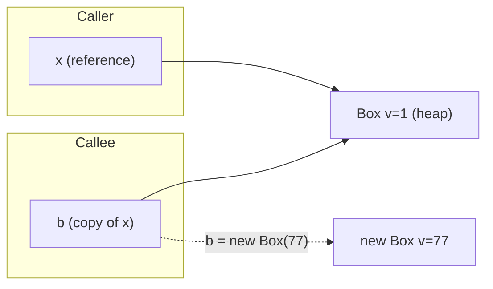
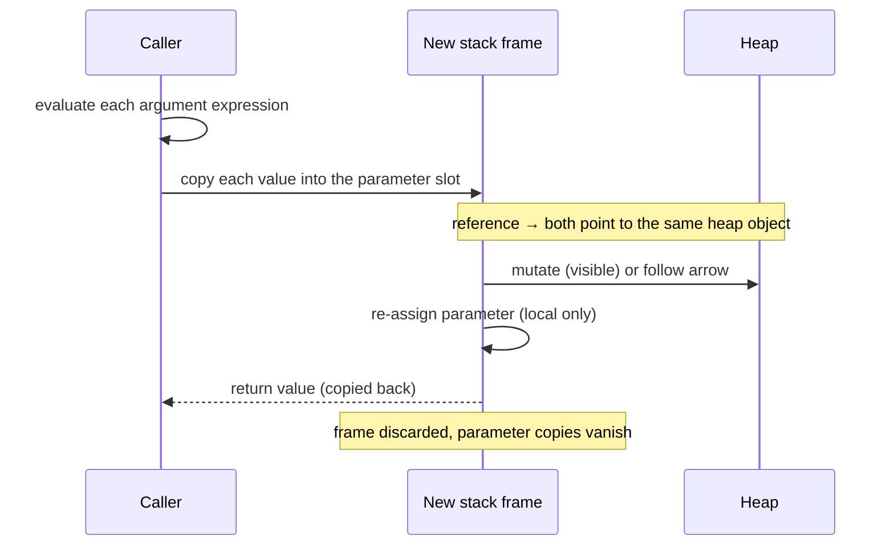
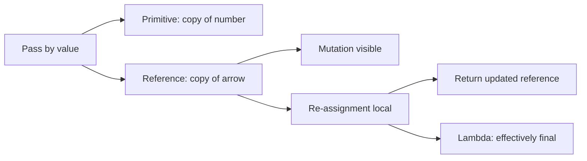

# Pass by Value vs Pass by Reference, Re-assigning References, and Passing References to Methods

**TL;DR:** Java is **always pass-by-value**. For a primitive the value copied is the number itself. For an object the value copied is the **reference** (the arrow). The method gets its own arrow pointing at the **same object**, so it can **mutate** the object (the caller sees it) but **re-assigning** its parameter only moves its own arrow (the caller sees nothing). That single rule explains every "does the caller see the change?" question, the impossible `swap(a, b)`, why linked-list `head` needs a return value, and why lambdas demand effectively final variables.

## Table of Contents

1. [TL;DR](#1-tldr)
2. [Why it matters](#2-why-it-matters)
3. [Prerequisites](#3-prerequisites)
4. [Mental model](#4-mental-model)
5. [Core concepts](#5-core-concepts)
6. [How it works](#6-how-it-works)
7. [Examples](#7-examples)
8. [Comparisons](#8-comparisons)
9. [Trade-offs](#9-trade-offs)
10. [Gotchas](#10-gotchas)
11. [Practical application](#11-practical-application)
12. [Interview prep](#12-interview-prep)
13. [Interview question bank](#13-interview-question-bank)
14. [Tricky code snippets](#14-tricky-code-snippets)
15. [Connections](#15-connections)
16. [Summary](#16-summary)
17. [Answers](#answers)

---

## 1. TL;DR

- **Rule:** the method receives a **copy of the argument's value**. Always. No exceptions.
- **Primitive argument:** the copy is the number/boolean/char; changing it never affects the caller.
- **Reference argument:** the copy is the **address**; both variables now point at the same object.
- **Mutate** (`b.v = 99`, `list.add(x)`) → visible to the caller. **Re-assign** (`b = new Box(77)`) → invisible.
- To hand a changed reference back: **return it** and assign it at the call site.

**The analogy: giving someone a copy of a house key.**

| House keys | Java |
|---|---|
| A house on a street | An **object** on the heap |
| Your key to the house | Your **reference variable** (`x`) |
| You photocopy the key and hand the copy to a friend | **Passing** `x` to a method: the parameter `b` is a copy of the reference |
| The friend rearranges the furniture | `b.v = 99`: **mutating the object**, which you see when you go home |
| The friend throws away their copy and picks up a key to a different house | `b = new Box(77)`: **re-assigning the parameter**; your key still opens your house |
| The friend cannot swap your key for another with theirs | **`swap(a, b)` can't change the caller's variables** |
| "Here is the address, go look" | Pass-by-value of a reference (what Java does) |
| "Here is my actual key ring, change it directly" | True pass-by-reference (C++ `&`); **Java doesn't have it** |

**Running example:** a tiny `Box` class with one `int v`, and methods `setPrim`, `mutate`, `reassign`, `mutateThenReassign`, `reassignAndReturn`, `swapRefs` and `swapContents`. We trace each one (6.2).

---

## 2. Why it matters

**The problem.** Beginners and even experienced developers repeat two opposite myths: "objects are passed by reference" and "Java copies everything so methods can't change my objects". Both are wrong, and the wrong mental model produces real bugs: lists that grow unexpectedly, "fixes" that do nothing, data structures that lose their head node.

**What goes wrong** (verified on Java 21):

| Code | Result | Cause |
|---|---|---|
| `void reassign(Box b) { b = new Box(77); }` | Caller's box unchanged | Only the local copy of the arrow moved |
| `void mutate(Box b) { b.v = 99; }` | Caller sees `99` | Both arrows reach one object |
| `swap(a, b)` that swaps parameters | Nothing happens | Parameters are copies |
| `void addHead(Node head, int v) { head = new Node(v, head); }` | List length unchanged | Re-assignment is local; must return the new head |
| `for (Box b : boxes) b = new Box(0);` | List unchanged | The loop variable is a copy of each reference |
| `Runnable r = () -> count++;` | Compile error | Lambdas capture values, so locals must be effectively final |
| `void sort(int[] a)` on the caller's array | Caller's array sorted | The array object is shared |
| `Arrays.asList`/`List.of` passed and then `add` | `UnsupportedOperationException` | Immutable or fixed-size object, not a parameter problem |

**Why interviewers ask.** "Is Java pass by value or pass by reference?" is among the most common Java questions. Strong candidates answer in one line ("always by value; for objects the value is the reference"), then prove it with a swap or a re-assign example. It also underlies linked-list, tree and graph coding questions.

---

## 3. Prerequisites

| Prerequisite | One-line refresher | Importance |
|---|---|---|
| Primitive vs reference types | Primitives hold values; reference variables hold addresses ([Primitive vs Reference Types notes]) | Essential |
| Reference variables and `null` | A reference variable is an arrow; `==` compares arrows ([Reference Data Types notes]) | Essential |
| Methods and parameters | Parameters are local variables initialised from the arguments ([Declaring Variables and Methods notes]) | Essential |
| Objects and `new` | `new` allocates an object and returns an arrow | Essential |
| Constructors | How reference fields get their objects ([Constructors notes]) | Helpful |

---

## 4. Mental model

> **The one picture to keep in your head:** every method call makes a **photocopy of each argument** and gives the photocopies to the parameters. A photocopied arrow points to the same object as the original; a photocopied number is just a number.

```
 CALLER (main)                         CALLEE (mutate / reassign)
 ┌─────────┐                           ┌─────────┐
 │ x  ●────────┐                       │ b  ●────────┐     b is a COPY of x's arrow
 └─────────┘   │                       └─────────┘   │
               ▼                                     ▼
            ┌────────────────────────────────────────────┐
            │  Box { v = 1 }   ← ONE object on the heap  │
            └────────────────────────────────────────────┘

   b.v = 99      → follow the arrow, change the object.  x sees it.
   b = new Box() → move b's arrow elsewhere.             x's arrow is untouched.
```
*Two arrows, one object. Changing the object is shared; moving an arrow is private.*


*After the re-assignment `b` points at a new Box; `x` still points at the original.*

**Primitive version:**

```
 main: n = 1  ──copy──►  setPrim: x = 1  → x = 99      (n remains 1)
```

---

## 5. Core concepts

### 5.1 Glossary

- **Argument:** the expression at the call site (`mutate(x)` → `x`).
- **Parameter:** the local variable in the method header (`Box b`).
- **Pass by value:** the parameter is initialised with a copy of the argument's value.
- **Pass by reference (true):** the parameter is an alias for the caller's *variable*, so assigning it changes the caller's variable. ⚠️ Java does not do this; C++ `&` references do.
- **Reference value:** the content of a reference variable, effectively the object's address or handle (the exact representation is JVM-specific ⚠️).
- **Mutation:** changing the state of an object through a reference.
- **Re-assignment:** making a reference variable point to a different object (or `null`).
- **Aliasing:** two reference variables pointing to the same object.
- **Effectively final:** a local that is never re-assigned after its initialisation, even without the `final` keyword.
- **Output parameter:** a parameter used to send data back (in Java, a mutable holder or array).
- **Holder / wrapper:** a small mutable object (such as `AtomicInteger` or `int[1]`) used to simulate pass by reference.

### 5.2 The rule in one table

| Argument type | What is copied | Can the method change the caller's variable? | Can it change the object? |
|---|---|---|---|
| `int`, `double`, `boolean`, `char` … | The value | No | n/a |
| Reference to mutable object (`Box`, `List`, array) | The reference | **No** | **Yes** |
| Reference to immutable object (`String`, `Integer`) | The reference | No | No (nothing to change) |
| `null` | `null` | No | n/a (calling methods on it throws) |

Why people say "pass by reference for objects": because mutation is visible. It's an observation about shared objects, not about how arguments are passed.

### 5.3 Mutate vs re-assign

| Operation inside the method | Example | Caller sees it? |
|---|---|---|
| Change a field | `b.v = 99` | **Yes** |
| Call a mutating method | `list.add("x")`, `sb.append("!")`, `Arrays.sort(a)` | **Yes** |
| Change an array element | `a[0] = 5` | **Yes** |
| Replace the parameter | `b = new Box(77)` | **No** |
| Set it to null | `b = null` | **No** (Snippet 19) |
| Assign to the parameter then mutate | `b = new Box(60); b.v = 61` | **No** (mutating the new object) |
| Mutate first, then re-assign | `b.v = 50; b = new Box(60)` | The mutation **yes**, the re-assignment no |

### 5.4 Re-assigning a reference variable

`x = new Box(2);` makes `x` point at a different object. The old object isn't changed or deleted; it simply loses one referrer (it's garbage-collectable once nothing refers to it).

- **Other variables are unaffected.** If `h` kept the old Box, `h` still sees it (Snippet 3).
- **Strings:** `a += "y"` re-assigns `a` to a *new* String; `b` still holds the old one (Snippet 9).
- **Re-assigning a field vs a local:** a field is part of an object; a local lives in the stack frame. Both are simple variable assignments (Snippet 21 shows a parameter shadowing a field).
- **In a loop:** `for (Box b : boxes) b = new Box(0)` re-assigns the loop variable only (Snippet 4).

### 5.5 Passing a reference variable to a method

What the method can do with the parameter `b`:
1. **Read** through it: `b.v`, `b.getName()`.
2. **Mutate** the object: caller sees it.
3. **Store** it: `this.kept = b;` makes a lasting alias (Snippets 3, 18).
4. **Return** it: `return b;` hands the same object back (Snippet 24).
5. **Re-assign** it: only the local changes.
6. **Be given `null`:** the method must handle it (Snippet 19).

### 5.6 Special cases

- **Arrays** are objects: elements change visibly (Snippets 11, 13, 20, 23, 25), but `g = new int[2][2]` doesn't.
- **Varargs** pass an array; `fill(arr)` shares the caller's array, while `fill("x","y")` creates a fresh one (Snippet 13).
- **`final` parameters** forbid re-assignment; the object remains mutable (Snippet 8).
- **Lambdas / anonymous classes** can capture only effectively final locals (Snippets 5, 6, 7).
- **Wrapper classes** (`Integer`) and `String` are immutable, so there's nothing to mutate; use a return value (Snippet 25).
- **Collections** (`List`, `Map`) behave like any mutable object (Snippets 10, 22).
- **`this`** is also passed by value as a hidden argument (Snippet 18).

---

## 6. How it works

### 6.1 The call sequence


*Arguments are evaluated first, then copied into the callee's frame. The caller's variables are never touched by the callee.*

### 6.2 Worked trace: the `Box` program

```java
class Box { int v; Box(int v) { this.v = v; } public String toString() { return "Box" + v; } }
public class Main {
    static void setPrim(int x) { x = 99; }
    static void mutate(Box b) { b.v = 99; }
    static void reassign(Box b) { b = new Box(77); }
    static void mutateThenReassign(Box b) { b.v = 50; b = new Box(60); b.v = 61; }
    static Box reassignAndReturn(Box b) { b = new Box(b.v + 1); return b; }
    static void swapRefs(Box a, Box b) { Box t = a; a = b; b = t; }
    static void swapContents(Box a, Box b) { int t = a.v; a.v = b.v; b.v = t; }
    public static void main(String[] args) {
        int n = 1; setPrim(n);
        Box x = new Box(1);
        mutate(x);               System.out.println(n + " " + x);
        x = new Box(1);
        reassign(x);             System.out.println(x);
        mutateThenReassign(x);   System.out.println(x);
        Box y = reassignAndReturn(x); System.out.println(x + " " + y + " " + (x == y));
        Box p = new Box(1), q = new Box(2);
        swapRefs(p, q);          System.out.println(p + " " + q);
        swapContents(p, q);      System.out.println(p + " " + q);
    }
}
```

Output (verified, Java 21):

```
1 Box99
Box1
Box50
Box50 Box51 false
Box1 Box2
Box2 Box1
```

| Call | What happens | Why the output |
|---|---|---|
| `setPrim(n)` | `x` is a copy of `1`; set to `99` | `n` is still `1` (first line shows `1`) |
| `mutate(x)` | `b` and `x` reach the same Box; `b.v = 99` | Prints `1 Box99` |
| `x = new Box(1); reassign(x)` | `b` is moved to a new Box(77); `x` untouched | Prints `Box1` |
| `mutateThenReassign(x)` | `b.v = 50` changes the shared Box; then `b` moves to Box(60); `b.v = 61` changes the new Box | Prints `Box50`: only the first mutation survives |
| `reassignAndReturn(x)` | New Box(51) is returned to `y` | `x` stays `Box50`, `y` is `Box51`, `x == y` is `false` |
| `swapRefs(p, q)` | Parameters `a` and `b` swap arrows locally | `p` and `q` unchanged: `Box1 Box2` |
| `swapContents(p, q)` | Reaches through the arrows and swaps the `v` fields | Now `Box2 Box1`: this swap is visible |

Memory picture during `mutateThenReassign(x)` (object ids are illustrative):

```
 before:  x ──► Box#2 {v=1}
 call:    b ──► Box#2                     (copy of x)
 b.v=50:  Box#2 {v=50}                    (x sees it)
 b=new Box(60):  b ──► Box#4 {v=60}       (x still ──► Box#2)
 b.v=61:  Box#4 {v=61}                    (nobody sees it; Box#4 is garbage after return)
 after:   x ──► Box#2 {v=50}              → prints Box50
```

### 6.3 Why `swap` is impossible but `swapContents` works

`swap(a, b)` would need to change the *caller's variables* `p` and `q`. The method only has copies of their contents (Snippet 1). `swapContents` doesn't move arrows; it reaches through them and exchanges the fields of the two objects, which both sides can see. The same applies to arrays: `swap(arr, i, j)` works because it changes the array's elements, not the parameter (Snippet 20).

### 6.4 Why a linked list needs a returned head

`head` inside `addHeadBroken(Node head, int v)` is a copy of the caller's `h`. `head = new Node(v, head)` moves only the copy. The fix: `return new Node(v, head)` and `h = addHead(h, 0)` (Snippet 17). The same applies to `reverse` (Snippet 16).

### 6.5 Why lambdas require effectively final

A lambda captures the **value** of the local variable (pass-by-value again) at the time the lambda is created, so it can't see later changes to the variable. To avoid silent staleness, the compiler requires that the variable is never re-assigned (Snippets 5, 6, 7). The *object* it refers to can still be mutated (`list.add(...)` inside a lambda is fine, Snippet 6).

---

## 7. Examples

### 7.1 Toy examples

**Primitive:** `static void inc(int n) { n++; }` → caller's `n` never changes.

**Mutating an array parameter:**

```java
static void sortIt(int[] a) { Arrays.sort(a); }      // caller's array is sorted
static int[] sorted(int[] a) { int[] c = a.clone(); Arrays.sort(c); return c; }  // caller's array untouched
```
Output with `{3,1,2}` (Snippet 11): `[3, 1, 2] [1, 2, 3]`, then after `sortIt`: `[1, 2, 3]`.

**Returning the new value:** `x = f(x)` is the idiom for "the method may produce a replacement".

### 7.2 Real-world examples

- **`Collections.sort(list)`, `Arrays.fill(a, 0)`:** mutate the passed object, return `void`.
- **`String.toUpperCase()`:** can't mutate (immutable), so it returns a new String you must assign.
- **Linked list / tree algorithms:** return the (possibly new) root: `root = insert(root, key)`.
- **Callbacks/listeners:** `l.on(this)` passes the source's reference to listeners (Snippet 18).
- **Returning two values:** a record or small object (`MinMax`) instead of output parameters (Snippet 15).
- **Counters in lambdas:** `AtomicInteger` or `int[1]` instead of a captured `int` (Snippet 14).

---

## 8. Comparisons

### 8.1 Pass by value vs true pass by reference

| Aspect | Java (pass by value) | True pass by reference (C++ `&`, C# `ref`) |
|---|---|---|
| Parameter is | A copy of the argument value | An alias of the caller's variable |
| `p = new X()` inside | Caller unaffected | Caller's variable changes |
| `swap(a, b)` function | Impossible | Possible |
| Mutating an object | Visible | Visible |
| Output parameters | Need holders or returns | Built in |

### 8.2 The 2×2 that settles most questions

| | Mutate the object | Re-assign the parameter |
|---|---|---|
| **Primitive** | n/a (no object) | Caller unaffected |
| **Reference** | Caller **sees it** | Caller **unaffected** |

### 8.3 Ways to get data out of a method

| Technique | Example | Notes |
|---|---|---|
| Return value | `int len = f(s);` | Best default |
| Return a record/pair | `MinMax range(int[])` (Snippet 15) | Clear and type-safe |
| Mutate a passed collection | `void collect(List<T> out)` | Accepted when documented |
| Holder object | `AtomicInteger`, `int[1]` (Snippet 14) | Mainly for lambdas/legacy |
| Exception | `throw` | For errors, not results |
| Return the updated reference | `head = insert(head, v)` (Snippet 17) | For immutable or re-rooted structures |

### 8.4 Mutable vs immutable arguments

| Argument | Method can change it? | To "change" it, you must |
|---|---|---|
| `StringBuilder`, `List`, `int[]`, your own classes | Yes | Mutate or return a replacement |
| `String`, `Integer`, `LocalDate`, records of immutables | No | Return a new value (Snippets 9, 25) |
| `List.of(...)`, `Collections.unmodifiableList(...)` | No (throws) | Copy first |

---

## 9. Trade-offs

| Decision | Benefit | Cost | Use when |
|---|---|---|---|
| Mutate the passed object | No allocation; efficient | Side effects surprise callers | Documented in-place operations (`sort`, `fill`) |
| Return a new object | No side effects; easier reasoning | Allocation; caller must assign | Immutable styles, functional code |
| Defensive copy at the boundary | Callee safe from later caller changes | Copy cost | Storing a mutable parameter in a field |
| `final` parameters | Prevents accidental re-assignment | Verbose | Large methods; team style ⚠️ opinion |
| Output holder (`int[1]`) | Works inside lambdas | Ugly, thread-unsafe | Rarely; prefer returns or `AtomicInteger` |
| Return a record for multiple results | Clear and type-safe | Extra type | Two or more related results |
| Pass `null` to mean "absent" | Simple | NPE risk | Prefer overloads or `Optional` for returns |

---

## 10. Gotchas

### Myths

- ❌ **Myth:** "Objects are passed by reference in Java." ✅ **Reality:** the reference is passed **by value**; re-assigning the parameter doesn't affect the caller (Snippet 1).
- ❌ **Myth:** "Primitives are passed by value, objects by reference." ✅ **Reality:** both by value; what's copied differs (a number vs an arrow).
- ❌ **Myth:** "A method can't change my object because Java copies arguments." ✅ **Reality:** it copies the arrow, not the object; mutations are visible (Snippets 10, 11).
- ❌ **Myth:** "I can write `swap(a, b)` for two Strings or Boxes." ✅ **Reality:** not possible; only `swapContents` for mutable objects, or swapping array elements (Snippets 1, 20).
- ❌ **Myth:** "`final` makes the argument immutable." ✅ **Reality:** `final` blocks re-assignment of the parameter, not mutation (Snippet 8).
- ❌ **Myth:** "`a += "y"` changes the String that `b` also refers to." ✅ **Reality:** `a` gets a new String; `b` keeps the old one (Snippet 9).
- ❌ **Myth:** "Setting the parameter to `null` removes the object." ✅ **Reality:** only the local arrow is cleared (Snippet 19).
- ❌ **Myth:** "`for (Box b : boxes) b = ...` replaces list elements." ✅ **Reality:** `b` is a copy of each element reference (Snippet 4).

### Common mistakes and edge cases

- **Re-assigning a parameter and expecting the caller to see it** (`head = ...`, `list = new ArrayList<>()`) (Snippets 10, 17).
- **Mutating a shared argument unintentionally**, such as sorting the caller's array inside a getter (Snippet 11).
- **Storing the parameter in a field** without copying; later caller changes leak (Snippet 3).
- **Passing `List.of(...)`/`Arrays.asList(...)`** to a method that adds elements (Snippet 10).
- **Mixing up shadowing and reassigning:** `count = 5;` in a setter changes the parameter, not the field (Snippet 21).
- **Varargs sharing the caller's array** (Snippet 13).
- **Capturing a loop counter in a lambda** (not effectively final, Snippet 5).
- **Expecting `String`/`Integer` parameters to change** after `toUpperCase()` or `+=` (Snippet 25).
- **Nested objects:** `p.address.city = "Goa"` mutates the shared nested object; `p = new Person()` doesn't (Snippet 12).

---

## 11. Practical application

### Checklist before writing a method that takes an object
- [ ] Does the method mutate the argument? If so, is that in its name/Javadoc?
- [ ] If it only reads, consider making the parameter type read-only or immutable.
- [ ] Do I need to store the argument? Copy if mutable.
- [ ] If I want to "replace" the caller's value, am I returning it?
- [ ] Is `null` allowed? Check or `requireNonNull`.
- [ ] Would a record return be clearer than output parameters?

### Hands-on exercise: predict, then fix

```java
import java.util.*;
public class Main {
    static void addAll(List<String> target) {
        target = new ArrayList<>();
        target.add("a");
        target.add("b");
    }
    static void upper(String s) { s = s.toUpperCase(); }
    static void bump(Box b) { b = new Box(b.v + 1); }
    public static void main(String[] args) {
        List<String> items = new ArrayList<>();
        addAll(items);
        String s = "hi";
        upper(s);
        Box box = new Box(1);
        bump(box);
        System.out.println(items + " " + s + " " + box.v);
    }
}
class Box { int v; Box(int v) { this.v = v; } }
```
(a) Predict the output. (b) Fix each of the three methods so the caller sees the intended result, using two different techniques.

<details><summary>Solution</summary>

**(a)** `[] hi 1`. Each method re-assigns its parameter (`target`, `s`, `b`) instead of mutating the shared object, so the caller sees nothing (Snippet 10 pattern).

**(b) Fixes:**

```java
// Technique 1: mutate the passed object (works for mutable types)
static void addAll(List<String> target) { target.add("a"); target.add("b"); }
static void bump(Box b) { b.v = b.v + 1; }

// Technique 2: return the result and assign it (works for every type, including String)
static List<String> addAll2() { List<String> l = new ArrayList<>(); l.add("a"); l.add("b"); return l; }
static String upper(String s) { return s.toUpperCase(); }
static Box bump2(Box b) { return new Box(b.v + 1); }
// main: items = addAll2(); s = upper(s); box = bump2(box);
```
`String` is immutable, so only technique 2 works for `upper`. After the fixes the output is `[a, b] HI 2`.

Both the original and the fixed versions were run on Java 21 and printed `[] hi 1` and `[a, b] HI 2`.
</details>

---

## 12. Interview prep

<details><summary>1. Is Java pass by value or pass by reference?</summary>

Always pass by value. For primitives the value is the number; for objects the value is the reference. So a method can mutate the object the reference points to, but re-assigning its own parameter never changes the caller's variable (Snippet 1).

To prove it, offer the swap test: a `swap(a, b)` on two objects can't change the caller's variables.
</details>

<details><summary>2. Then why do changes to my object inside a method show up outside?</summary>

Because the parameter is a copy of the *arrow*, not of the object. Both arrows point at one object, so a mutation through either is visible through both (Snippets 10, 11).
</details>

<details><summary>3. Can you write a working swap method in Java?</summary>

Not for two local variables, since the method only sees copies. You can swap the **contents** of two mutable objects (`swapContents`), swap two array or list elements (Snippet 20), or return both values in a record or array and reassign at the call site.
</details>

<details><summary>4. What's the difference between mutating and re-assigning a parameter?</summary>

Mutating changes the shared object, and the caller sees it. Re-assigning moves only the method's own arrow to another object, and the caller sees nothing (Snippets 1, 12).
</details>

<details><summary>5. A method receives a `String` and calls `s = s.toUpperCase()`. Does the caller see it?</summary>

No. `String` is immutable and the assignment only changes the local copy of the reference. Return the result: `s = upper(s)` (Snippet 25).
</details>

<details><summary>6. Why must linked-list methods like `insertAtHead` return the head?</summary>

The parameter is a copy of the caller's head variable. Assigning to it doesn't move the caller's head. Returning the new head and assigning it (`head = insertAtHead(head, v)`) updates the caller (Snippet 17).
</details>

<details><summary>7. What does `final` on a parameter do?</summary>

It prevents re-assigning the parameter inside the method (Snippet 8). It does not make the object immutable.
</details>

<details><summary>8. Why must variables used in a lambda be effectively final?</summary>

A lambda captures the *value* of the local at creation, so a later re-assignment would make the lambda see a stale value. The compiler rejects it (Snippets 5, 6, 7). Mutating the object the variable refers to is allowed.
</details>

---

## 13. Interview question bank

### 13.1 Basics (Q1–Q12)

<details><summary>Q1. Define parameter vs argument.</summary>

The parameter is the variable in the method declaration; the argument is the value supplied at the call site.
</details>

<details><summary>Q2. What does "pass by value" mean?</summary>

The method gets a copy of the argument's value. Changes to that copy don't affect the original variable.
</details>

<details><summary>Q3. What does the copy contain for an `int`? For a `Box`?</summary>

For `int`, the number. For `Box`, the reference to the object (the address, effectively).
</details>

<details><summary>Q4. Does `void f(int n) { n = 5; }` change the caller's variable?</summary>

No (Snippet 1, `setPrim`).
</details>

<details><summary>Q5. Does `void f(Box b) { b.v = 5; }` change the caller's object?</summary>

Yes. `b` refers to the same object (Snippet 1, `mutate`).
</details>

<details><summary>Q6. Does `void f(Box b) { b = new Box(5); }` change the caller's variable?</summary>

No (Snippet 1, `reassign`).
</details>

<details><summary>Q7. Does `void f(Box b) { b = null; }` set the caller's variable to null?</summary>

No. Only the local copy becomes `null` (Snippet 19).
</details>

<details><summary>Q8. Does passing an array let the method modify it?</summary>

Yes, elements are visible to the caller, because arrays are objects (Snippets 11, 23).
</details>

<details><summary>Q9. Can a method change a `String` the caller passes?</summary>

No. `String` is immutable; return a new value (Snippets 9, 25).
</details>

<details><summary>Q10. What is a re-assignment of a reference variable?</summary>

Making the variable point to a different object (or `null`). The previous object is untouched.
</details>

<details><summary>Q11. What happens to an object after the last reference to it is re-assigned?</summary>

It becomes unreachable and eligible for garbage collection (timing isn't guaranteed ⚠️).
</details>

<details><summary>Q12. Is Java pass by reference anywhere?</summary>

No. There is no `&` or `ref` parameter. "Pass by reference" in casual speech usually means "mutation is visible".
</details>

### 13.2 Passing references to methods (Q13–Q28)

<details><summary>Q13. What can a method do with a reference parameter?</summary>

Read through it, mutate the object, store it, return it, pass it on, or re-assign it (locally) (5.5).
</details>

<details><summary>Q14. If a method stores its parameter in a field and the caller re-assigns its variable, does the stored reference change?</summary>

No. The field holds the old arrow; the caller's new assignment doesn't reach it (Snippet 3).
</details>

<details><summary>Q15. After `h.keep(b); b = new Box(2);` and `h.kept.v = 10`, what is `b.v`?</summary>

`2`. `h.kept` still refers to the first box (Snippet 3).
</details>

<details><summary>Q16. Does `list.add(x)` inside a method affect the caller's list?</summary>

Yes (Snippet 10).
</details>

<details><summary>Q17. Does `list = new ArrayList<>()` inside a method affect the caller's list?</summary>

No (Snippet 10).
</details>

<details><summary>Q18. What if the caller passes `List.of(...)` and the method calls `add`?</summary>

`UnsupportedOperationException`. The object is immutable regardless of how it's passed (Snippet 10).
</details>

<details><summary>Q19. How do you give a method a list without letting it modify yours?</summary>

Pass an unmodifiable view (`Collections.unmodifiableList`) or a copy (`List.copyOf`). Better: have the method accept what it needs and return results.
</details>

<details><summary>Q20. Is `sorted(int[] a)` that clones then sorts a good API?</summary>

Yes if you don't want to change the caller's array. In-place `sortIt` is fine when documented (Snippet 11).
</details>

<details><summary>Q21. What does a varargs call share with the caller?</summary>

If you pass an existing array, the method gets that same array (Snippet 13). Listing values creates a fresh array.
</details>

<details><summary>Q22. What is the value of `this` in a method called on an object?</summary>

A hidden first parameter holding a reference to the receiver. It is passed by value like any other (Snippet 18).
</details>

<details><summary>Q23. Does `return b;` copy the object?</summary>

No, it returns (a copy of) the reference; the caller gets an alias (Snippet 24).
</details>

<details><summary>Q24. How does a method return two values?</summary>

Return a record, small class, array or `Map.Entry` (Snippet 15), not output parameters.
</details>

<details><summary>Q25. Can I simulate pass by reference for an `int`?</summary>

With a holder: `AtomicInteger` or `int[1]` (Snippet 14). Usually a return value is cleaner.
</details>

<details><summary>Q26. What does a method do with `null` passed as an argument?</summary>

Whatever you code: check for it, throw, or call a method and get `NullPointerException` (Snippet 19).
</details>

<details><summary>Q27. Does passing a `Map` and calling `m = new HashMap<>()` clear the caller's map?</summary>

No (Snippet 22). Use `m.clear()` to empty the shared object.
</details>

<details><summary>Q28. A method sets `g[0] = new int[]{9,9}` on a 2-D array. Visible?</summary>

Yes, you changed an element of the shared outer array (Snippet 23). `g = new int[2][2]` is not visible.
</details>

### 13.3 Re-assignment, loops, lambdas (Q29–Q38)

<details><summary>Q29. Does `for (Box b : boxes) b = new Box(0);` replace list elements?</summary>

No. `b` is a copy of each reference (Snippet 4).
</details>

<details><summary>Q30. Does `for (Box b : boxes) b.v = 0;` change the elements?</summary>

Yes; it mutates the objects (Snippet 4).
</details>

<details><summary>Q31. Does `for (int e : arr) e = 0;` zero the array?</summary>

No. `e` is a copy; use an indexed loop (Snippet 4).
</details>

<details><summary>Q32. Why is `Runnable r = () -> count++;` illegal?</summary>

`count` is captured by value and would be modified, so it isn't effectively final (Snippet 5).
</details>

<details><summary>Q33. Is it legal for a lambda to call `list.add(x)` on a captured list?</summary>

Yes, provided the `list` variable itself is never re-assigned (Snippet 6).
</details>

<details><summary>Q34. What if I re-assign the captured variable after the lambda?</summary>

Compile error (Snippets 6, 7). The variable must be effectively final everywhere.
</details>

<details><summary>Q35. How to count inside a lambda?</summary>

Use an `AtomicInteger`, a stream operation (`count()`, `reduce`), or a one-element array holder (Snippet 14).
</details>

<details><summary>Q36. `String a = "x"; String b = a; a += "y";` What are `a` and `b`?</summary>

`a` is a new String `"xy"`; `b` is still `"x"` (Snippet 9).
</details>

<details><summary>Q37. If `a` and `b` refer to the same `StringBuilder` and you call `a.append("y")`, what does `b` show?</summary>

It shows the appended content too; same object (Snippet 24).
</details>

<details><summary>Q38. When is re-assigning a parameter considered bad style?</summary>

When it hides intent or invites the "caller will see it" misunderstanding. Many teams mark parameters `final` or avoid re-assigning ⚠️ style preference (Snippet 8).
</details>

### 13.4 Data structures and design (Q39–Q50)

<details><summary>Q39. Why can't a method set the caller's `Node head` to a new node?</summary>

It only has a copy of the reference. Return the new head (Snippet 17).
</details>

<details><summary>Q40. Why does an iterative linked-list reverse need to `return prev`?</summary>

The caller's `head` still points to the old first node, which is now the last (Snippet 16).
</details>

<details><summary>Q41. In a BST `insert(Node root, int key)`, why is `root = insert(root, key)` used?</summary>

Because insertion may create a new root (when empty), and re-assignment must happen at the call site.
</details>

<details><summary>Q42. What does it mean that the callee "shares" the caller's object?</summary>

Side effects. This is why defensive copies and immutability matter for APIs.
</details>

<details><summary>Q43. Is it okay to mutate parameters?</summary>

When the method's purpose is mutation (`sort`, `fill`, `addAll`) and it's documented. Otherwise prefer returning a new value.
</details>

<details><summary>Q44. How does a defensive copy relate to pass by value?</summary>

Because only the reference is copied, a callee that stores the parameter keeps an alias to the caller's object; a defensive copy breaks the link.
</details>

<details><summary>Q45. How does a method that returns its parameter behave?</summary>

The result is the same object (`a == b` is `true`, Snippet 24). Fluent APIs rely on this.
</details>

<details><summary>Q46. Does Java have output parameters like C# `out`?</summary>

No. Use return values, records, or mutable holders.
</details>

<details><summary>Q47. Can overload resolution depend on whether an argument is a reference?</summary>

Yes, on its static type (for example `f(Object)` vs `f(String)`), but it never changes the pass-by-value rule. See Constructors notes for the `null` ambiguity case.
</details>

<details><summary>Q48. Is passing a large array costly?</summary>

No. Only the reference is copied (constant time), regardless of array length.
</details>

<details><summary>Q49. Are method arguments evaluated left to right?</summary>

Yes, in Java the argument expressions are evaluated left to right before the call.
</details>

<details><summary>Q50. How would you explain Java's rule to a C++ developer?</summary>

"All Java parameters are like C++ pass by value, and every object variable is like a pointer. You can mutate through the pointer, but you can't change the caller's pointer. There is no `&` parameter."
</details>

---

## 14. Tricky code snippets

Twenty-five snippets, each compiled and run on OpenJDK 21. Predict the output (or the compile error) before opening the answer. Classes are declared without `public` so they can share one file.

### Snippet 1: The Box program

```java
class Box { int v; Box(int v) { this.v = v; } public String toString() { return "Box" + v; } }
public class Main {
    static void setPrim(int x) { x = 99; }
    static void mutate(Box b) { b.v = 99; }
    static void reassign(Box b) { b = new Box(77); }
    static void mutateThenReassign(Box b) { b.v = 50; b = new Box(60); b.v = 61; }
    static Box reassignAndReturn(Box b) { b = new Box(b.v + 1); return b; }
    static void swapRefs(Box a, Box b) { Box t = a; a = b; b = t; }
    static void swapContents(Box a, Box b) { int t = a.v; a.v = b.v; b.v = t; }
    public static void main(String[] args) {
        int n = 1; setPrim(n);
        Box x = new Box(1);
        mutate(x);               System.out.println(n + " " + x);
        x = new Box(1);
        reassign(x);             System.out.println(x);
        mutateThenReassign(x);   System.out.println(x);
        Box y = reassignAndReturn(x); System.out.println(x + " " + y + " " + (x == y));
        Box p = new Box(1), q = new Box(2);
        swapRefs(p, q);          System.out.println(p + " " + q);
        swapContents(p, q);      System.out.println(p + " " + q);
    }
}
```

<details><summary>Answer</summary>

```
1 Box99
Box1
Box50
Box50 Box51 false
Box1 Box2
Box2 Box1
```

Only mutations survive; re-assignments (`reassign`, the second half of `mutateThenReassign`, `swapRefs`) are local. Trace in 6.2.
</details>

### Snippet 2: Identity inside and outside

```java
class Box { }
public class Main {
    static Box saved;
    static boolean same(Box b) { saved = b; return b == saved; }
    public static void main(String[] args) {
        Box x = new Box();
        System.out.println(same(x) + " " + (saved == x));
        x = new Box();
        System.out.println(saved == x);
    }
}
```

<details><summary>Answer</summary>

```
true true
false
```

Inside the call the parameter is `==` to the argument, and the stored reference is `==` to `x`. After `x = new Box()`, `saved` still points to the old one.
</details>

### Snippet 3: Caller re-assigns after storing

```java
class Box { int v; Box(int v) { this.v = v; } }
class Holder { Box kept; void keep(Box b) { kept = b; } }
public class Main {
    public static void main(String[] args) {
        Holder h = new Holder();
        Box b = new Box(1);
        h.keep(b);
        b = new Box(2);
        System.out.println(h.kept.v + " " + b.v);
        h.kept.v = 10;
        System.out.println(b.v);
    }
}
```

<details><summary>Answer</summary>

```
1 2
2
```

`h.kept` keeps the first box. Setting `h.kept.v = 10` changes that box, so `b` (the second one) stays `2`.
</details>

### Snippet 4: Enhanced `for` and re-assignment

```java
import java.util.*;
class Box { int v; Box(int v) { this.v = v; } public String toString() { return "B" + v; } }
public class Main {
    public static void main(String[] args) {
        List<String> names = new ArrayList<>(List.of("a", "b"));
        for (String s : names) s = s + "!";
        List<Box> boxes = List.of(new Box(1), new Box(2));
        for (Box b : boxes) b = new Box(0);
        System.out.println(names + " " + boxes);
        for (Box b : boxes) b.v = 0;
        System.out.println(boxes);
        int[] a = {1, 2, 3};
        for (int e : a) e = 0;
        System.out.println(Arrays.toString(a));
        for (int i = 0; i < a.length; i++) a[i] = 0;
        System.out.println(Arrays.toString(a));
    }
}
```

<details><summary>Answer</summary>

```
[a, b] [B1, B2]
[B0, B0]
[1, 2, 3]
[0, 0, 0]
```

The loop variable is a copy of each element. Re-assigning it does nothing (lines 1 and 3); mutating the object or indexing into the array works (lines 2 and 4).
</details>

### Snippet 5: Mutating a captured local

```java
public class Main {
    public static void main(String[] args) {
        int count = 0;
        Runnable r = () -> count++;
    }
}
```

<details><summary>Answer</summary>

Compile error: *local variables referenced from a lambda expression must be final or effectively final*.

`count++` re-assigns `count`. Use an `AtomicInteger` or a stream.
</details>

### Snippet 6: Re-assigning a captured reference

```java
import java.util.*;
public class Main {
    public static void main(String[] args) {
        List<String> list = new ArrayList<>();
        Runnable r = () -> list.add("x");
        r.run(); r.run();
        System.out.println(list);
        list = new ArrayList<>();
    }
}
```

<details><summary>Answer</summary>

Compile error: *local variables referenced from a lambda expression must be final or effectively final*.

The lambda body (`list.add("x")`) is fine, but the last line `list = new ArrayList<>()` makes `list` not effectively final. Remove it and the program prints `[x, x]`.
</details>

### Snippet 7: Re-assigning after capture

```java
import java.util.*;
public class Main {
    public static void main(String[] args) {
        String s = "a";
        Runnable r = () -> System.out.println(s);
        s = "b";
    }
}
```

<details><summary>Answer</summary>

Compile error: *local variables referenced from a lambda expression must be final or effectively final*.

It doesn't matter that the assignment comes after the lambda; the variable must never be re-assigned.
</details>

### Snippet 8: `final` parameter

```java
public class Main {
    static void m(final StringBuilder sb) { sb.append("!"); sb = new StringBuilder(); }
    public static void main(String[] args) { }
}
```

<details><summary>Answer</summary>

Compile error: *final parameter sb may not be assigned*.

`sb.append("!")` is allowed (mutation); `sb = new StringBuilder()` is not.
</details>

### Snippet 9: String re-assignment and aliasing

```java
public class Main {
    public static void main(String[] args) {
        String a = "x";
        String b = a;
        a += "y";
        a = a.toUpperCase();
        System.out.println(a + " " + b + " " + (a == b));
    }
}
```

<details><summary>Answer</summary>

```
XY x false
```

`a += "y"` creates a new String and `toUpperCase()` another; `b` still refers to the original `"x"`.
</details>

### Snippet 10: List parameters

```java
import java.util.*;
public class Main {
    static void addItem(List<String> l) { l.add("added"); }
    static void replace(List<String> l) { l = new ArrayList<>(List.of("new")); }
    static void clearIt(List<String> l) { l.clear(); }
    static List<String> replaced(List<String> l) { return new ArrayList<>(List.of("new")); }
    public static void main(String[] args) {
        List<String> list = new ArrayList<>(List.of("a"));
        addItem(list); System.out.println(list);
        replace(list); System.out.println(list);
        list = replaced(list); System.out.println(list);
        clearIt(list); System.out.println(list);
        try { addItem(List.of("x")); } catch (UnsupportedOperationException e) { System.out.println("immutable list"); }
    }
}
```

<details><summary>Answer</summary>

```
[a, added]
[a, added]
[new]
[]
immutable list
```

`addItem` mutates (visible). `replace` re-assigns its local (invisible). `replaced` returns a new list that the caller assigns. `clearIt` mutates. `List.of` is immutable, so `add` throws.
</details>

### Snippet 11: Sorting a parameter

```java
import java.util.*;
public class Main {
    static void sortIt(int[] a) { Arrays.sort(a); }
    static int[] sorted(int[] a) { int[] c = a.clone(); Arrays.sort(c); return c; }
    public static void main(String[] args) {
        int[] a = {3, 1, 2};
        int[] s = sorted(a);
        System.out.println(Arrays.toString(a) + " " + Arrays.toString(s));
        sortIt(a);
        System.out.println(Arrays.toString(a));
    }
}
```

<details><summary>Answer</summary>

```
[3, 1, 2] [1, 2, 3]
[1, 2, 3]
```

`sorted` works on a clone; `sortIt` sorts the caller's array in place.
</details>

### Snippet 12: Nested object, reassigning the whole object

```java
class Address { String city = "Pune"; }
class Person { Address address = new Address(); }
public class Main {
    static void move(Person p) { p.address.city = "Goa"; }
    static void moveNew(Person p) { p.address = new Address(); p.address.city = "Delhi"; }
    static void replacePerson(Person p) { p = new Person(); p.address.city = "Never seen"; }
    public static void main(String[] args) {
        Person p = new Person();
        move(p); System.out.println(p.address.city);
        moveNew(p); System.out.println(p.address.city);
        replacePerson(p); System.out.println(p.address.city);
    }
}
```

<details><summary>Answer</summary>

```
Goa
Delhi
Delhi
```

`move` mutates `p.address.city`. `moveNew` replaces the `address` field of the shared `Person` (visible, since it is a field of the shared object). `replacePerson` re-assigns its own parameter, so "Never seen" is never seen.
</details>

### Snippet 13: Varargs share the array

```java
import java.util.*;
public class Main {
    static void fill(String... items) { items[0] = "changed"; }
    public static void main(String[] args) {
        String[] arr = {"a", "b"};
        fill(arr);
        System.out.println(Arrays.toString(arr));
        fill("x", "y");
        fill();
    }
}
```

<details><summary>Answer</summary>

```
[changed, b]
```

then `ArrayIndexOutOfBoundsException` (`Index 0 out of bounds for length 0`) from `fill()`. `fill(arr)` passes the caller's array; `fill("x","y")` makes a temporary one; `fill()` makes an empty array.
</details>

### Snippet 14: Holder objects

```java
import java.util.concurrent.atomic.AtomicInteger;
public class Main {
    static void inc(AtomicInteger n) { n.incrementAndGet(); }
    static void incArr(int[] n) { n[0]++; }
    public static void main(String[] args) {
        AtomicInteger a = new AtomicInteger(5); int[] b = {5};
        inc(a); incArr(b);
        System.out.println(a.get() + " " + b[0]);
    }
}
```

<details><summary>Answer</summary>

```
6 6
```

Both `AtomicInteger` and `int[1]` are mutable objects that the method can change.
</details>

### Snippet 15: Returning two values

```java
record MinMax(int min, int max) { }
public class Main {
    static MinMax range(int[] a) {
        int min = a[0], max = a[0];
        for (int x : a) { min = Math.min(min, x); max = Math.max(max, x); }
        return new MinMax(min, max);
    }
    public static void main(String[] args) { System.out.println(range(new int[]{4, 9, 2, 7})); }
}
```

<details><summary>Answer</summary>

```
MinMax[min=2, max=9]
```

A record replaces output parameters.
</details>

### Snippet 16: Reversing a linked list

```java
class Node {
    int val; Node next;
    Node(int v, Node n) { val = v; next = n; }
}
public class Main {
    static Node reverse(Node head) {
        Node prev = null, cur = head;
        while (cur != null) { Node nxt = cur.next; cur.next = prev; prev = cur; cur = nxt; }
        return prev;
    }
    static void reverseBroken(Node head) {
        Node prev = null, cur = head;
        while (cur != null) { Node nxt = cur.next; cur.next = prev; prev = cur; cur = nxt; }
        head = prev;
    }
    static String show(Node n) { StringBuilder sb = new StringBuilder(); for (; n != null; n = n.next) sb.append(n.val).append(n.next != null ? "->" : ""); return sb.toString(); }
    public static void main(String[] args) {
        Node a = new Node(1, new Node(2, new Node(3, null)));
        Node first = a;
        System.out.println(show(a));
        reverseBroken(a);
        System.out.println(show(a) + " (a still points at the old head)");
        Node b = new Node(1, new Node(2, new Node(3, null)));
        b = reverse(b);
        System.out.println(show(b));
    }
}
```

<details><summary>Answer</summary>

```
1->2->3
1 (a still points at the old head)
3->2->1
```

`reverseBroken` re-assigns its local `head`; the caller's `a` still points to node 1, which is now the tail. `reverse` returns the new head.
</details>

### Snippet 17: Adding at the head

```java
class Node { int val; Node next; Node(int v, Node n) { val = v; next = n; } }
public class Main {
    static void addHeadBroken(Node head, int v) { head = new Node(v, head); }
    static Node addHead(Node head, int v) { return new Node(v, head); }
    static int len(Node n) { int c = 0; for (; n != null; n = n.next) c++; return c; }
    public static void main(String[] args) {
        Node h = new Node(1, null);
        addHeadBroken(h, 0);
        System.out.println(len(h));
        h = addHead(h, 0);
        System.out.println(len(h));
    }
}
```

<details><summary>Answer</summary>

```
1
2
```

`addHeadBroken` changes only its local `head`. `h = addHead(h, 0)` updates the caller.
</details>

### Snippet 18: Passing `this`

```java
class Listener { void on(Source s) { System.out.println("event from " + s.name + " same=" + (s.self() == s)); } }
class Source {
    String name; Source(String n) { name = n; }
    Source self() { return this; }
    void fire(Listener l) { l.on(this); }
}
public class Main { public static void main(String[] args) { new Source("src").fire(new Listener()); } }
```

<details><summary>Answer</summary>

```
event from src same=true
```

`this` is passed by value to the listener; `s.self() == s`.
</details>

### Snippet 19: `null` arguments

```java
public class Main {
    static String describe(String s) { return s == null ? "no value" : s.toUpperCase(); }
    static void reassignNull(StringBuilder sb) { sb = null; }
    public static void main(String[] args) {
        StringBuilder sb = new StringBuilder("keep");
        reassignNull(sb);
        System.out.println(describe(null) + " " + describe("ab") + " " + sb);
    }
}
```

<details><summary>Answer</summary>

```
no value AB keep
```

`describe(null)` takes the guard branch. `reassignNull` sets only its local to `null`; `sb` still prints `keep`.
</details>

### Snippet 20: Swapping elements, not variables

```java
import java.util.*;
public class Main {
    static <T> void swap(T[] a, int i, int j) { T t = a[i]; a[i] = a[j]; a[j] = t; }
    static void swapList(List<String> l, int i, int j) { Collections.swap(l, i, j); }
    public static void main(String[] args) {
        String[] arr = {"a", "b", "c"};
        swap(arr, 0, 2);
        List<String> l = new ArrayList<>(List.of("x", "y"));
        swapList(l, 0, 1);
        System.out.println(Arrays.toString(arr) + " " + l);
    }
}
```

<details><summary>Answer</summary>

```
[c, b, a] [y, x]
```

Swapping array and list elements works because it changes the shared objects.
</details>

### Snippet 21: Parameter shadows field

```java
class Counter {
    int count = 10;
    void set(int count) { count = 5; }
    void set2(int count) { this.count = count; }
}
public class Main {
    public static void main(String[] args) {
        Counter c = new Counter();
        c.set(1); System.out.print(c.count + " ");
        c.set2(1); System.out.println(c.count);
    }
}
```

<details><summary>Answer</summary>

```
10 1
```

`set` assigns to the parameter (field stays `10`). `set2` uses `this.count`.
</details>

### Snippet 22: Maps

```java
import java.util.*;
public class Main {
    static void put(Map<String, Integer> m) { m.merge("a", 1, Integer::sum); }
    static void reset(Map<String, Integer> m) { m = new HashMap<>(); m.put("z", 0); }
    public static void main(String[] args) {
        Map<String, Integer> m = new HashMap<>();
        put(m); put(m); reset(m);
        System.out.println(m);
    }
}
```

<details><summary>Answer</summary>

```
{a=2}
```

`put` mutates the caller's map; `reset` re-assigns its local, so `z` never appears.
</details>

### Snippet 23: 2-D arrays

```java
import java.util.*;
public class Main {
    static void setRow(int[][] g) { g[0] = new int[]{9, 9}; }
    static void setCell(int[][] g) { g[1][1] = 7; }
    static void replaceGrid(int[][] g) { g = new int[2][2]; }
    public static void main(String[] args) {
        int[][] g = {{1, 2}, {3, 4}};
        setRow(g); setCell(g); replaceGrid(g);
        System.out.println(Arrays.deepToString(g));
    }
}
```

<details><summary>Answer</summary>

```
[[9, 9], [3, 7]]
```

`setRow` replaces an element of the outer array; `setCell` mutates an inner array; `replaceGrid` re-assigns the local.
</details>

### Snippet 24: Returning the parameter

```java
public class Main {
    static StringBuilder same(StringBuilder sb) { return sb; }
    public static void main(String[] args) {
        StringBuilder a = new StringBuilder("x");
        StringBuilder b = same(a);
        b.append("y");
        System.out.println(a + " " + (a == b));
    }
}
```

<details><summary>Answer</summary>

```
xy true
```

The method returns the same object; `a` and `b` are aliases.
</details>

### Snippet 25: `char[]` vs `String`

```java
import java.util.*;
public class Main {
    static void shout(char[] cs) { for (int i = 0; i < cs.length; i++) cs[i] = Character.toUpperCase(cs[i]); }
    static String shoutStr(String s) { s = s.toUpperCase(); return s; }
    public static void main(String[] args) {
        char[] cs = "abc".toCharArray();
        String s = "abc";
        shout(cs); shoutStr(s);
        System.out.println(new String(cs) + " " + s);
    }
}
```

<details><summary>Answer</summary>

```
ABC abc
```

The array is changed in place; `String` cannot be changed, and `shoutStr` returns a value that was ignored.
</details>

---

## 15. Connections

| Related topic | How it connects |
|---|---|
| Reference Data Types | Reference variables hold addresses; `==` compares them |
| Primitive vs Reference Types | Explains what is copied for each kind of argument |
| Constructors and Reference Initialization | Constructor parameters follow the same rule (reassignment is local) |
| Heap and Stack Memory *(next note)* | The parameter copy lives in the callee's stack frame; the object lives on the heap |
| Encapsulation | Defensive copies protect objects that arrive as shared references |
| Lambdas and closures | Captured variables are copied; hence effectively final |
| Data structures | Linked lists, trees and graphs rely on returning updated roots/heads |
| Concurrency | Sharing mutable arguments across threads requires synchronisation |


*One rule, several consequences.*

---

## 16. Summary

### 60-second card

- Java is **always** pass by value; for objects the value is the reference.
- **Mutation** through a parameter is visible; **re-assignment** of a parameter is not.
- `swap(a, b)` on locals is impossible; swap contents or array elements instead.
- Immutable arguments (`String`, `Integer`) can't be changed; return a new value.
- Return the new head/root for data-structure operations; use a record for multiple results.
- Lambdas capture values, so captured locals must be effectively final (the object can still be mutated).

### Cheat sheet

```java
static void mutate(Box b)  { b.v = 99; }              // caller sees it
static void reassign(Box b){ b = new Box(77); }       // caller does NOT see it
static Box  replace(Box b) { return new Box(b.v + 1);}// caller: x = replace(x);
static void swapContents(Box a, Box b) { int t = a.v; a.v = b.v; b.v = t; }
static Node insertHead(Node h, int v)  { return new Node(v, h); } // head = insertHead(head, v)
```

| Question | Answer |
|---|---|
| Change visible to caller? | Only if you **mutate** a shared object |
| Can I swap two locals in a method? | No |
| How to "return" two things? | Record / array / small class |
| `final` parameter | Blocks re-assignment, not mutation |
| Lambda local variable | Must be effectively final |

### Self-test (answers at the end)

1. What does `void f(int n) { n = 5; }` do to the caller's variable?
2. What does `void f(Box b) { b.v = 5; }` do?
3. What does `void f(Box b) { b = new Box(5); }` do?
4. Why can't you write a `swap(Box a, Box b)` that exchanges the caller's variables?
5. After `String s = "hi"; void up(String x) { x = x.toUpperCase(); } up(s);` what is `s`?
6. Why must `insertHead` return the node it creates?
7. Why does `Runnable r = () -> count++;` fail to compile?
8. Does `for (Box b : boxes) b = new Box(0);` change the list?

### Flashcards (Anki `Q :: A`)

```
Is Java pass by value or by reference? :: Always by value; for objects the value is the reference
Mutate vs re-assign a parameter :: Mutation is visible to the caller; re-assignment is local
Can a Java method swap two caller variables? :: No; swap contents or array elements instead
Does final on a parameter make the object immutable? :: No, it only blocks re-assigning the parameter
Why return the head in linked-list methods? :: The parameter is a copy; re-assigning it does not change the caller's head
Why does a lambda need effectively final locals? :: It captures the value; later re-assignment would be invisible
What does for (Box b : boxes) b = new Box(0) do? :: Nothing to the list; b is a copy of each reference
What is copied when passing an int? :: The value
What is copied when passing an object variable? :: The reference (arrow), not the object
Pass String and call toUpperCase inside :: Caller's String unchanged; return the new String
```

### Further reading

- *Effective Java* (Joshua Bloch): items on minimising mutability and defensive copies.
- The Java Tutorials, "Passing Information to a Method or a Constructor": https://docs.oracle.com/javase/tutorial/java/javaOO/arguments.html
- JLS §15.12.4.5, "Create Frame, Synchronize, Transfer Control" (argument values are copied into parameters): https://docs.oracle.com/javase/specs/jls/se21/html/jls-15.html#jls-15.12.4.5

---

## Answers

<details><summary>1. `f(int n) { n = 5; }`</summary>

Nothing. `n` is a copy of the value (Snippet 1).
</details>

<details><summary>2. `f(Box b) { b.v = 5; }`</summary>

Changes the caller's object; both references point to it (Snippet 1).
</details>

<details><summary>3. `f(Box b) { b = new Box(5); }`</summary>

Nothing visible. Only the local copy of the reference moves (Snippet 1).
</details>

<details><summary>4. Why no `swap`</summary>

The method has copies of the references, so it can't change the caller's variables. It can swap the objects' contents or array elements (Snippets 1, 20).
</details>

<details><summary>5. `up(s)`</summary>

`s` is still `"hi"`. `String` is immutable and the method re-assigns its local; return the result instead (Snippets 9, 25).
</details>

<details><summary>6. `insertHead` returns the new node</summary>

The caller's head is a different variable; the method cannot change it, so the caller must assign the returned node (Snippet 17).
</details>

<details><summary>7. `count++` in a lambda</summary>

The lambda captures a copy of `count`, so the compiler requires it to be effectively final (Snippet 5).
</details>

<details><summary>8. Enhanced `for` re-assignment</summary>

No. `b` is a copy of each element reference (Snippet 4).
</details>
