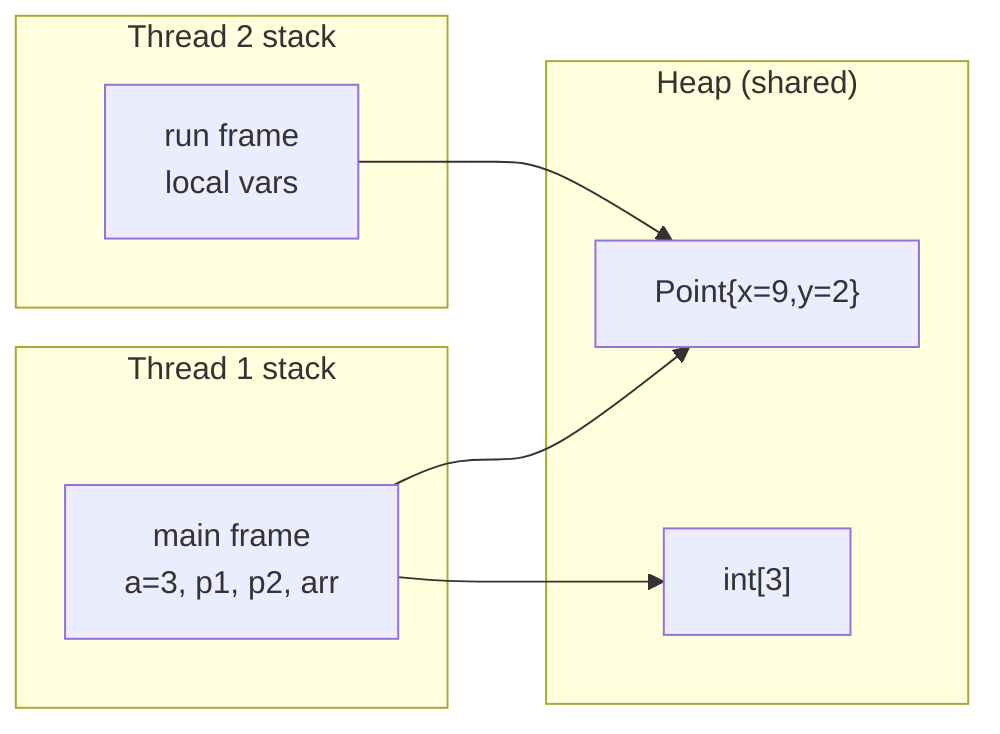
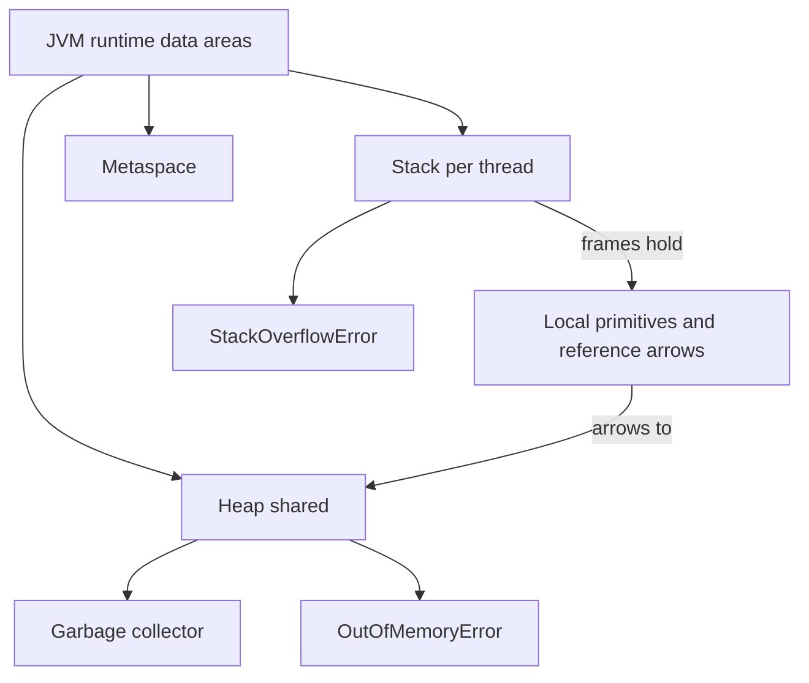

# Heap Memory and Stack Memory in Java

**TL;DR:** The JVM gives each **thread its own stack** (a pile of **frames**, one per active method call, holding local primitives and reference *variables*) and all threads share one **heap** (where every **object and array** lives, managed by the **garbage collector**). Method calls push and pop frames automatically; objects live until nothing can reach them. Run out of stack (too-deep recursion) and you get `StackOverflowError`; run out of heap and you get `OutOfMemoryError`.

## Table of Contents

1. [TL;DR](#1-tldr)
2. [Why it matters](#2-why-it-matters)
3. [Prerequisites](#3-prerequisites)
4. [Mental model](#4-mental-model)
5. [Core concepts](#5-core-concepts)
6. [How it works](#6-how-it-works)
7. [Examples](#7-examples)
8. [Comparisons](#8-comparisons)
9. [Trade-offs](#9-trade-offs)
10. [Gotchas](#10-gotchas)
11. [Practical application](#11-practical-application)
12. [Interview prep](#12-interview-prep)
13. [Interview question bank](#13-interview-question-bank)
14. [Tricky code snippets](#14-tricky-code-snippets)
15. [Connections](#15-connections)
16. [Summary](#16-summary)
17. [Answers](#answers)

---

## 1. TL;DR

- **Stack:** per thread; holds one **frame** per method call (parameters, local variables, partial results). Fast, automatic, small.
- **Heap:** shared by all threads; holds **all objects and arrays** (including `String`s and boxed numbers). Big, garbage-collected.
- **Local primitive** (`int a = 3`) → value in the frame. **Local reference** (`Point p`) → the *arrow* in the frame; the **object** is on the heap.
- **Lifetimes:** a frame dies when its method returns; an object dies when **unreachable** (the GC decides when to reclaim it).
- **Failure modes:** `StackOverflowError` (too many frames), `OutOfMemoryError` (heap or other area exhausted).

**The analogy: a restaurant with order tickets and a pantry.**

| Restaurant | Java |
|---|---|
| Each waiter has a spike of order tickets; new ticket on top, tear off the top when served | A thread's **stack**; each method call pushes a **frame**, return pops it |
| Waiters don't see each other's spikes | **Stacks are per-thread** |
| One shared pantry/storage room for ingredients and prepared dishes | The **heap** shared by all threads |
| A ticket says "grab dish from shelf 17" | A local **reference variable** holds the object's address |
| A ticket that says "table 5 wants 3 coffees" (the number itself is on the ticket) | A local **primitive** is stored in the frame |
| Janitor clears shelves nobody has a ticket for | **Garbage collector** |
| Too many tickets on the spike | `StackOverflowError` |
| The pantry is full | `OutOfMemoryError: Java heap space` |

**Running example:** a `Point` class with `x`, `y`, a `make` method that creates a `Point`, a `sum` method that uses one, a recursive `recurse(n)` that builds frames, and a `main` that holds `int a`, two `Point` references and an `int[]`. We watch the stack and heap evolve (6.3).

---

## 2. Why it matters

**The problem.** "Where does this variable live?", "what is the difference between stack and heap?" and "why `StackOverflowError` vs `OutOfMemoryError`?" are classic interview questions. They also explain pass-by-value, aliasing, garbage collection, thread safety (shared heap vs private stack) and memory leaks.

**What goes wrong** (verified on Java 21):

| Code | Result | Cause |
|---|---|---|
| `void r() { r(); }` | `StackOverflowError` | Unbounded recursion fills the thread's stack |
| `new long[Integer.MAX_VALUE]` | `OutOfMemoryError: Requested array size exceeds VM limit` | Array bigger than the VM allows |
| `new long[100000][100000]` | `OutOfMemoryError: Java heap space` | Request exceeds available heap |
| `new int[-1]` | `NegativeArraySizeException` | Invalid size, not a memory error |
| Using a local variable that was never assigned | Compile error | Locals live in frames and have no default values |
| `toString()` on two objects that print each other | `StackOverflowError` | Cyclic references cause infinite recursion |
| `static List<byte[]> CACHE` that only grows | Heap slowly fills | Reachable objects are never collected (a leak) |
| Two threads using one counter | Shared via the heap; need care | Heap is shared; local variables are private |

**Why interviewers ask.** They probe your mental model: if you can say "locals and call frames are on the stack, objects are on the heap, a reference variable on the stack points to an object on the heap", you can reason about almost any reference puzzle.

---

## 3. Prerequisites

| Prerequisite | One-line refresher | Importance |
|---|---|---|
| JVM architecture | Class loader, runtime data areas, execution engine ([JVM Architecture notes]) | Essential |
| Primitive vs reference types | Primitives hold values; references hold addresses ([Primitive vs Reference Types notes]) | Essential |
| Methods and recursion | Calls, parameters, return ([Declaring Variables and Methods notes]) | Essential |
| Pass by value | A copy of the argument goes into the callee's frame ([Pass by Value notes]) | Important |
| Constructors | `new` allocates on the heap and runs a constructor ([Constructors notes]) | Important |
| Threads (basic) | A thread is an independent flow of execution | Helpful |

---

## 4. Mental model

> **The one picture to keep in your head:** the **stack holds the variables, the heap holds the objects**, and arrows go from stack to heap (and heap to heap), never from heap back to a stack slot.

```
   STACK (one per thread)                      HEAP (shared)
  ┌─────────────────────────┐
  │ make(1,2)  frame        │               ┌──────────────────────────┐
  │   x=1  y=2              │               │ Point #1 { x=9, y=2 }    │◄─┐
  │   p ●───────────────────┼──────────────►│                          │  │
  ├─────────────────────────┤  (popped      └──────────────────────────┘  │
  │ main  frame             │   after return)                              │
  │   a = 3                 │               ┌──────────────────────────┐  │
  │   p1 ●──────────────────┼───────────────►  (same Point #1)         │──┘
  │   p2 ●──────────────────┼───────────────►                           
  │   arr ●─────────────────┼──────────────►┌──────────────────────────┐
  └─────────────────────────┘               │ int[3] { 0, 3, 0 }       │
                                            └──────────────────────────┘
```
*Stack slots hold primitives and arrows. The heap holds the things the arrows point at. `p1` and `p2` are two arrows to one Point.*


*Each thread has its own stack of frames; any thread can reach shared heap objects.*

---

## 5. Core concepts

### 5.1 Glossary

- **Stack (JVM stack):** per-thread memory made of frames; push on call, pop on return.
- **Stack frame:** the data for one method invocation: local variable slots (including parameters), an operand stack for intermediate values, and bookkeeping (return address, link to class constants).
- **Heap:** the shared area where objects and arrays are allocated and garbage-collected.
- **Object:** instance of a class on the heap: a header plus its instance fields.
- **Reference variable:** a variable holding an object's address (or `null`).
- **Garbage collection (GC):** automatic reclamation of heap objects no longer reachable.
- **GC roots:** starting points for reachability: local variables in live frames, static fields, active threads, JNI references.
- **Reachable / unreachable:** reachable objects can be reached from a GC root by following references.
- **Metaspace (method area):** class metadata, method bytecode and runtime constant pools. Native memory, not the Java heap (since Java 8).
- **String pool (intern table):** JVM-wide table of interned strings; its strings are ordinary heap objects since Java 7.
- **TLAB (thread-local allocation buffer):** a per-thread chunk of heap that makes allocation fast. ⚠️ HotSpot implementation detail.
- **Escape analysis:** a JIT optimisation that may avoid heap allocation for objects that don't escape a method. ⚠️ Not guaranteed.
- **`-Xms` / `-Xmx` / `-Xss`:** JVM options for initial heap, maximum heap, and per-thread stack size.

### 5.2 The runtime data areas

| Area | Per-thread or shared | Holds | Typical errors |
|---|---|---|---|
| **Java stack** | Per thread | Frames: locals, parameters, operand stack | `StackOverflowError` |
| **PC register** | Per thread | Address of the current instruction | n/a |
| **Native method stack** | Per thread | Frames for native (non-Java) code | `StackOverflowError` |
| **Heap** | Shared | Objects and arrays | `OutOfMemoryError: Java heap space` |
| **Method area / Metaspace** | Shared | Class metadata, bytecode, constant pools, static-variable layout | `OutOfMemoryError: Metaspace` |
| **Code cache** | Shared | JIT-compiled machine code ⚠️ HotSpot detail | Rare |

⚠️ The Java Virtual Machine Specification names these areas; exact layouts (for example where static field values live) are implementation details. In HotSpot the static field values are stored in the class's `Class` object on the heap, but conceptually statics belong to the class, not to any instance and not to a stack frame.

### 5.3 Where each kind of variable lives

| Declaration | The variable itself lives | The value / object lives |
|---|---|---|
| `int a = 3;` (local) | Stack frame | In the same slot |
| `Point p = new Point(1,2);` (local) | Stack frame (an arrow) | Object on the **heap** |
| Parameter `void f(Point p)` | Callee's stack frame (copy of the arrow) | Object on the heap |
| Instance field `int x;` | Inside its object on the **heap** | In the same place |
| Instance field `Point owner;` | Inside its object on the heap (an arrow) | Referenced object on the heap |
| `static int counter;` | Belongs to the class (method area side) ⚠️ | In the same place |
| `int[] arr = new int[3];` | Reference on the stack | Array object on the heap |
| `"hello"` literal | Reference on the stack | `String` object in the heap's string pool |
| `Integer i = 1000;` | Reference on the stack | `Integer` object on the heap |

**Primitives are on the stack only when they are locals.** A primitive *field* lives inside its heap object, and primitive array elements live inside the heap array (Snippet 20).

### 5.4 Stack frames

- A frame is created when a method is called and destroyed when it returns or throws.
- Parameters and locals occupy numbered slots; **each call gets its own slots**, which is why recursion works (Snippet 7).
- Locals have **no default value**; they must be assigned before use (Snippet 9).
- A local's scope ends with its block; the slot may be reused (Snippet 10).
- The frame size is fixed at compile time, but the number of frames depends on call depth.
- A stack trace is a listing of the active frames (Snippet 14).

### 5.5 Heap objects and their lifetimes

- Every `new` allocates on the heap (modulo JIT optimisations that don't change behaviour ⚠️).
- An object lives as long as it's **reachable**; when nothing reachable refers to it, the GC may reclaim it at some later point.
- **Re-assigning or nulling** a reference removes one referrer, but the object survives if another one remains (Snippet 1).
- The object outlives the method that created it if a reference escapes (returned, stored in a field, added to a collection) (Snippet 8).
- You never free memory yourself; you can only drop references. `System.gc()` is only a hint ⚠️.

### 5.6 Garbage collection basics

| Concept | Meaning |
|---|---|
| Reachability | Reached from a GC root via references; cycles of unreachable objects are still collected |
| Generational heap | Most objects die young: new objects go into the **young** generation; survivors are promoted to the **old** generation. ⚠️ Details differ by collector (G1 is the default since Java 9; others: Parallel, ZGC, Shenandoah, Serial) |
| Minor vs major collection | Young-generation collection (frequent, fast) vs old-generation work (rarer, costlier) ⚠️ terminology varies |
| Stop-the-world pause | Application threads pause during parts of GC; modern collectors minimise this |
| Weak reference | A reference that doesn't keep its target alive (Snippet 18) |
| Memory leak (Java sense) | Objects still reachable by mistake, so never collected (Snippet 21) |
| Finalizers | `finalize()` is deprecated for removal; use `try-with-resources`/`Cleaner` ⚠️ |

### 5.7 Errors and how they differ

| Error | Triggered by | Typical fixes |
|---|---|---|
| `StackOverflowError` | Too many nested calls (usually infinite recursion), or a cyclic `toString`/`equals`/`hashCode` (Snippets 2, 13) | Add the base case; convert to a loop; break the cycle; raise `-Xss` only as a last resort |
| `OutOfMemoryError: Java heap space` | Heap exhausted by live objects (Snippet 5) | Fix leaks, reduce data, process in chunks, raise `-Xmx` |
| `OutOfMemoryError: Requested array size exceeds VM limit` | Array length near `Integer.MAX_VALUE` (Snippets 4, 23) | Use smaller arrays, chunking, or other structures |
| `OutOfMemoryError: Metaspace` | Too many classes loaded (class loader leaks) | Fix class-loader leaks; `-XX:MaxMetaspaceSize` |
| `OutOfMemoryError: unable to create native thread` | OS can't create more threads ⚠️ | Fewer threads, smaller `-Xss` |
| `NegativeArraySizeException` | `new int[-1]` (Snippet 6) | Validate the size |

Both `StackOverflowError` and `OutOfMemoryError` extend `Error` (via `VirtualMachineError`), not `Exception`. You *can* catch them (Snippet 2) but rarely should, except at a top-level boundary or in a demonstration.

### 5.8 Memory and threads

- Each thread has its **own stack**, so local variables are inherently thread-safe (Snippet 11).
- Heap objects are shared, so shared mutable objects need synchronisation or immutability.
- A new thread's stack size can be requested in the `Thread` constructor or with `-Xss` ⚠️ platform dependent (Snippet 12).

### 5.9 JVM memory options (common)

| Option | Meaning |
|---|---|
| `-Xms512m` | Initial heap size |
| `-Xmx2g` | Maximum heap size |
| `-Xss1m` | Per-thread stack size |
| `-XX:MaxMetaspaceSize=256m` | Cap on metaspace |
| `-XX:+HeapDumpOnOutOfMemoryError` | Write a heap dump when heap OOM happens |
| `-Xlog:gc` | Print GC activity (unified logging, Java 9+) |

⚠️ Default heap and stack sizes depend on the JVM, version, OS and machine. As a common rule on 64-bit HotSpot: max heap defaults to about a quarter of physical memory, and the default thread stack is about 1 MB on Linux x64. Check your own JVM before quoting numbers.

---

## 6. How it works

### 6.1 What happens on a method call

```mermaid
sequenceDiagram
    participant Caller
    participant Stack
    participant Heap
    Caller->>Stack: push new frame (parameter slots = copies of arguments)
    Stack->>Stack: locals assigned, operand stack used for expressions
    Stack->>Heap: new Foo() allocates on the heap; arrow stored in a local
    Stack-->>Caller: return value copied to caller's frame
    Note over Stack: frame popped; its locals vanish
    Note over Heap: objects stay while any reachable arrow points to them
```
*The stack is cleaned up immediately by popping; the heap is cleaned up later by the garbage collector.*

### 6.2 What `new Point(1, 2)` does

1. Find space on the heap (usually a quick bump of a pointer in the thread's allocation buffer ⚠️).
2. Zero the memory, so all fields start at default values (`0`, `false`, `null`).
3. Set up the object header (class pointer, hash/lock bits ⚠️ layout is JVM-specific).
4. Run the constructor.
5. Put the resulting arrow in the variable you assigned to (a stack slot, a field, or an array element).

### 6.3 Worked trace: the `Point` program

```java
class Point {
    int x, y;
    Point(int x, int y) { this.x = x; this.y = y; }
    public String toString() { return "(" + x + "," + y + ")"; }
}
public class Main {
    static Point make(int x, int y) { Point p = new Point(x, y); return p; }
    static int sum(Point p) { int total = p.x + p.y; p = null; return total; }
    static void recurse(int n) {
        int local = n * 10;
        if (n > 0) recurse(n - 1);
        System.out.print(local + " ");
    }
    public static void main(String[] args) {
        int a = 3;
        Point p1 = make(1, 2);
        Point p2 = p1;
        p2.x = 9;
        System.out.println(p1 + " " + sum(p1) + " " + p1);
        recurse(3);
        System.out.println();
        int[] arr = new int[3];
        arr[1] = a;
        System.out.println(java.util.Arrays.toString(arr));
    }
}
```

Output (verified, Java 21):

```
(9,2) 11 (9,2)
0 10 20 30 
[0, 3, 0]
```

| Step | Stack | Heap |
|---|---|---|
| `main` starts | `main` frame: `args`, `a=3` | (empty for our objects) |
| `make(1, 2)` | New frame: `x=1, y=2, p→` | `Point#1 {1,2}` created by `new` |
| `make` returns | Frame popped; arrow copied into `p1` | `Point#1` **survives**: `p1` refers to it |
| `p2 = p1` | `p2` = copy of the arrow | Still one object (aliasing) |
| `p2.x = 9` | no change | `Point#1 {9,2}` (both names see it) |
| `sum(p1)` | New frame: `p→Point#1`, `total=11`; then `p = null` | `Point#1` untouched; `p1` still refers to it |
| `sum` returns 11 | Frame popped | Point still `{9,2}`: the output shows `(9,2) 11 (9,2)` |
| `recurse(3)` | Four frames: `n=3,2,1,0`, each with its own `local` | none |
| unwinding | Frames pop from `n=0`; each prints its `local` | `0 10 20 30` |
| `new int[3]`, `arr[1] = a` | `arr→` array | `int[3]` becomes `{0,3,0}` |

During `recurse(0)` the stack looks like this (top at the bottom of the picture):

```
 main            a=3 p1● p2● arr
 recurse(n=3)    local=30
 recurse(n=2)    local=20
 recurse(n=1)    local=10
 recurse(n=0)    local=0      ← current frame; it prints "0 " first, then returns
```

### 6.4 Why `StackOverflowError` happens

Every call needs a frame; the stack has a fixed maximum size per thread. Infinite (or just very deep) recursion keeps pushing frames until the limit and the JVM throws `StackOverflowError` (Snippet 2). The error is thrown inside the thread; the program continues if you catch it (Snippet 2) or the thread dies if you don't.

How deep can you go? It depends on frame size, JIT state and `-Xss` ⚠️. In one run on this machine a recursion of depth 1,000,000 overflowed on the main thread but succeeded in a thread created with a 512 MB stack (Snippet 12). Don't rely on any particular number.

### 6.5 Why `OutOfMemoryError` happens

The JVM tries to allocate; if there isn't enough free heap even after a collection, it throws `OutOfMemoryError`. The message tells you which limit was hit: `Java heap space` (Snippet 5) or `Requested array size exceeds VM limit` (Snippets 4, 23). A program that only keeps what it needs rarely hits it; leaks and giant data sets do.

### 6.6 Reachability in one picture

```
 GC roots:  main-frame locals, static fields, live threads
        │
        ▼
     Point#1 ──► Address#7        reachable: kept
     Point#2 ──► (cycle) ◄── Point#3   if no root reaches the cycle: unreachable, collected
```
*Cycles don't protect objects from collection; only reachability from a root does.*

---

## 7. Examples

### 7.1 Toy examples

**A local primitive vs a local reference:**

```java
int n = 5;                    // stack: n = 5
StringBuilder sb = new StringBuilder("x");  // stack: sb ●  →  heap: StringBuilder
```

**A returned object survives its frame:**

```java
static Box make() { Box local = new Box(7); return local; }
```
`local` disappears with the frame, but the `Box` lives on because the caller keeps the arrow (Snippet 8).

### 7.2 Real-world examples

- **Recursion limits:** naive recursive algorithms over deep structures (long linked lists, deep trees) may overflow; convert to iteration or increase the thread stack.
- **Caches and static collections:** a `static Map` that only grows is the classic Java memory leak (Snippet 21).
- **Large collections:** `ArrayList<Integer>` holds *arrays of references to Integer objects*, so it uses far more memory than `int[]` (each boxed value is its own heap object).
- **Heap dumps:** after `OutOfMemoryError`, a heap dump plus a profiler shows what's keeping objects alive.
- **Thread pools:** each thread costs stack memory (reserved from the OS), so thousands of threads can fail with "unable to create native thread" ⚠️.
- **Immutable objects:** safe to share between threads; no locking needed.

---

## 8. Comparisons

### 8.1 Stack vs heap

| Aspect | Stack | Heap |
|---|---|---|
| Scope | One per thread | Shared by all threads |
| Contents | Frames: locals, parameters, intermediate values | Objects, arrays |
| Allocation | Automatic on call | `new` |
| Deallocation | Automatic on return (pop) | Garbage collector, later |
| Size | Small (about a MB per thread by default ⚠️) | Large (GBs) |
| Speed | Very fast | Slower (allocation + GC) |
| Failure | `StackOverflowError` | `OutOfMemoryError` |
| Thread safety | Naturally thread-confined | Needs care |
| Lifetime | Until method returns | Until unreachable |

### 8.2 Java stack vs C/C++ memory

| | Java | C/C++ |
|---|---|---|
| Objects | Always on the heap (no `new`-free objects as locals) ⚠️ JIT may optimise | Can be stack objects |
| Freeing heap memory | Automatic GC | `delete`/`free` manually |
| Dangling pointers | Not possible (references keep objects alive) | Possible |
| Memory leaks | Only via reachable-but-unused objects | Also forgotten `free` |

### 8.3 Primitives vs references on the stack

| | `int a = 3;` | `Point p = new Point();` |
|---|---|---|
| Slot contains | The number | An arrow |
| Copy on assignment | Independent copy | Another arrow to the same object |
| Default | None (must assign) | None for locals (must assign); `null` for fields |

### 8.4 Heap vs metaspace vs string pool

| Area | Holds | Managed by |
|---|---|---|
| Heap | Objects, arrays, interned strings, boxed values | GC |
| Metaspace | Class metadata, method bytecode, constants | Class unloading; native memory |
| String pool | Interned `String` objects (kept in the heap since Java 7) | GC |

### 8.5 `StackOverflowError` vs `OutOfMemoryError`

| | `StackOverflowError` | `OutOfMemoryError` |
|---|---|---|
| Resource | Thread stack | Heap, metaspace, native threads |
| Typical cause | Deep/infinite recursion | Leak or too much data |
| Scope of impact | The thread | Possibly the whole JVM |
| Quick fix | Base case/iteration | Fix leak, increase `-Xmx`, reduce data |

---

## 9. Trade-offs

| Decision | Benefit | Cost | Use when |
|---|---|---|---|
| Recursion | Clear code for trees/divide-and-conquer | Stack depth limits | Bounded depth (log n) |
| Iteration with an explicit stack/queue | No stack overflow; heap-bounded | More code | Deep or unbounded input |
| More heap (`-Xmx`) | Fewer OOMs | Longer GC pauses, memory cost | After fixing leaks |
| Larger thread stack (`-Xss`) | Deeper recursion | Memory per thread × thread count | Specific deep-recursion threads (Snippet 12) |
| Many small objects | Simple design | Allocation + GC pressure + memory overhead | Normally fine; profile first |
| Primitive arrays vs boxed collections | Compact, fast | Less convenient API | Large numeric data |
| Object pooling | Fewer allocations | Complexity, leaks | Rarely; modern GCs are good ⚠️ |
| Caching with strong references | Fast repeat access | Can leak | Use bounded or weak/soft caches |
| Calling `System.gc()` | None reliable | Pauses, unpredictability | Basically never ⚠️ |

---

## 10. Gotchas

### Myths

- ❌ **Myth:** "Objects are stored on the stack if they're local variables." ✅ **Reality:** the *variable* is on the stack; the *object* is on the heap (Snippet 1).
- ❌ **Myth:** "Primitives always live on the stack." ✅ **Reality:** only **locals**. A primitive field lives inside its object on the heap; array elements live in the array (Snippet 20).
- ❌ **Myth:** "Static variables live on the stack." ✅ **Reality:** they belong to the class, not to any frame or instance (Snippet 19).
- ❌ **Myth:** "`obj = null` frees the memory immediately." ✅ **Reality:** it removes one reference; reclamation happens later, if at all, and only when unreachable (Snippet 18).
- ❌ **Myth:** "`System.gc()` frees memory." ✅ **Reality:** it's a hint ⚠️; the JVM may ignore it.
- ❌ **Myth:** "Java has no memory leaks because of GC." ✅ **Reality:** reachable-but-unused objects leak (Snippet 21).
- ❌ **Myth:** "Each thread has its own heap." ✅ **Reality:** each has its own **stack**; the heap is shared.
- ❌ **Myth:** "Strings live in a separate memory region." ✅ **Reality:** since Java 7 the string pool is in the heap; literals are heap objects (Snippet 15).
- ❌ **Myth:** "`StackOverflowError` is an exception you should always catch." ✅ **Reality:** it's an `Error`; fix the recursion rather than catch it.

### Common mistakes and edge cases

- **Recursion without a base case** (Snippet 2).
- **Mutual references in `toString`** printing each other (Snippet 13).
- **Using an unassigned local** (Snippet 9) or a variable outside its block (Snippet 10).
- **Growing static collections** with no eviction (Snippet 21).
- **Assuming a deep recursion limit** (like 10,000) will work everywhere (Snippet 12).
- **Confusing `NegativeArraySizeException` with OOM** (Snippet 6).
- **Believing `Integer` comparisons by `==` are safe** beyond the small cache (Snippet 22).
- **Comparing strings with `==`** (Snippet 15).
- **Treating `Runtime.freeMemory()` as exact:** it's approximate and changes as GC runs (Snippet 17).
- **Capturing large objects in long-lived lambdas or threads**, keeping them reachable.

---

## 11. Practical application

### Checklist when reasoning about memory
- [ ] For each variable: is it a local primitive, local reference, field, array element or static?
- [ ] For each `new`: who holds a reference, and for how long?
- [ ] Is there any recursion? What bounds its depth?
- [ ] Are there static or long-lived collections? What removes entries?
- [ ] Could objects reference each other in a cycle that a method (like `toString`) follows?
- [ ] Which data is shared between threads?
- [ ] Is an OOM possible from a single huge allocation or from many small ones?

### Hands-on exercise: draw the memory

```java
public class Main {
    static int f(int[] data, int k) {
        int local = data[0] + k;
        data = new int[]{100};
        return local + data[0];
    }
    public static void main(String[] args) {
        int[] nums = {1, 2, 3};
        int r = f(nums, 10);
        nums[0] = 7;
        String s = "hi";
        String t = s;
        s = s + "!";
        System.out.println(r + " " + nums[0] + " " + s + " " + t);
    }
}
```
(a) Predict the output. (b) For the moment just before `f` returns, list what is on the stack and what is on the heap. (c) After `main` finishes the statement `s = s + "!"`, which String objects exist and who refers to them?

<details><summary>Solution</summary>

**(a)** `111 7 hi! hi`. In `f`, `local = 1 + 10 = 11`; `data` is re-assigned to a new array `{100}`, so it returns `11 + 100 = 111`. The caller's `nums` array is untouched by that re-assignment, and then `nums[0] = 7`.

**(b)** *Stack:* `main` frame (`args`, `nums→`, `r` not yet assigned) and `f` frame (`data→` the new `{100}` array, `k=10`, `local=11`). *Heap:* the original `int[3] {1,2,3}` (referred to by `nums`), the new `int[1] {100}` (referred to only by `data`; unreachable once `f` returns).

**(c)** The pooled literal `"hi"` (referred to by `t`) and a new heap `String` `"hi!"` (referred to by `s`). `s + "!"` creates a new object; `t` still points to the original (Snippet 16 pattern).

*(Run on Java 21; it printed `111 7 hi! hi`.)*
</details>

---

## 12. Interview prep

<details><summary>1. What is the difference between stack and heap memory in Java?</summary>

The stack is per-thread memory for method calls: one frame per call, holding parameters, local primitives, local reference variables and intermediate values; frames are popped on return. The heap is shared memory for all objects and arrays, reclaimed by the garbage collector when they become unreachable.

Say it with the picture: "variables on the stack, objects on the heap, arrows from one to the other" (Snippet 1).
</details>

<details><summary>2. Where does `Point p = new Point(1, 2);` live?</summary>

The reference variable `p` is a local in the current stack frame. The `Point` object, with its fields `x` and `y`, is on the heap.
</details>

<details><summary>3. Where do primitives live?</summary>

Local primitives are in the stack frame. Primitive fields live inside their object on the heap, and array elements live in the array object on the heap (Snippet 20).
</details>

<details><summary>4. Where are static variables and string literals?</summary>

Static variables belong to the class (method area/class data), not to a frame or an instance ⚠️ HotSpot keeps their values in the `Class` object on the heap. String literals are `String` objects in the string pool, which has been part of the heap since Java 7 (Snippet 15).
</details>

<details><summary>5. What causes `StackOverflowError`, and how do you fix it?</summary>

Too many nested method calls, almost always unbounded recursion (or a cycle such as two `toString`s calling each other). Add or fix the base case, convert to iteration with an explicit stack, break the cycle, or as a last resort raise `-Xss` (Snippets 2, 12, 13).
</details>

<details><summary>6. What causes `OutOfMemoryError`, and how do you investigate?</summary>

The JVM can't satisfy an allocation even after GC: too much live data, a leak, or one oversized request. Read the message (`Java heap space`, `Metaspace`, `Requested array size exceeds VM limit`), enable `-XX:+HeapDumpOnOutOfMemoryError`, and inspect what's retaining objects (Snippets 4, 5, 21).
</details>

<details><summary>7. How does garbage collection decide what to free?</summary>

By reachability. Starting from GC roots (locals in live frames, static fields, live threads), everything reachable is kept; everything else may be reclaimed. Cycles don't matter on their own (6.6). When it runs is up to the JVM.
</details>

<details><summary>8. Can Java have memory leaks?</summary>

Yes: objects that are still reachable but no longer needed, such as entries in a static collection that is never cleared, listeners that are never removed, or `ThreadLocal`s on pooled threads. GC can't reclaim what's reachable (Snippet 21).
</details>

---

## 13. Interview question bank

### 13.1 Basics (Q1–Q14)

<details><summary>Q1. What is the stack?</summary>

A per-thread region of memory that stores frames for active method calls, last-in first-out.
</details>

<details><summary>Q2. What is the heap?</summary>

The shared region where all objects and arrays are allocated and garbage collected.
</details>

<details><summary>Q3. What is a stack frame, and what does it contain?</summary>

The data for one method call: local variable slots (parameters first), an operand stack for expression evaluation, and bookkeeping like the return address and constant-pool link.
</details>

<details><summary>Q4. When is a frame created and destroyed?</summary>

Created when the method is invoked; destroyed when it returns normally or via an exception.
</details>

<details><summary>Q5. Is the stack shared between threads?</summary>

No; each thread has its own (Snippet 11).
</details>

<details><summary>Q6. Is the heap shared between threads?</summary>

Yes. That's why shared mutable objects need synchronisation.
</details>

<details><summary>Q7. What gets stored in the stack for `int a = 3;` vs `Point p = new Point();`?</summary>

The value `3` for `a`; an arrow (reference) for `p`. The Point itself is on the heap.
</details>

<details><summary>Q8. Do local variables have default values?</summary>

No; the compiler requires definite assignment (Snippet 9). Fields and array elements do get defaults.
</details>

<details><summary>Q9. What happens to a local variable's storage when the method returns?</summary>

The frame is popped, so the variable ceases to exist. Objects it referred to survive if reachable some other way (Snippet 8).
</details>

<details><summary>Q10. Where do objects get allocated?</summary>

On the heap, with `new`. (The JIT may avoid the allocation when an object doesn't escape ⚠️ but the semantics are the same.)
</details>

<details><summary>Q11. Who frees heap memory?</summary>

The garbage collector, automatically. You can't free it explicitly.
</details>

<details><summary>Q12. What is metaspace?</summary>

Native memory holding class metadata and bytecode; it replaced PermGen in Java 8.
</details>

<details><summary>Q13. What are `-Xms`, `-Xmx` and `-Xss`?</summary>

Initial heap size, maximum heap size, and per-thread stack size.
</details>

<details><summary>Q14. What does `new` do at the memory level?</summary>

Allocates heap memory (zeroed), sets up the object header, runs the constructor, and returns a reference (6.2).
</details>

### 13.2 Stack vs heap in code (Q15–Q30)

<details><summary>Q15. After `Point p2 = p1;` how many objects are there?</summary>

One. Two stack variables refer to it (Snippet 1).
</details>

<details><summary>Q16. After `p1 = null;` is the object freed?</summary>

Not if `p2` still refers to it. Even if nothing does, it's only eligible, not immediately freed (Snippet 18).
</details>

<details><summary>Q17. Does an object created in a method disappear when the method ends?</summary>

Only if nothing else refers to it. If it's returned or stored, it lives on (Snippet 8).
</details>

<details><summary>Q18. How does passing an object to a method relate to stack and heap?</summary>

A copy of the arrow is placed in the callee's frame; the object isn't copied (Snippet 1 `sum`).
</details>

<details><summary>Q19. Where is an instance field of primitive type stored?</summary>

Inside the object on the heap (Snippet 20).
</details>

<details><summary>Q20. Where are the elements of `new int[3]` stored?</summary>

Within the array object on the heap, with default value `0` (Snippet 20).
</details>

<details><summary>Q21. How is a 2-D array laid out?</summary>

An outer array of references to separate inner arrays, all on the heap; `g[0] != g[1]` (Snippet 20).
</details>

<details><summary>Q22. Where do `String` literals live?</summary>

In the string pool, which is part of the heap since Java 7 (Snippet 15).
</details>

<details><summary>Q23. `new String("pool")` vs `"pool"`: how many objects?</summary>

The literal is one pooled object; `new String(...)` creates another heap object. So `"pool" == new String("pool")` is `false` (Snippet 15).
</details>

<details><summary>Q24. Does `a += "y"` change the String `b` also refers to?</summary>

No; it creates a new String for `a` (Snippet 16).
</details>

<details><summary>Q25. Where does an `Integer` object live?</summary>

On the heap. Values from -128 to 127 are cached by `Integer.valueOf`, so `==` can be `true` for small values and `false` for large ones (Snippet 22).
</details>

<details><summary>Q26. Where do local variables captured by a lambda live?</summary>

Their values are copied into the lambda object (on the heap); the original locals stay in the frame. Hence effectively final.
</details>

<details><summary>Q27. Is a `static` variable shared by all instances and threads?</summary>

Yes, one copy per class (per class loader). It's neither on the stack nor in each object (Snippet 19).
</details>

<details><summary>Q28. Does each call to a recursive method get its own local variables?</summary>

Yes, one frame per call (Snippet 7).
</details>

<details><summary>Q29. In what order do frames unwind in `recurse(3)`?</summary>

The innermost call returns first, so output is `0 10 20 30` (Snippet 1).
</details>

<details><summary>Q30. What does a stack trace show?</summary>

The active frames, innermost first (`c b a main` in Snippet 14).
</details>

### 13.3 Errors, GC and tuning (Q31–Q48)

<details><summary>Q31. Difference between `StackOverflowError` and `OutOfMemoryError`?</summary>

Stack of one thread exhausted by too many frames vs heap/metaspace/native memory exhausted (8.5).
</details>

<details><summary>Q32. Are they exceptions?</summary>

They are `Error`s (subclasses of `VirtualMachineError`), not `Exception`s. Catching them is rarely wise (Snippet 2).
</details>

<details><summary>Q33. Can a program continue after `StackOverflowError`?</summary>

Yes, if caught; the stack unwinds (Snippet 2). The state of any half-finished work may be inconsistent.
</details>

<details><summary>Q34. What message do you get for a huge array request?</summary>

`Requested array size exceeds VM limit` for lengths near `Integer.MAX_VALUE`, or `Java heap space` when the size is allowed but doesn't fit (Snippets 4, 5, 23).
</details>

<details><summary>Q35. `new int[-1]`: which error?</summary>

`NegativeArraySizeException`, a runtime exception, not an OOM (Snippet 6).
</details>

<details><summary>Q36. What are GC roots?</summary>

Local variables in live frames, static fields, active threads, and JNI references.
</details>

<details><summary>Q37. Can circular references be collected?</summary>

Yes, if the cycle is unreachable from the roots. Java GCs trace reachability rather than counting references.
</details>

<details><summary>Q38. What is the young/old generation split?</summary>

Most objects die young, so new objects go to a young region collected often and cheaply; survivors are promoted to old space collected less often ⚠️ details vary by collector.
</details>

<details><summary>Q39. Does `System.gc()` guarantee collection?</summary>

No; it's a request the JVM may ignore ⚠️ (Snippet 18 loops with `gc()` and observes the result, but this timing isn't guaranteed).
</details>

<details><summary>Q40. What are weak references for?</summary>

Referring to an object without keeping it alive; useful for caches and canonicalising maps (`WeakHashMap`) (Snippet 18).
</details>

<details><summary>Q41. How do you create a memory leak in Java?</summary>

Keep objects reachable through a long-lived structure and never remove them (static map/list, unremoved listeners, `ThreadLocal` on pooled threads) (Snippet 21).
</details>

<details><summary>Q42. How do you find a leak?</summary>

Heap dump (`-XX:+HeapDumpOnOutOfMemoryError`, `jmap`), then a tool such as Eclipse MAT or VisualVM to see what retains the objects; monitor GC logs (`-Xlog:gc`).
</details>

<details><summary>Q43. How would you reduce memory used by a huge `List<Integer>`?</summary>

Use `int[]` or a primitive-specialised collection; each `Integer` is a separate heap object.
</details>

<details><summary>Q44. How do you avoid `StackOverflowError` on a deep structure?</summary>

Iterate with an explicit `Deque` (heap-allocated), use tail-recursion-style loops, or increase the stack for a dedicated thread (Snippet 12).
</details>

<details><summary>Q45. Does Java optimise tail calls?</summary>

No; Java doesn't guarantee tail-call elimination, so deep tail recursion still consumes frames.
</details>

<details><summary>Q46. What is escape analysis?</summary>

A JIT analysis that can prove an object doesn't escape a method and avoid allocating it on the heap (scalar replacement). It's an optimisation, not something to rely on ⚠️.
</details>

<details><summary>Q47. What is a TLAB?</summary>

A thread-local allocation buffer: a slice of the heap each thread allocates from without locking, making `new` fast ⚠️ HotSpot detail.
</details>

<details><summary>Q48. What does `Runtime.totalMemory()` / `freeMemory()` / `maxMemory()` report?</summary>

Current heap size, free portion of it, and the maximum the JVM will try to use. They are approximate and change with GC (Snippet 17).
</details>

### 13.4 Threads and design (Q49–Q56)

<details><summary>Q49. Why are local variables thread-safe but fields aren't?</summary>

Locals are in a thread's private frame; fields of shared objects are on the shared heap (Snippet 11).
</details>

<details><summary>Q50. Two threads each call `work(n)` with a local counter and a shared `AtomicInteger`. What's private and what's shared?</summary>

The local counter is private to each call; the `AtomicInteger` is shared (Snippet 11: `1000 2000 3000`).
</details>

<details><summary>Q51. Does each thread have its own heap?</summary>

No, just its own stack (and, in HotSpot, a TLAB ⚠️ slice of the shared heap).
</details>

<details><summary>Q52. How many threads can I create?</summary>

Limited by OS resources and stack size per thread; each thread reserves its stack. Too many gives `OutOfMemoryError: unable to create native thread` ⚠️.
</details>

<details><summary>Q53. Why is immutability useful for memory and threads?</summary>

Immutable objects can be shared freely across threads and frames without defensive copies or locks.
</details>

<details><summary>Q54. What's the memory cost of a cyclic `toString`?</summary>

Not memory but stack: infinite mutual calls overflow it (Snippet 13).
</details>

<details><summary>Q55. A method returns a local `StringBuilder`. Is that unsafe like returning a pointer to a C++ local?</summary>

No. The object is on the heap and stays alive; only the stack variable disappears (Snippet 8).
</details>

<details><summary>Q56. Explain stack vs heap in one sentence.</summary>

"The stack holds each call's variables and dies with the call; the heap holds the objects, shared and garbage-collected when unreachable."
</details>

---

## 14. Tricky code snippets

23 snippets, each compiled and run on OpenJDK 21. Predict the output (or the compile error) before opening the answer. Classes are declared without `public` so they can share one file.

### Snippet 1: The Point program

```java
class Point { int x, y; Point(int x, int y) { this.x = x; this.y = y; } public String toString() { return "(" + x + "," + y + ")"; } }
public class Main {
    static Point make(int x, int y) { Point p = new Point(x, y); return p; }
    static int sum(Point p) { int total = p.x + p.y; p = null; return total; }
    static void recurse(int n) {
        int local = n * 10;
        if (n > 0) recurse(n - 1);
        System.out.print(local + " ");
    }
    public static void main(String[] args) {
        int a = 3;
        Point p1 = make(1, 2);
        Point p2 = p1;
        p2.x = 9;
        System.out.println(p1 + " " + sum(p1) + " " + p1);
        recurse(3);
        System.out.println();
        int[] arr = new int[3];
        arr[1] = a;
        System.out.println(java.util.Arrays.toString(arr));
    }
}
```

<details><summary>Answer</summary>

```
(9,2) 11 (9,2)
0 10 20 30 
[0, 3, 0]
```

Trace in 6.3: `p1` and `p2` alias one heap object; `sum`'s `p = null` only clears its local; `recurse` builds four frames that unwind innermost-first.
</details>

### Snippet 2: Unbounded recursion

```java
public class Main {
    static int depth = 0;
    static void recurse() { depth++; recurse(); }
    public static void main(String[] args) {
        try { recurse(); } catch (StackOverflowError e) { System.out.println("StackOverflowError caught, depth > 1000: " + (depth > 1000)); }
        System.out.println("program continues");
    }
}
```

<details><summary>Answer</summary>

```
StackOverflowError caught, depth > 1000: true
program continues
```

The `Error` is catchable, and execution resumes after the catch. The exact depth varies by JVM and settings ⚠️, so the program prints only whether it exceeded 1000.
</details>

### Snippet 3: StackOverflowError details

```java
public class Main {
    static void recurse() { recurse(); }
    public static void main(String[] args) {
        try { recurse(); } catch (StackOverflowError e) { System.out.println(e.getClass().getName() + " " + (e.getMessage() == null)); }
    }
}
```

<details><summary>Answer</summary>

```
java.lang.StackOverflowError true
```

The class is `java.lang.StackOverflowError`, and its message is `null` (`getMessage() == null` is `true`).
</details>

### Snippet 4: Largest possible array

```java
public class Main {
    public static void main(String[] args) {
        try { long[] big = new long[Integer.MAX_VALUE]; }
        catch (OutOfMemoryError e) { System.out.println("OOM: " + e.getMessage()); }
    }
}
```

<details><summary>Answer</summary>

```
OOM: Requested array size exceeds VM limit
```

A length of `Integer.MAX_VALUE` exceeds what the VM permits for `long[]`, so this isn't a plain heap shortage.
</details>

### Snippet 5: Too big for the heap

```java
public class Main {
    public static void main(String[] args) {
        try { long[][] big = new long[100000][100000]; System.out.println("allocated?"); }
        catch (OutOfMemoryError e) { System.out.println("OOM: " + e.getMessage()); }
    }
}
```

<details><summary>Answer</summary>

```
OOM: Java heap space
```

`new long[100000][100000]` asks for about 80 GB in total, which is far more than the heap can supply. ⚠️ On a machine with an enormous heap the outcome could differ.
</details>

### Snippet 6: Negative array size

```java
public class Main {
    public static void main(String[] args) {
        int n = -1;
        int[] a = new int[n];
    }
}
```

<details><summary>Answer</summary>

`NegativeArraySizeException: -1` (uncaught, so the program ends with a stack trace).

Not a memory error; the size is invalid.
</details>

### Snippet 7: Each call has its own locals

```java
public class Main {
    static int fact(int n) { int local = n; return n <= 1 ? 1 : local * fact(n - 1); }
    static void show(int n) {
        int mine = n;
        if (n > 0) show(n - 1);
        System.out.print(mine + " ");
    }
    public static void main(String[] args) { show(3); System.out.println(fact(5)); }
}
```

<details><summary>Answer</summary>

```
0 1 2 3 120
```

`show` prints after recursing, so `mine` values appear innermost first. `fact(5)` is `120`. Each frame has its own `n`, `mine` and `local`.
</details>

### Snippet 8: Returned object survives

```java
class Box { int v; Box(int v) { this.v = v; } }
public class Main {
    static Box make() { Box local = new Box(7); return local; }
    static int useAndDrop() { Box tmp = new Box(8); return tmp.v; }
    public static void main(String[] args) {
        Box b = make();
        System.out.println(b.v + " " + useAndDrop());
    }
}
```

<details><summary>Answer</summary>

```
7 8
```

`local` disappears with `make`'s frame but the `Box` lives on in `b`. `tmp` in `useAndDrop` becomes unreachable after the return.
</details>

### Snippet 9: Locals have no default

```java
public class Main {
    public static void main(String[] args) {
        int local;
        int[] arr = new int[1];
        System.out.println(arr[0]);
        System.out.println(local);
    }
}
```

<details><summary>Answer</summary>

Compile error: *variable local might not have been initialized*.

Array elements get defaults (`arr[0]` would print `0`), but locals do not.
</details>

### Snippet 10: Scope ends with the block

```java
public class Main {
    public static void main(String[] args) {
        { int inner = 5; System.out.println(inner); }
        System.out.println(inner);
    }
}
```

<details><summary>Answer</summary>

Compile error: *cannot find symbol* for the second `inner`.

The variable exists only inside its block; the first `println` is fine.
</details>

### Snippet 11: Per-thread stacks, shared heap

```java
import java.util.concurrent.atomic.AtomicInteger;
public class Main {
    static final AtomicInteger shared = new AtomicInteger();
    static int work(int n) { int local = 0; for (int i = 0; i < n; i++) { local++; shared.incrementAndGet(); } return local; }
    public static void main(String[] args) throws Exception {
        int[] results = new int[2];
        Thread t1 = new Thread(() -> results[0] = work(1000));
        Thread t2 = new Thread(() -> results[1] = work(2000));
        t1.start(); t2.start(); t1.join(); t2.join();
        System.out.println(results[0] + " " + results[1] + " " + shared.get());
    }
}
```

<details><summary>Answer</summary>

```
1000 2000 3000
```

Each thread's `local` is private (1000 and 2000); the shared `AtomicInteger` totals 3000.
</details>

### Snippet 12: Deep recursion on a big stack

```java
public class Main {
    static int depth(int n) { return n == 0 ? 0 : 1 + depth(n - 1); }
    public static void main(String[] args) throws Exception {
        try { System.out.println(depth(1_000_000)); } catch (StackOverflowError e) { System.out.println("main thread: SO at 1,000,000"); }
        Thread t = new Thread(null, () -> System.out.println("big stack thread: " + depth(1_000_000)), "big", 1L << 29);
        t.start(); t.join();
    }
}
```

<details><summary>Answer</summary>

```
main thread: SO at 1,000,000
big stack thread: 1000000
```

The default stack overflowed at depth 1,000,000, but a thread created with a 512 MB stack (`1L << 29`) succeeded. ⚠️ Results depend on the JVM, OS, `-Xss` and JIT state; don't treat any depth as guaranteed.
</details>

### Snippet 13: Cyclic `toString`

```java
class Node {
    String name; Node other;
    Node(String n) { name = n; }
    @Override public String toString() { return name + "->" + other; }
}
public class Main {
    public static void main(String[] args) {
        Node a = new Node("a"), b = new Node("b");
        a.other = b; b.other = a;
        try { System.out.println(a); } catch (StackOverflowError e) { System.out.println("StackOverflowError from cyclic toString"); }
    }
}
```

<details><summary>Answer</summary>

```
StackOverflowError from cyclic toString
```

`a.toString()` calls `b.toString()`, which calls `a.toString()`, and so on.
</details>

### Snippet 14: Frames in a stack trace

```java
public class Main {
    static void a() { b(); }
    static void b() { c(); }
    static void c() {
        StringBuilder sb = new StringBuilder();
        for (StackTraceElement e : new Throwable().getStackTrace()) sb.append(e.getMethodName()).append(' ');
        System.out.println(sb.toString().trim());
    }
    public static void main(String[] args) { a(); }
}
```

<details><summary>Answer</summary>

```
c b a main
```

The innermost frame is listed first.
</details>

### Snippet 15: String pool

```java
public class Main {
    public static void main(String[] args) {
        String a = "pool";
        String b = "pool";
        String c = new String("pool");
        String d = "po" + "ol";
        System.out.println((a == b) + " " + (a == c) + " " + (a == d) + " " + (a == c.intern()));
    }
}
```

<details><summary>Answer</summary>

```
true false true true
```

`a == b`: same pooled literal. `a == c`: `new String` creates a separate heap object. `a == d`: `"po" + "ol"` is a compile-time constant, so it's pooled. `c.intern()` returns the pooled instance.
</details>

### Snippet 16: Concatenation makes new objects

```java
public class Main {
    public static void main(String[] args) {
        String a = "x";
        String b = a;
        a += "y";
        System.out.println(a + " " + b + " " + (a == b));
        StringBuilder s1 = new StringBuilder("x");
        StringBuilder s2 = s1;
        s1.append("y");
        System.out.println(s1 + " " + s2 + " " + (s1 == s2));
    }
}
```

<details><summary>Answer</summary>

```
xy x false
xy xy true
```

`String +=` creates a new String (`b` keeps the old one); `StringBuilder.append` mutates the same object that `s2` refers to.
</details>

### Snippet 17: Runtime memory queries

```java
public class Main {
    public static void main(String[] args) {
        Runtime rt = Runtime.getRuntime();
        System.out.println((rt.maxMemory() > 0) + " " + (rt.totalMemory() >= rt.freeMemory()) + " " + (rt.availableProcessors() >= 1));
    }
}
```

<details><summary>Answer</summary>

```
true true true
```

`maxMemory() > 0`, `totalMemory() >= freeMemory()` and `availableProcessors() >= 1`. The actual numbers vary by machine, so the snippet checks only relationships.
</details>

### Snippet 18: Weak reference

```java
import java.lang.ref.*;
public class Main {
    public static void main(String[] args) {
        Object o = new Object();
        WeakReference<Object> w = new WeakReference<>(o);
        System.out.println(w.get() != null);
        o = null;
        for (int i = 0; i < 50 && w.get() != null; i++) { System.gc(); try { Thread.sleep(10); } catch (InterruptedException e) { } }
        System.out.println(w.get() == null);
    }
}
```

<details><summary>Answer</summary>

```
true
true
```

The first `true`: the referent is alive while `o` refers to it. After `o = null` and some `System.gc()` calls the weak reference was cleared (second `true`). ⚠️ GC timing is not guaranteed; the loop retries up to 50 times.
</details>

### Snippet 19: Static field vs local

```java
public class Main {
    static int counter = 0;
    static int bump() { int local = 0; local++; counter++; return local; }
    public static void main(String[] args) {
        bump(); bump();
        System.out.println(bump() + " " + counter);
    }
}
```

<details><summary>Answer</summary>

```
1 3
```

`local` is recreated as `0` in every call; `counter` belongs to the class and accumulates across calls.
</details>

### Snippet 20: Arrays are heap objects

```java
import java.util.*;
public class Main {
    static void fill(int[] a) { for (int i = 0; i < a.length; i++) a[i] = i * i; }
    public static void main(String[] args) {
        int[] a = new int[4];
        fill(a);
        int[][] g = new int[2][3];
        g[1][2] = 5;
        System.out.println(Arrays.toString(a) + " " + Arrays.deepToString(g) + " " + (g[0] != g[1]));
    }
}
```

<details><summary>Answer</summary>

```
[0, 1, 4, 9] [[0, 0, 0], [0, 0, 5]] true
```

`fill` modifies the caller's array. The 2-D array has two distinct inner arrays (`g[0] != g[1]`).
</details>

### Snippet 21: A static collection keeps objects alive

```java
import java.util.*;
public class Main {
    static final List<byte[]> CACHE = new ArrayList<>();
    public static void main(String[] args) {
        for (int i = 0; i < 5; i++) CACHE.add(new byte[1024]);
        System.out.println(CACHE.size() + " arrays kept reachable by a static list");
        CACHE.clear();
        System.out.println(CACHE.size());
    }
}
```

<details><summary>Answer</summary>

```
5 arrays kept reachable by a static list
0
```

While the arrays are in the static list they're reachable. `clear()` removes the references; the arrays can then be collected.
</details>

### Snippet 22: Integer cache

```java
public class Main {
    public static void main(String[] args) {
        Integer a = 100, b = 100, c = 1000, d = 1000;
        System.out.println((a == b) + " " + (c == d));
    }
}
```

<details><summary>Answer</summary>

```
true false
```

`Integer.valueOf` caches values from -128 to 127, so `100` boxes to the same object and `1000` to different ones. Compare with `equals`.
</details>

### Snippet 23: Array size limits

```java
public class Main {
    public static void main(String[] args) {
        int[] ok = new int[1_000_000];
        System.out.println(ok.length);
        try { int[] bad = new int[Integer.MAX_VALUE]; } catch (OutOfMemoryError e) { System.out.println(e.getMessage()); }
    }
}
```

<details><summary>Answer</summary>

```
1000000
Requested array size exceeds VM limit
```

A million ints is fine; a request of `Integer.MAX_VALUE` elements exceeds the VM's array-size limit.
</details>

---

## 15. Connections

| Related topic | How it connects |
|---|---|
| JVM Architecture | Stack, heap, metaspace and PC register are the runtime data areas |
| Primitive vs Reference Types | Primitive locals sit in frames; references point to heap objects |
| Pass by Value and Reassigning References | The argument copy lives in the callee's frame; the object stays on the heap |
| Constructors and Reference Initialization | `new` allocates on the heap; reference fields are arrows between heap objects |
| Reference Data Types | `null`, aliasing and `==` are all about arrows |
| Strings | String pool in the heap, immutability, concatenation creating new objects |
| Concurrency | Per-thread stacks vs shared heap define what needs synchronisation |
| Garbage collection and tuning | Reachability, generations, `-Xmx`, GC logs and heap dumps |
| Recursion and algorithms | Depth bounded by stack; convert to iteration for deep inputs |


*The stack holds the variables, the heap holds the objects, and each has its own failure mode.*

---

## 16. Summary

### 60-second card

- **Stack** = per-thread frames (locals, parameters); popped on return; overflow → `StackOverflowError`.
- **Heap** = shared objects and arrays; reclaimed by GC when unreachable; exhaustion → `OutOfMemoryError`.
- A local reference is an arrow on the stack; the object it points to is on the heap.
- Primitive fields and array elements live inside their heap objects; statics belong to the class.
- Objects outlive the method that created them if a reference escapes; leaks are reachable-but-unused objects.
- Strings: literals are pooled (in the heap); `new String(...)` and concatenation create new objects.

### Cheat sheet

| Thing | Where |
|---|---|
| `int a = 3;` (local) | Stack frame |
| `Point p = new Point();` | `p` on stack, `Point` on heap |
| Instance field (any type) | Inside the heap object |
| `static` field | The class (not a frame, not an instance) |
| `new int[3]` | Heap (elements inside) |
| String literal | String pool (heap) |
| Method parameters | Callee's stack frame (copies) |
| Class metadata and bytecode | Metaspace |

```
-Xms<size>  initial heap     -Xmx<size>  max heap     -Xss<size>  thread stack
-XX:+HeapDumpOnOutOfMemoryError   -Xlog:gc
```

### Self-test (answers at the end)

1. Where is `Point p = new Point();` stored (variable and object)?
2. Where do primitive fields live?
3. What causes `StackOverflowError`?
4. After `Point q = p;` how many `Point` objects exist?
5. What happens to an object created in a method and returned to the caller?
6. Can a Java program have a memory leak?
7. Does each thread have its own heap?
8. Are `"a" == "a"` and `new String("a") == "a"` the same?

### Flashcards (Anki `Q :: A`)

```
Stack vs heap in one line :: Stack holds per-thread frames (locals); heap holds shared objects
Where is a local reference variable? :: In the stack frame; the object is on the heap
Where is a primitive field? :: Inside its object on the heap
Where are static variables? :: Belong to the class (not stack, not instance)
StackOverflowError cause :: Too many nested calls, usually unbounded recursion
OutOfMemoryError: Java heap space cause :: Heap exhausted by live objects
Each thread has its own :: Stack (not heap)
Local variables default value :: None; must be assigned before use
GC decides what to free by :: Reachability from GC roots
What survives a method return? :: Heap objects still referenced; the frame itself is gone
String literal location :: String pool (in the heap since Java 7)
Metaspace holds :: Class metadata and bytecode (native memory)
JVM flags for heap max and stack size :: -Xmx and -Xss
```

### Further reading

- *Java Virtual Machine Specification* (SE 21), chapter 2 "The Structure of the Java Virtual Machine", runtime data areas: https://docs.oracle.com/javase/specs/jvms/se21/html/jvms-2.html#jvms-2.5
- Oracle, *HotSpot Virtual Machine Garbage Collection Tuning Guide* (Java 21): https://docs.oracle.com/en/java/javase/21/gctuning/
- *Effective Java* (Joshua Bloch): the item on eliminating obsolete object references (memory leaks).

---

## Answers

<details><summary>1. Where `Point p = new Point();` lives</summary>

The variable `p` (an arrow) is in the current stack frame; the `Point` object is on the heap (Snippet 1).
</details>

<details><summary>2. Primitive fields</summary>

Inside the object on the heap, not on the stack (Snippet 20).
</details>

<details><summary>3. `StackOverflowError`</summary>

Too many nested calls exhaust the thread's stack, typically unbounded recursion or a cycle like mutual `toString` calls (Snippets 2, 13).
</details>

<details><summary>4. `Point q = p;`</summary>

Still one object, now with two references (Snippet 1).
</details>

<details><summary>5. Returned object</summary>

It survives, because the caller holds a reference. Only the callee's frame and its variables disappear (Snippet 8).
</details>

<details><summary>6. Memory leak</summary>

Yes: objects that remain reachable (for example in a static collection) but are never used again can't be collected (Snippet 21).
</details>

<details><summary>7. Heap per thread</summary>

No. Each thread has its own stack; the heap is shared (Snippet 11).
</details>

<details><summary>8. `"a" == "a"` vs `new String("a") == "a"`</summary>

The first is `true` (same pooled object); the second is `false` (a new heap object) (Snippet 15).
</details>
