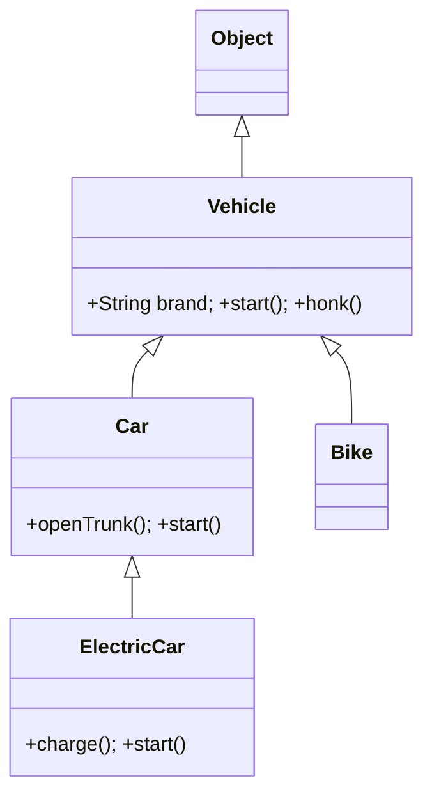
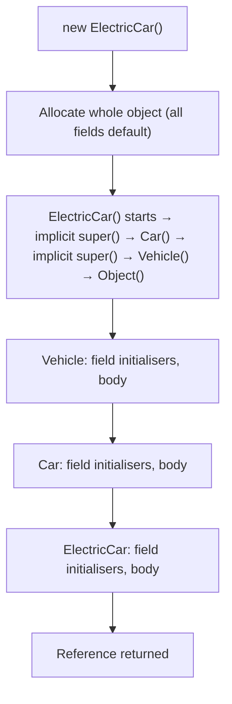
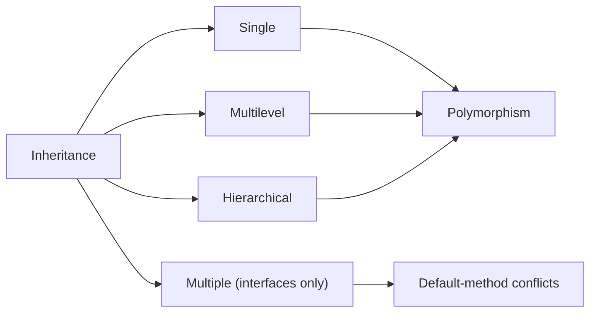

# Inheritance in Java: Single, Multilevel and Hierarchical

**TL;DR:** Inheritance (`extends`) lets a class reuse and specialise another class's members. Java allows **one direct superclass per class**, but classes can be chained (**multilevel**: `A → B → C`) and one parent can have many children (**hierarchical**: `Animal → Dog, Cat, Bird`). "Multiple inheritance" of *type* is possible only through **interfaces**. Everything ultimately descends from `Object`. A child object is built top-down (parent constructor first), and a parent reference can hold any descendant (polymorphism).

## Table of Contents

1. [TL;DR](#1-tldr)
2. [Why it matters](#2-why-it-matters)
3. [Prerequisites](#3-prerequisites)
4. [Mental model](#4-mental-model)
5. [Core concepts](#5-core-concepts)
6. [How it works](#6-how-it-works)
7. [Examples](#7-examples)
8. [Comparisons](#8-comparisons)
9. [Trade-offs](#9-trade-offs)
10. [Gotchas](#10-gotchas)
11. [Practical application](#11-practical-application)
12. [Interview prep](#12-interview-prep)
13. [Interview question bank](#13-interview-question-bank)
14. [Tricky code snippets](#14-tricky-code-snippets)
15. [Connections](#15-connections)
16. [Summary](#16-summary)
17. [Answers](#answers)

> **Scope note.** The earlier *Inheritance and Polymorphism* note covers constructor chaining, overriding rules, casting and dynamic dispatch in depth. This note focuses on the **shapes** of inheritance (single, multilevel, hierarchical, and why not multiple), with those mechanics only where they matter.

---

## 1. TL;DR

- **Single inheritance:** `class Dog extends Animal` — one parent.
- **Multilevel:** `Vehicle → Car → ElectricCar` — a chain; the grandchild gets everything above it.
- **Hierarchical:** `Vehicle → Car`, `Vehicle → Bike` — several siblings sharing one parent.
- **Multiple (classes):** not allowed (Snippet 12). **Multiple (types):** allowed via interfaces (Snippets 13, 17).
- **Root:** every class extends `Object`, directly or indirectly (Snippet 26).

**The analogy: a family tree.**

| Family | Java |
|---|---|
| A child has one biological mother in this tree (one parent per class) | A class has exactly one `extends` parent |
| Grandparent → parent → child: traits flow down the line | **Multilevel** inheritance |
| One parent with several children who share family traits but differ from each other | **Hierarchical** inheritance (siblings) |
| A child inherits the family name and house rules, but not the parent's private diary | Members inherited; `private` ones aren't accessible |
| A child can behave differently from the parent on some tasks | **Overriding** |
| Joining several clubs (each club has rules you follow) | A class `implements` several **interfaces** |
| Everyone's oldest ancestor is "human" | `Object` |

**Running example:** `Vehicle` with `brand`, `start()` and `honk()`; `Car extends Vehicle` adds `openTrunk()` and overrides `start()`; `ElectricCar extends Car` adds `charge()` and overrides `start()` again; `Bike extends Vehicle` is a sibling of `Car`. Full program and output in 6.2.

---

## 2. Why it matters

**The problem.** Without inheritance, shared behaviour (everything every vehicle can do) is copy-pasted into each class, and fixing a bug means fixing it everywhere. Inheritance gives one place for shared code and a type hierarchy that supports polymorphism. Used badly, it creates rigid, fragile designs.

**What goes wrong** (verified on Java 21):

| Code | Result | Cause |
|---|---|---|
| `class C extends A, B` | Compile error | One superclass only (Snippet 12) |
| `Animal a = new Dog(); a.bark();` | Compile error | The reference type decides what you can call (Snippet 3) |
| `(Cat) animalThatIsADog` | `ClassCastException` | Siblings are not related by IS-A (Snippet 9) |
| `class Dog extends Animal {}` when `Animal` has only `Animal(String)` | Compile error | No default parent constructor to call (Snippet 28) |
| Subclass reads parent's `private` field | Compile error | Private members aren't accessible (Snippet 18) |
| `class A extends B {} class B extends A {}` | Compile error | Cyclic inheritance (Snippet 23) |
| `class C implements A, B` with two same defaults | Compile error | Ambiguous default method (Snippet 14) |
| `Stack` used with `add(0, x)` | Stack order broken | `Stack` extends `Vector`, inheriting methods that don't fit (Snippet 33) |

**Why interviewers ask.** "Why doesn't Java support multiple inheritance?", "types of inheritance", "what is the diamond problem and how do interfaces solve it", "is-a vs has-a" and "what happens to constructors in a chain" are staple questions. They check whether you understand IS-A, substitutability and the limits of `extends`.

---

## 3. Prerequisites

| Prerequisite | One-line refresher | Importance |
|---|---|---|
| Classes, objects, constructors | `new`, fields, methods, `this` ([Classes and Objects notes]) | Essential |
| Access modifiers | `private`/default/`protected`/`public` ([Encapsulation notes]) | Essential |
| Method overriding basics | Same signature in a subclass replaces the parent's behaviour ([Polymorphism notes]) | Important |
| Interfaces and abstract classes | Contracts and partial implementations ([Encapsulation and Abstraction notes]) | Important |
| Reference types and casting | Upcast implicit, downcast explicit ([Reference Data Types notes]) | Important |

---

## 4. Mental model

> **The one picture to keep in your head:** inheritance forms a **tree** whose root is `Object`. Every class has exactly one parent line upward; a node can have many children. An object of a class contains *all* the state of its ancestors.

```
                    Object
                      │
                   Vehicle            ◄── brand, start(), honk()
                  ┌───┴────┐
                 Car      Bike        ◄── hierarchical: two children of Vehicle
                  │
             ElectricCar              ◄── multilevel: Vehicle → Car → ElectricCar
```
*Reading upward is IS-A: an `ElectricCar` is a `Car`, is a `Vehicle`, is an `Object`. Siblings (`Car`, `Bike`) are not related to each other.*


*A UML-style view of the same tree; arrows point from child to parent.*

**What one object looks like in memory:** `new ElectricCar()` creates one object holding the fields of `Vehicle`, `Car` and `ElectricCar` together, with a hidden pointer to its class so the right (most derived) method is found at run time.

```
 ElectricCar object (one block on the heap)
 ┌──────────────────────────┐
 │ header (class pointer)   │
 │ Vehicle part: brand      │
 │ Car part: (its fields)   │
 │ ElectricCar part: ...    │
 └──────────────────────────┘
```

---

## 5. Core concepts

### 5.1 Glossary

- **Inheritance (`extends`):** a subclass acquires the accessible members of its superclass.
- **Superclass / parent / base class:** the class being extended.
- **Subclass / child / derived class:** the class doing the extending.
- **Direct vs indirect superclass:** the parent vs every ancestor above it.
- **IS-A relationship:** a `Car` *is a* `Vehicle`; the basis of substitutability.
- **Single inheritance:** a class has one direct superclass.
- **Multilevel inheritance:** a chain of single inheritances (`A → B → C`).
- **Hierarchical inheritance:** one superclass with several subclasses.
- **Multiple inheritance:** a class with more than one superclass. Not allowed for classes in Java; allowed for interface *types*.
- **Hybrid inheritance:** a mix of the above; in Java it only works when interfaces are involved.
- **Diamond problem:** ambiguity when two parents provide the same member to one child.
- **`Object`:** the root class; supplies `equals`, `hashCode`, `toString`, `getClass`, and more.
- **Sealed class/interface:** restricts which classes may extend it (Java 17+).

### 5.2 The five shapes

| Shape | Example | In Java |
|---|---|---|
| Single | `Dog extends Animal` | Yes |
| Multilevel | `Puppy extends Dog extends Animal` | Yes (any depth) |
| Hierarchical | `Dog`, `Cat`, `Bird` all `extends Animal` | Yes |
| Multiple | `C extends A, B` | **No** for classes (Snippet 12) |
| Hybrid | Hierarchical + multiple | Only through interfaces |

### 5.3 What a subclass gets

- **Inherits:** `public` and `protected` members; package-private members if in the same package.
- **Does not inherit access to:** `private` members (they exist in the object but are only reachable through the parent's methods, Snippets 18, 19).
- **Does not inherit constructors**, but must call one (Snippets 28, 29, 30).
- **Does inherit** static members (accessible by name), though they're not overridden (Snippets 25, 34).
- **Can add** new fields and methods, **override** parent methods, and **hide** fields and static methods (Snippets 24, 25).
- Subclass objects can be assigned to parent-typed variables (**upcasting**) (Snippet 2).

### 5.4 Single and multilevel inheritance

```java
class Animal { void eat() { System.out.println("eating"); } }
class Dog extends Animal { void bark() { System.out.println("woof"); } }
class Puppy extends Dog { void play() { System.out.println("playing"); } }
```
- `Puppy` can call `play()`, `bark()` and `eat()`.
- Method lookup starts at the object's actual class and moves **up** the chain until found (Snippet 5).
- Overriding at any level takes effect for all lower levels unless overridden again (Snippets 5, 6).
- Constructors run **top-down**: `Animal`, `Dog`, `Puppy` (Snippet 4).
- Depth costs readability; deep chains (more than 3 or 4 levels) are a design smell ⚠️ opinion.

### 5.5 Hierarchical inheritance

- Siblings share the parent's members but are **independent**: changing one object doesn't affect another (Snippet 7).
- Siblings are **not** substitutable for each other: casting a `Dog` object to `Cat` fails (Snippets 9, 10).
- A `Parent[]` or `List<Parent>` holds any mix of siblings, and each element behaves per its own class (Snippet 11).
- A sibling that doesn't override gets the parent's behaviour (Snippet 8).
- Sealed hierarchies list the allowed siblings, so a `switch` can be exhaustive (Snippets 36, 37).

### 5.6 Why classes can't extend two classes

If `C extends A, B` and both define `show()`, which one does `new C().show()` run? The same ambiguity applies to fields and to the state held by shared grand-parents (the **diamond problem**). Java's designers avoided it by allowing **one superclass** (Snippet 12).

**Interfaces recover the useful part:**

| Feature | Interface with abstract methods | Interface with `default` methods |
|---|---|---|
| State (instance fields) | None | None |
| Implementation | None | Yes, but must resolve conflicts |
| Class implementing several | Fine (Snippet 13) | If two defaults clash, the class **must override** (Snippets 14, 15) |
| Class vs interface default | n/a | **Class method wins** (Snippet 16) |
| Interface extends several interfaces | Yes (Snippet 17) | Same conflict rules |

### 5.7 Access rules in inheritance

| Modifier | Same class | Same package | Subclass (other package) | Anywhere |
|---|---|---|---|---|
| `private` | ✅ | ❌ | ❌ | ❌ |
| default | ✅ | ✅ | ❌ | ❌ |
| `protected` | ✅ | ✅ | ✅ (via subclass code) | ❌ |
| `public` | ✅ | ✅ | ✅ | ✅ |

`protected` across packages: subclass code can use it on `this` or on subclass-typed references, not on arbitrary parent-typed ones ⚠️ (not run here; needs separate packages).

### 5.8 `final`, `abstract` and `sealed` in hierarchies

- `final class`: cannot be extended (Snippet 21).
- `final` method: cannot be overridden (Snippet 22).
- `abstract class`: can't be instantiated, may leave methods unimplemented (Snippets 31, 32).
- `sealed ... permits`: only listed subclasses (Snippets 36, 37).
- Cyclic inheritance is illegal (Snippet 23).

---

## 6. How it works

### 6.1 Building an object up the chain


*The call goes up, the work goes down: the topmost constructor body finishes first.*

Static initialisers run once per class, top-down, before the first instance is built (Snippet 35).

### 6.2 Worked trace: `Vehicle → Car → ElectricCar`, plus `Bike`

```java
class Vehicle {
    String brand = "Generic";
    Vehicle() { System.out.println("Vehicle()"); }
    void start() { System.out.println(brand + " starts"); }
    void honk() { System.out.println("beep"); }
}
class Car extends Vehicle {
    Car() { System.out.println("Car()"); brand = "CarCo"; }
    void openTrunk() { System.out.println("trunk open"); }
    @Override void start() { super.start(); System.out.println("Car engine on"); }
}
class ElectricCar extends Car {
    ElectricCar() { System.out.println("ElectricCar()"); brand = "VoltCo"; }
    void charge() { System.out.println("charging"); }
    @Override void start() { super.start(); System.out.println("silent motor on"); }
}
class Bike extends Vehicle {
    Bike() { System.out.println("Bike()"); }
}
public class Main {
    public static void main(String[] args) {
        ElectricCar e = new ElectricCar();
        e.start(); e.honk(); e.openTrunk(); e.charge();
        System.out.println("--");
        Bike b = new Bike();
        b.start();
    }
}
```

Output (verified, Java 21):

```
Vehicle()
Car()
ElectricCar()
VoltCo starts
Car engine on
silent motor on
beep
trunk open
charging
--
Vehicle()
Bike()
Generic starts
```

| Step | What happens | Why |
|---|---|---|
| `new ElectricCar()` | Prints `Vehicle()`, `Car()`, `ElectricCar()` | Constructors run top-down; each calls its parent's first |
| `brand` assignments | `"Generic"` → `"CarCo"` → `"VoltCo"` | Each constructor overwrites the shared inherited field in turn |
| `e.start()` | `ElectricCar.start` → `super.start()` = `Car.start` → `super.start()` = `Vehicle.start` | Prints `VoltCo starts`, then `Car engine on`, then `silent motor on` |
| `e.honk()` | `Vehicle.honk` | Never overridden; found by walking up |
| `e.openTrunk()` | `Car.openTrunk` | Inherited one level up |
| `new Bike()` | `Vehicle()` then `Bike()` | Sibling chain is independent of `Car` |
| `b.start()` | `Vehicle.start` with `brand = "Generic"` | `Bike` never changed `brand` and has no override |

### 6.3 Method lookup in a multilevel chain

```
 call: c.who()   (object is a C; C extends B extends A)
   look in C  → not found
   look in B  → found B.who()  ← runs
   (A.who() is hidden by the override)
```
Verified in Snippet 5: `c.who()` prints `B.who`, `c.other()` prints `A.other`, and `((A) c).who()` still prints `B.who`.

### 6.4 Why `a.bark()` doesn't compile but `((Dog) a).bark()` does

The **compiler** only knows the reference type (`Animal`), so `bark()` isn't visible (Snippet 3). A cast (or an `instanceof` pattern) tells the compiler to treat the object as a `Dog`, and the **JVM** checks at run time that it really is one (Snippets 38, 9).

---

## 7. Examples

### 7.1 Toy example

```java
class Animal { void eat() { System.out.println("eating"); } }
class Dog extends Animal { void bark() { System.out.println("woof"); } }
// new Dog().eat() → eating; new Dog().bark() → woof
```
Verified (Snippet 2).

### 7.2 Hierarchical with polymorphism

```java
abstract class Animal { abstract String speak(); }
class Dog extends Animal { String speak() { return "woof"; } }
class Cat extends Animal { String speak() { return "meow"; } }
class Bird extends Animal { String speak() { return "tweet"; } }
// for (Animal a : new Animal[]{ new Dog(), new Cat(), new Bird() }) print a.speak()
```
Output `woof meow tweet` (Snippet 11).

### 7.3 Real-world examples

- **JDK exceptions:** `Throwable → Exception → IOException → FileNotFoundException` (multilevel) and `Exception → IOException, SQLException` (hierarchical).
- **Collections:** `AbstractCollection → AbstractList → ArrayList`; `Collection → List, Set, Queue` interface hierarchy.
- **GUI/Swing:** `Component → Container → JComponent → JButton`.
- **Domain models:** `Employee → Manager, Engineer, Intern`; `Payment → CardPayment, UpiPayment`.
- **Framework base classes:** your servlet or test class extends a framework class and overrides hooks.
- **Anti-example:** `Stack extends Vector` (Snippet 33), widely cited as a design mistake in the JDK.

---

## 8. Comparisons

### 8.1 Types of inheritance at a glance

| Type | Diagram | Java classes | Java interfaces |
|---|---|---|---|
| Single | `A ← B` | ✅ | ✅ |
| Multilevel | `A ← B ← C` | ✅ | ✅ |
| Hierarchical | `A ← B`, `A ← C` | ✅ | ✅ |
| Multiple | `A ← C → B` | ❌ | ✅ (`extends A, B`) |
| Hybrid | mix | ❌ for classes | ✅ via interfaces |

### 8.2 Class inheritance vs interface implementation

| Aspect | `extends` (class) | `implements` (interface) |
|---|---|---|
| How many | One | Many |
| Gets state (fields) | Yes | No (only constants) |
| Gets code | Yes | Only `default`/`static` methods |
| Constructor chain | Yes | No |
| Conflict handling | n/a | Must override on a default clash (Snippets 14, 15) |
| Typical use | Shared implementation, IS-A | Capabilities/contracts |

### 8.3 Inheritance vs composition

| | Inheritance | Composition |
|---|---|---|
| Relationship | IS-A | HAS-A |
| Coupling | Tight to the parent's internals | Loose; talks to the part's public API |
| Runtime change | No (fixed at compile time) | Yes (swap the part) |
| Example | `Dog extends Animal` | `Car` has an `Engine` |
| Pitfall | `Stack extends Vector` | More forwarding code |

See the *Association, Aggregation and Composition* note for the second column in depth.

### 8.4 Abstract class vs interface as a hierarchy root

| | Abstract class | Interface |
|---|---|---|
| Shared fields/state | Yes | No |
| Constructors | Yes | No |
| Multiple per class | No | Yes |
| Best for | Common base with shared code | Capabilities across unrelated classes |

---

## 9. Trade-offs

| Decision | Benefit | Cost | Use when |
|---|---|---|---|
| Inherit from a base class | Reuse and polymorphism | Tight coupling; fragile base class | A genuine IS-A with shared behaviour |
| Deep multilevel chain | Fine-grained specialisation | Hard to follow where behaviour comes from | Rarely beyond 3 levels ⚠️ opinion |
| Wide hierarchical tree | Clear variants of one concept | Base class grows to satisfy all children | Variants differ in a few overridable parts |
| Interfaces for capabilities | Mix several roles | No shared state | Unrelated classes share a behaviour |
| Abstract base + concrete children | Template for subclasses | Subclass must implement the abstract parts | Common skeleton with variable steps |
| `final` classes | Safe from misuse, easy to reason about | Can't be extended | Value types, security-sensitive classes |
| Sealed hierarchies | Exhaustive `switch`, closed set | Must list subclasses | Fixed set of variants |
| Composition instead | Flexibility | Delegation boilerplate | HAS-A or when IS-A is doubtful |

---

## 10. Gotchas

### Myths

- ❌ **Myth:** "Java supports multiple inheritance through interfaces, so it fully supports it." ✅ **Reality:** you get multiple **type** inheritance and default-method code, but no multiple **state** inheritance (Snippets 12, 13).
- ❌ **Myth:** "A subclass doesn't contain the parent's private fields." ✅ **Reality:** the object contains them; the subclass just can't access them by name (Snippets 18, 19).
- ❌ **Myth:** "Constructors are inherited." ✅ **Reality:** they aren't; `new Dog("x")` fails unless `Dog` declares that constructor (Snippet 29).
- ❌ **Myth:** "If two interfaces have the same default method, one wins." ✅ **Reality:** compile error unless the class overrides (Snippet 14).
- ❌ **Myth:** "If a parent class and an interface both provide a method, it's ambiguous." ✅ **Reality:** the **class** wins (Snippet 16).
- ❌ **Myth:** "Fields can be overridden like methods." ✅ **Reality:** they're hidden, and the reference type decides (Snippet 24).
- ❌ **Myth:** "Sibling classes can be cast to each other." ✅ **Reality:** no, `ClassCastException` at run time or a compile error (Snippets 9, 10).
- ❌ **Myth:** "`static` members are overridden in subclasses." ✅ **Reality:** they're hidden (Snippet 25), and `static` state is shared by all subclasses (Snippet 34).
- ❌ **Myth:** "Inheritance is the best way to reuse code." ✅ **Reality:** composition is often better; use inheritance only for true IS-A (Snippet 33).

### Common mistakes and edge cases

- **Missing parent constructor:** parent has only `Parent(String)`, child has no `super("...")` (Snippet 28).
- **Calling a child-only method through a parent reference** (Snippet 3).
- **Assuming `getClass()` equals `instanceof`** across levels (Snippet 27).
- **Cyclic inheritance** (Snippet 23); **extending a `final` class** (Snippet 21).
- **Subclass in a sealed hierarchy not listed in `permits`** (Snippet 37).
- **Shared static counters across subclasses** (Snippet 34).
- **Static/instance initialiser order across levels** (Snippet 35).
- **Making a class extend something only to reuse a method** instead of delegating (Snippet 33).
- **Interface default conflicts** after adding a new default method to an interface ⚠️ (an evolution hazard).

---

## 11. Practical application

### Design checklist
- [ ] Is it truly IS-A, and does the child honour the parent's contract (Liskov substitution)?
- [ ] Is there only one reason to extend (not just reuse)? Otherwise delegate.
- [ ] Is the hierarchy shallow (ideally ≤ 3 levels)?
- [ ] Does the parent have a usable constructor for the children?
- [ ] Are fields `private` with protected/public accessors where needed?
- [ ] Are classes not meant for extension marked `final` (or sealed)?
- [ ] Are shared capabilities modelled with interfaces?
- [ ] Is every override marked `@Override`?

### Hands-on exercise: model a payroll hierarchy

Model: `Employee` (name, base salary, `pay()`), `Manager` (adds a bonus), `Engineer` (adds an on-call allowance), and `Intern` (fixed stipend, no base salary). Then say what type of inheritance this is, which classes are siblings, and add a `SeniorManager` level.

<details><summary>Solution</summary>

```java
class Employee {
    protected final String name;
    protected final double base;
    Employee(String name, double base) { this.name = name; this.base = base; }
    double pay() { return base; }
    @Override public String toString() { return name + ":" + pay(); }
}
class Manager extends Employee {
    private final double bonus;
    Manager(String n, double b, double bonus) { super(n, b); this.bonus = bonus; }
    @Override double pay() { return super.pay() + bonus; }
}
class Engineer extends Employee {
    private final double onCall;
    Engineer(String n, double b, double onCall) { super(n, b); this.onCall = onCall; }
    @Override double pay() { return super.pay() + onCall; }
}
class Intern extends Employee {
    Intern(String n) { super(n, 0); }
    @Override double pay() { return 1000; }
}
class SeniorManager extends Manager {
    SeniorManager(String n, double b, double bonus) { super(n, b, bonus); }
    @Override double pay() { return super.pay() * 1.1; }
}
```
- **Hierarchical:** `Manager`, `Engineer`, `Intern` are siblings under `Employee`.
- **Multilevel:** `Employee → Manager → SeniorManager`.
- `Employee` has a constructor taking arguments, so every child calls `super(...)` explicitly (otherwise the Snippet 28 error).
- `SeniorManager.pay()` calls `Manager.pay()`, which calls `Employee.pay()` (the chain in Snippet 6).

*Design note:* if "intern" is really a different kind of worker (no base salary), consider an interface `Payable` instead of forcing `Intern` into the salary base class; this avoids a hierarchy that lies about IS-A. Verified on Java 21 with `Manager(5000, 500)`, `Engineer(4000, 200)`, `Intern`, `SeniorManager(6000, 1000)`: pay is `5500.0`, `4200.0`, `1000.0` and `7700.000000000001` (the last digits are normal floating-point noise from `* 1.1`; use `BigDecimal` for money).
</details>

---

## 12. Interview prep

Eight model answers, as you would say them aloud.

<details><summary>1. What types of inheritance does Java support?</summary>

For classes: single, multilevel and hierarchical. Multiple inheritance of classes isn't allowed (Snippet 12); multiple and hybrid inheritance work only through interfaces (Snippets 13, 17).
</details>

<details><summary>2. Why doesn't Java support multiple inheritance of classes?</summary>

Because of ambiguity: if two parents define the same method or field (and share a grandparent's state), the child can't tell which to use (the diamond problem). Java permits one superclass and gets multiple *types* through interfaces, which have no instance state.
</details>

<details><summary>3. How do interfaces solve the diamond problem?</summary>

They carry no instance state, and for default methods the compiler forces you to resolve a clash: override the method and optionally pick versions with `A.super.m()` (Snippets 14, 15). If a superclass also supplies the method, the class wins (Snippet 16).
</details>

<details><summary>4. What is multilevel inheritance, and how do constructors behave in it?</summary>

A chain `A → B → C`. Constructors run top-down: `A`, `B`, then `C` (Snippet 4). Methods are looked up from the object's own class upward (Snippet 5).
</details>

<details><summary>5. What is hierarchical inheritance?</summary>

One parent with several children (`Animal → Dog, Cat, Bird`). Children share the parent's members, stay independent of each other, and can't be cast to one another (Snippets 7, 9, 10, 11).
</details>

<details><summary>6. What does a subclass inherit and not inherit?</summary>

It inherits accessible fields and methods (public, protected, same-package default). It doesn't get access to `private` members (Snippets 18, 19) and doesn't inherit constructors (Snippet 29). Static members are accessible but hidden, not overridden (Snippet 25).
</details>

<details><summary>7. IS-A vs HAS-A: when do you choose which?</summary>

Use inheritance when the child really is a kind of the parent and can stand in anywhere the parent is expected; otherwise use composition. `Stack extends Vector` is the classic misuse (Snippet 33).
</details>

<details><summary>8. What is the root of the class hierarchy?</summary>

`java.lang.Object`. Every class without an explicit `extends` gets it, and a chain always ends there (Snippet 26).
</details>

---

## 13. Interview question bank


### 13.1 Basics (Q1–Q14)

<details><summary>Q1. What is inheritance?</summary>

A mechanism where a class (subclass) acquires the accessible members of another class (superclass) with `extends`, enabling reuse, specialisation and polymorphism.
</details>

<details><summary>Q2. Which keyword creates inheritance between classes? Between a class and an interface?</summary>

`extends` for class-to-class (and interface-to-interface); `implements` for class-to-interface.
</details>

<details><summary>Q3. Can a class extend more than one class?</summary>

No. Snippet 12 shows the compile error.
</details>

<details><summary>Q4. Can a class implement more than one interface?</summary>

Yes, any number (Snippet 13).
</details>

<details><summary>Q5. Can an interface extend multiple interfaces?</summary>

Yes (Snippet 17).
</details>

<details><summary>Q6. What is the parent of a class that has no `extends` clause?</summary>

`Object`.
</details>

<details><summary>Q7. Name the types of inheritance in Java.</summary>

Single, multilevel, hierarchical (classes); multiple and hybrid only via interfaces.
</details>

<details><summary>Q8. What is a subclass's relationship to the parent called?</summary>

IS-A.
</details>

<details><summary>Q9. Does a subclass object contain the parent's private fields?</summary>

Yes, in memory, but the subclass can't access them directly; it uses the parent's accessors (Snippets 18, 19).
</details>

<details><summary>Q10. Are constructors inherited?</summary>

No (Snippet 29), but a subclass constructor must call one of the parent's (explicitly or implicitly) (Snippets 28, 30).
</details>

<details><summary>Q11. Can a subclass add new methods and fields?</summary>

Yes. Those are only visible through a subclass-typed reference (Snippet 3).
</details>

<details><summary>Q12. Can you extend a `final` class?</summary>

No (Snippet 21).
</details>

<details><summary>Q13. Can you extend an abstract class and not implement all its abstract methods?</summary>

Only if the subclass is also abstract (Snippet 31). Instantiating an abstract class is an error (Snippet 32).
</details>

<details><summary>Q14. What does `Dog d = new Dog(); Animal a = d;` demonstrate?</summary>

Upcasting: a child object stored in a parent-typed variable; no cast is needed (Snippet 2).
</details>


### 13.2 Single and multilevel (Q15–Q28)

<details><summary>Q15. What is the order of constructor calls in `A → B → C` when you run `new C()`?</summary>

`A`, `B`, `C` (Snippet 4).
</details>

<details><summary>Q16. What is the order of static blocks, instance blocks and constructors over three levels?</summary>

All three static blocks top-down (once), then for each object: instance block and constructor of `A`, then of `B`, then of `C` (Snippet 35).
</details>

<details><summary>Q17. In `A → B → C`, if only `B` overrides `who()`, what does `new C().who()` run?</summary>

`B.who` (Snippet 5).
</details>

<details><summary>Q18. How do you call the parent's version from an override?</summary>

`super.method()` (Snippet 6). Only one level up; `super.super` is illegal (see the Super and This note).
</details>

<details><summary>Q19. Does overriding at a middle level affect lower levels?</summary>

Yes, unless a lower class overrides again (Snippet 5).
</details>

<details><summary>Q20. What happens if the parent has no no-arg constructor and the child doesn't call `super(...)`?</summary>

Compile error (Snippet 28).
</details>

<details><summary>Q21. Can a child constructor run before the parent's?</summary>

No. The parent's constructor completes first (Snippets 4, 30).
</details>

<details><summary>Q22. Where do `brand`-style inherited fields live in memory?</summary>

Inside the same single object; one object has the fields of all its ancestors (Section 4).
</details>

<details><summary>Q23. What is `getClass()` for an object of a multilevel chain's bottom class?</summary>

The bottom class, regardless of the variable type (Snippet 27).
</details>

<details><summary>Q24. `instanceof` vs `getClass() ==`?</summary>

`instanceof` is true for the class and all its ancestors; `getClass() == X.class` is true only for exactly `X` (Snippet 27).
</details>

<details><summary>Q25. How do you print the ancestry of a class?</summary>

Loop `getSuperclass()` until `null` (Snippet 26: `Puppy -> Dog -> Animal -> Object`).
</details>

<details><summary>Q26. Is there a limit on inheritance depth?</summary>

Practically none; good design keeps it shallow.
</details>

<details><summary>Q27. Do static members get inherited?</summary>

They're accessible through the subclass name, but they're shared, not copied (Snippet 34), and re-declaring one hides rather than overrides (Snippet 25).
</details>

<details><summary>Q28. What does a `protected` member allow?</summary>

Access from the same package and from subclasses (Snippet 20).
</details>


### 13.3 Hierarchical (Q29–Q40)

<details><summary>Q29. What is hierarchical inheritance?</summary>

Several classes extend the same parent (Section 5.5).
</details>

<details><summary>Q30. If I change a field on a `Dog` object, does a `Cat` object change?</summary>

No; they're separate objects (Snippet 7). Only static fields are shared (Snippet 34).
</details>

<details><summary>Q31. Can `Dog` be cast to `Cat`?</summary>

Not directly: compile error with a `Dog` variable (Snippet 10); `ClassCastException` through an `Animal` variable holding a Dog (Snippet 9).
</details>

<details><summary>Q32. How do you store different siblings together?</summary>

In an array or collection of the parent type (Snippet 11).
</details>

<details><summary>Q33. What if only one sibling overrides a method?</summary>

Others use the parent's version (Snippet 8).
</details>

<details><summary>Q34. How do you add behaviour for just some siblings?</summary>

Put it in those classes, or define an interface they implement.
</details>

<details><summary>Q35. How do you process each sibling according to its own type?</summary>

Prefer polymorphism (override); otherwise `instanceof` patterns or a `switch` on a sealed type (Snippets 36, 38).
</details>

<details><summary>Q36. What is a sealed class?</summary>

One that restricts its permitted direct subclasses with `permits` (Java 17+); unlisted subclasses fail to compile (Snippet 37).
</details>

<details><summary>Q37. Why is a sealed hierarchy useful with `switch`?</summary>

The compiler knows all variants, so a `switch` without `default` can be checked for exhaustiveness (Snippet 36).
</details>

<details><summary>Q38. Can sealed classes' permitted subclasses be `final`, `sealed` or `non-sealed`?</summary>

Yes, each permitted subclass must pick one of those three.
</details>

<details><summary>Q39. Name hierarchical examples in the JDK.</summary>

`Exception → IOException, SQLException, RuntimeException`; `Number → Integer, Double, Long`; `AbstractList → ArrayList, LinkedList` ⚠️ (the last pair share an abstract ancestor, not a single parent).
</details>

<details><summary>Q40. What is the downside of a wide hierarchy?</summary>

The parent type tends to grow unrelated members to satisfy every child, so consider interfaces or composition.
</details>


### 13.4 Multiple inheritance and interfaces (Q41–Q52)

<details><summary>Q41. Why is `class C extends A, B` illegal?</summary>

The language allows one superclass to avoid ambiguity (Snippet 12).
</details>

<details><summary>Q42. What is the diamond problem?</summary>

Class `D` inherits from `B` and `C`, both of which inherit from `A`: which version of `A`'s members does `D` get, and is there one `A` part or two?
</details>

<details><summary>Q43. What happens if two interfaces define the same default method and a class implements both?</summary>

Compile error unless the class overrides it (Snippet 14).
</details>

<details><summary>Q44. How do you call a specific interface's default method?</summary>

`InterfaceName.super.method()` inside the overriding method (Snippet 15).
</details>

<details><summary>Q45. If a superclass and an interface both define a method, which wins?</summary>

The superclass (class wins rule) (Snippet 16).
</details>

<details><summary>Q46. Can `A.super.m()` reach an interface that isn't directly implemented?</summary>

No; the interface must be a direct superinterface of the class (Snippet 31 in the Super and This note).
</details>

<details><summary>Q47. Can interfaces have state?</summary>

Only `public static final` constants; no instance fields.
</details>

<details><summary>Q48. Can an interface extend a class?</summary>

No.
</details>

<details><summary>Q49. Abstract class vs interface when designing a hierarchy root?</summary>

Abstract class for shared state and constructors; interface for capabilities and multiple inheritance of type (8.4).
</details>

<details><summary>Q50. Is "hybrid inheritance" possible in Java?</summary>

Yes, using interfaces (e.g. a class implementing several interfaces that themselves form a hierarchy).
</details>

<details><summary>Q51. Do interface default methods make interfaces like abstract classes?</summary>

Close, but they have no state and no constructors, and a class can mix many.
</details>

<details><summary>Q52. Which design is better for reuse: inherit or compose?</summary>

Compose unless the IS-A relationship and substitutability are real (8.3, Snippet 33).
</details>


### 13.5 Design, traps and edge cases (Q53–Q64)

<details><summary>Q53. Why is `Stack extends Vector` considered a mistake?</summary>

A `Stack` inherits `add(int, E)`, `insertElementAt` and more, which break LIFO rules (Snippet 33). Prefer `Deque`.
</details>

<details><summary>Q54. What is the fragile base class problem?</summary>

Changing a parent's internals can break children that depended on them, so inheritance couples subclass to parent implementation.
</details>

<details><summary>Q55. What is the Liskov Substitution Principle?</summary>

Code using a parent type must keep working when handed any subclass; subclasses shouldn't strengthen preconditions or weaken guarantees.
</details>

<details><summary>Q56. When should a class be `final`?</summary>

When it isn't designed for extension (value types, utility classes, security-sensitive code); "design for inheritance or prohibit it" (Effective Java).
</details>

<details><summary>Q57. Can a method be `final` in a non-final class?</summary>

Yes; subclasses can't override that method (Snippet 22).
</details>

<details><summary>Q58. What if class A extends B and B extends A?</summary>

Compile error: cyclic inheritance (Snippet 23).
</details>

<details><summary>Q59. How are fields of parent and child with the same name resolved?</summary>

Both exist; the reference type picks which one you see (Snippet 24).
</details>

<details><summary>Q60. Do static counters in a parent count objects of all subclasses?</summary>

Yes, one shared field (Snippet 34).
</details>

<details><summary>Q61. Can a subclass reduce a method's visibility?</summary>

No; it may only keep or widen it (see Polymorphism note).
</details>

<details><summary>Q62. What does `new Child()` do if `Parent` has a private no-arg constructor?</summary>

Compile error: the child can't call the parent constructor (access violation); use `protected`/package-private for extensible parents ⚠️ not run here.
</details>

<details><summary>Q63. Can anonymous classes extend a class?</summary>

Yes, one class or one interface at a time.
</details>

<details><summary>Q64. How would you refactor a deep multilevel chain?</summary>

Extract interfaces for capabilities, move variable behaviour into delegated strategy objects, and flatten the chain.
</details>

---

## 14. Tricky code snippets

38 snippets, each compiled and run on OpenJDK 21. Predict the output (or the compile error) before opening the answer. Classes are declared without `public` so they can share one file.

### Snippet 1: The Vehicle chain

```java
class Vehicle {
    String brand = "Generic";
    Vehicle() { System.out.println("Vehicle()"); }
    void start() { System.out.println(brand + " starts"); }
    void honk() { System.out.println("beep"); }
}
class Car extends Vehicle {
    Car() { System.out.println("Car()"); brand = "CarCo"; }
    void openTrunk() { System.out.println("trunk open"); }
    @Override void start() { super.start(); System.out.println("Car engine on"); }
}
class ElectricCar extends Car {
    ElectricCar() { System.out.println("ElectricCar()"); brand = "VoltCo"; }
    void charge() { System.out.println("charging"); }
    @Override void start() { super.start(); System.out.println("silent motor on"); }
}
class Bike extends Vehicle {
    Bike() { System.out.println("Bike()"); }
}
public class Main {
    public static void main(String[] args) {
        ElectricCar e = new ElectricCar();
        e.start(); e.honk(); e.openTrunk(); e.charge();
        System.out.println("--");
        Bike b = new Bike();
        b.start();
    }
}
```

<details><summary>Answer</summary>

```
Vehicle()
Car()
ElectricCar()
VoltCo starts
Car engine on
silent motor on
beep
trunk open
charging
--
Vehicle()
Bike()
Generic starts
```

Trace in 6.2: constructors run top-down; `start()` chains upward through `super.start()`; `Bike` is an independent sibling.
</details>

### Snippet 2: Single inheritance

```java
class Animal { void eat() { System.out.println("eating"); } }
class Dog extends Animal { void bark() { System.out.println("woof"); } }
public class Main {
    public static void main(String[] args) {
        Dog d = new Dog();
        d.eat(); d.bark();
        Animal a = d;
        a.eat();
    }
}
```

<details><summary>Answer</summary>

```
eating
woof
eating
```

`Dog` inherits `eat()`. Storing it in an `Animal` variable still calls the same method.
</details>

### Snippet 3: Parent reference, child method

```java
class Animal { void eat() { } }
class Dog extends Animal { void bark() { } }
public class Main {
    public static void main(String[] args) {
        Animal a = new Dog();
        a.bark();
    }
}
```

<details><summary>Answer</summary>

Compile error: *cannot find symbol*.

The reference type `Animal` has no `bark()`. The compiler decides what's visible from the declared type.
</details>

### Snippet 4: Constructor order in a chain

```java
class A { A() { System.out.println("A"); } }
class B extends A { B() { System.out.println("B"); } }
class C extends B { C() { System.out.println("C"); } }
public class Main { public static void main(String[] args) { new C(); } }
```

<details><summary>Answer</summary>

```
A
B
C
```

`new C()` calls `B()` first (implicit `super()`), which calls `A()` first; bodies finish top-down.
</details>

### Snippet 5: Lookup in a multilevel chain

```java
class A { void who() { System.out.println("A.who"); } void other() { System.out.println("A.other"); } }
class B extends A { @Override void who() { System.out.println("B.who"); } }
class C extends B { }
public class Main {
    public static void main(String[] args) {
        C c = new C();
        c.who();
        c.other();
        A a = c;
        a.who();
    }
}
```

<details><summary>Answer</summary>

```
B.who
A.other
B.who
```

`C` doesn't override, so lookup climbs to `B.who`. `other()` is only in `A`. Upcasting to `A` doesn't change which `who()` runs.
</details>

### Snippet 6: `super` through three levels

```java
class A { void show() { System.out.println("A"); } }
class B extends A { @Override void show() { super.show(); System.out.println("B"); } }
class C extends B { @Override void show() { super.show(); System.out.println("C"); } }
public class Main { public static void main(String[] args) { new C().show(); } }
```

<details><summary>Answer</summary>

```
A
B
C
```

Each override first calls its parent's version, so the output climbs from the top.
</details>

### Snippet 7: Siblings are independent

```java
class Animal { String name = "animal"; void eat() { System.out.println(name + " eats"); } }
class Dog extends Animal { Dog() { name = "dog"; } void bark() { System.out.println("woof"); } }
class Cat extends Animal { Cat() { name = "cat"; } void meow() { System.out.println("meow"); } }
public class Main {
    public static void main(String[] args) {
        Dog d = new Dog(); Cat c = new Cat();
        d.eat(); c.eat();
        d.name = "changed";
        d.eat(); c.eat();
        System.out.println((d instanceof Animal) + " " + (c instanceof Animal));
    }
}
```

<details><summary>Answer</summary>

```
dog eats
cat eats
changed eats
cat eats
true true
```

Changing `d.name` doesn't affect `c`. Both are `Animal`s.
</details>

### Snippet 8: Only one sibling overrides

```java
class Animal { String sound() { return "..."; } }
class Dog extends Animal { @Override String sound() { return "woof"; } }
class Cat extends Animal { }
public class Main { public static void main(String[] args) { System.out.println(new Dog().sound() + " " + new Cat().sound() + " " + new Animal().sound()); } }
```

<details><summary>Answer</summary>

```
woof ... ...
```

`Cat` inherits `Animal.sound()`; `Dog` overrides it.
</details>

### Snippet 9: Casting a Dog to Cat at run time

```java
class Animal { }
class Dog extends Animal { }
class Cat extends Animal { }
public class Main {
    public static void main(String[] args) {
        Animal a = new Dog();
        try { Cat c = (Cat) a; } catch (ClassCastException e) { System.out.println("ClassCastException"); }
    }
}
```

<details><summary>Answer</summary>

```
ClassCastException
```

The variable type is `Animal` so the cast compiles, but the actual object is a `Dog`.
</details>

### Snippet 10: Casting between siblings at compile time

```java
class Animal { }
class Dog extends Animal { }
class Cat extends Animal { }
public class Main {
    public static void main(String[] args) {
        Dog d = new Dog();
        Cat c2 = (Cat) d;
    }
}
```

<details><summary>Answer</summary>

Compile error: *incompatible types: Dog cannot be converted to Cat*.

With a `Dog`-typed variable the compiler can already see that `Dog` and `Cat` are unrelated.
</details>

### Snippet 11: Siblings in one array

```java
abstract class Animal { abstract String speak(); }
class Dog extends Animal { String speak() { return "woof"; } }
class Cat extends Animal { String speak() { return "meow"; } }
class Bird extends Animal { String speak() { return "tweet"; } }
public class Main {
    public static void main(String[] args) {
        Animal[] zoo = { new Dog(), new Cat(), new Bird() };
        for (Animal a : zoo) System.out.print(a.speak() + " ");
        System.out.println();
    }
}
```

<details><summary>Answer</summary>

```
woof meow tweet
```

Each element runs its own class's `speak()` (runtime polymorphism).
</details>

### Snippet 12: Two superclasses

```java
class A { }
class B { }
class C extends A, B { }
public class Main { public static void main(String[] args) { } }
```

<details><summary>Answer</summary>

Compile error: *'{' expected*.

After one `extends` type the compiler expects the class body; the grammar allows only one superclass.
</details>

### Snippet 13: Two interfaces

```java
interface Swimmer { default void move() { System.out.println("swim"); } }
interface Walker { void walk(); }
class Duck implements Swimmer, Walker { public void walk() { System.out.println("walk"); } }
public class Main { public static void main(String[] args) { Duck d = new Duck(); d.move(); d.walk(); } }
```

<details><summary>Answer</summary>

```
swim
walk
```

`Duck` gets `move()` from `Swimmer` and implements `walk()`.
</details>

### Snippet 14: Clashing defaults

```java
interface A { default void hello() { System.out.println("A"); } }
interface B { default void hello() { System.out.println("B"); } }
class C implements A, B { }
public class Main { public static void main(String[] args) { new C().hello(); } }
```

<details><summary>Answer</summary>

Compile error: *types A and B are incompatible; class C inherits unrelated defaults for hello() from types A and B*.

The compiler refuses to guess. Resolve by overriding `hello()` in `C`.
</details>

### Snippet 15: Resolving the clash

```java
interface A { default void hello() { System.out.println("A"); } }
interface B { default void hello() { System.out.println("B"); } }
class C implements A, B {
    @Override public void hello() { A.super.hello(); B.super.hello(); System.out.println("C"); }
}
public class Main { public static void main(String[] args) { new C().hello(); } }
```

<details><summary>Answer</summary>

```
A
B
C
```

`A.super.hello()` and `B.super.hello()` pick each interface's version explicitly.
</details>

### Snippet 16: Class wins over interface default

```java
interface Greeter { default String hi() { return "interface"; } }
class Base { public String hi() { return "class"; } }
class Impl extends Base implements Greeter { }
public class Main { public static void main(String[] args) { System.out.println(new Impl().hi()); } }
```

<details><summary>Answer</summary>

```
class
```

A method inherited from a superclass takes priority over an interface's default.
</details>

### Snippet 17: Interface extending two interfaces

```java
interface Flyer { default String move() { return "fly"; } }
interface Swimmer { void dive(); }
interface Amphibious extends Flyer, Swimmer { }
class Duck implements Amphibious { public void dive() { System.out.println("dive"); } }
public class Main { public static void main(String[] args) { Duck d = new Duck(); System.out.println(d.move()); d.dive(); } }
```

<details><summary>Answer</summary>

```
fly
dive
```

`Amphibious` combines `Flyer` and `Swimmer`; `Duck` gets `move()` from the default and implements `dive()`.
</details>

### Snippet 18: Reading a parent's private field

```java
class Parent { private int secret = 42; int getSecret() { return secret; } }
class Child extends Parent { int peek() { return secret; } }
public class Main { public static void main(String[] args) { } }
```

<details><summary>Answer</summary>

Compile error: *secret has private access in Parent*.

The field exists in the object but isn't accessible by name in the subclass.
</details>

### Snippet 19: Using the parent's accessor

```java
class Parent { private int secret = 42; int getSecret() { return secret; } }
class Child extends Parent { int peek() { return getSecret() + 1; } }
public class Main { public static void main(String[] args) { System.out.println(new Child().peek()); } }
```

<details><summary>Answer</summary>

```
43
```

`getSecret()` (package-private here) returns `42`; plus 1 is `43`.
</details>

### Snippet 20: Protected access

```java
class Parent { protected int shared = 7; protected void hook() { System.out.println("hook " + shared); } }
class Child extends Parent { void use() { shared++; hook(); } }
public class Main { public static void main(String[] args) { new Child().use(); } }
```

<details><summary>Answer</summary>

```
hook 8
```

The subclass can change `shared` and call `hook()`.
</details>

### Snippet 21: Extending a final class

```java
final class Sealed { }
class Sub extends Sealed { }
public class Main { public static void main(String[] args) { } }
```

<details><summary>Answer</summary>

Compile error: *cannot inherit from final Sealed*.

`final` classes can't be subclassed.
</details>

### Snippet 22: Overriding a final method

```java
class P { final void lock() { } }
class C extends P { void lock() { } }
public class Main { public static void main(String[] args) { } }
```

<details><summary>Answer</summary>

Compile error: *lock() in C cannot override lock() in P*.

The compiler adds that the overridden method is final.
</details>

### Snippet 23: Cyclic inheritance

```java
class A extends B { }
class B extends A { }
public class Main { public static void main(String[] args) { } }
```

<details><summary>Answer</summary>

Compile error: *cyclic inheritance involving A*.

A class can't be its own ancestor.
</details>

### Snippet 24: Fields are hidden, not overridden

```java
class Parent { String name = "parent"; String get() { return name; } }
class Child extends Parent { String name = "child"; @Override String get() { return name; } }
public class Main {
    public static void main(String[] args) {
        Parent p = new Child();
        System.out.println(p.name + " " + p.get() + " " + ((Child) p).name);
    }
}
```

<details><summary>Answer</summary>

```
parent child child
```

`p.name` uses the reference type (`Parent`), `p.get()` is dispatched to `Child`, and the cast sees `Child.name`.
</details>

### Snippet 25: Static methods are hidden

```java
class Parent { static String who() { return "parent"; } }
class Child extends Parent { static String who() { return "child"; } }
public class Main {
    public static void main(String[] args) {
        Parent p = new Child();
        System.out.println(p.who() + " " + Child.who());
    }
}
```

<details><summary>Answer</summary>

```
parent child
```

`p.who()` is resolved by the variable's type (`Parent`), not the object.
</details>

### Snippet 26: Walking up to Object

```java
class Animal { }
class Dog extends Animal { }
class Puppy extends Dog { }
public class Main {
    public static void main(String[] args) {
        Class<?> c = Puppy.class;
        StringBuilder sb = new StringBuilder();
        while (c != null) { sb.append(c.getSimpleName()).append(c.getSuperclass() != null ? " -> " : ""); c = c.getSuperclass(); }
        System.out.println(sb);
    }
}
```

<details><summary>Answer</summary>

```
Puppy -> Dog -> Animal -> Object
```

Every class chain ends at `Object`.
</details>

### Snippet 27: `instanceof` vs `getClass()`

```java
class Animal { }
class Dog extends Animal { }
class Puppy extends Dog { }
public class Main {
    public static void main(String[] args) {
        Animal a = new Puppy();
        System.out.println((a instanceof Dog) + " " + (a.getClass() == Dog.class) + " " + (a.getClass() == Puppy.class) + " " + Dog.class.isAssignableFrom(a.getClass()));
    }
}
```

<details><summary>Answer</summary>

```
true false true true
```

A `Puppy` is a `Dog` (`instanceof`), but its exact class is `Puppy`, not `Dog`.
</details>

### Snippet 28: Parent without a default constructor

```java
class Animal { Animal(String name) { } }
class Dog extends Animal { }
public class Main { public static void main(String[] args) { } }
```

<details><summary>Answer</summary>

Compile error: *constructor Animal in class Animal cannot be applied to given types;*.

`Dog` gets an implicit `super()`, but `Animal` has only `Animal(String)`.
</details>

### Snippet 29: Constructors aren't inherited

```java
class Animal { Animal(String name) { } }
class Dog extends Animal { Dog() { super("d"); } }
public class Main { public static void main(String[] args) { new Dog("x"); } }
```

<details><summary>Answer</summary>

Compile error: *constructor Dog in class Dog cannot be applied to given types;*.

`new Dog("x")` needs a `Dog(String)` constructor; `Dog` only has `Dog()`.
</details>

### Snippet 30: Implicit `super()`

```java
class A { A() { System.out.println("A()"); } A(int x) { System.out.println("A(int)"); } }
class B extends A { B() { System.out.println("B()"); } B(int x) { super(x); System.out.println("B(int)"); } }
public class Main { public static void main(String[] args) { new B(); new B(1); } }
```

<details><summary>Answer</summary>

```
A()
B()
A(int)
B(int)
```

`B()` implicitly calls `A()`; `B(int)` explicitly calls `A(int)`.
</details>

### Snippet 31: Abstract class in the middle

```java
abstract class Shape { abstract double area(); public String toString() { return getClass().getSimpleName() + " " + area(); } }
abstract class Polygon extends Shape { abstract int sides(); }
class Square extends Polygon {
    double s = 2; double area() { return s * s; } int sides() { return 4; }
}
public class Main { public static void main(String[] args) { Polygon p = new Square(); System.out.println(p + " sides=" + p.sides()); } }
```

<details><summary>Answer</summary>

```
Square 4.0 sides=4
```

`Polygon` is abstract and leaves `area()` abstract; `Square` implements both. `getClass().getSimpleName()` shows the real class.
</details>

### Snippet 32: Instantiating an abstract class

```java
abstract class Shape { }
public class Main { public static void main(String[] args) { new Shape(); } }
```

<details><summary>Answer</summary>

Compile error: *Shape is abstract; cannot be instantiated*.

Abstract classes are for extending.
</details>

### Snippet 33: `Stack` extends `Vector`

```java
import java.util.*;
public class Main {
    public static void main(String[] args) {
        Stack<Integer> s = new Stack<>();
        s.push(1); s.push(2);
        s.add(0, 9);
        System.out.println(s + " " + s.pop() + " " + s.pop() + " " + s.pop());
    }
}
```

<details><summary>Answer</summary>

```
[9, 1, 2] 2 1 9
```

`add(0, 9)` (inherited from `Vector`) inserts at the bottom, breaking LIFO expectations; the pops then give `2`, `1`, `9`.
</details>

### Snippet 34: Static field across subclasses

```java
class Base { static int count = 0; Base() { count++; } }
class A extends Base { }
class B extends Base { }
public class Main {
    public static void main(String[] args) {
        new A(); new A(); new B();
        System.out.println(Base.count + " " + A.count + " " + B.count);
    }
}
```

<details><summary>Answer</summary>

```
3 3 3
```

One `count` belongs to `Base`; `A.count` and `B.count` refer to it.
</details>

### Snippet 35: Initialisation order

```java
class A {
    static { System.out.println("A static"); }
    { System.out.println("A instance"); }
    A() { System.out.println("A ctor"); }
}
class B extends A {
    static { System.out.println("B static"); }
    { System.out.println("B instance"); }
    B() { System.out.println("B ctor"); }
}
class C extends B {
    static { System.out.println("C static"); }
    { System.out.println("C instance"); }
    C() { System.out.println("C ctor"); }
}
public class Main { public static void main(String[] args) { new C(); System.out.println("--"); new C(); } }
```

<details><summary>Answer</summary>

```
A static
B static
C static
A instance
A ctor
B instance
B ctor
C instance
C ctor
--
A instance
A ctor
B instance
B ctor
C instance
C ctor
```

Static blocks run once, top-down, when the class is first initialised. For each object, the order is instance block then constructor, parent first.
</details>

### Snippet 36: Sealed hierarchy with `switch`

```java
sealed interface Shape permits Circle, Square, Rect { }
record Circle(double r) implements Shape { }
record Square(double s) implements Shape { }
record Rect(double w, double h) implements Shape { }
public class Main {
    static double area(Shape s) {
        return switch (s) {
            case Circle c -> Math.PI * c.r() * c.r();
            case Square q -> q.s() * q.s();
            case Rect r -> r.w() * r.h();
        };
    }
    public static void main(String[] args) { System.out.println(area(new Square(3)) + " " + area(new Rect(2, 5))); }
}
```

<details><summary>Answer</summary>

```
9.0 10.0
```

The `switch` covers all permitted subtypes, so no `default` is required.
</details>

### Snippet 37: Subclass not permitted

```java
sealed interface Shape permits Circle { }
record Circle(double r) implements Shape { }
record Hexagon() implements Shape { }
public class Main { public static void main(String[] args) { } }
```

<details><summary>Answer</summary>

Compile error: *class is not allowed to extend sealed class: Shape (as it is not listed in its 'permits' clause)*.

`Hexagon` isn't in the `permits` list.
</details>

### Snippet 38: Reaching a child member

```java
class Animal { void eat() { } }
class Dog extends Animal { void bark() { System.out.println("woof"); } }
public class Main {
    public static void main(String[] args) {
        Animal a = new Dog();
        if (a instanceof Dog d) d.bark();
        ((Dog) a).bark();
    }
}
```

<details><summary>Answer</summary>

```
woof
woof
```

A pattern-matching `instanceof` and a cast both let you call `bark()`; the cast would throw `ClassCastException` if the object weren't a `Dog`.
</details>

---

## 15. Connections

| Related topic | How it connects |
|---|---|
| Polymorphism, Overriding and Overloading *(this batch)* | Inheritance is what makes runtime polymorphism possible |
| Super and This keywords *(this batch)* | How a subclass talks to its parent and to itself |
| Association, Aggregation, Composition *(this batch)* | The HAS-A alternative to IS-A |
| Encapsulation and Abstraction | Access modifiers decide what a subclass can touch; abstract classes and interfaces are hierarchy roots |
| Constructors and Reference Initialization | Constructor chaining across levels, initialisation order |
| Static Members | Static fields and methods are shared and hidden, not overridden |
| Object class methods | `equals`, `hashCode`, `toString` are inherited from `Object` |
| Design principles | Liskov substitution, "favour composition over inheritance", open/closed |


*The three class shapes all feed runtime polymorphism; multiple inheritance of type goes through interfaces.*

---

## 16. Summary

### 60-second card

- Classes: **single** (`extends` one parent), **multilevel** (chains), **hierarchical** (many children). No multiple class inheritance.
- Interfaces give multiple inheritance of **type**; clashing defaults must be resolved; **class wins** over interface.
- One object holds the fields of every ancestor; constructors run top-down; methods are looked up from the actual class upward.
- Private members aren't accessible; constructors aren't inherited; static members and fields are hidden, not overridden.
- Siblings can't be cast to each other; the declared type decides what you can call.
- Prefer composition unless IS-A and substitutability are real; use `final` or `sealed` to control extension.

### Cheat sheet

```java
class Animal { }
class Dog extends Animal { }          // single
class Puppy extends Dog { }           // multilevel (Animal → Dog → Puppy)
class Cat extends Animal { }          // hierarchical (Dog and Cat are siblings)
class Duck implements Swimmer, Flyer { }          // multiple types via interfaces
interface Both extends Swimmer, Flyer { }         // interface multiple inheritance
sealed interface Shape permits Circle, Square { } // closed hierarchy
```

| Question | Answer |
|---|---|
| Two superclasses? | No |
| Two interfaces? | Yes |
| Order of constructors? | Parent first |
| Same default in two interfaces? | Override and choose with `X.super.m()` |
| Class vs interface default? | Class wins |
| Cast between siblings? | Not allowed / `ClassCastException` |

### Self-test (answers at the end)

1. Which types of inheritance does Java support for classes?
2. Why can't a class extend two classes?
3. In `A → B → C`, what order do constructors run for `new C()`?
4. Two interfaces define the same `default` method and a class implements both. What must you do?
5. A parent has a default method in an interface and a concrete method in a superclass with the same signature. Which runs?
6. Can you cast a `Dog` object (held in an `Animal` variable) to `Cat`?
7. Does the subclass object contain the parent's private fields?
8. Why is `Stack extends Vector` considered poor design?

### Flashcards (Anki `Q :: A`)

```
Single inheritance in Java means :: Each class has exactly one direct superclass
Multilevel inheritance :: A chain: A <- B <- C
Hierarchical inheritance :: One parent, several children (siblings)
Multiple inheritance of classes :: Not allowed in Java
How does Java allow multiple inheritance of type? :: A class can implement many interfaces
Root of all classes :: java.lang.Object
Constructor order in a chain :: Parent first, then child
Interface default clash :: Class must override; use A.super.m() to choose
Superclass method vs interface default :: Superclass method wins
Are constructors inherited? :: No
Can a subclass access parent's private fields? :: Not by name; use accessors
Diamond problem :: Ambiguity when a class inherits the same member via two paths
Can siblings be cast to each other? :: No (compile error or ClassCastException)
```

### Further reading

- The Java Tutorials, "Inheritance": https://docs.oracle.com/javase/tutorial/java/IandI/subclasses.html
- JLS §8.1.4 "Superclasses and Subclasses" and §9.4.1.3 "Inheriting Methods with Override-Equivalent Signatures": https://docs.oracle.com/javase/specs/jls/se21/html/jls-8.html#jls-8.1.4
- *Effective Java* (Joshua Bloch): "Favor composition over inheritance" and "Design and document for inheritance or else prohibit it".

---

## Answers

<details><summary>1. Types supported for classes</summary>

Single, multilevel and hierarchical. Multiple and hybrid inheritance work only through interfaces.
</details>

<details><summary>2. Two superclasses</summary>

The compiler allows one `extends` class because two parents could define the same member, so the child's behaviour (and state) would be ambiguous: the diamond problem (Snippet 12).
</details>

<details><summary>3. Constructor order</summary>

`A`, `B`, then `C` (Snippet 4).
</details>

<details><summary>4. Same default in two interfaces</summary>

Override the method in the class and, if you want, call `A.super.hello()` and/or `B.super.hello()` (Snippets 14, 15).
</details>

<details><summary>5. Superclass method vs interface default</summary>

The superclass method (Snippet 16).
</details>

<details><summary>6. Cast Dog (in Animal variable) to Cat</summary>

It compiles but throws `ClassCastException` at run time (Snippet 9). With a `Dog`-typed variable it doesn't even compile (Snippet 10).
</details>

<details><summary>7. Private fields in the subclass object</summary>

Yes, they exist in the object, but the subclass can't access them by name; it uses the parent's methods (Snippets 18, 19).
</details>

<details><summary>8. `Stack extends Vector`</summary>

`Stack` is not truly a kind of `Vector` for clients: inherited methods like `add(int, E)` let callers break LIFO order (Snippet 33). Composition or `Deque` fits better.
</details>
