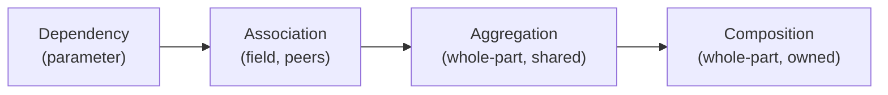
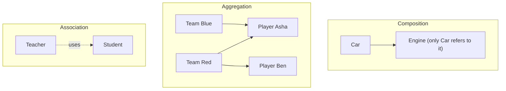
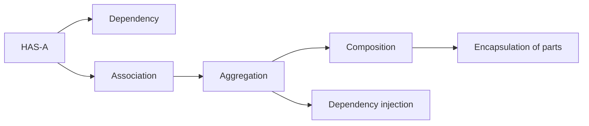

# Association, Aggregation and Composition in Java

**TL;DR:** These three describe how objects of different classes are *related* (the **HAS-A** side of OOP, as opposed to IS-A inheritance). **Association** is the general "one object knows/uses another" link. **Aggregation** is a weak whole-part link: the part can exist without the whole and can be shared (a `Team` has `Player`s). **Composition** is a strong whole-part link: the whole creates and owns its parts, which don't outlive it or get shared (a `Car` has an `Engine`). Java has no keyword for any of them. The difference is **how you write the fields, constructors and getters**.

## Table of Contents

1. [TL;DR](#1-tldr)
2. [Why it matters](#2-why-it-matters)
3. [Prerequisites](#3-prerequisites)
4. [Mental model](#4-mental-model)
5. [Core concepts](#5-core-concepts)
6. [How it works](#6-how-it-works)
7. [Examples](#7-examples)
8. [Comparisons](#8-comparisons)
9. [Trade-offs](#9-trade-offs)
10. [Gotchas](#10-gotchas)
11. [Practical application](#11-practical-application)
12. [Interview prep](#12-interview-prep)
13. [Interview question bank](#13-interview-question-bank)
14. [Tricky code snippets](#14-tricky-code-snippets)
15. [Connections](#15-connections)
16. [Summary](#16-summary)
17. [Answers](#answers)

---

## 1. TL;DR

- **Association:** "uses/knows" (`Teacher` teaches `Student`). Both sides are independent; the link can be one-way or two-way.
- **Aggregation:** association + "part of", with independent lifetimes (`Team` ← `Player`). Parts are passed in and can be shared.
- **Composition:** aggregation + **ownership** (`Car` ← `Engine`). The whole creates its parts, keeps them private, and when it becomes unreachable they do too.
- **Dependency** (weakest): a class uses another only inside a method (parameter/local), keeping no field.
- All four are implemented with **reference fields** (or parameters). The *semantics* you promise are what differ.

**The analogy: a school.**

| School | Java | Relationship |
|---|---|---|
| A teacher teaches students; neither belongs to the other | `Teacher.teach(Student)` | **Association** |
| A department has professors, but the professors exist without that department and can work in two | `Department` holds `List<Professor>` passed in | **Aggregation** |
| A school building has classrooms; demolish the building and the rooms are gone | `Building` creates and owns its `Room`s | **Composition** |
| A visitor borrows a pen for one call | method parameter, no field kept | **Dependency** |

**Running example:** `Car` owns an `Engine` (composition); `Team` holds `Player`s that exist independently (aggregation); `Teacher` uses `Student`s (association). Full program and output in 6.2.

---

## 2. Why it matters

**The problem.** Real systems are webs of objects: orders have lines, teams have players, users have addresses. If you don't decide *who owns what*, you get objects that leak their insides, parts changed by two owners, stale links, memory that never gets freed, and cyclic structures that crash `toString`.

**What goes wrong** (verified on Java 21):

| Code | Result | Cause |
|---|---|---|
| Getter returns the internal `Engine` | Caller can set `hp = 0`, breaking the car | Composition ownership leaked (Snippet 14) |
| `Emp.dept = d` set, but `d.emps` not updated | Two sides disagree | Bidirectional link updated on one side only (Snippet 4) |
| `Parent.toString()` prints child, child prints parent | `StackOverflowError` | Cycle in a bidirectional association (Snippet 5) |
| Same `Player` in two `Team`s, renamed through one | Both see it | Aggregation shares the part (Snippet 8) |
| `team.coach.name` when no coach was set | `NullPointerException` | Optional part not handled (Snippet 11) |
| Mutating a field used by `hashCode` after adding to a `HashSet` | `contains` fails | Aggregated mutable part used as a key (Snippet 12) |
| `new Car.Engine()` for a non-static inner class | Compile error | A composed inner part needs its owner (Snippet 17) |
| Record `Line(Point, Point)` with mutable `Point` | The "immutable" line changes | Shallow immutability (Snippet 24) |

**Why interviewers ask.** "Difference between association, aggregation and composition", "HAS-A vs IS-A", "composition over inheritance" and "give an example of each" are very common. They're also the vocabulary of low-level design interviews (class diagrams for parking lots, libraries, etc.).

---

## 3. Prerequisites

| Prerequisite | One-line refresher | Importance |
|---|---|---|
| Classes, objects and reference fields | A field of class type holds an arrow ([Reference Data Types notes]) | Essential |
| Constructors and initialising reference fields | Create vs inject vs copy ([Constructors notes]) | Essential |
| Encapsulation | `private final`, defensive copies ([Encapsulation notes]) | Essential |
| Inheritance basics | IS-A, for contrast ([Inheritance notes]) | Important |
| Collections basics | `List`, `Set`, `Map` hold collections of parts | Important |

---

## 4. Mental model

> **The one picture to keep in your head:** all three are **arrows between objects**. What differs is **who creates the target, who else may hold an arrow to it, and what happens to it when the source goes away**.

```
 ASSOCIATION            AGGREGATION               COMPOSITION
 Teacher ───── Student  Team ◇──── Player         Car ◆──── Engine
 (uses; peers)          (has; part shared,        (owns; part created inside,
                         lives on its own)         dies with the whole)

 UML: plain line        hollow diamond             filled diamond
 Dependency: dashed arrow  Report - - -> Printer   (used only inside a method)
```
*Strength of coupling increases left to right: dependency < association < aggregation < composition.*


*Each step adds a stronger promise about ownership and lifetime.*

**"Dies with" in Java means "becomes unreachable".** Java has no destructor call tied to ownership; an object is collectable once nothing reachable refers to it. A composed part is only reachable through its owner, so it goes when the owner does. An aggregated part may have other references (Snippets 8, 9).

---

## 5. Core concepts

### 5.1 Glossary

- **HAS-A:** an object holds a reference to another object as part of its state.
- **Dependency ("uses"):** a class needs another only temporarily, through a parameter, local variable or return type; no field.
- **Association:** a structural link between two classes, stored in a field; the objects are otherwise independent.
- **Aggregation:** a whole-part association where the part has an independent life and may be shared.
- **Composition:** a whole-part association where the whole owns the part: created by it, hidden by it, and not shared.
- **Whole / part (composite / component):** the owner and the owned.
- **Multiplicity (cardinality):** how many objects on each side: one-to-one, one-to-many, many-to-many.
- **Navigability (direction):** whether one side holds a reference to the other (uni-directional) or both do (bi-directional).
- **Ownership:** responsibility to create, protect and release the part.
- **Delegation:** the whole forwards calls to its part (`engine.start()`).
- **Inner (non-static nested) class:** a class whose instances need an enclosing instance; often used for composition.
- **Referential integrity:** both sides of a bidirectional link agree.

### 5.2 The four relationships side by side

| | Dependency | Association | Aggregation | Composition |
|---|---|---|---|---|
| Stored as a field? | No (parameter/local) | Yes | Yes | Yes (usually `private final`) |
| Strength | Weakest | Weak | Medium | Strongest |
| Lifetimes | Independent | Independent | Independent | Part bound to whole |
| Who creates the other? | Caller | Anyone | Usually outside, then passed in | The whole, inside its constructor/methods |
| Can the other be shared? | Yes | Yes | **Yes** | **No** |
| UML | Dashed arrow | Plain line | Hollow diamond ◇ | Filled diamond ◆ |
| Example | `Report.render(Printer)` | `Teacher` – `Student` | `Team` – `Player` | `Car` – `Engine` |
| Snippets | 7 | 2, 3, 4, 5, 6 | 8, 9, 10, 11, 12 | 13–22 |

### 5.3 Association

- A plain link, for example `Person → Address` (Snippet 2) or `Student ↔ Course`.
- **Direction:** unidirectional (`Person` knows `Address`) or bidirectional (`Student` ↔ `Course`).
- **Multiplicity:** one-to-one (`Person` – `Passport`), one-to-many (`Department` – `Employee`), many-to-many (`Student` – `Course`, Snippet 6).
- **Bidirectional links must be kept consistent**, so mutate both sides in one method (Snippet 3), otherwise the sides disagree (Snippet 4).
- Bidirectional links create cycles: `toString`, `equals`, `hashCode` and serialisers can recurse forever (Snippet 5).

### 5.4 Aggregation

- The whole **holds** parts, typically **received** via constructor/add method (`team.add(player)`).
- Parts exist before the whole and survive it (Snippet 9).
- Parts can be shared by several wholes (Snippet 8) and can be replaced (Snippet 10).
- The collection is owned by the whole but the *elements* are not.
- Parts may be optional/`null`/empty (Snippet 11).
- Mutable parts used inside hash-based collections can be lost if they change (Snippet 12).

### 5.5 Composition

The whole **owns** the part. To make that real in Java:

| Rule | Why | Snippet |
|---|---|---|
| Create the part **inside** the whole (constructor or method) | Nobody else has a handle | 13 |
| Keep the field `private` (and usually `final`) | Prevents outside re-pointing | 13 |
| Don't hand out the internal object; return a copy or a read-only view | Otherwise the owner loses control | 14, 15, 19 |
| Don't accept an outside object as the part without copying | Otherwise it's really aggregation | 22 |
| Release/close parts when the whole is closed | Cascade lifecycle | 20 |
| Consider a non-static inner class when a part makes no sense without its owner | The language enforces existence of the outer instance | 16, 17 |

`static` nested classes are only a **namespace** relationship, not ownership (Snippet 18).

### 5.6 Dependency

`Report.render(Printer p)` uses a `Printer` only for the call (Snippet 7). No field; if the `Printer` changes, `Report` may need to change, but `Report` doesn't *remember* it.

### 5.7 How to decide

Ask three questions:
1. **Does the whole keep a reference** between method calls? If no → dependency.
2. **Can the other object exist without it, or be used by something else?** Yes → association/aggregation. No → composition.
3. **Is the other a *part of* the whole**, or just something it knows? Part → aggregation/composition; just knows → association.

⚠️ Terminology varies. Some textbooks treat every HAS-A as "aggregation", and UML 2 itself treats shared aggregation loosely. In an interview, state your definitions (lifetime and sharing) and give an example.

### 5.8 Implementing each in Java

| Relationship | Typical code shape |
|---|---|
| Dependency | `void render(Printer p) { p.print(...); }` |
| Association | `private Address address;` + setter, or `void teach(Student s)` that records a link |
| Aggregation | `private final List<Player> players = new ArrayList<>(); void add(Player p) { players.add(p); }` |
| Composition | `private final Engine engine = new Engine(type);` and no getter that leaks it |

---

## 6. How it works

### 6.1 Object graphs and lifetimes


*Red and Blue share Asha, so if Red becomes unreachable Asha survives; only the Car refers to its Engine, so if the Car goes, the Engine goes.*

### 6.2 Worked trace: Car, Team, Teacher

```java
import java.util.*;
class Engine {
    private final String type;
    Engine(String type) { this.type = type; System.out.println("  Engine(" + type + ") built"); }
    String type() { return type; }
}
class Car {
    private final Engine engine;                    // composition: created inside, owned
    Car(String type) { this.engine = new Engine(type); }
    String describe() { return "Car[" + engine.type() + "]"; }
}
class Player {
    final String name;
    Player(String n) { name = n; }
    public String toString() { return name; }
}
class Team {
    private final String name;
    private final List<Player> players = new ArrayList<>();   // aggregation: players come from outside
    Team(String n) { name = n; }
    void add(Player p) { players.add(p); }
    public String toString() { return name + players; }
}
class Teacher {
    final String name;
    Teacher(String n) { name = n; }
    void teach(Student s) { System.out.println("  " + name + " teaches " + s.name); }   // association: uses
}
class Student { final String name; Student(String n) { name = n; } }
public class Main {
    public static void main(String[] args) {
        System.out.println("composition:");
        Car car = new Car("V8");
        System.out.println(car.describe());
        System.out.println("aggregation:");
        Player p1 = new Player("Asha"), p2 = new Player("Ben");
        Team red = new Team("Red"), blue = new Team("Blue");
        red.add(p1); red.add(p2); blue.add(p1);
        System.out.println(red + " " + blue);
        red = null;
        System.out.println("after red = null: " + p1 + " " + p2 + " still usable, blue=" + blue);
        System.out.println("association:");
        Teacher t = new Teacher("Ms Rao");
        t.teach(new Student("Asha")); t.teach(new Student("Ben"));
    }
}
```

Output (verified, Java 21):

```
composition:
  Engine(V8) built
Car[V8]
aggregation:
Red[Asha, Ben] Blue[Asha]
after red = null: Asha Ben still usable, blue=Blue[Asha]
association:
  Ms Rao teaches Asha
  Ms Rao teaches Ben
```

| Step | What happens | Relationship shown |
|---|---|---|
| `new Car("V8")` | `Car`'s constructor builds its own `Engine` | Composition: the caller never touches the engine |
| `red.add(p1)`, `blue.add(p1)` | One `Player` object is in two teams | Aggregation: parts are shared |
| `red = null` | `Red` is unreachable (collectable) but `p1` and `p2` are still referenced by `main` (and `p1` by `Blue`) | Aggregation: parts outlive the whole |
| `t.teach(new Student(...))` | `Teacher` uses a student for one call and keeps nothing | Association/dependency in use |

### 6.3 Bidirectional association: keep both sides in sync

```java
void enroll(Course c) { if (courses.add(c)) c.students.add(this); }
void drop(Course c)   { if (courses.remove(c)) c.students.remove(this); }
```
Verified (Snippet 3): after Asha and Ben enrol, `java.students.size()` is `2` and Asha's course count is `2`; after Asha drops Java, both counts are `1`. Updating only one side (Snippet 4) leaves `d.emps.size()` at `0` even though `e.dept == d`.

### 6.4 Why composition leaks through getters

A getter returning the internal object gives the caller a second arrow to your "private" part, so they can mutate it behind your back (Snippet 14: `power()` becomes `0`). Return a copy (Snippet 15), an immutable view (Snippet 19), or expose operations instead of the part.

### 6.5 Garbage collection and the three relationships

- **Composition:** part reachable only via the whole → collected together.
- **Aggregation:** part reachable via others too → survives (Snippet 9).
- **Association:** each side's lifetime is independent of the link.
- **Bidirectional cycles** don't prevent collection if the whole cycle is unreachable (reachability, not reference counting).

---

## 7. Examples

### 7.1 Toy examples

**Association (one-way):**

```java
class Address { String city; Address(String c) { city = c; } }
class Person { String name; Address address; Person(String n, Address a) { name = n; address = a; } }
// Person -> Address  (Snippet 2 prints: Asha -> Pune)
```

**Composition with delegation:**

```java
class Stack2<T> {
    private final Deque<T> items = new ArrayDeque<>();   // the part, hidden
    void push(T t) { items.push(t); }
    T pop() { return items.pop(); }
}
```
Verified (Snippet 25): a stack built by composition exposes only `push`/`pop`/`size`, unlike `Stack extends Vector`.

### 7.2 Real-world examples

- **Composition:** `Order` ↔ `OrderLine`s; `Car` ↔ `Engine`; `House` ↔ `Room`s; an `ArrayList`'s internal array.
- **Aggregation:** `Team` ↔ `Player`; `Library` ↔ `Book`; `Playlist` ↔ `Song`; `Department` ↔ `Employee`.
- **Association:** `Doctor` ↔ `Patient`; `Student` ↔ `Course`; `Customer` ↔ `Order` (one-to-many).
- **Dependency:** a service method taking a `Logger`; a controller using a DTO in a method.
- **JDK:** `HashMap` is composed of an internal table of `Node`s; `Thread` is associated with a `Runnable`; collections aggregate whatever objects you add.
- **Frameworks:** JPA `@OneToMany(cascade = ALL, orphanRemoval = true)` models composition (cascade delete), while a plain `@ManyToMany` models association ⚠️ (annotation semantics not run here).

---

## 8. Comparisons

### 8.1 Aggregation vs composition

| Aspect | Aggregation | Composition |
|---|---|---|
| Life of the part | Independent | Tied to the whole |
| Created by | Usually outside | The whole |
| Shared | Yes | No |
| Getter exposes part? | Often fine | Should not (copy/view) |
| Part without whole? | Meaningful | Meaningless |
| Constructor | Receives parts | Builds parts |
| Example | `Team`–`Player` | `Car`–`Engine` |

### 8.2 Association vs dependency

| | Dependency | Association |
|---|---|---|
| Field? | No | Yes |
| Duration | One call | Lifetime of the object (or longer) |
| Example | `render(Printer)` | `Person.address` |

### 8.3 HAS-A vs IS-A

| | Inheritance (IS-A) | Composition/aggregation (HAS-A) |
|---|---|---|
| Declared with | `extends` | Fields |
| Coupling | Tight | Loose |
| Reuse | Inherits everything | Delegates what you choose |
| Runtime flexibility | None | Swap the part |
| Misuse example | `Car extends Engine` (Snippet 26) | n/a |

"Favour composition over inheritance": use `extends` only when the subclass truly *is* a specialised parent.

### 8.4 Cardinality in code

| Multiplicity | Typical Java |
|---|---|
| 1 : 1 | `private Passport passport;` |
| 1 : N | `private final List<Employee> employees = new ArrayList<>();` |
| N : N | `Map<Student, Set<Course>>` or two `Set` fields kept in sync (Snippets 3, 6) |
| 0..1 | Nullable field or `Optional` (Snippet 11) |

### 8.5 Uni- vs bi-directional

| | Unidirectional | Bidirectional |
|---|---|---|
| Fields | One side only | Both sides |
| Maintenance | Easy | Keep both in sync (Snippet 3) |
| Risk | Can't navigate back | Cycles, inconsistency (Snippets 4, 5) |
| Advice | Default choice | Only when both navigations are needed |

---

## 9. Trade-offs

| Decision | Benefit | Cost | Use when |
|---|---|---|---|
| Composition (create inside) | Strong encapsulation; invariants safe | Hard-wired to the concrete part | The part is a private implementation detail |
| Aggregation (inject parts) | Flexible and testable; reuse across wholes | Aliasing; shared mutation | Parts have their own lifecycle |
| Bidirectional association | Easy navigation both ways | Sync bugs, cycles | Both directions are frequently needed |
| Unidirectional association | Simple and safe | One-way navigation | Default |
| Defensive copies in getters | Keeps ownership | Allocation | Mutable composed parts |
| Immutable parts | Sharing is safe | New object per change | Value-like parts (`record`) |
| Inner class for composition | Language enforces ownership | Tighter coupling; hidden outer reference | Part meaningless without the whole |
| Delegation instead of inheritance | Control the exposed API | Forwarding boilerplate | HAS-A, or an unsafe IS-A (Snippet 33 of the Inheritance note) |

---

## 10. Gotchas

### Myths

- ❌ **Myth:** "Java has keywords for association, aggregation and composition." ✅ **Reality:** none; the difference is in ownership and lifetime conventions.
- ❌ **Myth:** "Aggregation and composition are the same." ✅ **Reality:** composition adds ownership and non-sharing (Snippets 8 vs 13).
- ❌ **Myth:** "`final` makes a composed part immutable." ✅ **Reality:** `final` freezes the reference only (Snippet 23).
- ❌ **Myth:** "When the whole is deleted, Java deletes the parts." ✅ **Reality:** nothing is "deleted"; parts become unreachable and are collected later, unless someone else refers to them (Snippet 9).
- ❌ **Myth:** "A bidirectional association keeps itself consistent." ✅ **Reality:** you must update both sides (Snippet 4).
- ❌ **Myth:** "Records are deeply immutable." ✅ **Reality:** a record is shallowly immutable; mutable components can still change (Snippet 24).
- ❌ **Myth:** "A static nested class means composition." ✅ **Reality:** it only scopes the name; instances are independent (Snippet 18). Inner (non-static) classes tie to an outer instance (Snippets 16, 17).
- ❌ **Myth:** "Inheritance is fine for any HAS-A shortcut." ✅ **Reality:** `Car extends Engine` is wrong (Snippet 26).

### Common mistakes and edge cases

- **Getter returning the internal part** (Snippet 14).
- **Storing the caller's mutable object as a "composed" part** instead of copying.
- **Updating only one side** of a two-way link (Snippet 4).
- **`toString`/`equals`/`hashCode` following a cycle** (Snippet 5).
- **Sharing a part among wholes by accident** (Snippet 8).
- **Using a mutable part as a hash key or in a set** (Snippet 12).
- **Assuming the part exists:** optional parts need null/`Optional` handling (Snippet 11).
- **Leaking a collection** (`return lines;`) instead of a view (Snippet 19).
- **Forgetting to close composed resources** (Snippet 20).
- **Classifying by wishful thinking:** "composition" with a public setter for the part is really aggregation.

---

## 11. Practical application

### Design checklist
- [ ] For each field of a class type, label it: dependency, association, aggregation or composition.
- [ ] Composition: created inside, `private final`, never leaked, closed with the owner.
- [ ] Aggregation: constructor/method accepts parts; decide who validates and who may share.
- [ ] Bidirectional links: one method updates both sides.
- [ ] No cycles in `toString`/`equals`/`hashCode`.
- [ ] Optional parts: `null` handled or `Optional`.
- [ ] Collections exposed as unmodifiable views or copies.
- [ ] Prefer unidirectional links unless both directions are needed.

### Hands-on exercise: a small hospital model

Requirements: a `Hospital` is made of `Department`s that cannot exist without it. `Doctor`s are employed by a hospital but exist independently (and may work at several). A `Doctor` treats `Patient`s, with no ownership either way. Write the classes, say which relationship each pair is, and make sure `Hospital` doesn't leak its departments.

<details><summary>Solution</summary>

```java
import java.util.*;
class Department {
    final String name;
    Department(String name) { this.name = name; }
    public String toString() { return name; }
}
class Doctor {
    final String name;
    Doctor(String name) { this.name = name; }
    void treat(Patient p) { System.out.println(name + " treats " + p.name); }   // association/dependency
    public String toString() { return name; }
}
class Patient { final String name; Patient(String n) { name = n; } }
class Hospital {
    private final String name;
    private final List<Department> departments = new ArrayList<>();   // composition: created inside
    private final List<Doctor> doctors = new ArrayList<>();           // aggregation: passed in
    Hospital(String name, String... deptNames) {
        this.name = name;
        for (String d : deptNames) departments.add(new Department(d));
    }
    void hire(Doctor d) { doctors.add(d); }
    List<Department> departments() { return List.copyOf(departments); }   // no leak
    List<Doctor> doctors() { return Collections.unmodifiableList(doctors); }
    public String toString() { return name + departments + doctors; }
}
```
- **Hospital–Department:** composition (created inside, private, copy on the way out).
- **Hospital–Doctor:** aggregation (doctors created elsewhere; one `Doctor` may be hired by several hospitals).
- **Doctor–Patient:** association (the doctor uses the patient in `treat`; neither owns the other).

Verified on Java 21: hiring the same `Doctor` in two `Hospital`s, then reading `departments()` and trying `.add(...)` on the returned lists, gave the expected shared doctor and `UnsupportedOperationException` for both views.
</details>

---

## 12. Interview prep

Eight model answers, as you would say them aloud.

<details><summary>1. What is the difference between association, aggregation and composition?</summary>

All three are HAS-A links stored in fields. Association is a general "knows/uses" link between independent objects. Aggregation is a whole-part link where the part lives independently and can be shared (`Team`–`Player`). Composition is a whole-part link where the whole owns the part: it creates it, doesn't share it, and the part goes when the whole does (`Car`–`Engine`).
</details>

<details><summary>2. How do you implement composition in Java?</summary>

Create the part inside the whole's constructor, keep the field `private final`, and never leak the internal reference (return copies, views or operations). A non-static inner class enforces that the part needs an owner (Snippets 13, 15, 16, 19).
</details>

<details><summary>3. How do you implement aggregation?</summary>

Receive existing parts through a constructor or `add` method and store references. Several wholes may share the same part and the part survives the whole (Snippets 8, 9).
</details>

<details><summary>4. What does "the part dies with the whole" mean in a garbage-collected language?</summary>

There's no explicit destruction. The part is only reachable through its owner, so when the owner becomes unreachable the part does too and the GC may reclaim both. Aggregated parts with other references survive (Snippet 9).
</details>

<details><summary>5. HAS-A vs IS-A: which do you choose?</summary>

IS-A (inheritance) only for a true specialisation that can replace the parent anywhere. Otherwise HAS-A, which is looser and swappable. `Car extends Engine` is wrong; `Car` has an `Engine` (Snippet 26).
</details>

<details><summary>6. What problems come with bidirectional associations?</summary>

Keeping both sides consistent (Snippets 3, 4) and cycles that make `toString`, `equals`, `hashCode` or serialisation recurse forever (Snippet 5). Prefer unidirectional links unless both directions are needed.
</details>

<details><summary>7. How do you prevent a composed part from leaking?</summary>

Don't return the internal object: return a defensive copy (Snippet 15), an unmodifiable view for collections (Snippet 19), or expose behaviour (`car.power()`) instead of the part. Leaking breaks ownership (Snippet 14).
</details>

<details><summary>8. Is `final` enough to make a composed part immutable?</summary>

No. `final` freezes only the reference; the part's state can change (Snippet 23). Make the part immutable (a `record` of immutable fields) or hide it.
</details>

---

## 13. Interview question bank


### 13.1 Basics (Q1–Q12)

<details><summary>Q1. What is a HAS-A relationship?</summary>

A class holds a reference to an object of another class as part of its state, as opposed to IS-A (inheritance).
</details>

<details><summary>Q2. Name the object relationships between classes.</summary>

Dependency, association, aggregation, composition (and inheritance/realisation for IS-A).
</details>

<details><summary>Q3. What is association?</summary>

A link where one object stores a reference to (or otherwise uses) another; both stay independent (Snippet 2).
</details>

<details><summary>Q4. What is dependency?</summary>

A class uses another only inside a method (parameter, local, return type), keeping no field (Snippet 7).
</details>

<details><summary>Q5. What is aggregation?</summary>

A whole-part association where the part exists independently and may be shared (Snippets 8, 9).
</details>

<details><summary>Q6. What is composition?</summary>

A whole-part association where the whole creates and owns the parts, which are not shared and don't outlive it (Snippets 13, 14).
</details>

<details><summary>Q7. Which is stronger, aggregation or composition?</summary>

Composition.
</details>

<details><summary>Q8. How are they drawn in UML?</summary>

Association: plain line. Aggregation: hollow diamond at the whole. Composition: filled diamond at the whole. Dependency: dashed arrow.
</details>

<details><summary>Q9. Does Java have keywords for these relationships?</summary>

No; they're design conventions realised through fields, constructors and getters.
</details>

<details><summary>Q10. How is a HAS-A relationship stored?</summary>

As a reference field (or a collection of references).
</details>

<details><summary>Q11. Give one example each.</summary>

Association: `Teacher`–`Student`. Aggregation: `Team`–`Player`. Composition: `Car`–`Engine`. Dependency: `Report.render(Printer)`.
</details>

<details><summary>Q12. Is `Person` having an `Address` aggregation or association?</summary>

Depends on semantics: if addresses are shared between people (families) and independent, aggregation/association; if each person owns a private copy, composition. State your assumption.
</details>


### 13.2 Association (Q13–Q24)

<details><summary>Q13. What are one-to-one, one-to-many and many-to-many?</summary>

Multiplicities: one object links to one, many, or many-to-many objects. Java uses a single field, a `List`/`Set`, or a map/two sets (Snippets 3, 6).
</details>

<details><summary>Q14. What is unidirectional vs bidirectional association?</summary>

One side holds the reference vs both sides do.
</details>

<details><summary>Q15. How do you keep a bidirectional association consistent?</summary>

One method that updates both sides (`enroll` adds to both) (Snippet 3).
</details>

<details><summary>Q16. What happens if you only set one side?</summary>

The sides disagree (Snippet 4).
</details>

<details><summary>Q17. Why can bidirectional links cause `StackOverflowError`?</summary>

If each `toString` prints the other, they recurse infinitely (Snippet 5). Print only IDs/names of the other side.
</details>

<details><summary>Q18. How do you model many-to-many in code?</summary>

`Map<Student, Set<Course>>` or two `Set` fields kept in sync, or a separate `Enrollment` class when the link has its own data (Snippets 3, 6).
</details>

<details><summary>Q19. When should a relationship become its own class?</summary>

When the link has attributes (grade, date), as in an `Enrollment`.
</details>

<details><summary>Q20. Can an association be between objects of the same class?</summary>

Yes (`Employee` – `manager` Employee, a "recursive" association).
</details>

<details><summary>Q21. Is a method parameter an association?</summary>

It's a dependency (temporary use) unless you store it.
</details>

<details><summary>Q22. What is navigability?</summary>

The direction in which you can follow the link through references.
</details>

<details><summary>Q23. Do associations imply ownership?</summary>

No.
</details>

<details><summary>Q24. How does an association show up in a database?</summary>

As a foreign key (one-to-many) or a join table (many-to-many) ⚠️ (mapping details depend on the ORM).
</details>


### 13.3 Aggregation (Q25–Q36)

<details><summary>Q25. What is the key characteristic of aggregation?</summary>

Parts have independent lifetimes and can be shared (Snippets 8, 9).
</details>

<details><summary>Q26. If a `Team` becomes unreachable, what happens to its `Player`s?</summary>

They survive while anything else refers to them (Snippet 9).
</details>

<details><summary>Q27. How does a whole usually obtain aggregated parts?</summary>

Through its constructor or an `add`/`set` method.
</details>

<details><summary>Q28. Can aggregated parts be replaced?</summary>

Yes (Snippet 10).
</details>

<details><summary>Q29. Can an aggregate have no parts?</summary>

Yes; handle empty collections or `null` (Snippet 11).
</details>

<details><summary>Q30. What is a risk of storing mutable parts in a `HashSet`?</summary>

Changing a field used by `hashCode` makes the element unfindable (Snippet 12).
</details>

<details><summary>Q31. How do you avoid sharing issues in aggregation?</summary>

Make parts immutable, or copy at the boundary if the whole must own its state.
</details>

<details><summary>Q32. Should an aggregation getter return the internal list?</summary>

Return an unmodifiable view or copy (Snippet 19).
</details>

<details><summary>Q33. What's an example of aggregation in the JDK?</summary>

Any collection: it holds references to objects that live independently.
</details>

<details><summary>Q34. Is `Library` – `Book` aggregation or composition?</summary>

Usually aggregation (books can move between libraries); composition if the model says a book copy exists only within one library. Justify it.
</details>

<details><summary>Q35. Can the same object be part of two aggregates?</summary>

Yes (Snippet 8). It cannot in composition.
</details>

<details><summary>Q36. How do you null-safely use an optional part?</summary>

`Optional.ofNullable(t.coach).map(...).orElse(...)` (Snippet 11).
</details>


### 13.4 Composition (Q37–Q50)

<details><summary>Q37. What is the key characteristic of composition?</summary>

Ownership: created by the whole, not shared, lifetime bound to the whole.
</details>

<details><summary>Q38. How do you create a composed part?</summary>

Inside the whole (field initialiser or constructor) (Snippet 13).
</details>

<details><summary>Q39. Why shouldn't the whole expose its composed part?</summary>

A returned reference lets outsiders change it (Snippet 14).
</details>

<details><summary>Q40. How do you expose a composed part safely?</summary>

Return a copy (Snippet 15), a read-only view (Snippet 19), or add delegating methods.
</details>

<details><summary>Q41. What does `private final Engine engine = new Engine();` guarantee?</summary>

The reference never changes and nobody outside can re-point it; the engine can still be mutated by the car's methods (Snippet 23).
</details>

<details><summary>Q42. What is an inner class's role in composition?</summary>

A non-static inner class instance always belongs to an outer instance (Snippets 16, 17).
</details>

<details><summary>Q43. Static nested vs inner class: which is composition?</summary>

Inner (non-static) enforces an owner; static nested is just namespacing (Snippet 18).
</details>

<details><summary>Q44. What is a cascading lifecycle?</summary>

When the whole is closed or destroyed, it closes its parts (Snippet 20).
</details>

<details><summary>Q45. How do you implement lazy composition?</summary>

Create the part on first use (Snippet 21). Not thread-safe unless synchronised.
</details>

<details><summary>Q46. How do copy constructors behave with composition?</summary>

A deep copy builds new parts (Snippet 22); otherwise the copies would share parts.
</details>

<details><summary>Q47. Is a `record` with a mutable component truly immutable?</summary>

No; only shallowly (Snippet 24).
</details>

<details><summary>Q48. What's the difference between composition and delegation?</summary>

Composition is the structure (the whole holds a part); delegation is forwarding calls to it (Snippet 25).
</details>

<details><summary>Q49. Why prefer composition to inheritance?</summary>

Looser coupling, swappable parts at run time, and no inherited methods you don't want (Snippets 25, 26).
</details>

<details><summary>Q50. Give a real-world composition example.</summary>

`Order` and `OrderLine` (lines are created by the order and meaningless without it).
</details>


### 13.5 Design, traps and interview scenarios (Q51–Q62)

<details><summary>Q51. How would you model a parking lot's relationships?</summary>

`ParkingLot` composes `Floor`s and `Spot`s; `Ticket` associates a `Vehicle` and a `Spot`; `Vehicle` exists independently (aggregation/association). State the lifetimes you assume.
</details>

<details><summary>Q52. Library system: classify Library–Book, Member–Book, Book–Page.</summary>

Library–Book aggregation; Member–Book association (borrowing); Book–Page composition.
</details>

<details><summary>Q53. When is it OK to share a part between two composites?</summary>

Never by definition; if it is shared it's aggregation.
</details>

<details><summary>Q54. How do you test classes with composition?</summary>

Prefer injecting dependencies (aggregation) for collaborators you need to mock; keep truly private parts composed.
</details>

<details><summary>Q55. What is the Law of Demeter relevance?</summary>

Avoid reaching through parts (`a.getB().getC().do()`); delegate instead (`a.do()`).
</details>

<details><summary>Q56. How does dependency injection relate to aggregation?</summary>

DI supplies collaborators from outside, which is the aggregation style.
</details>

<details><summary>Q57. Can inheritance replace composition?</summary>

Sometimes, but it couples you to the parent's internals (see the Inheritance note).
</details>

<details><summary>Q58. How do equality and hashing interact with parts?</summary>

Decide whether the parts take part in `equals`/`hashCode`; avoid mutable parts and cycles (Snippets 5, 12).
</details>

<details><summary>Q59. How do you avoid null parts?</summary>

Initialise collections and use `Optional` or empty objects (Snippet 11).
</details>

<details><summary>Q60. How do you copy an object with composition and aggregation?</summary>

Deep-copy composed parts; share (or reference) aggregated ones (Snippet 22).
</details>

<details><summary>Q61. How do you remove a part from an aggregate safely?</summary>

Remove it from the whole's collection; update the other side if bidirectional (Snippet 3).
</details>

<details><summary>Q62. Explain it to a non-programmer in one sentence.</summary>

"A car's engine is part of the car (composition); a player belongs to a team but is still their own person (aggregation); a teacher and a student simply know each other (association)."
</details>

---

## 14. Tricky code snippets

26 snippets, each compiled and run on OpenJDK 21. Predict the output (or the compile error) before opening the answer. Classes are declared without `public` so they can share one file.

### Snippet 1: Car, Team and Teacher

```java
import java.util.*;
class Engine {
    private final String type;
    Engine(String type) { this.type = type; System.out.println("  Engine(" + type + ") built"); }
    String type() { return type; }
}
class Car {
    private final Engine engine;                    // composition: created inside, owned
    Car(String type) { this.engine = new Engine(type); }
    String describe() { return "Car[" + engine.type() + "]"; }
}
class Player {
    final String name;
    Player(String n) { name = n; }
    public String toString() { return name; }
}
class Team {
    private final String name;
    private final List<Player> players = new ArrayList<>();   // aggregation: players come from outside
    Team(String n) { name = n; }
    void add(Player p) { players.add(p); }
    public String toString() { return name + players; }
}
class Teacher {
    final String name;
    Teacher(String n) { name = n; }
    void teach(Student s) { System.out.println("  " + name + " teaches " + s.name); }   // association: uses
}
class Student { final String name; Student(String n) { name = n; } }
public class Main {
    public static void main(String[] args) {
        System.out.println("composition:");
        Car car = new Car("V8");
        System.out.println(car.describe());
        System.out.println("aggregation:");
        Player p1 = new Player("Asha"), p2 = new Player("Ben");
        Team red = new Team("Red"), blue = new Team("Blue");
        red.add(p1); red.add(p2); blue.add(p1);
        System.out.println(red + " " + blue);
        red = null;
        System.out.println("after red = null: " + p1 + " " + p2 + " still usable, blue=" + blue);
        System.out.println("association:");
        Teacher t = new Teacher("Ms Rao");
        t.teach(new Student("Asha")); t.teach(new Student("Ben"));
    }
}
```

<details><summary>Answer</summary>

```
composition:
Engine(V8) built
Car[V8]
aggregation:
Red[Asha, Ben] Blue[Asha]
after red = null: Asha Ben still usable, blue=Blue[Asha]
association:
Ms Rao teaches Asha
Ms Rao teaches Ben
```

Trace in 6.2. The engine is created inside `Car`; players are shared and survive their team; the teacher keeps nothing.
</details>

### Snippet 2: One-way association

```java
class Address { String city; Address(String c) { city = c; } }
class Person { String name; Address address; Person(String n, Address a) { name = n; address = a; } }
public class Main {
    public static void main(String[] args) {
        Person p = new Person("Asha", new Address("Pune"));
        System.out.println(p.name + " -> " + p.address.city);
    }
}
```

<details><summary>Answer</summary>

```
Asha -> Pune
```

`Person` holds an `Address`; `Address` knows nothing about `Person`.
</details>

### Snippet 3: Many-to-many, kept in sync

```java
import java.util.*;
class Student {
    final String name; final Set<Course> courses = new LinkedHashSet<>();
    Student(String n) { name = n; }
    void enroll(Course c) { if (courses.add(c)) c.students.add(this); }
    void drop(Course c) { if (courses.remove(c)) c.students.remove(this); }
}
class Course {
    final String title; final Set<Student> students = new LinkedHashSet<>();
    Course(String t) { title = t; }
}
public class Main {
    public static void main(String[] args) {
        Student a = new Student("Asha"), b = new Student("Ben");
        Course java = new Course("Java"), db = new Course("DB");
        a.enroll(java); a.enroll(db); b.enroll(java);
        System.out.println(java.students.size() + " " + a.courses.size());
        a.drop(java);
        System.out.println(java.students.size() + " " + a.courses.size());
    }
}
```

<details><summary>Answer</summary>

```
2 2
1 1
```

`enroll` and `drop` update both sets, so the counts agree before and after the drop.
</details>

### Snippet 4: Updating one side only

```java
import java.util.*;
class Dept { List<Emp> emps = new ArrayList<>(); }
class Emp { Dept dept; }
public class Main {
    public static void main(String[] args) {
        Dept d = new Dept(); Emp e = new Emp();
        e.dept = d;
        System.out.println(d.emps.size() + " " + (e.dept == d));
        d.emps.add(e);
        System.out.println(d.emps.size());
    }
}
```

<details><summary>Answer</summary>

```
0 true
1
```

Setting `e.dept` doesn't add `e` to `d.emps`. The link looks present from `e` but absent from `d` until the second side is updated.
</details>

### Snippet 5: Cycle in `toString`

```java
class Parent {
    String name = "p"; Child child;
    public String toString() { return name + "->" + child; }
}
class Child {
    String name = "c"; Parent parent;
    public String toString() { return name + "->" + parent; }
}
public class Main {
    public static void main(String[] args) {
        Parent p = new Parent(); Child c = new Child();
        p.child = c; c.parent = p;
        try { System.out.println(p); } catch (StackOverflowError e) { System.out.println("StackOverflowError"); }
    }
}
```

<details><summary>Answer</summary>

```
StackOverflowError
```

`Parent.toString()` calls `Child.toString()`, which calls `Parent.toString()`, and so on.
</details>

### Snippet 6: Many-to-many with a map

```java
import java.util.*;
public class Main {
    public static void main(String[] args) {
        Map<String, Set<String>> enrol = new TreeMap<>();
        enrol.computeIfAbsent("Asha", k -> new TreeSet<>()).add("Java");
        enrol.computeIfAbsent("Asha", k -> new TreeSet<>()).add("DB");
        enrol.computeIfAbsent("Ben", k -> new TreeSet<>()).add("Java");
        System.out.println(enrol);
    }
}
```

<details><summary>Answer</summary>

```
{Asha=[DB, Java], Ben=[Java]}
```

`computeIfAbsent` creates each student's set on demand; `TreeMap`/`TreeSet` give sorted output.
</details>

### Snippet 7: Dependency through a parameter

```java
class Printer { void print(String s) { System.out.println(s); } }
class Report {
    void render(Printer p) { p.print("report"); }   // dependency: no field kept
}
public class Main { public static void main(String[] args) { new Report().render(new Printer()); } }
```

<details><summary>Answer</summary>

```
report
```

`Report` uses a `Printer` for one call and keeps no field.
</details>

### Snippet 8: One player in two teams

```java
import java.util.*;
class Player { String name; Player(String n) { name = n; } }
class Team { List<Player> players = new ArrayList<>(); }
public class Main {
    public static void main(String[] args) {
        Player p = new Player("Asha");
        Team a = new Team(), b = new Team();
        a.players.add(p); b.players.add(p);
        p.name = "Asha K";
        System.out.println(a.players.get(0).name + " " + b.players.get(0).name + " " + (a.players.get(0) == b.players.get(0)));
    }
}
```

<details><summary>Answer</summary>

```
Asha K Asha K true
```

Both teams hold the same `Player`; renaming through the variable `p` shows in both lists.
</details>

### Snippet 9: Part outlives its whole

```java
import java.util.*;
class Player { String name; Player(String n) { name = n; } }
class Team { List<Player> players = new ArrayList<>(); }
public class Main {
    public static void main(String[] args) {
        Player p = new Player("Asha");
        Team t = new Team(); t.players.add(p);
        t = null;
        System.out.println(p.name);
    }
}
```

<details><summary>Answer</summary>

```
Asha
```

Setting `t = null` makes the team unreachable but `p` still refers to the player.
</details>

### Snippet 10: Replacing an aggregated part

```java
class Coach { String name; Coach(String n) { name = n; } }
class Team { Coach coach; void setCoach(Coach c) { coach = c; } }
public class Main {
    public static void main(String[] args) {
        Coach old = new Coach("Old"), fresh = new Coach("New");
        Team t = new Team(); t.setCoach(old);
        t.setCoach(fresh);
        System.out.println(t.coach.name + " " + old.name);
    }
}
```

<details><summary>Answer</summary>

```
New Old
```

`setCoach` swaps the reference; the old coach object is unchanged and still usable.
</details>

### Snippet 11: Optional part

```java
import java.util.*;
class Coach { String name = "C"; }
class Team { Coach coach; }
public class Main {
    public static void main(String[] args) {
        Team t = new Team();
        try { System.out.println(t.coach.name); } catch (NullPointerException e) { System.out.println("NPE"); }
        System.out.println(Optional.ofNullable(t.coach).map(c -> c.name).orElse("no coach"));
    }
}
```

<details><summary>Answer</summary>

```
NPE
no coach
```

A missing coach leaves `null`. `Optional.ofNullable(...).map(...).orElse(...)` handles it safely.
</details>

### Snippet 12: Mutating a hash key

```java
import java.util.*;
class Player {
    String name; Player(String n) { name = n; }
    @Override public boolean equals(Object o) { return o instanceof Player p && p.name.equals(name); }
    @Override public int hashCode() { return name.hashCode(); }
}
public class Main {
    public static void main(String[] args) {
        Set<Player> team = new HashSet<>();
        Player p = new Player("Asha");
        team.add(p);
        p.name = "Asha K";
        System.out.println(team.contains(p) + " " + team.size());
    }
}
```

<details><summary>Answer</summary>

```
false 1
```

The player was stored under the hash of `"Asha"`; after renaming, `contains` looks in a different bucket. The set still holds one (now unreachable by lookup) entry.
</details>

### Snippet 13: Each owner has its own part

```java
class Heart { int beats = 60; }
class Person {
    private final Heart heart = new Heart();
    void exercise() { heart.beats += 40; }
    int pulse() { return heart.beats; }
}
public class Main {
    public static void main(String[] args) {
        Person a = new Person(), b = new Person();
        a.exercise();
        System.out.println(a.pulse() + " " + b.pulse());
    }
}
```

<details><summary>Answer</summary>

```
100 60
```

Each `Person` created its own `Heart`; exercising `a` doesn't affect `b`.
</details>

### Snippet 14: Leaking the composed part

```java
class Engine { int hp = 100; }
class Car {
    private final Engine engine = new Engine();
    Engine getEngine() { return engine; }
    int power() { return engine.hp; }
}
public class Main {
    public static void main(String[] args) {
        Car c = new Car();
        Engine e = c.getEngine();
        e.hp = 0;
        System.out.println(c.power());
    }
}
```

<details><summary>Answer</summary>

```
0
```

The getter returned the real engine; the caller set `hp = 0`, which `power()` reads.
</details>

### Snippet 15: Getter returns a copy

```java
class Engine {
    int hp = 100;
    Engine() { }
    Engine(Engine o) { hp = o.hp; }
}
class Car {
    private final Engine engine = new Engine();
    Engine getEngine() { return new Engine(engine); }
    int power() { return engine.hp; }
}
public class Main {
    public static void main(String[] args) {
        Car c = new Car();
        c.getEngine().hp = 0;
        System.out.println(c.power());
    }
}
```

<details><summary>Answer</summary>

```
100
```

The caller changes only a copy of the engine.
</details>

### Snippet 16: Inner class as a composed part

```java
class Car {
    private final String name;
    Car(String n) { name = n; }
    class Engine {
        String describe() { return "Engine of " + name; }
    }
    Engine newEngine() { return new Engine(); }
}
public class Main {
    public static void main(String[] args) {
        Car c = new Car("Zed");
        Car.Engine e = c.newEngine();
        Car.Engine e2 = c.new Engine();
        System.out.println(e.describe() + " | " + e2.describe());
    }
}
```

<details><summary>Answer</summary>

```
Engine of Zed | Engine of Zed
```

Each `Engine` belongs to a `Car` instance and can read its fields. `c.new Engine()` is the explicit syntax.
</details>

### Snippet 17: Inner class without an owner

```java
class Car {
    class Engine { }
}
public class Main {
    public static void main(String[] args) {
        Car.Engine e = new Car.Engine();
    }
}
```

<details><summary>Answer</summary>

Compile error: *an enclosing instance that contains Car.Engine is required*.

A non-static inner class instance needs an outer instance.
</details>

### Snippet 18: Static nested class

```java
class Car {
    static class Spec { String info = "spec"; }
}
public class Main {
    public static void main(String[] args) {
        Car.Spec s = new Car.Spec();
        System.out.println(s.info);
    }
}
```

<details><summary>Answer</summary>

```
spec
```

`Car.Spec` can be created without a `Car`; it's just nested for naming and scope.
</details>

### Snippet 19: Read-only view of owned parts

```java
import java.util.*;
class Line { final String sku; final int qty; Line(String s, int q) { sku = s; qty = q; } public String toString() { return sku + "x" + qty; } }
class Order {
    private final List<Line> lines = new ArrayList<>();
    void addLine(String sku, int qty) { lines.add(new Line(sku, qty)); }
    List<Line> lines() { return Collections.unmodifiableList(lines); }
}
public class Main {
    public static void main(String[] args) {
        Order o = new Order();
        o.addLine("A", 2); o.addLine("B", 1);
        System.out.println(o.lines());
        try { o.lines().add(new Line("C", 9)); } catch (UnsupportedOperationException e) { System.out.println("read-only view"); }
    }
}
```

<details><summary>Answer</summary>

```
[Ax2, Bx1]
read-only view
```

`Order` creates its `Line`s and exposes an unmodifiable view, so callers can read but not add or remove.
</details>

### Snippet 20: Cascading lifecycle

```java
class Part implements AutoCloseable {
    final String n; Part(String n) { this.n = n; System.out.println("open " + n); }
    public void close() { System.out.println("close " + n); }
}
class Whole implements AutoCloseable {
    private final Part a = new Part("a"), b = new Part("b");
    public void close() { System.out.println("close whole"); b.close(); a.close(); }
}
public class Main {
    public static void main(String[] args) {
        try (Whole w = new Whole()) { System.out.println("using"); }
    }
}
```

<details><summary>Answer</summary>

```
open a
open b
using
close whole
close b
close a
```

The whole creates its parts, and `close()` releases them in reverse order. `try-with-resources` calls `close()` automatically.
</details>

### Snippet 21: Lazy composed part

```java
class Report {
    private java.util.List<String> lines;
    int count() { return lines == null ? 0 : lines.size(); }
    void add(String s) { if (lines == null) lines = new java.util.ArrayList<>(); lines.add(s); }
}
public class Main { public static void main(String[] args) { Report r = new Report(); System.out.print(r.count() + " "); r.add("a"); System.out.println(r.count()); } }
```

<details><summary>Answer</summary>

```
0 1
```

The list is created on the first `add`. `count()` handles the not-yet-created case.
</details>

### Snippet 22: Copying a composed object

```java
class Engine { int hp; Engine(int hp) { this.hp = hp; } Engine(Engine o) { hp = o.hp; } }
class Car {
    private final Engine engine;
    Car(int hp) { engine = new Engine(hp); }
    Car(Car o) { engine = new Engine(o.engine); }
    void tune() { engine.hp += 50; }
    int hp() { return engine.hp; }
}
public class Main {
    public static void main(String[] args) {
        Car a = new Car(100); Car b = new Car(a);
        a.tune();
        System.out.println(a.hp() + " " + b.hp());
    }
}
```

<details><summary>Answer</summary>

```
150 100
```

The copy constructor builds a new `Engine`, so tuning `a` doesn't touch `b`.
</details>

### Snippet 23: `final` doesn't freeze the part

```java
import java.util.*;
class Team {
    private final List<String> names = new ArrayList<>();
    List<String> names() { return names; }
}
public class Main {
    public static void main(String[] args) {
        Team t = new Team();
        t.names().add("x");
        System.out.println(t.names());
    }
}
```

<details><summary>Answer</summary>

```
[x]
```

The `List` reference can't change, but its contents can, and the getter exposed it.
</details>

### Snippet 24: Record with a mutable component

```java
class Point { int x; Point(int x) { this.x = x; } }
record Line(Point a, Point b) { }
public class Main {
    public static void main(String[] args) {
        Point p = new Point(1);
        Line l = new Line(p, new Point(2));
        p.x = 99;
        System.out.println(l.a().x);
    }
}
```

<details><summary>Answer</summary>

```
99
```

The record's components are `final`, but the `Point` object they refer to can change.
</details>

### Snippet 25: Stack by composition

```java
import java.util.*;
class Stack2<T> {
    private final Deque<T> items = new ArrayDeque<>();
    void push(T t) { items.push(t); }
    T pop() { return items.pop(); }
    int size() { return items.size(); }
}
public class Main {
    public static void main(String[] args) {
        Stack2<Integer> s = new Stack2<>();
        s.push(1); s.push(2);
        System.out.println(s.pop() + " " + s.size());
    }
}
```

<details><summary>Answer</summary>

```
2 1
```

`Stack2` hides its `Deque` and exposes only stack operations.
</details>

### Snippet 26: `Car extends Engine`

```java
class Engine { void start() { System.out.println("engine start"); } }
class Car extends Engine { }
public class Main {
    public static void main(String[] args) {
        Engine e = new Car();
        System.out.println(e instanceof Car);
        new Car().start();
    }
}
```

<details><summary>Answer</summary>

```
true
engine start
```

It compiles, but it says a car *is an* engine and exposes `start()` as the car's own API. A car *has an* engine.
</details>

---

## 15. Connections

| Related topic | How it connects |
|---|---|
| Inheritance (IS-A) | The alternative to HAS-A; "favour composition over inheritance" |
| Constructors and Reference Initialization | Create vs inject vs copy decide composition vs aggregation |
| Encapsulation | Hiding the part and returning copies/views preserves ownership |
| Reference Data Types and Pass by Value | Parts are references; sharing means aliasing |
| Heap and Stack Memory | Reachability decides when parts are collected |
| Collections | `List`, `Set`, `Map` are how wholes hold many parts |
| Dependency Injection | The aggregation style at framework scale |
| UML and design interviews | Class diagrams use exactly these symbols |


*Each stronger relationship adds ownership; composition leans on encapsulation, aggregation on injection.*

---

## 16. Summary

### 60-second card

- **Dependency:** use inside a method. **Association:** stored link between independent objects.
- **Aggregation:** whole-part, part independent and shareable (injected). **Composition:** whole-part, whole owns the part (created inside, private, not leaked).
- In Java the difference is **construction, visibility and getters**, not keywords.
- Keep bidirectional links consistent; beware cycles in `toString`/`equals`/`hashCode`.
- `final` freezes the reference, not the part; records are shallowly immutable.
- Prefer composition (HAS-A) to inheritance (IS-A) unless substitutability is real.

### Cheat sheet

```java
// Composition: owned, created inside, not leaked
class Car { private final Engine engine = new Engine(); }

// Aggregation: parts come from outside and may be shared
class Team { private final List<Player> players = new ArrayList<>(); void add(Player p) { players.add(p); } }

// Association: stored link between peers
class Person { private Address address; }

// Dependency: use inside a method only
void render(Printer p) { p.print("x"); }
```

| Question | Composition | Aggregation | Association |
|---|---|---|---|
| Whole creates part? | Yes | No | No |
| Part shared? | No | Yes | Yes |
| Part dies with whole? | Yes | No | No |
| UML | ◆ | ◇ | line |

### Self-test (answers at the end)

1. Classify: `Order`–`OrderLine`, `Team`–`Player`, `Teacher`–`Student`.
2. What does "part dies with the whole" mean in Java?
3. How do you stop a getter from breaking composition?
4. Why can bidirectional associations crash `toString`?
5. Does `private final Engine engine = new Engine();` make the engine immutable?
6. Which uses a field: dependency or association?
7. Is `Car extends Engine` good design? Why?
8. What does a non-static inner class give you for composition?

### Flashcards (Anki `Q :: A`)

```
Association :: A link between independent objects (stored reference)
Aggregation :: Whole-part; part independent and shareable
Composition :: Whole-part; whole owns the part, not shared, same lifetime
Dependency :: Use inside a method only; no field
UML hollow diamond :: Aggregation
UML filled diamond :: Composition
How to implement composition :: Create part inside, private final, do not leak
How to implement aggregation :: Receive parts via constructor/add method
Bidirectional association risk :: Inconsistent sides and cyclic toString
Does final make a part immutable? :: No, only the reference
HAS-A vs IS-A :: Fields vs extends
Favour composition over inheritance because :: Looser coupling and swappable parts
```

### Further reading

- *Effective Java* (Joshua Bloch): "Favor composition over inheritance", "Minimize mutability", "Make defensive copies when needed".
- UML Superstructure/OMG UML 2.5.1, section on associations and aggregation kinds (shared vs composite): https://www.omg.org/spec/UML/2.5.1/
- The Java Tutorials, "Nested Classes": https://docs.oracle.com/javase/tutorial/java/javaOO/nested.html

---

## Answers

<details><summary>1. Classification</summary>

`Order`–`OrderLine`: composition. `Team`–`Player`: aggregation. `Teacher`–`Student`: association.
</details>

<details><summary>2. "Dies with the whole"</summary>

The part is reachable only through the whole, so when the whole becomes unreachable the garbage collector can reclaim both. There is no explicit destruction (6.5).
</details>

<details><summary>3. Getter and composition</summary>

Return a copy or an unmodifiable view, or expose operations instead of the part (Snippets 14, 15, 19).
</details>

<details><summary>4. Cyclic `toString`</summary>

Each side prints the other, so the calls never end and the stack overflows (Snippet 5).
</details>

<details><summary>5. `private final Engine engine = new Engine();`</summary>

No. The reference is fixed, but the engine's state can change (Snippet 23).
</details>

<details><summary>6. Which keeps a field</summary>

Association (and aggregation/composition). A dependency uses the other object only inside a method (Snippet 7).
</details>

<details><summary>7. `Car extends Engine`</summary>

No: a car is not a kind of engine, and it would expose engine behaviour as its own API. A car *has* an engine (Snippet 26).
</details>

<details><summary>8. Inner class and composition</summary>

Every inner instance requires an owning outer instance, so the part cannot exist without its whole (Snippets 16, 17).
</details>
