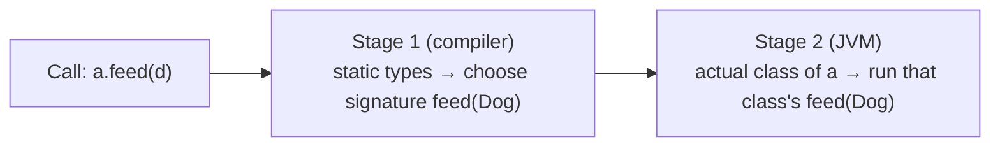
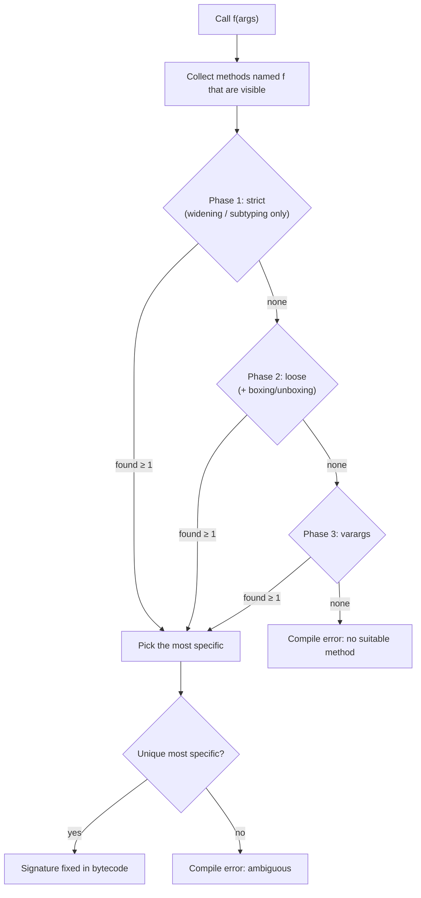
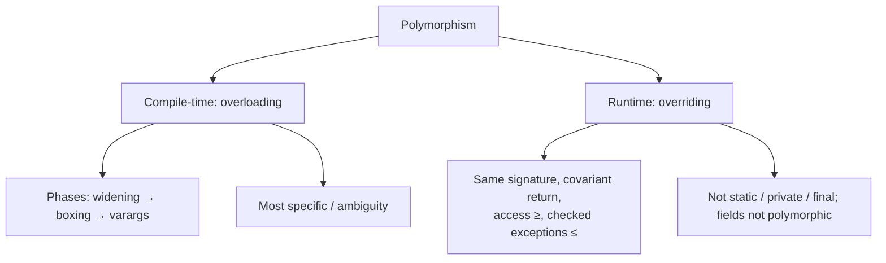

# Polymorphism in Java: Compile-time vs Runtime, and the Rules of Overloading and Overriding

**TL;DR:** *Polymorphism* means "one name, many forms". In Java it appears in two main ways. **Compile-time polymorphism** is **method overloading**: several methods share a name but differ in parameters, and the **compiler** picks one using the *declared types* of the arguments. **Runtime polymorphism** is **method overriding**: a subclass replaces an inherited method, and the **JVM** picks the version using the *actual class of the object* when the call runs. One mental rule covers nearly every puzzle: **the compiler chooses the signature from static types; the JVM chooses the implementation from the real object.**

## Table of Contents

1. [TL;DR](#1-tldr)
2. [Why it matters](#2-why-it-matters)
3. [Prerequisites](#3-prerequisites)
4. [Mental model](#4-mental-model)
5. [Core concepts](#5-core-concepts)
6. [How it works](#6-how-it-works)
7. [Examples](#7-examples)
8. [Comparisons](#8-comparisons)
9. [Trade-offs](#9-trade-offs)
10. [Gotchas](#10-gotchas)
11. [Practical application](#11-practical-application)
12. [Interview prep](#12-interview-prep)
13. [Interview question bank](#13-interview-question-bank)
14. [Tricky code snippets](#14-tricky-code-snippets)
15. [Connections](#15-connections)
16. [Summary](#16-summary)
17. [Answers](#answers)

---

## 1. TL;DR

- **Overloading** (compile-time / static / early binding): same name, **different parameter lists** in the same class (or inherited). The **compiler** picks.
- **Overriding** (runtime / dynamic / late binding): subclass redefines an inherited **instance** method with the **same signature**. The **JVM** picks by the object's real class.
- **Overloading rules:** differ by parameter count, types or order; **not** by return type, `throws` or modifiers (Snippets 2, 3, 4).
- **Overriding rules:** same signature; return type same or **covariant**; access same or **wider**; checked exceptions same or **narrower**; not `static`, `final` or `private` (Snippets 22–33).
- **Only methods are polymorphic.** Fields, static methods and private methods are resolved by the declared type (Snippets 33, 34, 42, 43).

**The analogy: a TV remote and a delivery order.**

| Real world | Java |
|---|---|
| A remote's "play" button does different things depending on whether the device is a TV, a DVD or a speaker (you press the same button) | **Runtime polymorphism**: `shape.draw()` runs the real object's version |
| A vending machine with slots labelled "coin", "note" and "card"; you pick the slot by what you hold, before the machine does anything | **Compile-time polymorphism**: `print(int)` vs `print(String)` is chosen from the argument's declared type |
| The printed menu is fixed; what the chef actually cooks depends on who is on shift | Overload = menu entry (fixed at compile time); override = implementation (decided at run time) |

**Running example:** an `Animal`/`Dog` pair where `feed` is both **overloaded** (`feed(Animal)`, `feed(Dog)`) and **overridden** in `Dog`, plus a `log` method overloaded for `int`, `long`, `double`, `String` and `Object`. Full program and output in 6.3.

---

## 2. Why it matters

**The problem.** Without polymorphism you write `if (shape instanceof Circle) … else if (shape instanceof Square) …` everywhere, and every new shape means editing every `if`. With it, new subclasses plug into existing code. Overloading gives clean APIs (`println(int)`, `println(String)`). But both have precise rules, and misunderstanding them causes bugs that the compiler may not catch.

**What goes wrong** (verified on Java 21):

| Code | Result | Cause |
|---|---|---|
| Two methods differing only in return type | Compile error: already defined | Return type isn't part of the signature (Snippet 3) |
| `f(null)` with `f(String)` and `f(StringBuilder)` | Compile error: ambiguous | Neither is more specific (Snippet 11) |
| `f(5)` with `f(long)` and `f(Integer)` | Calls `long` | Widening beats boxing (Snippet 5) |
| `f(5)` with `f(Object)` and `f(int...)` | Calls `Object` | Boxing beats varargs (Snippet 6) |
| `public boolean equals(Money o)` | `a.equals(obj)` is `false`; `List.contains` fails | An *overload*, not an override (Snippet 35) |
| `@Override void speek()` | Compile error | The annotation catches the typo (Snippet 31); without it the typo silently adds a new method (Snippet 32) |
| Overriding with weaker access | Compile error | Access can't be reduced (Snippet 23) |
| Overriding with a broader checked exception | Compile error | Checked exceptions can only narrow (Snippet 28) |
| `Parent p = new Child(); p.name` | Parent's field | Fields aren't polymorphic (Snippet 42) |
| Parent constructor calls an overridden method | Runs the child's version before child fields are set | Dynamic dispatch in constructors (Snippet 44) |

**Why interviewers ask.** "Compile-time vs runtime polymorphism", "overloading vs overriding", "can we override static methods", "can the return type differ", "what is covariant return", "what's the output of this overload puzzle" are among the most common Java questions at every level.

---

## 3. Prerequisites

| Prerequisite | One-line refresher | Importance |
|---|---|---|
| Methods and signatures | Name + parameter types identify a method ([Declaring Variables and Methods notes]) | Essential |
| Inheritance | `extends`, IS-A, upcasting ([Inheritance notes]) | Essential |
| Type conversion | Widening, boxing ([Data Type Compatibility notes]) | Essential |
| Reference types and casting | Declared type vs actual type ([Reference Data Types notes]) | Essential |
| Interfaces and abstract classes | Contracts implemented by many classes ([Encapsulation and Abstraction notes]) | Important |
| `static`, `final`, `private` | Modifiers that affect overriding ([Static Members notes]) | Important |

---

## 4. Mental model

> **The one picture to keep in your head:** every call `x.m(arg)` is decided in **two stages**. Stage 1 (compile time) looks at the *declared types* of `x` and `arg` and chooses a **method signature**. Stage 2 (run time) looks at the *real class of the object* behind `x` and runs **that class's version** of the chosen signature.

```
        COMPILE TIME (javac)                       RUN TIME (JVM)
 ┌────────────────────────────────┐         ┌────────────────────────────────┐
 │ Animal a = new Dog();          │         │ object behind a is a Dog       │
 │ a.feed(d);                     │         │                                │
 │   declared type of a: Animal   │         │ find feed(Dog) starting from   │
 │   declared type of d: Dog      │  ─────► │ Dog; found Dog.feed(Dog)       │
 │   candidates in Animal:        │ signature│                                │
 │     feed(Animal) feed(Dog)     │  chosen │ run Dog.feed(Dog)              │
 │   pick most specific: feed(Dog)│         │                                │
 └────────────────────────────────┘         └────────────────────────────────┘
        overloading decided here                  overriding decided here
```
*The compiler never decides which class's code runs; the JVM never reconsiders which signature to use.*


*Overloading = stage 1; overriding = stage 2.*

You can see stage 1 in the bytecode. For `log(5)` and `log("x")` the compiler emits `invokestatic log:(I)V` and `invokestatic log:(Ljava/lang/String;)V` (signatures fixed at compile time), while for `a.sound()` it emits `invokevirtual Animal.sound:()Ljava/lang/String;` (the *signature* is fixed, the *target object's class* is resolved at run time). Verified with `javap -c` on Java 21.

---

## 5. Core concepts

### 5.1 Glossary

- **Polymorphism:** one interface or name, many implementations or forms.
- **Method signature:** the method name plus the ordered list of parameter types (return type and `throws` are **not** part of it).
- **Overloading:** several methods with the same name and different signatures in scope.
- **Overriding:** a subclass instance method with the same signature as an inherited one, replacing it for that class.
- **Static (early) binding:** choosing the method at compile time (overloads, `static`, `private`, `final`, constructors).
- **Dynamic (late) binding / dynamic dispatch:** choosing the implementation at run time from the object's class (overridden instance methods).
- **Static type (declared type):** the type of the variable or expression as the compiler sees it.
- **Dynamic type (runtime type):** the actual class of the object.
- **Upcasting:** treating a child object as a parent type (implicit).
- **Covariant return type:** an overriding method may return a *subtype* of the overridden method's return type.
- **Method hiding:** a `static` method in a subclass with the same signature hides (not overrides) the parent's.
- **Most specific method:** the applicable overload whose parameter types are the most narrow.
- **Varargs:** `T...` parameter, treated as an array and tried last.
- **Bridge method:** a compiler-generated method that preserves overriding across generics and covariant returns ⚠️ (an implementation detail).
- **`@Override`:** an annotation that makes the compiler verify that you really override something.

### 5.2 The two kinds of polymorphism

| | Compile-time (static) | Runtime (dynamic) |
|---|---|---|
| Mechanism | **Overloading** (and constructors, and the overloaded `+`) | **Overriding** + upcasting |
| Resolved by | Compiler | JVM |
| Based on | Declared types of arguments (and receiver) | Actual class of the receiver |
| Binding | Early / static | Late / dynamic |
| Needs inheritance? | No | Yes (or interface implementation) |
| Bytecode | `invokestatic`, `invokespecial`, or a fixed signature | `invokevirtual` / `invokeinterface` |
| Example | `log(int)` vs `log(String)` | `shape.area()` on a `Circle` |

⚠️ "Compile-time polymorphism" and "runtime polymorphism" are informal textbook labels; the Java Language Specification speaks of overload resolution and method invocation (dispatch). Parametric polymorphism (generics) is a third kind, resolved at compile time via erasure.

### 5.3 Overloading rules

| Rule | Example | Snippet |
|---|---|---|
| Must differ in **number, type or order** of parameters | `f(int, String)` vs `f(String, int)` | 2 |
| **Return type alone** can't distinguish | `int f()` vs `String f()` → error | 3 |
| `throws` clause or modifiers alone can't distinguish | `void f()` vs `public void f() throws Exception` → error | 4 |
| Can have different return types **if** parameters differ | `int f(int)` and `String f(String)` | 2, 16 |
| Can have different access levels and `throws` if parameters differ | any | n/a |
| Parameter **names** don't matter | `f(int a)` vs `f(int b)` is a duplicate | n/a |
| A subclass can **add** overloads without overriding | `C.f(String)` alongside `P.f(Object)` | 45 |
| Constructors can be overloaded; `this(...)` chains them | `Box()`, `Box(int)`, `Box(int, int)` | 16 |
| Overloads can be `static` or instance, in any mix | `static f(int)` and `f(String)` | n/a |

### 5.4 How the compiler picks an overload

Java tries three phases, **stopping at the first phase that finds any applicable method**, then picks the **most specific** in that phase:

| Phase | Allowed conversions | Example |
|---|---|---|
| 1. Strict invocation | Identity, widening primitive, widening reference (subtyping). **No boxing, no varargs** | `f(5)` finds `f(long)` (Snippet 5); `f('a')` finds `f(int)` (Snippet 8) |
| 2. Loose invocation | Phase 1 plus **boxing/unboxing** | `f(5)` finds `f(Object)` via boxing (Snippet 6) |
| 3. Variable arity | Phase 2 plus **varargs** | `f(1, 2, 3)` finds `f(int...)` (Snippet 7) |

Consequences:
- **Widening beats boxing** (`f(long)` over `f(Integer)`, Snippet 5).
- **Boxing beats varargs** (`f(Object)` over `f(int...)`, Snippet 6).
- **Varargs is the last resort**, so `f(1, 2)` prefers `f(int, int)` (Snippet 7).
- With several applicable overloads in a phase, the **most specific** wins: for `null`, `f(String)` beats `f(Object)` (Snippet 10). If none is most specific you get an **ambiguity** error (Snippets 11, 12).
- The **declared type** of the argument is what counts, not the object it holds (Snippet 15).
- A `char` argument widens to `int` (printing `97`) when no `char` overload exists (Snippet 8).
- A `byte` argument prefers `f(int)` (widening) over `f(Byte)`/`f(Object)` (Snippet 9).

### 5.5 Overriding rules

| # | Rule | What happens if violated | Snippet |
|---|---|---|---|
| 1 | **Same name and parameter types** (after generics erasure) as an inherited method | It's an *overload*, not an override (Snippets 32, 35) | 32, 35 |
| 2 | **Return type**: same, or a **subtype** for reference types (covariant). **Primitives must match exactly** | Compile error | 24, 25, 26 |
| 3 | **Access**: same or **wider** (`protected` → `public` is fine; `public` → package is not) | Compile error | 22, 23 |
| 4 | **Checked exceptions**: none, the same, or **narrower**; may add any unchecked | Compile error for broader checked | 27, 28, 29 |
| 5 | The parent method must be **inherited and visible** (not `private`) | A same-named method is just a new method | 33 |
| 6 | **Cannot override `final`** methods | Compile error | (Inheritance note, Snippet 22) |
| 7 | **Cannot override `static`** (a static method *hides*; instance vs static mismatch is an error) | Hiding or compile error | 30, 43 |
| 8 | **Constructors** aren't inherited, so they can't be overridden | n/a | (Constructors notes) |
| 9 | Interface methods are implicitly `public`; implementations must be `public` | Compile error | 40 |
| 10 | A concrete class must implement all inherited `abstract` methods | Compile error | 41 |
| 11 | `default` methods can be overridden; call the original with `Interface.super.m()` | n/a | 39 |
| 12 | Use `@Override` so the compiler checks you | Typos go unnoticed (Snippet 32) vs error (Snippet 31) | 31, 32 |
| 13 | Same erasure with different generics is a **name clash**, not an override | Compile error | 38 |
| 14 | A varargs method and an array-parameter method have the same signature | Allowed; javac can warn under `-Xlint:overrides` ⚠️ | 37 |

### 5.6 What is *not* polymorphic

| Member | Resolved by | Behaviour | Snippet |
|---|---|---|---|
| Instance fields | Declared type | Hidden, not overridden | 42 |
| `static` methods | Declared type (class) | Hidden | 43 |
| `private` methods | The class where they're called | Not inherited, so not overridden | 33, 34 |
| `final` methods | Fixed | Can't be overridden; early-bound | 34 |
| Constructors | Class named in `new` | Not inherited | 16 |
| Overloads | Compile-time declared types | Chosen once, before run time | 15, 45 |

### 5.7 Upcasting and what you can call

`Animal a = new Dog();` gives you a variable that can only call `Animal`'s members (the compiler checks), but when it calls an overridden one, the **Dog** version runs (Snippets 18, 19). To call a Dog-only method you must downcast.

### 5.8 Where runtime polymorphism shines

- **Collections of a supertype** (`Shape[]`, `List<Payment>`) with each element behaving per its class (Snippets 18, 19).
- **`println(Object)` and string concatenation** call the object's `toString()` (Snippet 20).
- **Method references** like `Animal::sound` dispatch dynamically (Snippet 21).
- **Frameworks and callbacks:** you implement an interface; the library calls it.
- **Template method and strategy patterns.**

---

## 6. How it works

### 6.1 Compile-time: overload resolution in steps


*The compiler uses only declared types; no object exists yet.*

### 6.2 Run time: finding the implementation

1. The JVM takes the **actual class** of the receiver (`Dog`).
2. It looks for a method with the signature the compiler chose, **starting in that class** and moving **up** the superclass chain (and default methods) until one is found.
3. It runs that method.

HotSpot speeds this up with a per-class method table (a "vtable") and inline caches, and the JIT may inline calls when it can prove the target ⚠️ (implementation details, not Java semantics).

### 6.3 Worked trace: overloads and an override together

```java
class Animal {
    String sound() { return "..."; }
    void feed(Animal a) { System.out.println("Animal feeds Animal"); }
    void feed(Dog d)    { System.out.println("Animal feeds Dog"); }
}
class Dog extends Animal {
    @Override String sound() { return "woof"; }
    @Override void feed(Animal a) { System.out.println("Dog feeds Animal"); }
    @Override void feed(Dog d)    { System.out.println("Dog feeds Dog"); }
}
public class Main {
    static void log(int x)    { System.out.println("int " + x); }
    static void log(long x)   { System.out.println("long " + x); }
    static void log(double x) { System.out.println("double " + x); }
    static void log(String s) { System.out.println("String " + s); }
    static void log(Object o) { System.out.println("Object " + o); }
    public static void main(String[] args) {
        log(5); log(5L); log(5.0f); log('a'); log("hi"); log(new int[0].length); log((Object) "hi"); log(Integer.valueOf(7));
        System.out.println("--");
        Animal a = new Dog();
        Dog d = new Dog();
        System.out.println(a.sound());
        a.feed(a); a.feed(d); d.feed(a); d.feed(d);
    }
}
```

Output (verified, Java 21):

```
int 5
long 5
double 5.0
int 97
String hi
int 0
Object hi
Object 7
--
woof
Dog feeds Animal
Dog feeds Dog
Dog feeds Animal
Dog feeds Dog
```

| Call | Compiler (static types) | JVM (actual object) | Output |
|---|---|---|---|
| `log(5)` | `int` exact match | n/a (static) | `int 5` |
| `log(5L)` | `long` exact | | `long 5` |
| `log(5.0f)` | No `float` overload; `float` widens to `double` | | `double 5.0` |
| `log('a')` | No `char` overload; `char` widens to `int` | | `int 97` |
| `log("hi")` | `String` exact (more specific than `Object`) | | `String hi` |
| `log((Object) "hi")` | Declared type `Object` | | `Object hi` (the cast changes the chosen overload, not the object) |
| `log(Integer.valueOf(7))` | Phase 1: `Integer` is an `Object` (subtyping); `int` would need unboxing (phase 2) | | `Object 7` |
| `a.sound()` | `Animal.sound()` | `Dog` object → `Dog.sound` | `woof` |
| `a.feed(a)` | args are `Animal` → `feed(Animal)` | `Dog.feed(Animal)` | `Dog feeds Animal` |
| `a.feed(d)` | arg is `Dog` → most specific `feed(Dog)` | `Dog.feed(Dog)` | `Dog feeds Dog` |
| `d.feed(a)` | arg declared `Animal` → `feed(Animal)` | `Dog.feed(Animal)` | `Dog feeds Animal` |
| `d.feed(d)` | `feed(Dog)` | `Dog.feed(Dog)` | `Dog feeds Dog` |

**Notice:** in `a.feed(a)` the *argument* `a` is declared `Animal`, so stage 1 chose `feed(Animal)`; stage 2 then ran `Dog`'s version because the *receiver* really is a `Dog`. Overloading looks at the argument's declared type; overriding looks at the receiver's real class.

### 6.4 Constructors and dynamic dispatch

During construction, the parent constructor runs before the child's fields are initialised, yet a call to an overridden method still dispatches to the **child**. In Snippet 44 the output is `C.show x=0` because `x = 5` hasn't run yet. Avoid calling overridable methods from constructors.

### 6.5 Hiding vs overriding

```
 Parent p = new Child();
 p.name      → Parent's field         (field hiding: static type)
 p.who()     → Parent.who() if static  (method hiding: static type)
 p.who()     → Child.who()  if instance (overriding: actual class)
```
Verified in Snippets 42, 43: `P C.who` for a field plus instance method; `P P P` for a static method called three ways.

---

## 7. Examples

### 7.1 Toy example: runtime polymorphism

```java
class Shape  { double area() { return 0; } }
class Circle extends Shape { double r = 1; @Override double area() { return Math.PI * r * r; } }
class Square extends Shape { double s = 2; @Override double area() { return s * s; } }
// Shape[] shapes = { new Circle(), new Square(), new Shape() };  sum of area() → 7.14
```
Verified (Snippet 18): the total prints `7.14` (3.14 + 4 + 0).

### 7.2 Toy example: overloading with a constructor

```java
class Box {
    int w, h;
    Box() { this(1, 1); }
    Box(int s) { this(s, s); }
    Box(int w, int h) { this.w = w; this.h = h; }
}
```
`new Box()`, `new Box(3)`, `new Box(2, 5)` give `1x1 3x3 2x5` (Snippet 16).

### 7.3 Real-world examples

- **`System.out.println`:** about ten overloads (`int`, `char`, `String`, `Object`, `char[]` …) chosen at compile time (Snippet 14).
- **`String.valueOf`**, **`Math.max`/`abs`**, **`List.remove(int)` vs `remove(Object)`** ⚠️ (the last is a famous overload trap: `list.remove(1)` removes by index, `list.remove(Integer.valueOf(1))` by value).
- **`toString`, `equals`, `hashCode`:** overridden everywhere; collections and string concatenation call the real override (Snippet 20).
- **Payment/Shape/Employee hierarchies:** the classic runtime polymorphism examples (Snippet 19).
- **Frameworks:** a servlet's `doGet`, JUnit's lifecycle methods, Spring beans programmed to interfaces.
- **The `+` operator:** overloaded for `String` concatenation and numeric addition, the only operator overloading Java has (Snippet 17).

---

## 8. Comparisons

### 8.1 Overloading vs overriding

| Aspect | Overloading | Overriding |
|---|---|---|
| Where | Same class (or inherited) | Parent and child |
| Signature | **Must differ** | **Must be the same** |
| Return type | Can differ | Same or covariant |
| Access modifier | Can differ | Same or wider |
| Exceptions | Can differ | Checked: same or narrower |
| Binding | Compile time | Run time |
| Decided by | Declared argument types | Actual receiver class |
| `static` methods | Can be overloaded | Hidden, not overridden |
| `private`/`final` | Can be overloaded | Cannot be overridden |
| Needs inheritance | No | Yes |
| Annotation | None | `@Override` (recommended) |

### 8.2 Overriding vs hiding

| | Overriding | Hiding |
|---|---|---|
| Applies to | Instance methods | Static methods and fields |
| Resolved by | Actual object | Declared type |
| `@Override` allowed | Yes | No (compile error, Snippet 30) |

### 8.3 Early vs late binding

| Early (static) | Late (dynamic) |
|---|---|
| Overloaded methods, `static`, `private`, `final`, constructors, `super.m()` calls | Overridable instance methods called on a reference |
| Bytecode: `invokestatic` / `invokespecial` | Bytecode: `invokevirtual` / `invokeinterface` |

### 8.4 Binding rules of thumb for puzzle questions

1. Pick the **signature** from the *declared* types (static stage).
2. Find that signature in the **declared class of the receiver** (it must exist there).
3. Run the **actual class's** override of it (dynamic stage).
4. For fields, static methods and private methods: use the declared type only.

### 8.5 Polymorphism via inheritance vs via interfaces

| | Class inheritance | Interface implementation |
|---|---|---|
| Overridden/implemented | Instance methods | Abstract and default methods |
| Many per class | One parent | Many interfaces |
| Dispatch | `invokevirtual` | `invokeinterface` |

### 8.6 Covariant vs contravariant vs invariant

| | Rule in Java |
|---|---|
| Return types | **Covariant** when overriding (Snippet 24) |
| Parameter types | **Invariant**: a different type is an overload, not an override (Snippets 35, 45) |
| Generic type arguments | **Invariant** (`List<String>` isn't a `List<Object>`) |
| Arrays | Covariant (and checked at run time) |

---

## 9. Trade-offs

| Decision | Benefit | Cost | Use when |
|---|---|---|---|
| Overloading | Natural APIs (`print(x)`) | Resolution can surprise (boxing, `null`, varargs) | Operations that are conceptually the same |
| Distinct method names instead | No ambiguity | Wordier | Overloads would differ in meaning (`removeAt`, `removeValue`) |
| Many overloads with `null`-friendly params | Convenient | Ambiguity errors (Snippet 11) | Avoid; use different names or casts |
| Varargs overload | Flexible call sites | Allocates an array; last-resort resolution | Small utility APIs |
| Overriding for behaviour variants | Open/closed; no `instanceof` chains | Subclass coupling; fragile base class | Real IS-A with a stable contract |
| `final` on methods | Prevents unsafe overriding | Reduces extensibility | Methods that must not change |
| Covariant returns | Callers avoid casts | Minor complexity | Fluent/self-returning methods (Snippet 24) |
| `@Override` everywhere | Typos caught at compile time | None | Always |
| Calling overridable methods in constructors | Convenient hooks | Sees uninitialised state (Snippet 44) | Avoid |

---

## 10. Gotchas

### Myths

- ❌ **Myth:** "Overloading can differ by return type." ✅ **Reality:** the signature excludes return type; this is a compile error (Snippet 3).
- ❌ **Myth:** "Overload resolution looks at the object's real type." ✅ **Reality:** only declared types count (Snippet 15; `log((Object) "hi")` in 6.3).
- ❌ **Myth:** "Overriding is resolved at compile time because the method name is known." ✅ **Reality:** the signature is chosen at compile time; the implementation at run time (section 4).
- ❌ **Myth:** "Fields are polymorphic like methods." ✅ **Reality:** the declared type decides (Snippet 42).
- ❌ **Myth:** "You can override a static method." ✅ **Reality:** you can only hide it; `@Override` on it is an error (Snippets 30, 43).
- ❌ **Myth:** "A private method can be overridden." ✅ **Reality:** it isn't inherited, so a same-named subclass method is unrelated (Snippet 33).
- ❌ **Myth:** "Overriding may reduce visibility if the exception list shrinks." ✅ **Reality:** access must stay the same or widen, independently (Snippet 23).
- ❌ **Myth:** "An overriding method may throw any exception." ✅ **Reality:** no new or broader *checked* exceptions (Snippets 27–29).
- ❌ **Myth:** "`public boolean equals(MyClass o)` overrides `equals`." ✅ **Reality:** it overloads it; `Object`-typed calls still use `Object.equals` (Snippets 35, 36).
- ❌ **Myth:** "Boxing is tried before widening." ✅ **Reality:** widening comes first (Snippet 5).
- ❌ **Myth:** "`f(null)` picks the first overload." ✅ **Reality:** the most specific one, or a compile error if ambiguous (Snippets 10, 11).
- ❌ **Myth:** "Runtime polymorphism doesn't work inside constructors." ✅ **Reality:** it does, which is exactly the danger (Snippet 44).

### Common mistakes and edge cases

- **Forgetting `@Override`**: a typo creates a new method; the parent version runs (Snippet 32).
- **Wrong parameter type in `equals`/`compareTo`** (Snippet 35).
- **Ambiguous overloads** with `null` or two boxing options (Snippets 11, 12).
- **Relying on a particular overload through a cast**, which changes the chosen method but not the object (6.3).
- **Surprising `println(char[])`**: prints the characters, not `[C@…` (Snippet 14).
- **Subclass adds an overload instead of overriding**, so a parent-typed reference can't see it (Snippet 45).
- **Static method called through an instance** looks polymorphic but isn't (Snippet 43).
- **Overriding with an incompatible return type** (Snippets 25, 26).
- **Generic erasure clashes** (Snippet 38).
- **Adding an interface method later** may break implementers unless it's a `default` ⚠️.

---

## 11. Practical application

### Checklist before overriding or overloading
- [ ] Am I overriding (same signature) or overloading (new signature)? Name which.
- [ ] `@Override` present on every override?
- [ ] Access same or wider; return type same or covariant; checked exceptions same or narrower?
- [ ] For `equals(Object)`, `hashCode()`, `compareTo(T)`: exact parameter types.
- [ ] Do my overloads risk `null`/boxing/varargs ambiguity? If so, rename.
- [ ] Not calling overridable methods from constructors.
- [ ] Is the method `static`, `private` or `final` and therefore not polymorphic?
- [ ] Could a `switch` on a sealed type or a visitor replace an `instanceof` chain?

### Hands-on exercise: predict the four calls

```java
class Shape {
    void draw(Shape s)  { System.out.println("Shape draws Shape"); }
    void draw(Circle c) { System.out.println("Shape draws Circle"); }
}
class Circle extends Shape {
    @Override void draw(Shape s) { System.out.println("Circle draws Shape"); }
}
public class Main {
    public static void main(String[] a) {
        Shape s = new Circle();
        Circle c = new Circle();
        s.draw(s); s.draw(c); c.draw(s); c.draw(c);
    }
}
```
(a) Predict the four lines. (b) Add `@Override void draw(Circle c) { System.out.println("Circle draws Circle"); }` to `Circle`. What changes?

<details><summary>Solution</summary>

**(a)**

```
Circle draws Shape
Shape draws Circle
Circle draws Shape
Shape draws Circle
```

- `s.draw(s)`: argument declared `Shape` → `draw(Shape)`; receiver is a `Circle` → `Circle.draw(Shape)`.
- `s.draw(c)`: argument declared `Circle` → most specific `draw(Circle)`; `Circle` doesn't override it → `Shape.draw(Circle)`.
- `c.draw(s)`: `draw(Shape)` → `Circle`'s override.
- `c.draw(c)`: `draw(Circle)` is more specific → inherited `Shape.draw(Circle)`.

**(b)** `Circle` now overrides both, so the output becomes `Circle draws Shape`, `Circle draws Circle`, `Circle draws Shape`, `Circle draws Circle`. The signatures chosen at compile time are unchanged; only which class's code runs for `draw(Circle)` changes.

Both versions were run on Java 21 and printed exactly these lines.
</details>

---

## 12. Interview prep

Eight model answers, as you would say them aloud.

<details><summary>1. What is polymorphism, and what are its types in Java?</summary>

One name or interface with many behaviours. Compile-time (static) polymorphism is method overloading, resolved by the compiler from declared argument types. Runtime (dynamic) polymorphism is method overriding with upcasting, resolved by the JVM from the object's actual class (section 5.2).
</details>

<details><summary>2. Overloading vs overriding: the core differences?</summary>

Overloading: same name, different parameters, same class, resolved at compile time, return type may differ. Overriding: same signature in a subclass, resolved at run time, return type same or covariant, access same or wider, checked exceptions same or narrower (8.1).
</details>

<details><summary>3. How does the compiler choose among overloads?</summary>

Using declared types in three phases (widening/subtyping, then boxing, then varargs), stopping at the first phase with any match and choosing the most specific. If no method is most specific, it's an ambiguity error (5.4; Snippets 5, 6, 7, 11).
</details>

<details><summary>4. How does dynamic dispatch work?</summary>

The compiler fixes the method signature; at run time the JVM starts at the receiver's real class and walks up until it finds that signature, then runs it (6.2). `invokevirtual`/`invokeinterface` are the bytecode instructions.
</details>

<details><summary>5. Can you override a static method? A private one? A final one?</summary>

No to all three. A static method with the same signature hides the parent's (Snippet 43); a private method isn't inherited so there's nothing to override (Snippet 33); a final method is forbidden to override.
</details>

<details><summary>6. What is a covariant return type?</summary>

An overriding method may return a subtype of the overridden method's return type (`Dog self()` overriding `Animal self()`), but primitives must match exactly (Snippets 24, 25, 26).
</details>

<details><summary>7. What are the rules about access modifiers and exceptions when overriding?</summary>

Access can stay the same or widen (not narrow, Snippet 22 vs 23). Checked exceptions can stay the same, narrow or disappear, but can't broaden (Snippets 27, 28); unchecked exceptions are unrestricted (Snippet 29).
</details>

<details><summary>8. Why does `public boolean equals(Money o)` cause trouble?</summary>

It overloads rather than overrides `equals(Object)`. Code that calls `equals` with an `Object`, such as `List.contains`, uses the inherited `Object.equals` and gets `false` (Snippet 35). Use `@Override public boolean equals(Object o)` (Snippet 36).
</details>

---

## 13. Interview question bank


### 13.1 Polymorphism basics (Q1–Q12)

<details><summary>Q1. What does polymorphism mean?</summary>

"Many forms": the same call can run different code depending on types.
</details>

<details><summary>Q2. What are the types of polymorphism in Java?</summary>

Compile-time (overloading), runtime (overriding), and parametric (generics) ⚠️ the last is a separate concept.
</details>

<details><summary>Q3. What is compile-time polymorphism called otherwise?</summary>

Static or early binding; method overloading.
</details>

<details><summary>Q4. What is runtime polymorphism called otherwise?</summary>

Dynamic or late binding; dynamic method dispatch; overriding.
</details>

<details><summary>Q5. Is operator overloading supported?</summary>

Not by users. Only `+` is overloaded by the language (numeric addition and `String` concatenation) (Snippet 17).
</details>

<details><summary>Q6. Are constructors polymorphic?</summary>

They can be overloaded (Snippet 16) but are never overridden or dynamically dispatched.
</details>

<details><summary>Q7. What is upcasting, and why does runtime polymorphism need it?</summary>

Assigning a child object to a parent-typed reference. Calls through it dispatch to the child's overrides (Snippets 18, 19).
</details>

<details><summary>Q8. What does `Animal a = new Dog();` let you call?</summary>

Only members declared in `Animal` (the compiler checks), but overridden ones run the `Dog` version.
</details>

<details><summary>Q9. Does polymorphism need inheritance?</summary>

Runtime polymorphism needs a type relationship: inheritance or interface implementation (Snippet 19). Overloading doesn't.
</details>

<details><summary>Q10. What does `println(Object)` use to print an object?</summary>

The object's `toString()`, a polymorphic call (Snippet 20).
</details>

<details><summary>Q11. Can method references be polymorphic?</summary>

Yes; `Animal::sound` calls the real override (Snippet 21).
</details>

<details><summary>Q12. What is the benefit of runtime polymorphism?</summary>

Code written against a supertype works with new subtypes without change (open/closed principle).
</details>


### 13.2 Overloading (Q13–Q30)

<details><summary>Q13. What qualifies as a different signature for overloading?</summary>

Different number, types or order of parameters (Snippet 2).
</details>

<details><summary>Q14. Can you overload by return type?</summary>

No (Snippet 3).
</details>

<details><summary>Q15. Can you overload by `throws` clause or access modifier?</summary>

Not alone (Snippet 4).
</details>

<details><summary>Q16. Do parameter names matter?</summary>

No; `f(int a)` and `f(int b)` are the same signature.
</details>

<details><summary>Q17. Can overloaded methods have different return types?</summary>

Yes, as long as the parameter lists differ.
</details>

<details><summary>Q18. Can `static` and instance methods overload each other?</summary>

Yes, if signatures differ.
</details>

<details><summary>Q19. Can you overload `main`?</summary>

Yes; only `public static void main(String[])` is the entry point the JVM calls ⚠️ (Java 21 preview adds instance main methods).
</details>

<details><summary>Q20. `f(5)` with `f(long)` and `f(Integer)`: which?</summary>

`f(long)`, since widening beats boxing (Snippet 5).
</details>

<details><summary>Q21. `f(5)` with `f(Object)` and `f(int...)`: which?</summary>

`f(Object)`, since boxing beats varargs (Snippet 6).
</details>

<details><summary>Q22. `f(1, 2)` with `f(int, int)` and `f(int...)`: which?</summary>

`f(int, int)`; varargs is last (Snippet 7).
</details>

<details><summary>Q23. `f('a')` with `f(int)` and `f(String)`: which?</summary>

`f(int)` (char widens) (Snippet 8).
</details>

<details><summary>Q24. `byte b` with `f(int)`, `f(Object)`, `f(Byte)`: which?</summary>

`f(int)`; with a `Byte` argument, `f(Byte)` (Snippet 9).
</details>

<details><summary>Q25. `f(null)` with `f(Object)` and `f(String)`?</summary>

`f(String)` is more specific (Snippet 10).
</details>

<details><summary>Q26. `f(null)` with `f(String)` and `f(StringBuilder)`?</summary>

Compile error: ambiguous (Snippet 11).
</details>

<details><summary>Q27. `f(1, 2)` with `f(Integer, int)` and `f(int, Integer)`?</summary>

Ambiguous (Snippet 12).
</details>

<details><summary>Q28. `f(new ArrayList<String>())` with `Collection<?>`, `Object`, `List<?>` overloads?</summary>

`List<?>`, the most specific; a `Collection<String>` variable gets `Collection<?>` (Snippet 13).
</details>

<details><summary>Q29. Does the object's runtime type affect overload choice?</summary>

No; only the declared type (Snippet 15, 6.3).
</details>

<details><summary>Q30. What does `println(char[])` print?</summary>

The characters; `println(Object)` would print `[C@hash` (Snippet 14).
</details>


### 13.3 Overriding rules (Q31–Q50)

<details><summary>Q31. What are the rules of overriding?</summary>

Same signature; covariant or same return type; same or wider access; same or narrower checked exceptions; instance, non-final, non-private, visible parent method (5.5).
</details>

<details><summary>Q32. Can an overriding method have a different return type?</summary>

Only a subtype for reference types (Snippet 24); a different primitive or unrelated type is an error (Snippets 25, 26).
</details>

<details><summary>Q33. Can an overriding method be less accessible?</summary>

No (Snippet 23). More accessible is fine (Snippet 22).
</details>

<details><summary>Q34. Can an overriding method throw a broader checked exception?</summary>

No (Snippet 28). Narrower, none, or any unchecked is fine (Snippets 27, 29).
</details>

<details><summary>Q35. Can you override a static method?</summary>

No, you can hide it (Snippet 43); `@Override` on it is an error (Snippet 30).
</details>

<details><summary>Q36. Can you override a private method?</summary>

No; it isn't inherited (Snippet 33).
</details>

<details><summary>Q37. Can you override a final method?</summary>

No.
</details>

<details><summary>Q38. Can you override a constructor?</summary>

No; constructors aren't inherited.
</details>

<details><summary>Q39. What does `@Override` do?</summary>

Asks the compiler to verify that the method overrides or implements something; typos become errors (Snippets 31, 32).
</details>

<details><summary>Q40. Is `@Override` mandatory?</summary>

No, but always recommended.
</details>

<details><summary>Q41. Why does an interface implementation need `public`?</summary>

Interface methods are implicitly public and access can't be narrowed (Snippet 40).
</details>

<details><summary>Q42. Can an abstract method be overridden by an abstract method?</summary>

Yes, to re-declare or narrow the contract; a concrete class must implement all abstract methods (Snippet 41).
</details>

<details><summary>Q43. How do you call the overridden method from the override?</summary>

`super.method()`; for interface defaults `Interface.super.method()` (Snippet 39).
</details>

<details><summary>Q44. Do `List<String>` and `List<Integer>` parameters give different overloads/overrides?</summary>

No; same erasure gives a name clash error (Snippet 38).
</details>

<details><summary>Q45. Is `f(String...)` overridden by `f(String[])`?</summary>

They have the same signature after erasure, so yes ⚠️ (Snippet 37; prefer the same form).
</details>

<details><summary>Q46. What happens if a typo makes a "new" method instead of an override?</summary>

Without `@Override` the parent's method still runs (Snippet 32).
</details>

<details><summary>Q47. Which `equals` signature overrides `Object.equals`?</summary>

`public boolean equals(Object o)` (Snippets 35, 36).
</details>

<details><summary>Q48. Can a subclass override a method with an unchecked exception?</summary>

Yes (Snippet 29).
</details>

<details><summary>Q49. Can an overriding method be `synchronized` or `strictfp` regardless of the parent?</summary>

Yes; those modifiers aren't part of the override contract ⚠️ not run here.
</details>

<details><summary>Q50. Can the overriding method have different parameter names or `final` parameters?</summary>

Yes; only types matter.
</details>


### 13.4 Dispatch details and traps (Q51–Q66)

<details><summary>Q51. Are fields polymorphic?</summary>

No; the declared type chooses the field (Snippet 42).
</details>

<details><summary>Q52. Which `who()` does `p.who()` call when both are static?</summary>

The declared type's (Snippet 43).
</details>

<details><summary>Q53. What does a parent's method calling a private helper do when the child declares the same name?</summary>

Calls the parent's private method (Snippet 33).
</details>

<details><summary>Q54. Why can calling an overridable method in a constructor be dangerous?</summary>

The child's override can run before the child's fields are initialised (Snippet 44).
</details>

<details><summary>Q55. Which method runs when a subclass adds an overload but you call through a parent reference?</summary>

The parent's, because the parent type doesn't know the new overload (Snippet 45).
</details>

<details><summary>Q56. How is `final` related to binding?</summary>

`final` methods can't be overridden, so calls can be bound early (Snippet 34).
</details>

<details><summary>Q57. What bytecode instruction implements a virtual call?</summary>

`invokevirtual` (classes) or `invokeinterface` (interfaces); static calls use `invokestatic`; `super`/private/constructors use `invokespecial` (section 4).
</details>

<details><summary>Q58. What does the cast in `log((Object) "hi")` change?</summary>

The declared type, hence the chosen overload (`Object`), not the actual object.
</details>

<details><summary>Q59. Do overloads participate in dynamic dispatch?</summary>

The chosen overload does; the run-time class provides the implementation of that chosen signature (6.3).
</details>

<details><summary>Q60. Can interfaces have overloaded methods?</summary>

Yes, with the same rules.
</details>

<details><summary>Q61. Can you overload a generic method?</summary>

Yes, provided erasures differ (Snippet 38 shows a clash).
</details>

<details><summary>Q62. What happens if two inherited defaults conflict?</summary>

The class must override (see Inheritance note, Snippets 14, 15).
</details>

<details><summary>Q63. What is the output of `1 + 2 + "3" + 4 + 5`?</summary>

`3345`: numeric additions first, then string concatenation (Snippet 17).
</details>

<details><summary>Q64. What is "method hiding"?</summary>

A static method in a subclass with the same signature as an inherited static method.
</details>

<details><summary>Q65. Why is `Object.equals` an overload trap in `List.contains`?</summary>

`contains` calls `equals(Object)`; an `equals(Money)` overload isn't used (Snippet 35).
</details>

<details><summary>Q66. How can the Visitor pattern simulate double dispatch?</summary>

Java dispatches on the receiver only; the visitor calls `accept(visitor)` (dynamic on the element) which calls `visitor.visit(this)` (static overload on the concrete type) ⚠️ not run here.
</details>


### 13.5 Design and scenario questions (Q67–Q76)

<details><summary>Q67. How would you replace an `instanceof` chain with polymorphism?</summary>

Move the behaviour into an overridden method of each subclass, or use a sealed hierarchy with a `switch`.
</details>

<details><summary>Q68. When would you avoid overloading?</summary>

When overloads could be confused (boxing/`null`/varargs) or mean different things; use distinct names.
</details>

<details><summary>Q69. What are the dangers of overriding in a library you don't control?</summary>

Fragile base class: parent implementation changes can break subclasses; document or make methods `final`.
</details>

<details><summary>Q70. Template method pattern: which polymorphism does it use?</summary>

Runtime polymorphism: a final method in the base calls overridable steps.
</details>

<details><summary>Q71. Strategy pattern vs inheritance?</summary>

Strategy uses composition plus polymorphic strategy objects, avoiding subclass explosion.
</details>

<details><summary>Q72. How does polymorphism relate to the Liskov Substitution Principle?</summary>

Overriding must keep the parent's contract so subclasses can be substituted safely.
</details>

<details><summary>Q73. Why do collections of a supertype need overrides of `equals`/`hashCode`?</summary>

Lookup uses the dynamic type's methods; inconsistent overrides break `HashMap`/`HashSet`.
</details>

<details><summary>Q74. Can you achieve polymorphism with lambdas?</summary>

Yes; a functional interface reference runs whichever lambda it holds.
</details>

<details><summary>Q75. Name a case where compile-time polymorphism hides a bug.</summary>

`list.remove(1)` vs `list.remove(Integer.valueOf(1))` ⚠️ not run here; or `equals(Money)` (Snippet 35).
</details>

<details><summary>Q76. Summarise the two-stage rule.</summary>

The compiler picks the signature from declared types; the JVM picks the implementation from the real receiver class.
</details>

---

## 14. Tricky code snippets

45 snippets, each compiled and run on OpenJDK 21. Predict the output (or the compile error) before opening the answer. Classes are declared without `public` so they can share one file.

### Snippet 1: Overloads and an override together

```java
class Animal {
    String sound() { return "..."; }
    void feed(Animal a) { System.out.println("Animal feeds Animal"); }
    void feed(Dog d)    { System.out.println("Animal feeds Dog"); }
}
class Dog extends Animal {
    @Override String sound() { return "woof"; }
    @Override void feed(Animal a) { System.out.println("Dog feeds Animal"); }
    @Override void feed(Dog d)    { System.out.println("Dog feeds Dog"); }
}
public class Main {
    static void log(int x)    { System.out.println("int " + x); }
    static void log(long x)   { System.out.println("long " + x); }
    static void log(double x) { System.out.println("double " + x); }
    static void log(String s) { System.out.println("String " + s); }
    static void log(Object o) { System.out.println("Object " + o); }
    public static void main(String[] args) {
        log(5); log(5L); log(5.0f); log('a'); log("hi"); log(new int[0].length); log((Object) "hi"); log(Integer.valueOf(7));
        System.out.println("--");
        Animal a = new Dog();
        Dog d = new Dog();
        System.out.println(a.sound());
        a.feed(a); a.feed(d); d.feed(a); d.feed(d);
    }
}
```

<details><summary>Answer</summary>

```
int 5
long 5
double 5.0
int 97
String hi
int 0
Object hi
Object 7
--
woof
Dog feeds Animal
Dog feeds Dog
Dog feeds Animal
Dog feeds Dog
```

Full table in 6.3. Overloads are chosen from the arguments' declared types; `Dog`'s overrides run because the receiver is a `Dog`.
</details>

### Snippet 2: Overloading by parameter order

```java
public class Main {
    static void f(int a, String b) { System.out.println("int,String"); }
    static void f(String a, int b) { System.out.println("String,int"); }
    public static void main(String[] args) { f(1, "x"); f("x", 1); }
}
```

<details><summary>Answer</summary>

```
int,String
String,int
```

Different parameter orders give different signatures, so both methods can coexist.
</details>

### Snippet 3: Overloading by return type

```java
class A {
    int f() { return 1; }
    String f() { return "x"; }
}
public class Main { public static void main(String[] args) { } }
```

<details><summary>Answer</summary>

Compile error: *method f() is already defined in class A*.

The return type isn't part of the signature.
</details>

### Snippet 4: Overloading by `throws` and modifiers

```java
class A {
    void f() { }
    public void f() throws Exception { }
}
public class Main { public static void main(String[] args) { } }
```

<details><summary>Answer</summary>

Compile error: *method f() is already defined in class A*.

Access modifiers and `throws` clauses also aren't part of the signature.
</details>

### Snippet 5: Widening vs boxing

```java
public class Main {
    static void f(long x)    { System.out.println("long"); }
    static void f(Integer x) { System.out.println("Integer"); }
    public static void main(String[] args) { f(5); }
}
```

<details><summary>Answer</summary>

```
long
```

Phase 1 (widening) finds `f(long)` before boxing to `Integer` is even considered.
</details>

### Snippet 6: Boxing vs varargs

```java
public class Main {
    static void f(Object o)  { System.out.println("Object"); }
    static void f(int... xs) { System.out.println("varargs"); }
    public static void main(String[] args) { f(5); }
}
```

<details><summary>Answer</summary>

```
Object
```

Phase 2 (boxing `int` to `Integer`, then to `Object`) succeeds before the varargs phase.
</details>

### Snippet 7: Varargs as the last resort

```java
public class Main {
    static void f(int a, int b)  { System.out.println("two ints"); }
    static void f(int... xs)     { System.out.println("varargs " + xs.length); }
    public static void main(String[] args) { f(1, 2); f(1); f(1, 2, 3); f(); }
}
```

<details><summary>Answer</summary>

```
two ints
varargs 1
varargs 3
varargs 0
```

`f(1, 2)` matches the fixed-arity method; the other calls only fit `f(int...)`.
</details>

### Snippet 8: `char` argument

```java
public class Main {
    static void f(int x)    { System.out.println("int"); }
    static void f(String s) { System.out.println("String"); }
    public static void main(String[] args) { f('a'); f((char) 98); }
}
```

<details><summary>Answer</summary>

```
int
int
```

No `char` overload exists, so `char` widens to `int`, which beats `String` (not applicable).
</details>

### Snippet 9: `byte` and `Byte`

```java
public class Main {
    static void f(int x)     { System.out.println("int"); }
    static void f(Object o)  { System.out.println("Object"); }
    static void f(Byte b)    { System.out.println("Byte"); }
    public static void main(String[] args) { byte b = 1; f(b); f((Byte) b); f(Byte.valueOf(b)); }
}
```

<details><summary>Answer</summary>

```
int
Byte
Byte
```

A `byte` widens to `int` in phase 1. A `Byte` argument matches `f(Byte)` exactly, which is more specific than `f(Object)`.
</details>

### Snippet 10: `null` and the most specific overload

```java
public class Main {
    static void f(Object o) { System.out.println("Object"); }
    static void f(String s) { System.out.println("String"); }
    public static void main(String[] args) { f(null); f((Object) null); }
}
```

<details><summary>Answer</summary>

```
String
Object
```

`String` is a subtype of `Object`, so `f(String)` is more specific. The cast makes the declared type `Object`.
</details>

### Snippet 11: `null` with unrelated overloads

```java
public class Main {
    static void f(String s)       { System.out.println("String"); }
    static void f(StringBuilder s) { System.out.println("StringBuilder"); }
    public static void main(String[] args) { f(null); }
}
```

<details><summary>Answer</summary>

Compile error: *reference to f is ambiguous*.

`String` and `StringBuilder` are unrelated, so neither is more specific. Cast the argument to choose.
</details>

### Snippet 12: Two boxing overloads

```java
public class Main {
    static void f(Integer a, int b) { System.out.println("Integer,int"); }
    static void f(int a, Integer b) { System.out.println("int,Integer"); }
    public static void main(String[] args) { f(1, 2); }
}
```

<details><summary>Answer</summary>

Compile error: *reference to f is ambiguous*.

Both `f(Integer, int)` and `f(int, Integer)` apply in phase 2, and neither is more specific.
</details>

### Snippet 13: Overloads over a type hierarchy

```java
import java.util.*;
public class Main {
    static void f(Collection<?> c) { System.out.println("Collection"); }
    static void f(Object o) { System.out.println("Object"); }
    static void f(List<?> l) { System.out.println("List"); }
    public static void main(String[] args) {
        f(new ArrayList<String>()); f(new HashSet<String>()); Collection<String> c = new ArrayList<>(); f(c);
    }
}
```

<details><summary>Answer</summary>

```
List
Collection
Collection
```

An `ArrayList` argument matches `List<?>` best. A `HashSet` or a variable *declared* `Collection<String>` matches `Collection<?>`.
</details>

### Snippet 14: `println(char[])`

```java
public class Main {
    public static void main(String[] args) {
        char[] cs = {'a', 'b'};
        System.out.println(cs);
        System.out.println("x" + String.valueOf(cs));
        Object o = cs;
        System.out.println(o instanceof char[]);
    }
}
```

<details><summary>Answer</summary>

```
ab
xab
true
```

`println` has a `char[]` overload that prints the characters. `String.valueOf(cs)` builds the string `"ab"`.
</details>

### Snippet 15: Declared type decides the overload

```java
class Animal { }
class Dog extends Animal { }
public class Main {
    static void handle(Animal a) { System.out.println("handle Animal"); }
    static void handle(Dog d)    { System.out.println("handle Dog"); }
    public static void main(String[] args) {
        Animal a = new Dog();
        handle(a);
        handle(new Dog());
        handle((Dog) a);
    }
}
```

<details><summary>Answer</summary>

```
handle Animal
handle Dog
handle Dog
```

`a` is declared `Animal` even though it holds a `Dog`. Casting changes the declared type.
</details>

### Snippet 16: Overloaded constructors

```java
class Box {
    int w, h;
    Box() { this(1, 1); }
    Box(int s) { this(s, s); }
    Box(int w, int h) { this.w = w; this.h = h; }
}
public class Main { public static void main(String[] args) { Box a = new Box(), b = new Box(3), c = new Box(2, 5); System.out.println(a.w + "x" + a.h + " " + b.w + "x" + b.h + " " + c.w + "x" + c.h); } }
```

<details><summary>Answer</summary>

```
1x1 3x3 2x5
```

`this(...)` chains the shorter constructors to the full one.
</details>

### Snippet 17: The overloaded `+`

```java
public class Main {
    public static void main(String[] args) {
        System.out.println(1 + 2 + "3" + 4 + 5);
        System.out.println('a' + 'b' + "c");
        System.out.println("c" + 'a' + 'b');
        System.out.println((char) ('a' + 1));
    }
}
```

<details><summary>Answer</summary>

```
3345
195c
cab
b
```

`1 + 2` is numeric (`3`), then `+ "3"` starts string concatenation. `'a' + 'b'` adds char codes (97 + 98 = 195) before the string appears. `"c" + 'a' + 'b'` concatenates.
</details>

### Snippet 18: Dynamic dispatch over an array

```java
class Shape { double area() { return 0; } }
class Circle extends Shape { double r = 1; @Override double area() { return Math.PI * r * r; } }
class Square extends Shape { double s = 2; @Override double area() { return s * s; } }
public class Main {
    public static void main(String[] args) {
        Shape[] shapes = { new Circle(), new Square(), new Shape() };
        double total = 0;
        for (Shape s : shapes) total += s.area();
        System.out.printf("%.2f%n", total);
    }
}
```

<details><summary>Answer</summary>

```
7.14
```

`Circle` adds π, `Square` adds 4, `Shape` adds 0: `3.14 + 4 + 0`.
</details>

### Snippet 19: Dispatch through an interface

```java
interface Payment { double fee(double amt); }
class Card implements Payment { public double fee(double a) { return a * 0.02; } }
class Upi implements Payment { public double fee(double a) { return 0; } }
public class Main {
    public static void main(String[] args) {
        Payment[] ps = { new Card(), new Upi() };
        for (Payment p : ps) System.out.println(p.getClass().getSimpleName() + " " + p.fee(100));
    }
}
```

<details><summary>Answer</summary>

```
Card 2.0
Upi 0.0
```

Each `Payment` implementation supplies its own `fee`.
</details>

### Snippet 20: `toString` through `Object`

```java
class Pt { int x = 1; @Override public String toString() { return "Pt(" + x + ")"; } }
public class Main {
    public static void main(String[] args) {
        Object o = new Pt();
        System.out.println(o);
        System.out.println("v=" + o);
        System.out.println(String.valueOf(o));
    }
}
```

<details><summary>Answer</summary>

```
Pt(1)
v=Pt(1)
Pt(1)
```

`println(Object)`, string concatenation and `String.valueOf` all call the real `toString()`.
</details>

### Snippet 21: Method reference dispatch

```java
import java.util.*;
import java.util.function.*;
class Animal { String sound() { return "..."; } }
class Dog extends Animal { @Override String sound() { return "woof"; } }
public class Main {
    public static void main(String[] args) {
        Function<Animal, String> f = Animal::sound;
        System.out.println(f.apply(new Dog()) + " " + f.apply(new Animal()));
    }
}
```

<details><summary>Answer</summary>

```
woof ...
```

`Animal::sound` is a virtual call, so a `Dog` argument runs `Dog.sound`.
</details>

### Snippet 22: Widening access

```java
class P { protected void f() { System.out.println("P"); } }
class C extends P { @Override public void f() { System.out.println("C"); } }
public class Main { public static void main(String[] args) { new C().f(); P p = new C(); p.f(); } }
```

<details><summary>Answer</summary>

```
C
C
```

`protected` → `public` is allowed. Both calls dispatch to `C`.
</details>

### Snippet 23: Reducing access

```java
class P { public void f() { } }
class C extends P { void f() { } }
public class Main { public static void main(String[] args) { } }
```

<details><summary>Answer</summary>

Compile error: *f() in C cannot override f() in P*.

The detail line reads *attempting to assign weaker access privileges; was public*.
</details>

### Snippet 24: Covariant return

```java
class Animal { Animal self() { return this; } }
class Dog extends Animal {
    @Override Dog self() { return this; }
    void bark() { System.out.println("woof"); }
}
public class Main { public static void main(String[] args) { new Dog().self().bark(); Animal a = new Dog().self(); System.out.println(a.getClass().getSimpleName()); } }
```

<details><summary>Answer</summary>

```
woof
Dog
```

`Dog self()` returns `Dog`, so `bark()` can be called without a cast. Through an `Animal` reference the actual class is still `Dog`.
</details>

### Snippet 25: Incompatible return type

```java
class P { Number f() { return 1; } }
class C extends P { @Override String f() { return "x"; } }
public class Main { public static void main(String[] args) { } }
```

<details><summary>Answer</summary>

Compile error: *f() in C cannot override f() in P*.

The detail line reads *return type String is not compatible with Number*. (With `@Override` present, javac also reports a second error that no method is overridden.)
</details>

### Snippet 26: Primitive return type change

```java
class P { int f() { return 1; } }
class C extends P { @Override long f() { return 1L; } }
public class Main { public static void main(String[] args) { } }
```

<details><summary>Answer</summary>

Compile error: *f() in C cannot override f() in P*.

For primitives the return type must match exactly: `long` is not `int`.
</details>

### Snippet 27: Narrower or no checked exception

```java
import java.io.*;
class P { void f() throws IOException { System.out.println("P"); } }
class C extends P { @Override void f() throws FileNotFoundException { System.out.println("C"); } }
class D extends P { @Override void f() { System.out.println("D no throws"); } }
public class Main {
    public static void main(String[] args) throws Exception { new C().f(); new D().f(); }
}
```

<details><summary>Answer</summary>

```
C
D no throws
```

`FileNotFoundException` is narrower than `IOException`, and dropping the `throws` clause is always allowed.
</details>

### Snippet 28: Broader checked exception

```java
import java.io.*;
class P { void f() throws IOException { } }
class C extends P { @Override void f() throws Exception { } }
public class Main { public static void main(String[] args) { } }
```

<details><summary>Answer</summary>

Compile error: *f() in C cannot override f() in P*.

The detail line reads *overridden method does not throw Exception*.
</details>

### Snippet 29: Any unchecked exception

```java
class P { void f() { } }
class C extends P { @Override void f() throws IllegalStateException { throw new IllegalStateException("boom"); } }
public class Main { public static void main(String[] args) { try { new C().f(); } catch (IllegalStateException e) { System.out.println(e.getMessage()); } } }
```

<details><summary>Answer</summary>

```
boom
```

Unchecked exceptions aren't restricted by the override rules.
</details>

### Snippet 30: Static method vs instance method

```java
class P { void f() { } }
class C extends P { static void f() { } }
public class Main { public static void main(String[] args) { } }
```

<details><summary>Answer</summary>

Compile error: *f() in C cannot override f() in P*.

A static method can't override an instance method; the detail line reads *overriding method is static*.
</details>

### Snippet 31: `@Override` catches a typo

```java
class P { void speak() { } }
class C extends P { @Override void speek() { } }
public class Main { public static void main(String[] args) { } }
```

<details><summary>Answer</summary>

Compile error: *method does not override or implement a method from a supertype*.

`speek` doesn't match `speak`.
</details>

### Snippet 32: Typo without `@Override`

```java
class P { void speak() { System.out.println("P"); } }
class C extends P { void speek() { System.out.println("C"); } }
public class Main { public static void main(String[] args) { P p = new C(); p.speak(); } }
```

<details><summary>Answer</summary>

```
P
```

`speek` is just a new method. `p.speak()` runs the parent's version.
</details>

### Snippet 33: Private method isn't overridden

```java
class P {
    private void f() { System.out.println("P.f"); }
    void call() { f(); }
}
class C extends P { void f() { System.out.println("C.f"); } }
public class Main { public static void main(String[] args) { new C().call(); } }
```

<details><summary>Answer</summary>

```
P.f
```

`P.call()` calls its own private `f()`; the subclass's `f()` is an unrelated method.
</details>

### Snippet 34: Early-bound methods

```java
class P {
    final String a() { return "P.a"; }
    private String b() { return "P.b"; }
    String callB() { return b(); }
    static String c() { return "P.c"; }
}
class C extends P { String b() { return "C.b"; } }
public class Main { public static void main(String[] args) { C c = new C(); System.out.println(c.a() + " " + c.callB() + " " + c.b() + " " + P.c()); } }
```

<details><summary>Answer</summary>

```
P.a P.b C.b P.c
```

`final`, `private` and `static` methods are bound by the declared class. `c.b()` is `C`'s own method.
</details>

### Snippet 35: `equals(Money)` is an overload

```java
class Money {
    int cents; Money(int c) { cents = c; }
    public boolean equals(Money o) { return o != null && o.cents == cents; }
}
public class Main {
    public static void main(String[] args) {
        Money a = new Money(5), b = new Money(5);
        Object o = b;
        System.out.println(a.equals(b) + " " + a.equals(o));
        java.util.List<Money> list = java.util.List.of(a);
        System.out.println(list.contains(b));
    }
}
```

<details><summary>Answer</summary>

```
true false
false
```

`a.equals(b)` picks the `Money` overload; `a.equals(o)` (declared `Object`) uses `Object.equals`; `List.contains` calls `equals(Object)`.
</details>

### Snippet 36: A correct `equals`

```java
class Money {
    int cents; Money(int c) { cents = c; }
    @Override public boolean equals(Object o) { return o instanceof Money m && m.cents == cents; }
    @Override public int hashCode() { return Integer.hashCode(cents); }
}
public class Main {
    public static void main(String[] args) {
        Money a = new Money(5), b = new Money(5);
        Object o = b;
        System.out.println(a.equals(b) + " " + a.equals(o) + " " + java.util.List.of(a).contains(b));
    }
}
```

<details><summary>Answer</summary>

```
true true true
```

`equals(Object)` really overrides, so every call path works.
</details>

### Snippet 37: Varargs and array parameters

```java
class P { void f(String... xs) { System.out.println("P " + xs.length); } }
class C extends P { @Override void f(String[] xs) { System.out.println("C " + xs.length); } }
public class Main { public static void main(String[] args) { P p = new C(); p.f("a", "b"); } }
```

<details><summary>Answer</summary>

```
C 2
```

`String...` and `String[]` have the same signature after erasure, so `C.f` overrides `P.f`. ⚠️ Prefer identical declarations.
</details>

### Snippet 38: Same erasure, different generics

```java
import java.util.*;
class P { void f(List<String> l) { } }
class C extends P { void f(List<Integer> l) { } }
public class Main { public static void main(String[] args) { } }
```

<details><summary>Answer</summary>

Compile error: *name clash: f(List<Integer>) in C and f(List<String>) in P have the same erasure, yet neither overrides the other*.

After erasure both are `f(List)`, but they aren't override-equivalent, so the compiler rejects it.
</details>

### Snippet 39: Overriding a default method

```java
interface Greeter { default String hi() { return "interface"; } }
class Polite implements Greeter { @Override public String hi() { return "polite " + Greeter.super.hi(); } }
public class Main { public static void main(String[] args) { System.out.println(new Polite().hi()); } }
```

<details><summary>Answer</summary>

```
polite interface
```

`Greeter.super.hi()` reaches the interface's version.
</details>

### Snippet 40: Interface method needs `public`

```java
interface Greeter { String hi(); }
class Impl implements Greeter { String hi() { return "x"; } }
public class Main { public static void main(String[] args) { } }
```

<details><summary>Answer</summary>

Compile error: *hi() in Impl cannot implement hi() in Greeter*.

Interface methods are public; the implementation can't be package-private.
</details>

### Snippet 41: Missing abstract method

```java
abstract class Shape { abstract double area(); }
class Sq extends Shape { }
public class Main { public static void main(String[] args) { } }
```

<details><summary>Answer</summary>

Compile error: *Sq is not abstract and does not override abstract method area() in Shape*.

A concrete class must implement all inherited abstract methods.
</details>

### Snippet 42: Fields aren't polymorphic

```java
class P { String name = "P"; String who() { return "P.who"; } }
class C extends P { String name = "C"; @Override String who() { return "C.who"; } }
public class Main { public static void main(String[] args) { P p = new C(); System.out.println(p.name + " " + p.who()); } }
```

<details><summary>Answer</summary>

```
P C.who
```

`p.name` uses the declared type (`P`); `p.who()` dispatches to `C`.
</details>

### Snippet 43: Static methods aren't polymorphic

```java
class P { static String who() { return "P"; } String inst() { return who(); } }
class C extends P { static String who() { return "C"; } }
public class Main { public static void main(String[] args) { P p = new C(); System.out.println(p.who() + " " + p.inst() + " " + new C().inst()); } }
```

<details><summary>Answer</summary>

```
P P P
```

`p.who()` uses the declared type. Inside `P.inst()`, `who()` means `P.who()`, even for a `C` object.
</details>

### Snippet 44: Override called from a constructor

```java
class P { P() { show(); } void show() { System.out.println("P.show"); } }
class C extends P { int x = 5; @Override void show() { System.out.println("C.show x=" + x); } }
public class Main { public static void main(String[] args) { new C(); } }
```

<details><summary>Answer</summary>

```
C.show x=0
```

`C`'s field initialiser (`x = 5`) hasn't run when `P()` calls `show()`.
</details>

### Snippet 45: A subclass adds an overload

```java
class P { void f(Object o) { System.out.println("P.f(Object)"); } }
class C extends P { void f(String s) { System.out.println("C.f(String)"); } }
public class Main {
    public static void main(String[] args) {
        P p = new C();
        p.f("x");
        new C().f("x");
        new C().f((Object) "x");
    }
}
```

<details><summary>Answer</summary>

```
P.f(Object)
C.f(String)
P.f(Object)
```

Through a `P` reference only `f(Object)` is visible. `new C().f("x")` also sees `f(String)`, which is more specific; casting to `Object` picks the parent's again.
</details>

---

## 15. Connections

| Related topic | How it connects |
|---|---|
| Inheritance | Overriding requires a type relationship; overload resolution also considers inherited methods |
| Super and This keywords *(next note)* | `super.m()` calls the parent's implementation (early-bound), `this` is the dynamic receiver |
| Data Type Compatibility | Widening, boxing and varargs drive overload choice |
| Static Members | Static methods and fields are hidden, not overridden |
| Encapsulation and Abstraction | Abstract classes and interfaces define what subclasses must override |
| Constructors | Overloaded constructors; the dynamic dispatch trap in constructors |
| Object class methods | `equals`, `hashCode`, `toString` overrides drive collections and printing |
| Design patterns | Template method, strategy, visitor, state all rely on polymorphism |
| Generics and lambdas | Parametric polymorphism; functional interfaces dispatch dynamically |


*Two stages, two sets of rules.*

---

## 16. Summary

### 60-second card

- **Overloading** = compile-time; choose by *declared argument types*; phases: widening/subtyping → boxing → varargs; then most specific; else ambiguous.
- **Overriding** = runtime; choose by the *receiver's real class*; same signature.
- Overload differs by parameters only (not return type, `throws`, modifiers).
- Override: covariant return (primitives exact), access same/wider, checked exceptions same/narrower, not static/final/private.
- Fields, static, private and final methods aren't dynamically dispatched.
- Always `@Override`; `equals(Object)` exact; avoid ambiguous overloads and overridable calls in constructors.

### Cheat sheet

```java
// Overload: new signature
void f(int a) { }   void f(long a) { }   void f(String s) { }
// Override: same signature in a subclass
@Override public String toString() { ... }
@Override Dog self() { return this; }          // covariant return
// Resolution: phase 1 widening > phase 2 boxing > phase 3 varargs
// Two-stage rule: compiler picks signature (static types); JVM picks implementation (actual class)
```

| Question | Answer |
|---|---|
| Overload by return type? | No |
| Override static? | No (hiding) |
| Override private/final? | No |
| Reduce access when overriding? | No |
| Broader checked exception? | No |
| Covariant return? | Yes (reference types) |
| Fields polymorphic? | No |
| `f(5)` with `f(long)` and `f(Integer)` | `f(long)` |

### Self-test (answers at the end)

1. What decides which overload is called: declared or actual types?
2. What decides which override runs?
3. Can two methods differ only by return type?
4. `f(5)` with `f(Object)` and `f(int...)`: which?
5. Why does `public boolean equals(Money m)` not work as expected?
6. What are the rules for exceptions when overriding?
7. Why is `Parent p = new Child(); p.name` the parent's field?
8. Why is `@Override` useful?

### Flashcards (Anki `Q :: A`)

```
Compile-time polymorphism :: Method overloading, resolved by the compiler from declared types
Runtime polymorphism :: Method overriding, resolved by the JVM from the object's actual class
Overload resolution phases :: 1 widening/subtyping, 2 boxing/unboxing, 3 varargs
Overload by return type? :: Not allowed (not part of the signature)
Override: return type rule :: Same or covariant (primitives exact)
Override: access rule :: Same or wider
Override: checked exception rule :: Same, narrower or none
Can you override static methods? :: No, they are hidden
Can you override private or final methods? :: No
Are fields polymorphic? :: No, the declared type decides
f(null) with f(String) and f(StringBuilder) :: Compile error: ambiguous
What does @Override do? :: Makes the compiler check that you really override
equals overload trap :: equals(Money) overloads; override equals(Object)
```

### Further reading

- JLS §15.12 "Method Invocation Expressions" (compile-time and run-time steps): https://docs.oracle.com/javase/specs/jls/se21/html/jls-15.html#jls-15.12
- JLS §8.4.8 "Inheritance, Overriding, and Hiding": https://docs.oracle.com/javase/specs/jls/se21/html/jls-8.html#jls-8.4.8
- The Java Tutorials, "Polymorphism": https://docs.oracle.com/javase/tutorial/java/IandI/polymorphism.html
- *Effective Java* (Joshua Bloch): "Use overloading judiciously", "Always use the Override annotation".

---

## Answers

<details><summary>1. Overload decider</summary>

The declared (static) types of the arguments, chosen by the compiler (Snippet 15).
</details>

<details><summary>2. Override decider</summary>

The actual class of the receiver object at run time.
</details>

<details><summary>3. Differ only by return type</summary>

No; the return type isn't part of the signature, so it's a duplicate-method error (Snippet 3).
</details>

<details><summary>4. `f(5)` with `f(Object)` and `f(int...)`</summary>

`f(Object)`: boxing (phase 2) is tried before varargs (phase 3) (Snippet 6).
</details>

<details><summary>5. `equals(Money)`</summary>

It overloads `equals(Object)` rather than overriding it, so calls through `Object` references and `List.contains` use `Object.equals` (Snippet 35).
</details>

<details><summary>6. Exception rules</summary>

The overriding method may throw the same checked exceptions, narrower ones, or none; never broader checked ones. Unchecked exceptions are free (Snippets 27, 28, 29).
</details>

<details><summary>7. `p.name`</summary>

Fields are hidden, not overridden, so the declared type `Parent` decides (Snippet 42).
</details>

<details><summary>8. `@Override`</summary>

It makes the compiler verify that the method overrides or implements something, so typos and signature mistakes fail at compile time (Snippets 31, 32, 35).
</details>
