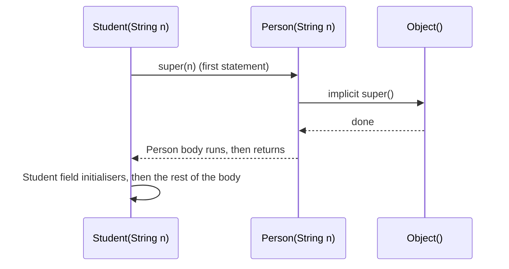
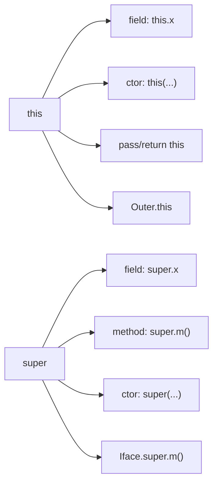

# The `super` and `this` Keywords in Java

**TL;DR:** `this` is a reference to **the current object**; `super` is a way to reach the **parent-class part of that same object**. There is only **one object**, never a separate "parent object". Both have three jobs: reach **fields** (`this.x` / `super.x`), call **methods** (`this.m()` / `super.m()`), and call **constructors** (`this(...)` / `super(...)`). The constructor forms must be the **first statement**, and neither keyword can be used in a `static` context. `super.m()` always runs the parent's version (it is **not** dispatched dynamically), while `this.m()` is dispatched to the object's real class.

## Table of Contents

1. [TL;DR](#1-tldr)
2. [Why it matters](#2-why-it-matters)
3. [Prerequisites](#3-prerequisites)
4. [Mental model](#4-mental-model)
5. [Core concepts](#5-core-concepts)
6. [How it works](#6-how-it-works)
7. [Examples](#7-examples)
8. [Comparisons](#8-comparisons)
9. [Trade-offs](#9-trade-offs)
10. [Gotchas](#10-gotchas)
11. [Practical application](#11-practical-application)
12. [Interview prep](#12-interview-prep)
13. [Interview question bank](#13-interview-question-bank)
14. [Tricky code snippets](#14-tricky-code-snippets)
15. [Connections](#15-connections)
16. [Summary](#16-summary)
17. [Answers](#answers)

---

## 1. TL;DR

- **`this`:** the current object. Use it to disambiguate a field from a parameter (`this.name = name`), call another constructor (`this(...)`), pass or return the current object, and name an outer instance (`Outer.this`).
- **`super`:** the parent-class view of the current object. Use it to call the parent's constructor (`super(...)`), an overridden method (`super.m()`), or a hidden field (`super.x`); `Interface.super.m()` picks an interface's default method.
- **Constructor forms** (`this(...)`, `super(...)`) must come **first**, only **one** of them per constructor, and can't reference `this` yet (Snippets 4, 6, 25, 26, 27).
- **Not allowed in `static` code** (Snippets 7, 28).
- **No `super.super`** (Snippet 21).
- **Same object:** `super.self() == this` is `true` (Snippet 18).

**The analogy: a person with a family name and a personal name.**

| Real world | Java |
|---|---|
| "Me" (the person speaking) | `this`: the current object |
| "As my parent would do it" (reaching for the way my parent handles it) | `super.method()`: the parent's version of a behaviour |
| "My own diary vs the family diary I also inherited" | `this.x` (own field) vs `super.x` (the parent's field of the same name) |
| "I'm a person; call my 'other' constructor before I'm built" | `this(...)` |
| "Before I can be built, my parent's part must be built first" | `super(...)`: the parent's constructor runs first |
| "Which family member said that?" (outer family vs me) | `Outer.this` vs `this` |
| There's one person, not two | `super` and `this` refer to **one object** |

**Running example:** `Person` (with a field `name`, two constructors where `Person()` calls `this("Unknown")`) and `Student extends Person` (with its own hidden field `name`, constructors calling `super(...)`, and a method using `this.name`, `super.name` and `super.describe()`). Full program and output in 6.2.

---

## 2. Why it matters

**The problem.** Inheritance creates name collisions (a child field or method with the same name as the parent's), overloaded constructors that repeat code, and parents that must be initialised before children. `this` and `super` are how you disambiguate and sequence all of that.

**What goes wrong** (verified on Java 21):

| Code | Result | Cause |
|---|---|---|
| `void set(int x) { x = x; }` | Field unchanged | Parameter shadows the field; need `this.x = x` (Snippet 2) |
| `A(int x) { System.out.println("hi"); this(); }` | Compile error | `this(...)` must be first (Snippet 4) |
| `A() { this(1); } A(int x) { this(); }` | Compile error: recursive constructor invocation | Constructor cycle (Snippet 5) |
| `C() { this(1); super(); }` | Compile error | Only one of the two, and it must be first (Snippet 6) |
| `static void f() { this.x }` | Compile error | No current object in static code (Snippet 7) |
| `super.super.f()` | Compile error | Not valid syntax (Snippet 21) |
| `C() { super(this); }` | Compile error | `this` not usable before the parent is initialised (Snippet 27) |
| `super.f()` where `f` is private | Compile error | Private members aren't accessible (Snippet 29) |
| `super.f()` where `f` is abstract | Compile error | Nothing to call (Snippet 35) |
| `((A) this).f()` inside an override | `StackOverflowError` | Casting doesn't change dynamic dispatch (Snippet 22) |
| Parent method calls `who()` and the child overrides it | Child's version, even via `super.callWho()` | `super.` affects only that one call (Snippet 19) |
| `A.super.hi()` when `A` isn't a direct interface | Compile error | Must be a direct superinterface (Snippet 31) |

**Why interviewers ask.** "Difference between `this` and `super`", "can we use both in one constructor", "what does `this()` do", "why must `super()` be first", "can we call `super.super.method()`", "how do you access a parent's hidden field", and "what is constructor chaining" appear in nearly every Java screen.

---

## 3. Prerequisites

| Prerequisite | One-line refresher | Importance |
|---|---|---|
| Classes, objects, constructors | `new` runs a constructor ([Classes and Objects notes]) | Essential |
| Inheritance | `extends`, IS-A ([Inheritance notes]) | Essential |
| Overriding and overloading | Same vs different signatures ([Polymorphism notes]) | Essential |
| Instance vs static | `static` has no current object ([Static Members notes]) | Important |
| Constructor initialisation order | Parent first, then fields, then body ([Constructors notes]) | Important |

---

## 4. Mental model

> **The one picture to keep in your head:** an object is **one block of memory** shaped like layers of an onion: the `Object` core, then each parent, then the child. `this` points to the whole block (seen as the current class); `super` is a **lens** that looks at the same block through the parent layer, so `super.x` and `super.m()` mean "the parent layer's `x` / `m`".

```
        one object on the heap (a Student)
 ┌───────────────────────────────────────────┐
 │ Object layer                              │
 │ ┌───────────────────────────────────────┐ │
 │ │ Person layer:  name = "Asha"          │ │ ◄── super.name  /  super.describe()
 │ │ ┌───────────────────────────────────┐ │ │
 │ │ │ Student layer: name = "S-Asha"    │ │ │ ◄── this.name   /  this.describe()
 │ │ └───────────────────────────────────┘ │ │
 │ └───────────────────────────────────────┘ │
 └───────────────────────────────────────────┘
   this  = reference to the whole block
   super = same reference, viewed as the parent layer (not a second object)
```
*Two fields called `name` coexist in the same object: one in each layer.*

**Construction goes from the core outward**, so the parent layer is built before the child layer:


*`super(...)` is the only way the child asks for a specific parent constructor.*

**Constructor chaining with `this(...)`** funnels all constructors into one "master" constructor:

```
 Box()  ──this(1)──► Box(int) ──this(s,s)──► Box(int,int) ──this(w,h,1)──► Box(int,int,int)   ← does the real work
 (prints in reverse: the master finishes first)
```

---

## 5. Core concepts

### 5.1 Glossary

- **`this` (reference):** the object whose method or constructor is currently executing; never `null` and never assignable (Snippet 10).
- **`super` (reference):** the same object treated as an instance of the direct superclass.
- **`this(...)` call:** invokes another constructor of the same class.
- **`super(...)` call:** invokes a constructor of the direct superclass.
- **Constructor chaining:** a sequence of constructors calling each other until one reaches `Object()`.
- **Implicit `super()`:** the compiler inserts `super();` as the first statement of a constructor that has no explicit `this(...)`/`super(...)`.
- **Shadowing:** a local variable or parameter hides a field of the same name.
- **Field hiding:** a subclass field with the same name as a parent's; both exist (Snippet 20).
- **Qualified `this` (`Outer.this`):** the enclosing instance of an inner class (Snippet 13).
- **Qualified `super` (`Iface.super.m()`):** an interface's default method (Snippet 30).
- **Fluent interface / method chaining:** methods that `return this` (Snippet 8).
- **Template method:** a final method in a parent that calls overridable steps; children use `super.step()` to extend them (Snippet 36).

### 5.2 The six uses of `this`

| # | Use | Example | Snippet |
|---|---|---|---|
| 1 | Refer to a field when a local/parameter shadows it | `this.x = x;` | 2 |
| 2 | Call another constructor | `this(1, 1);` (first statement) | 3 |
| 3 | Call a method on the current object | `this.print()` (same as `print()`) | 19 |
| 4 | Pass the current object | `listener.on(this)` | 9 |
| 5 | Return the current object | `return this;` (fluent/builder) | 8 |
| 6 | Name the outer instance from an inner class | `Outer.this.x` | 13 |

Other notes:
- Inside an **instance initialiser block**, `this` is available (Snippet 14).
- Inside a **lambda**, `this` is the *enclosing* object; inside an **anonymous class**, it's the anonymous instance (Snippet 12).
- `this` can't be assigned (Snippet 10) and can't appear in `static` code (Snippet 7).
- Calling a method on a `null` reference throws NPE *before* the method runs, so `this` is never `null` inside it (Snippet 15).
- In an **enum**, `this` works like any instance; comparing `this == HIGH` is safe (Snippet 16).

### 5.3 The four uses of `super`

| # | Use | Example | Snippet |
|---|---|---|---|
| 1 | Call a parent constructor | `super(name);` (first statement) | 23, 25, 26 |
| 2 | Call the parent's version of an overridden method | `super.start();` | 17 |
| 3 | Access a hidden parent field | `super.name` | 20 |
| 4 | Call an interface's default method | `Greeter.super.hi()` | 30, 31 |

Related facts:
- `super.m()` is bound **early** (the JVM uses `invokespecial`): it always runs the parent's code, even if the object is a deeper subclass (Snippet 19).
- It reaches only the **direct** parent; `super.super.m()` is illegal (Snippet 21). A cast to the grandparent doesn't help: dynamic dispatch still picks the override, so `((A) this).f()` recurses forever (Snippet 22).
- It works for `Object`'s methods too: `super.toString()` gives `ClassName@hash`, `super.equals(o)` is identity (Snippets 32, 33).
- Inside a **lambda**, `super.m()` is allowed and refers to the enclosing class's parent (Snippet 34).
- `super` can't be used in a `static` method (Snippet 28), can't call a `private` parent method (Snippet 29) or an `abstract` one (Snippet 35).
- A static method hides rather than overrides, and `super` isn't needed: use `ParentName.method()` (Snippet 37).

### 5.4 Rules for `this(...)` and `super(...)`

| Rule | Detail | Snippet |
|---|---|---|
| Must be the **first statement** | Java 21: anything before it is a compile error ⚠️ newer JDKs (preview in 22+) relax this for statements that don't use `this` | 4, 25 |
| **One** of them per constructor | Can't write both `this(1); super();` | 6 |
| No cycles | `A() { this(1); } A(int) { this(); }` is an error | 5 |
| Not in methods | They're constructor-only calls | n/a |
| Arguments can't use `this` or instance members | The object isn't initialised yet; use constants, parameters or `static` helpers | 26, 27 |
| If you write neither, the compiler adds `super();` | The parent needs an accessible no-arg constructor | 23, 24 |
| `this(...)` delegates, `super(...)` goes up | The `this(...)` chain must end in a constructor that calls `super(...)` (explicitly or implicitly) | 3, 23 |

### 5.5 Which field/method does a name refer to?

Inside `Student` (which has its own `name` and inherits `Person`'s `name`) with a parameter also called `name`:

| Expression | Refers to |
|---|---|
| `name` | The **parameter** (innermost scope) |
| `this.name` | `Student`'s own field |
| `super.name` | `Person`'s field |
| `((Person) this).name` | `Person`'s field (same as `super.name`) |

Verified in Snippets 1 and 20: for a method with parameter `"param/"` the combination prints `param/CPP`.

### 5.6 Common patterns

- **Constructor telescoping:** short constructors call `this(...)` with defaults (Snippet 3).
- **Calling the parent's constructor with computed arguments:** `super(make(n))` using a `static` helper (Snippet 26).
- **Extending, not replacing, behaviour:** `return "Student/" + super.describe();` (Snippet 1).
- **Template method with hooks:** the child's `footer()` appends to `super.footer()` (Snippet 36).
- **Fluent API:** `sb.add("a").add("b")` via `return this` (Snippet 8).
- **Equality:** `if (this == o) return true;` as the fast path in `equals` (Snippet 11).

---

## 6. How it works

### 6.1 Constructor execution order with `this(...)` and `super(...)`

```mermaid
flowchart TD
    N["new Student(\"Asha\")"] --> S1["Student(String) entered"]
    S1 --> SU["super(n) → Person(String)"]
    SU --> PO["Person: implicit super() → Object(), then Person field initialisers, then Person body"]
    PO --> SI["Back in Student: Student field initialisers"]
    SI --> SB["Student body continues"]
    SB --> R["Reference returned"]
```
*If a constructor starts with `this(...)`, it delegates and does **not** run field initialisers itself; the delegate target does (Snippets 3, 38).*

Facts to remember:
- A constructor that calls `this(...)` does not call `super(...)` itself; the final constructor in the chain does.
- Instance initialisers and field initialisers run right **after** the `super(...)` call returns, and **not** at all in a constructor that starts with `this(...)`.
- All of it happens for one object; the chain is just method-call nesting.

### 6.2 Worked trace: `Person` and `Student`

```java
class Person {
    String name = "person-field";
    Person() { this("Unknown"); System.out.println("Person()"); }
    Person(String name) { this.name = name; System.out.println("Person(String) " + this.name); }
    String describe() { return "Person " + name; }
}
class Student extends Person {
    String name = "student-field";
    Student() { super(); System.out.println("Student()"); }
    Student(String n) { super(n); this.name = "S-" + n; System.out.println("Student(String)"); }
    void show(String name) {
        System.out.println(name + " | " + this.name + " | " + super.name);
    }
    @Override String describe() { return "Student/" + super.describe(); }
}
public class Main {
    public static void main(String[] args) {
        Student s = new Student();
        System.out.println("--");
        Student t = new Student("Asha");
        t.show("param");
        System.out.println(t.describe());
    }
}
```

Output (verified, Java 21):

```
Person(String) Unknown
Person()
Student()
--
Person(String) Asha
Student(String)
param | S-Asha | Asha
Student/Person Asha
```

| Step | What happens | Why |
|---|---|---|
| `new Student()` | `Student()` → `super()` → `Person()` | The first statement of `Student()` calls the parent's no-arg constructor |
| `Person()` → `this("Unknown")` | Runs `Person(String)`, which sets `Person.name = "Unknown"` and prints `Person(String) Unknown` | `this(...)` delegates, so `Person()`'s own body (`Person()` print) runs **after** it |
| Output order | `Person(String) Unknown`, `Person()`, `Student()` | Master constructor finishes first; the outermost finishes last |
| `Student`'s `name = "student-field"` | Initialised after the parent's constructor returns | Student layer is built after the Person layer |
| `new Student("Asha")` | `super(n)` runs `Person(String)`: prints `Person(String) Asha` | Explicit `super(n)` selects the parent constructor |
| `this.name = "S-" + n` | Sets **Student's** `name` to `S-Asha` | `this.name` is the child's field |
| `t.show("param")` | Prints `param`, `S-Asha`, `Asha` | Parameter, `this.name` (child), `super.name` (parent) |
| `t.describe()` | `Student/` + `super.describe()`; `Person.describe()` reads **Person's** `name` (`Asha`) | Field access inside `Person` uses `Person`'s field, not the hidden one |

### 6.3 Why `super.method()` is not virtual

```java
class P {
    String who() { return "P.who"; }
    String callWho() { return who(); }
    String callThisWho() { return this.who(); }
}
class C extends P {
    @Override String who() { return "C.who"; }
    String viaSuper() { return super.who(); }
    String viaSuperCall() { return super.callWho(); }
}
```
`new C().viaSuper()` → `P.who` (bound to the parent's code). But `viaSuperCall()` → `super.callWho()` runs `P.callWho`, whose inner `who()` is a normal virtual call on the same object, so it prints `C.who`. Likewise `callThisWho()` gives `C.who`. Verified (Snippet 19): `P.who C.who C.who`.

**Rule:** `super.` bypasses overriding for that **one** call only. Anything the parent method does internally is dispatched normally.

### 6.4 Why `((A) this).f()` doesn't reach the grandparent

Casting changes the *static type* but not the *object*. The call is still `invokevirtual`, so the JVM runs the most-derived override. Inside `C.f()` that is `C.f()` again, so the program recurses until `StackOverflowError` (Snippet 22). Java offers no direct way to call a grandparent's overridden method; redesign (rename, extract a protected helper) instead.

### 6.5 `this` in constructors and the escape problem

Leaking `this` (to a registry, thread or listener) before the constructor ends exposes a half-built object, and a parent's call to an overridable method hits the child's override before its fields are set (see the Constructors and Polymorphism notes).

---

## 7. Examples

### 7.1 Toy examples

**Disambiguating with `this`:**

```java
class P { int x; P(int x) { this.x = x; } void set(int x) { x = x; } void set2(int x) { this.x = x; } }
// p.set(5) leaves x at 1; p.set2(5) makes x 5   → prints "1 5" (Snippet 2)
```

**Fluent chaining with `return this`:**

```java
class Sb { private final StringBuilder sb = new StringBuilder(); Sb add(String s) { sb.append(s); return this; } public String toString() { return sb.toString(); } }
// new Sb().add("a").add("b").add("c")  → abc
```

**Extending behaviour with `super`:**

```java
class P { String hi() { return "P.hi"; } }
class C extends P { @Override String hi() { return "C.hi>" + super.hi(); } }
// new C().hi() → C.hi>P.hi
```
All three verified (Snippets 2, 8, 17).

### 7.2 Real-world examples

- **Exceptions:** `class MyEx extends Exception { MyEx(String m, Throwable cause) { super(m, cause); } }`.
- **`equals`/`hashCode`/`toString` overrides** calling `super.equals(o)` or `super.toString()` to build on the parent's output.
- **Template/framework hooks:** `@Override public void setUp() { super.setUp(); … }` in test and Android/Swing lifecycle methods.
- **Builders and fluent APIs:** `return this;` in `StringBuilder.append`, `Stream`-style classes, Lombok-style builders.
- **Listeners:** `button.addListener(this)` or `source.fire(listener)` with `listener.on(this)` (Snippet 9).
- **Inner classes:** `Outer.this.field` inside an adapter or iterator (Snippet 13).
- **Default-method interfaces:** `Comparator`-style interfaces calling `Interface.super.method()` to pick one implementation (Snippet 30).

---

## 8. Comparisons

### 8.1 `this` vs `super`

| Aspect | `this` | `super` |
|---|---|---|
| Refers to | The current object (current class view) | The same object viewed as the direct parent |
| Field access | `this.x` (own or inherited) | `super.x` (parent's hidden field) |
| Method call | `this.m()`: virtual dispatch to the real class | `super.m()`: the parent's version, non-virtual |
| Constructor call | `this(...)`: another constructor of this class | `super(...)`: a parent constructor |
| As a value | Can be passed/returned/compared | **Cannot** be used alone (`Object o = super;` is illegal, Snippet 39) |
| Static context | Not allowed | Not allowed |
| Chains upward | n/a | One level only (`super.super` illegal) |
| Interfaces | n/a | `Iface.super.m()` for defaults |

### 8.2 `this(...)` vs `super(...)`

| | `this(...)` | `super(...)` |
|---|---|---|
| Target | Same class | Direct superclass |
| Purpose | Reuse another constructor (defaults) | Initialise the parent part |
| Position | First statement | First statement |
| Both together | No | No |
| If omitted | n/a (no implicit `this()`) | Compiler inserts `super()` |
| Cycles | Illegal (Snippet 5) | Impossible (inheritance is acyclic) |

### 8.3 Shadowing vs hiding vs overriding

| | Shadowing | Hiding | Overriding |
|---|---|---|---|
| What | Local/parameter vs field | Subclass field/static method vs parent's | Subclass instance method replaces parent's |
| Resolve to the other | `this.x` | `super.x` (field) / `Parent.m()` (static) | `super.m()` |
| Resolved by | Scope | Declared type | Actual class |

### 8.4 `this` in different contexts

| Context | What `this` is |
|---|---|
| Instance method / constructor | The current object |
| Instance initialiser | The object being built |
| Lambda | The enclosing instance (Snippet 12) |
| Anonymous class | The anonymous instance; `Outer.this` for the enclosing one (Snippet 12) |
| Inner class | The inner instance; `Outer.this` for the outer (Snippet 13) |
| `static` method / static block | Not available (Snippet 7) |

---

## 9. Trade-offs

| Decision | Benefit | Cost | Use when |
|---|---|---|---|
| `this(...)` chaining | One place for initialisation logic; no duplication | Order of output/initialisation can surprise | Several constructors with defaults |
| Builder/static factories instead | Named, optional parameters | Extra class/methods | Many optional parameters |
| `this.x = x` convention | Clear, avoids shadowing bugs | None | Always |
| Different parameter names to avoid shadowing | No `this.` needed | Naming churn | Rarely preferred; `this.x` is standard |
| `super.m()` extension | Reuse parent logic | Couples child to parent's implementation | Genuinely extending behaviour |
| Hiding a parent field (same name) | None really | Confusion (Snippet 20) | Avoid; choose different names |
| `return this` | Fluent APIs | Mutable chaining; unclear ownership | Builders |
| Passing `this` to others | Callbacks | Escape before construction ends | After construction only |
| Template method with `super.hook()` | Controlled extension | Rigid | Frameworks and base classes |

---

## 10. Gotchas

### Myths

- ❌ **Myth:** "`super` creates a parent object." ✅ **Reality:** there's only one object; `super.self() == this` is `true` (Snippet 18).
- ❌ **Myth:** "`super.method()` is dispatched dynamically like normal calls." ✅ **Reality:** it's bound to the parent's code (Snippet 19), though anything the parent method calls internally is virtual.
- ❌ **Myth:** "`super.super.method()` reaches the grandparent." ✅ **Reality:** illegal syntax (Snippet 21); casting won't help (Snippet 22).
- ❌ **Myth:** "`this()` and `super()` can both appear." ✅ **Reality:** only one, and first (Snippets 4, 6).
- ❌ **Myth:** "If I don't write `super()` nothing runs." ✅ **Reality:** the compiler inserts `super();` (Snippet 23), failing if the parent has no accessible no-arg constructor (Snippet 24).
- ❌ **Myth:** "`this` can be used in arguments to `super(...)`." ✅ **Reality:** the object isn't ready (Snippet 27).
- ❌ **Myth:** "`this` can be `null`." ✅ **Reality:** a call on `null` fails before the method starts (Snippet 15).
- ❌ **Myth:** "A subclass field with the same name overrides the parent's." ✅ **Reality:** both fields exist (Snippets 1, 20).
- ❌ **Myth:** "`this` in a lambda is the lambda." ✅ **Reality:** it's the enclosing object (Snippet 12).
- ❌ **Myth:** "`super` can be used in static methods to call the parent's static method." ✅ **Reality:** use `Parent.method()` (Snippets 28, 37).
- ❌ **Myth:** "Fields set via `this(...)`-delegating constructors are initialised twice." ✅ **Reality:** field and instance initialisers run once, in the constructor that calls `super(...)` (Snippet 38).

### Common mistakes and edge cases

- **`name = name;`** in a constructor or setter (Snippet 2).
- **Putting a statement before `this(...)`/`super(...)`** (Snippets 4, 25).
- **Recursive `this(...)` chains** (Snippet 5).
- **Forgetting that the parent has no default constructor** (Snippet 24).
- **Calling `super.m()` on a private or abstract parent method** (Snippets 29, 35).
- **Using `this` in a static method** (Snippet 7).
- **Expecting `super.callWho()` to make inner calls non-virtual** (Snippet 19).
- **Casting to the grandparent to call its version** (Snippet 22).
- **Using `A.super.m()` for an indirect interface** (Snippet 31).
- **Believing `this` in an anonymous class equals the outer object** (Snippets 12, 13).
- **Reading a hidden parent field through the wrong qualifier** (Snippet 20).

---

## 11. Practical application

### Checklist
- [ ] Use `this.field = param;` in every constructor and setter.
- [ ] Funnel constructors through one master constructor with `this(...)`.
- [ ] Call `super(...)` explicitly when the parent has no no-arg constructor.
- [ ] Don't use `this` (or instance fields) in arguments to `super(...)`/`this(...)`.
- [ ] Use `super.method()` only to *extend* behaviour, and keep the override contract intact.
- [ ] Avoid hiding fields; give subclass fields distinct names.
- [ ] Don't call overridable methods from constructors.
- [ ] Use `Outer.this` only when a name conflict requires it.

### Hands-on exercise: predict the output

```java
class A {
    String name = "A";
    A() { init(); }
    void init() { System.out.println("A.init " + name); }
    String who() { return "A"; }
    String test() { return who() + "/" + this.who(); }
}
class B extends A {
    String name = "B";
    B() { super(); System.out.println("B() " + name + " " + super.name); }
    @Override void init() { System.out.println("B.init " + name); }
    @Override String who() { return "B"; }
    String viaSuper() { return super.who() + "/" + super.test(); }
}
public class Main {
    public static void main(String[] x) {
        B b = new B();
        System.out.println(b.viaSuper());
    }
}
```
Predict all three lines and explain each.

<details><summary>Solution</summary>

```
B.init null
B() B A
A/B/B
```

1. `new B()` → `B()` → `super()` → `A()` → `init()`. `init()` is virtual, so `B.init` runs while `B`'s field `name` is still `null` (the field initialiser hasn't run yet): `B.init null`.
2. Back in `B()`, `B`'s field initialiser has run: `name` is `"B"`, and `super.name` is `A`'s field: `B() B A`.
3. `viaSuper()`: `super.who()` is `A`'s version → `A`. `super.test()` runs `A.test()`, where `who()` and `this.who()` are both **virtual** and hit `B.who()`: `B/B`. Combined: `A/B/B`.

Verified on Java 21: output exactly as above.
</details>

---

## 12. Interview prep

Eight model answers, as you would say them aloud.

<details><summary>1. What is the difference between `this` and `super`?</summary>

`this` refers to the current object; `super` refers to the same object viewed as its direct parent. `this.x`/`this.m()` use the current class (virtual dispatch); `super.x`/`super.m()` reach the parent's field or method (non-virtual). `this(...)` calls another constructor of the same class; `super(...)` calls a parent constructor (8.1, 8.2).
</details>

<details><summary>2. What does `this()` do, and what are its rules?</summary>

It calls another constructor of the same class, which lets you centralise initialisation. It must be the first statement, can't be combined with `super(...)`, can't form a cycle, and can't use instance members in its arguments (5.4; Snippets 3, 4, 5, 6).
</details>

<details><summary>3. What does `super()` do, and what if you don't write it?</summary>

It runs a parent constructor first, so the parent layer is built before the child's. If you write neither `this(...)` nor `super(...)`, the compiler inserts `super();`; that fails to compile if the parent has no accessible no-arg constructor (Snippets 23, 24).
</details>

<details><summary>4. Why must `this(...)`/`super(...)` be the first statement?</summary>

So the parent part of the object is initialised before the child code touches it. On Java 21, anything before it is a compile error (Snippets 4, 25); newer JDKs relax this for statements that don't use `this` ⚠️.
</details>

<details><summary>5. Can you call `super.super.method()`?</summary>

No, it's invalid syntax (Snippet 21), and casting `((A) this).f()` doesn't help because dispatch is still virtual and recurses (Snippet 22).
</details>

<details><summary>6. Is `super.method()` dynamically dispatched?</summary>

No, it runs the parent's code. But calls made *inside* that parent method are normal virtual calls and may hit a child's override (Snippet 19).
</details>

<details><summary>7. How do you access a hidden parent field or a shadowed field?</summary>

`super.field` for the parent's field; `this.field` for the current class's field when a parameter shadows it (Snippets 2, 20).
</details>

<details><summary>8. Does `super` create a separate parent object?</summary>

No. One object exists; `super.self() == this` is `true` (Snippet 18).
</details>

---

## 13. Interview question bank


### 13.1 `this` (Q1–Q18)

<details><summary>Q1. What is `this`?</summary>

A reference to the object whose method or constructor is currently running.
</details>

<details><summary>Q2. What are the main uses of `this`?</summary>

Disambiguate fields, call another constructor, call methods on the current object, pass the current object, return it, and qualify an outer instance (5.2).
</details>

<details><summary>Q3. Why `this.x = x`?</summary>

Because the parameter `x` shadows the field `x`; `x = x` assigns the parameter to itself (Snippet 2).
</details>

<details><summary>Q4. Can `this` be assigned?</summary>

No (Snippet 10).
</details>

<details><summary>Q5. Can `this` be used in a static method?</summary>

No; there's no current object (Snippet 7).
</details>

<details><summary>Q6. Can `this` be `null`?</summary>

No. A call on a `null` reference throws NPE before the method runs (Snippet 15).
</details>

<details><summary>Q7. What does `return this;` enable?</summary>

Method chaining/fluent APIs (Snippet 8).
</details>

<details><summary>Q8. How do you pass the current object to another object?</summary>

`other.method(this)` (Snippet 9). Do it after construction to avoid exposing a half-built object.
</details>

<details><summary>Q9. What does `this` mean in a lambda?</summary>

The enclosing instance, unlike in an anonymous class where it's the anonymous object (Snippet 12).
</details>

<details><summary>Q10. How do you refer to the outer instance from an inner class?</summary>

`Outer.this` (Snippet 13).
</details>

<details><summary>Q11. What does `this` refer to inside an instance initialiser block?</summary>

The object being constructed (Snippet 14).
</details>

<details><summary>Q12. Is `this.method()` different from `method()`?</summary>

No; same call, both virtual.
</details>

<details><summary>Q13. What is `this == o` used for in `equals`?</summary>

A fast identity check before comparing fields (Snippet 11).
</details>

<details><summary>Q14. Can `this` be used in an enum?</summary>

Yes; comparing `this == CONSTANT` is common (Snippet 16).
</details>

<details><summary>Q15. Does `this` have a type?</summary>

The class in which it appears.
</details>

<details><summary>Q16. Can `this` be a constructor argument to the parent?</summary>

Not in `super(this)`: compile error (Snippet 27).
</details>

<details><summary>Q17. Can you declare a variable named `this`?</summary>

No; it's a keyword.
</details>

<details><summary>Q18. What is the difference between `this` and a variable holding the same object?</summary>

None at run time; `this` is just the implicit reference to the receiver.
</details>


### 13.2 `this(...)` (Q19–Q28)

<details><summary>Q19. What is constructor chaining?</summary>

One constructor calling another, ending at `Object()` (Snippet 3, 6.1).
</details>

<details><summary>Q20. What does `this(...)` do?</summary>

Delegates to another constructor of the same class.
</details>

<details><summary>Q21. Must it be the first statement?</summary>

Yes (Snippet 4).
</details>

<details><summary>Q22. Can a constructor call itself with `this(...)`?</summary>

No, recursive constructor invocation error (Snippet 5).
</details>

<details><summary>Q23. Can a constructor use both `this(...)` and `super(...)`?</summary>

No (Snippet 6).
</details>

<details><summary>Q24. In what order do chained constructors finish?</summary>

The one at the end of the chain finishes first (Snippet 3 prints `Box(int,int,int)` first, `Box()` last).
</details>

<details><summary>Q25. Do field initialisers run again for each `this(...)` hop?</summary>

No, only in the constructor that eventually calls `super(...)` (Snippet 38).
</details>

<details><summary>Q26. Can `this(...)` arguments use instance fields?</summary>

No; use constants, parameters or static helpers (Snippet 27 for the `super` analogue).
</details>

<details><summary>Q27. Why use `this(...)`?</summary>

Avoid duplicated initialisation and provide default values.
</details>

<details><summary>Q28. Can you call `this(...)` from a method?</summary>

No; constructors only.
</details>


### 13.3 `super` basics (Q29–Q44)

<details><summary>Q29. What is `super`?</summary>

A keyword to access the direct superclass's members and constructors from a subclass.
</details>

<details><summary>Q30. What are the uses of `super`?</summary>

Call the parent constructor, call the parent's overridden method, access a hidden parent field, and `Iface.super.m()` for defaults (5.3).
</details>

<details><summary>Q31. What does `super()` do if omitted?</summary>

The compiler inserts it (Snippet 23).
</details>

<details><summary>Q32. What if the parent has only a constructor with parameters?</summary>

Subclass constructors must call it explicitly, else a compile error (Snippet 24).
</details>

<details><summary>Q33. Can `super(...)` take computed arguments?</summary>

Yes, using constants, parameters or `static` methods (Snippet 26).
</details>

<details><summary>Q34. Can `super` be used in a static method?</summary>

No (Snippet 28).
</details>

<details><summary>Q35. Can `super.m()` call a private method of the parent?</summary>

No (Snippet 29).
</details>

<details><summary>Q36. Can `super.m()` call an abstract method?</summary>

No, there's no implementation (Snippet 35).
</details>

<details><summary>Q37. How do you call a parent's hidden field?</summary>

`super.name` (Snippet 20).
</details>

<details><summary>Q38. Can `super` be used as a standalone value?</summary>

No (Snippet 39).
</details>

<details><summary>Q39. What does `super.toString()` return in a direct child of `Object`?</summary>

`ClassName@hexHashCode` (Snippet 32).
</details>

<details><summary>Q40. What does `super.equals(o)` do in a direct child of `Object`?</summary>

Reference identity (Snippet 33).
</details>

<details><summary>Q41. Can `super` be used inside a lambda?</summary>

Yes, it refers to the enclosing class's parent (Snippet 34).
</details>

<details><summary>Q42. Can `super` reach the grandparent?</summary>

Not directly: `super.super` is illegal (Snippet 21).
</details>

<details><summary>Q43. How do you call a static method of the parent from a child?</summary>

By class name, `Parent.method()`; `super` isn't needed (Snippet 37).
</details>

<details><summary>Q44. Does `super` refer to a separate object?</summary>

No; one object (Snippet 18).
</details>


### 13.4 Dispatch, fields and traps (Q45–Q58)

<details><summary>Q45. Is `super.m()` virtual?</summary>

No, it's bound to the parent's code (Snippet 19).
</details>

<details><summary>Q46. If `P.callWho()` calls `who()` and `C` overrides `who()`, what does `super.callWho()` run?</summary>

`P.callWho`, whose `who()` call dispatches to `C.who` (Snippet 19).
</details>

<details><summary>Q47. Why does `((A) this).f()` in an override cause infinite recursion?</summary>

Casting doesn't change dynamic dispatch (Snippet 22).
</details>

<details><summary>Q48. Which `name` does `name`, `this.name` and `super.name` refer to in a method with a parameter `name`?</summary>

The parameter, the child's field, the parent's field (Snippet 20).
</details>

<details><summary>Q49. Which field does a parent method read when the child hides the field?</summary>

The parent's own field (Snippet 1: `Person.describe()` printed `Person Asha`).
</details>

<details><summary>Q50. What does the parent's constructor see when it calls an overridden method?</summary>

The child's override, running before the child's fields are initialised (exercise in section 11).
</details>

<details><summary>Q51. Why can't `super(this)` compile?</summary>

`this` isn't initialised before the parent constructor finishes (Snippet 27).
</details>

<details><summary>Q52. How can you call an interface's default method?</summary>

`Iface.super.m()` for a direct superinterface (Snippet 30), not an indirect one (Snippet 31).
</details>

<details><summary>Q53. How do you extend a template-method hook?</summary>

Override it and call `super.hook()` (Snippet 36).
</details>

<details><summary>Q54. What is a common bug with `this`/`super` in constructors?</summary>

Parameter shadowing (`name = name`) and forgetting `super(...)` arguments (Snippets 2, 24).
</details>

<details><summary>Q55. In an inner class, how do you tell `this` from the outer `this`?</summary>

`this` vs `Outer.this` (Snippet 13).
</details>

<details><summary>Q56. How does `this` differ in a lambda vs anonymous class?</summary>

Lambda: enclosing instance; anonymous: the anonymous instance (Snippet 12).
</details>

<details><summary>Q57. Can `this` be used before the object is fully constructed?</summary>

Yes inside the constructor body after `super(...)`, but leaking it is risky.
</details>

<details><summary>Q58. Does a `this(...)`-calling constructor also call `super(...)`?</summary>

Not itself; the constructor it delegates to eventually does.
</details>


### 13.5 Design and scenario questions (Q59–Q66)

<details><summary>Q59. When is `super.method()` appropriate?</summary>

To extend (not replace) the parent's behaviour while keeping its contract.
</details>

<details><summary>Q60. What's the danger of overusing `super.method()`?</summary>

Tight coupling to the parent's implementation (fragile base class).
</details>

<details><summary>Q61. How would you avoid hiding fields?</summary>

Use different names or make fields `private` with accessors.
</details>

<details><summary>Q62. Why prefer builders over long `this(...)` chains?</summary>

Named, optional parameters are clearer than many overloads.
</details>

<details><summary>Q63. What would you do instead of calling an overridable method from a constructor?</summary>

Make it `private`/`final`, or use a separate `init()` after construction, or a factory method.
</details>

<details><summary>Q64. How do you implement a fluent API safely with inheritance?</summary>

Use a self-typed generic or covariant return; plain `return this` loses the subclass type.
</details>

<details><summary>Q65. Explain constructor order for `new C()` with `C → B → A` where each calls `super()`.</summary>

`A`, `B`, `C` bodies finish in that order, with each class's field initialisers run just after its `super(...)` returns (Snippet 1; Inheritance note).
</details>

<details><summary>Q66. One-line difference between `this` and `super`?</summary>

`this` is the current object; `super` is the same object's parent-class view.
</details>

---

## 14. Tricky code snippets

39 snippets, each compiled and run on OpenJDK 21. Predict the output (or the compile error) before opening the answer. Classes are declared without `public` so they can share one file.

### Snippet 1: Person and Student

```java
class Person {
    String name = "person-field";
    Person() { this("Unknown"); System.out.println("Person()"); }
    Person(String name) { this.name = name; System.out.println("Person(String) " + this.name); }
    String describe() { return "Person " + name; }
}
class Student extends Person {
    String name = "student-field";
    Student() { super(); System.out.println("Student()"); }
    Student(String n) { super(n); this.name = "S-" + n; System.out.println("Student(String)"); }
    void show(String name) {
        System.out.println(name + " | " + this.name + " | " + super.name);
    }
    @Override String describe() { return "Student/" + super.describe(); }
}
public class Main {
    public static void main(String[] args) {
        Student s = new Student();
        System.out.println("--");
        Student t = new Student("Asha");
        t.show("param");
        System.out.println(t.describe());
    }
}
```

<details><summary>Answer</summary>

```
Person(String) Unknown
Person()
Student()
--
Person(String) Asha
Student(String)
param | S-Asha | Asha
Student/Person Asha
```

Trace in 6.2: `this("Unknown")` delegates inside `Person`; `super(n)` selects the parent constructor; `this.name`, `super.name` and the parameter are three different things.
</details>

### Snippet 2: `this.x = x`

```java
class P { int x; P(int x) { this.x = x; } void set(int x) { x = x; } void set2(int x) { this.x = x; } }
public class Main {
    public static void main(String[] args) {
        P p = new P(1);
        p.set(5); System.out.print(p.x + " ");
        p.set2(5); System.out.println(p.x);
    }
}
```

<details><summary>Answer</summary>

```
1 5
```

`set` assigns the parameter to itself, leaving the field at `1`. `set2` assigns the field.
</details>

### Snippet 3: Constructor chaining with `this(...)`

```java
class Box {
    int w, h, d;
    Box() { this(1); System.out.println("Box()"); }
    Box(int s) { this(s, s); System.out.println("Box(int)"); }
    Box(int w, int h) { this(w, h, 1); System.out.println("Box(int,int)"); }
    Box(int w, int h, int d) { this.w = w; this.h = h; this.d = d; System.out.println("Box(int,int,int)"); }
}
public class Main { public static void main(String[] args) { new Box(); } }
```

<details><summary>Answer</summary>

```
Box(int,int,int)
Box(int,int)
Box(int)
Box()
```

Each constructor delegates first, so the master constructor's body runs first and the one you called finishes last.
</details>

### Snippet 4: `this(...)` not first

```java
class A {
    A() { }
    A(int x) { System.out.println("hi"); this(); }
}
public class Main { public static void main(String[] args) { } }
```

<details><summary>Answer</summary>

Compile error: *call to this must be first statement in constructor*.

Nothing may precede `this(...)` on Java 21.
</details>

### Snippet 5: Constructor cycle

```java
class A {
    A() { this(1); }
    A(int x) { this(); }
}
public class Main { public static void main(String[] args) { } }
```

<details><summary>Answer</summary>

Compile error: *recursive constructor invocation*.

`A()` calls `A(int)`, which calls `A()`.
</details>

### Snippet 6: `this(...)` and `super(...)` together

```java
class P { P() { } }
class C extends P {
    C() { this(1); super(); }
    C(int x) { }
}
public class Main { public static void main(String[] args) { } }
```

<details><summary>Answer</summary>

Compile error: *call to super must be first statement in constructor*.

`this(1)` already occupies the first slot, so `super()` can't be first.
</details>

### Snippet 7: `this` in static code

```java
class A {
    int x = 1;
    static void f() { System.out.println(this.x); }
}
public class Main { public static void main(String[] args) { } }
```

<details><summary>Answer</summary>

Compile error: *non-static variable this cannot be referenced from a static context*.

A static method has no current object.
</details>

### Snippet 8: `return this`

```java
class Sb {
    private final StringBuilder sb = new StringBuilder();
    Sb add(String s) { sb.append(s); return this; }
    public String toString() { return sb.toString(); }
}
public class Main { public static void main(String[] args) { System.out.println(new Sb().add("a").add("b").add("c")); } }
```

<details><summary>Answer</summary>

```
abc
```

Each `add` returns the same object, so calls chain.
</details>

### Snippet 9: Passing `this`

```java
class Listener { void on(Source s) { System.out.println("got " + s.name + " same=" + (s.self() == s)); } }
class Source {
    String name = "src";
    Source self() { return this; }
    void fire(Listener l) { l.on(this); }
}
public class Main { public static void main(String[] args) { new Source().fire(new Listener()); } }
```

<details><summary>Answer</summary>

```
got src same=true
```

The listener receives the source object itself.
</details>

### Snippet 10: Assigning to `this`

```java
class A { void f() { this = new A(); } }
public class Main { public static void main(String[] args) { } }
```

<details><summary>Answer</summary>

Compile error: *cannot assign to 'this'*.

`this` is not a variable you can re-point.
</details>

### Snippet 11: `this == o` and `getClass()` in `equals`

```java
class P {
    int v; P(int v) { this.v = v; }
    @Override public boolean equals(Object o) {
        if (this == o) return true;
        if (o == null || getClass() != o.getClass()) return false;
        return v == ((P) o).v;
    }
    @Override public int hashCode() { return v; }
}
class Q extends P { Q(int v) { super(v); } }
public class Main {
    public static void main(String[] args) {
        P a = new P(1);
        System.out.println(a.equals(a) + " " + a.equals(new P(1)) + " " + a.equals(new Q(1)) + " " + a.equals(null));
    }
}
```

<details><summary>Answer</summary>

```
true true false false
```

Identity is the fast path. `getClass() != o.getClass()` rejects the subclass `Q` even though its `v` matches; `null` is rejected too.
</details>

### Snippet 12: `this` in a lambda and an anonymous class

```java
public class Main {
    String name = "Outer";
    void run() {
        Runnable lam = () -> System.out.println("lambda this=" + this.name);
        Runnable anon = new Runnable() {
            String name = "Anon";
            public void run() { System.out.println("anon this=" + this.name + " outer=" + Main.this.name); }
        };
        lam.run(); anon.run();
    }
    public static void main(String[] args) { new Main().run(); }
}
```

<details><summary>Answer</summary>

```
lambda this=Outer
anon this=Anon outer=Outer
```

The lambda's `this` is the enclosing `Main`. The anonymous class has its own `this` and reaches the outer one with `Main.this`.
</details>

### Snippet 13: Parameter, `this` and `Outer.this`

```java
class Outer {
    int x = 1;
    class Inner {
        int x = 2;
        void show(int x) { System.out.println(x + " " + this.x + " " + Outer.this.x); }
    }
}
public class Main { public static void main(String[] args) { new Outer().new Inner().show(3); } }
```

<details><summary>Answer</summary>

```
3 2 1
```

`x` is the parameter, `this.x` the inner field, `Outer.this.x` the outer field.
</details>

### Snippet 14: `this` in an initialiser block

```java
class A {
    int x;
    { this.x = 5; System.out.println("init x=" + x); }
    A() { System.out.println("ctor x=" + this.x); }
}
public class Main { public static void main(String[] args) { new A(); } }
```

<details><summary>Answer</summary>

```
init x=5
ctor x=5
```

The initialiser block runs before the constructor body, and `this.x` is available in both.
</details>

### Snippet 15: Call on a null reference

```java
public class Main {
    String name = "m";
    String get() { return this.name; }
    public static void main(String[] args) {
        Main m = null;
        try { m.get(); } catch (NullPointerException e) { System.out.println("NPE before get() runs"); }
    }
}
```

<details><summary>Answer</summary>

```
NPE before get() runs
```

The NPE happens at the call site, so inside a method `this` is never null.
</details>

### Snippet 16: `this` in an enum

```java
enum Level {
    LOW(1), HIGH(10);
    private final int v;
    Level(int v) { this.v = v; }
    boolean isHigh() { return this == HIGH; }
}
public class Main { public static void main(String[] args) { System.out.println(Level.LOW.isHigh() + " " + Level.HIGH.isHigh()); } }
```

<details><summary>Answer</summary>

```
false true
```

`this == HIGH` compares the current constant to `HIGH`.
</details>

### Snippet 17: Extending with `super.m()`

```java
class P { String hi() { return "P.hi"; } }
class C extends P { @Override String hi() { return "C.hi>" + super.hi(); } }
public class Main { public static void main(String[] args) { System.out.println(new C().hi()); } }
```

<details><summary>Answer</summary>

```
C.hi>P.hi
```

The override calls the parent's version and adds to it.
</details>

### Snippet 18: `super` and `this` are one object

```java
class P { Object self() { return this; } }
class C extends P {
    boolean same() { return super.self() == this; }
}
public class Main { public static void main(String[] args) { C c = new C(); System.out.println(c.same() + " " + (c.self() == c)); } }
```

<details><summary>Answer</summary>

```
true true
```

`super.self()` returns `this`, so there's no separate parent object.
</details>

### Snippet 19: `super.m()` is not virtual

```java
class P {
    String who() { return "P.who"; }
    String callWho() { return who(); }
    String callThisWho() { return this.who(); }
}
class C extends P {
    @Override String who() { return "C.who"; }
    String viaSuper() { return super.who(); }
    String viaSuperCall() { return super.callWho(); }
}
public class Main {
    public static void main(String[] args) {
        C c = new C();
        System.out.println(c.viaSuper() + " " + c.viaSuperCall() + " " + c.callThisWho());
    }
}
```

<details><summary>Answer</summary>

```
P.who C.who C.who
```

`super.who()` runs `P.who`. `super.callWho()` runs `P.callWho`, which calls `who()` virtually, so `C.who` appears. `this.who()` is virtual too.
</details>

### Snippet 20: Field hiding and qualifiers

```java
class P { String n = "P"; }
class C extends P {
    String n = "C";
    String all(String n) { return n + this.n + super.n + ((P) this).n; }
}
public class Main { public static void main(String[] args) { System.out.println(new C().all("param/")); } }
```

<details><summary>Answer</summary>

```
param/CPP
```

The parameter `n` (`param/`), then `this.n` (`C`), `super.n` (`P`) and `((P) this).n` (`P`).
</details>

### Snippet 21: `super.super`

```java
class A { void f() { System.out.println("A"); } }
class B extends A { void f() { System.out.println("B"); } }
class C extends B { void f() { super.super.f(); } }
public class Main { public static void main(String[] args) { } }
```

<details><summary>Answer</summary>

Compile error: *<identifier> expected*.

The syntax isn't valid (javac also reports *not a statement*).
</details>

### Snippet 22: Casting to reach the grandparent

```java
class A { void f() { System.out.println("A"); } }
class B extends A { @Override void f() { System.out.println("B"); } }
class C extends B { @Override void f() { ((A) this).f(); } }
public class Main { public static void main(String[] args) { try { new C().f(); } catch (StackOverflowError e) { System.out.println("StackOverflowError"); } } }
```

<details><summary>Answer</summary>

```
StackOverflowError
```

`((A) this).f()` is still a virtual call that resolves to `C.f` again, forever.
</details>

### Snippet 23: Implicit `super()`

```java
class P { P() { System.out.println("P()"); } }
class C extends P { C() { System.out.println("C()"); } }
public class Main { public static void main(String[] args) { new C(); } }
```

<details><summary>Answer</summary>

```
P()
C()
```

The compiler inserted `super();` as the first statement of `C()`.
</details>

### Snippet 24: Parent has no no-arg constructor

```java
class P { P(int x) { } }
class C extends P { C() { System.out.println("C()"); } }
public class Main { public static void main(String[] args) { } }
```

<details><summary>Answer</summary>

Compile error: *constructor P in class P cannot be applied to given types;*.

The inserted `super()` finds only `P(int)`.
</details>

### Snippet 25: `super(...)` not first

```java
class P { P() { } }
class C extends P { C() { System.out.println("x"); super(); } }
public class Main { public static void main(String[] args) { } }
```

<details><summary>Answer</summary>

Compile error: *call to super must be first statement in constructor*.

A statement came before it.
</details>

### Snippet 26: Computed `super(...)` argument

```java
class P { final String label; P(String l) { label = l; } }
class C extends P {
    static String make(int n) { return "item-" + n; }
    C(int n) { super(make(n)); }
}
public class Main { public static void main(String[] args) { System.out.println(new C(7).label); } }
```

<details><summary>Answer</summary>

```
item-7
```

A static helper (`make`) is allowed in the argument; instance members aren't.
</details>

### Snippet 27: `this` in `super(...)`

```java
class P { P(Object o) { } }
class C extends P { int v = 1; C() { super(this); } }
public class Main { public static void main(String[] args) { } }
```

<details><summary>Answer</summary>

Compile error: *cannot reference this before supertype constructor has been called*.

The object isn't initialised until the parent constructor returns.
</details>

### Snippet 28: `super` in a static method

```java
class P { void m() { } }
class C extends P { static void f() { super.m(); } }
public class Main { public static void main(String[] args) { } }
```

<details><summary>Answer</summary>

Compile error: *non-static variable super cannot be referenced from a static context*.

There's no current object to view as its parent.
</details>

### Snippet 29: `super.f()` on a private method

```java
class P { private void f() { } }
class C extends P { void g() { super.f(); } }
public class Main { public static void main(String[] args) { } }
```

<details><summary>Answer</summary>

Compile error: *f() has private access in P*.

Private members aren't accessible from the subclass.
</details>

### Snippet 30: `X.super.m()` with two interfaces

```java
interface A { default String hi() { return "A"; } }
interface B { default String hi() { return "B"; } }
class C implements A, B { public String hi() { return A.super.hi() + B.super.hi(); } }
public class Main { public static void main(String[] args) { System.out.println(new C().hi()); } }
```

<details><summary>Answer</summary>

```
AB
```

`A.super.hi()` and `B.super.hi()` pick each default explicitly.
</details>

### Snippet 31: `X.super.m()` for an indirect interface

```java
interface A { default String hi() { return "A"; } }
class C implements A { public String hi() { return "C"; } }
class D extends C { public String hi() { return A.super.hi(); } }
public class Main { public static void main(String[] args) { } }
```

<details><summary>Answer</summary>

Compile error: *not an enclosing class: A*.

`D` doesn't implement `A` directly (it inherits it through `C`), so `A.super` isn't allowed.
</details>

### Snippet 32: `super.toString()` from `Object`

```java
class P { }
public class Main {
    public static void main(String[] args) {
        P p = new P();
        String s = p.toString();
        System.out.println(s.startsWith("P@") + " " + s.equals("P@" + Integer.toHexString(p.hashCode())));
    }
}
```

<details><summary>Answer</summary>

```
true true
```

The default is `ClassName@` followed by the hex hash code.
</details>

### Snippet 33: `super.equals()` from `Object`

```java
class P { int v = 1; @Override public boolean equals(Object o) { return super.equals(o); } }
public class Main {
    public static void main(String[] args) {
        P a = new P(), b = new P();
        System.out.println(a.equals(a) + " " + a.equals(b));
    }
}
```

<details><summary>Answer</summary>

```
true false
```

`Object.equals` is identity comparison.
</details>

### Snippet 34: `super` inside a lambda

```java
class P { String hi() { return "P"; } }
class C extends P {
    @Override String hi() { return "C"; }
    java.util.function.Supplier<String> sup() { return () -> super.hi() + this.hi(); }
}
public class Main { public static void main(String[] args) { System.out.println(new C().sup().get()); } }
```

<details><summary>Answer</summary>

```
PC
```

`super.hi()` is `P`'s version; `this.hi()` is `C`'s. The lambda sees the enclosing instance.
</details>

### Snippet 35: `super.f()` on an abstract method

```java
abstract class P { abstract void f(); }
class C extends P { void f() { super.f(); } }
public class Main { public static void main(String[] args) { } }
```

<details><summary>Answer</summary>

Compile error: *abstract method f() in P cannot be accessed directly*.

There's no implementation to call.
</details>

### Snippet 36: Extending a hook

```java
abstract class Report {
    final String render() { return header() + "|" + body() + "|" + footer(); }
    String header() { return "H"; }
    abstract String body();
    String footer() { return "F"; }
}
class Sales extends Report {
    @Override String body() { return "sales"; }
    @Override String footer() { return super.footer() + "+"; }
}
public class Main { public static void main(String[] args) { System.out.println(new Sales().render()); } }
```

<details><summary>Answer</summary>

```
H|sales|F+
```

The final `render` calls the steps; `Sales.footer` appends to `super.footer()`.
</details>

### Snippet 37: Static methods and `super`

```java
class P { static String who() { return "P"; } }
class C extends P { static String who() { return "C>" + P.who(); } static String viaSuper() { return who(); } }
public class Main { public static void main(String[] args) { System.out.println(C.who() + " " + C.viaSuper()); } }
```

<details><summary>Answer</summary>

```
C>P C>P
```

Static methods are reached by class name (`P.who()`); there's no `super` involved.
</details>

### Snippet 38: Initialisers run once per object

```java
class A {
    int n = make("field initialiser");
    { System.out.println("instance block"); }
    static int make(String s) { System.out.println("init: " + s); return 1; }
    A() { this(1); System.out.println("A()"); }
    A(int x) { System.out.println("A(int)"); }
}
public class Main { public static void main(String[] args) { new A(); } }
```

<details><summary>Answer</summary>

```
init: field initialiser
instance block
A(int)
A()
```

`A()` starts with `this(1)`, so the initialisers run in `A(int)` (the constructor that calls `super()`), not in `A()`.
</details>

### Snippet 39: `super` as a value

```java
class P { }
class C extends P { Object o = super; }
public class Main { public static void main(String[] args) { } }
```

<details><summary>Answer</summary>

Compile error: *'.' expected*.

`super` must be followed by `.` or `(`; it isn't a standalone expression.
</details>

---

## 15. Connections

| Related topic | How it connects |
|---|---|
| Inheritance (single, multilevel, hierarchical) | `super(...)` chains constructors up the hierarchy |
| Polymorphism, Overloading and Overriding | `super.m()` is the early-bound escape from dynamic dispatch; `this.m()` is dynamic |
| Constructors and Reference Initialization | Initialisation order, shadowing, `this` escape, constructor overloading |
| Static Members | No `this`/`super` in static context; static methods are hidden |
| Encapsulation | `this.field` assignments and fluent setters; hiding private state |
| Inner and anonymous classes, lambdas | `Outer.this` and what `this` means in each |
| Interfaces with default methods | `Interface.super.m()` resolves diamond conflicts |
| Design patterns | Template method, builder (fluent `this`), decorator (delegating to `super`) |


*Each keyword has a field form, a method form and a constructor form (plus qualified forms).*

---

## 16. Summary

### 60-second card

- `this` = current object; `super` = the same object seen as its parent. One object only.
- `this.x = x` fixes shadowing; `super.x` reaches a hidden parent field.
- `this(...)` and `super(...)`: constructor-only, **first statement**, **only one**, no `this` in the arguments, no cycles.
- No explicit call → compiler adds `super();` (needs an accessible no-arg parent constructor).
- `super.m()` is non-virtual and one level only (no `super.super`); calls made *inside* the parent's method are still virtual.
- Neither keyword works in `static` code; `Outer.this` and `Iface.super.m()` are the qualified forms.

### Cheat sheet

```java
class Student extends Person {
    String name = "student";
    Student() { this("Unknown"); }                       // chain: another constructor of Student
    Student(String n) { super(n); this.name = n; }       // parent first, then own field
    void show(String name) { /* name, this.name, super.name */ }
    @Override String describe() { return "Student/" + super.describe(); }
    Student self() { return this; }                       // fluent
}
```

| Want | Write |
|---|---|
| Field vs parameter | `this.x = x` |
| Reuse a constructor | `this(a, b)` (first) |
| Initialise the parent | `super(args)` (first) |
| Parent's version | `super.m()` |
| Hidden parent field | `super.x` |
| Interface default | `Iface.super.m()` |
| Outer object | `Outer.this` |

### Self-test (answers at the end)

1. What are `this` and `super`?
2. Can a constructor contain both `this(...)` and `super(...)`?
3. What happens if you write no explicit `super(...)`?
4. Does `super.m()` use dynamic dispatch?
5. Can you call `super.super.m()`?
6. In a method with a parameter `name`, how do you reach the child's field and the parent's field?
7. Why can't you write `super(this)`?
8. What does `this` mean inside a lambda?

### Flashcards (Anki `Q :: A`)

```
this :: Reference to the current object
super :: The same object viewed as its direct parent (not a separate object)
this(...) :: Calls another constructor of the same class; first statement
super(...) :: Calls a parent constructor; first statement
Both this(...) and super(...) in one constructor :: Not allowed
No explicit super(...) :: Compiler inserts super();
super.m() dispatch :: Non-virtual: the parent's version
super.super.m() :: Illegal
this.x = x purpose :: Disambiguate field from shadowing parameter
super.x purpose :: Access the parent's hidden field
this in static method :: Not allowed
this in a lambda :: The enclosing instance
Outer.this :: The enclosing instance from an inner class
Iface.super.m() :: Call a direct superinterface's default method
```

### Further reading

- The Java Tutorials, "Using the Keyword super" and "Using the this Keyword": https://docs.oracle.com/javase/tutorial/java/IandI/super.html and https://docs.oracle.com/javase/tutorial/java/javaOO/thiskey.html
- JLS §8.8.7 "Constructor Body" (explicit constructor invocations): https://docs.oracle.com/javase/specs/jls/se21/html/jls-8.html#jls-8.8.7
- JLS §15.12 and §15.8.3 (`this`, `super` in expressions): https://docs.oracle.com/javase/specs/jls/se21/html/jls-15.html#jls-15.8.3

---

## Answers

<details><summary>1. `this` and `super`</summary>

`this` is a reference to the current object. `super` lets you access the direct parent's members and constructors; it's the same object viewed through the parent class (Snippet 18).
</details>

<details><summary>2. Both in one constructor</summary>

No. Each must be the first statement, so only one can appear (Snippet 6).
</details>

<details><summary>3. No explicit `super(...)`</summary>

The compiler inserts `super();`. If the parent has no accessible no-arg constructor, compilation fails (Snippets 23, 24).
</details>

<details><summary>4. `super.m()` dispatch</summary>

No. It runs the parent's version. Calls the parent's method makes internally are still virtual (Snippet 19).
</details>

<details><summary>5. `super.super.m()`</summary>

No, it's invalid syntax, and casting to the grandparent doesn't change virtual dispatch (Snippets 21, 22).
</details>

<details><summary>6. Child and parent fields</summary>

`this.name` for the child's field and `super.name` for the parent's; plain `name` is the parameter (Snippet 20).
</details>

<details><summary>7. `super(this)`</summary>

The object isn't initialised until the parent constructor returns, so `this` can't be used in those arguments (Snippet 27).
</details>

<details><summary>8. `this` in a lambda</summary>

The enclosing instance, not the lambda itself (Snippet 12).
</details>
