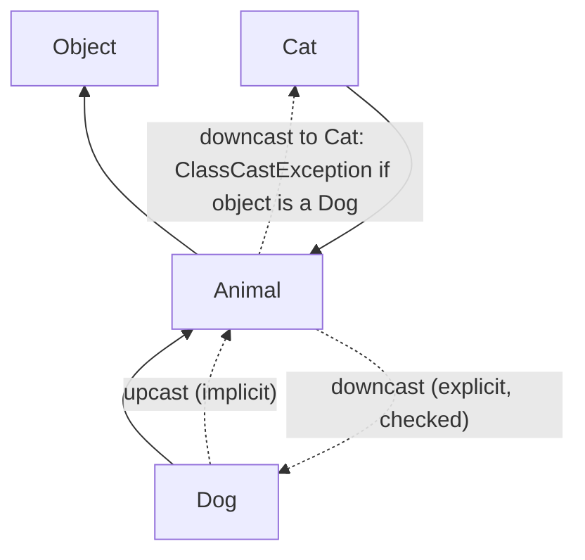
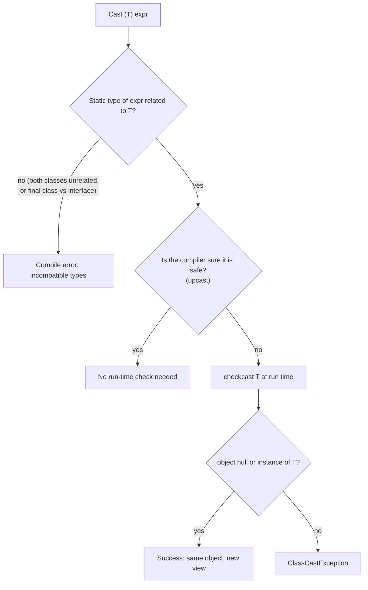
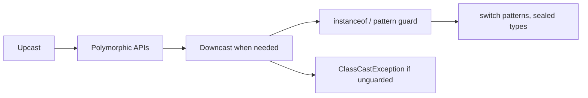

# Upcasting and Downcasting of Reference Variables in Java

**TL;DR:** A reference variable has a **declared type** (what the compiler knows) and the object it points to has an **actual class** (what it really is). **Upcasting** assigns a subclass object to a superclass (or interface) variable: always safe, implicit, and it *narrows what you can call*. **Downcasting** goes back down: it needs an explicit cast `(Dog) a`, the compiler only checks that the types are *related*, and the JVM checks the object's real class, throwing `ClassCastException` on a mismatch. Guard downcasts with `instanceof` (or an `instanceof` pattern). **Casting never changes the object, only the view you have of it.**

## Table of Contents

1. [TL;DR](#1-tldr)
2. [Why it matters](#2-why-it-matters)
3. [Prerequisites](#3-prerequisites)
4. [Mental model](#4-mental-model)
5. [Core concepts](#5-core-concepts)
6. [How it works](#6-how-it-works)
7. [Examples](#7-examples)
8. [Comparisons](#8-comparisons)
9. [Trade-offs](#9-trade-offs)
10. [Gotchas](#10-gotchas)
11. [Practical application](#11-practical-application)
12. [Interview prep](#12-interview-prep)
13. [Interview question bank](#13-interview-question-bank)
14. [Tricky code snippets](#14-tricky-code-snippets)
15. [Connections](#15-connections)
16. [Summary](#16-summary)
17. [Answers](#answers)

> **Scope note.** The earlier *Inheritance and Polymorphism* note has a short casting section. This note is the full treatment: rules, compile-time vs run-time checks, `instanceof` patterns, arrays, generics and wildcards, interfaces and boxed types.

---

## 1. TL;DR

- **Upcast:** `Animal a = new Dog();` — implicit, always legal, hides subclass-only members.
- **Downcast:** `Dog d = (Dog) a;` — explicit; compiles if `Dog` and `Animal` are related; at run time the object must really be a `Dog` (or subclass), else `ClassCastException`.
- **Guard:** `if (a instanceof Dog d) d.bark();` — test and cast in one step.
- **Overridden methods still dispatch to the real class** after an upcast; fields and static methods don't (Snippets 15, 16, 17).
- **`null`** passes any cast and fails every `instanceof` (Snippet 10).

**The analogy: a staff ID card and the person wearing it.**

| Real world | Java |
|---|---|
| A person who is a surgeon | An object whose actual class is `Surgeon` |
| The badge you show at the front desk says only "Employee" | An upcast: `Employee e = surgeon;` the variable exposes only employee features |
| The person is the same, but the receptionist can only use "employee" privileges | The object doesn't change; the variable's type limits what you can call |
| Asking "are you a surgeon?" before handing them a scalpel | `instanceof Surgeon` |
| Handing a scalpel to someone who turns out to be an accountant | `ClassCastException` |
| Trying to treat a person as a Giraffe (an unrelated type) | Compile error: inconvertible types |

**Running example:** `Animal` with subclasses `Dog` (`bark()`) and `Cat` (`meow()`). We upcast a `Dog` into an `Animal` variable, call an overridden method, downcast safely, and watch two wrong downcasts fail. Full program and output in 6.2.

---

## 2. Why it matters

**The problem.** Polymorphic code works with a general type (`Animal`, `Shape`, `Payment`, an interface). Occasionally you need something specific to the subclass. Casting is the bridge, and mistakes show up either as compile errors you can fix or as run-time `ClassCastException`s that crash production.

**What goes wrong** (verified on Java 21):

| Code | Result | Cause |
|---|---|---|
| `Animal a = new Dog(); a.bark();` | Compile error: cannot find symbol | The variable's type has no `bark()` (Snippet 3) |
| `Dog d = a;` (no cast) | Compile error | Downcast must be explicit (Snippet 4) |
| `(Dog) new Animal()` | `ClassCastException` | The object isn't a `Dog` (Snippet 5) |
| `(Integer) someString` | Compile error | Unrelated classes (Snippet 11) |
| `(Runnable) dog` for a non-final `Dog` | `ClassCastException` at run time | A subclass *could* implement it, so the compiler allows it (Snippet 13) |
| Same with a `final` class | Compile error | A final class can't have such a subclass (Snippet 14) |
| `Object[] o = new String[2]; o[1] = 42;` | `ArrayStoreException` | Arrays are covariant (Snippet 19) |
| `List<Animal> l = dogs;` | Compile error | Generics are invariant (Snippet 21) |
| `(long) obj` where `obj` holds an `Integer` | `ClassCastException` | Unboxing cast targets the exact wrapper (Snippet 25) |
| `(List<String>) obj` | Compiles with a warning; fails later | Unchecked cast: heap pollution (Snippet 31) |

**Why interviewers ask.** "What is upcasting and downcasting?", "when does `ClassCastException` occur?", "what does `instanceof` do with `null`?", "can you cast between unrelated classes?", "why does array covariance cause `ArrayStoreException`?" are standard. They test whether you separate compile-time and run-time checks.

---

## 3. Prerequisites

| Prerequisite | One-line refresher | Importance |
|---|---|---|
| Inheritance | `extends`, IS-A ([Inheritance notes]) | Essential |
| Polymorphism | Overriding and dynamic dispatch ([Polymorphism notes]) | Essential |
| Reference variables | Variable type vs object type ([Reference Data Types notes]) | Essential |
| Interfaces and abstract classes | Implementation types ([Encapsulation and Abstraction notes]) | Important |
| Generics basics | `List<T>`, wildcards | Helpful |

---

## 4. Mental model

> **The one picture to keep in your head:** a reference variable is a **window** onto an object. The window's *shape* is the declared type: it decides which members you can see. The object behind it never changes. Upcasting swaps to a **smaller** window (always possible); downcasting swaps to a **bigger** window (only possible if the object actually has that room).

```
 new Dog()  — the object on the heap (class Dog: eat(), bark(), name)
   ▲
   │  Dog d       window shows: eat(), bark(), name      (the whole Dog)
   │  Animal a    window shows: eat(), name              (smaller; bark() hidden)
   │  Object o    window shows: toString(), equals() ... (smallest)

 Upcast   (Dog → Animal → Object)  : implicit, safe, shrinks the window
 Downcast (Object → Animal → Dog)  : explicit, checked at run time, widens the window
```
*The object is always a Dog; only the amount you may touch changes.*


*Moving up the tree is free; moving down is a promise the JVM verifies.*

**Two checks happen:**

| When | Who | Question |
|---|---|---|
| Compile time | `javac` | Are the two types **related** (one is a subtype of the other, or an interface could apply)? If not: *incompatible types* |
| Run time | JVM | Is the object's **actual class** a subtype of the target? If not: `ClassCastException` |

---

## 5. Core concepts

### 5.1 Glossary

- **Reference type conversion (casting):** changing the type through which an object is viewed.
- **Upcasting (widening reference conversion):** subtype → supertype; implicit.
- **Downcasting (narrowing reference conversion):** supertype → subtype; explicit and run-time checked.
- **Declared (static) type:** the type of the variable or expression.
- **Actual (dynamic) type:** the object's class.
- **`ClassCastException`:** run-time failure of a downcast.
- **`instanceof`:** tests whether a value is non-null and an instance of a type.
- **Pattern matching for `instanceof`:** `x instanceof Dog d` tests and declares a typed variable (final in Java 16+).
- **Reifiable type:** a type fully available at run time (`String`, `List<?>`, arrays); `List<String>` is not.
- **Unchecked cast:** a cast the compiler can't verify (generics), flagged with a warning.
- **Heap pollution:** a variable whose static type claims more than the object delivers.
- **Covariance:** a subtype relationship carries over (`String[]` is an `Object[]`). Generics are invariant.

### 5.2 Upcasting

- Implicit: no cast syntax needed (`Animal a = d;`, Snippet 2). Writing `(Animal) d` is allowed but redundant.
- **Always succeeds** at run time and compile time (if the types are related).
- You can only call members **declared in the variable's type** (Snippet 3).
- **Overridden instance methods** still run the real class's version (Snippet 15).
- **Fields and static methods** follow the declared type (Snippets 16, 17).
- **Overload resolution** uses the declared type: `f((Animal) d)` picks `f(Animal)` (Snippet 18).
- It happens implicitly in many places: assignments, method arguments (Snippet 36), return values, collections (Snippet 34), ternary results (Snippet 35), anonymous classes (Snippet 38), interface references (Snippet 27).

### 5.3 Downcasting

- Needs an explicit cast: `Dog d = (Dog) a;` (Snippet 4 shows the error without it).
- **Compile-time rule:** allowed when the source and target types are *related* (one extends/implements the other). Unrelated classes are rejected (Snippet 11).
- **Run-time rule:** the object must be an instance of the target type, else `ClassCastException` (Snippets 5, 6).
- Cast to an **interface** compiles for a non-final class even if the class doesn't implement it (a subclass might); it fails at run time (Snippet 13). For a **final** class the compiler can tell it will fail (Snippet 14).
- Cast through a chain step by step if you like; each step is checked (Snippet 32).
- **`null`** can be cast to any reference type and stays `null` (Snippet 10).
- After a downcast you get a *bigger window* onto the **same object** (Snippet 26).

### 5.4 `instanceof`

| Form | Meaning | Snippet |
|---|---|---|
| `a instanceof Dog` | `true` if `a` is non-null and its class is `Dog` or a subclass | 7 |
| `a instanceof Dog d` | Same, plus binds `d` to `a` as a `Dog` when true | 8 |
| `null instanceof X` | Always `false` | 10 |
| `s instanceof Integer` for `String s` | Compile error: types incompatible | 12 |
| `o instanceof List<?>` | Fine (reifiable) | 30 |
| `o instanceof List<String>` | Compile error: not safely checkable | 30 |

**Pattern variable scope** is flow-based: `d` is in scope where the compiler can prove the test succeeded (`&&`, the `if` body, or after a negated test that exits). With `||` it is *not* in scope (Snippet 9).

`getClass()` vs `instanceof`: `a.getClass() == Animal.class` is a test for the *exact* class; `Animal.class.isInstance(a)` equals `instanceof` (Snippet 33).

### 5.5 Pattern matching in `switch` (Java 21)

A `switch` can test types directly, with guards and `null`:

```java
switch (o) {
    case Circle c -> ...
    case Square s when s.s() > 10 -> ...
    case String str -> ...
    case null -> ...
    default -> ...
}
```
Verified (Snippet 29). Order matters: a more specific pattern must come before a more general one. With a `sealed` hierarchy the compiler can check the cases are exhaustive without `default`.

### 5.6 Arrays, generics and boxed types

| Topic | Rule | Snippet |
|---|---|---|
| Arrays | Covariant: `Object[] o = new String[2]` compiles; storing a non-String throws `ArrayStoreException` | 19 |
| Array downcast | Checked by the array's actual component type | 20 |
| Generics | Invariant: `List<Dog>` is **not** a `List<Animal>` | 21 |
| Wildcard `? extends` | Read as the supertype; can't add | 22, 23 |
| Unchecked generic cast | Compiles with a warning; fails later where the element is used | 31 |
| Boxed cast | `(int) obj` works when `obj` is an `Integer`; `(long) obj` fails (needs a `Long`) | 25 |
| Primitive cast vs reference cast | Primitive casts convert the *value* (`(int) 3.9 → 3`); reference casts only change the *view* | 24 |

### 5.7 Interfaces and anonymous classes

- Any class's object can be upcast to the interfaces it implements, and downcast back with `instanceof` (Snippet 27).
- An anonymous class instance is upcast to its interface or parent, and extra members are invisible through that type (Snippet 38), unless you capture it with `var` (also in Snippet 38).

### 5.8 When casting is a smell

Frequent downcasts after upcasts usually mean the supertype lacks a method it should have. Prefer:
1. **Polymorphism:** put the behaviour in the supertype and override it.
2. **Visitor / sealed + `switch`:** when behaviours live outside the classes.
3. **Generics:** to avoid `Object` casts in containers.

---

## 6. How it works

### 6.1 What the compiler checks, what the JVM checks


*Downcasts compile to a `checkcast` bytecode instruction.*

### 6.2 Worked trace: Animal, Dog, Cat

```java
class Animal { String name = "animal"; void eat() { System.out.println("eats"); } }
class Dog extends Animal { void bark() { System.out.println("woof"); } @Override void eat() { System.out.println("dog eats"); } }
class Cat extends Animal { void meow() { System.out.println("meow"); } }
public class Main {
    public static void main(String[] args) {
        Animal a = new Dog();
        a.eat();
        if (a instanceof Dog) { Dog d = (Dog) a; d.bark(); }
        System.out.println(a instanceof Cat);
        try { Cat c = (Cat) a; } catch (ClassCastException e) { System.out.println("ClassCastException"); }
        Animal plain = new Animal();
        System.out.println(plain instanceof Dog);
    }
}
```

Output (verified, Java 21):

```
dog eats
woof
false
ClassCastException
false
```

| Step | Declared type | Actual class | Result |
|---|---|---|---|
| `Animal a = new Dog()` | `Animal` | `Dog` | Upcast, implicit |
| `a.eat()` | `Animal` | `Dog` | Dynamic dispatch: `dog eats` |
| `a instanceof Dog` | | `Dog` | `true`, so `(Dog) a` is safe |
| `d.bark()` | `Dog` | `Dog` | `woof` (bigger window) |
| `a instanceof Cat` | | `Dog` | `false` |
| `(Cat) a` | | `Dog` | Compiles (related types), then `ClassCastException` |
| `plain instanceof Dog` | | `Animal` | `false`: an `Animal` object isn't a `Dog` |

### 6.3 Why `(Cat) a` compiles but `(Cat) dogVariable` doesn't

With `Animal a`, the object *could* be a `Cat`, so the compiler allows the cast and the JVM decides. With `Dog d`, the compiler already knows `Dog` and `Cat` are sibling classes, so no object can be both: compile error (Snippet 11 shows the unrelated-class version; the Inheritance note's Snippets 9 and 10 show the sibling pair).

### 6.4 The exception message

`ClassCastException: class Animal cannot be cast to class Dog (Animal and Dog are in unnamed module of loader 'app')`. In Snippet 6 the message starts with `class Animal cannot be cast to class Dog`. Read it as "actual class X, wanted Y".

### 6.5 Arrays: checked twice

Covariant array assignment is allowed at compile time, so the check moves to run time: storing an `Integer` into an array that is really `String[]` throws `ArrayStoreException: java.lang.Integer` (Snippet 19). That's why generics were made invariant: the compile-time check replaces the run-time one.

### 6.6 Generic casts and erasure

`List<String>` and `List<Integer>` are the same class at run time. A cast `(List<String>) obj` can only check "is it a `List`?", so it compiles with an *unchecked* warning, succeeds, and the `ClassCastException` appears later when you read an element as `String` (Snippet 31). `instanceof List<String>` is rejected outright (Snippet 30).

---

## 7. Examples

### 7.1 Toy example: upcast, call, downcast

```java
Animal a = new Dog();           // upcast
a.eat();                        // dog eats  (dynamic dispatch)
if (a instanceof Dog d) d.bark();   // woof  (guarded downcast with a pattern)
```
Verified (Snippets 1, 8).

### 7.2 Real-world examples

- **Collections of a supertype:** `List<Animal>` or `List<Shape>`; count or process only some subtypes with `instanceof` (Snippet 34).
- **`equals(Object o)`:** `o instanceof P p && p.v == v` is the standard null-safe, type-safe pattern (Snippet 28).
- **Frameworks:** a handler receives a generic `Event` and downcasts to `ClickEvent` ⚠️ (illustrative).
- **JDK:** `Object`-typed APIs such as `Map.get`, legacy collections and reflection return `Object`; code casts the result.
- **Visitor / sealed + `switch`:** replaces long `instanceof` chains (Snippet 29).
- **Serialization/deserialization:** reading an `Object` from a stream and casting it.

---

## 8. Comparisons

### 8.1 Upcasting vs downcasting

| Aspect | Upcasting | Downcasting |
|---|---|---|
| Direction | Subtype → supertype | Supertype → subtype |
| Syntax | Implicit | Explicit `(Sub) x` or pattern |
| Safe? | Always | Not always |
| Failure | None | `ClassCastException` |
| Effect on visible members | Fewer | More |
| Compile check | Types related | Types related |
| Run-time check | None | `checkcast` |
| Typical use | Polymorphic APIs, collections | Access subclass-specific members |

### 8.2 Reference cast vs primitive cast

| | Primitive cast | Reference cast |
|---|---|---|
| Changes | The **value** (`(int) 3.9` → `3`) | Only the **view**; same object |
| Can lose data | Yes | No |
| Can fail at run time | No | Yes (`ClassCastException`) |
| Snippet | 24 | 24, 26 |

### 8.3 `instanceof` vs `getClass()` vs `isInstance`

| Test | True when | Snippet |
|---|---|---|
| `a instanceof Animal` | Non-null and actual class is `Animal` or a subclass | 7, 33 |
| `a.getClass() == Animal.class` | Actual class is exactly `Animal` | 33 |
| `Animal.class.isInstance(a)` | Same as `instanceof` (dynamic) | 33 |
| `Dog.class.cast(a)` | Cast using a `Class` object; throws if wrong | 33 |

### 8.4 Cast forms for downcasting

| Style | Code | Notes |
|---|---|---|
| Guard then cast | `if (a instanceof Dog) ((Dog) a).bark();` | Verbose (Snippet 7) |
| Pattern | `if (a instanceof Dog d) d.bark();` | Preferred (Snippet 8) |
| `switch` pattern | `case Dog d -> ...` | Java 21 (Snippet 29) |
| `try/catch ClassCastException` | | Avoid: using exceptions for control flow |
| `Class.cast` | `Dog.class.cast(a)` | When the type is only known at run time |

### 8.4b Arrays vs generics

| | Arrays | Generics |
|---|---|---|
| Variance | Covariant | Invariant |
| Type errors | At run time (`ArrayStoreException`) | At compile time |
| Run-time type info | Kept (reifiable) | Erased |

---

## 9. Trade-offs

| Decision | Benefit | Cost | Use when |
|---|---|---|---|
| Upcast to the supertype | Decoupled, general code; polymorphism | Subclass members hidden | Almost always for APIs and fields |
| Downcast with a guard | Access subclass features | Type-check noise; a design smell if frequent | Occasional, localised needs |
| Pattern `instanceof` | Concise and safe | Needs Java 16+ | Modern code |
| `switch` patterns / sealed types | Exhaustive and readable | Needs Java 21 (final) | Many variants |
| Polymorphic method instead of a cast | No type checks; open for extension | Must change the supertype | Behaviour belongs to the type |
| Unchecked generic cast | Sometimes unavoidable | Hides type errors until later | Isolated, with `@SuppressWarnings` and a comment |
| `catch ClassCastException` | Handles unknowns | Hides bugs; slow | Avoid; test with `instanceof` |
| `Class.cast` | Works with runtime types | Verbose | Reflection, generic utilities |

---

## 10. Gotchas

### Myths

- ❌ **Myth:** "Casting converts the object into another type." ✅ **Reality:** the object is unchanged; only the variable's view changes (Snippet 26).
- ❌ **Myth:** "After upcasting, the parent's version of an overridden method runs." ✅ **Reality:** the child's override runs (Snippet 15).
- ❌ **Myth:** "After upcasting, `p.name` reads the child's field." ✅ **Reality:** fields use the declared type (Snippet 16).
- ❌ **Myth:** "A cast that compiles can't fail." ✅ **Reality:** downcasts compile if the types are related and may throw at run time (Snippets 5, 13).
- ❌ **Myth:** "You can cast between any two classes." ✅ **Reality:** unrelated classes are a compile error (Snippet 11).
- ❌ **Myth:** "`null instanceof X` is `true` or throws." ✅ **Reality:** it's `false` (Snippet 10).
- ❌ **Myth:** "Casting `null` throws NPE." ✅ **Reality:** it's fine and stays `null` (Snippet 10).
- ❌ **Myth:** "`(long) obj` works if `obj` holds an `int`." ✅ **Reality:** the object is an `Integer`; cast `(long) (int) obj` (Snippet 25).
- ❌ **Myth:** "`List<Dog>` is a `List<Animal>`." ✅ **Reality:** generics are invariant; use `? extends Animal` for read access (Snippets 21, 22, 23).
- ❌ **Myth:** "An unchecked cast fails immediately." ✅ **Reality:** it succeeds, and the failure shows up later (Snippet 31).
- ❌ **Myth:** "Pattern variables are always in scope after the `if`." ✅ **Reality:** scope follows definite matching; `||` breaks it (Snippet 9).

### Common mistakes and edge cases

- **Downcasting without `instanceof`** (Snippet 5).
- **Calling a subclass method through the supertype variable** (Snippet 3).
- **Assuming `getClass() == Parent.class` after an upcast** (Snippet 33).
- **Casting siblings** (`Cat` ↔ `Dog`): `ClassCastException` or compile error.
- **`(String) obj` when `obj` is an `Integer`** (Snippet 37).
- **Array covariance surprises** (Snippets 19, 20).
- **`instanceof List<String>`** (Snippet 30).
- **`final` classes and interface casts** (Snippets 13, 14).
- **Over-casting instead of designing a better supertype** (5.8).
- **Using `||` with a pattern variable** (Snippet 9).

---

## 11. Practical application

### Checklist
- [ ] Prefer polymorphism to casting; add the method to the supertype if possible.
- [ ] Downcast only after `instanceof` (prefer the pattern form).
- [ ] Never rely on catching `ClassCastException`.
- [ ] Use wildcards (`? extends`, `? super`) rather than raw casts for generic collections.
- [ ] Keep unchecked casts in one small, commented method.
- [ ] Remember fields and static methods don't follow the object's real type.
- [ ] For `equals`, use `instanceof` pattern or `getClass()` consistently.
- [ ] Use `sealed` + `switch` patterns for closed families.

### Hands-on exercise: which lines throw?

```java
class Animal { }
class Dog extends Animal { }
class Puppy extends Dog { }
class Cat extends Animal { }
public class Main {
    public static void main(String[] args) {
        Animal a1 = new Puppy(), a2 = new Dog(), a3 = new Cat();
        Dog d1 = (Dog) a1;                  // (1)
        Puppy p1 = (Puppy) a2;              // (2)
        Dog d2 = (Dog) a3;                  // (3)
        Object o = a1; Animal a4 = (Animal) o;   // (4)
        System.out.println((a1 instanceof Dog) + " " + (a2 instanceof Puppy) + " " + (a3 instanceof Animal));
    }
}
```
Which numbered lines throw, and what does the last line print? Rewrite (2) and (3) so nothing throws.

<details><summary>Solution</summary>

- **(1)** OK: the object is a `Puppy`, which is a `Dog`.
- **(2)** `ClassCastException`: the object is a plain `Dog`, not a `Puppy`.
- **(3)** `ClassCastException`: the object is a `Cat`, a sibling of `Dog`.
- **(4)** OK: upcast then (redundant) cast.
- Last line: `true false true`.

Safe versions:

```java
if (a2 instanceof Puppy p1) { /* use p1 */ }
if (a3 instanceof Dog d2)   { /* use d2 */ }
```

Verified on Java 21 by running the snippet with (2) and (3) wrapped in `try/catch (ClassCastException e)` (both caught) and the print line unchanged (`true false true`).
</details>

---

## 12. Interview prep

Eight model answers, as you would say them aloud.

<details><summary>1. What are upcasting and downcasting?</summary>

Upcasting assigns a subclass object to a superclass or interface variable: implicit, always safe, and the variable then exposes only the supertype's members. Downcasting goes the other way with an explicit cast `(Dog) a`; the compiler checks that the types are related and the JVM checks the object's real class, throwing `ClassCastException` if it doesn't match. Neither changes the object, only the view of it (4, 5.2, 5.3; Snippets 2, 5, 26).
</details>

<details><summary>2. When does `ClassCastException` occur, and how do you avoid it?</summary>

When the runtime class of the object isn't the target type or a subtype, for example `(Dog) new Animal()` or `(String) integerObject`. Avoid it by testing first with `instanceof`, ideally the pattern form `if (a instanceof Dog d)`, or by redesigning so no cast is needed (Snippets 5, 8, 37).
</details>

<details><summary>3. What does a cast check at compile time versus run time?</summary>

Compile time: the source and target types must be related (one is a subtype of the other, or an interface cast is possible); unrelated classes are rejected. Run time: the `checkcast` instruction verifies the object's actual class. So a cast can compile and still fail (6.1; Snippets 5, 11, 13).
</details>

<details><summary>4. After `Animal a = new Dog();`, what do `a.eat()`, `a.name` and `a.bark()` do?</summary>

If `Dog` overrides `eat()`, the Dog's version runs (dynamic dispatch). `a.name` reads the field of the declared type `Animal`, not a Dog field of the same name. `a.bark()` is a compile error because `Animal` has no `bark()` (Snippets 3, 15, 16).
</details>

<details><summary>5. What does `instanceof` return for `null`, and what is the pattern form?</summary>

`false` for `null`, so a guarded cast never throws NPE. `a instanceof Dog d` tests and binds `d` as a `Dog` in one step (Java 16+); `d` is only in scope where the match is guaranteed, not after `||` (Snippets 8, 9, 10).
</details>

<details><summary>6. Can you cast between any two classes?</summary>

Only related ones. Two unrelated classes (`String` and `Integer`) fail at compile time. A cast to an interface compiles for a non-final class (a subclass might implement it) and may fail at run time; for a final class that doesn't implement it, it is a compile error (Snippets 11, 13, 14).
</details>

<details><summary>7. Why do arrays throw `ArrayStoreException` but generics don't?</summary>

Arrays are covariant (`Object[] o = new String[2]` compiles), so the type check is deferred to the store at run time. Generics are invariant (`List<Dog>` isn't a `List<Animal>`), so the compiler catches it; `? extends` wildcards give read-only covariance (Snippets 19, 21, 22, 23).
</details>

<details><summary>8. How do you cut down on casts in real code?</summary>

Put the behaviour in the supertype and override it; use generics to avoid `Object` containers; use `sealed` hierarchies with `switch` patterns or a visitor for closed families. Frequent downcasting is a smell that the abstraction is missing a method (5.8, 8.4; Snippet 29).
</details>

---

## 13. Interview question bank


### 13.1 Upcasting (Q1–Q14)

<details><summary>Q1. What is upcasting?</summary>

Treating a subclass object as its superclass or interface type: `Animal a = new Dog();`.
</details>

<details><summary>Q2. Is a cast operator required for upcasting?</summary>

No, it's implicit. `(Animal) d` is legal but redundant (Snippet 2).
</details>

<details><summary>Q3. Can upcasting fail?</summary>

No, at compile time or run time, as long as the types are related.
</details>

<details><summary>Q4. What do you lose after an upcast?</summary>

Access to members declared only in the subclass (Snippet 3). The object itself is unchanged.
</details>

<details><summary>Q5. Which method runs when an overridden method is called through the upcast variable?</summary>

The subclass's version, via dynamic dispatch (Snippet 15).
</details>

<details><summary>Q6. Does a field follow the object's real class after upcasting?</summary>

No, fields are resolved by the declared type (Snippet 16).
</details>

<details><summary>Q7. And a static method?</summary>

Also by the declared type; static methods are hidden, not overridden (Snippet 17).
</details>

<details><summary>Q8. Which overload is chosen if you pass an upcast variable?</summary>

The one matching the declared type, chosen at compile time (Snippet 18).
</details>

<details><summary>Q9. Where does upcasting happen implicitly besides assignment?</summary>

Method arguments, return values, collection adds, ternary results, and anonymous classes (Snippets 34, 35, 36, 38).
</details>

<details><summary>Q10. Is `Object o = "hi";` an upcast?</summary>

Yes; everything upcasts to `Object`.
</details>

<details><summary>Q11. Why upcast at all?</summary>

To write code against a general type (polymorphism, loose coupling, heterogeneous collections).
</details>

<details><summary>Q12. Can you upcast to an interface?</summary>

Yes, to any interface the class implements (Snippet 27).
</details>

<details><summary>Q13. Does upcasting copy the object?</summary>

No; both variables refer to the same object (Snippet 26).
</details>

<details><summary>Q14. Is `getClass()` affected by the upcast?</summary>

No, it still returns the real class (Snippet 33).
</details>


### 13.2 Downcasting (Q15–Q32)

<details><summary>Q15. What is downcasting?</summary>

Converting a superclass-typed reference back to a subclass type with an explicit cast.
</details>

<details><summary>Q16. Why is an explicit cast required?</summary>

The compiler can't prove the object is a `Dog` (Snippet 4).
</details>

<details><summary>Q17. Does a downcast always succeed?</summary>

No; the object must be an instance of the target type at run time (Snippet 5).
</details>

<details><summary>Q18. What exception is thrown on failure and what does its message say?</summary>

`ClassCastException: class Animal cannot be cast to class Dog ...` (actual class, then wanted class) (Snippet 6).
</details>

<details><summary>Q19. Can you downcast an object created as `new Animal()` to `Dog`?</summary>

It compiles and throws at run time (Snippet 5).
</details>

<details><summary>Q20. Can you cast `Cat` to `Dog` (siblings)?</summary>

If the variable is declared `Cat`, it's a compile error; if it's declared `Animal`, it compiles and fails at run time if the object is a Cat (6.3).
</details>

<details><summary>Q21. Is `null` castable?</summary>

Yes, to any reference type; the result is `null` (Snippet 10).
</details>

<details><summary>Q22. What does the cast actually do to the object?</summary>

Nothing; it checks and changes the variable's view (Snippet 26).
</details>

<details><summary>Q23. Can you downcast in two steps?</summary>

Yes; each step is checked, and the last must match the real class (Snippet 32).
</details>

<details><summary>Q24. What bytecode implements a downcast?</summary>

`checkcast` (6.1).
</details>

<details><summary>Q25. What happens when you cast to an interface the class doesn't implement?</summary>

Non-final class: compiles, fails at run time. Final class: compile error (Snippets 13, 14).
</details>

<details><summary>Q26. Can you cast `Object` to `String`?</summary>

Only if the object is a `String`; an `Integer` throws (Snippet 37).
</details>

<details><summary>Q27. What is `Dog.class.cast(a)`?</summary>

The reflective form of a cast; throws `ClassCastException` if wrong (Snippet 33).
</details>

<details><summary>Q28. Should you catch `ClassCastException`?</summary>

Avoid it; test with `instanceof` instead.
</details>

<details><summary>Q29. What are the compile-time rules for casting?</summary>

Related types only; unrelated classes are rejected (Snippet 11).
</details>

<details><summary>Q30. Can a downcast change which method runs?</summary>

No: overridden methods run the same either way; only which members are visible changes.
</details>

<details><summary>Q31. Does downcasting a variable change the object's class?</summary>

No (Snippet 26).
</details>

<details><summary>Q32. What is the safest downcast style?</summary>

Pattern `instanceof` (Snippet 8).
</details>


### 13.3 `instanceof` and pattern matching (Q33–Q44)

<details><summary>Q33. What does `instanceof` return for a subclass instance tested against its superclass?</summary>

`true`.
</details>

<details><summary>Q34. What does `null instanceof X` return?</summary>

`false` (Snippet 10).
</details>

<details><summary>Q35. What is the pattern form?</summary>

`x instanceof Dog d` binds `d` if the test succeeds (Snippet 8).
</details>

<details><summary>Q36. Is `d` in scope after `a instanceof Dog d || other`?</summary>

No (Snippet 9).
</details>

<details><summary>Q37. Can you write `s instanceof Integer` for a `String s`?</summary>

No; compile error (Snippet 12).
</details>

<details><summary>Q38. Can you write `o instanceof List<String>`?</summary>

No, it can't be checked at run time; `List<?>` is fine (Snippet 30).
</details>

<details><summary>Q39. `instanceof` vs `getClass() ==`?</summary>

`instanceof` includes subclasses, `getClass()` is exact (Snippet 33).
</details>

<details><summary>Q40. How is `instanceof` used in `equals`?</summary>

`o instanceof P p && p.v == v` (Snippet 28).
</details>

<details><summary>Q41. What does `switch` pattern matching add?</summary>

Type patterns, `when` guards, `case null`, exhaustiveness for sealed types (Snippet 29).
</details>

<details><summary>Q42. Does the order of `case` patterns matter?</summary>

Yes; a dominated pattern is a compile error, so specific cases go first.
</details>

<details><summary>Q43. Is `instanceof` slow?</summary>

Not meaningfully; the JIT optimises it. Long chains are a design smell, not a speed issue.
</details>

<details><summary>Q44. Does `instanceof` work with interfaces and arrays?</summary>

Yes.
</details>


### 13.4 Arrays, generics, boxing (Q45–Q58)

<details><summary>Q45. Is `String[]` an `Object[]`?</summary>

Yes, arrays are covariant (Snippet 19).
</details>

<details><summary>Q46. What goes wrong with that?</summary>

Storing a non-String throws `ArrayStoreException` (Snippet 19).
</details>

<details><summary>Q47. Can you cast `Object` holding `int[]` to `Integer[]`?</summary>

No, `ClassCastException`; primitive and reference arrays are unrelated (Snippet 20).
</details>

<details><summary>Q48. Is `List<Dog>` a `List<Animal>`?</summary>

No, generics are invariant (Snippet 21).
</details>

<details><summary>Q49. How do you read a `List<Dog>` as animals?</summary>

`List<? extends Animal>` (Snippet 22).
</details>

<details><summary>Q50. Can you add to a `List<? extends Animal>`?</summary>

No; compile error (Snippet 23).
</details>

<details><summary>Q51. What is an unchecked cast?</summary>

A generic cast the compiler can't verify; it warns and may pollute the heap (Snippet 31).
</details>

<details><summary>Q52. Why does the failure appear later?</summary>

Erasure: the cast only checks the raw `List`; the element cast happens when you read (Snippet 31).
</details>

<details><summary>Q53. What is a reifiable type?</summary>

One fully available at run time: primitives, non-generic types, raw types, unbounded wildcards, arrays of those.
</details>

<details><summary>Q54. Does `(int) 3.9` behave like a reference cast?</summary>

No; primitive casts convert the value (Snippet 24).
</details>

<details><summary>Q55. Can you cast an `Object` holding an `Integer` to `int`?</summary>

Yes (unbox) (Snippet 25).
</details>

<details><summary>Q56. And to `long`?</summary>

No: `ClassCastException`; use `(long) (int) obj` (Snippet 25).
</details>

<details><summary>Q57. Can you cast `Integer` to `Long`?</summary>

Not at all; unrelated wrapper classes.
</details>

<details><summary>Q58. Is a cast needed when reading from `List<Dog>`?</summary>

No; generics insert it for you.
</details>


### 13.5 Design and practice (Q59–Q68)

<details><summary>Q59. When are downcasts acceptable?</summary>

Localised, guarded, and when the supertype can't reasonably carry the behaviour (`equals`, legacy `Object` APIs).
</details>

<details><summary>Q60. What's the alternative to downcasting?</summary>

Overriding, generics, visitor, sealed + switch (5.8).
</details>

<details><summary>Q61. What does casting do to `static` type vs `dynamic` type?</summary>

It changes the static type for that expression; the dynamic type is fixed at construction.
</details>

<details><summary>Q62. Does a cast to the same type do anything?</summary>

Nothing; it's redundant.
</details>

<details><summary>Q63. Which is safer: catching `ClassCastException` or `instanceof`?</summary>

`instanceof`.
</details>

<details><summary>Q64. How does a ternary affect types?</summary>

The result type is the common supertype (Snippet 35).
</details>

<details><summary>Q65. Is an anonymous class's type nameable?</summary>

No; use `var` to retain its members (Snippet 38).
</details>

<details><summary>Q66. Can interface references be downcast to the class?</summary>

Yes, with `instanceof` (Snippet 27).
</details>

<details><summary>Q67. Does a method parameter of a supertype accept subclass objects?</summary>

Yes, implicit upcast (Snippet 36).
</details>

<details><summary>Q68. Where does a collection of supertypes hide types?</summary>

Elements are upcast on add; use `instanceof` to recover them (Snippet 34).
</details>

---

## 14. Tricky code snippets

38 snippets, each compiled and run on OpenJDK 21. Predict the output (or the compile error) before opening the answer. Classes are declared without `public` so they can share one file.

### Snippet 1: Animal, Dog, Cat

```java
class Animal { String name = "animal"; void eat() { System.out.println("eats"); } }
class Dog extends Animal { void bark() { System.out.println("woof"); } @Override void eat() { System.out.println("dog eats"); } }
class Cat extends Animal { void meow() { System.out.println("meow"); } }
public class Main {
    public static void main(String[] args) {
        Animal a = new Dog();
        a.eat();
        if (a instanceof Dog) { Dog d = (Dog) a; d.bark(); }
        System.out.println(a instanceof Cat);
        try { Cat c = (Cat) a; } catch (ClassCastException e) { System.out.println("ClassCastException"); }
        Animal plain = new Animal();
        System.out.println(plain instanceof Dog);
    }
}
```

<details><summary>Answer</summary>

```
dog eats
woof
false
ClassCastException
false
```

Trace in 6.2: dynamic dispatch picks `Dog.eat()`, the guarded downcast works, `(Cat) a` fails because the object is a Dog.
</details>

### Snippet 2: Implicit upcast

```java
class Animal { }
class Dog extends Animal { }
public class Main {
    public static void main(String[] args) {
        Dog d = new Dog();
        Animal a = d;
        Object o = d;
        System.out.println((a == d) + " " + (o == d) + " " + a.getClass().getSimpleName());
    }
}
```

<details><summary>Answer</summary>

```
true true Dog
```

No cast needed; the object is still a `Dog` (`getClass`).
</details>

### Snippet 3: Calling a subclass method through the supertype

```java
class Animal { }
class Dog extends Animal { void bark() { } }
public class Main {
    public static void main(String[] args) {
        Animal a = new Dog();
        a.bark();
    }
}
```

<details><summary>Answer</summary>

Compile error: *cannot find symbol*.

The variable's type is `Animal`, which has no `bark()`.
</details>

### Snippet 4: Downcast without a cast

```java
class Animal { }
class Dog extends Animal { }
public class Main {
    public static void main(String[] args) {
        Animal a = new Dog();
        Dog d = a;
    }
}
```

<details><summary>Answer</summary>

Compile error: *incompatible types: Animal cannot be converted to Dog*.

Add `(Dog)` explicitly.
</details>

### Snippet 5: Wrong downcast at run time

```java
class Animal { }
class Dog extends Animal { }
public class Main {
    public static void main(String[] args) {
        Animal a = new Animal();
        Dog d = (Dog) a;
    }
}
```

<details><summary>Answer</summary>

```
Exception in thread "main" java.lang.ClassCastException: class Animal cannot be cast to class Dog (Animal and Dog are in unnamed module of loader 'app')
```

It compiles; the object is a plain `Animal`. The message says actual class first, then target.
</details>

### Snippet 6: Message of the exception

```java
class Animal { }
class Dog extends Animal { }
public class Main {
    public static void main(String[] args) {
        Object o = new Animal();
        try { Dog d = (Dog) o; }
        catch (ClassCastException e) { System.out.println(e.getMessage().startsWith("class Animal cannot be cast to class Dog")); }
    }
}
```

<details><summary>Answer</summary>

```
true
```

The program prints whether the message starts with `class Animal cannot be cast to class Dog`.
</details>

### Snippet 7: `instanceof` then cast

```java
class Animal { }
class Dog extends Animal { void bark() { System.out.println("woof"); } }
class Cat extends Animal { }
public class Main {
    static void speak(Animal a) { if (a instanceof Dog) ((Dog) a).bark(); else System.out.println("not a dog"); }
    public static void main(String[] args) { speak(new Dog()); speak(new Cat()); speak(null); }
}
```

<details><summary>Answer</summary>

```
woof
not a dog
not a dog
```

Plain `Animal` and `null` both fail the test, so no cast runs.
</details>

### Snippet 8: Pattern variable

```java
class Animal { }
class Dog extends Animal { void bark() { System.out.println("woof"); } }
public class Main {
    public static void main(String[] args) {
        Animal a = new Dog();
        if (a instanceof Dog d) d.bark();
        if (!(a instanceof Dog dd)) { System.out.println("no"); } else { dd.bark(); }
    }
}
```

<details><summary>Answer</summary>

```
woof
woof
```

`d` is bound to the object as a `Dog` when the test succeeds.
</details>

### Snippet 9: Pattern variable after `||`

```java
class Animal { }
class Dog extends Animal { String name = "rex"; }
public class Main {
    public static void main(String[] args) {
        Animal a = new Dog();
        if (a instanceof Dog d && d.name.length() == 3) System.out.println("short-named dog");
        if (a instanceof Dog d || true) System.out.println(d.name);
    }
}
```

<details><summary>Answer</summary>

Compile error: *cannot find symbol*.

`d` is only definitely matched with `&&`; after `||` the compiler can't prove the match.
</details>

### Snippet 10: `null` with `instanceof` and cast

```java
class Animal { }
class Dog extends Animal { }
public class Main {
    public static void main(String[] args) {
        Animal a = null;
        System.out.println(a instanceof Dog);
        Dog d = (Dog) a;
        System.out.println(d);
    }
}
```

<details><summary>Answer</summary>

```
false
null
```

`instanceof` is false for `null`; casting `null` is allowed and yields `null`.
</details>

### Snippet 11: Cast between unrelated classes

```java
public class Main {
    public static void main(String[] args) {
        String s = "x";
        Integer i = (Integer) s;
    }
}
```

<details><summary>Answer</summary>

Compile error: *incompatible types: String cannot be converted to Integer*.

Neither is a subtype of the other, so no object can be both.
</details>

### Snippet 12: `instanceof` with unrelated types

```java
public class Main {
    public static void main(String[] args) {
        String s = "x";
        System.out.println(s instanceof Integer);
    }
}
```

<details><summary>Answer</summary>

Compile error: *incompatible types: String cannot be converted to Integer*.

The same relatedness check applies.
</details>

### Snippet 13: Cast to an interface

```java
class Dog { }
public class Main {
    public static void main(String[] args) {
        Dog d = new Dog();
        try { Runnable r = (Runnable) d; } catch (ClassCastException e) { System.out.println("ClassCastException at run time"); }
    }
}
```

<details><summary>Answer</summary>

```
ClassCastException at run time
```

A non-final class could have a subclass implementing it, so the compiler allows the cast; this object doesn't.
</details>

### Snippet 14: Final class to interface

```java
final class Dog { }
public class Main {
    public static void main(String[] args) {
        Dog d = new Dog();
        Runnable r = (Runnable) d;
    }
}
```

<details><summary>Answer</summary>

Compile error: *incompatible types: Dog cannot be converted to Runnable*.

`Dog` is final and doesn't implement `Runnable`, so the compiler knows it can't succeed.
</details>

### Snippet 15: Overridden method via upcast

```java
class Shape { double area() { return 0; } }
class Circle extends Shape { double area() { return 3; } }
public class Main {
    public static void main(String[] args) {
        Shape s = new Circle();
        System.out.println(s.area() + " " + ((Shape) s).area() + " " + ((Object) s).getClass().getSimpleName());
    }
}
```

<details><summary>Answer</summary>

```
3.0 3.0 Circle
```

Same method result either way: the override of the real class runs.
</details>

### Snippet 16: Fields via upcast

```java
class P { String name = "P"; }
class C extends P { String name = "C"; }
public class Main {
    public static void main(String[] args) {
        C c = new C();
        P p = c;
        System.out.println(c.name + " " + p.name + " " + ((P) c).name + " " + ((C) p).name);
    }
}
```

<details><summary>Answer</summary>

```
C P P C
```

Field access uses the declared type: `c.name` is C's, `p.name` and `((P) c).name` are P's, `((C) p).name` is C's.
</details>

### Snippet 17: Static method via upcast

```java
class P { static String who() { return "P"; } }
class C extends P { static String who() { return "C"; } }
public class Main {
    public static void main(String[] args) {
        P p = new C();
        System.out.println(p.who() + " " + ((C) p).who());
    }
}
```

<details><summary>Answer</summary>

```
P C
```

Static methods are chosen by the declared type, not the object.
</details>

### Snippet 18: Overload with upcast arguments

```java
class Animal { }
class Dog extends Animal { }
public class Main {
    static void f(Animal a) { System.out.println("Animal"); }
    static void f(Dog d) { System.out.println("Dog"); }
    public static void main(String[] args) {
        Dog d = new Dog();
        f(d); f((Animal) d); Animal a = d; f(a); f((Dog) a);
    }
}
```

<details><summary>Answer</summary>

```
Dog
Animal
Animal
Dog
```

Overloads are picked at compile time from the declared type.
</details>

### Snippet 19: Array covariance

```java
public class Main {
    public static void main(String[] args) {
        Object[] objs = new String[2];
        objs[0] = "ok";
        try { objs[1] = 42; } catch (ArrayStoreException e) { System.out.println("ArrayStoreException " + e.getMessage()); }
    }
}
```

<details><summary>Answer</summary>

```
ArrayStoreException java.lang.Integer
```

`Object[]` accepted the assignment; the store failed at run time.
</details>

### Snippet 20: Casting arrays

```java
public class Main {
    public static void main(String[] args) {
        Object o = new int[]{1, 2};
        int[] ok = (int[]) o;
        System.out.println(ok.length);
        try { Integer[] bad = (Integer[]) o; } catch (ClassCastException e) { System.out.println("ClassCastException"); }
        Object[] os = new String[]{"a"};
        String[] ss = (String[]) os;
        System.out.println(ss[0]);
        Object[] plain = new Object[]{"a"};
        try { String[] bad2 = (String[]) plain; } catch (ClassCastException e) { System.out.println("ClassCastException 2"); }
    }
}
```

<details><summary>Answer</summary>

```
2
ClassCastException
a
ClassCastException 2
```

The array's real component type decides; `int[]` isn't `Integer[]`, and an `Object[]` isn't a `String[]`.
</details>

### Snippet 21: Generics invariance

```java
import java.util.*;
class Animal { }
class Dog extends Animal { }
public class Main {
    public static void main(String[] args) {
        List<Dog> dogs = new ArrayList<>();
        List<Animal> animals = dogs;
    }
}
```

<details><summary>Answer</summary>

Compile error: *incompatible types: List<Dog> cannot be converted to List<Animal>*.

If it were allowed, you could add a Cat to the dog list.
</details>

### Snippet 22: `? extends` for reading

```java
import java.util.*;
class Animal { }
class Dog extends Animal { }
public class Main {
    static int count(List<? extends Animal> l) { return l.size(); }
    public static void main(String[] args) {
        List<Dog> dogs = new ArrayList<>(List.of(new Dog(), new Dog()));
        List<? extends Animal> view = dogs;
        Animal first = view.get(0);
        System.out.println(count(dogs) + " " + (first == dogs.get(0)));
    }
}
```

<details><summary>Answer</summary>

```
2 true
```

Reading as `Animal` is safe.
</details>

### Snippet 23: `? extends` for adding

```java
import java.util.*;
class Animal { }
class Dog extends Animal { }
public class Main {
    public static void main(String[] args) {
        List<Dog> dogs = new ArrayList<>();
        List<? extends Animal> view = dogs;
        view.add(new Dog());
    }
}
```

<details><summary>Answer</summary>

Compile error: *incompatible types: Dog cannot be converted to CAP#1*.

The exact element type is unknown, so nothing (except `null`) can be added.
</details>

### Snippet 24: Primitive vs reference cast

```java
public class Main {
    public static void main(String[] args) {
        double d = 3.9;
        int i = (int) d;
        Object o = new StringBuilder("x");
        CharSequence cs = (CharSequence) o;
        System.out.println(i + " " + (cs == o) + " " + cs.length());
    }
}
```

<details><summary>Answer</summary>

```
3 true 1
```

`(int) 3.9` changes the value; reference casts keep the same object.
</details>

### Snippet 25: Casting a boxed value

```java
public class Main {
    public static void main(String[] args) {
        Object o = 5;
        int i = (int) o;
        long l = (long) (int) o;
        System.out.println(i + " " + l);
        try { long bad = (long) o; } catch (ClassCastException e) { System.out.println("ClassCastException: Integer is not Long"); }
    }
}
```

<details><summary>Answer</summary>

```
5 5
ClassCastException: Integer is not Long
```

`(int) obj` unboxes an `Integer`; `(long) obj` needs a `Long`.
</details>

### Snippet 26: Cast changes the view

```java
class Animal { }
class Dog extends Animal { }
public class Main {
    public static void main(String[] args) {
        Dog d = new Dog();
        Animal a = (Animal) d;
        Object o = a;
        Dog back = (Dog) o;
        System.out.println((back == d) + " " + (o.getClass() == Dog.class));
    }
}
```

<details><summary>Answer</summary>

```
true true
```

Both variables refer to the same object (`==`), which stays a `Dog`.
</details>

### Snippet 27: Interface references

```java
interface Flyer { void fly(); }
class Bird implements Flyer { public void fly() { System.out.println("flap"); } void sing() { System.out.println("tweet"); } }
public class Main {
    public static void main(String[] args) {
        Flyer f = new Bird();
        f.fly();
        if (f instanceof Bird b) b.sing();
    }
}
```

<details><summary>Answer</summary>

```
flap
tweet
```

The same object is viewed through different interfaces after `instanceof` checks.
</details>

### Snippet 28: `equals` with `instanceof`

```java
class P {
    int v; P(int v) { this.v = v; }
    @Override public boolean equals(Object o) { return o instanceof P p && p.v == v; }
    @Override public int hashCode() { return v; }
}
public class Main { public static void main(String[] args) { System.out.println(new P(1).equals(new P(1)) + " " + new P(1).equals("x") + " " + new P(1).equals(null)); } }
```

<details><summary>Answer</summary>

```
true false false
```

Same value and type is equal; a different value, `null` and another type are not.
</details>

### Snippet 29: `switch` patterns

```java
sealed interface Shape permits Circle, Square { }
record Circle(double r) implements Shape { }
record Square(double s) implements Shape { }
public class Main {
    static String describe(Object o) {
        return switch (o) {
            case Circle c -> "circle " + c.r();
            case Square s when s.s() > 10 -> "big square";
            case Square s -> "square " + s.s();
            case String str -> "string " + str.length();
            case null -> "null!";
            default -> "other";
        };
    }
    public static void main(String[] args) {
        System.out.println(describe(new Circle(1)) + ", " + describe(new Square(20)) + ", " + describe(new Square(2)) + ", " + describe("hey") + ", " + describe(null) + ", " + describe(7));
    }
}
```

<details><summary>Answer</summary>

```
circle 1.0, big square, square 2.0, string 3, null!, other
```

Guarded case first, then the general `Square`; `case null` handles `null` explicitly.
</details>

### Snippet 30: `instanceof List<String>`

```java
import java.util.*;
public class Main {
    public static void main(String[] args) {
        Object o = new ArrayList<String>();
        System.out.println(o instanceof List<?>);
        System.out.println(o instanceof List<String>);
    }
}
```

<details><summary>Answer</summary>

Compile error: *Object cannot be safely cast to List<String>*.

Generic type arguments are erased; use `List<?>`.
</details>

### Snippet 31: Unchecked cast

```java
import java.util.*;
public class Main {
    @SuppressWarnings("unchecked")
    public static void main(String[] args) {
        Object o = new ArrayList<Integer>(List.of(1, 2));
        List<String> strs = (List<String>) o;
        System.out.println(strs.size());
        try { String s = strs.get(0); } catch (ClassCastException e) { System.out.println("ClassCastException later, at get()"); }
    }
}
```

<details><summary>Answer</summary>

```
2
ClassCastException later, at get()
```

The cast to `List<String>` succeeds (unchecked); reading an element as `String` fails.
</details>

### Snippet 32: Casting step by step

```java
class A { }
class B extends A { }
class C extends B { }
public class Main {
    public static void main(String[] args) {
        A a = new C();
        B b = (B) a;
        C c = (C) b;
        System.out.println(c.getClass().getSimpleName());
        A a2 = new B();
        try { C bad = (C) a2; } catch (ClassCastException e) { System.out.println("B is not a C"); }
    }
}
```

<details><summary>Answer</summary>

```
C
B is not a C
```

Both steps are checked; the object must be a `C`.
</details>

### Snippet 33: `getClass`, `isInstance`, `cast`

```java
class Animal { }
class Dog extends Animal { }
public class Main {
    public static void main(String[] args) {
        Animal a = new Dog();
        System.out.println(a.getClass().getName() + " " + (a.getClass() == Animal.class) + " " + Animal.class.isInstance(a) + " " + Dog.class.cast(a).getClass().getSimpleName());
    }
}
```

<details><summary>Answer</summary>

```
Dog false true Dog
```

The real class is `Dog`; exact comparison with `Animal.class` is false, `isInstance` is true.
</details>

### Snippet 34: Collections of a supertype

```java
import java.util.*;
class Animal { String s() { return "animal"; } }
class Dog extends Animal { @Override String s() { return "dog"; } }
class Cat extends Animal { @Override String s() { return "cat"; } }
public class Main {
    public static void main(String[] args) {
        List<Animal> zoo = new ArrayList<>();
        zoo.add(new Dog()); zoo.add(new Cat()); zoo.add(new Animal());
        StringBuilder sb = new StringBuilder();
        for (Animal a : zoo) sb.append(a.s()).append(' ');
        System.out.println(sb.toString().trim());
        int dogs = 0;
        for (Animal a : zoo) if (a instanceof Dog) dogs++;
        System.out.println(dogs);
    }
}
```

<details><summary>Answer</summary>

```
dog cat animal
1
```

Elements are upcast on add; `instanceof` counts only dogs.
</details>

### Snippet 35: Ternary result type

```java
class Animal { }
class Dog extends Animal { }
class Cat extends Animal { }
public class Main {
    public static void main(String[] args) {
        boolean flag = true;
        Animal a = flag ? new Dog() : new Cat();
        System.out.println(a.getClass().getSimpleName());
    }
}
```

<details><summary>Answer</summary>

```
Dog
```

The ternary's static type is the common supertype, but the object is still a `Dog`.
</details>

### Snippet 36: Passing a subclass

```java
class Animal { }
class Dog extends Animal { }
public class Main {
    static String kind(Animal a) { return a.getClass().getSimpleName(); }
    static Animal make() { return new Dog(); }
    public static void main(String[] args) { System.out.println(kind(new Dog()) + " " + make().getClass().getSimpleName()); }
}
```

<details><summary>Answer</summary>

```
Dog Dog
```

The parameter is an `Animal`; the object stays a `Dog`.
</details>

### Snippet 37: Casting `Object` to `String`

```java
public class Main {
    public static void main(String[] args) {
        Object o = "hello";
        String s = (String) o;
        System.out.println(s.length());
        Object n = 42;
        try { String bad = (String) n; } catch (ClassCastException e) { System.out.println("Integer is not String"); }
    }
}
```

<details><summary>Answer</summary>

```
5
Integer is not String
```

Works only when the object is really a `String`.
</details>

### Snippet 38: Anonymous class and upcast

```java
interface Greeter { String hi(); }
public class Main {
    public static void main(String[] args) {
        Greeter g = new Greeter() { public String hi() { return "hi"; } public String extra() { return "extra"; } };
        System.out.println(g.hi());
        var v = new Object() { int x = 5; };
        System.out.println(v.x);
    }
}
```

<details><summary>Answer</summary>

```
hi
5
```

Extra members of the anonymous type are visible only through `var`.
</details>

---

## 15. Connections

| Related topic | How it connects |
|---|---|
| Inheritance | Casting only exists along the `extends`/`implements` tree |
| Polymorphism, Overloading and Overriding | Upcasting is what makes dynamic dispatch useful; overloads use the declared type |
| Abstract classes and interfaces | The usual supertypes you upcast to |
| Reference data types | Declared type vs object type; the heap holds the real object |
| Generics and wildcards | Invariance, `? extends`, unchecked casts, erasure |
| Arrays | Covariance and `ArrayStoreException` |
| Wrapper classes and boxing | `(int) obj` vs `(long) obj`; `Integer` isn't `Long` |
| Records, sealed types, `switch` patterns | The modern replacement for `instanceof` chains |
| `equals` and `hashCode` | `instanceof` or `getClass()` guard before casting |


*Upcast for generality, downcast with a guard for specifics, switch patterns when there are many cases.*

---

## 16. Summary

### 60-second card

- Upcast = implicit and safe; downcast = explicit and checked at run time.
- Casting changes the **view**, never the object.
- Overridden methods dispatch on the real class; fields and static methods use the declared type.
- Compile time: types must be related. Run time: the object must really be the target (or a subtype).
- `instanceof` is `false` for `null`; casting `null` is fine.
- Prefer `if (a instanceof Dog d)`; avoid catching `ClassCastException`.
- Arrays are covariant (`ArrayStoreException`); generics are invariant; unchecked casts defer failures.
- `(long) obj` fails for an `Integer`; use `(long) (int) obj`.

### Cheat sheet

```java
Animal a = new Dog();                 // upcast
if (a instanceof Dog d) d.bark();     // guarded downcast
Dog d2 = Dog.class.cast(a);           // reflective cast
List<? extends Animal> r = dogs;      // read-only covariance
```

| Want | Write |
|---|---|
| Treat a Dog as an Animal | `Animal a = dog;` |
| Use a Dog-only method | `if (a instanceof Dog d) d.bark();` |
| Exact class test | `a.getClass() == Dog.class` |
| Many subtypes | `switch (o) { case Dog d -> ... }` |
| Read dogs as animals | `List<? extends Animal>` |

### Self-test

1. What is the difference between upcasting and downcasting?
2. Which checks happen at compile time and which at run time?
3. After `Animal a = new Dog();`, which of `eat()` (overridden), field `name`, static `info()` use the Dog's version?
4. What is `null instanceof Object`, and what does `(Dog) null` do?
5. Why does `(Cat) dogVariable` fail to compile but `(Cat) animalVariable` doesn't?
6. Why does `Object[] o = new String[1]; o[0] = 1;` fail only at run time?
7. Why isn't `List<Dog>` a `List<Animal>`?
8. Why does `(long) obj` throw when `obj` holds an `Integer`?

### Anki flashcards

```
Upcasting :: Subtype to supertype; implicit and always safe
Downcasting :: Supertype to subtype; explicit, checked at run time
ClassCastException :: Thrown when the object's real class isn't the cast target
instanceof null :: Always false
Pattern instanceof :: x instanceof Dog d binds d when true (Java 16+)
Cast effect :: Changes the view, not the object
Field/static via upcast :: Resolved by declared type
Array covariance :: String[] is an Object[]; bad store throws ArrayStoreException
Generics invariance :: List<Dog> is not List<Animal>
(long) Object holding Integer :: ClassCastException
Cast to interface, non-final class :: Compiles; may fail at run time
```

### Resources

- *The Java Language Specification*, chapter 5 (Conversions and Contexts) and 15.20.2 (`instanceof`): docs.oracle.com/javase/specs
- JEP 394, Pattern Matching for `instanceof`: openjdk.org/jeps/394
- JEP 441, Pattern Matching for `switch`: openjdk.org/jeps/441
- *Effective Java*, Joshua Bloch: items on generics, wildcards and arrays

---

## Answers

1. Upcasting moves up the hierarchy implicitly and safely; downcasting moves down explicitly and can fail.
2. Compile time: the types must be related. Run time: the object's class is checked by `checkcast`.
3. `eat()` uses the Dog's override; the field and static method use `Animal`'s.
4. `false`; `(Dog) null` is `null` with no exception.
5. The compiler knows `Dog` and `Cat` are unrelated siblings; an `Animal` object might be a `Cat`.
6. Arrays are covariant, so the compiler allows it; the actual array's component type is checked on store.
7. Generics are invariant; otherwise a `Cat` could be added to a list of dogs.
8. The unboxing cast needs a `Long`; the object is an `Integer`.
