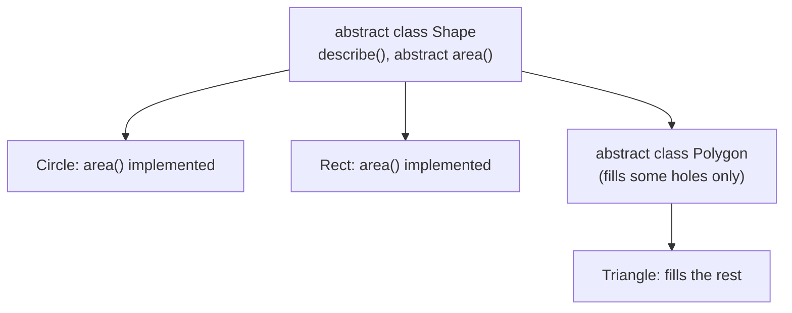
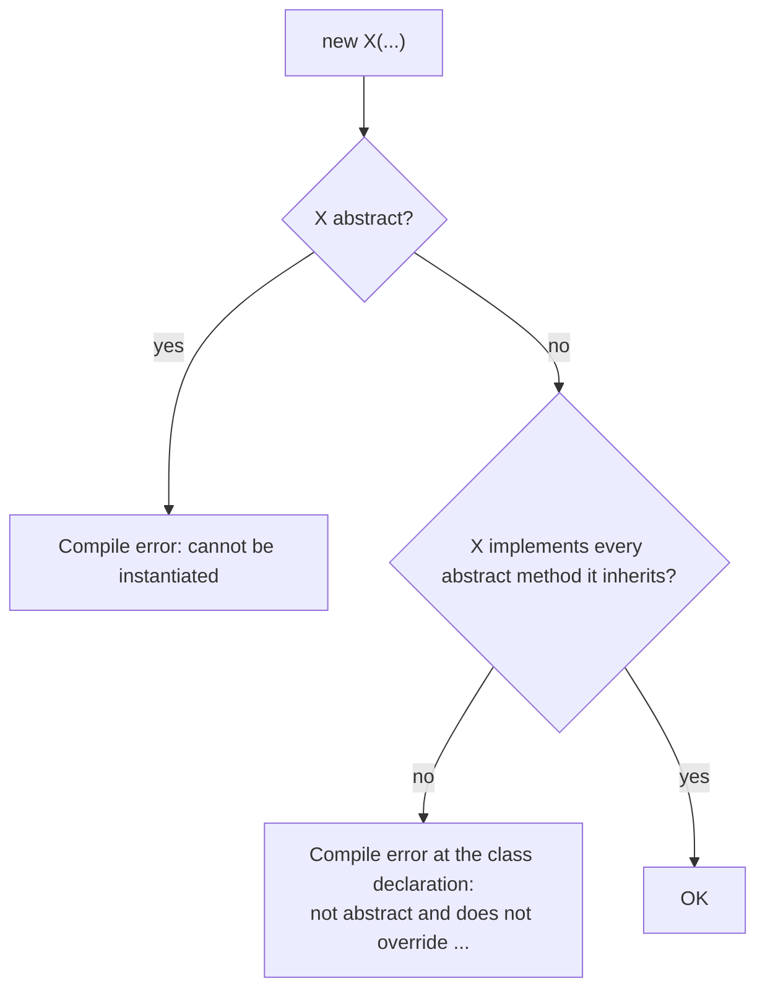
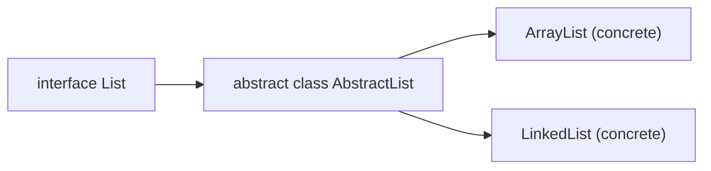

# Abstract Classes and Abstract Methods in Java

**TL;DR:** An **abstract class** is a class you cannot instantiate; it exists to be extended. An **abstract method** has a signature but no body (`abstract double area();`) and forces every concrete subclass to supply one. Abstract classes can still have fields, constructors, concrete methods and static members, which makes them the right tool for *shared state and partial behaviour* with a *required customisation point* (the Template Method pattern). If you only need a contract, prefer an interface.

## Table of Contents

1. [TL;DR](#1-tldr)
2. [Why it matters](#2-why-it-matters)
3. [Prerequisites](#3-prerequisites)
4. [Mental model](#4-mental-model)
5. [Core concepts](#5-core-concepts)
6. [How it works](#6-how-it-works)
7. [Examples](#7-examples)
8. [Comparisons](#8-comparisons)
9. [Trade-offs](#9-trade-offs)
10. [Gotchas](#10-gotchas)
11. [Practical application](#11-practical-application)
12. [Interview prep](#12-interview-prep)
13. [Interview question bank](#13-interview-question-bank)
14. [Tricky code snippets](#14-tricky-code-snippets)
15. [Connections](#15-connections)
16. [Summary](#16-summary)
17. [Answers](#answers)

> **Scope note.** The earlier *Encapsulation and Abstraction* note introduces abstraction at a high level. This note is the full, rule-by-rule treatment of the `abstract` keyword. Interfaces are covered next in the Interfaces note.

---

## 1. TL;DR

- `abstract class X { }` can't be instantiated: `new X()` is a compile error (Snippet 2).
- `abstract void m();` has **no body**, and a body is an error (Snippet 4).
- A **concrete** subclass must implement **all** inherited abstract methods, or itself be `abstract` (Snippets 5, 6).
- A class with an abstract method must be declared abstract (Snippet 3). The reverse isn't required (Snippet 7).
- Abstract classes **have constructors**; they run when a subclass is built (Snippet 12).
- `abstract` can't combine with `final`, `private` or `static` (Snippets 8-11).

**The analogy: a blank form with some fields pre-filled.**

| Real world | Java |
|---|---|
| A form template: title and footer printed, "Details:" left blank | Abstract class: some concrete methods, some abstract |
| You can't submit the blank template | You can't `new` an abstract class |
| Each department fills in the blanks and produces a usable form | Each concrete subclass implements the abstract methods |
| The printed parts are the same for everyone | Shared code in the abstract class |

**Running example:** `Shape` (abstract, with a constructor, a `name` field, a concrete `describe()` and an abstract `area()`), with `Circle` and `Rect`. Full program and output in 6.2.

---

## 2. Why it matters

**The problem.** You have several related classes that share state and some behaviour, but each must provide one piece differently. Copy-pasting the shared part invites divergence; a plain superclass can't *force* the subclasses to implement the missing piece. An abstract class does both.

**What goes wrong** (verified on Java 21):

| Code | Result | Snippet |
|---|---|---|
| `new Shape()` for an abstract `Shape` | Compile error: abstract; cannot be instantiated | 2 |
| Abstract method in a non-abstract class | Compile error | 3 |
| `abstract double area() { ... }` | Compile error: abstract methods cannot have a body | 4 |
| Subclass forgets to implement an abstract method | Compile error | 5 |
| `abstract final`, `abstract private`, `abstract static` | Compile error: illegal combination | 8, 9, 10, 11 |
| Calling an overridable method from the abstract constructor | Sees uninitialised subclass fields | 12, 25 |
| Overriding a public abstract method with a weaker access | Compile error | 18 |
| `super.m()` where `m` is abstract | Compile error | 26 |

**Why interviewers ask.** "Abstract class vs interface", "can an abstract class have a constructor?", "can an abstract class have no abstract methods?", "can you instantiate an abstract class?" are near-certain questions in Java interviews.

---

## 3. Prerequisites

| Prerequisite | One-line refresher | Importance |
|---|---|---|
| Inheritance | `extends`, `super` | Essential |
| Overriding and polymorphism | Child methods replace parent ones at run time | Essential |
| Constructors | Run parent first; `super(...)` | Essential |
| Access modifiers | `public`, `protected`, package-private, `private` | Important |
| Interfaces (basics) | Pure contracts | Helpful |

---

## 4. Mental model

> **The one picture to keep in your head:** an abstract class is a **partially built class**. It can hold real state and real code, but it has holes (abstract methods). A hole must be filled before an object can exist, so only a *complete* subclass can be instantiated.

```
          Shape (abstract)
   fields: name          constructor Shape(String)
   concrete: describe()  ← calls area()
   abstract: area()      ← HOLE, no body
        ▲                        ▲
   Circle                     Rect
   area() filled in           area() filled in
   new Circle(1)  ✓           new Rect(2,3)  ✓
   new Shape(...) ✗ (compile error)
```
*Instantiable = every hole filled.*


*Abstract classes can extend abstract classes; the first concrete class must fill every hole.*

---

## 5. Core concepts

### 5.1 Glossary

- **Abstract class:** declared with `abstract`; can't be instantiated.
- **Abstract method:** no body, ends with `;`; implemented by subclasses.
- **Concrete class:** not abstract; can be instantiated; must implement all inherited abstract methods.
- **Template method:** a concrete (often `final`) method in an abstract class that calls abstract "hook" steps.
- **Hook / extension point:** an abstract or overridable method subclasses supply.
- **Contract:** what a type promises to provide.

### 5.2 Rules for abstract classes

| Rule | Snippet |
|---|---|
| Can't be instantiated (`new`) | 2 |
| Can be referenced: `Shape s = new Circle(1);` | 16, 23 |
| Can have constructors, called via `super(...)` | 1, 12 |
| Can have fields, instance init blocks, static members, nested classes | 14, 28, 29 |
| Can have zero abstract methods | 7 |
| Can extend a concrete class, and can be extended by an abstract class | 19, 6 |
| Can implement an interface without implementing its methods | 21 |
| Can't be `final` | 8 |
| An anonymous subclass can instantiate it by supplying the abstract methods | 17, 23 |
| Arrays of the abstract type are fine; elements start `null` | 22 |

### 5.3 Rules for abstract methods

| Rule | Snippet |
|---|---|
| No body; ends with a semicolon | 4 |
| Only in an abstract class (or interface) | 3 |
| Can't be `private` (nobody could override it) | 9 |
| Can't be `static` (static isn't overridden) | 10 |
| Can't be `final` | 11 |
| Overrider can't reduce access | 18 |
| Concrete subclass must implement all | 5, 20 |
| `super.m()` is illegal when `m` is abstract | 26 |
| A concrete method can be re-declared abstract in a subclass | 19, 20 |
| Constructors can't be abstract | 13 |

### 5.4 What an abstract class can contain

Fields (any kind), constructors, concrete instance methods, static methods, abstract methods, initialiser blocks, nested types, and any access modifiers. That's the main difference from an interface (before Java 8 interfaces had only abstract methods and constants).

### 5.5 Constructors in abstract classes

You can't `new` it, but its constructor **runs** whenever a subclass is created (`super(...)`, explicit or implicit). Use it to initialise shared state. Danger: if it calls an abstract (or overridable) method, the subclass part isn't initialised yet (Snippets 12, 25).

### 5.6 The Template Method pattern

```java
abstract class Report {
    final void generate() { header(); body(); footer(); }  // fixed algorithm
    void header() { ... }
    abstract void body();                                   // required step
    void footer() { ... }
}
```
Verified in Snippet 15. `final` on the template stops subclasses from changing the sequence.

### 5.7 Abstract classes and interfaces together

A common design: interface defines the contract, an abstract class supplies a skeleton implementation, concrete classes extend the skeleton (`List` → `AbstractList` → `ArrayList` in the JDK). The abstract class may implement only some interface methods (Snippet 21).

### 5.8 Checking at run time

`Modifier.isAbstract(Shape.class.getModifiers())` returns `true` (Snippet 24).

---

## 6. How it works

### 6.1 Compile-time checks


*The compiler enforces the contract at the class declaration, not at the call site.*

### 6.2 Worked trace: Shape, Circle, Rect

```java
abstract class Shape {
    String name;
    Shape(String name) { this.name = name; System.out.println("Shape(" + name + ")"); }
    abstract double area();
    void describe() { System.out.println(name + " area=" + area()); }
}
class Circle extends Shape {
    double r;
    Circle(double r) { super("circle"); this.r = r; }
    double area() { return Math.PI * r * r; }
}
class Rect extends Shape {
    double w, h;
    Rect(double w, double h) { super("rect"); this.w = w; this.h = h; }
    double area() { return w * h; }
}
public class Main {
    public static void main(String[] args) {
        Shape[] shapes = { new Circle(1), new Rect(2, 3) };
        for (Shape s : shapes) s.describe();
    }
}
```

Output (verified, Java 21):

```
Shape(circle)
Shape(rect)
circle area=3.141592653589793
rect area=6.0
```

| Step | What happens |
|---|---|
| `new Circle(1)` | `Circle(double)` calls `super("circle")`; the abstract class's constructor runs |
| `shapes[0].describe()` | Concrete method in `Shape`; it calls `area()` |
| `area()` inside `describe` | Dynamic dispatch picks `Circle.area()` |

### 6.3 Construction order and the leak

`new Child()` runs `Base()` first, then the field initialisers of `Child`, then `Child()`. If `Base()` calls an abstract method implemented by `Child`, it sees default values (`0`, `null`):

```
Base ctor
init x=0
Child ctor x=5
```
Verified in Snippet 12. Snippet 25 shows the same with a `String` (`label=null`).

### 6.4 Why `abstract` can't mix with `final`, `private`, `static`

- `final`: can't be overridden, but abstract demands an override.
- `private`: not visible to subclasses, so can't be overridden.
- `static`: belongs to the class and isn't overridden.

The compiler says *illegal combination of modifiers* (Snippets 8-11).

---

## 7. Examples

### 7.1 Toy example

```java
abstract class Animal { abstract String sound(); }
class Dog extends Animal { String sound() { return "woof"; } }
class Cat extends Animal { String sound() { return "meow"; } }
Animal a = new Dog(); Animal b = new Cat();
System.out.println(a.sound() + " " + b.sound());   // woof meow
```
Verified (Snippet 16).

### 7.2 Real-world examples

- **JDK:** `java.io.InputStream`/`OutputStream` (abstract `read`/`write`), `AbstractList`, `AbstractMap`, `Number` (abstract; `Integer` extends it), `java.util.Calendar`.
- **Frameworks:** `HttpServlet` (override `doGet`/`doPost`) ⚠️ (Jakarta Servlet API; not run here).
- **Template method:** report generators, data importers, test base classes (`setUp`/`tearDown` hooks).
- **Game or UI toolkits:** an abstract `Widget` with `draw()`.
- **Domain model:** `Payment` (abstract `process()`) with `CardPayment`, `UpiPayment`.

---

## 8. Comparisons

### 8.1 Abstract class vs interface

| Aspect | Abstract class | Interface |
|---|---|---|
| Instantiate | No | No |
| Inheritance | Single (`extends` one class) | Multiple (`implements` many) |
| Fields | Any (instance, static) | Only `public static final` constants |
| Constructors | Yes | No |
| Methods | Abstract and concrete, any access | Abstract, `default`, `static`, `private` (Java 8/9+) |
| State | Yes | No instance state |
| Access modifiers of methods | Any | Public (abstract/default/static), private helpers |
| Use for | Shared state and partial implementation; "is-a" family | Capability/contract; "can-do" |
| Evolution | Adding a concrete method is safe | Adding an abstract method breaks implementers; use `default` |

### 8.2 Abstract class vs concrete class

| | Abstract | Concrete |
|---|---|---|
| `new` | No | Yes |
| Abstract methods | Allowed | Not allowed |
| Must implement all inherited abstracts | No | Yes |
| Can be `final` | No | Yes |

### 8.3 Abstract method vs overridable concrete method

| | Abstract | Concrete (non-final) |
|---|---|---|
| Body | None | Has default behaviour |
| Subclass must override | Yes (if concrete) | No |
| Use when | No sensible default | A default exists |

### 8.4 Ways to define the missing piece

| Technique | Example |
|---|---|
| Named subclass | `class Circle extends Shape` |
| Anonymous subclass | `new Shape("x") { double area() { ... } }` (Snippet 17) |
| Lambda | Only for interfaces with one abstract method, never for abstract classes |

---

## 9. Trade-offs

| Decision | Benefit | Cost | Use when |
|---|---|---|---|
| Abstract class | Shared state/code, enforced hooks | Single inheritance; tighter coupling | Closely related subclasses |
| Interface | Multiple inheritance of type; flexible | No instance state | Capabilities across unrelated types |
| Interface + abstract skeleton | Contract and reuse | More types | Library APIs (`List`/`AbstractList`) |
| Template method | Fixed algorithm, controlled variation | Inheritance-based; hard to compose | Stable skeleton, variable steps |
| Strategy (composition) instead | Swap behaviour at run time | More objects | Behaviour varies independently |
| Abstract method | Forces implementation | Every subclass must write it | No sensible default |
| Concrete method with default | Less boilerplate | Subclasses may forget to override | A safe default exists |
| Calling abstract methods in a constructor | Compact | Sees uninitialised state | Avoid |

---

## 10. Gotchas

### Myths

- ❌ **Myth:** "An abstract class must have an abstract method." ✅ **Reality:** it can have none (Snippet 7).
- ❌ **Myth:** "Abstract classes have no constructors." ✅ **Reality:** they have them and they run (Snippet 12).
- ❌ **Myth:** "You can't create a variable of an abstract type." ✅ **Reality:** you can, and it points at a subclass object (Snippet 16).
- ❌ **Myth:** "You can never instantiate an abstract class." ✅ **Reality:** you can create an anonymous subclass (Snippet 17); you just can't `new` the abstract class itself.
- ❌ **Myth:** "An abstract class can't have concrete methods or fields." ✅ **Reality:** it can (Snippets 1, 14).
- ❌ **Myth:** "Every subclass must implement all abstract methods." ✅ **Reality:** only concrete ones; an abstract subclass may defer (Snippet 6).
- ❌ **Myth:** "`abstract` and `final` can be combined for a class." ✅ **Reality:** illegal combination (Snippet 8).
- ❌ **Myth:** "A concrete method can't become abstract again." ✅ **Reality:** it can (Snippet 19).
- ❌ **Myth:** "Abstract classes can't have static methods." ✅ **Reality:** they can (Snippet 14).

### Common mistakes and edge cases

- **Forgetting to implement a method in the first concrete class** (Snippet 5).
- **Weaker access when overriding** an abstract public method (Snippet 18).
- **Calling an abstract method from the constructor** (Snippets 12, 25).
- **`super.m()` on an abstract method** (Snippet 26).
- **Writing a body for an abstract method**, or forgetting `abstract` on the class (Snippets 3, 4).
- **Choosing an abstract class where an interface would do**, which blocks other inheritance.
- **Assuming `new Shape[2]` creates shapes**: it creates `null` slots (Snippet 22).
- **Marking an abstract method `private`/`static`/`final`** (Snippets 9-11).

---

## 11. Practical application

### Checklist
- [ ] Use an abstract class when subclasses share state or code *and* must supply something.
- [ ] Make the template method `final`.
- [ ] Keep constructors from calling overridable methods.
- [ ] Give abstract methods javadoc describing the contract.
- [ ] Prefer interfaces for pure capabilities; add an abstract skeleton only when it removes real duplication.
- [ ] Keep abstract hierarchies shallow.
- [ ] Declare overriding methods with `@Override`.
- [ ] Name abstract classes after the concept (`Shape`, `AbstractList`).

### Hands-on exercise

Build an abstract `Employee` with a `name`, a constructor, an abstract `double pay()` and a concrete `String slip()` returning `name + ": " + pay()`. Add `Salaried` (monthly salary, `pay` = salary) and `Hourly` (rate and hours, `pay` = rate × hours). Print the slips for `new Salaried("A", 3000)` and `new Hourly("B", 20, 10)`.

<details><summary>Solution</summary>

```java
abstract class Employee {
    final String name;
    Employee(String name) { this.name = name; }
    abstract double pay();
    String slip() { return name + ": " + pay(); }
}
class Salaried extends Employee {
    double salary;
    Salaried(String n, double s) { super(n); salary = s; }
    double pay() { return salary; }
}
class Hourly extends Employee {
    double rate, hours;
    Hourly(String n, double r, double h) { super(n); rate = r; hours = h; }
    double pay() { return rate * hours; }
}
public class Main {
    public static void main(String[] args) {
        Employee[] es = { new Salaried("A", 3000), new Hourly("B", 20, 10) };
        for (Employee e : es) System.out.println(e.slip());
    }
}
```

Output (verified on Java 21):

```
A: 3000.0
B: 200.0
```
</details>

---

## 12. Interview prep

Eight model answers, as you would say them aloud.

<details><summary>1. What is an abstract class and why use one?</summary>

A class declared `abstract` that can't be instantiated. It holds shared state and code and declares abstract methods that every concrete subclass must implement, so you get reuse and an enforced contract together (1, 5.2; Snippets 1, 2).
</details>

<details><summary>2. What is an abstract method?</summary>

A method with a signature and no body, ending in `;`. It's only allowed in an abstract class or interface, and every concrete subclass must override it. It can't be `private`, `static` or `final` (5.3; Snippets 3, 4, 9, 10, 11).
</details>

<details><summary>3. Can an abstract class have a constructor? How is it used?</summary>

Yes. You can't call it with `new`, but it runs when a subclass is constructed (`super(...)`), which is how shared fields get initialised. Avoid calling abstract methods from it, since the subclass isn't initialised yet (Snippets 12, 25).
</details>

<details><summary>4. Can an abstract class have no abstract methods?</summary>

Yes. It's a way to stop direct instantiation of a base class (Snippet 7).
</details>

<details><summary>5. Abstract class vs interface: when do you choose which?</summary>

Abstract class for related classes sharing state or code, with some required hooks; only one can be extended. Interface for a capability a class can add regardless of its parent; a class may implement many. Libraries often combine both (`List`/`AbstractList`) (8.1, 5.7).
</details>

<details><summary>6. Can you instantiate an abstract class?</summary>

Not with `new X()`. You can create an anonymous subclass that implements the abstract methods, and you can hold references of the abstract type pointing at concrete subclasses (Snippets 2, 16, 17).
</details>

<details><summary>7. What must a subclass do about abstract methods?</summary>

A concrete subclass implements all of them or the compiler rejects the class. An abstract subclass may implement some or none (Snippets 5, 6, 20).
</details>

<details><summary>8. What is the Template Method pattern and how does `abstract` support it?</summary>

A concrete, usually `final` method in the abstract class defines the algorithm steps and calls abstract or overridable hooks; subclasses fill in the hooks without altering the sequence (5.6; Snippet 15).
</details>

---

## 13. Interview question bank


### 13.1 Basics (Q1–Q14)

<details><summary>Q1. What does `abstract` mean for a class?</summary>

It can't be instantiated and may contain abstract methods.
</details>

<details><summary>Q2. For a method?</summary>

It has no body; subclasses must provide one.
</details>

<details><summary>Q3. Can you declare a variable of an abstract type?</summary>

Yes; it references an object of a concrete subclass (Snippet 16).
</details>

<details><summary>Q4. Can you create an array of an abstract type?</summary>

Yes; the elements start as `null` (Snippet 22).
</details>

<details><summary>Q5. What error does `new` on an abstract class produce?</summary>

"X is abstract; cannot be instantiated" (Snippet 2).
</details>

<details><summary>Q6. Can a class with an abstract method be non-abstract?</summary>

No; compile error (Snippet 3).
</details>

<details><summary>Q7. Can an abstract method have a body?</summary>

No (Snippet 4).
</details>

<details><summary>Q8. Can an abstract class have a `main` method?</summary>

Yes; it's a static method and can run.
</details>

<details><summary>Q9. Can an abstract class have static methods and fields?</summary>

Yes (Snippet 14).
</details>

<details><summary>Q10. Can an abstract class have instance fields and initialiser blocks?</summary>

Yes (Snippet 28).
</details>

<details><summary>Q11. Can an abstract class have nested classes?</summary>

Yes (Snippet 29).
</details>

<details><summary>Q12. Does `getClass()` on an object created via an abstract reference show the abstract name?</summary>

No; it shows the concrete class (Snippet 16).
</details>

<details><summary>Q13. How can you check at run time that a class is abstract?</summary>

`Modifier.isAbstract(cls.getModifiers())` (Snippet 24).
</details>

<details><summary>Q14. Can an abstract class be generic?</summary>

Yes; abstractness and generics are independent.
</details>


### 13.2 Constructors and initialisation (Q15–Q22)

<details><summary>Q15. Does an abstract class have a constructor if you write none?</summary>

Yes, the compiler adds a default one.
</details>

<details><summary>Q16. Can an abstract class constructor be abstract?</summary>

No; "modifier abstract not allowed here" (Snippet 13).
</details>

<details><summary>Q17. Does its constructor run?</summary>

Yes, when a subclass object is created (Snippet 12).
</details>

<details><summary>Q18. In what order do things run?</summary>

Parent instance initialisers and constructor, then child initialisers and constructor (Snippet 28).
</details>

<details><summary>Q19. What's wrong with calling an abstract method in the constructor?</summary>

The subclass's fields aren't initialised yet; you see `0`/`null` (Snippets 12, 25).
</details>

<details><summary>Q20. Can the constructor be `private` in an abstract class?</summary>

Yes, but then only nested/same-class subclasses can extend it.
</details>

<details><summary>Q21. Can the constructor be `protected`?</summary>

Yes, it's common, because only subclasses call it.
</details>

<details><summary>Q22. Does an anonymous subclass call the abstract constructor?</summary>

Yes, with the arguments you pass (`new Shape("x") { ... }`) (Snippet 17).
</details>


### 13.3 Rules and modifiers (Q23–Q34)

<details><summary>Q23. Why can't `abstract` be combined with `final`?</summary>

`final` forbids overriding; `abstract` requires it (Snippets 8, 11).
</details>

<details><summary>Q24. With `private`?</summary>

Private methods aren't visible to subclasses, so can't be overridden (Snippet 9).
</details>

<details><summary>Q25. With `static`?</summary>

Static methods aren't overridden (Snippet 10).
</details>

<details><summary>Q26. Can an abstract method be `protected`?</summary>

Yes; the overrider may widen but not narrow access.
</details>

<details><summary>Q27. What if the overrider has weaker access?</summary>

Compile error: "attempting to assign weaker access privileges; was public" (Snippet 18).
</details>

<details><summary>Q28. Can an abstract method throw checked exceptions?</summary>

Yes; overriders may throw the same or narrower ones.
</details>

<details><summary>Q29. Can the overrider have a covariant return type?</summary>

Yes, a subtype of the declared return type.
</details>

<details><summary>Q30. Can a concrete method be overridden as abstract?</summary>

Yes (Snippets 19, 20).
</details>

<details><summary>Q31. Can you call `super.m()` on an abstract method?</summary>

No: "abstract method m() in A cannot be accessed directly" (Snippet 26).
</details>

<details><summary>Q32. Can you call `super.m()` on a concrete method of an abstract class?</summary>

Yes (Snippet 27).
</details>

<details><summary>Q33. Can an abstract class be `final`?</summary>

No (Snippet 8).
</details>

<details><summary>Q34. Can an abstract class be `static`?</summary>

Only as a nested class.
</details>


### 13.4 Inheritance and interfaces (Q35–Q44)

<details><summary>Q35. Can an abstract class extend another abstract class?</summary>

Yes (Snippet 6).
</details>

<details><summary>Q36. Can it extend a concrete class?</summary>

Yes (Snippet 19).
</details>

<details><summary>Q37. Can it implement an interface without defining its methods?</summary>

Yes; the concrete subclass must (Snippet 21).
</details>

<details><summary>Q38. Can a class extend multiple abstract classes?</summary>

No; single inheritance of classes.
</details>

<details><summary>Q39. Can an interface extend an abstract class?</summary>

No.
</details>

<details><summary>Q40. Which is the first class that must implement the methods?</summary>

The first concrete class in the chain (Snippets 5, 6).
</details>

<details><summary>Q41. Can abstract classes be used with polymorphism?</summary>

Yes, that's their main purpose (Snippets 1, 16).
</details>

<details><summary>Q42. What is a skeleton implementation?</summary>

An abstract class implementing most of an interface (e.g. `AbstractList`).
</details>

<details><summary>Q43. Can an abstract class implement `equals`/`toString`?</summary>

Yes, it inherits them from `Object` anyway.
</details>

<details><summary>Q44. What does `instanceof` do with an abstract type?</summary>

Works normally (Snippets 16, 30).
</details>


### 13.5 Design (Q45–Q56)

<details><summary>Q45. When to use an abstract class over an interface?</summary>

Shared state, constructors, non-public members, or a skeleton implementation.
</details>

<details><summary>Q46. When to prefer an interface?</summary>

When unrelated classes need the capability, or you need multiple inheritance of type.
</details>

<details><summary>Q47. Why make the template method `final`?</summary>

So subclasses can't change the algorithm's order (Snippet 15).
</details>

<details><summary>Q48. Is the Template Method an example of inversion of control?</summary>

Yes: the base class calls the subclass's hook ("Hollywood principle").
</details>

<details><summary>Q49. What's the alternative to template method?</summary>

Strategy: pass behaviour in via composition or a lambda.
</details>

<details><summary>Q50. How do you evolve an abstract class without breaking subclasses?</summary>

Add concrete methods; adding an abstract method breaks existing subclasses.
</details>

<details><summary>Q51. Is a class with all abstract methods the same as an interface?</summary>

Functionally close, but it uses up the single inheritance slot and can hold state.
</details>

<details><summary>Q52. Why have an abstract class with no abstract methods?</summary>

To prevent instantiating a base type that only makes sense when extended (Snippet 7).
</details>

<details><summary>Q53. Does abstract affect performance?</summary>

No meaningful difference; virtual dispatch is optimised by the JIT.
</details>

<details><summary>Q54. Can an abstract class be tested directly?</summary>

Through a small concrete or anonymous subclass (Snippets 7, 17).
</details>

<details><summary>Q55. How does Java enforce that a concrete class implements everything?</summary>

At compile time, at the class declaration (6.1; Snippets 5, 20).
</details>

<details><summary>Q56. Can an enum have abstract methods?</summary>

Yes, each constant supplies a body ⚠️ (covered in the Enum note).
</details>

---

## 14. Tricky code snippets

30 snippets, each compiled and run on OpenJDK 21. Predict the output (or the compile error) before opening the answer. Classes are declared without `public` so they can share one file.

### Snippet 1: Shape, Circle, Rect

```java
abstract class Shape {
    String name;
    Shape(String name) { this.name = name; System.out.println("Shape(" + name + ")"); }
    abstract double area();
    void describe() { System.out.println(name + " area=" + area()); }
}
class Circle extends Shape {
    double r;
    Circle(double r) { super("circle"); this.r = r; }
    double area() { return Math.PI * r * r; }
}
class Rect extends Shape {
    double w, h;
    Rect(double w, double h) { super("rect"); this.w = w; this.h = h; }
    double area() { return w * h; }
}
public class Main {
    public static void main(String[] args) {
        Shape[] shapes = { new Circle(1), new Rect(2, 3) };
        for (Shape s : shapes) s.describe();
    }
}
```

<details><summary>Answer</summary>

```
Shape(circle)
Shape(rect)
circle area=3.141592653589793
rect area=6.0
```

Trace in 6.2: the abstract constructor runs via `super(...)`; `describe()` dispatches to the subclass's `area()`.
</details>

### Snippet 2: `new` on an abstract class

```java
abstract class Shape { abstract double area(); }
public class Main {
    public static void main(String[] args) {
        Shape s = new Shape();
    }
}
```

<details><summary>Answer</summary>

Compile error: *Shape is abstract; cannot be instantiated*.

The compiler stops it at the call site.
</details>

### Snippet 3: Abstract method in a non-abstract class

```java
class Shape { abstract double area(); }
public class Main { public static void main(String[] args) { } }
```

<details><summary>Answer</summary>

Compile error: *Shape is not abstract and does not override abstract method area() in Shape*.

The class must be declared `abstract`.
</details>

### Snippet 4: Abstract method with a body

```java
abstract class Shape { abstract double area() { return 0; } }
public class Main { public static void main(String[] args) { } }
```

<details><summary>Answer</summary>

Compile error: *abstract methods cannot have a body*.

Use `;` instead of `{ }`.
</details>

### Snippet 5: Concrete subclass missing a method

```java
abstract class Shape { abstract double area(); }
class Sq extends Shape { }
public class Main { public static void main(String[] args) { } }
```

<details><summary>Answer</summary>

Compile error: *Sq is not abstract and does not override abstract method area() in Shape*.

Implement `area()` or make `Sq` abstract.
</details>

### Snippet 6: Abstract subclass defers the rest

```java
abstract class A { abstract void x(); abstract void y(); }
abstract class B extends A { void x() { System.out.println("x"); } }
class C extends B { void y() { System.out.println("y"); } }
public class Main {
    public static void main(String[] args) { C c = new C(); c.x(); c.y(); }
}
```

<details><summary>Answer</summary>

```
x
y
```

`B` implements `x()`, `C` implements `y()`; only `C` is concrete.
</details>

### Snippet 7: Abstract class with no abstract methods

```java
abstract class Base { void hi() { System.out.println("hi"); } }
public class Main {
    public static void main(String[] args) {
        new Base() { }.hi();
    }
}
```

<details><summary>Answer</summary>

```
hi
```

`Base` can't be created directly, but the anonymous subclass can.
</details>

### Snippet 8: `abstract final` class

```java
abstract final class X { }
public class Main { public static void main(String[] args) { } }
```

<details><summary>Answer</summary>

Compile error: *illegal combination of modifiers: abstract and final*.

A final class can't be extended, so an abstract one would be useless.
</details>

### Snippet 9: `abstract private` method

```java
abstract class X { private abstract void m(); }
public class Main { public static void main(String[] args) { } }
```

<details><summary>Answer</summary>

Compile error: *illegal combination of modifiers: abstract and private*.

A private method can't be overridden.
</details>

### Snippet 10: `abstract static` method

```java
abstract class X { abstract static void m(); }
public class Main { public static void main(String[] args) { } }
```

<details><summary>Answer</summary>

Compile error: *illegal combination of modifiers: abstract and static*.

Static methods aren't overridden.
</details>

### Snippet 11: `abstract final` method

```java
abstract class X { abstract final void m(); }
public class Main { public static void main(String[] args) { } }
```

<details><summary>Answer</summary>

Compile error: *illegal combination of modifiers: abstract and final*.

`final` forbids the override that `abstract` requires.
</details>

### Snippet 12: Abstract constructor calls abstract method

```java
abstract class Base {
    Base() { System.out.println("Base ctor"); init(); }
    abstract void init();
}
class Child extends Base {
    int x = 5;
    Child() { super(); System.out.println("Child ctor x=" + x); }
    void init() { System.out.println("init x=" + x); }
}
public class Main { public static void main(String[] args) { new Child(); } }
```

<details><summary>Answer</summary>

```
Base ctor
init x=0
Child ctor x=5
```

`init()` runs inside `Base()` before `Child`'s field `x` is set to 5, so it sees `0`.
</details>

### Snippet 13: Abstract constructor

```java
abstract class X { abstract X(); }
public class Main { public static void main(String[] args) { } }
```

<details><summary>Answer</summary>

Compile error: *modifier abstract not allowed here*.

Constructors can't be abstract.
</details>

### Snippet 14: Statics and fields in an abstract class

```java
abstract class Util {
    static int count = 0;
    static void hello() { System.out.println("static in abstract"); }
    int id = ++count;
}
class Impl extends Util { }
public class Main {
    public static void main(String[] args) {
        Util.hello();
        System.out.println(new Impl().id + " " + new Impl().id + " " + Util.count);
    }
}
```

<details><summary>Answer</summary>

```
static in abstract
1 2 2
```

Static members are used normally; each `Impl` gets its own `id` from the shared counter.
</details>

### Snippet 15: Template method

```java
abstract class Report {
    final void generate() { header(); body(); footer(); }
    void header() { System.out.println("== header =="); }
    abstract void body();
    void footer() { System.out.println("== footer =="); }
}
class Sales extends Report { void body() { System.out.println("sales data"); } }
public class Main { public static void main(String[] args) { new Sales().generate(); } }
```

<details><summary>Answer</summary>

```
== header ==
sales data
== footer ==
```

`generate()` fixes the order; `body()` is the subclass's step.
</details>

### Snippet 16: Abstract reference

```java
abstract class Animal { abstract String sound(); }
class Dog extends Animal { String sound() { return "woof"; } }
class Cat extends Animal { String sound() { return "meow"; } }
public class Main {
    public static void main(String[] args) {
        Animal a = new Dog();
        Animal b = new Cat();
        System.out.println(a.sound() + " " + b.sound());
        System.out.println(a instanceof Animal);
        System.out.println(a.getClass().getSimpleName());
    }
}
```

<details><summary>Answer</summary>

```
woof meow
true
Dog
```

The reference type is abstract; the object and `getClass()` are concrete.
</details>

### Snippet 17: Anonymous subclass

```java
abstract class Greeter { abstract String greet(String n); }
public class Main {
    public static void main(String[] args) {
        Greeter g = new Greeter() { String greet(String n) { return "hi " + n; } };
        System.out.println(g.greet("raj"));
    }
}
```

<details><summary>Answer</summary>

```
hi raj
```

An anonymous class supplies the abstract method inline.
</details>

### Snippet 18: Override with weaker access

```java
abstract class A { public abstract void m(); }
class B extends A { void m() { } }
public class Main { public static void main(String[] args) { } }
```

<details><summary>Answer</summary>

Compile error: *m() in B cannot override m() in A*.

The detail line says: attempting to assign weaker access privileges; was public.
</details>

### Snippet 19: Re-abstracting a concrete method

```java
class A { void m() { System.out.println("A.m"); } }
abstract class B extends A { abstract void m(); }
class C extends B { void m() { System.out.println("C.m"); } }
public class Main { public static void main(String[] args) { new C().m(); } }
```

<details><summary>Answer</summary>

```
C.m
```

`B` makes `m()` abstract again; `C` implements it.
</details>

### Snippet 20: Missing the re-abstracted method

```java
class A { void m() { System.out.println("A.m"); } }
abstract class B extends A { abstract void m(); }
class C extends B { }
public class Main { public static void main(String[] args) { } }
```

<details><summary>Answer</summary>

Compile error: *C is not abstract and does not override abstract method m() in B*.

`A.m()` doesn't count because `B` re-declared it abstract.
</details>

### Snippet 21: Abstract class implementing part of an interface

```java
interface Walker { void walk(); void rest(); }
abstract class Mover implements Walker { public void walk() { System.out.println("walk"); } }
class Person extends Mover { public void rest() { System.out.println("rest"); } }
public class Main { public static void main(String[] args) { Person p = new Person(); p.walk(); p.rest(); } }
```

<details><summary>Answer</summary>

```
walk
rest
```

`Mover` implements `walk()`; `Person` supplies `rest()`.
</details>

### Snippet 22: Array of an abstract type

```java
abstract class Shape { }
class Sq extends Shape { }
public class Main {
    public static void main(String[] args) {
        Shape[] arr = new Shape[2];
        System.out.println(arr[0]);
        arr[0] = new Sq();
        System.out.println(arr[0].getClass().getSimpleName());
    }
}
```

<details><summary>Answer</summary>

```
null
Sq
```

The array is created; its elements are `null` until you assign objects.
</details>

### Snippet 23: Abstract type as a parameter

```java
abstract class Shape { abstract String n(); }
class Sq extends Shape { String n() { return "sq"; } }
public class Main {
    static void show(Shape s) { System.out.println(s.n()); }
    public static void main(String[] args) { show(new Sq()); show(new Shape() { String n() { return "anon"; } }); }
}
```

<details><summary>Answer</summary>

```
sq
anon
```

Any subclass, named or anonymous, can be passed.
</details>

### Snippet 24: Checking abstractness by reflection

```java
import java.lang.reflect.Modifier;
abstract class Shape { abstract double area(); }
public class Main {
    public static void main(String[] args) throws Exception {
        System.out.println(Modifier.isAbstract(Shape.class.getModifiers()));
        System.out.println(Modifier.isAbstract(Shape.class.getDeclaredMethod("area").getModifiers()));
    }
}
```

<details><summary>Answer</summary>

```
true
true
```

Both the class and the method carry the `abstract` modifier.
</details>

### Snippet 25: Field read by an overridden method in the parent constructor

```java
abstract class Base {
    Base() { System.out.println(describe()); }
    abstract String describe();
}
class Kid extends Base {
    String label = "kid";
    String describe() { return "label=" + label; }
}
public class Main { public static void main(String[] args) { new Kid(); } }
```

<details><summary>Answer</summary>

```
label=null
```

`label` isn't assigned until `Kid`'s initialisers run, after `Base()`.
</details>

### Snippet 26: `super.m()` on an abstract method

```java
abstract class A { abstract void m(); }
class B extends A { void m() { super.m(); } }
public class Main { public static void main(String[] args) { } }
```

<details><summary>Answer</summary>

Compile error: *abstract method m() in A cannot be accessed directly*.

There's no body to call.
</details>

### Snippet 27: `super.m()` on a concrete method

```java
abstract class A { void greet() { System.out.println("A.greet"); } }
class B extends A { void greet() { super.greet(); System.out.println("B.greet"); } }
public class Main { public static void main(String[] args) { new B().greet(); } }
```

<details><summary>Answer</summary>

```
A.greet
B.greet
```

Fine; the parent has an implementation.
</details>

### Snippet 28: Initialiser blocks and constructors

```java
abstract class A {
    { System.out.println("A init block"); }
    A() { System.out.println("A()"); }
}
class B extends A { B() { System.out.println("B()"); } }
public class Main { public static void main(String[] args) { new B(); } }
```

<details><summary>Answer</summary>

```
A init block
A()
B()
```

The parent's block runs, then its constructor, then the child's.
</details>

### Snippet 29: Nested class in an abstract class

```java
abstract class Outer {
    static class Helper { void h() { System.out.println("helper"); } }
}
public class Main { public static void main(String[] args) { new Outer.Helper().h(); } }
```

<details><summary>Answer</summary>

```
helper
```

A static nested class is instantiable even when the outer is abstract.
</details>

### Snippet 30: Casting to an abstract type

```java
abstract class Shape { }
class Sq extends Shape { }
public class Main {
    public static void main(String[] args) {
        Object o = new Sq();
        Shape s = (Shape) o;
        System.out.println(s instanceof Sq);
    }
}
```

<details><summary>Answer</summary>

```
true
```

The cast is to `Shape`; `instanceof Sq` is still true for the real object.
</details>

---

## 15. Connections

| Related topic | How it connects |
|---|---|
| Inheritance | `extends`; abstract classes are meant to be extended |
| Polymorphism and overriding | Abstract methods are overridden; calls dispatch at run time |
| Interfaces | The other contract mechanism; abstract skeletons implement interfaces |
| Constructors | The abstract constructor runs via `super(...)`; avoid calling hooks in it |
| Final keyword | `final` template methods; `abstract final` is illegal |
| Anonymous and inner classes | Quick one-off subclasses (`new Shape() { ... }`) |
| Enums | Constants can have bodies implementing an abstract method |
| Design patterns | Template Method; skeleton implementations; Strategy as the alternative |


*Contract, then skeleton, then concrete classes.*

---

## 16. Summary

### 60-second card

- Abstract class: can't `new`; can have fields, constructors, concrete and static members.
- Abstract method: no body; only in abstract classes or interfaces.
- The first concrete subclass must implement every inherited abstract method.
- `abstract` can't combine with `final`, `private` or `static`.
- Constructors can't be abstract, but they do run for subclasses.
- Don't call abstract methods from a constructor.
- Use for shared state plus a required hook; use interfaces for pure capabilities.

### Cheat sheet

```java
abstract class Report {
    final void generate() { header(); body(); footer(); }  // template
    void header() { }
    abstract void body();                                   // hook
    void footer() { }
}
class Sales extends Report { void body() { /* ... */ } }
```

| Want | Write |
|---|---|
| Block direct instantiation | `abstract class X` |
| Force a method | `abstract void m();` |
| Fixed algorithm | `final` template method |
| One-off implementation | `new X() { ... }` |

### Self-test

1. Can you instantiate an abstract class?
2. Can an abstract class have a constructor? Does it run?
3. Can a class have abstract methods without being abstract?
4. Which modifiers can't combine with `abstract` on a method?
5. What happens when a concrete subclass doesn't implement an abstract method?
6. Why is calling an abstract method in a constructor risky?
7. Abstract class or interface for a capability shared by unrelated classes?
8. What does `final` on a template method achieve?

### Anki flashcards

```
Abstract class :: Can't be instantiated; may have state, constructors, concrete methods
Abstract method :: No body; must be implemented by the first concrete subclass
abstract + final/private/static :: Illegal combinations
Abstract constructor :: Not allowed, but the constructor runs via super(...)
Template method :: final method calling abstract hook steps
Abstract class with no abstract methods :: Allowed
Abstract vs interface :: State and single inheritance vs capability and multiple
Anonymous subclass :: Instantiates an abstract class by implementing its abstract methods
```

### Resources

- *The Java Language Specification*, 8.1.1.1 (abstract classes) and 8.4.3.1 (abstract methods): docs.oracle.com/javase/specs
- The Java Tutorials, "Abstract Methods and Classes": docs.oracle.com/javase/tutorial
- *Effective Java*, Joshua Bloch: "Prefer interfaces to abstract classes" and skeletal implementations

---

## Answers

1. No; only through a concrete or anonymous subclass.
2. Yes; it runs when a subclass is constructed.
3. No; compile error.
4. `final`, `private`, `static`.
5. Compile error at the class declaration.
6. The subclass isn't initialised yet; fields read as defaults.
7. An interface.
8. Subclasses can't change the order of the steps.
