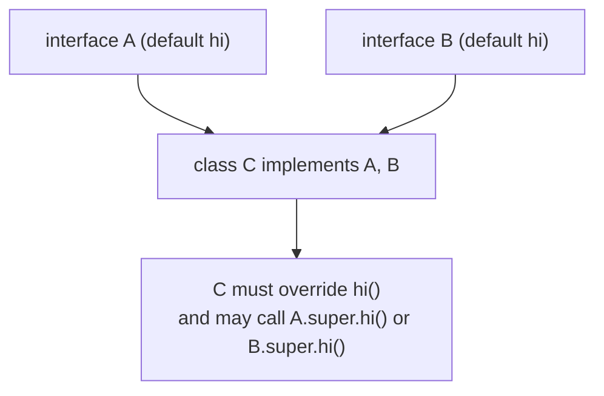
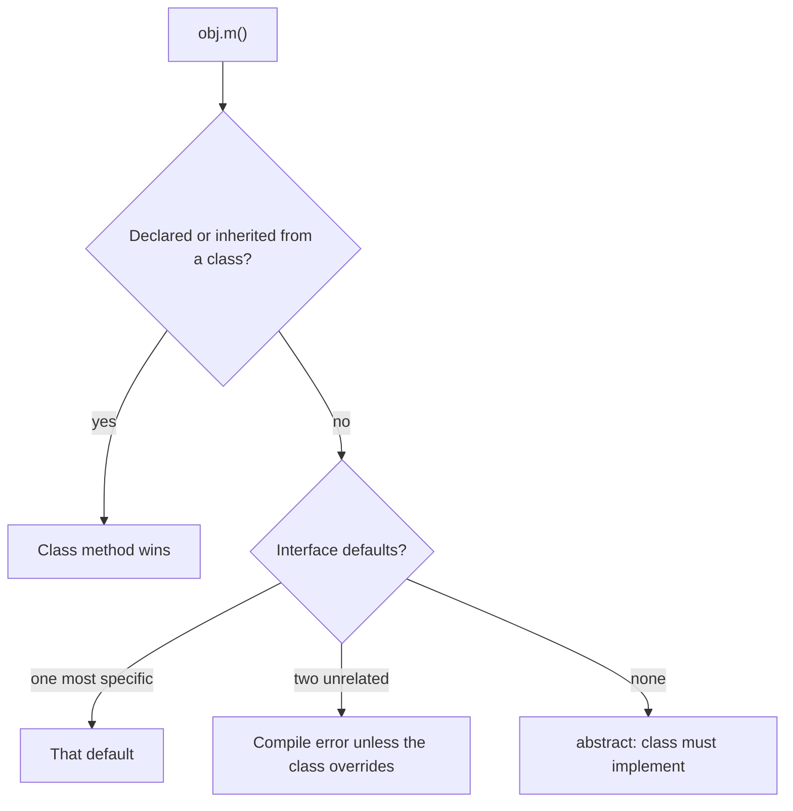
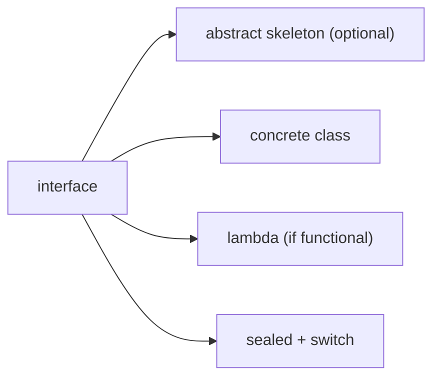

# Interfaces in Java: Multiple Interfaces and New Interface Features (Java 8 to 11)

**TL;DR:** An **interface** is a pure contract: a set of method signatures a class promises to provide. A class can `implements` **many** interfaces, which is how Java gets multiple inheritance of *type*. Since Java 8 interfaces can also carry **`default`** methods (inherited implementations) and **`static`** methods; since Java 9, **`private`** helper methods. When two interfaces supply conflicting defaults, the class must override and choose explicitly with `A.super.m()`. ⚠️ Java 11 added no new interface syntax; "Java 8 & 11" in syllabi usually means the Java 8 additions plus Java 9's private methods that Java 11 (an LTS) includes.

## Table of Contents

1. [TL;DR](#1-tldr)
2. [Why it matters](#2-why-it-matters)
3. [Prerequisites](#3-prerequisites)
4. [Mental model](#4-mental-model)
5. [Core concepts](#5-core-concepts)
6. [How it works](#6-how-it-works)
7. [Examples](#7-examples)
8. [Comparisons](#8-comparisons)
9. [Trade-offs](#9-trade-offs)
10. [Gotchas](#10-gotchas)
11. [Practical application](#11-practical-application)
12. [Interview prep](#12-interview-prep)
13. [Interview question bank](#13-interview-question-bank)
14. [Tricky code snippets](#14-tricky-code-snippets)
15. [Connections](#15-connections)
16. [Summary](#16-summary)
17. [Answers](#answers)

> **Scope note.** Functional interfaces and lambdas are in the next note. Abstract classes were covered just before this one; the comparison table is in 8.1.

---

## 1. TL;DR

- `interface Flyer { void fly(); }` — methods are implicitly `public abstract` (Snippet 8); fields are implicitly `public static final` (Snippets 5, 6, 7).
- `class Duck implements Flyer, Swimmer` — **multiple interfaces** are allowed (Snippet 1).
- `interface` **extends** interfaces (several allowed), never a class (Snippets 21, 22).
- **Java 8:** `default` methods (with a body, inherited) and `static` methods (called on the interface name) (Snippets 9, 15).
- **Java 9:** `private` and `private static` helper methods (Snippets 18, 20).
- **Diamond:** two unrelated defaults with the same signature force you to override (Snippets 11, 12).
- **Rules of precedence:** class wins over interface; the more specific interface wins (Snippets 13, 14).

**The analogy: a job description vs a person.**

| Real world | Java |
|---|---|
| A job description lists duties (no details of *how*) | Interface: method signatures |
| One person can hold several roles (driver, cook, guide) | A class implements several interfaces |
| A company gives a default procedure for a duty, which you may replace | `default` method |
| A company-wide rule book entry not tied to any one person | `static` method on the interface |
| Two departments give conflicting default procedures; you must pick | Diamond conflict; `A.super.m()` |

**Running example:** `Flyer` and `Swimmer` interfaces, a `Duck` that implements both, used through each interface (Snippet 1, 6.2).

---

## 2. Why it matters

**The problem.** Java classes can extend only one class. Yet one object often plays several roles (comparable, iterable, serialisable, runnable). Interfaces let unrelated classes share a *capability* without sharing a parent. Before Java 8, adding a method to a published interface broke every implementer; default methods solved that and made the streams API possible (`Collection.stream()`, `List.sort`, `forEach`).

**What goes wrong** (verified on Java 21):

| Code | Result | Snippet |
|---|---|---|
| `new I()` | Compile error: abstract; cannot be instantiated | 2 |
| Class forgets a method | Compile error: not abstract and does not override | 3 |
| Implementing with package-private `void m()` | Compile error: weaker access | 4 |
| `Config.MAX = 20` | Compile error: static final | 6 |
| Two interfaces with the same default | Compile error: unrelated defaults | 11 |
| `Impl.twice(4)` for an interface static | Compile error: cannot find symbol | 16, 17 |
| Two interfaces with the same method but different return types | Compile error | 25 |
| `default String toString()` | Compile error: overrides a member of `Object` | 31 |
| `final`, `protected` or a constructor in an interface | Compile error | 34, 35, 36 |

**Why interviewers ask.** "Can a class implement multiple interfaces? What about the diamond problem?", "What are default methods and why were they added?", "Interface vs abstract class", "Can interfaces have static or private methods?", "Why can't an interface have a constructor?" are standard.

---

## 3. Prerequisites

| Prerequisite | One-line refresher | Importance |
|---|---|---|
| Inheritance and overriding | `extends`, `@Override`, dynamic dispatch | Essential |
| Abstract classes | Partial implementations and abstract methods | Essential |
| Access modifiers | An overrider can't reduce visibility | Important |
| Upcasting | An object can be viewed through any interface it implements | Important |
| Static members | Belong to the type, not instances | Helpful |

---

## 4. Mental model

> **The one picture to keep in your head:** an interface is a **plug socket specification**. It says what shape of plug fits (the methods), not what the appliance is. Any class that implements it can be plugged in. A class can fit several sockets at once.

```
            «interface» Flyer           «interface» Swimmer
                fly()                        swim()
                   ▲                            ▲
                   └─────────── Duck ───────────┘
                        implements both

   Flyer f = duck;   → sees only fly()
   Swimmer s = duck; → sees only swim()
   Duck d = duck;    → sees both
```
*One object, several views; each view is an interface type.*


*Conflicting defaults are never guessed; the compiler makes you decide.*

---

## 5. Core concepts

### 5.1 Glossary

- **Interface:** a type declaring behaviour without (necessarily) implementing it.
- **Implements:** a class promises to provide the interface's methods.
- **Default method:** an interface method with a body (`default` keyword), inherited by implementers.
- **Static interface method:** a method belonging to the interface itself.
- **Private interface method:** a helper usable only inside the interface (Java 9+).
- **Marker interface:** an interface with no members (`Serializable`).
- **Diamond problem:** inheriting the same-named method from two unrelated sources.
- **Functional interface:** exactly one abstract method (next note).
- **Skeletal implementation:** an abstract class implementing most of an interface.

### 5.2 What goes inside an interface

| Member | Implicit modifiers | Since | Snippet |
|---|---|---|---|
| Constant field | `public static final` | 1.0 | 5, 6, 7 |
| Abstract method | `public abstract` | 1.0 | 8 |
| `default` method | `public` | Java 8 | 9, 10 |
| `static` method | `public` (or `private`) | Java 8 | 15 |
| `private` method | `private` | Java 9 | 18 |
| `private static` method | `private static` | Java 9 | 20 |
| Nested class/interface/enum | `public static` | 1.0 | 28 |
| Constructor, instance field, `protected`, `final` method | Not allowed | | 34, 35, 36 |

### 5.3 Implementing multiple interfaces

```java
class Duck implements Flyer, Swimmer { ... }
```
- The class must implement **every** abstract method from all of them (Snippet 3).
- Implementations must be `public` (Snippet 4).
- If two interfaces have the **same signature**, one implementation satisfies both (Snippet 24).
- If they have the same signature but **different return types**, the class can't satisfy both (Snippet 25).
- An interface can extend several interfaces (Snippet 21). A class can extend one class and implement many interfaces (Snippet 23).

### 5.4 Default methods (Java 8)

- Declared with `default` and a body; inherited by every implementer.
- Can call the interface's abstract methods (Snippet 30).
- Can be overridden by the class (Snippet 10).
- **Can't** override `Object` methods such as `toString`/`equals`/`hashCode` (Snippet 31).
- Why added: to evolve interfaces without breaking existing code (Snippet 37) and to add stream/collection methods like `forEach`, `removeIf`, `sort` (Snippet 40).

### 5.5 Conflict resolution rules

1. **Class wins:** a method inherited from a superclass (or declared in the class) beats an interface default (Snippet 13).
2. **More specific interface wins:** if `B extends A` and both define the default, `B`'s is used (Snippet 14).
3. **Otherwise, you must resolve:** override in the class; use `A.super.hi()` to pick one (Snippets 11, 12). `X.super.m()` only works for an interface that the class **directly** implements (Snippet 38).
4. An abstract class can re-declare a default as abstract (Snippet 32).

### 5.6 Static methods (Java 8)

- Called as `InterfaceName.method()` (Snippet 15).
- **Not inherited** by implementing classes or called through an instance (Snippets 16, 17).
- Good for utilities that belong with the interface (`Comparator.comparing`, `List.of`).

### 5.7 Private methods (Java 9)

- `private` and `private static` methods let default/static methods share code without exposing it (Snippets 18, 20).
- Not visible to implementing classes (Snippet 19), but visible inside the interface's own nested types (Snippet 41).

### 5.8 Java 11 and "new interface features"

⚠️ Version fact check: interface syntax changed in **Java 8** (default, static) and **Java 9** (private). **Java 11** did not change interface syntax. Java 11 is an LTS release that contains both, plus related API additions: `var` in lambda parameters and `Predicate.not` (covered in the next note), and the `List.of`/`Map.of` factories from Java 9 (Snippet 39).

### 5.9 Marker interfaces and nested types

Marker interfaces (no members) tag classes: `Serializable`, `Cloneable` (Snippet 26). Interfaces can nest classes, enums and interfaces (Snippet 28). Modern code often uses annotations instead of markers.

### 5.10 Sealed interfaces (Java 17+)

`sealed interface Shape permits Circle, Square` restricts the implementers; with `switch` the compiler checks exhaustiveness (Snippet 42).

---

## 6. How it works

### 6.1 Method resolution for a call on a class


*Superclass methods beat defaults; conflicts are compile-time errors, never run-time surprises.*

### 6.2 Worked trace: Duck

```java
interface Flyer { void fly(); }
interface Swimmer { void swim(); }
class Duck implements Flyer, Swimmer {
    public void fly() { System.out.println("duck flies"); }
    public void swim() { System.out.println("duck swims"); }
}
public class Main {
    public static void main(String[] args) {
        Duck d = new Duck();
        d.fly(); d.swim();
        Flyer f = d; Swimmer s = d;
        f.fly(); s.swim();
        System.out.println((f instanceof Swimmer) + " " + (s instanceof Flyer));
    }
}
```

Output (verified, Java 21):

```
duck flies
duck swims
duck flies
duck swims
true true
```

| Step | What happens |
|---|---|
| `implements Flyer, Swimmer` | Duck must provide `fly()` and `swim()`, both `public` |
| `Flyer f = d` | Upcast to an interface; `f` can only call `fly()` |
| `f instanceof Swimmer` | The *object* is a Swimmer, so `true` even though the variable type is `Flyer` |

### 6.3 Why the diamond problem is not fatal

Interfaces have no instance state, and conflicting defaults are rejected at compile time. The class resolves it explicitly:

```java
class C implements A, B { public void hi() { A.super.hi(); B.super.hi(); System.out.println("C"); } }
```
Output: `A`, `B`, `C` (Snippet 12). Classes still can't extend two classes, which avoids the state-diamond problem.

### 6.4 Why an interface has no constructor

Constructors initialise instance state; interfaces have none (fields are static constants). Hence no constructors and no instance initialisers (Snippet 34).

### 6.5 Why the Object methods can't be defaulted

A class always inherits `toString()` from `Object`, and *class wins*, so a default would never be used. The compiler rejects it (Snippet 31).

---

## 7. Examples

### 7.1 Toy example

```java
interface Greeter {
    String name();
    default String greet() { return "Hello " + name(); }
}
class P implements Greeter { public String name() { return "raj"; } }
// new P().greet() -> Hello raj
```
Verified (Snippet 9).

### 7.2 Real-world examples

- **JDK:** `Comparable`, `Runnable`, `Iterable`, `List`/`Map`/`Set` (with default `forEach`, `removeIf`, `sort`), `AutoCloseable`, `Serializable` (marker).
- **Strategy/plug-in:** `Payment` with `Card` and `Upi`, used through a `List<Payment>` (Snippet 29).
- **Spring/JPA style:** repositories declared as interfaces; the framework supplies the implementation ⚠️ (not run here).
- **Testing:** mock an interface easily.
- **Dependency injection:** depend on interfaces, inject implementations (see the DI note).

---

## 8. Comparisons

### 8.1 Interface vs abstract class

| Aspect | Interface | Abstract class |
|---|---|---|
| Multiple inheritance | Yes (`implements A, B`) | No |
| Instance state | No (constants only) | Yes |
| Constructors | No | Yes |
| Method access | Public (private helpers since 9) | Any |
| Concrete methods | `default`, `static`, `private` | Any |
| Purpose | Capability / contract | Shared base with partial implementation |
| Evolves by | Adding `default` methods | Adding concrete methods |
| Keyword | `implements` | `extends` |

### 8.2 Default vs static vs private interface methods

| | `default` | `static` | `private` |
|---|---|---|---|
| Since | Java 8 | Java 8 | Java 9 |
| Has body | Yes | Yes | Yes |
| Inherited by implementers | Yes | No | No |
| Overridable | Yes | No | No |
| Called via | Instance | `Interface.m()` | Inside the interface only |

### 8.3 `extends` vs `implements`

| Relation | Keyword | Multiple? |
|---|---|---|
| class → class | `extends` | No |
| class → interface | `implements` | Yes |
| interface → interface | `extends` | Yes |
| interface → class | not allowed (Snippet 22) | |

### 8.4 Interface vs marker vs annotation

| Tool | Carries | Typical use |
|---|---|---|
| Interface with methods | Behaviour contract | Polymorphism |
| Marker interface | A type tag | `instanceof` checks (`Serializable`) |
| Annotation | Metadata | Frameworks, processing |

---

## 9. Trade-offs

| Decision | Benefit | Cost | Use when |
|---|---|---|---|
| Interface | Decoupling, multiple roles, easy mocking | No state | Capabilities and boundaries |
| Abstract class | Shared state/code | Single inheritance | Related subclasses |
| `default` method | Evolve APIs without breaking code | Hidden behaviour; diamond conflicts | Adding a method to a published interface |
| `static` interface method | Utilities next to the contract | Not inherited | Factories, helpers |
| `private` interface method | Share code between defaults | Java 9+ only | Avoid duplicate default code |
| Marker interface | Type-level tag | No data; annotations are more flexible | Legacy/`instanceof` use |
| Big "fat" interface | One place | Forces implementers to provide unused methods | Avoid; split by role (ISP) |
| Interface per class "just in case" | Flexibility | Noise | Only where there is real variation |

---

## 10. Gotchas

### Myths

- ❌ **Myth:** "Java has no multiple inheritance." ✅ **Reality:** multiple inheritance of *type* via interfaces (and of behaviour via defaults); only classes are single-inherited (Snippets 1, 21).
- ❌ **Myth:** "Interface methods can't have bodies." ✅ **Reality:** since Java 8 they can (`default`, `static`) and since 9 `private` (Snippets 9, 15, 18).
- ❌ **Myth:** "The diamond problem breaks Java." ✅ **Reality:** conflicting defaults must be resolved explicitly (Snippets 11, 12).
- ❌ **Myth:** "Interface fields are instance fields." ✅ **Reality:** always `public static final` (Snippet 7).
- ❌ **Myth:** "Static interface methods are inherited." ✅ **Reality:** call them on the interface name (Snippets 16, 17).
- ❌ **Myth:** "A default in an interface beats a superclass method." ✅ **Reality:** class wins (Snippet 13).
- ❌ **Myth:** "An interface can have a constructor / be instantiated." ✅ **Reality:** neither (Snippets 2, 34); anonymous classes implement it instead (Snippet 27).
- ❌ **Myth:** "Java 11 introduced private interface methods." ✅ **Reality:** Java 9 did.
- ❌ **Myth:** "An implementing method can be package-private." ✅ **Reality:** it must be `public` (Snippet 4).
- ❌ **Myth:** "`instanceof` only sees the variable's declared type." ✅ **Reality:** it checks the object (Snippet 1).

### Common mistakes and edge cases

- **Forgetting `public`** on the implementing method (Snippet 4).
- **Assuming a default calls the right override** when two interfaces conflict (Snippet 11).
- **Using `A.super.m()` for an interface that isn't directly implemented** (Snippet 38).
- **Calling an interface static through the implementing class or instance** (Snippets 16, 17).
- **Same method name, different return types** in two interfaces (Snippet 25).
- **Trying to default `toString`/`equals`/`hashCode`** (Snippet 31).
- **Modifying a constant** (Snippet 6).
- **Fat interfaces** that force no-op implementations.

---

## 11. Practical application

### Checklist
- [ ] Program to interfaces for fields, parameters and return types.
- [ ] Keep interfaces small and role-focused.
- [ ] Use `default` for backward-compatible evolution, not for general implementation sharing.
- [ ] Resolve diamond conflicts with `X.super.m()` and a comment.
- [ ] Use `private` methods to avoid duplicating default code.
- [ ] Don't put mutable state in constants.
- [ ] Prefer an abstract skeleton for shared state.
- [ ] Use `@Override` on implementations.

### Hands-on exercise

Create `Logger` with an abstract `void log(String msg)` and a default `void warn(String msg)` that calls `log("WARN: " + msg)`. Create `ConsoleLogger` implementing it. Then add `Auditable` with a default `warn` of its own and a class `Service implements Logger, Auditable` that resolves the conflict by calling both. Print what `new Service().warn("x")` outputs.

<details><summary>Solution</summary>

```java
interface Logger {
    void log(String msg);
    default void warn(String msg) { log("WARN: " + msg); }
}
interface Auditable {
    default void warn(String msg) { System.out.println("AUDIT: " + msg); }
}
class Service implements Logger, Auditable {
    public void log(String msg) { System.out.println(msg); }
    public void warn(String msg) { Logger.super.warn(msg); Auditable.super.warn(msg); }
}
public class Main {
    public static void main(String[] args) { new Service().warn("x"); }
}
```

Output (verified on Java 21):

```
WARN: x
AUDIT: x
```
</details>

---

## 12. Interview prep

Eight model answers, as you would say them aloud.

<details><summary>1. What is an interface, and how does it differ from a class?</summary>

A type that declares a contract: method signatures, constants, and since Java 8 default/static (and since 9 private) methods. It has no constructors or instance state and can't be instantiated; classes implement it and can implement many (5.2; Snippets 1, 2).
</details>

<details><summary>2. Does Java support multiple inheritance?</summary>

Not of classes, but yes of types through interfaces: a class can implement many, and an interface can extend many. Since defaults arrived, behaviour can also be inherited from several interfaces, with conflicts resolved explicitly (Snippets 1, 21, 12).
</details>

<details><summary>3. What is the diamond problem with default methods, and how does Java resolve it?</summary>

Two unrelated interfaces provide the same default method, so the class would inherit two. The compiler rejects it unless the class overrides the method; inside it you can pick one with `A.super.m()`. Beforehand, class methods win over interface defaults, and a more specific interface wins over a less specific one (5.5; Snippets 11, 12, 13, 14).
</details>

<details><summary>4. Why were default methods added, and what are they not for?</summary>

To evolve published interfaces without breaking implementers, enabling `Collection.stream()`, `List.sort`, `forEach` and so on. They aren't a replacement for abstract classes: no state, and they can't override `Object` methods (Snippets 37, 40, 31).
</details>

<details><summary>5. What are static and private methods in interfaces?</summary>

Static methods (Java 8) belong to the interface and are called as `Iface.m()`; they aren't inherited. Private methods (Java 9) are helpers shared by default/static methods and are invisible to implementers (Snippets 15, 16, 18, 19).
</details>

<details><summary>6. Interface vs abstract class?</summary>

Interface: multiple, no state, capability contract. Abstract class: single, state and constructors, shared base. Use an interface for roles across unrelated types; an abstract class for a family; combine them with a skeletal abstract class (8.1).
</details>

<details><summary>7. Which fields and methods are implicit in an interface?</summary>

Fields: `public static final`. Abstract methods: `public abstract`. Default and static methods: `public`. So implementers must declare overriding methods `public` (Snippets 4, 7, 8).
</details>

<details><summary>8. What did Java 8, 9 and 11 change for interfaces?</summary>

Java 8 added `default` and `static` methods; Java 9 added `private` (and `private static`) methods; Java 11 added no interface syntax ⚠️. Java 11 is just an LTS that includes both (5.8).
</details>

---

## 13. Interview question bank


### 13.1 Basics (Q1–Q14)

<details><summary>Q1. How do you declare and implement an interface?</summary>

`interface I { void m(); }` and `class C implements I { public void m() { } }` (Snippet 1).
</details>

<details><summary>Q2. Can you instantiate an interface?</summary>

No; compile error (Snippet 2). You can use an anonymous class or lambda (Snippet 27).
</details>

<details><summary>Q3. Can you have a variable of an interface type?</summary>

Yes, referring to any implementing object (Snippets 1, 29).
</details>

<details><summary>Q4. What must a concrete class do with an interface's abstract methods?</summary>

Implement all of them (Snippet 3).
</details>

<details><summary>Q5. Why must the implementing method be public?</summary>

Interface methods are public; overriding can't reduce access (Snippet 4).
</details>

<details><summary>Q6. What are interface fields?</summary>

`public static final` constants (Snippets 5, 7).
</details>

<details><summary>Q7. Can interface constants be changed?</summary>

No (Snippet 6).
</details>

<details><summary>Q8. Are interface methods public by default?</summary>

Yes (Snippet 8).
</details>

<details><summary>Q9. Can interfaces have constructors?</summary>

No (Snippet 34).
</details>

<details><summary>Q10. Can interface methods be `protected` or `final`?</summary>

No (Snippets 35, 36).
</details>

<details><summary>Q11. What is a marker interface?</summary>

One with no members, used as a type tag (`Serializable`) (Snippet 26).
</details>

<details><summary>Q12. Can an interface contain a nested class or enum?</summary>

Yes (Snippet 28).
</details>

<details><summary>Q13. Can an object be an instance of an interface?</summary>

`instanceof` is true for any interface the object's class implements (Snippet 1).
</details>

<details><summary>Q14. Does a class inherit interface constants?</summary>

Yes, as members (Snippet 33).
</details>


### 13.2 Multiple interfaces and inheritance (Q15–Q26)

<details><summary>Q15. Can a class implement multiple interfaces?</summary>

Yes, comma-separated (Snippet 1).
</details>

<details><summary>Q16. Can an interface extend multiple interfaces?</summary>

Yes (Snippet 21).
</details>

<details><summary>Q17. Can an interface extend a class?</summary>

No (Snippet 22).
</details>

<details><summary>Q18. Can a class extend a class and implement interfaces?</summary>

Yes; `extends` first, then `implements` (Snippet 23).
</details>

<details><summary>Q19. Two interfaces declare the same abstract method. What happens?</summary>

One implementation satisfies both (Snippet 24).
</details>

<details><summary>Q20. And with different return types?</summary>

A class can't satisfy both; compile error (Snippet 25).
</details>

<details><summary>Q21. Can an abstract class implement an interface partially?</summary>

Yes; the concrete subclass completes it (see the Abstract Class note).
</details>

<details><summary>Q22. Is this multiple inheritance?</summary>

Of type, and behaviour via defaults, but not of state.
</details>

<details><summary>Q23. Why doesn't Java allow multiple class inheritance?</summary>

To avoid state and constructor ambiguity (the diamond with fields).
</details>

<details><summary>Q24. Does `instanceof` work across interfaces?</summary>

Yes (Snippets 1, 21).
</details>

<details><summary>Q25. Can a class implement the same interface twice?</summary>

Listing it twice is a compile error; inheriting it via two paths is fine.
</details>

<details><summary>Q26. Can an interface implement another interface?</summary>

No; it `extends` (Snippet 21).
</details>


### 13.3 Default methods (Q27–Q40)

<details><summary>Q27. What is a default method?</summary>

An interface method with a body, marked `default` (Snippet 9).
</details>

<details><summary>Q28. Can a class override a default method?</summary>

Yes (Snippet 10).
</details>

<details><summary>Q29. What if two interfaces have the same default?</summary>

Compile error until the class overrides (Snippet 11).
</details>

<details><summary>Q30. How do you call one specific interface's default?</summary>

`A.super.hi()` (Snippet 12).
</details>

<details><summary>Q31. A superclass method and an interface default conflict. Which wins?</summary>

The class method (Snippet 13).
</details>

<details><summary>Q32. `B extends A`, both define the default. Which wins?</summary>

The more specific, `B` (Snippet 14).
</details>

<details><summary>Q33. Can `A.super.m()` be used when A isn't directly implemented?</summary>

No; compile error (Snippet 38).
</details>

<details><summary>Q34. Can a default method call an abstract method?</summary>

Yes (Snippet 30).
</details>

<details><summary>Q35. Can a default method override `toString`?</summary>

No (Snippet 31).
</details>

<details><summary>Q36. Can an abstract class re-declare a default as abstract?</summary>

Yes (Snippet 32).
</details>

<details><summary>Q37. Why add defaults?</summary>

Compatible evolution (Snippet 37) and stream/collection APIs (Snippet 40).
</details>

<details><summary>Q38. Can defaults access instance fields?</summary>

No fields exist; only via the interface's methods.
</details>

<details><summary>Q39. Can a default method be `static` or `final`?</summary>

No to both; `default` and `static` are different kinds.
</details>

<details><summary>Q40. Can lambdas use default methods?</summary>

Yes, on a functional interface (Snippet 30).
</details>


### 13.4 Static and private methods, versions (Q41–Q52)

<details><summary>Q41. How do you call an interface static method?</summary>

`Iface.m()` (Snippet 15).
</details>

<details><summary>Q42. Through the implementing class?</summary>

No (Snippet 16).
</details>

<details><summary>Q43. Through an instance?</summary>

No (Snippet 17).
</details>

<details><summary>Q44. Can static interface methods be overridden?</summary>

No.
</details>

<details><summary>Q45. What are private interface methods for?</summary>

Sharing code between default/static methods (Snippets 18, 20).
</details>

<details><summary>Q46. Can implementers call them?</summary>

No (Snippet 19).
</details>

<details><summary>Q47. Can a nested class inside the interface call them?</summary>

Yes (Snippet 41).
</details>

<details><summary>Q48. In which Java version did each arrive?</summary>

Default/static: 8. Private: 9. Nothing new in 11 ⚠️.
</details>

<details><summary>Q49. Which Java 9 API adds immutable collections?</summary>

`List.of`, `Map.of`, `Set.of` (Snippet 39).
</details>

<details><summary>Q50. What is a sealed interface?</summary>

One that lists permitted implementers (Java 17) (Snippet 42).
</details>

<details><summary>Q51. What are the benefits of sealed interfaces with `switch`?</summary>

Exhaustiveness checking without `default` (Snippet 42).
</details>

<details><summary>Q52. Can interface methods be `synchronized`?</summary>

No; that's an implementation detail.
</details>


### 13.5 Design (Q53–Q62)

<details><summary>Q53. When to choose an interface?</summary>

Capability across unrelated types; decoupling; testing.
</details>

<details><summary>Q54. When an abstract class?</summary>

Shared state and constructors (8.1).
</details>

<details><summary>Q55. What is a skeletal implementation?</summary>

An abstract class implementing most of an interface (`AbstractList`).
</details>

<details><summary>Q56. What's the Interface Segregation Principle?</summary>

Prefer several small interfaces to one large one.
</details>

<details><summary>Q57. Should every class have an interface?</summary>

No; only where variation or testing needs it.
</details>

<details><summary>Q58. What is "programming to an interface"?</summary>

Declare variables, parameters and returns with the interface type (Snippet 29).
</details>

<details><summary>Q59. How do you mock an interface?</summary>

Implement it anonymously, with a lambda, or with a mocking library.
</details>

<details><summary>Q60. Are constants in interfaces good style?</summary>

Rarely; a constants interface is an anti-pattern; use a class or enum.
</details>

<details><summary>Q61. How are interfaces compiled?</summary>

To `.class` files with `ACC_INTERFACE`; default methods are real bytecode methods ⚠️.
</details>

<details><summary>Q62. What replaced marker interfaces in modern code?</summary>

Annotations, mostly.
</details>

---

## 14. Tricky code snippets

42 snippets, each compiled and run on OpenJDK 21. Predict the output (or the compile error) before opening the answer. Classes are declared without `public` so they can share one file.

### Snippet 1: Duck implements Flyer and Swimmer

```java
interface Flyer { void fly(); }
interface Swimmer { void swim(); }
class Duck implements Flyer, Swimmer {
    public void fly() { System.out.println("duck flies"); }
    public void swim() { System.out.println("duck swims"); }
}
public class Main {
    public static void main(String[] args) {
        Duck d = new Duck();
        d.fly(); d.swim();
        Flyer f = d; Swimmer s = d;
        f.fly(); s.swim();
        System.out.println((f instanceof Swimmer) + " " + (s instanceof Flyer));
    }
}
```

<details><summary>Answer</summary>

```
duck flies
duck swims
duck flies
duck swims
true true
```

Trace in 6.2: one object viewed through two interface types; `instanceof` checks the object.
</details>

### Snippet 2: `new` on an interface

```java
interface I { void m(); }
public class Main { public static void main(String[] args) { I i = new I(); } }
```

<details><summary>Answer</summary>

Compile error: *I is abstract; cannot be instantiated*.

Use an implementing class, anonymous class or lambda.
</details>

### Snippet 3: Not implementing the method

```java
interface I { void m(); }
class C implements I { }
public class Main { public static void main(String[] args) { } }
```

<details><summary>Answer</summary>

Compile error: *C is not abstract and does not override abstract method m() in I*.

Implement it or make the class abstract.
</details>

### Snippet 4: Implementing without `public`

```java
interface I { void m(); }
class C implements I { void m() { } }
public class Main { public static void main(String[] args) { } }
```

<details><summary>Answer</summary>

Compile error: *m() in C cannot implement m() in I*.

The detail line: attempting to assign weaker access privileges; was public.
</details>

### Snippet 5: Interface constants

```java
interface Config { int MAX = 10; String NAME = "cfg"; }
public class Main {
    public static void main(String[] args) {
        System.out.println(Config.MAX + " " + Config.NAME);
    }
}
```

<details><summary>Answer</summary>

```
10 cfg
```

Accessed through the interface name.
</details>

### Snippet 6: Assigning an interface field

```java
interface Config { int MAX = 10; }
public class Main { public static void main(String[] args) { Config.MAX = 20; } }
```

<details><summary>Answer</summary>

Compile error: *cannot assign a value to static final variable MAX*.

Interface fields are constants.
</details>

### Snippet 7: Reflecting an interface field's modifiers

```java
import java.lang.reflect.*;
interface Config { int MAX = 10; }
public class Main {
    public static void main(String[] args) throws Exception {
        System.out.println(Modifier.toString(Config.class.getField("MAX").getModifiers()));
    }
}
```

<details><summary>Answer</summary>

```
public static final
```

The modifiers are implicit.
</details>

### Snippet 8: Reflecting an interface method's modifiers

```java
import java.lang.reflect.*;
interface I { void m(); }
public class Main {
    public static void main(String[] args) throws Exception {
        System.out.println(Modifier.toString(I.class.getMethod("m").getModifiers()));
    }
}
```

<details><summary>Answer</summary>

```
public abstract
```

Also implicit.
</details>

### Snippet 9: A default method

```java
interface Greeter {
    String name();
    default String greet() { return "Hello " + name(); }
}
class P implements Greeter { public String name() { return "raj"; } }
public class Main { public static void main(String[] args) { System.out.println(new P().greet()); } }
```

<details><summary>Answer</summary>

```
Hello raj
```

The default calls the abstract `name()`.
</details>

### Snippet 10: Overriding a default

```java
interface Greeter { default String greet() { return "Hello"; } }
class P implements Greeter { public String greet() { return "Hi"; } }
public class Main { public static void main(String[] args) { System.out.println(new P().greet()); } }
```

<details><summary>Answer</summary>

```
Hi
```

The class's version replaces the default.
</details>

### Snippet 11: Two conflicting defaults

```java
interface A { default void hi() { System.out.println("A"); } }
interface B { default void hi() { System.out.println("B"); } }
class C implements A, B { }
public class Main { public static void main(String[] args) { } }
```

<details><summary>Answer</summary>

Compile error: *types A and B are incompatible;*.

The detail: class C inherits unrelated defaults for hi() from types A and B.
</details>

### Snippet 12: Resolving with `X.super.m()`

```java
interface A { default void hi() { System.out.println("A"); } }
interface B { default void hi() { System.out.println("B"); } }
class C implements A, B {
    public void hi() { A.super.hi(); B.super.hi(); System.out.println("C"); }
}
public class Main { public static void main(String[] args) { new C().hi(); } }
```

<details><summary>Answer</summary>

```
A
B
C
```

The class overrides and picks both explicitly.
</details>

### Snippet 13: Class beats interface default

```java
interface I { default String who() { return "interface"; } }
class Base { public String who() { return "class"; } }
class C extends Base implements I { }
public class Main { public static void main(String[] args) { System.out.println(new C().who()); } }
```

<details><summary>Answer</summary>

```
class
```

The inherited class method takes precedence.
</details>

### Snippet 14: More specific interface wins

```java
interface A { default String who() { return "A"; } }
interface B extends A { default String who() { return "B"; } }
class C implements A, B { }
public class Main { public static void main(String[] args) { System.out.println(new C().who()); } }
```

<details><summary>Answer</summary>

```
B
```

`B extends A`, so B's default overrides A's.
</details>

### Snippet 15: Interface static method

```java
interface Util { static int twice(int x) { return x * 2; } }
public class Main { public static void main(String[] args) { System.out.println(Util.twice(4)); } }
```

<details><summary>Answer</summary>

```
8
```

Called on the interface name.
</details>

### Snippet 16: Static method via the implementing class

```java
interface Util { static int twice(int x) { return x * 2; } }
class Impl implements Util { }
public class Main { public static void main(String[] args) { System.out.println(Impl.twice(4)); } }
```

<details><summary>Answer</summary>

Compile error: *cannot find symbol*.

Interface statics aren't inherited.
</details>

### Snippet 17: Static method via an instance

```java
interface Util { static int twice(int x) { return x * 2; } }
class Impl implements Util { }
public class Main { public static void main(String[] args) { Impl i = new Impl(); System.out.println(i.twice(4)); } }
```

<details><summary>Answer</summary>

Compile error: *cannot find symbol*.

Same rule.
</details>

### Snippet 18: Private helper (Java 9)

```java
interface Calc {
    default int sumSq(int a, int b) { return sq(a) + sq(b); }
    private int sq(int x) { return x * x; }
}
class C implements Calc { }
public class Main { public static void main(String[] args) { System.out.println(new C().sumSq(3, 4)); } }
```

<details><summary>Answer</summary>

```
25
```

`sumSq` shares `sq` privately: 9 + 16.
</details>

### Snippet 19: Private method from an implementer

```java
interface Calc { private int sq(int x) { return x * x; } }
class C implements Calc { int t() { return sq(2); } }
public class Main { public static void main(String[] args) { } }
```

<details><summary>Answer</summary>

Compile error: *cannot find symbol*.

Not inherited, not visible.
</details>

### Snippet 20: Private static helper

```java
interface Calc {
    static int run(int x) { return helper(x); }
    private static int helper(int x) { return x + 1; }
}
public class Main { public static void main(String[] args) { System.out.println(Calc.run(1)); } }
```

<details><summary>Answer</summary>

```
2
```

A static method can call a private static helper.
</details>

### Snippet 21: Interface extending two interfaces

```java
interface A { void a(); }
interface B { void b(); }
interface C extends A, B { void c(); }
class Impl implements C {
    public void a() { System.out.println("a"); }
    public void b() { System.out.println("b"); }
    public void c() { System.out.println("c"); }
}
public class Main { public static void main(String[] args) { Impl i = new Impl(); i.a(); i.b(); i.c(); A x = i; System.out.println(x instanceof B); } }
```

<details><summary>Answer</summary>

```
a
b
c
true
```

An `A`-typed view of the object is still a `B` at run time.
</details>

### Snippet 22: Interface extending a class

```java
class A { }
interface I extends A { }
public class Main { public static void main(String[] args) { } }
```

<details><summary>Answer</summary>

Compile error: *interface expected here*.

Interfaces extend only interfaces.
</details>

### Snippet 23: `extends` plus `implements`

```java
class Base { void b() { System.out.println("base"); } }
interface I { void i(); }
class D extends Base implements I { public void i() { System.out.println("i"); } }
public class Main { public static void main(String[] args) { D d = new D(); d.b(); d.i(); } }
```

<details><summary>Answer</summary>

```
base
i
```

A class can do both.
</details>

### Snippet 24: Same method in two interfaces

```java
interface A { void m(); }
interface B { void m(); }
class C implements A, B { public void m() { System.out.println("one impl for both"); } }
public class Main { public static void main(String[] args) { C c = new C(); c.m(); ((A) c).m(); ((B) c).m(); } }
```

<details><summary>Answer</summary>

```
one impl for both
one impl for both
one impl for both
```

One public method satisfies both contracts.
</details>

### Snippet 25: Different return types

```java
interface A { int m(); }
interface B { String m(); }
class C implements A, B { public int m() { return 1; } }
public class Main { public static void main(String[] args) { } }
```

<details><summary>Answer</summary>

Compile error: *C is not abstract and does not override abstract method m() in B*.

There is also a second error: m() in C cannot implement m() in B. No single method satisfies both.
</details>

### Snippet 26: Marker interface

```java
interface Marker { }
class Tagged implements Marker { }
public class Main { public static void main(String[] args) { Object o = new Tagged(); System.out.println(o instanceof Marker); } }
```

<details><summary>Answer</summary>

```
true
```

`instanceof` can test the tag.
</details>

### Snippet 27: Anonymous implementation

```java
interface Greeter { String greet(String n); }
public class Main {
    public static void main(String[] args) {
        Greeter g = new Greeter() { public String greet(String n) { return "hi " + n; } };
        System.out.println(g.greet("raj"));
    }
}
```

<details><summary>Answer</summary>

```
hi raj
```

An anonymous class implements the interface inline.
</details>

### Snippet 28: Nested types in an interface

```java
interface Shape {
    double area();
    class Unit implements Shape { public double area() { return 1; } }
    enum Kind { ROUND, FLAT }
}
public class Main { public static void main(String[] args) { System.out.println(new Shape.Unit().area() + " " + Shape.Kind.ROUND); } }
```

<details><summary>Answer</summary>

```
1.0 ROUND
```

They are implicitly `public static`.
</details>

### Snippet 29: Polymorphism over an interface

```java
import java.util.*;
interface Payment { String pay(); }
class Card implements Payment { public String pay() { return "card"; } }
class Upi implements Payment { public String pay() { return "upi"; } }
public class Main {
    public static void main(String[] args) {
        List<Payment> ps = List.of(new Card(), new Upi());
        for (Payment p : ps) System.out.println(p.pay());
    }
}
```

<details><summary>Answer</summary>

```
card
upi
```

Each element dispatches to its own `pay()`.
</details>

### Snippet 30: Default using the abstract method

```java
interface Shape {
    double area();
    default String info() { return "area=" + area(); }
}
public class Main {
    public static void main(String[] args) {
        Shape s = () -> 2.5;
        System.out.println(s.info());
    }
}
```

<details><summary>Answer</summary>

```
area=2.5
```

A lambda implements the single abstract method; the default still works.
</details>

### Snippet 31: Default `toString`

```java
interface I { default String toString() { return "x"; } }
public class Main { public static void main(String[] args) { } }
```

<details><summary>Answer</summary>

Compile error: *default method toString in interface I overrides a member of java.lang.Object*.

Not allowed.
</details>

### Snippet 32: Re-abstracting a default

```java
interface I { default String hi() { return "I"; } }
abstract class A implements I { public abstract String hi(); }
class B extends A { public String hi() { return "B"; } }
public class Main { public static void main(String[] args) { System.out.println(new B().hi()); } }
```

<details><summary>Answer</summary>

```
B
```

`A` redeclares it abstract; `B` implements it.
</details>

### Snippet 33: Constants through the class

```java
interface I { int X = 5; }
class C implements I { int get() { return X; } }
public class Main { public static void main(String[] args) { System.out.println(new C().get() + " " + C.X); } }
```

<details><summary>Answer</summary>

```
5 5
```

Implementers inherit the constant.
</details>

### Snippet 34: Interface constructor

```java
interface I { I() { } }
public class Main { public static void main(String[] args) { } }
```

<details><summary>Answer</summary>

Compile error: *<identifier> expected*.

Interfaces can't have constructors.
</details>

### Snippet 35: Final interface method

```java
interface I { final void m(); }
public class Main { public static void main(String[] args) { } }
```

<details><summary>Answer</summary>

Compile error: *modifier final not allowed here*.

Not allowed.
</details>

### Snippet 36: Protected interface method

```java
interface I { protected void m(); }
public class Main { public static void main(String[] args) { } }
```

<details><summary>Answer</summary>

Compile error: *modifier protected not allowed here*.

Members are public (or private).
</details>

### Snippet 37: Old implementer still works

```java
interface Old { void a(); }
class Impl implements Old { public void a() { System.out.println("a"); } }
public class Main { public static void main(String[] args) { new Impl().a(); } }
```

<details><summary>Answer</summary>

```
a
```

Adding a default to `Old` wouldn't break `Impl`; this shows the baseline.
</details>

### Snippet 38: `A.super` without implementing A

```java
interface A { default void hi() { System.out.println("A"); } }
class C { }
class D extends C { public void x() { A.super.hi(); } }
public class Main { public static void main(String[] args) { } }
```

<details><summary>Answer</summary>

Compile error: *not an enclosing class: A*.

`D` doesn't implement `A` directly.
</details>

### Snippet 39: `List.of` and `Map.of`

```java
import java.util.*;
public class Main {
    public static void main(String[] args) {
        List<Integer> l = List.of(1, 2);
        try { l.add(3); } catch (UnsupportedOperationException e) { System.out.println("UOE"); }
        Map<String,Integer> m = Map.of("a", 1);
        System.out.println(m.getOrDefault("b", 0));
    }
}
```

<details><summary>Answer</summary>

```
UOE
0
```

Immutable collections; adding throws.
</details>

### Snippet 40: JDK default methods

```java
import java.util.*;
public class Main {
    public static void main(String[] args) {
        List<Integer> l = new ArrayList<>(List.of(3, 1, 2));
        l.sort(null);
        l.forEach(x -> System.out.print(x + " "));
        System.out.println();
        l.removeIf(x -> x == 2);
        System.out.println(l);
    }
}
```

<details><summary>Answer</summary>

```
1 2 3
[1, 3]
```

`List.sort(null)`, `forEach` and `removeIf` are defaults on `List`/`Iterable`/`Collection`.
</details>

### Snippet 41: Nested class using a private interface method

```java
interface I {
    private static String secret() { return "s"; }
    class N { String get() { return secret(); } }
}
public class Main { public static void main(String[] args) { System.out.println(new I.N().get()); } }
```

<details><summary>Answer</summary>

```
s
```

Code inside the interface body, including nested types, can use it.
</details>

### Snippet 42: Sealed interface and `switch`

```java
sealed interface Shape permits Circle, Square { }
record Circle(double r) implements Shape { }
record Square(double s) implements Shape { }
public class Main {
    static double area(Shape s) {
        return switch (s) {
            case Circle c -> Math.PI * c.r() * c.r();
            case Square q -> q.s() * q.s();
        };
    }
    public static void main(String[] args) { System.out.println(area(new Square(3))); }
}
```

<details><summary>Answer</summary>

```
9.0
```

No `default` needed because the cases are exhaustive.
</details>

---

## 15. Connections

| Related topic | How it connects |
|---|---|
| Abstract classes | The other contract mechanism; skeletal implementations combine both |
| Inheritance and polymorphism | Interface references dispatch dynamically |
| Upcasting and downcasting | Objects are upcast to interfaces and downcast with `instanceof` |
| Functional interfaces and lambdas | An interface with one abstract method is a lambda target |
| Static members | Interface statics aren't inherited |
| Dependency Injection | Depend on interfaces, inject implementations |
| Enums and records | Both can implement interfaces |
| Design patterns | Strategy, Adapter, Observer all rely on interfaces |


*Ways to supply an implementation of a contract.*

---

## 16. Summary

### 60-second card

- Interface = contract; fields are `public static final`; methods `public abstract` by default.
- A class `implements` many interfaces; an interface `extends` many.
- Java 8: `default` and `static`. Java 9: `private`. Java 11: no new syntax ⚠️.
- Class wins; more specific interface wins; otherwise override and use `X.super.m()`.
- Interface statics aren't inherited. No constructors, no instance state.
- Implementations must be `public`.

### Cheat sheet

```java
interface Shape {
    double PI2 = 6.28;                          // constant
    double area();                              // abstract
    default String info() { return "area=" + area(); }
    static Shape unit() { return () -> 1; }     // static (lambda target)
    private void helper() { }                   // Java 9
}
class C implements A, B {
    public void hi() { A.super.hi(); }          // resolve a default conflict
}
```

| Want | Write |
|---|---|
| Several roles | `implements A, B` |
| Backward-compatible method | `default` |
| Utility on the interface | `static` |
| Shared helper | `private` |
| Pick one default | `A.super.m()` |

### Self-test

1. Can a class implement multiple interfaces? Can it extend multiple classes?
2. What are the implicit modifiers of interface fields and methods?
3. What does the compiler do when two interfaces provide the same default?
4. Class method vs interface default: which wins?
5. Are interface static methods inherited?
6. Which Java version added private interface methods?
7. Why can't an interface have a constructor?
8. Why can't a default method be `toString()`?

### Anki flashcards

```
Interface fields :: public static final
Interface methods :: public abstract (default/static/private are the exceptions)
Default method :: Java 8; body; inherited; overridable
Static interface method :: Java 8; call via Iface.m(); not inherited
Private interface method :: Java 9; helper for default/static methods
Diamond conflict :: Override and call A.super.m()
Conflict rules :: Class wins; more specific interface wins
Java 11 interface features :: None new ⚠️
Marker interface :: No members; a type tag
```

### Resources

- *The Java Language Specification*, chapter 9 (Interfaces): docs.oracle.com/javase/specs
- The Java Tutorials, "Interfaces and Inheritance" and "Default Methods": docs.oracle.com/javase/tutorial
- JEP 213, Milling Project Coin (private interface methods): openjdk.org/jeps/213
- *Effective Java*, Joshua Bloch: items on interfaces and default methods

---

## Answers

1. Many interfaces yes; many classes no.
2. Fields `public static final`; methods `public abstract` (default and static are `public`).
3. It reports an error unless the class overrides the method.
4. The class method.
5. No.
6. Java 9.
7. There is no instance state to initialise.
8. A class always inherits `Object`'s version, and class wins, so it would never apply.
