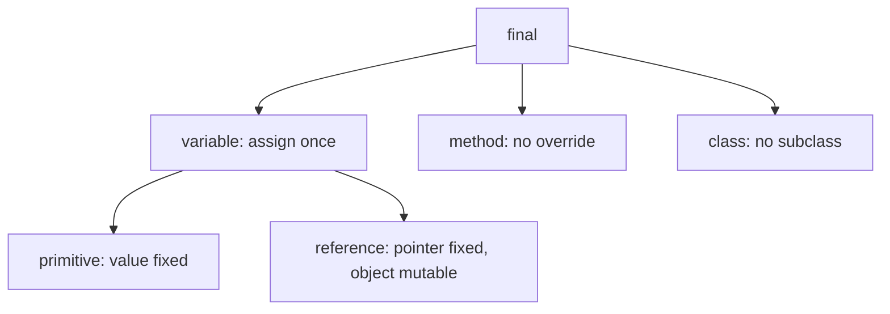
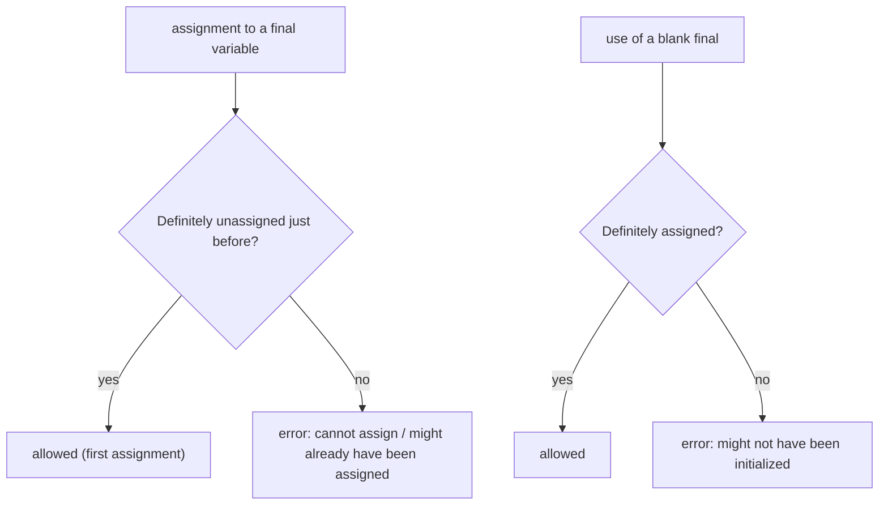
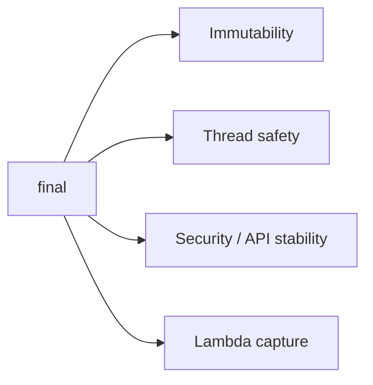

# `final` Variables, `final` Methods and `final` Classes in Java

**TL;DR:** `final` means "can't be changed after it is set", and what that means depends on where it sits. A **final variable** can be assigned exactly once (the *reference* is locked, not the object's contents). A **final method** can't be overridden. A **final class** can't be extended. Constants are `static final`. Immutable classes combine a final class with private final fields. `final` is a compile-time guarantee, so it prevents bugs and enables safe sharing across threads.

## Table of Contents

1. [TL;DR](#1-tldr)
2. [Why it matters](#2-why-it-matters)
3. [Prerequisites](#3-prerequisites)
4. [Mental model](#4-mental-model)
5. [Core concepts](#5-core-concepts)
6. [How it works](#6-how-it-works)
7. [Examples](#7-examples)
8. [Comparisons](#8-comparisons)
9. [Trade-offs](#9-trade-offs)
10. [Gotchas](#10-gotchas)
11. [Practical application](#11-practical-application)
12. [Interview prep](#12-interview-prep)
13. [Interview question bank](#13-interview-question-bank)
14. [Tricky code snippets](#14-tricky-code-snippets)
15. [Connections](#15-connections)
16. [Summary](#16-summary)
17. [Answers](#answers)

> **Scope note.** Earlier notes touch on `final` (static constants, overriding rules). This is the complete treatment, including definite assignment, constant expressions and effectively final.

---

## 1. TL;DR

- `final int x = 1; x = 2;` is a compile error (Snippet 2). A *blank* final may be assigned once later (Snippet 3), but not twice (Snippet 4).
- `final` fields must be assigned by the end of every constructor, an initialiser block, or the declaration (Snippets 7, 8, 9).
- `final` on a **reference** locks the reference, not the object: `final List` can still `add` (Snippets 12, 13, 14).
- `final` **method**: can't be overridden (Snippet 15), but is inherited and callable (Snippet 16).
- `final` **class**: can't be extended (Snippet 18); `String`, `Integer` and records are final (Snippets 29, 38).
- `static final` + constant expression = compile-time constant (Snippets 22, 24).
- Lambdas and anonymous classes capture locals that are final or **effectively final** (Snippets 26-28).

**The analogy: a sealed envelope, a locked recipe and a closed family tree.**

| Real world | Java |
|---|---|
| A name written in permanent marker on a box label | `final` variable: label can't change |
| The box's *contents* can still be rearranged | The object a final reference points to can be mutated |
| A recipe card marked "do not alter" | `final` method |
| A family line that ends: no children allowed | `final` class |

**Running example:** a `Config` class with a `final int max` set by the constructor and a `static final String NAME`; we try to reassign, mutate and extend (Snippet 1).

---

## 2. Why it matters

**The problem.** Mutable state and open extension are the main sources of bugs: someone changes a value you assumed fixed, or a subclass breaks the contract of a method you relied on. `final` makes those intentions enforceable by the compiler.

**What goes wrong** (verified on Java 21):

| Code | Result | Snippet |
|---|---|---|
| Reassigning a final local | Compile error: cannot assign a value to final variable | 2 |
| Assigning a blank final twice | Compile error: might already have been assigned | 4 |
| Final field never assigned | Compile error: might not have been initialized | 8, 31 |
| Overriding a final method | Compile error: overridden method is final | 15 |
| Extending a final class | Compile error: cannot inherit from final | 18 |
| Non-constant `case` label | Compile error: constant expression required | 25 |
| Lambda capturing a modified local | Compile error: must be final or effectively final | 28 |
| `final List` thinking it's immutable | The list still changes | 12 |
| Leaking `this` in a constructor | Another object reads the final field as `0` | 30 |

**Why interviewers ask.** "Final vs finally vs finalize", "is a final reference immutable?", "can you override a final method?", "why is `String` final?", "what is effectively final?" are classic. They test whether you distinguish the reference from the object.

---

## 3. Prerequisites

| Prerequisite | One-line refresher | Importance |
|---|---|---|
| Variables and scope | Local, instance, static | Essential |
| Inheritance and overriding | `extends`, `@Override` | Essential |
| Constructors | Where final fields are usually set | Essential |
| Reference vs object | A variable holds a reference | Essential |
| Static members | `static final` constants | Important |

---

## 4. Mental model

> **The one picture to keep in your head:** `final` locks the **label**, not the **box**. For a primitive, the label *is* the value, so it can't change. For a reference, the label points at an object; you can't repoint it, but you can still open the box and change what's inside.

```
 final int x = 5          x ─▶ [5]             x can't change

 final List<Integer> l    l ─▶ [ 1, 2 ]        l can't point elsewhere
                                │
                                └ l.add(3) → [ 1, 2, 3 ]   (object still mutable)

 final method m()         subclass can inherit m, not replace it
 final class C            no subclass at all
```
*Final protects the variable, the method or the class — never the data inside an object automatically.*


*Three targets, one idea: no further change.*

---

## 5. Core concepts

### 5.1 Glossary

- **Final variable:** assignable once.
- **Blank final:** declared without an initialiser and assigned later, exactly once.
- **Constant variable:** a `final` primitive or `String` initialised with a constant expression.
- **Compile-time constant:** a constant whose value the compiler can inline.
- **Effectively final:** a local variable never reassigned after initialisation, so it behaves as final even without the keyword.
- **Definite assignment:** compiler analysis proving a variable is assigned before use.
- **Immutable class:** an object whose state can't change after construction.
- **`final` vs `finally` vs `finalize`:** a keyword, a try-block clause, and a deprecated `Object` method.

### 5.2 Final variables

| Kind | When it must be assigned | Snippets |
|---|---|---|
| Final local | Once, before use; a blank final may be assigned later | 2, 3, 4, 5 |
| Final parameter | Never inside the method | 6 |
| Final instance field | Declaration, instance initialiser block, or *every* constructor path | 7, 8, 9, 31, 32, 33 |
| Final static field | Declaration or a `static { }` block | 11 |
| Loop variable | `for (final int x : arr)` allowed | 37 |
| With `var` | `final var x = 3;` | 39 |

Reassigning outside those places is an error (Snippets 2, 10).

### 5.3 Final references vs immutable objects

- `final List<Integer> l` can't be reassigned (Snippet 13) but `l.add(...)` works (Snippet 12).
- `final int[] a`: elements change freely (Snippet 14).
- A `final` parameter can still have its object modified (Snippet 35).
- For true immutability: final class, private final fields, no setters, defensive copies (Snippet 40).

### 5.4 Final methods

- Can't be overridden (Snippet 15), but they **are inherited** (Snippet 16).
- Overloads are unaffected (Snippet 17).
- A `private` method is never overridden, so `final` on it is redundant and a same-named method in the subclass is unrelated (Snippet 20).
- A `static final` method can't be hidden either (Snippet 21).
- Uses: protect a template method, protect security-critical logic, call from constructors safely.

### 5.5 Final classes

- Can't be extended (Snippet 18); methods are effectively final (Snippet 19).
- Can't be `abstract` too (Snippet 36).
- JDK examples: `String`, `Integer` (all wrappers), `Math`, `System`.
- Records are implicitly final, and their fields are final (Snippet 38).
- Alternatives to `final` for controlled extension: `sealed` classes (Java 17).

### 5.6 Constants and compile-time constants

```java
static final int X = 10;           // constant variable
final int a = 10; byte b = a;      // allowed: constant expression fits in byte
```
- A final variable with a constant initialiser can be narrowed implicitly if the value fits (Snippet 22); without `final` it's a compile error (Snippet 23).
- It can be used as a `case` label (Snippet 24); a non-final variable can't (Snippet 25).
- Compile-time constants are inlined into other classes: changing the constant requires recompiling the users ⚠️ (not reproduced here).
- A `static final` that is **not** a constant expression (calls a method) is initialised at class initialisation, not inlined (Snippet 41).

### 5.7 Effectively final

A local variable that is never reassigned is *effectively final* and may be captured by lambdas and inner classes (Snippets 26, 27). Reassign it once and it's an error (Snippet 28). Java 8 introduced this so you don't have to write `final` everywhere.

### 5.8 `final` and the Java memory model

Final fields get special thread-safety: once the constructor finishes normally, other threads see the final fields' assigned values without extra synchronisation ⚠️ (JLS 17.5; not demonstrable in a short snippet). This is why immutable objects are naturally thread-safe. Leaking `this` before the constructor ends breaks the guarantee (Snippet 30).

### 5.9 Immutable class recipe

1. `final` class (or private constructors plus factories).
2. `private final` fields.
3. No setters; methods return new objects (Snippet 40).
4. Defensive copies for mutable fields in and out.

---

## 6. How it works

### 6.1 What the compiler checks


*"Definite assignment" is flow analysis: every path counts (Snippets 31, 32).*

### 6.2 Worked trace: Config

```java
final class Config {
    final int max;
    static final String NAME = "cfg";
    Config(int max) { this.max = max; }
}
public class Main {
    public static void main(String[] args) {
        Config c = new Config(5);
        System.out.println(c.max + " " + Config.NAME);
        final int local = 3;
        System.out.println(local);
    }
}
```

Output (verified, Java 21):

```
5 cfg
3
```

| Step | What happens |
|---|---|
| `final int max;` | A blank final; the compiler requires assignment in the constructor |
| `this.max = max` | The single allowed assignment |
| `static final String NAME` | A constant, assigned at declaration |
| `final int local = 3` | A final local; any later assignment is an error |

### 6.3 `this` escape and final fields

If the constructor passes `this` out before assigning a final field, the receiver sees the default value:

```
seen v=0
```
Verified in Snippet 30. Assign final fields first, publish `this` last.

### 6.4 Why `final` helps design

- **Intent:** readers know it won't change.
- **Safety:** the compiler enforces it.
- **Concurrency:** final fields are safely published.
- **Security:** a final class or method can't be subverted by a subclass.
- **Performance:** only marginal; the JIT already optimises effectively final code, so don't use `final` for speed.

---

## 7. Examples

### 7.1 Toy example

```java
final int[] a = {1, 2};
a[0] = 9;                    // fine
// a = new int[3];           // error: cannot assign a value to final variable a
```
Verified (Snippets 14 and 2).

### 7.2 Real-world examples

- **Constants:** `Integer.MAX_VALUE`, `Math.PI` are `public static final`.
- **Immutable value types:** `String`, wrappers, `LocalDate` (final classes).
- **Dependency injection:** `private final Service service;` set via the constructor.
- **Template methods:** `final` methods that call overridable hooks.
- **Lambdas:** captured variables are effectively final (Snippet 27).
- **Security:** `String` is final so that no subclass can alter its behaviour (used for class names, file paths).

---

## 8. Comparisons

### 8.1 `final` on a variable, method, class

| Target | Effect | Typical use |
|---|---|---|
| Variable | Assign once | Constants, immutability, captured locals |
| Method | No override | Protecting an algorithm |
| Class | No subclass | Immutable and security-sensitive types |
| Parameter | Can't reassign inside | Style, clarity |

### 8.2 `final` vs `finally` vs `finalize`

| | `final` | `finally` | `finalize()` |
|---|---|---|---|
| What | Modifier | `try` block clause | `Object` method |
| Purpose | Prevent change | Run cleanup code | Pre-GC hook |
| Status | Current | Current | Deprecated for removal (Java 18+) ⚠️ |

### 8.3 `final` vs immutable

| | `final` | Immutable |
|---|---|---|
| Applies to | A variable, method or class | A whole object's state |
| Guarantee | The reference/override/extension | No state change after construction |
| Example | `final List<T> l` (mutable contents) | `List.of(...)`, `String` |

### 8.4 `static final` vs `final`

| | `final` | `static final` |
|---|---|---|
| One per | Object | Class |
| Assigned | Each constructor | Declaration or static block |
| Constant (inlined) | Only if constant expression | Typically |

### 8.5 `final` vs `sealed` vs `private` constructor

| Tool | Restricts |
|---|---|
| `final class` | No subclasses |
| `sealed ... permits` | Only listed subclasses |
| `private` constructor | Only nested/same-file subclasses; no outside instantiation |

---

## 9. Trade-offs

| Decision | Benefit | Cost | Use when |
|---|---|---|---|
| `final` fields | Immutability, thread safety | No later changes; more constructor params | Value objects, DI fields |
| `final` locals/params everywhere | Explicit intent | Noise | Team style requires it |
| `final` method | Protects the algorithm | Blocks legitimate customisation, mocking | Template methods, security |
| `final` class | Safe, simple, immutable | Hard to extend or mock | Value types, utilities |
| Leave non-final | Extensible | Subclass can break invariants | Designed for inheritance (and documented) |
| `sealed` | Controlled hierarchy | Java 17+ | Closed families |
| `static final` constants | Clear, inlined | Recompile dependents when changed | True constants only |
| Defensive copies | Real immutability | Allocation | Mutable inputs |

---

## 10. Gotchas

### Myths

- ❌ **Myth:** "A `final` object can't change." ✅ **Reality:** only the reference is locked (Snippets 12, 14, 35).
- ❌ **Myth:** "`final` methods can't be inherited." ✅ **Reality:** inherited, just not overridable (Snippet 16).
- ❌ **Myth:** "A final variable must be initialised at declaration." ✅ **Reality:** blank finals can be assigned once later (Snippets 3, 7, 9, 11).
- ❌ **Myth:** "Final fields can be set in any method." ✅ **Reality:** only in constructors/initialisers (Snippet 10).
- ❌ **Myth:** "Lambdas need the `final` keyword on captured locals." ✅ **Reality:** effectively final is enough (Snippet 27).
- ❌ **Myth:** "`private final` method can be overridden." ✅ **Reality:** a subclass method of the same name is a separate method (Snippet 20).
- ❌ **Myth:** "`final` makes code faster." ✅ **Reality:** negligible.
- ❌ **Myth:** "`final` = `finally` = `finalize`." ✅ **Reality:** unrelated (8.2).
- ❌ **Myth:** "A final class's methods can be overridden somewhere." ✅ **Reality:** there are no subclasses (Snippet 19).
- ❌ **Myth:** "A final `static` method can be hidden." ✅ **Reality:** compile error (Snippet 21).

### Common mistakes and edge cases

- **Missing assignment on one constructor path** (Snippet 31) vs both branches (Snippet 32).
- **Assigning a final field twice** or in a method (Snippets 4, 10).
- **Reassigning a captured local** (Snippet 28).
- **Using a non-final variable as a `case` label** (Snippet 25).
- **Leaking `this`** before final fields are set (Snippet 30).
- **Assuming `final List` is read-only** (Snippet 12).
- **`abstract final`** (Snippet 36).
- **Static constant initialisation order** (Snippet 41).

---

## 11. Practical application

### Checklist
- [ ] Make fields `private final` unless they truly need to change.
- [ ] Use `static final` for constants, in UPPER_SNAKE_CASE.
- [ ] Make value classes `final` (or records).
- [ ] Take defensive copies of mutable constructor arguments.
- [ ] Mark template methods `final`.
- [ ] Don't leak `this` from constructors.
- [ ] Prefer `List.of`/`Collections.unmodifiableList` for read-only collections, not just `final`.
- [ ] Use `sealed` when you want a closed, extensible-by-you hierarchy.

### Hands-on exercise

Which of these lines compile? Fix the ones that don't (keep the intent).

```java
final int[] a = {1, 2};
a[0] = 5;                  // (1)
a = new int[]{3};          // (2)
final StringBuilder sb = new StringBuilder("x");
sb.append("y");            // (3)
sb = new StringBuilder();  // (4)
final int n;
n = 1;                     // (5)
n = 2;                     // (6)
```

<details><summary>Solution</summary>

- (1) compiles: element assignment.
- (2) error: cannot assign a value to final variable `a`.
- (3) compiles: mutates the object.
- (4) error: reassigning the final reference.
- (5) compiles: first assignment of a blank final.
- (6) error: variable `n` might already have been assigned.

Fix: remove (2), (4), (6), or drop `final` from the variables you need to reassign. Verified on Java 21: `javac` reports (2) and (4) first; the (6) error appears once those are removed (Snippet 4 shows it on its own).
</details>

---

## 12. Interview prep

Eight model answers, as you would say them aloud.

<details><summary>1. What does `final` mean for a variable, a method and a class?</summary>

Variable: it can be assigned only once. Method: it can't be overridden. Class: it can't be extended. In every case the compiler enforces "no further change" at that level (1, 5.2, 5.4, 5.5; Snippets 2, 15, 18).
</details>

<details><summary>2. Does `final` make an object immutable?</summary>

No. A final reference can't be re-pointed, but the object it refers to may still be mutated (`final List` can `add`). Immutability needs a final class, private final fields, no setters and defensive copies (5.3, 5.9; Snippets 12, 14, 40).
</details>

<details><summary>3. Where can a final field be initialised?</summary>

At its declaration, in an instance initialiser block, or in every constructor path (static finals: declaration or static block). Missing a path is a compile error (Snippets 7, 8, 9, 11, 31, 32).
</details>

<details><summary>4. Can you override a final method? Is it inherited?</summary>

You can't override it (compile error), but it's inherited and callable. A private method is never overridden, so `final` on it is redundant (Snippets 15, 16, 20).
</details>

<details><summary>5. Why is `String` final?</summary>

Security, caching and thread safety: strings are used as keys, class names and file paths, and the pool and hash caching assume immutability, which a subclass could break (Snippet 29).
</details>

<details><summary>6. What is "effectively final"?</summary>

A local variable that is never reassigned after initialisation. Lambdas and inner classes may capture such variables; reassigning one makes the capture a compile error (Snippets 26, 27, 28).
</details>

<details><summary>7. What is a compile-time constant, and why does it matter?</summary>

A `final` primitive or `String` with a constant-expression initialiser. It can be inlined, used as a `case` label, and implicitly narrowed if it fits (`final int a = 10; byte b = a;`) (Snippets 22, 23, 24, 25).
</details>

<details><summary>8. Difference between `final`, `finally` and `finalize`?</summary>

`final` is a modifier; `finally` is a try-block clause that runs cleanup; `finalize()` is an old `Object` pre-GC hook, deprecated for removal ⚠️ (8.2).
</details>

---

## 13. Interview question bank


### 13.1 Final variables (Q1–Q18)

<details><summary>Q1. What does `final int x = 1; x = 2;` do?</summary>

Compile error: cannot assign a value to final variable x (Snippet 2).
</details>

<details><summary>Q2. What is a blank final?</summary>

A final variable declared without an initialiser, assigned exactly once later (Snippet 3).
</details>

<details><summary>Q3. Can it be assigned twice?</summary>

No: "might already have been assigned" (Snippet 4).
</details>

<details><summary>Q4. Can it be read before assignment?</summary>

No: "might not have been initialized" (Snippet 5).
</details>

<details><summary>Q5. Can a method parameter be final?</summary>

Yes; assigning to it is an error (Snippet 6).
</details>

<details><summary>Q6. Where can a final instance field be set?</summary>

Declaration, initialiser block, or constructor (Snippets 7, 9).
</details>

<details><summary>Q7. What if a constructor doesn't set it?</summary>

Compile error (Snippet 8).
</details>

<details><summary>Q8. What if only one branch sets it?</summary>

Compile error; every path must (Snippets 31, 32).
</details>

<details><summary>Q9. Can a constructor chained via `this(...)` set it?</summary>

Yes, in the constructor that does the actual assignment (Snippet 33).
</details>

<details><summary>Q10. Can a method set a final field?</summary>

No (Snippet 10).
</details>

<details><summary>Q11. How is a static final initialised?</summary>

Declaration or `static { }` (Snippet 11).
</details>

<details><summary>Q12. Can a final variable hold a mutable object?</summary>

Yes (Snippet 12).
</details>

<details><summary>Q13. Can you reassign a final reference?</summary>

No (Snippet 13).
</details>

<details><summary>Q14. Can array elements of a final array change?</summary>

Yes (Snippet 14).
</details>

<details><summary>Q15. Is the enhanced-for variable allowed to be final?</summary>

Yes (Snippet 37).
</details>

<details><summary>Q16. Can `var` be final?</summary>

Yes: `final var x = 3;` (Snippet 39).
</details>

<details><summary>Q17. Can reflection see that a field is final?</summary>

`Modifier.isFinal(...)` returns true (Snippet 34).
</details>

<details><summary>Q18. Naming convention for constants?</summary>

`UPPER_SNAKE_CASE` on `static final`.
</details>


### 13.2 Final methods (Q19–Q28)

<details><summary>Q19. What does a final method prevent?</summary>

Overriding (Snippet 15).
</details>

<details><summary>Q20. Is it inherited?</summary>

Yes (Snippet 16).
</details>

<details><summary>Q21. Can you overload it?</summary>

Yes (Snippet 17).
</details>

<details><summary>Q22. Can a private method be final?</summary>

Yes, but pointless; a subclass method with the same name is unrelated (Snippet 20).
</details>

<details><summary>Q23. Can a static method be final?</summary>

Yes; it can't be hidden (Snippet 21).
</details>

<details><summary>Q24. Can an abstract method be final?</summary>

No: illegal combination (see the Abstract Class note).
</details>

<details><summary>Q25. Why use final methods?</summary>

Protect algorithms, ensure security or invariants, safe to call from constructors.
</details>

<details><summary>Q26. Does final on a method help performance?</summary>

Not meaningfully.
</details>

<details><summary>Q27. Can an interface method be final?</summary>

No.
</details>

<details><summary>Q28. Can constructors be final?</summary>

No; constructors aren't inherited or overridden.
</details>


### 13.3 Final classes (Q29–Q38)

<details><summary>Q29. What does a final class prevent?</summary>

Being extended (Snippet 18).
</details>

<details><summary>Q30. Are its methods overridable?</summary>

No subclasses exist, so effectively final (Snippet 19).
</details>

<details><summary>Q31. Name final classes in the JDK.</summary>

`String`, `Integer` and other wrappers, `Math`, `System`.
</details>

<details><summary>Q32. Is `String.class` final?</summary>

Yes (Snippet 29).
</details>

<details><summary>Q33. Can a final class be abstract?</summary>

No (Snippet 36).
</details>

<details><summary>Q34. Are records final?</summary>

Yes, and their component fields are final (Snippet 38).
</details>

<details><summary>Q35. How do you make a class immutable?</summary>

Final class, private final fields, no setters, defensive copies (Snippet 40).
</details>

<details><summary>Q36. Final class vs sealed class?</summary>

Final: no subclasses; sealed: only permitted subclasses.
</details>

<details><summary>Q37. Can you mock a final class?</summary>

Not with basic proxies; modern mocking tools can ⚠️.
</details>

<details><summary>Q38. Is an enum final?</summary>

Usually; constants with bodies make a subclass internally ⚠️ (Enum note).
</details>


### 13.4 Constants, capture, thread-safety (Q39–Q52)

<details><summary>Q39. When is a `final` variable a compile-time constant?</summary>

When it's a primitive or `String` initialised with a constant expression.
</details>

<details><summary>Q40. What does that allow?</summary>

Implicit narrowing and `case` labels (Snippets 22, 24).
</details>

<details><summary>Q41. Does a non-final variable allow that?</summary>

No (Snippets 23, 25).
</details>

<details><summary>Q42. Are `static final` calls to methods constants?</summary>

No; they're initialised at class init (Snippet 41).
</details>

<details><summary>Q43. Why does `K.A` not trigger class initialisation in Snippet 41?</summary>

It's a constant, inlined by the compiler.
</details>

<details><summary>Q44. What is effectively final?</summary>

Never reassigned after initialisation (Snippet 27).
</details>

<details><summary>Q45. What error appears if you reassign a captured local?</summary>

"local variables referenced from a lambda expression must be final or effectively final" (Snippet 28).
</details>

<details><summary>Q46. Why that restriction?</summary>

Captured values are copied; mutation would diverge.
</details>

<details><summary>Q47. Does an anonymous class need `final`?</summary>

Not since Java 8 (Snippet 26).
</details>

<details><summary>Q48. How do final fields help thread safety?</summary>

Safe publication after construction (JLS 17.5) ⚠️.
</details>

<details><summary>Q49. What breaks that guarantee?</summary>

Leaking `this` in the constructor (Snippet 30).
</details>

<details><summary>Q50. Does `final` on a parameter mean the caller's object is immutable?</summary>

No (Snippet 35).
</details>

<details><summary>Q51. Is `final String s` immutable?</summary>

Yes because `String` is; the reference is also fixed (Snippet 29).
</details>

<details><summary>Q52. Does a constant change propagate without recompiling?</summary>

Not for inlined constants ⚠️.
</details>


### 13.5 Design and trivia (Q53–Q62)

<details><summary>Q53. What is `final` vs `finally` vs `finalize`?</summary>

Modifier, try clause, deprecated GC hook (8.2).
</details>

<details><summary>Q54. Should all fields be final?</summary>

By default yes, unless state must change.
</details>

<details><summary>Q55. Should all parameters be final?</summary>

Style; many teams skip it.
</details>

<details><summary>Q56. What is a defensive copy?</summary>

Copying a mutable argument or return so callers can't alter internal state.
</details>

<details><summary>Q57. Is `Collections.unmodifiableList` the same as `final`?</summary>

No; it makes the list read-only via a wrapper.
</details>

<details><summary>Q58. Is `List.of` immutable?</summary>

Yes, throws `UnsupportedOperationException` on changes.
</details>

<details><summary>Q59. Is a final field's value allowed in `switch` cases?</summary>

Only if it's a constant (Snippet 24).
</details>

<details><summary>Q60. Can final be used on an instance initialiser block?</summary>

No; it's not a declaration.
</details>

<details><summary>Q61. How does `final` interact with serialization?</summary>

Final fields are restored by the serialization mechanism, not constructors ⚠️.
</details>

<details><summary>Q62. Is it good style to mark local variables `final`?</summary>

Optional; effectively final is enough for capture.
</details>

---

## 14. Tricky code snippets

41 snippets, each compiled and run on OpenJDK 21. Predict the output (or the compile error) before opening the answer. Classes are declared without `public` so they can share one file.

### Snippet 1: Config with final fields

```java
final class Config {
    final int max;
    static final String NAME = "cfg";
    Config(int max) { this.max = max; }
}
public class Main {
    public static void main(String[] args) {
        Config c = new Config(5);
        System.out.println(c.max + " " + Config.NAME);
        final int local = 3;
        System.out.println(local);
    }
}
```

<details><summary>Answer</summary>

```
5 cfg
3
```

Trace in 6.2: blank final set in the constructor; static constant; final local.
</details>

### Snippet 2: Reassigning a final local

```java
public class Main { public static void main(String[] args) { final int x = 1; x = 2; } }
```

<details><summary>Answer</summary>

Compile error: *cannot assign a value to final variable x*.

Assignment after initialisation is rejected.
</details>

### Snippet 3: Blank final, assigned once

```java
public class Main {
    public static void main(String[] args) {
        final int x;
        x = 5;
        System.out.println(x);
    }
}
```

<details><summary>Answer</summary>

```
5
```

Allowed: definitely unassigned before the single assignment.
</details>

### Snippet 4: Blank final assigned twice

```java
public class Main { public static void main(String[] args) { final int x; x = 5; x = 6; } }
```

<details><summary>Answer</summary>

Compile error: *variable x might already have been assigned*.

The second assignment is the problem.
</details>

### Snippet 5: Reading an unassigned final

```java
public class Main { public static void main(String[] args) { final int x; System.out.println(x); } }
```

<details><summary>Answer</summary>

Compile error: *variable x might not have been initialized*.

Definite assignment fails.
</details>

### Snippet 6: Assigning a final parameter

```java
public class Main {
    static void f(final int p) { p = 2; }
    public static void main(String[] args) { }
}
```

<details><summary>Answer</summary>

Compile error: *final parameter p may not be assigned*.

Parameters can be final too.
</details>

### Snippet 7: Final field set in the constructor

```java
class P { final int v; P(int v) { this.v = v; } }
public class Main { public static void main(String[] args) { System.out.println(new P(7).v); } }
```

<details><summary>Answer</summary>

```
7
```

The usual way.
</details>

### Snippet 8: Final field never set

```java
class P { final int v; P() { } }
public class Main { public static void main(String[] args) { } }
```

<details><summary>Answer</summary>

Compile error: *variable v might not have been initialized*.

The constructor must assign it.
</details>

### Snippet 9: Final field set in an initialiser block

```java
class P {
    final int v;
    { v = 9; }
}
public class Main { public static void main(String[] args) { System.out.println(new P().v); } }
```

<details><summary>Answer</summary>

```
9
```

Allowed: runs as part of construction.
</details>

### Snippet 10: Assigning a final field in a method

```java
class P { final int v = 1; void set() { v = 2; } }
public class Main { public static void main(String[] args) { } }
```

<details><summary>Answer</summary>

Compile error: *cannot assign a value to final variable v*.

Only constructors and initialisers may assign blank finals.
</details>

### Snippet 11: Static final in a static block

```java
class K {
    static final int X;
    static { X = 42; }
}
public class Main { public static void main(String[] args) { System.out.println(K.X); } }
```

<details><summary>Answer</summary>

```
42
```

Blank static finals can be assigned there.
</details>

### Snippet 12: Final list, mutated

```java
import java.util.*;
public class Main {
    public static void main(String[] args) {
        final List<Integer> l = new ArrayList<>();
        l.add(1); l.add(2);
        System.out.println(l);
    }
}
```

<details><summary>Answer</summary>

```
[1, 2]
```

The reference is fixed, not the list.
</details>

### Snippet 13: Final list, reassigned

```java
import java.util.*;
public class Main {
    public static void main(String[] args) {
        final List<Integer> l = new ArrayList<>();
        l = new ArrayList<>();
    }
}
```

<details><summary>Answer</summary>

Compile error: *cannot assign a value to final variable l*.

The label can't point elsewhere.
</details>

### Snippet 14: Final array elements

```java
public class Main {
    public static void main(String[] args) {
        final int[] a = {1, 2};
        a[0] = 9;
        System.out.println(a[0] + " " + a.length);
    }
}
```

<details><summary>Answer</summary>

```
9 2
```

Elements are mutable; the length is fixed anyway.
</details>

### Snippet 15: Overriding a final method

```java
class A { final void m() { } }
class B extends A { void m() { } }
public class Main { public static void main(String[] args) { } }
```

<details><summary>Answer</summary>

Compile error: *m() in B cannot override m() in A*.

The detail: overridden method is final.
</details>

### Snippet 16: Final method inherited

```java
class A { final void m() { System.out.println("A.m"); } }
class B extends A { }
public class Main { public static void main(String[] args) { new B().m(); } }
```

<details><summary>Answer</summary>

```
A.m
```

Subclasses can call it; they just can't replace it.
</details>

### Snippet 17: Overloading around a final method

```java
class A { final void m(int x) { System.out.println("int"); } void m(String s) { System.out.println("String"); } }
class B extends A { void m(double d) { System.out.println("double"); } }
public class Main { public static void main(String[] args) { B b = new B(); b.m(1); b.m("s"); b.m(1.5); } }
```

<details><summary>Answer</summary>

```
int
String
double
```

Different signatures are unrelated methods.
</details>

### Snippet 18: Extending a final class

```java
final class A { }
class B extends A { }
public class Main { public static void main(String[] args) { } }
```

<details><summary>Answer</summary>

Compile error: *cannot inherit from final A*.

`final` class means no subclasses.
</details>

### Snippet 19: Methods of a final class

```java
final class A { void m() { System.out.println("A.m"); } }
public class Main { public static void main(String[] args) { new A().m(); } }
```

<details><summary>Answer</summary>

```
A.m
```

Normal methods; they just can never be overridden.
</details>

### Snippet 20: `private final` and a same-named subclass method

```java
class A { private final void m() { } }
class B extends A { void m() { System.out.println("B.m"); } }
public class Main { public static void main(String[] args) { new B().m(); } }
```

<details><summary>Answer</summary>

```
B.m
```

`A.m` is invisible to `B`, so `B.m` is a new method, not an override.
</details>

### Snippet 21: Hiding a final static method

```java
class A { static final void m() { } }
class B extends A { static void m() { } }
public class Main { public static void main(String[] args) { } }
```

<details><summary>Answer</summary>

Compile error: *m() in B cannot override m() in A*.

The detail: overridden method is static,final.
</details>

### Snippet 22: Constant narrowing

```java
class K { static final int X = 10; }
public class Main {
    public static void main(String[] args) {
        final int a = 10;
        byte b = a;
        System.out.println(b + " " + K.X);
    }
}
```

<details><summary>Answer</summary>

```
10 10
```

A final constant `10` fits in `byte`, so the assignment compiles.
</details>

### Snippet 23: Non-final narrowing

```java
public class Main {
    public static void main(String[] args) {
        int a = 10;
        byte b = a;
    }
}
```

<details><summary>Answer</summary>

Compile error: *incompatible types: possible lossy conversion from int to byte*.

Without `final`, `a` isn't a constant expression.
</details>

### Snippet 24: `case` with a final constant

```java
public class Main {
    public static void main(String[] args) {
        final int ONE = 1;
        int x = 1;
        switch (x) { case ONE: System.out.println("one"); break; default: System.out.println("other"); }
    }
}
```

<details><summary>Answer</summary>

```
one
```

A constant variable is a valid label.
</details>

### Snippet 25: `case` with a non-final variable

```java
public class Main {
    public static void main(String[] args) {
        int one = 1; int x = 1;
        switch (x) { case one: System.out.println("one"); }
    }
}
```

<details><summary>Answer</summary>

Compile error: *constant expression required*.

Labels must be constants.
</details>

### Snippet 26: Anonymous class capturing a final

```java
public class Main {
    public static void main(String[] args) {
        final int n = 5;
        Runnable r = new Runnable() { public void run() { System.out.println(n); } };
        r.run();
    }
}
```

<details><summary>Answer</summary>

```
5
```

Always allowed.
</details>

### Snippet 27: Lambda capturing an effectively final local

```java
public class Main {
    public static void main(String[] args) {
        int n = 5;
        Runnable r = () -> System.out.println(n);
        r.run();
    }
}
```

<details><summary>Answer</summary>

```
5
```

No `final` keyword needed since Java 8.
</details>

### Snippet 28: Lambda capturing a modified local

```java
public class Main {
    public static void main(String[] args) {
        int n = 5;
        n++;
        Runnable r = () -> System.out.println(n);
    }
}
```

<details><summary>Answer</summary>

Compile error: *local variables referenced from a lambda expression must be final or effectively final*.

`n++` makes it not effectively final.
</details>

### Snippet 29: `final String` and `String` itself

```java
public class Main {
    public static void main(String[] args) {
        final String s = "a";
        String t = s.concat("b");
        System.out.println(s + " " + t);
        System.out.println(String.class.getModifiers() == (java.lang.reflect.Modifier.PUBLIC | java.lang.reflect.Modifier.FINAL));
    }
}
```

<details><summary>Answer</summary>

```
a ab
true
```

`concat` returns a new string; `String` has exactly the PUBLIC and FINAL modifiers.
</details>

### Snippet 30: Leaking `this` before assigning a final

```java
class P {
    final int v;
    P(Q q) { q.seen(this); this.v = 5; }
}
class Q { void seen(P p) { System.out.println("seen v=" + p.v); } }
public class Main { public static void main(String[] args) { new P(new Q()); } }
```

<details><summary>Answer</summary>

```
seen v=0
```

The other object sees the default value.
</details>

### Snippet 31: Constructor missing one path

```java
class P {
    final int v;
    P(boolean b) { if (b) v = 1; }
}
public class Main { public static void main(String[] args) { } }
```

<details><summary>Answer</summary>

Compile error: *variable v might not have been initialized*.

If `b` is false, `v` stays unassigned.
</details>

### Snippet 32: Assigned on both branches

```java
class P {
    final int v;
    P(boolean b) { if (b) v = 1; else v = 2; }
}
public class Main { public static void main(String[] args) { System.out.println(new P(true).v + " " + new P(false).v); } }
```

<details><summary>Answer</summary>

```
1 2
```

Every path assigns exactly once.
</details>

### Snippet 33: Chained constructors

```java
class P {
    final int v;
    P() { this(3); }
    P(int v) { this.v = v; }
}
public class Main { public static void main(String[] args) { System.out.println(new P().v); } }
```

<details><summary>Answer</summary>

```
3
```

Only the delegated-to constructor assigns it.
</details>

### Snippet 34: Reflection sees `final`

```java
import java.lang.reflect.*;
class P { final int v = 1; }
public class Main {
    public static void main(String[] args) throws Exception {
        Field f = P.class.getDeclaredField("v");
        System.out.println(Modifier.isFinal(f.getModifiers()));
    }
}
```

<details><summary>Answer</summary>

```
true
```

The modifier is part of the class file.
</details>

### Snippet 35: Mutating a final parameter's object

```java
public class Main {
    static void f(final StringBuilder sb) { sb.append("!"); }
    public static void main(String[] args) { StringBuilder s = new StringBuilder("hi"); f(s); System.out.println(s); }
}
```

<details><summary>Answer</summary>

```
hi!
```

`final` stops reassignment, not mutation.
</details>

### Snippet 36: `abstract final` class

```java
abstract final class A { }
public class Main { public static void main(String[] args) { } }
```

<details><summary>Answer</summary>

Compile error: *illegal combination of modifiers: abstract and final*.

Contradictory.
</details>

### Snippet 37: Final loop variable

```java
public class Main {
    public static void main(String[] args) {
        for (final int x : new int[]{1, 2}) System.out.print(x + " ");
        System.out.println();
    }
}
```

<details><summary>Answer</summary>

```
1 2
```

Legal; a new variable per iteration.
</details>

### Snippet 38: Records are final

```java
record P(int x) { }
public class Main {
    public static void main(String[] args) throws Exception {
        System.out.println(java.lang.reflect.Modifier.isFinal(P.class.getDeclaredField("x").getModifiers()) + " " + java.lang.reflect.Modifier.isFinal(P.class.getModifiers()));
    }
}
```

<details><summary>Answer</summary>

```
true true
```

The component field and the class are both final.
</details>

### Snippet 39: `final var`

```java
public class Main {
    public static void main(String[] args) {
        final var x = 3;
        System.out.println(x);
    }
}
```

<details><summary>Answer</summary>

```
3
```

The type is inferred; the variable is final.
</details>

### Snippet 40: Immutable class

```java
final class Money {
    private final long cents;
    Money(long c) { cents = c; }
    Money plus(Money o) { return new Money(cents + o.cents); }
    public String toString() { return "Money(" + cents + ")"; }
}
public class Main { public static void main(String[] args) { Money a = new Money(100); Money b = a.plus(new Money(50)); System.out.println(a + " " + b); } }
```

<details><summary>Answer</summary>

```
Money(100) Money(150)
```

`plus` returns a new object; `a` is unchanged.
</details>

### Snippet 41: Constant vs non-constant static final

```java
class K {
    static final int A = 5;
    static final int B = compute();
    static int compute() { System.out.println("compute"); return 7; }
}
public class Main {
    public static void main(String[] args) {
        System.out.println(K.A);
        System.out.println("before B");
        System.out.println(K.B);
    }
}
```

<details><summary>Answer</summary>

```
5
before B
compute
7
```

`A` is inlined without loading `K`; `B` triggers class initialisation on first use.
</details>

---

## 15. Connections

| Related topic | How it connects |
|---|---|
| Static members | `static final` constants; static init order |
| Inheritance and overriding | `final` blocks override; `private`/`static` methods aren't overridden |
| Abstract classes | `abstract` can't combine with `final` |
| Constructors | Final fields are assigned in constructors; `this` escape |
| Lambdas and inner classes | Captured locals must be effectively final |
| Strings and wrappers | Immutable final classes |
| Records and sealed types | Records are final; sealed restricts subclasses |
| Collections | `final` reference vs unmodifiable collection |
| Concurrency | Final fields give safe publication |


*What `final` buys you.*

---

## 16. Summary

### 60-second card

- Variable: assign once (blank finals later, once). Method: no override. Class: no subclass.
- Final reference ≠ immutable object.
- Final fields: set in declaration, initialiser block, or every constructor path.
- Compile-time constants: `case` labels and implicit narrowing.
- Effectively final = never reassigned; needed for lambda/inner-class capture.
- `abstract final` is illegal. Records are final.
- `final` ≠ `finally` ≠ `finalize`.

### Cheat sheet

```java
final class Money {                       // no subclasses
    private final long cents;             // set once
    static final int SCALE = 100;         // constant
    Money(long c) { cents = c; }
    final long cents() { return cents; }  // can't be overridden
}
```

| Want | Write |
|---|---|
| Constant | `static final` |
| Immutable value class | `final class` + `private final` fields |
| Lock an algorithm | `final` method |
| Capture a local in a lambda | Leave it unmodified (effectively final) |
| Read-only collection | `List.of` / unmodifiable, not just `final` |

### Self-test

1. Can you modify the contents of a `final` array?
2. Where may a final instance field be assigned?
3. Is a final method inherited?
4. Why is `String` final?
5. What is effectively final?
6. When is a `final` variable a constant expression?
7. Can a class be both `abstract` and `final`?
8. How do `final`, `finally` and `finalize` differ?

### Anki flashcards

```
final variable :: Assigned once
final reference :: Pointer locked; object still mutable
final method :: Can't be overridden; still inherited
final class :: Can't be extended
Blank final :: Declared without value; assigned once later
Effectively final :: Never reassigned; OK for lambda capture
abstract + final :: Illegal
Constant variable :: final primitive/String with constant initialiser
final vs finally vs finalize :: Modifier / try clause / deprecated GC hook
```

### Resources

- *The Java Language Specification*, 4.12.4 (final variables), 8.3.1.2 (final fields), 8.4.3.3 (final methods), 17.5 (final field semantics): docs.oracle.com/javase/specs
- *Effective Java*, Joshua Bloch: "Minimize mutability"
- JEP 421, Deprecate Finalization for Removal: openjdk.org/jeps/421

---

## Answers

1. Yes; `final` only stops reassigning the array variable.
2. Declaration, instance initialiser block, or every constructor path.
3. Yes, but it can't be overridden.
4. Immutability, security, string pool and hash caching.
5. A local never reassigned after initialisation.
6. A primitive or `String` initialised with a constant expression.
7. No.
8. Modifier; try-block clause; deprecated `Object` method.
