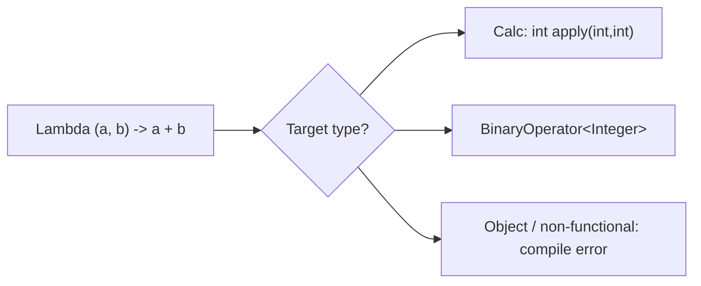
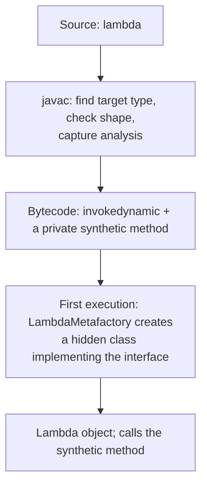
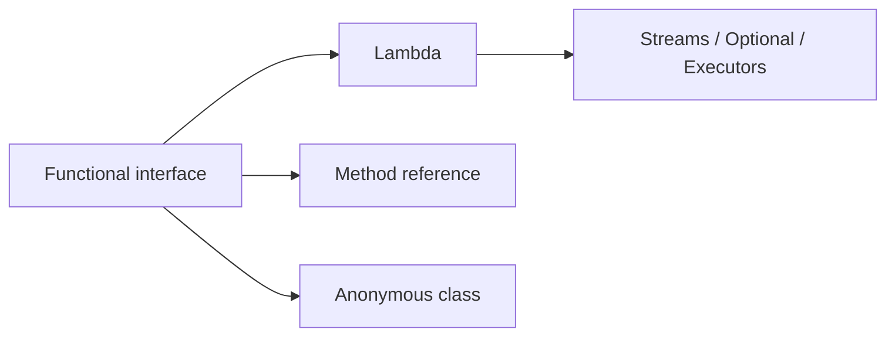

# Functional Interfaces and Lambda Expressions in Java

**TL;DR:** A **functional interface** is an interface with exactly **one abstract method** (SAM: single abstract method). A **lambda expression** is a compact way to write an implementation of that method: `(a, b) -> a + b`. The compiler works out *which* interface from the context (**target typing**). Lambdas can capture local variables only if they are **effectively final**, and `this` inside a lambda means the enclosing object, not the lambda. The `java.util.function` package supplies the standard shapes: `Predicate`, `Function`, `Consumer`, `Supplier`, `UnaryOperator`, `BinaryOperator`, plus primitive variants. Method references (`String::length`) are shorthand for lambdas that just call one method.

## Table of Contents

1. [TL;DR](#1-tldr)
2. [Why it matters](#2-why-it-matters)
3. [Prerequisites](#3-prerequisites)
4. [Mental model](#4-mental-model)
5. [Core concepts](#5-core-concepts)
6. [How it works](#6-how-it-works)
7. [Examples](#7-examples)
8. [Comparisons](#8-comparisons)
9. [Trade-offs](#9-trade-offs)
10. [Gotchas](#10-gotchas)
11. [Practical application](#11-practical-application)
12. [Interview prep](#12-interview-prep)
13. [Interview question bank](#13-interview-question-bank)
14. [Tricky code snippets](#14-tricky-code-snippets)
15. [Connections](#15-connections)
16. [Summary](#16-summary)
17. [Answers](#answers)

> **Scope note.** Default and static interface methods are in the Interfaces note. Streams are only used lightly here as the most common home of lambdas. Anonymous classes are covered in the Inner Classes note (next); 8.1 compares them with lambdas.

---

## 1. TL;DR

- Functional interface: **one** abstract method (Snippet 1); `@FunctionalInterface` makes the compiler check it (Snippet 2).
- Default, static and `Object`-method declarations (`equals`) don't count (Snippet 3). Inherited abstract methods count (Snippet 4).
- Lambda syntax: `() -> expr`, `x -> expr`, `(a, b) -> { ...; return v; }` (Snippet 6).
- A lambda needs a functional interface as its **target type**; `Object o = () -> 1;` fails (Snippet 5).
- **Captured locals must be effectively final** (Snippets 13, 14, 15). Fields can change (Snippet 16).
- **`this` in a lambda** = the enclosing instance (Snippet 18). Lambda parameters can't shadow locals (Snippet 19).
- **Method references:** `Main::twice`, `obj::m`, `String::length`, `StringBuilder::new` (Snippet 21).
- **Java 11:** `var` in lambda parameters, `Predicate.not` (Snippets 10, 11).

**The analogy: a recipe card vs a hired chef.**

| Real world | Java |
|---|---|
| A job slot "someone who can *cook one dish*" | Functional interface (one abstract method) |
| Hiring a whole chef with name, uniform, history | A class or anonymous class implementing it |
| Handing over a sticky note with the recipe steps | A lambda: just the behaviour |
| The note can only mention ingredients that don't change while cooking | Captured variables must be effectively final |
| "Do what the pastry book page 12 does" | Method reference |

**Running example:** a `Calc` interface with `int apply(int a, int b)`; `add` and `mul` are lambdas (Snippet 1, 6.2).

---

## 2. Why it matters

**The problem.** Before Java 8, passing behaviour meant writing an anonymous class: five lines of ceremony for one line of logic. That made APIs like sorting, callbacks and collection processing noisy. Lambdas and functional interfaces made `Comparator`, `Runnable`, streams, `Optional` and `CompletableFuture` pleasant to use, and they are the entry point to Java's functional style.

**What goes wrong** (verified on Java 21):

| Code | Result | Snippet |
|---|---|---|
| `@FunctionalInterface` on two abstract methods | Compile error | 2 |
| `Object o = () -> 1;` | Compile error: not a functional interface | 5 |
| Modifying a captured local | Compile error: must be final or effectively final | 14, 15 |
| Lambda parameter named like a local | Compile error: already defined | 19 |
| Throwing a checked exception from `Supplier` | Compile error: unreported exception | 24 |
| Lambda referring to itself via a local | Compile error: might not have been initialized | 28 |
| `(var a, b) -> ...` mixed forms | Compile error | 12, 34 |
| `x -> { x + 1; }` | Compile error: not a statement | 39 |
| `run(() -> "x")` with `Runnable` and `Callable` overloads | Picks `Callable` | 23 |

**Why interviewers ask.** "What is a functional interface?", "lambda vs anonymous class", "what is effectively final?", "what does `this` mean in a lambda?", "method reference types", "which built-in functional interface for X?" are everyday Java 8+ interview staples.

---

## 3. Prerequisites

| Prerequisite | One-line refresher | Importance |
|---|---|---|
| Interfaces | Abstract, default, static methods | Essential |
| Anonymous classes | One-off implementations | Important |
| Final and effectively final | Locals that never change | Essential |
| Generics basics | `Function<T,R>` | Important |
| Inner class `this` | Outer vs inner instance | Helpful |

---

## 4. Mental model

> **The one picture to keep in your head:** a lambda is an **object with one method**, created where you write it. Its type is decided by *where it is used*: the compiler looks at the target (a parameter, a variable type, a return type) and asks "which interface, and what does its one method look like?" The lambda's parameters and return value must fit that shape.

```
 Calc add = (a, b) -> a + b;
   │            │        │
   │            │        └─ body: becomes the body of apply(...)
   │            └─ parameters: match  int apply(int a, int b)
   └─ target type: tells the compiler what this lambda *is*

 Function<String,Integer> f = s -> s.length();
 same lambda text with a different target gives a different shape
```
*The same arrow syntax means different things under different target types.*


*No target, no lambda.*

---

## 5. Core concepts

### 5.1 Glossary

- **Functional interface (SAM):** interface with exactly one abstract method.
- **`@FunctionalInterface`:** optional annotation asking the compiler to verify that.
- **Lambda expression:** an inline implementation of a functional interface's method.
- **Target type:** the interface the lambda is converted to, taken from context.
- **Capture:** using a local variable of the enclosing method inside the lambda.
- **Effectively final:** a local never reassigned.
- **Method reference:** `Type::method` shorthand for a lambda that calls one method.
- **Closure:** a function plus the variables it captured.
- **Higher-order function:** takes or returns a function.
- **`invokedynamic`:** the bytecode instruction used to link lambdas at run time.

### 5.2 What counts as a functional interface

- Exactly one abstract method (Snippet 1).
- `default`, `static` and `private` methods don't count (Snippet 3).
- Abstract redeclarations of `Object` public methods (`equals`) don't count (Snippet 3).
- Abstract methods inherited from a super-interface count (Snippet 4).
- `@FunctionalInterface` is optional but catches mistakes (Snippet 2).
- Existing examples: `Runnable`, `Callable`, `Comparator`, `Comparable`, `Iterable`.

### 5.3 Lambda syntax

| Form | Example | Snippet |
|---|---|---|
| No parameters | `() -> System.out.println("run")` | 6 |
| One parameter, no parens | `x -> x * x` | 6 |
| Several, inferred types | `(a, b) -> a + b` | 6 |
| Explicit types | `(Integer a, Integer b) -> { return ...; }` | 6 |
| `var` parameters (Java 11) | `(var a, var b) -> a + b` | 11 |
| Block body | `{ ...; return v; }` (return needed for non-void) | 6, 39 |
| Mixed forms | `(var a, b)` or `(a, Integer b)` | Error (12, 34) |

### 5.4 Standard functional interfaces (`java.util.function`)

| Interface | Method | Use | Snippet |
|---|---|---|---|
| `Predicate<T>` | `boolean test(T)` | Filter/condition | 7, 8 |
| `Function<T,R>` | `R apply(T)` | Transform | 7, 9 |
| `Consumer<T>` | `void accept(T)` | Side effect | 7 |
| `Supplier<T>` | `T get()` | Produce a value | 7 |
| `UnaryOperator<T>` | `T apply(T)` | Same-type transform | 7 |
| `BinaryOperator<T>` | `T apply(T,T)` | Combine two | 6 |
| `BiFunction<T,U,R>` | `R apply(T,U)` | Two inputs | 6 |
| `Runnable` | `void run()` | Task | 6 |
| `Callable<V>` | `V call() throws Exception` | Task with result | 22, 25 |
| `Comparator<T>` | `int compare(T,T)` | Ordering | 30 |
| Primitive variants | `IntPredicate`, `ToIntFunction`, `IntBinaryOperator`, ... | Avoid boxing | 36 |

### 5.5 Composing functions

Default methods on the standard interfaces: `Predicate.and/or/negate`, `Function.andThen/compose`, `Comparator.reversed/thenComparing` (Snippets 8, 9, 30, 35). Java 11 adds `Predicate.not(...)` for negating method references (Snippet 10).

### 5.6 Capturing variables

- Locals and parameters of the enclosing method can be used only if **effectively final** (Snippets 13, 14, 15).
- **Fields** (instance or static) can be read and modified (Snippet 16).
- Workarounds for mutation: a one-element array or an `AtomicInteger` (Snippet 17).
- Why: the lambda may run later or on another thread; it gets a *copy* of the local's value.

### 5.7 `this`, shadowing and scope

- Inside a lambda, `this` is the **enclosing** instance (Snippet 18). In an anonymous class, `this` is the anonymous object.
- A lambda body shares the enclosing method's scope: a parameter or local with the same name as an enclosing local is an error (Snippet 19). An anonymous class has its own scope and may shadow (Snippet 20).

### 5.8 Method references

| Kind | Syntax | Equivalent lambda | Snippet |
|---|---|---|---|
| Static | `Main::twice` | `x -> Main.twice(x)` | 21 |
| Bound instance | `m::inst` | `x -> m.inst(x)` | 21 |
| Unbound instance | `String::length` | `s -> s.length()` | 21 |
| Constructor | `StringBuilder::new` | `() -> new StringBuilder()` | 21 |

### 5.9 Target typing, overloads and checked exceptions

- The same lambda can be a `Runnable` or a `Callable` depending on its body and context (Snippets 22, 23). With both overloads, `() -> "x"` goes to `Callable`, `() -> { }` to `Runnable`.
- A lambda may throw a checked exception only if the interface method declares it (Snippets 24, 25).
- A lambda can't refer to a local variable it is initialising (Snippet 28); use a field (Snippet 29) or another approach.

### 5.10 Identity and implementation

Lambdas are objects (`getClass()` shows a synthetic hidden class) (Snippet 27). Two textually identical lambdas are different objects (Snippet 26); don't rely on identity. They are linked with `invokedynamic` at first use rather than compiled to inner class files ⚠️ (implementation detail).

---

## 6. How it works

### 6.1 From source to run time


*⚠️ Implementation detail: no separate `.class` file per lambda, unlike anonymous classes.*

### 6.2 Worked trace: Calc

```java
@FunctionalInterface
interface Calc { int apply(int a, int b); }
public class Main {
    public static void main(String[] args) {
        Calc add = (a, b) -> a + b;
        Calc mul = (a, b) -> a * b;
        System.out.println(add.apply(3, 4) + " " + mul.apply(3, 4));
    }
}
```

Output (verified, Java 21):

```
7 12
```

| Step | What happens |
|---|---|
| `Calc add = (a, b) -> a + b;` | Target type `Calc`; parameters inferred as `int`; the body becomes `apply` |
| `add.apply(3, 4)` | Runs the body: `3 + 4` |
| `mul` | A different lambda for the same interface |

### 6.3 Capture: what actually happens

```java
int base = 10;
IntUnaryOperator f = x -> x + base;   // base copied into the lambda
// base = 20;                          // would make base not effectively final: error
```
Verified in Snippets 13 and 14 (`15` printed; error when reassigned).

### 6.4 Lambda vs anonymous class `this`

```
outer      <- lambda: this.name is the enclosing Main's field
anon       <- anonymous class: this.name is the anonymous object's own field
```
Verified in Snippet 18.

### 6.5 Recursion in lambdas

A local lambda can't refer to itself (`variable fact might not have been initialized`, Snippet 28). Use a static or instance field (Snippet 29).

---

## 7. Examples

### 7.1 Toy example

```java
Function<Integer,Function<Integer,Integer>> adder = a -> b -> a + b;
adder.apply(3).apply(4);   // 7
```
Verified (Snippet 32).

### 7.2 Real-world examples

- **Sorting:** `list.sort((a, b) -> a.length() - b.length())` (Snippet 30).
- **Streams:** `filter(x -> x % 2 == 1).map(x -> x * x)` gives `[1, 9, 25]` (Snippet 31).
- **Optional:** `opt.map(String::toUpperCase).orElse("none")` (Snippet 37).
- **Threads and executors:** `new Thread(() -> work())`, `executor.submit(() -> compute())`.
- **Event callbacks / UI handlers** ⚠️ (illustrative).
- **Spring/JPA, JUnit** accept lambdas for callbacks and assertions ⚠️ (not run here).

---

## 8. Comparisons

### 8.1 Lambda vs anonymous class

| Aspect | Lambda | Anonymous class |
|---|---|---|
| Works for | Functional interfaces only | Any interface or class |
| `this` | Enclosing instance | The anonymous object |
| Shadowing of locals | Not allowed | Allowed |
| Own fields/state | No | Yes |
| Can implement several methods | No | Yes |
| Class file | None per lambda (`invokedynamic`) | One `.class` per anonymous class |
| Syntax | Compact | Verbose |

### 8.2 Method reference vs lambda

| | Lambda | Method reference |
|---|---|---|
| Readability | Flexible | Shorter when it only forwards |
| Can add logic | Yes | No |
| Example | `s -> s.length()` | `String::length` |

### 8.3 `Runnable` vs `Callable` vs `Supplier`

| | `Runnable` | `Callable<V>` | `Supplier<T>` |
|---|---|---|---|
| Returns | nothing | value | value |
| Throws checked | No | Yes | No |
| Package | `java.lang` | `java.util.concurrent` | `java.util.function` |

### 8.4 Primitive specialisations

| Generic | Primitive version | Avoids |
|---|---|---|
| `Function<Integer,Integer>` | `IntUnaryOperator` | Boxing |
| `BiFunction<Integer,Integer,Integer>` | `IntBinaryOperator` | Boxing |
| `Predicate<Integer>` | `IntPredicate` | Boxing |
| `Function<String,Integer>` | `ToIntFunction<String>` | Boxing the result |

### 8.5 Java 8 vs Java 11 lambda features

| Feature | Version |
|---|---|
| Lambdas, method references, `java.util.function` | 8 |
| `var` in lambda parameters | 11 (Snippet 11) |
| `Predicate.not` | 11 (Snippet 10) |

---

## 9. Trade-offs

| Decision | Benefit | Cost | Use when |
|---|---|---|---|
| Lambda | Short, readable | Hard to debug (stack frames), no state | Short stateless behaviour |
| Anonymous class | State, multiple methods, own `this` | Verbose | Need more than one method or state |
| Method reference | Even shorter | Can hide what's called | Pure forwarding |
| Named method instead of a long lambda | Testable, reusable | Extra method | Logic over ~3 lines |
| Standard `java.util.function` interfaces | Familiar | Generic names | General-purpose APIs |
| Custom functional interface | Self-documenting; can throw checked exceptions | One more type | Domain meaning, checked exceptions |
| Primitive specialisations | No boxing | More types to choose | Hot loops, large data |
| Capturing mutable state via array/Atomic | Works | Surprising, thread-unsafe (array) | Last resort; prefer streams/reduction |

---

## 10. Gotchas

### Myths

- ❌ **Myth:** "A functional interface can have only one method." ✅ **Reality:** one *abstract* method; defaults, statics and `Object` methods are fine (Snippet 3).
- ❌ **Myth:** "`@FunctionalInterface` is required." ✅ **Reality:** optional; it only adds a compile check (Snippets 1, 2).
- ❌ **Myth:** "Lambdas are just anonymous classes." ✅ **Reality:** different `this`, scoping and implementation (Snippets 18-20, 27).
- ❌ **Myth:** "A lambda can modify local variables." ✅ **Reality:** only effectively final ones; fields are fine (Snippets 15, 16).
- ❌ **Myth:** "`this` in a lambda is the lambda." ✅ **Reality:** the enclosing instance (Snippet 18).
- ❌ **Myth:** "A lambda has its own type." ✅ **Reality:** it takes the target's type; no target means error (Snippet 5).
- ❌ **Myth:** "Lambdas can throw any exception." ✅ **Reality:** only those the interface method declares (Snippets 24, 25).
- ❌ **Myth:** "Two identical lambdas are `==`." ✅ **Reality:** don't rely on it (Snippet 26).
- ❌ **Myth:** "Lambdas can call themselves recursively via a local variable." ✅ **Reality:** not allowed; use a field (Snippets 28, 29).
- ❌ **Myth:** "Java 11 added lambdas." ✅ **Reality:** Java 8; Java 11 added `var` parameters (Snippet 11).

### Common mistakes and edge cases

- **Modifying a captured local** (`count++`) (Snippet 15).
- **Naming a lambda parameter like an enclosing local** (Snippet 19).
- **Forgetting `return` in a block lambda** (Snippet 39).
- **Mixing `var` and explicit/inferred parameters** (Snippets 12, 34).
- **Ambiguous overloads** like `Runnable`/`Callable` (Snippet 23).
- **Checked exceptions** in standard interfaces (Snippet 24).
- **Boxing overhead** with `Function<Integer,Integer>` in loops (Snippet 36 shows the primitive form).
- **Expecting `this` to be the lambda** (Snippet 18).

---

## 11. Practical application

### Checklist
- [ ] Use standard `java.util.function` interfaces unless you need a domain name or checked exceptions.
- [ ] Keep lambdas short; extract longer logic into a method and use a method reference.
- [ ] Don't mutate captured state; prefer returning values.
- [ ] Prefer primitive specialisations on hot paths.
- [ ] Add `@FunctionalInterface` to your own functional interfaces.
- [ ] Use `Predicate.not` instead of `x -> !x.isEmpty()` when negating method references (Java 11).
- [ ] Avoid side effects inside stream lambdas.
- [ ] Mind checked exceptions; wrap or use a custom interface.

### Hands-on exercise

Given `List<String> names = List.of("bob", "alice", "eve", "", "dan")`, write a pipeline that removes empty strings, upper-cases the rest, sorts by length then alphabetically, and prints the list. Use `Predicate.not`, a method reference, and `Comparator.comparing(...).thenComparing(...)`.

<details><summary>Solution</summary>

```java
import java.util.*;
import java.util.function.Predicate;
import java.util.stream.*;
public class Main {
    public static void main(String[] args) {
        List<String> names = List.of("bob", "alice", "eve", "", "dan");
        List<String> r = names.stream()
            .filter(Predicate.not(String::isEmpty))
            .map(String::toUpperCase)
            .sorted(Comparator.comparing(String::length).thenComparing(Comparator.naturalOrder()))
            .collect(Collectors.toList());
        System.out.println(r);
    }
}
```

Output (verified on Java 21):

```
[BOB, DAN, EVE, ALICE]
```
</details>

---

## 12. Interview prep

Eight model answers, as you would say them aloud.

<details><summary>1. What is a functional interface?</summary>

An interface with exactly one abstract method (SAM). Default, static and `Object`-method declarations don't count. `@FunctionalInterface` is optional and makes the compiler verify it. Lambdas and method references target such interfaces (5.2; Snippets 1, 2, 3).
</details>

<details><summary>2. What is a lambda expression, and how does the compiler know its type?</summary>

An inline implementation of a functional interface's method, written `(params) -> body`. Its type comes from the target context (assignment, argument, return type); with no functional-interface target it's a compile error (4, 5.3; Snippets 5, 6).
</details>

<details><summary>3. Name the core built-in functional interfaces.</summary>

`Predicate<T>` (`boolean test`), `Function<T,R>` (`apply`), `Consumer<T>` (`void accept`), `Supplier<T>` (`get`), `UnaryOperator<T>`, `BinaryOperator<T>`, `BiFunction`, plus primitive variants like `IntPredicate` and `ToIntFunction` to avoid boxing (5.4; Snippets 7, 36).
</details>

<details><summary>4. Lambda vs anonymous class: what are the differences?</summary>

Lambdas only work for functional interfaces; `this` is the enclosing instance; they can't shadow enclosing locals; no own state; linked via `invokedynamic` without a separate class file. Anonymous classes work for any interface or class, have their own `this`, scope and state (8.1; Snippets 18, 19, 20, 27).
</details>

<details><summary>5. What is "effectively final", and why does a lambda need it?</summary>

A local never reassigned after initialisation. The lambda captures a copy of the value, and the lambda may run later or elsewhere, so allowing mutation would make the copy and the original diverge. Fields aren't restricted (5.6; Snippets 13, 14, 15, 16).
</details>

<details><summary>6. What are the four kinds of method reference?</summary>

Static (`Main::twice`), bound instance (`obj::m`), unbound instance (`String::length`), constructor (`StringBuilder::new`). Each equals a lambda that just forwards to that method (5.8; Snippet 21).
</details>

<details><summary>7. Can a lambda throw checked exceptions?</summary>

Only those declared by the functional interface method. `Runnable` and `Supplier` declare none, so you must catch or wrap; `Callable` declares `Exception` (Snippets 24, 25).
</details>

<details><summary>8. What changed in Java 11 for lambdas?</summary>

`var` is allowed in lambda parameters (all or none) and `Predicate.not` was added. Lambdas themselves came in Java 8 (5.3, 8.5; Snippets 10, 11, 12).
</details>

---

## 13. Interview question bank


### 13.1 Functional interfaces (Q1–Q14)

<details><summary>Q1. What is a SAM interface?</summary>

Single abstract method; the same as a functional interface.
</details>

<details><summary>Q2. Is `@FunctionalInterface` mandatory?</summary>

No; it only enforces the rule (Snippets 1, 2).
</details>

<details><summary>Q3. What happens with two abstract methods plus the annotation?</summary>

Compile error: Unexpected @FunctionalInterface annotation (Snippet 2).
</details>

<details><summary>Q4. Can it have default and static methods?</summary>

Yes (Snippet 3).
</details>

<details><summary>Q5. Does `boolean equals(Object)` count as abstract?</summary>

No; it matches a public `Object` method (Snippet 3).
</details>

<details><summary>Q6. Does an inherited abstract method count?</summary>

Yes (Snippet 4).
</details>

<details><summary>Q7. Name functional interfaces from before Java 8.</summary>

`Runnable`, `Callable`, `Comparator`, `Comparable`, `Iterable`, `ActionListener`.
</details>

<details><summary>Q8. Can a generic interface be functional?</summary>

Yes (`Function<T,R>`).
</details>

<details><summary>Q9. Can an abstract class be a lambda target?</summary>

No; only interfaces.
</details>

<details><summary>Q10. Can a lambda be assigned to `Object`?</summary>

No (Snippet 5); cast to a functional interface first.
</details>

<details><summary>Q11. What is an intersection cast?</summary>

`(Runnable & Serializable) () -> ...` (Snippet 38).
</details>

<details><summary>Q12. How is a lambda executed under the hood?</summary>

Via `invokedynamic`, with a hidden class created at first use ⚠️ (6.1; Snippet 27).
</details>

<details><summary>Q13. Are lambdas objects?</summary>

Yes, instances of a synthetic class implementing the interface (Snippet 27).
</details>

<details><summary>Q14. Are identical lambdas equal?</summary>

Don't assume; `a == b` was false (Snippet 26).
</details>


### 13.2 Lambda syntax and typing (Q15–Q28)

<details><summary>Q15. What are the syntax forms?</summary>

`() -> e`, `x -> e`, `(a, b) -> e`, `(T a, T b) -> { ...; return v; }` (Snippet 6).
</details>

<details><summary>Q16. When can you drop the parentheses?</summary>

With exactly one parameter and no type.
</details>

<details><summary>Q17. When can you drop the braces?</summary>

When the body is a single expression; then `return` is implicit.
</details>

<details><summary>Q18. What if a block body forgets `return`?</summary>

For non-void targets, a compile error (Snippet 39 shows `x + 1;` as "not a statement").
</details>

<details><summary>Q19. Can you mix `var` and inferred parameters?</summary>

No (Snippet 12).
</details>

<details><summary>Q20. Mix explicit and inferred types?</summary>

No (Snippet 34).
</details>

<details><summary>Q21. Since which version is `var` allowed in lambdas?</summary>

Java 11 (Snippet 11).
</details>

<details><summary>Q22. How are parameter types inferred?</summary>

From the target interface method.
</details>

<details><summary>Q23. Which overload is chosen for `run(() -> "x")` with `Runnable`/`Callable`?</summary>

`Callable` (Snippet 23).
</details>

<details><summary>Q24. And for `run(() -> { })`?</summary>

`Runnable`.
</details>

<details><summary>Q25. Can a lambda return a lambda?</summary>

Yes (Snippet 32).
</details>

<details><summary>Q26. Can an expression lambda be used for a `void` method?</summary>

Yes, if the expression is a statement expression (Snippet 33).
</details>

<details><summary>Q27. Can a lambda be generic?</summary>

No; it can use the interface's type parameters, but can't declare its own.
</details>

<details><summary>Q28. What is target typing?</summary>

Determining the lambda's type from context (4, Snippet 22).
</details>


### 13.3 Capture, scope and `this` (Q29–Q40)

<details><summary>Q29. Which variables can a lambda use from the enclosing method?</summary>

Final or effectively final locals (Snippet 13).
</details>

<details><summary>Q30. What is the error for modifying one?</summary>

"local variables referenced from a lambda expression must be final or effectively final" (Snippets 14, 15).
</details>

<details><summary>Q31. Can lambdas modify fields?</summary>

Yes (Snippet 16).
</details>

<details><summary>Q32. How do you count something inside a lambda?</summary>

`AtomicInteger`, a one-element array (Snippet 17), or better a stream reduction.
</details>

<details><summary>Q33. What does `this` mean in a lambda?</summary>

The enclosing instance (Snippet 18).
</details>

<details><summary>Q34. And in an anonymous class?</summary>

The anonymous instance (Snippet 18).
</details>

<details><summary>Q35. Can a lambda parameter shadow a local?</summary>

No; compile error (Snippet 19).
</details>

<details><summary>Q36. Can an anonymous class method parameter shadow?</summary>

Yes (Snippet 20).
</details>

<details><summary>Q37. Why can't a local lambda call itself?</summary>

The variable isn't definitely assigned yet (Snippet 28).
</details>

<details><summary>Q38. How do you write a recursive lambda?</summary>

Assign to a field (Snippet 29) or use a named method.
</details>

<details><summary>Q39. Does a lambda create a new scope?</summary>

No; it shares the enclosing scope.
</details>

<details><summary>Q40. Is capture by value or by reference?</summary>

By value (a copy), which is why mutation is prohibited (6.3).
</details>


### 13.4 Built-ins and method references (Q41–Q54)

<details><summary>Q41. `Predicate<T>`?</summary>

`boolean test(T)`; `and`, `or`, `negate` (Snippet 8).
</details>

<details><summary>Q42. `Function<T,R>`?</summary>

`R apply(T)`; `andThen`, `compose` (Snippet 9).
</details>

<details><summary>Q43. `andThen` vs `compose`?</summary>

`f.andThen(g)` is `g(f(x))`; `f.compose(g)` is `f(g(x))` (Snippet 9 gives 12 vs 11).
</details>

<details><summary>Q44. `Consumer`, `Supplier`?</summary>

Takes a value, returns nothing; takes nothing, returns a value (Snippet 7).
</details>

<details><summary>Q45. `UnaryOperator` / `BinaryOperator`?</summary>

Function and BiFunction with the same input and output type (Snippets 6, 7).
</details>

<details><summary>Q46. Why primitive specialisations?</summary>

To avoid boxing (Snippet 36).
</details>

<details><summary>Q47. What is `Predicate.not`?</summary>

Java 11 helper negating a predicate, handy with method references (Snippet 10).
</details>

<details><summary>Q48. What are the types of method references?</summary>

Static, bound, unbound, constructor (Snippet 21).
</details>

<details><summary>Q49. When prefer a method reference?</summary>

When the lambda only forwards its parameters.
</details>

<details><summary>Q50. `Comparator.comparing(...)`?</summary>

Builds a comparator from a key extractor; `.reversed()` flips it (Snippet 30).
</details>

<details><summary>Q51. What does `Function.identity()` do?</summary>

Returns its input (Snippet 35).
</details>

<details><summary>Q52. How does `Optional.map` use lambdas?</summary>

Applies a function if a value is present (Snippet 37).
</details>

<details><summary>Q53. How do streams use lambdas?</summary>

Each stage takes a lambda: `filter`, `map`, `reduce` (Snippet 31).
</details>

<details><summary>Q54. `Runnable` vs `Callable`?</summary>

No result and no checked exceptions vs a result and `throws Exception` (Snippets 22, 24, 25).
</details>


### 13.5 Design and trade-offs (Q55–Q64)

<details><summary>Q55. When use an anonymous class instead of a lambda?</summary>

When you need state, several methods or a non-functional interface/class (8.1).
</details>

<details><summary>Q56. How do you handle checked exceptions in lambdas?</summary>

Catch inside, wrap in an unchecked exception, or use a custom functional interface that throws.
</details>

<details><summary>Q57. Why are long lambdas discouraged?</summary>

Hard to read, test and debug; extract a method.
</details>

<details><summary>Q58. Are lambdas faster than anonymous classes?</summary>

No guarantee; both are optimised by the JIT. Choose for clarity.
</details>

<details><summary>Q59. Do lambdas help with memory?</summary>

A non-capturing lambda can be reused; a capturing one allocates ⚠️.
</details>

<details><summary>Q60. Are lambdas serialisable?</summary>

Only with a serialisable target type (Snippet 38).
</details>

<details><summary>Q61. What is a closure?</summary>

A function with its captured variables (6.3).
</details>

<details><summary>Q62. Is Java functional programming?</summary>

It supports the style but is still object-oriented with mutable state.
</details>

<details><summary>Q63. How do you test code that takes lambdas?</summary>

Pass test lambdas or call the extracted method directly.
</details>

<details><summary>Q64. Do lambdas show in stack traces?</summary>

As synthetic frames like `lambda$main$0` ⚠️.
</details>

---

## 14. Tricky code snippets

39 snippets, each compiled and run on OpenJDK 21. Predict the output (or the compile error) before opening the answer. Classes are declared without `public` so they can share one file.

### Snippet 1: Calc with lambdas

```java
@FunctionalInterface
interface Calc { int apply(int a, int b); }
public class Main {
    public static void main(String[] args) {
        Calc add = (a, b) -> a + b;
        Calc mul = (a, b) -> a * b;
        System.out.println(add.apply(3, 4) + " " + mul.apply(3, 4));
    }
}
```

<details><summary>Answer</summary>

```
7 12
```

Trace in 6.2: the target type `Calc` gives the parameters and return type.
</details>

### Snippet 2: Annotation on two abstract methods

```java
@FunctionalInterface
interface Bad { void a(); void b(); }
public class Main { public static void main(String[] args) { } }
```

<details><summary>Answer</summary>

Compile error: *Unexpected @FunctionalInterface annotation*.

The detail: Bad is not a functional interface; multiple non-overriding abstract methods found.
</details>

### Snippet 3: Default, static and `equals` don't count

```java
@FunctionalInterface
interface Greeter {
    String name();
    default String greet() { return "Hi " + name(); }
    static Greeter of(String n) { return () -> n; }
    boolean equals(Object o);
}
public class Main { public static void main(String[] args) { System.out.println(Greeter.of("raj").greet()); } }
```

<details><summary>Answer</summary>

```
Hi raj
```

Still exactly one abstract method (`name`); the lambda implements it.
</details>

### Snippet 4: Inherited abstract method

```java
interface A { void m(); }
interface B extends A { }
public class Main { public static void main(String[] args) { B b = () -> System.out.println("ok"); b.m(); } }
```

<details><summary>Answer</summary>

```
ok
```

`B` has one abstract method, inherited from `A`.
</details>

### Snippet 5: Lambda targeting `Object`

```java
public class Main { public static void main(String[] args) { Object o = () -> 1; } }
```

<details><summary>Answer</summary>

Compile error: *incompatible types: Object is not a functional interface*.

No functional-interface target type.
</details>

### Snippet 6: Syntax forms

```java
import java.util.function.*;
public class Main {
    public static void main(String[] args) {
        Runnable r = () -> System.out.println("run");
        Function<Integer,Integer> sq = x -> x * x;
        BiFunction<Integer,Integer,Integer> add = (a, b) -> a + b;
        BinaryOperator<Integer> mx = (Integer a, Integer b) -> { return a > b ? a : b; };
        r.run();
        System.out.println(sq.apply(5) + " " + add.apply(1, 2) + " " + mx.apply(3, 9));
    }
}
```

<details><summary>Answer</summary>

```
run
25 3 9
```

No-arg, single-arg, two-arg and typed block-body lambdas.
</details>

### Snippet 7: Standard interfaces

```java
import java.util.function.*;
public class Main {
    public static void main(String[] args) {
        Predicate<String> empty = String::isEmpty;
        Function<String,Integer> len = String::length;
        Consumer<String> pr = System.out::println;
        Supplier<String> sup = () -> "supplied";
        UnaryOperator<String> up = String::toUpperCase;
        System.out.println(empty.test("") + " " + len.apply("abcd"));
        pr.accept(sup.get());
        System.out.println(up.apply("hi"));
    }
}
```

<details><summary>Answer</summary>

```
true 4
supplied
HI
```

`Predicate`, `Function`, `Consumer`, `Supplier`, `UnaryOperator` with method references.
</details>

### Snippet 8: `and`, `or`, `negate`

```java
import java.util.function.*;
public class Main {
    public static void main(String[] args) {
        Predicate<Integer> even = x -> x % 2 == 0;
        Predicate<Integer> pos = x -> x > 0;
        System.out.println(even.and(pos).test(4) + " " + even.and(pos).test(-4) + " " + even.or(pos).test(-3) + " " + even.negate().test(3));
    }
}
```

<details><summary>Answer</summary>

```
true false false true
```

`4` is even and positive; `-4` isn't positive; `-3` is neither; `3` isn't even so `negate` is true.
</details>

### Snippet 9: `andThen` vs `compose`

```java
import java.util.function.*;
public class Main {
    public static void main(String[] args) {
        Function<Integer,Integer> plus1 = x -> x + 1;
        Function<Integer,Integer> times2 = x -> x * 2;
        System.out.println(plus1.andThen(times2).apply(5) + " " + plus1.compose(times2).apply(5));
    }
}
```

<details><summary>Answer</summary>

```
12 11
```

`andThen`: (5+1)*2; `compose`: (5*2)+1.
</details>

### Snippet 10: `Predicate.not` (Java 11)

```java
import java.util.*;
import java.util.stream.*;
public class Main {
    public static void main(String[] args) {
        List<String> l = List.of("a", "", "b", "");
        System.out.println(l.stream().filter(java.util.function.Predicate.not(String::isEmpty)).collect(Collectors.toList()));
    }
}
```

<details><summary>Answer</summary>

```
[a, b]
```

Filters out empty strings.
</details>

### Snippet 11: `var` parameters (Java 11)

```java
import java.util.function.*;
public class Main {
    public static void main(String[] args) {
        BiFunction<Integer,Integer,Integer> f = (var a, var b) -> a + b;
        System.out.println(f.apply(2, 3));
    }
}
```

<details><summary>Answer</summary>

```
5
```

Both parameters use `var`.
</details>

### Snippet 12: Mixing `var` and inferred

```java
import java.util.function.*;
public class Main {
    public static void main(String[] args) {
        BiFunction<Integer,Integer,Integer> f = (var a, b) -> a + b;
    }
}
```

<details><summary>Answer</summary>

Compile error: *invalid lambda parameter declaration*.

All parameters must use `var` or none.
</details>

### Snippet 13: Capturing an effectively final local

```java
public class Main {
    public static void main(String[] args) {
        int base = 10;
        java.util.function.IntUnaryOperator f = x -> x + base;
        System.out.println(f.applyAsInt(5));
    }
}
```

<details><summary>Answer</summary>

```
15
```

`base` is never reassigned.
</details>

### Snippet 14: Local reassigned after capture

```java
public class Main {
    public static void main(String[] args) {
        int base = 10;
        java.util.function.IntUnaryOperator f = x -> x + base;
        base = 20;
    }
}
```

<details><summary>Answer</summary>

Compile error: *local variables referenced from a lambda expression must be final or effectively final*.

The later `base = 20` breaks it.
</details>

### Snippet 15: Modifying a local inside the lambda

```java
public class Main {
    public static void main(String[] args) {
        int count = 0;
        Runnable r = () -> count++;
    }
}
```

<details><summary>Answer</summary>

Compile error: *local variables referenced from a lambda expression must be final or effectively final*.

`count++` assigns it.
</details>

### Snippet 16: Modifying a field

```java
public class Main {
    int count = 0;
    void run() { Runnable r = () -> count++; r.run(); r.run(); System.out.println(count); }
    public static void main(String[] args) { new Main().run(); }
}
```

<details><summary>Answer</summary>

```
2
```

Fields aren't captured copies; they can change.
</details>

### Snippet 17: One-element array workaround

```java
public class Main {
    public static void main(String[] args) {
        int[] c = {0};
        Runnable r = () -> c[0]++;
        r.run(); r.run();
        System.out.println(c[0]);
    }
}
```

<details><summary>Answer</summary>

```
2
```

The array reference is final; its element changes.
</details>

### Snippet 18: `this` in lambda vs anonymous

```java
public class Main {
    String name = "outer";
    void test() {
        Runnable lam = () -> System.out.println(this.name);
        Runnable anon = new Runnable() { String name = "anon"; public void run() { System.out.println(this.name); } };
        lam.run(); anon.run();
    }
    public static void main(String[] args) { new Main().test(); }
}
```

<details><summary>Answer</summary>

```
outer
anon
```

The lambda's `this` is the enclosing `Main`; the anonymous class's is itself.
</details>

### Snippet 19: Lambda parameter shadowing a local

```java
public class Main {
    public static void main(String[] args) {
        int x = 1;
        java.util.function.IntUnaryOperator f = x -> x + 1;
    }
}
```

<details><summary>Answer</summary>

Compile error: *variable x is already defined in method main(String[])*.

Lambdas share the enclosing scope.
</details>

### Snippet 20: Anonymous class parameter shadowing

```java
public class Main {
    public static void main(String[] args) {
        int x = 1;
        java.util.function.IntUnaryOperator f = new java.util.function.IntUnaryOperator() {
            public int applyAsInt(int x) { return x + 1; }
        };
        System.out.println(f.applyAsInt(5));
    }
}
```

<details><summary>Answer</summary>

```
6
```

An anonymous class has its own scope.
</details>

### Snippet 21: Four method reference kinds

```java
import java.util.function.*;
public class Main {
    static int twice(int x) { return x * 2; }
    int inst(int x) { return x + 100; }
    public static void main(String[] args) {
        Function<Integer,Integer> s = Main::twice;
        Main m = new Main();
        Function<Integer,Integer> b = m::inst;
        Function<String,Integer> u = String::length;
        Supplier<StringBuilder> c = StringBuilder::new;
        System.out.println(s.apply(4) + " " + b.apply(1) + " " + u.apply("abc") + " " + c.get().append("x"));
    }
}
```

<details><summary>Answer</summary>

```
8 101 3 x
```

Static, bound instance, unbound instance, constructor.
</details>

### Snippet 22: Same shape, different target

```java
import java.util.concurrent.Callable;
public class Main {
    public static void main(String[] args) throws Exception {
        Runnable r = () -> { };
        Callable<String> c = () -> "x";
        System.out.println(c.call());
    }
}
```

<details><summary>Answer</summary>

```
x
```

`Runnable` and `Callable<String>` have different method shapes.
</details>

### Snippet 23: Overloads `Runnable`/`Callable`

```java
import java.util.concurrent.Callable;
public class Main {
    static void run(Runnable r) { System.out.println("Runnable"); }
    static void run(Callable<String> c) { System.out.println("Callable"); }
    public static void main(String[] args) {
        run(() -> "x");
        run(() -> { });
        run(() -> { return "y"; });
    }
}
```

<details><summary>Answer</summary>

```
Callable
Runnable
Callable
```

A value-returning lambda fits `Callable`; a void block fits `Runnable`.
</details>

### Snippet 24: Checked exception in a `Supplier`

```java
import java.util.function.*;
public class Main {
    public static void main(String[] args) {
        Supplier<String> s = () -> { throw new Exception("x"); };
    }
}
```

<details><summary>Answer</summary>

Compile error: *unreported exception Exception; must be caught or declared to be thrown*.

`Supplier.get()` declares no exceptions.
</details>

### Snippet 25: Checked exception in a `Callable`

```java
import java.util.concurrent.Callable;
public class Main {
    public static void main(String[] args) throws Exception {
        Callable<String> c = () -> { if (args.length > 5) throw new Exception("x"); return "ok"; };
        System.out.println(c.call());
    }
}
```

<details><summary>Answer</summary>

```
ok
```

`call()` declares `throws Exception`.
</details>

### Snippet 26: Lambda identity

```java
public class Main {
    public static void main(String[] args) {
        Runnable a = () -> System.out.println("x");
        Runnable b = () -> System.out.println("x");
        System.out.println(a == b);
        System.out.println(a.equals(a));
    }
}
```

<details><summary>Answer</summary>

```
false
true
```

Two separate lambda expressions yield different objects.
</details>

### Snippet 27: Lambda's class

```java
public class Main {
    public static void main(String[] args) {
        Runnable r = () -> { };
        System.out.println(r.getClass().getName().contains("$$Lambda"));
        System.out.println(r.getClass().isSynthetic());
    }
}
```

<details><summary>Answer</summary>

```
true
true
```

A synthetic class; the name contains `$$Lambda` on this JVM ⚠️ (implementation detail).
</details>

### Snippet 28: Self-referencing local lambda

```java
import java.util.function.*;
public class Main {
    public static void main(String[] args) {
        Function<Integer,Integer> fact = n -> n <= 1 ? 1 : n * fact.apply(n - 1);
    }
}
```

<details><summary>Answer</summary>

Compile error: *variable fact might not have been initialized*.

The variable isn't assigned yet inside its own initialiser.
</details>

### Snippet 29: Recursion through a static field

```java
import java.util.function.*;
public class Main {
    static Function<Integer,Integer> fact = n -> n <= 1 ? 1 : n * Main.fact.apply(n - 1);
    public static void main(String[] args) { System.out.println(fact.apply(5)); }
}
```

<details><summary>Answer</summary>

```
120
```

The field is accessible when the lambda runs.
</details>

### Snippet 30: Sorting with lambdas

```java
import java.util.*;
public class Main {
    public static void main(String[] args) {
        List<String> l = new ArrayList<>(List.of("pear", "fig", "banana"));
        l.sort((a, b) -> a.length() - b.length());
        System.out.println(l);
        l.sort(Comparator.comparing(String::toString).reversed());
        System.out.println(l);
    }
}
```

<details><summary>Answer</summary>

```
[fig, pear, banana]
[pear, fig, banana]
```

First by length, then reverse alphabetical order.
</details>

### Snippet 31: Stream pipeline

```java
import java.util.*;
import java.util.stream.*;
public class Main {
    public static void main(String[] args) {
        List<Integer> r = Stream.of(1, 2, 3, 4, 5).filter(x -> x % 2 == 1).map(x -> x * x).collect(Collectors.toList());
        System.out.println(r);
    }
}
```

<details><summary>Answer</summary>

```
[1, 9, 25]
```

Odd numbers, squared.
</details>

### Snippet 32: Currying

```java
import java.util.function.*;
public class Main {
    public static void main(String[] args) {
        Function<Integer, Function<Integer,Integer>> adder = a -> b -> a + b;
        System.out.println(adder.apply(3).apply(4));
    }
}
```

<details><summary>Answer</summary>

```
7
```

`adder.apply(3)` returns a function awaiting `b`.
</details>

### Snippet 33: Expression body with a void target

```java
import java.util.*;
public class Main {
    public static void main(String[] args) {
        List<String> l = new ArrayList<>();
        Runnable r = () -> l.add("x");
        r.run();
        System.out.println(l);
    }
}
```

<details><summary>Answer</summary>

```
[x]
```

`l.add("x")` returns a boolean, but it's a statement expression, so it fits `Runnable` (value discarded).
</details>

### Snippet 34: Mixing inferred and explicit types

```java
public class Main {
    public static void main(String[] args) {
        java.util.function.BiFunction<Integer,Integer,Integer> f = (a, Integer b) -> a + b;
    }
}
```

<details><summary>Answer</summary>

Compile error: *invalid lambda parameter declaration*.

Use all explicit or all inferred.
</details>

### Snippet 35: `andThen` chain and `identity`

```java
import java.util.function.*;
public class Main {
    public static void main(String[] args) {
        Function<Integer,Integer> f = x -> x + 1;
        System.out.println(f.andThen(f).andThen(f).apply(0));
        System.out.println(Function.<Integer>identity().apply(7));
    }
}
```

<details><summary>Answer</summary>

```
3
7
```

Three increments from 0; identity returns 7.
</details>

### Snippet 36: Primitive functional interfaces

```java
import java.util.function.*;
public class Main {
    public static void main(String[] args) {
        IntBinaryOperator sum = (a, b) -> a + b;
        IntPredicate odd = n -> n % 2 == 1;
        ToIntFunction<String> len = String::length;
        System.out.println(sum.applyAsInt(2, 3) + " " + odd.test(3) + " " + len.applyAsInt("hello"));
    }
}
```

<details><summary>Answer</summary>

```
5 true 5
```

`IntBinaryOperator`, `IntPredicate`, `ToIntFunction` avoid boxing.
</details>

### Snippet 37: `Optional.map`

```java
import java.util.*;
public class Main {
    public static void main(String[] args) {
        Optional<String> o = Optional.of("raj");
        System.out.println(o.map(String::toUpperCase).orElse("none") + " " + Optional.<String>empty().map(String::toUpperCase).orElse("none"));
    }
}
```

<details><summary>Answer</summary>

```
RAJ none
```

The function runs only if present.
</details>

### Snippet 38: Intersection cast

```java
import java.io.Serializable;
public class Main {
    public static void main(String[] args) {
        Runnable r = (Runnable & Serializable) () -> System.out.println("ser");
        r.run();
        System.out.println(r instanceof Serializable);
    }
}
```

<details><summary>Answer</summary>

```
ser
true
```

The lambda is both `Runnable` and `Serializable`.
</details>

### Snippet 39: Block lambda without `return`

```java
public class Main {
    public static void main(String[] args) {
        java.util.function.Function<Integer,Integer> f = x -> { x + 1; };
    }
}
```

<details><summary>Answer</summary>

Compile error: *not a statement*.

`x + 1;` isn't a statement; write `return x + 1;`.
</details>

---

## 15. Connections

| Related topic | How it connects |
|---|---|
| Interfaces | Functional interfaces are interfaces; default methods like `andThen` live on them |
| Inner and anonymous classes | The pre-Java-8 way to do the same; different `this` and scope |
| Final and effectively final | The rule for captured locals |
| Generics | `Function<T,R>`, wildcards in streams |
| Streams and Optional | Main consumers of lambdas |
| Concurrency | `Runnable`, `Callable`, `CompletableFuture` take lambdas |
| Design patterns | Strategy, Command, Template Method become one-liners |
| Exceptions | Checked exceptions don't fit standard functional interfaces |


*Three ways to implement the same one-method contract.*

---

## 16. Summary

### 60-second card

- Functional interface = one abstract method; `@FunctionalInterface` verifies it.
- Lambda = `(params) -> body`; type comes from the target.
- Capture only effectively final locals; fields are free.
- `this` in a lambda = enclosing instance; no shadowing of locals.
- Method refs: static, bound, unbound, constructor.
- Checked exceptions only if the interface declares them.
- Java 8: lambdas; Java 11: `var` params and `Predicate.not`.

### Cheat sheet

```java
Predicate<String> notEmpty = Predicate.not(String::isEmpty);
Function<Integer,Integer> inc = x -> x + 1;
BinaryOperator<Integer> max = (a, b) -> a > b ? a : b;
Supplier<List<String>> mk = ArrayList::new;
list.sort(Comparator.comparing(String::length).thenComparing(Comparator.naturalOrder()));
```

| Need | Use |
|---|---|
| Test a condition | `Predicate<T>` |
| Transform | `Function<T,R>` |
| Side effect | `Consumer<T>` |
| Produce | `Supplier<T>` |
| Same type in/out | `UnaryOperator<T>` / `BinaryOperator<T>` |
| Task with result and exception | `Callable<V>` |

### Self-test

1. What makes an interface functional?
2. Does `@FunctionalInterface` change behaviour?
3. What does effectively final mean?
4. What does `this` mean inside a lambda?
5. Name the four kinds of method reference.
6. Why can't a `Supplier` lambda throw `Exception`?
7. `andThen` vs `compose`?
8. Which Java version added `var` in lambda parameters?

### Anki flashcards

```
Functional interface :: Exactly one abstract method
@FunctionalInterface :: Compile-time check only
Lambda target type :: The functional interface from context
Effectively final :: Never reassigned; required for capture
this in lambda :: Enclosing instance
Method reference kinds :: Static, bound, unbound, constructor
Predicate / Function / Consumer / Supplier :: test / apply / accept / get
andThen vs compose :: g(f(x)) vs f(g(x))
Java 11 lambda additions :: var parameters, Predicate.not
```

### Resources

- *The Java Language Specification*, 9.8 (functional interfaces) and 15.27 (lambda expressions): docs.oracle.com/javase/specs
- The Java Tutorials, "Lambda Expressions": docs.oracle.com/javase/tutorial
- JEP 323, Local-Variable Syntax for Lambda Parameters: openjdk.org/jeps/323
- *Effective Java*, Joshua Bloch: items on lambdas, method references and standard functional interfaces

---

## Answers

1. Exactly one abstract method.
2. No; it only makes the compiler check.
3. Never reassigned after initialisation.
4. The enclosing instance.
5. Static, bound instance, unbound instance, constructor.
6. `Supplier.get()` declares no checked exceptions.
7. `f.andThen(g)` is g(f(x)); `f.compose(g)` is f(g(x)).
8. Java 11.
