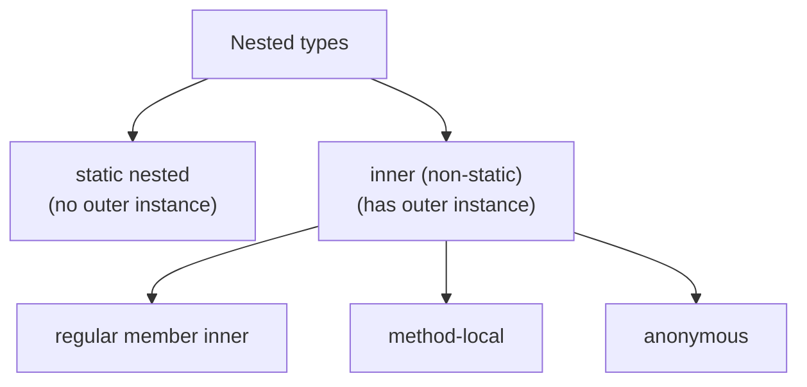
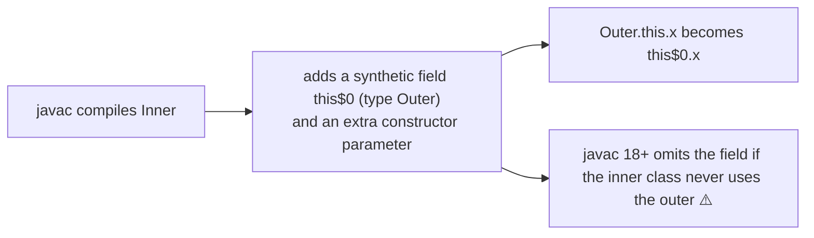
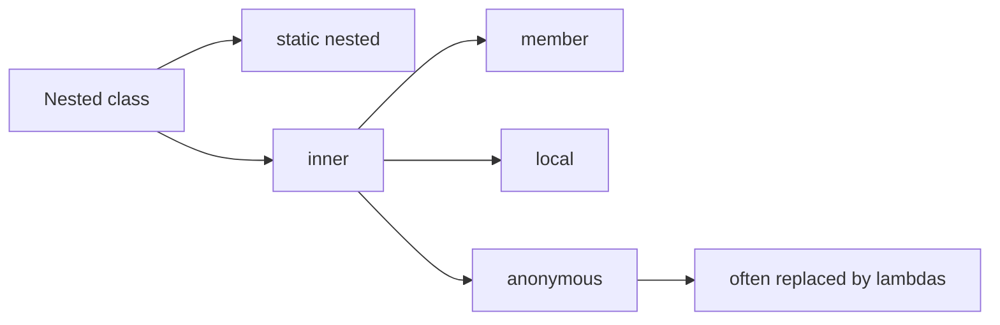

# Inner Classes in Java: Regular, Method-Local, Anonymous and Static Nested

**TL;DR:** A **nested class** is a class declared inside another. There are four kinds. A **static nested class** is just a class tucked inside another for organisation (no outer instance). A **regular inner class** is non-static and is tied to an instance of the outer class, so it can read the outer's fields, even private ones. A **method-local class** is declared inside a method and can capture effectively final locals. An **anonymous class** is a nameless one-off subclass or implementation created at the point of use. Use `Outer.this` to reach the outer instance, `outer.new Inner()` to create an inner object from outside.

## Table of Contents

1. [TL;DR](#1-tldr)
2. [Why it matters](#2-why-it-matters)
3. [Prerequisites](#3-prerequisites)
4. [Mental model](#4-mental-model)
5. [Core concepts](#5-core-concepts)
6. [How it works](#6-how-it-works)
7. [Examples](#7-examples)
8. [Comparisons](#8-comparisons)
9. [Trade-offs](#9-trade-offs)
10. [Gotchas](#10-gotchas)
11. [Practical application](#11-practical-application)
12. [Interview prep](#12-interview-prep)
13. [Interview question bank](#13-interview-question-bank)
14. [Tricky code snippets](#14-tricky-code-snippets)
15. [Connections](#15-connections)
16. [Summary](#16-summary)
17. [Answers](#answers)

> **Scope note.** Anonymous classes are compared with lambdas in the Functional Interfaces and Lambdas note (8.1 there). This note is the full treatment of all four kinds.

---

## 1. TL;DR

| Kind | Declared | Needs outer instance? | Typical use |
|---|---|---|---|
| **Regular inner** | Inside a class, not `static` | Yes: `outer.new Inner()` | Helper tied to one object (iterators, nodes) |
| **Static nested** | Inside a class, `static` | No: `new Outer.Nested()` | Grouping; builders; helper types |
| **Method-local** | Inside a method/block | Yes if the method is an instance method | One-off helper using the method's locals |
| **Anonymous** | `new Type() { ... }` expression | Yes if in an instance context | One-off implementation or override |

- Regular inner needs an outer instance (Snippet 2); inside the outer you can just write `new Inner()` (Snippet 3).
- Inner classes access the outer's private members and vice versa (Snippets 4, 5).
- `Outer.this.x` reaches the outer's field when names clash (Snippet 6).
- A static nested class can't touch outer instance members (Snippet 12) but can use outer statics (Snippet 13).
- Local and anonymous classes capture only effectively final locals (Snippets 19, 20, 33).
- Anonymous classes have no constructor, but can pass arguments to the parent's (Snippets 27, 28).

**The analogy: departments in a company.**

| Real world | Java |
|---|---|
| A department that only exists as part of a specific company branch and uses its tools | Regular inner class (needs an `Outer` object) |
| A shared-services team listed under the company name but independent of any one branch | Static nested class |
| A temporary task force formed inside one project | Method-local class |
| A one-day contractor hired on the spot, no name | Anonymous class |

**Running example:** `Outer` with a private `x = 10`, an `Inner` that doubles it, a `Nested` that returns "nested", and a method with a local class and an anonymous `Runnable` (Snippet 1, 6.2).

---

## 2. Why it matters

**The problem.** Sometimes a class makes sense only in the context of another (a linked list's `Node`, a collection's `Iterator`, an event handler). Putting it inside keeps it hidden, close to its use, and lets it access private state without getters. Anonymous classes were the standard way to pass behaviour before lambdas.

**What goes wrong** (verified on Java 21):

| Code | Result | Snippet |
|---|---|---|
| `new Outer.Inner()` for a non-static inner | Compile error: enclosing instance required | 2 |
| Static nested reading an outer instance field | Compile error: non-static variable | 12 |
| Local class used outside its method | Compile error: cannot find symbol | 18 |
| Modifying a captured local | Compile error: must be final or effectively final | 20 |
| `public class L` inside a method | Compile error | 21 |
| Anonymous class declaring a constructor | Compile error | 28 |
| Reading `o.extra` on an anonymous class typed `Object` | Compile error: cannot find symbol | 30 |
| Private inner class used from another class | Compile error: private access | 42 |
| Assuming `Outer` initialises when `Outer.N` is used | It doesn't | 46 |

**Why interviewers ask.** "Types of inner classes", "static nested vs inner", "can an inner class access private members?", "how do you create an inner object from `main`?", "anonymous class rules", "why must captured variables be final?", "how many `.class` files are produced?" are common.

---

## 3. Prerequisites

| Prerequisite | One-line refresher | Importance |
|---|---|---|
| Classes and objects | Fields, methods, constructors | Essential |
| Access modifiers | `private` is visible within the top-level class | Essential |
| Static members | Belong to the class, not an object | Essential |
| Interfaces and abstract classes | Common anonymous-class parents | Important |
| Effectively final | Captured locals | Important |

---

## 4. Mental model

> **The one picture to keep in your head:** an inner (non-static) class object carries a **hidden reference** to the outer object that created it. That reference is why it can read outer fields and why it can't exist without an outer instance. A static nested class has no such reference; it is an ordinary class that happens to live in another class's namespace.

```
 Outer object o              Inner object i
 ┌────────────┐              ┌──────────────────┐
 │ x = 10     │◀─────────────│ hidden ref → o   │   i.twice() uses o.x
 └────────────┘              └──────────────────┘

 Nested (static): no hidden ref; works like a top-level class named Outer.Nested
```
*Inner = class + secret pointer to its creator.*


*"Inner class" strictly means the non-static kinds; static nested classes are nested but not inner.*

---

## 5. Core concepts

### 5.1 Glossary

- **Nested class:** any class declared inside another.
- **Inner class:** a nested class that is not static; has an enclosing instance.
- **Static nested class:** a nested class declared `static`.
- **Member class:** declared directly in the class body.
- **Local class:** declared in a block or method.
- **Anonymous class:** unnamed class declared and instantiated in one expression.
- **Enclosing (outer) instance:** the object an inner instance belongs to.
- **`Outer.this`:** the enclosing instance from inside the inner class.
- **Capture:** using an enclosing method's local variable in a local or anonymous class.

### 5.2 Regular (member) inner class

- Declared in the class body without `static`.
- Created with an outer instance: `Outer.Inner i = o.new Inner();` (Snippet 1). Inside the outer, `new Inner()` implicitly uses `this` (Snippet 3).
- From outside without an outer object: error (Snippet 2).
- Accesses **all** outer members, including `private` ones (Snippet 4), and the outer can access the inner's private members (Snippet 5).
- Each inner object belongs to one outer object (Snippets 8, 9).
- Name clash? `x`, `this.x`, `Outer.this.x` (Snippet 6). Same for methods (Snippet 39).
- Can extend its outer class, or be nested again (Snippets 11, 40).
- Can have `static` members: allowed since **Java 16** (Snippet 7) ⚠️; before that only constant variables.
- Can be `private`, `protected`, package-private or `public` (Snippets 41, 42).

### 5.3 Static nested class

- Declared `static` inside another class.
- Instantiated without an outer object: `new Outer.Nested()` (Snippets 1, 16).
- Can access only the outer's **static** members directly (Snippets 12, 13); to use instance fields it needs an object reference (Snippet 14).
- Can have static and instance members (Snippet 15).
- Interfaces, enums and records nested in a class are implicitly static (Snippets 44, 45).
- Typical: `Map.Entry`, `Builder` classes.

### 5.4 Method-local (local) inner class

- Declared inside a method, constructor or block; visible only there (Snippets 17, 18).
- No access modifier (`public class L` inside a method is an error) (Snippet 21).
- Can use the method's **effectively final** locals and parameters (Snippets 19, 20).
- Inside an **instance** method it has an enclosing instance (Snippet 23); inside a **static** method it doesn't (Snippet 22).
- Since Java 16 local **records, enums and interfaces** are also allowed (Snippet 24).

### 5.5 Anonymous inner class

- Syntax: `new Parent(args) { members }` for a class or interface (Snippets 25, 26, 27).
- **No name, no constructor** (Snippet 28), but an initialiser block works (Snippet 29) and constructor arguments go to the parent (Snippet 27).
- Extends one class **or** implements one interface, not both (Snippet 32).
- Extra members aren't visible through the parent type (Snippet 30) unless you use `var` (Snippet 31).
- Captures effectively final locals (Snippet 33); `this` is the anonymous object, `Outer.this` the enclosing one (Snippet 34).
- Works in static contexts, with no enclosing instance (Snippet 35).
- The diamond `<>` is allowed with anonymous classes since Java 9 (Snippet 37).
- Each anonymous class is a different class; instances created from the same loop site share one class (Snippet 38).
- `getClass() == Base.class` is false (Snippet 26).
- Common uses: `Comparator`, `Runnable`, listeners, iterators (Snippets 36, 48).

### 5.6 Rules at a glance

| Rule | Regular inner | Static nested | Local | Anonymous |
|---|---|---|---|---|
| Needs outer instance | Yes | No | If instance method | If instance context |
| Access outer instance members | Yes | No | If instance method | If instance context |
| Access outer statics | Yes | Yes | Yes | Yes |
| Can have constructors | Yes | Yes | Yes | No |
| Can be named/reused | Yes | Yes | In scope only | No |
| Access modifiers | Any | Any | None | None |
| Captures locals | n/a | n/a | Effectively final | Effectively final |
| Can have static members | Yes (Java 16+) | Yes | Yes (Java 16+) ⚠️ | Yes (Java 16+) ⚠️ |

### 5.7 Compiled names

Each nested class compiles to its own `.class` file: `Outer$Inner`, `Outer$Nested`, `Outer$1` (anonymous), `Outer$1Local` (local) (Snippet 10). Lambdas, by contrast, don't produce a class file each.

### 5.8 Initialisation

Using a static nested class does **not** initialise the outer class (Snippet 46). An inner class instance requires an outer instance, so the outer is constructed first.

---

## 6. How it works

### 6.1 The hidden outer reference


*Snippet 43 shows `Uses` has `this$0` while `Ignores` doesn't on this JDK (⚠️ version-dependent, JDK 18+). Older compilers always add it, a classic memory-leak source.*

### 6.2 Worked trace: Outer, Inner, Nested, Local, anonymous

```java
class Outer {
    private int x = 10;
    class Inner { int twice() { return x * 2; } }
    static class Nested { String hi() { return "nested"; } }
    void run() {
        int local = 5;
        class Local { int sum() { return x + local; } }
        System.out.println(new Local().sum());
        Runnable r = new Runnable() { public void run() { System.out.println("anon " + x); } };
        r.run();
    }
}
public class Main {
    public static void main(String[] args) {
        Outer o = new Outer();
        Outer.Inner i = o.new Inner();
        System.out.println(i.twice());
        System.out.println(new Outer.Nested().hi());
        o.run();
    }
}
```

Output (verified, Java 21):

```
20
nested
15
anon 10
```

| Step | What happens |
|---|---|
| `o.new Inner()` | Creates an `Inner` whose hidden reference is `o` |
| `i.twice()` | Reads `o.x` (private is fine) |
| `new Outer.Nested()` | No outer object needed |
| `new Local().sum()` | `x + local`: `10 + 5` |
| anonymous `Runnable` | One-off class reading `x` |

### 6.3 Why captured locals must be effectively final

The local or anonymous class gets a **copy** of the variable's value (stored in a synthetic field). If the original could change, the two would diverge, so Java requires the variable never to change (Snippets 19, 20, 33). Fields don't have this problem because the class reaches them through the object.

### 6.4 `this` resolution

Inside an inner class: unqualified `x` finds the innermost scope first (parameter, then inner field, then outer field). `this.x` is the inner's; `Outer.this.x` is the outer's (Snippet 6: `3 2 1`).

### 6.5 Private access

The JVM historically had no concept of nested-class private access, so javac generated bridge methods; Java 11 added **nestmates** so that nested classes access each other's private members directly ⚠️ (implementation detail; behaviour is the same in source).

---

## 7. Examples

### 7.1 Toy example

```java
Outer o = new Outer();
Outer.Inner i = o.new Inner();     // regular inner: needs o
Outer.Nested n = new Outer.Nested(); // static nested: doesn't
```
Verified (Snippets 1, 16).

### 7.2 Real-world examples

- **JDK collections:** `ArrayList.Itr` (inner iterator over the list's fields), `HashMap.Node`, `Map.Entry` (static nested interface).
- **Iterator pattern:** an anonymous `Iterator` inside `iterator()` (Snippet 48).
- **Builders:** `static class Builder` nested in the product.
- **Event handlers / callbacks / comparators:** anonymous classes (Snippet 36).
- **Linked list `Node`:** a private static nested class (no outer reference needed).
- **Android/Swing listeners:** anonymous classes before lambdas ⚠️ (not run here).

---

## 8. Comparisons

### 8.1 Static nested vs inner

| Aspect | Static nested | Inner (non-static) |
|---|---|---|
| Outer instance | Not needed | Required |
| Access to outer instance members | No (needs a reference) | Yes |
| Created with | `new Outer.Nested()` | `outer.new Inner()` |
| Memory | No hidden reference | Holds reference to outer |
| Typical use | Helper/builder/node | Iterator, view over the outer's state |

### 8.2 Local vs anonymous

| | Local | Anonymous |
|---|---|---|
| Name | Yes | No |
| Constructor | Yes | No (initialiser block instead) |
| Reusable within the method | Yes (many `new`) | Only at its one expression |
| Supertypes | Any extends + implements | One class **or** one interface |
| Typical use | Several uses in one method | Single quick use |

### 8.3 Anonymous class vs lambda

| | Anonymous | Lambda |
|---|---|---|
| Parent | Any class or interface | Functional interface only |
| `this` | The anonymous object | Enclosing instance |
| Own state/methods | Yes | No |
| Shadows locals | Yes | No |
| Class file | `Outer$1.class` | None per lambda |

### 8.4 Nested types: which are implicitly static

| Declared in a class | Implicitly static? |
|---|---|
| `class` (member) | No (unless written `static`) |
| `interface` | Yes |
| `enum` | Yes |
| `record` | Yes |
| Anything nested in an interface | Yes (and public) |

### 8.5 Access modifiers on member classes

| Modifier | Visible to |
|---|---|
| `private` | Only the top-level class body (Snippets 41, 42) |
| package-private | Same package |
| `protected` | Package and subclasses |
| `public` | Everyone |

---

## 9. Trade-offs

| Decision | Benefit | Cost | Use when |
|---|---|---|---|
| Static nested class | No outer reference; clear | Needs a reference to read outer state | Default choice for helper types |
| Inner class | Direct access to outer state | Hidden reference can leak the outer (memory) | Iterators/views bound to one outer object |
| Local class | Keeps a helper next to its use | Single-method scope | Reused within one method |
| Anonymous class | Minimal code for one-off, can override several methods | Verbose; no name; harder to test | State/multiple methods needed |
| Lambda instead | Shortest | Functional interfaces only | One-method behaviour |
| Top-level class | Reusable, testable | More files | Used in several places |
| Private nested class | Hides implementation | Not testable directly | Implementation details |
| Deep nesting | Strong grouping | Hard to read | Avoid beyond two levels |

---

## 10. Gotchas

### Myths

- ❌ **Myth:** "All nested classes are inner classes." ✅ **Reality:** static nested classes are nested but not inner (Snippets 12, 16).
- ❌ **Myth:** "An inner class object can exist alone." ✅ **Reality:** it needs an outer instance (Snippet 2).
- ❌ **Myth:** "Inner classes can't touch private members." ✅ **Reality:** both directions are allowed (Snippets 4, 5).
- ❌ **Myth:** "A static nested class can read outer instance fields." ✅ **Reality:** only through an object reference (Snippets 12, 14).
- ❌ **Myth:** "Inner classes can't have static members." ✅ **Reality:** allowed since Java 16 (Snippet 7) ⚠️.
- ❌ **Myth:** "Anonymous classes can have constructors." ✅ **Reality:** no, but initialiser blocks work (Snippets 28, 29).
- ❌ **Myth:** "An anonymous class can extend a class and implement an interface." ✅ **Reality:** one or the other (Snippet 32).
- ❌ **Myth:** "A local class can be `public`/`private`." ✅ **Reality:** no access modifiers (Snippet 21).
- ❌ **Myth:** "Using `Outer.Nested` loads and initialises `Outer`." ✅ **Reality:** it doesn't (Snippet 46).
- ❌ **Myth:** "An anonymous class is a `Base`, so `getClass()` equals `Base.class`." ✅ **Reality:** it's a subclass (Snippet 26).

### Common mistakes and edge cases

- **Instantiating an inner class from `static main`** without an outer object (Snippet 2).
- **Modifying a captured local** (Snippet 20).
- **Leaking the outer** through a long-lived inner object (memory; 6.1).
- **Expecting an anonymous class's extra members to be visible** (Snippet 30).
- **Shadowed names**: `x`, `this.x`, `Outer.this.x` (Snippet 6).
- **Declaring a constructor in an anonymous class** (Snippet 28).
- **Forgetting that `this` in an anonymous class is not the outer** (Snippet 34).
- **Accessing a private inner class from outside** (Snippet 42).

---

## 11. Practical application

### Checklist
- [ ] Default to `static` nested classes; make them inner only when they need the outer instance.
- [ ] Keep implementation helpers `private`.
- [ ] Prefer lambdas to anonymous classes when the target is a functional interface.
- [ ] Don't return inner-class objects that outlive the outer without thinking about the hidden reference.
- [ ] Don't nest more than two levels.
- [ ] Use `Outer.this` explicitly when names clash.
- [ ] Use `var` only when you really need an anonymous class's extra members.
- [ ] Use `Builder` as a static nested class.

### Hands-on exercise

Write a class `Counter` with a private `int count`. Add a regular inner class `Handle` with `void inc()` that increments the outer's count. Add a static nested class `Snapshot` with `static Snapshot of(Counter c)` storing the current count. From `main`, create a `Counter`, get a `Handle` from it, call `inc()` three times, and print `Snapshot.of(c).value`.

<details><summary>Solution</summary>

```java
class Counter {
    private int count;
    class Handle { void inc() { count++; } }
    static class Snapshot {
        final int value;
        private Snapshot(int v) { value = v; }
        static Snapshot of(Counter c) { return new Snapshot(c.count); }
    }
}
public class Main {
    public static void main(String[] args) {
        Counter c = new Counter();
        Counter.Handle h = c.new Handle();
        h.inc(); h.inc(); h.inc();
        System.out.println(Counter.Snapshot.of(c).value);
    }
}
```

Output (verified on Java 21):

```
3
```
</details>

---

## 12. Interview prep

Eight model answers, as you would say them aloud.

<details><summary>1. What are the types of nested classes in Java?</summary>

Four: static nested, regular (member) inner, method-local, and anonymous. The last three are "inner" classes because they have an enclosing instance (if declared in an instance context); a static nested class doesn't (1, 5.1).
</details>

<details><summary>2. Static nested class vs inner class?</summary>

A static nested class is independent of any outer instance: `new Outer.Nested()`, and it reaches outer instance members only through a reference. An inner class holds a hidden reference to its outer object, is created with `outer.new Inner()`, and reads outer members directly, including private ones (8.1; Snippets 1, 2, 12, 14).
</details>

<details><summary>3. How do you create an inner class object from another class or `main`?</summary>

First create the outer object, then `outer.new Inner()`. `new Outer.Inner()` fails with "an enclosing instance that contains Outer.Inner is required". Inside the outer, plain `new Inner()` works (Snippets 2, 3).
</details>

<details><summary>4. Can an inner class access the outer's private members, and vice versa?</summary>

Yes both ways, because they share one top-level class body. Name clashes are disambiguated with `this.x` and `Outer.this.x` (Snippets 4, 5, 6).
</details>

<details><summary>5. What is a method-local inner class, and what are its rules?</summary>

A class declared inside a method or block, visible only there, with no access modifier. It can use the method's effectively final locals and parameters; in an instance method it also has an enclosing instance (Snippets 17-23).
</details>

<details><summary>6. What is an anonymous inner class and what can't it do?</summary>

A nameless class declared and instantiated in one expression, either extending a class or implementing one interface. It has no constructor (but may have an initialiser block), can't extend and implement together, and extra members aren't visible via the parent type (5.5; Snippets 25-32).
</details>

<details><summary>7. Why must captured local variables be effectively final?</summary>

Local and anonymous classes copy the variable's value; mutation after capture would make the copy stale. The compiler enforces it with "local variables referenced from an inner class must be final or effectively final" (6.3; Snippet 20).
</details>

<details><summary>8. Anonymous class vs lambda?</summary>

A lambda only targets functional interfaces, has the enclosing `this`, and can't shadow locals. An anonymous class works for any class or interface, has its own `this`, state and several methods, and compiles to its own class file (8.3).
</details>

---

## 13. Interview question bank


### 13.1 Basics and regular inner classes (Q1–Q16)

<details><summary>Q1. What is a nested class?</summary>

Any class declared inside another class.
</details>

<details><summary>Q2. What is the difference between nested and inner?</summary>

Inner means non-static nested; static nested isn't inner (4).
</details>

<details><summary>Q3. Why use nested classes?</summary>

Logical grouping, encapsulation (private helpers), and readability.
</details>

<details><summary>Q4. How do you instantiate a regular inner class?</summary>

`outer.new Inner()` (Snippet 1).
</details>

<details><summary>Q5. Can `new Outer.Inner()` work from `main`?</summary>

No: enclosing instance required (Snippet 2).
</details>

<details><summary>Q6. Inside the outer class's instance method?</summary>

Plain `new Inner()` (Snippet 3).
</details>

<details><summary>Q7. Can inner access outer private fields?</summary>

Yes (Snippet 4).
</details>

<details><summary>Q8. Can the outer access inner private fields?</summary>

Yes (Snippet 5).
</details>

<details><summary>Q9. How do you access the outer `x` when the inner also has `x`?</summary>

`Outer.this.x` (Snippet 6).
</details>

<details><summary>Q10. Can an inner class have static members?</summary>

Since Java 16 yes (Snippet 7) ⚠️; before, only constant variables.
</details>

<details><summary>Q11. Does each inner object belong to one outer object?</summary>

Yes (Snippets 8, 9).
</details>

<details><summary>Q12. Can an inner class extend its outer class?</summary>

Yes (Snippet 11).
</details>

<details><summary>Q13. Can inner classes be nested in inner classes?</summary>

Yes (Snippet 40).
</details>

<details><summary>Q14. Which access modifiers can an inner class have?</summary>

All four (Snippets 41, 42).
</details>

<details><summary>Q15. Can inner classes be generic or use the outer's type parameters?</summary>

Yes (Snippet 47).
</details>

<details><summary>Q16. What does `this$0` refer to?</summary>

The synthetic field holding the outer reference; newer javac drops it if unused ⚠️ (Snippet 43).
</details>


### 13.2 Static nested classes (Q17–Q28)

<details><summary>Q17. What is a static nested class?</summary>

A nested class marked `static`.
</details>

<details><summary>Q18. Does it need an outer instance?</summary>

No (Snippet 16).
</details>

<details><summary>Q19. Can it access outer instance fields?</summary>

Not directly: compile error (Snippet 12).
</details>

<details><summary>Q20. Outer static fields?</summary>

Yes, even private ones (Snippet 13).
</details>

<details><summary>Q21. How can it use outer instance data?</summary>

Via an object reference (Snippet 14).
</details>

<details><summary>Q22. Can it have static methods?</summary>

Yes (Snippet 15).
</details>

<details><summary>Q23. Does using it initialise the outer class?</summary>

No (Snippet 46).
</details>

<details><summary>Q24. Which nested types are implicitly static?</summary>

Interfaces, enums, records, and anything nested in an interface (Snippets 44, 45).
</details>

<details><summary>Q25. Examples in the JDK?</summary>

`Map.Entry`, `AbstractMap.SimpleEntry`, builders.
</details>

<details><summary>Q26. Why prefer static nested over inner?</summary>

No hidden reference, so no accidental memory retention.
</details>

<details><summary>Q27. How is it referenced from outside?</summary>

`Outer.Nested`.
</details>

<details><summary>Q28. Can a static nested class extend another class?</summary>

Yes, like any class.
</details>


### 13.3 Method-local classes (Q29–Q38)

<details><summary>Q29. Where can a local class be declared?</summary>

In a method, constructor, initialiser or block (Snippet 17).
</details>

<details><summary>Q30. Can it be used outside the method?</summary>

No (Snippet 18).
</details>

<details><summary>Q31. Access modifiers?</summary>

None allowed (Snippet 21).
</details>

<details><summary>Q32. Can it read method locals?</summary>

If effectively final (Snippet 19).
</details>

<details><summary>Q33. What if the local is changed after capture?</summary>

Compile error (Snippet 20).
</details>

<details><summary>Q34. Can it use the outer instance fields?</summary>

In an instance method yes (Snippet 23); in a static method no (Snippet 22).
</details>

<details><summary>Q35. Can a local class have a constructor?</summary>

Yes.
</details>

<details><summary>Q36. Can a local class be `static`?</summary>

No; but local records, enums and interfaces (implicitly static) are allowed (Snippet 24).
</details>

<details><summary>Q37. Local class file name?</summary>

`Outer$1Local` (Snippet 10).
</details>

<details><summary>Q38. Local class vs lambda?</summary>

A local class can have state and multiple methods; a lambda is shorter for one method.
</details>


### 13.4 Anonymous classes (Q39–Q56)

<details><summary>Q39. What is an anonymous class?</summary>

A class without a name, declared and instantiated in one expression (Snippet 25).
</details>

<details><summary>Q40. Can it extend a concrete or abstract class?</summary>

Yes, passing constructor arguments to it (Snippets 26, 27).
</details>

<details><summary>Q41. Can it implement an interface?</summary>

Yes, exactly one (Snippet 25).
</details>

<details><summary>Q42. Both extend and implement?</summary>

No (Snippet 32).
</details>

<details><summary>Q43. Can it have a constructor?</summary>

No (Snippet 28).
</details>

<details><summary>Q44. Can it have an initialiser block?</summary>

Yes (Snippet 29).
</details>

<details><summary>Q45. Are its extra members accessible?</summary>

Not through the parent type (Snippet 30), but with `var` yes (Snippet 31).
</details>

<details><summary>Q46. Is `getClass()` equal to the parent's class?</summary>

No (Snippet 26).
</details>

<details><summary>Q47. Can it capture locals?</summary>

Effectively final ones (Snippet 33).
</details>

<details><summary>Q48. What is `this` inside it?</summary>

The anonymous object; `Outer.this` is the enclosing one (Snippet 34).
</details>

<details><summary>Q49. Can it be created in a static method?</summary>

Yes (Snippet 35).
</details>

<details><summary>Q50. Is the diamond allowed?</summary>

Since Java 9 (Snippet 37).
</details>

<details><summary>Q51. Do two anonymous expressions share a class?</summary>

No; a loop body creating one shares it (Snippet 38).
</details>

<details><summary>Q52. Name file `Main$1` — which kind is it?</summary>

The first anonymous class in `Main` (Snippet 10).
</details>

<details><summary>Q53. Typical uses?</summary>

Comparators, listeners, runnables, iterators (Snippets 36, 48).
</details>

<details><summary>Q54. When prefer a lambda?</summary>

When the target is a functional interface.
</details>

<details><summary>Q55. Can anonymous classes be serialised?</summary>

Poor practice ⚠️; they capture the outer reference.
</details>

<details><summary>Q56. Can an anonymous class be abstract or final?</summary>

You can't apply modifiers to it.
</details>


### 13.5 Scope, design and trivia (Q57–Q66)

<details><summary>Q57. What does a nested class compile to?</summary>

A separate `.class` file: `Outer$Inner` (Snippet 10).
</details>

<details><summary>Q58. Can an inner method have the same name as the outer's?</summary>

Yes; `Outer.this.m()` calls the outer's (Snippet 39).
</details>

<details><summary>Q59. How do you hide an implementation class?</summary>

Make it a `private` nested class (Snippets 41, 42).
</details>

<details><summary>Q60. Memory leak risk with inner classes?</summary>

The hidden outer reference keeps the outer alive (6.1).
</details>

<details><summary>Q61. What are nestmates?</summary>

Java 11 feature letting nested classes access each other's private members without bridge methods ⚠️.
</details>

<details><summary>Q62. Can an interface contain a class?</summary>

Yes, implicitly `public static` (see the Interfaces note).
</details>

<details><summary>Q63. How deep should nesting go?</summary>

Rarely beyond two levels.
</details>

<details><summary>Q64. Which kinds can access outer instance members?</summary>

Inner, and local/anonymous in instance contexts.
</details>

<details><summary>Q65. Can you declare an inner class in an inner class?</summary>

Yes (Snippet 40).
</details>

<details><summary>Q66. How does the iterator pattern use inner classes?</summary>

The iterator is an inner or anonymous class reading the collection's fields (Snippet 48).
</details>

---

## 14. Tricky code snippets

48 snippets, each compiled and run on OpenJDK 21. Predict the output (or the compile error) before opening the answer. Classes are declared without `public` so they can share one file.

### Snippet 1: Four kinds together

```java
class Outer {
    private int x = 10;
    class Inner { int twice() { return x * 2; } }
    static class Nested { String hi() { return "nested"; } }
    void run() {
        int local = 5;
        class Local { int sum() { return x + local; } }
        System.out.println(new Local().sum());
        Runnable r = new Runnable() { public void run() { System.out.println("anon " + x); } };
        r.run();
    }
}
public class Main {
    public static void main(String[] args) {
        Outer o = new Outer();
        Outer.Inner i = o.new Inner();
        System.out.println(i.twice());
        System.out.println(new Outer.Nested().hi());
        o.run();
    }
}
```

<details><summary>Answer</summary>

```
20
nested
15
anon 10
```

Trace in 6.2.
</details>

### Snippet 2: Inner without an outer instance

```java
class Outer { class Inner { } }
public class Main { public static void main(String[] args) { Outer.Inner i = new Outer.Inner(); } }
```

<details><summary>Answer</summary>

Compile error: *an enclosing instance that contains Outer.Inner is required*.

Use `outer.new Inner()`.
</details>

### Snippet 3: Creating an inner inside the outer

```java
class Outer {
    class Inner { String s() { return "inner"; } }
    String make() { Inner i = new Inner(); return i.s(); }
}
public class Main { public static void main(String[] args) { System.out.println(new Outer().make()); } }
```

<details><summary>Answer</summary>

```
inner
```

`new Inner()` implies `this.new Inner()`.
</details>

### Snippet 4: Inner reads a private outer field

```java
class Outer {
    private int secret = 42;
    class Inner { int peek() { return secret; } }
}
public class Main { public static void main(String[] args) { System.out.println(new Outer().new Inner().peek()); } }
```

<details><summary>Answer</summary>

```
42
```

Allowed: same top-level class.
</details>

### Snippet 5: Outer reads a private inner field

```java
class Outer {
    class Inner { private int hidden = 7; }
    int read() { return new Inner().hidden; }
}
public class Main { public static void main(String[] args) { System.out.println(new Outer().read()); } }
```

<details><summary>Answer</summary>

```
7
```

Also allowed.
</details>

### Snippet 6: `x`, `this.x`, `Outer.this.x`

```java
class Outer {
    int x = 1;
    class Inner {
        int x = 2;
        void show(int x) { System.out.println(x + " " + this.x + " " + Outer.this.x); }
    }
}
public class Main { public static void main(String[] args) { new Outer().new Inner().show(3); } }
```

<details><summary>Answer</summary>

```
3 2 1
```

Parameter, inner field, outer field.
</details>

### Snippet 7: Static members in an inner class

```java
class Outer {
    class Inner { static int count = 0; static void f() { } }
}
public class Main { public static void main(String[] args) { Outer.Inner.count++; Outer.Inner.f(); System.out.println(Outer.Inner.count); } }
```

<details><summary>Answer</summary>

```
1
```

Allowed from Java 16; older versions reject it ⚠️.
</details>

### Snippet 8: Each inner belongs to its outer

```java
class Outer {
    int id;
    Outer(int id) { this.id = id; }
    class Inner { int who() { return id; } }
}
public class Main {
    public static void main(String[] args) {
        Outer a = new Outer(1), b = new Outer(2);
        Outer.Inner ia = a.new Inner(), ib = b.new Inner();
        System.out.println(ia.who() + " " + ib.who());
    }
}
```

<details><summary>Answer</summary>

```
1 2
```

Each reads its own outer's `id`.
</details>

### Snippet 9: `Outer.this` identity

```java
class Outer {
    class Inner { Outer owner() { return Outer.this; } }
}
public class Main {
    public static void main(String[] args) {
        Outer o = new Outer();
        Outer.Inner i = o.new Inner();
        System.out.println(i.owner() == o);
    }
}
```

<details><summary>Answer</summary>

```
true
```

The hidden reference is the creating object.
</details>

### Snippet 10: Class names

```java
public class Main {
    class Inner { }
    static class Nested { }
    public static void main(String[] args) {
        Object anon = new Object() { };
        class Local { }
        System.out.println(Inner.class.getName());
        System.out.println(Nested.class.getName());
        System.out.println(anon.getClass().getName());
        System.out.println(Local.class.getName());
    }
}
```

<details><summary>Answer</summary>

```
Main$Inner
Main$Nested
Main$1
Main$1Local
```

Anonymous classes are numbered; local ones get a number and a name.
</details>

### Snippet 11: Inner extending outer

```java
class Outer {
    String who() { return "outer"; }
    class Inner extends Outer { String who() { return "inner"; } }
}
public class Main { public static void main(String[] args) { Outer o = new Outer(); System.out.println(o.who() + " " + o.new Inner().who()); } }
```

<details><summary>Answer</summary>

```
outer inner
```

Allowed.
</details>

### Snippet 12: Static nested reading an instance field

```java
class Outer {
    int x = 5;
    static class Nested { int get() { return x; } }
}
public class Main { public static void main(String[] args) { } }
```

<details><summary>Answer</summary>

Compile error: *non-static variable x cannot be referenced from a static context*.

No outer instance exists.
</details>

### Snippet 13: Static nested reading a private static field

```java
class Outer {
    private static int count = 3;
    static class Nested { int get() { return count; } }
}
public class Main { public static void main(String[] args) { System.out.println(new Outer.Nested().get()); } }
```

<details><summary>Answer</summary>

```
3
```

Statics are reachable.
</details>

### Snippet 14: Static nested using an outer reference

```java
class Outer {
    int x = 5;
    static class Nested { int get(Outer o) { return o.x; } }
}
public class Main { public static void main(String[] args) { System.out.println(new Outer.Nested().get(new Outer())); } }
```

<details><summary>Answer</summary>

```
5
```

Pass the object in.
</details>

### Snippet 15: Static method in a static nested class

```java
class Outer {
    static class Nested { static int sq(int n) { return n * n; } }
}
public class Main { public static void main(String[] args) { System.out.println(Outer.Nested.sq(4)); } }
```

<details><summary>Answer</summary>

```
16
```

Called as `Outer.Nested.sq(4)`.
</details>

### Snippet 16: Creation syntax compared

```java
class Outer {
    static class N { }
    class I { }
}
public class Main {
    public static void main(String[] args) {
        Outer.N n = new Outer.N();
        Outer.I i = new Outer().new I();
        System.out.println(n.getClass().getSimpleName() + " " + i.getClass().getSimpleName());
    }
}
```

<details><summary>Answer</summary>

```
N I
```

`new Outer.N()` vs `new Outer().new I()`.
</details>

### Snippet 17: Local class

```java
public class Main {
    public static void main(String[] args) {
        class Counter {
            int c;
            void inc() { c++; }
        }
        Counter k = new Counter();
        k.inc(); k.inc();
        System.out.println(k.c);
    }
}
```

<details><summary>Answer</summary>

```
2
```

Declared and used in the same method.
</details>

### Snippet 18: Local class used elsewhere

```java
public class Main {
    static void f() { class L { } }
    public static void main(String[] args) { L l = new L(); }
}
```

<details><summary>Answer</summary>

Compile error: *cannot find symbol*.

It exists only inside its block.
</details>

### Snippet 19: Local class capturing a local

```java
public class Main {
    public static void main(String[] args) {
        int n = 5;
        class L { int get() { return n; } }
        System.out.println(new L().get());
    }
}
```

<details><summary>Answer</summary>

```
5
```

Effectively final.
</details>

### Snippet 20: Capture then modify

```java
public class Main {
    public static void main(String[] args) {
        int n = 5;
        class L { int get() { return n; } }
        n = 6;
    }
}
```

<details><summary>Answer</summary>

Compile error: *local variables referenced from an inner class must be final or effectively final*.

`n = 6` breaks it.
</details>

### Snippet 21: `public` local class

```java
public class Main {
    public static void main(String[] args) {
        public class L { }
    }
}
```

<details><summary>Answer</summary>

Compile error: *illegal start of expression*.

Local classes have no access modifiers.
</details>

### Snippet 22: Local class in `static main` using an instance field

```java
public class Main {
    int x = 1;
    public static void main(String[] args) {
        class L { int get() { return x; } }
    }
}
```

<details><summary>Answer</summary>

Compile error: *non-static variable x cannot be referenced from a static context*.

No enclosing instance.
</details>

### Snippet 23: Local class in an instance method

```java
public class Main {
    int x = 1;
    void f() {
        class L { int get() { return x + 1; } }
        System.out.println(new L().get());
    }
    public static void main(String[] args) { new Main().f(); }
}
```

<details><summary>Answer</summary>

```
2
```

Reads `x` through the enclosing instance.
</details>

### Snippet 24: Local record, enum, interface

```java
public class Main {
    public static void main(String[] args) {
        record P(int a, int b) { }
        enum Dir { UP, DOWN }
        interface Greeter { String hi(); }
        System.out.println(new P(1, 2) + " " + Dir.UP);
        Greeter g = () -> "hello";
        System.out.println(g.hi());
    }
}
```

<details><summary>Answer</summary>

```
P[a=1, b=2] UP
hello
```

Allowed since Java 16.
</details>

### Snippet 25: Anonymous `Runnable`

```java
public class Main {
    public static void main(String[] args) {
        Runnable r = new Runnable() { public void run() { System.out.println("anon run"); } };
        r.run();
    }
}
```

<details><summary>Answer</summary>

```
anon run
```

Implements the interface inline.
</details>

### Snippet 26: Anonymous subclass

```java
class Base {
    String who() { return "base"; }
}
public class Main {
    public static void main(String[] args) {
        Base b = new Base() { String who() { return "anon"; } };
        System.out.println(b.who() + " " + (b instanceof Base) + " " + (b.getClass() == Base.class));
    }
}
```

<details><summary>Answer</summary>

```
anon true false
```

It is a `Base` but not exactly `Base`.
</details>

### Snippet 27: Constructor arguments

```java
abstract class Shape {
    String name;
    Shape(String name) { this.name = name; }
    abstract double area();
}
public class Main {
    public static void main(String[] args) {
        Shape s = new Shape("sq") { double area() { return 4; } };
        System.out.println(s.name + " " + s.area());
    }
}
```

<details><summary>Answer</summary>

```
sq 4.0
```

Arguments go to the parent constructor.
</details>

### Snippet 28: Constructor in an anonymous class

```java
public class Main {
    public static void main(String[] args) {
        Object o = new Object() { Object() { } };
    }
}
```

<details><summary>Answer</summary>

Compile error: *invalid method declaration; return type required*.

The class has no name, so `Object()` looks like a method.
</details>

### Snippet 29: Initialiser block

```java
public class Main {
    public static void main(String[] args) {
        Object o = new Object() {
            int x;
            { x = 7; System.out.println("init " + x); }
        };
    }
}
```

<details><summary>Answer</summary>

```
init 7
```

Runs when the object is created.
</details>

### Snippet 30: Extra member via the parent type

```java
public class Main {
    public static void main(String[] args) {
        Object o = new Object() { int extra = 5; };
        System.out.println(o.extra);
    }
}
```

<details><summary>Answer</summary>

Compile error: *cannot find symbol*.

`o` is typed `Object`.
</details>

### Snippet 31: Extra member via `var`

```java
public class Main {
    public static void main(String[] args) {
        var o = new Object() { int extra = 5; };
        System.out.println(o.extra);
    }
}
```

<details><summary>Answer</summary>

```
5
```

`var` keeps the anonymous type.
</details>

### Snippet 32: Extend and implement together

```java
public class Main {
    public static void main(String[] args) {
        Object o = new Object() implements Runnable { public void run() { } };
    }
}
```

<details><summary>Answer</summary>

Compile error: *';' expected*.

Not valid syntax; pick one parent.
</details>

### Snippet 33: Capturing a local

```java
public class Main {
    public static void main(String[] args) {
        String msg = "hi";
        Runnable r = new Runnable() { public void run() { System.out.println(msg); } };
        r.run();
    }
}
```

<details><summary>Answer</summary>

```
hi
```

Effectively final.
</details>

### Snippet 34: `this` in an anonymous class

```java
public class Main {
    String name = "outer";
    void go() {
        Runnable r = new Runnable() {
            String name = "anon";
            public void run() { System.out.println(this.name + " " + Main.this.name); }
        };
        r.run();
    }
    public static void main(String[] args) { new Main().go(); }
}
```

<details><summary>Answer</summary>

```
anon outer
```

`this.name` is its own field; `Main.this.name` is the outer's.
</details>

### Snippet 35: Anonymous class in `static main`

```java
public class Main {
    public static void main(String[] args) {
        Runnable r = new Runnable() { public void run() { System.out.println(Main.class.getSimpleName()); } };
        r.run();
    }
}
```

<details><summary>Answer</summary>

```
Main
```

Fine; no enclosing instance is needed.
</details>

### Snippet 36: Anonymous `Comparator`

```java
import java.util.*;
public class Main {
    public static void main(String[] args) {
        List<String> l = new ArrayList<>(List.of("pear", "fig", "banana"));
        Collections.sort(l, new Comparator<String>() {
            public int compare(String a, String b) { return a.length() - b.length(); }
        });
        System.out.println(l);
    }
}
```

<details><summary>Answer</summary>

```
[fig, pear, banana]
```

The classic pre-lambda sort.
</details>

### Snippet 37: Diamond with anonymous classes

```java
import java.util.*;
public class Main {
    public static void main(String[] args) {
        Comparator<String> c = new Comparator<>() {
            public int compare(String a, String b) { return b.compareTo(a); }
        };
        System.out.println(c.compare("a", "b"));
    }
}
```

<details><summary>Answer</summary>

```
1
```

Allowed since Java 9.
</details>

### Snippet 38: Class sharing

```java
public class Main {
    public static void main(String[] args) {
        Runnable a = new Runnable() { public void run() { } };
        Runnable b = new Runnable() { public void run() { } };
        System.out.println(a.getClass() == b.getClass());
        Runnable[] arr = new Runnable[2];
        for (int i = 0; i < 2; i++) arr[i] = new Runnable() { public void run() { } };
        System.out.println(arr[0].getClass() == arr[1].getClass());
    }
}
```

<details><summary>Answer</summary>

```
false
true
```

Two separate expressions are two classes; one loop site is one class.
</details>

### Snippet 39: Same method name inner and outer

```java
class Outer {
    void m() { System.out.println("outer m"); }
    class Inner {
        void m() { System.out.println("inner m"); }
        void call() { m(); Outer.this.m(); }
    }
}
public class Main { public static void main(String[] args) { new Outer().new Inner().call(); } }
```

<details><summary>Answer</summary>

```
inner m
outer m
```

`Outer.this.m()` reaches the outer.
</details>

### Snippet 40: Inner of inner

```java
class A {
    class B {
        class C { String s() { return "C"; } }
    }
}
public class Main { public static void main(String[] args) { A.B.C c = new A().new B().new C(); System.out.println(c.s()); } }
```

<details><summary>Answer</summary>

```
C
```

Chained `new A().new B().new C()`.
</details>

### Snippet 41: Modifiers on member classes

```java
class Outer {
    private class Hidden { String s() { return "hidden"; } }
    protected class Prot { }
    class Pkg { }
    public class Pub { }
    String viaOuter() { return new Hidden().s(); }
}
public class Main { public static void main(String[] args) { Outer o = new Outer(); o.new Pub(); o.new Pkg(); o.new Prot(); System.out.println(o.viaOuter()); } }
```

<details><summary>Answer</summary>

```
hidden
```

The outer can use its own private inner class.
</details>

### Snippet 42: Private inner from another class

```java
class Outer { private class Hidden { } }
public class Main { public static void main(String[] args) { new Outer().new Hidden(); } }
```

<details><summary>Answer</summary>

Compile error: *Outer.Hidden has private access in Outer*.

Visible only within the top-level class.
</details>

### Snippet 43: Hidden `this$0` field

```java
class Outer {
    class Uses { Outer o() { return Outer.this; } }
    class Ignores { }
}
public class Main {
    public static void main(String[] args) {
        for (Class<?> c : new Class<?>[]{ Outer.Uses.class, Outer.Ignores.class }) {
            boolean has = false;
            for (var f : c.getDeclaredFields()) if (f.getName().equals("this$0")) has = true;
            System.out.println(c.getSimpleName() + " has this$0: " + has);
        }
    }
}
```

<details><summary>Answer</summary>

```
Uses has this$0: true
Ignores has this$0: false
```

On JDK 21 javac omits it when unused ⚠️ (older compilers always add it).
</details>

### Snippet 44: Nested interface

```java
class Outer {
    interface Callback { void done(); }
    void run(Callback c) { c.done(); }
}
public class Main { public static void main(String[] args) { new Outer().run(() -> System.out.println("done")); } }
```

<details><summary>Answer</summary>

```
done
```

Implicitly static; a lambda implements it.
</details>

### Snippet 45: Nested enum

```java
class Outer {
    enum Color { RED, GREEN }
}
public class Main { public static void main(String[] args) { System.out.println(Outer.Color.GREEN); } }
```

<details><summary>Answer</summary>

```
GREEN
```

Implicitly static.
</details>

### Snippet 46: Initialisation of a nested class

```java
class Outer {
    static { System.out.println("Outer static"); }
    static class N { static { System.out.println("N static"); } }
}
public class Main {
    public static void main(String[] args) {
        System.out.println("start");
        new Outer.N();
    }
}
```

<details><summary>Answer</summary>

```
start
N static
```

`Outer`'s static block never ran.
</details>

### Snippet 47: Inner of a generic outer

```java
class Box<T> {
    T val;
    Box(T v) { val = v; }
    class Peek { T get() { return val; } }
}
public class Main { public static void main(String[] args) { Box<String> b = new Box<>("x"); Box<String>.Peek p = b.new Peek(); System.out.println(p.get()); } }
```

<details><summary>Answer</summary>

```
x
```

The inner uses the outer's `T`.
</details>

### Snippet 48: Anonymous iterator

```java
import java.util.*;
class Range implements Iterable<Integer> {
    final int n;
    Range(int n) { this.n = n; }
    public Iterator<Integer> iterator() {
        return new Iterator<Integer>() {
            int i = 0;
            public boolean hasNext() { return i < n; }
            public Integer next() { return i++; }
        };
    }
}
public class Main { public static void main(String[] args) { for (int x : new Range(3)) System.out.print(x + " "); System.out.println(); } }
```

<details><summary>Answer</summary>

```
0 1 2
```

The iterator reads the outer's `n`.
</details>

---

## 15. Connections

| Related topic | How it connects |
|---|---|
| Static members | Static nested classes; statics in inner classes (Java 16+) |
| Access modifiers and encapsulation | Private nested classes hide implementation; shared private access |
| Interfaces and abstract classes | Common anonymous-class parents; nested interfaces |
| Lambdas | Replace most anonymous classes; different `this` and scope |
| Final and effectively final | Capture rule for local and anonymous classes |
| `this` and `super` | `Outer.this`, shadowing |
| Enums and records | Implicitly static when nested |
| Design patterns | Builder, Iterator, Strategy, Observer (listeners) |
| Memory and GC | The hidden outer reference can retain the outer object |


*Pick the narrowest kind that does the job.*

---

## 16. Summary

### 60-second card

- Four kinds: static nested, member inner, local, anonymous.
- Inner = hidden pointer to the outer object; create with `outer.new Inner()`.
- Inner and outer share private access; `Outer.this.x` resolves clashes.
- Static nested: no outer instance; sees only outer statics directly.
- Local/anonymous: capture effectively final locals; no access modifiers.
- Anonymous: no name, no constructor, extends a class **or** implements an interface.
- Static members in inner classes allowed since Java 16 ⚠️.
- Default to static nested; prefer lambdas for functional interfaces.

### Cheat sheet

```java
Outer o = new Outer();
Outer.Inner i = o.new Inner();           // inner
Outer.Nested n = new Outer.Nested();     // static nested
class Local { }                          // inside a method
Runnable r = new Runnable() { public void run() { } };  // anonymous
int v = Outer.this.x;                    // outer field from inner
```

| Need | Use |
|---|---|
| Helper with no outer access | `static` nested |
| Helper reading outer fields | Inner class |
| One-off implementation | Anonymous class (or lambda) |
| Helper used several times in one method | Local class |

### Self-test

1. What are the four kinds of nested classes?
2. How do you create a regular inner object from `main`?
3. Can an inner class use the outer's private fields?
4. What can a static nested class access directly from the outer?
5. Why must captured locals be effectively final?
6. Can an anonymous class have a constructor?
7. What is the file name of the first anonymous class in `Main`?
8. What does `Outer.this` mean?

### Anki flashcards

```
Inner class creation :: outer.new Inner()
Static nested creation :: new Outer.Nested()
Outer.this :: The enclosing instance, from inside an inner class
Static nested class :: No hidden outer reference; only outer statics directly
Local class :: Declared in a method; no access modifier; captures effectively final locals
Anonymous class :: No name, no constructor; extends one class or implements one interface
Anonymous class file name :: Outer$1
Nested interfaces/enums/records :: Implicitly static
Static members in inner classes :: Allowed since Java 16
```

### Resources

- *The Java Language Specification*, chapter 8.1.3 (inner classes) and 15.9.5 (anonymous classes): docs.oracle.com/javase/specs
- The Java Tutorials, "Nested Classes": docs.oracle.com/javase/tutorial
- JEP 181, Nest-Based Access Control (Java 11): openjdk.org/jeps/181
- *Effective Java*, Joshua Bloch: "Favor static member classes over nonstatic"

---

## Answers

1. Static nested, regular (member) inner, method-local, anonymous.
2. Create the outer first, then `outer.new Inner()`.
3. Yes, including private ones.
4. Its static members (instance members only through a reference).
5. The class gets a copy of the value, so later changes would diverge.
6. No; use an initialiser block.
7. `Main$1`.
8. The enclosing outer instance.
