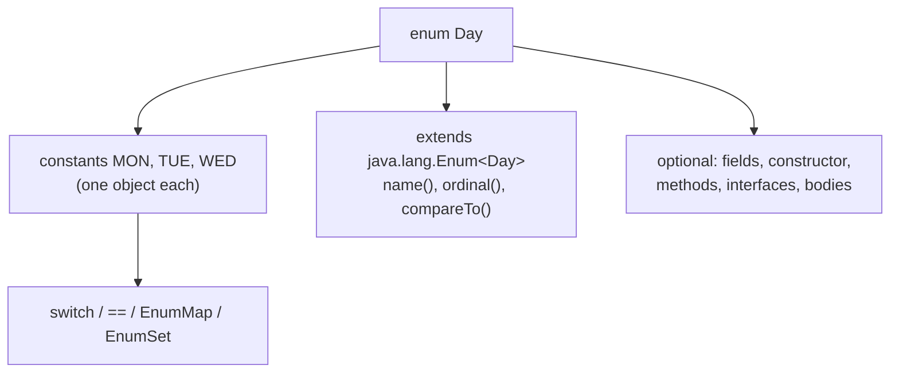
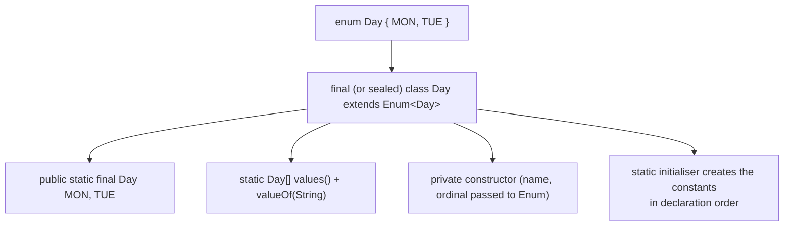
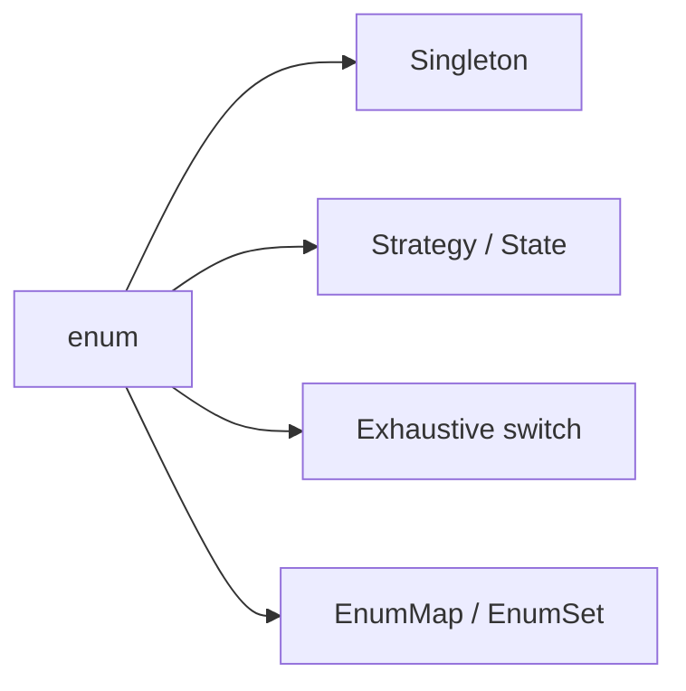

# Enums in Java

**TL;DR:** An **enum** is a special class with a fixed set of named instances (the constants). It replaces `int`/`String` constants with a type-safe, self-describing type: `enum Day { MON, TUE, WED }`. Each constant is a **singleton object** created once when the enum is loaded, so compare with `==`. Enums can have fields, constructors, methods, implement interfaces, and give each constant its own method body. They can't be instantiated with `new` or extended. `values()`, `valueOf()`, `name()`, `ordinal()`, `compareTo()` come built in, and `switch`, `EnumMap` and `EnumSet` work especially well with them.

## Table of Contents

1. [TL;DR](#1-tldr)
2. [Why it matters](#2-why-it-matters)
3. [Prerequisites](#3-prerequisites)
4. [Mental model](#4-mental-model)
5. [Core concepts](#5-core-concepts)
6. [How it works](#6-how-it-works)
7. [Examples](#7-examples)
8. [Comparisons](#8-comparisons)
9. [Trade-offs](#9-trade-offs)
10. [Gotchas](#10-gotchas)
11. [Practical application](#11-practical-application)
12. [Interview prep](#12-interview-prep)
13. [Interview question bank](#13-interview-question-bank)
14. [Tricky code snippets](#14-tricky-code-snippets)
15. [Connections](#15-connections)
16. [Summary](#16-summary)
17. [Answers](#answers)

> **Scope note.** Interfaces, inner classes and `final` are covered in the previous notes; this note shows how enums use them (enums implement interfaces, constants can have anonymous-class-like bodies, enums are implicitly final or sealed).

---

## 1. TL;DR

- `enum Day { MON, TUE, WED }` declares a type with exactly three instances (Snippet 1).
- Built-ins: `name()`, `ordinal()`, `values()`, `valueOf(String)`, `compareTo` (Snippets 1, 19).
- **No `new`** (Snippet 4), **no `extends`** (Snippets 5, 6); enums implicitly extend `java.lang.Enum`.
- **Fields + private constructor + methods**: constants are created with arguments (Snippets 7, 9).
- **Constant-specific bodies** let each constant override an abstract method (Snippets 10, 34).
- Enums can `implement` interfaces (Snippets 13, 33).
- Use `==` to compare (Snippet 18); `switch` on enums, with `case MON` (Snippets 14, 16).
- `EnumMap`/`EnumSet` are fast, ordered collections for enum keys (Snippet 22).
- Best Singleton in Java: a single-constant enum (Snippets 23, 28).

**The analogy: a restaurant's fixed menu.**

| Real world | Java |
|---|---|
| The menu lists exactly the dishes available; you can't order something not on it | Enum constants are the only instances |
| Each dish has a name, price and a recipe | Fields and methods per constant |
| The kitchen prepares each dish once at opening | Constants are created once at class loading |
| Dishes are numbered 1, 2, 3 on the menu | `ordinal()` (position; not to be relied on) |
| "Chef's special" has its own special preparation | Constant-specific body |

**Running example:** `enum Day { MON, TUE, WED }` and later `Planet` and `Op` enums with fields and behaviour (Snippets 1, 7, 10).

---

## 2. Why it matters

**The problem.** Constants like `static final int MON = 1` are not type-safe (any `int` fits), print as meaningless numbers, don't group well, and can't carry behaviour. Enums give a closed, type-checked set with names, fields, behaviour and exhaustive-switch support.

**What goes wrong** (verified on Java 21):

| Code | Result | Snippet |
|---|---|---|
| `Day.valueOf("SUN")` for a missing name | `IllegalArgumentException: No enum constant Day.SUN` | 2 |
| `valueOf("mon")` | Fails; case-sensitive | 3 |
| `new Day()` | Compile error: enum classes may not be instantiated | 4 |
| `class X extends Day` | Compile error | 5 |
| `public` enum constructor | Compile error | 8 |
| Abstract method with no constant bodies | Compile error | 12 |
| `switch (nullEnum)` | `NullPointerException` | 17 |
| Static field used in the enum constructor | Compile error: illegal reference to static field | 24 |
| Switch expression missing a constant | Compile error: does not cover all values | 35 |
| `E.A.clone()` | Compile error: `clone()` protected | 29 |
| Persisting `ordinal()` then reordering constants | Wrong constant after the change | 32 |

**Why interviewers ask.** "What is an enum? Can it have constructors/methods? Can it extend a class or implement an interface?", "`==` vs `equals`", "how do you make a Singleton with an enum?", "`EnumMap` vs `HashMap`", "`values()` and `valueOf()`", "can you `new` an enum?" are standard.

---

## 3. Prerequisites

| Prerequisite | One-line refresher | Importance |
|---|---|---|
| Classes, constructors, fields | The pieces an enum can contain | Essential |
| Static members | Constants are `public static final` instances | Essential |
| Interfaces | Enums can implement them | Important |
| Abstract methods and anonymous classes | Constant-specific bodies work like anonymous subclasses | Important |
| `switch` | Natural consumer of enums | Important |

---

## 4. Mental model

> **The one picture to keep in your head:** an enum is a **class whose complete list of instances is written in the declaration**. `enum Day { MON, TUE }` is roughly `final class Day extends Enum<Day>` with exactly two `public static final Day` instances, a private constructor, and no way to make more.

```
 enum Day { MON, TUE, WED }          roughly:

 final class Day extends Enum<Day> {
     public static final Day MON = new Day("MON", 0);
     public static final Day TUE = new Day("TUE", 1);
     public static final Day WED = new Day("WED", 2);
     private Day(String name, int ordinal) { super(name, ordinal); }
     public static Day[] values()      { /* a copy of the list */ }
     public static Day valueOf(String) { /* lookup by name */ }
 }
```
*Constants are singletons created when the class loads; there is no other way to get an instance.*


*All the power of a class, with a fixed instance list.*

---

## 5. Core concepts

### 5.1 Glossary

- **Enum constant:** one of the named instances.
- **`java.lang.Enum`:** the implicit superclass of every enum.
- **`name()`:** the constant's identifier as declared.
- **`ordinal()`:** its zero-based position in the declaration.
- **`values()`:** returns a new array of all constants.
- **`valueOf(String)`:** returns the constant with that exact name.
- **Constant-specific class body:** a body after a constant that overrides methods for it alone.
- **`EnumMap` / `EnumSet`:** collections specialised for enum keys.
- **Type-safe enum pattern:** the pre-Java-5 hand-written equivalent.

### 5.2 Declaring and using

```java
enum Day { MON, TUE, WED }
Day d = Day.TUE;
d.name()       // "TUE"
d.ordinal()    // 1
Day.values()   // [MON, TUE, WED]
Day.valueOf("WED") == Day.WED   // true
```
Verified (Snippet 1). A trailing comma after the last constant is allowed (Snippet 38); when adding anything after the constants, end the list with `;` (Snippet 39 shows the error without it).

### 5.3 What you can't do

- Instantiate: `new Day()` (Snippet 4).
- Extend an enum or write `extends` (Snippets 5, 6); enums extend `Enum` implicitly, so they can't extend another class, but they **can implement interfaces** (Snippet 13).
- Declare a `public` or `protected` constructor (Snippet 8): constructors are implicitly `private`.
- Clone (Snippet 29) or deserialise into new instances (Snippet 28 shows identity preserved).
- Use `valueOf` with the wrong case or an unknown name (Snippets 2, 3).

### 5.4 Fields, constructors and methods

```java
enum Planet {
    MERCURY(3.3e23, 2.44e6), EARTH(5.97e24, 6.37e6);
    private final double mass, radius;
    Planet(double mass, double radius) { this.mass = mass; this.radius = radius; }
    double gravity() { return 6.67e-11 * mass / (radius * radius); }
}
```
Verified (Snippet 7: `MERCURY 3.70`, `EARTH 9.81`).

- The constructor runs **once per constant**, when the enum class is first used (Snippet 9).
- Make fields `final`; enums should be effectively immutable.
- Enums can have `main` (Snippet 27) and be nested in classes or interfaces (Snippet 26).
- **Static members:** a constructor can't use a non-constant static field of its own enum (Snippet 24), because statics initialise after the constants; constants (`static final` compile-time) are fine (Snippet 25).

### 5.5 Constant-specific class bodies

```java
enum Op {
    ADD("+") { int apply(int a, int b) { return a + b; } },
    MUL("*") { int apply(int a, int b) { return a * b; } };
    ...
    abstract int apply(int a, int b);
}
```
- Each constant with a body is an anonymous subclass of the enum (Snippet 11: `getClass() != Op.class`, but `getDeclaringClass() == Op.class`).
- An abstract method requires every constant to supply a body (Snippet 12).
- Handy for state machines and strategies (Snippets 10, 34). A strategy can also be a lambda field (Snippet 33).
- ⚠️ An enum with constant bodies is not `final` (it is implicitly **sealed** since Java 17); a plain enum is final (Snippets 37, 40).

### 5.6 Enums and interfaces

Enums may `implements` any interfaces (Snippets 13, 33). They can't `extends`. A common pattern is one interface with several enum implementations (e.g. `Operation` with `BasicOp` and `ExtendedOp` enums) to emulate extensible enums.

### 5.7 Comparing and ordering

- Compare with **`==`**: safe, null-safe on the left, and checked at compile time for type (Snippet 18). `equals` is `==` internally; calling it on `null` throws NPE (Snippet 18).
- `compareTo` orders by **ordinal** (Snippet 19: `LOW.compareTo(HIGH)` = `-2`).
- `toString()` returns the name by default and can be overridden; `name()` is final (Snippet 20), and `valueOf` uses the name, not `toString`.

### 5.8 `switch` with enums

- Classic: `case MON:` without qualification (Snippet 14).
- Switch expressions with `->` and multiple labels (Snippet 16); without a `default`, they must cover every constant (Snippet 35).
- A `null` selector throws NPE (Snippet 17) unless there's a `case null` (Java 21).
- ⚠️ Java 21 also accepts **qualified** labels (`case Day.MON`) (Snippet 15); older versions don't.

### 5.9 `EnumMap` and `EnumSet`

- `EnumMap<K extends Enum<K>, V>`: array-backed, iterates in ordinal order, very fast (Snippet 22).
- `EnumSet`: bit-vector backed: `of`, `range`, `complementOf`, `allOf`, `noneOf` (Snippet 22).
- Prefer them to `HashMap`/`HashSet` for enum keys, though a plain `HashMap` works too (Snippet 31).

### 5.10 Enum as a Singleton

```java
enum Registry { INSTANCE; private int hits; int hit() { return ++hits; } }
```
Thread-safe class loading, serialisation-safe (Snippet 28), reflection-proof, and one line. This is Joshua Bloch's recommended Singleton (Snippet 23).

### 5.11 Useful facts

- `o instanceof Enum` and `Comparable` are true; `Day.class.isEnum()` is true (Snippet 36).
- A generic helper: `<T extends Enum<T>> T parse(Class<T>, String)` using `Enum.valueOf` (Snippet 30).
- `values()` returns a fresh copy each call; mutating it doesn't affect the enum (Snippet 21).
- Don't persist `ordinal()`; use `name()` (Snippet 32).

---

## 6. How it works

### 6.1 What the compiler generates


*Constants are created in a static initialiser, in order; the `$VALUES` array backs `values()` (cloned on each call).*

### 6.2 Worked trace: Day

```java
enum Day { MON, TUE, WED }
public class Main {
    public static void main(String[] args) {
        Day d = Day.TUE;
        System.out.println(d + " " + d.name() + " " + d.ordinal());
        for (Day x : Day.values()) System.out.print(x + " ");
        System.out.println();
        System.out.println(Day.valueOf("WED") == Day.WED);
    }
}
```

Output (verified, Java 21):

```
TUE TUE 1
MON TUE WED 
true
```

| Step | What happens |
|---|---|
| `Day.TUE` | The existing singleton object |
| `d + ...` | `toString()` returns `name()` by default |
| `d.ordinal()` | Position `1` |
| `Day.values()` | A new array `[MON, TUE, WED]` |
| `valueOf("WED") == Day.WED` | Returns the same object, so `true` |

### 6.3 Construction timing

The constructor runs once per constant when the enum class initialises, i.e. at first use, not when `Day` is merely mentioned:

```
start
ctor A
ctor B
true
```
Verified in Snippet 9: both constants are built together on first access; two references to `E.A` are `==`.

### 6.4 Why `static` fields are off-limits in the constructor

Constants are created first (in the static initialiser); static fields are initialised afterwards. A constructor reading a non-constant static would see an uninitialised value, so the compiler forbids it (Snippet 24). Compile-time constants are inlined and safe (Snippet 25).

### 6.5 Constant bodies and `getClass()`

A constant with a body is an instance of an anonymous subclass (`Op$1`), so `getClass()` differs from `Op.class`; `getDeclaringClass()` returns the enum itself (Snippet 11). Use `getDeclaringClass()` when you need the enum type.

---

## 7. Examples

### 7.1 Toy example

```java
enum Light {
    RED { Light next() { return GREEN; } },
    GREEN { Light next() { return YELLOW; } },
    YELLOW { Light next() { return RED; } };
    abstract Light next();
}
```
Walking four steps from `RED` prints `RED GREEN YELLOW RED` (Snippet 34).

### 7.2 Real-world examples

- **JDK:** `java.time.DayOfWeek`, `Month`, `TimeUnit`, `RoundingMode`, `StandardOpenOption`.
- **Status and type codes:** `OrderStatus { NEW, PAID, SHIPPED }`.
- **Strategy:** an enum implementing an interface with a lambda per constant (Snippet 33).
- **State machines:** each state decides the next (Snippet 34).
- **Singletons:** `enum Registry { INSTANCE }` (Snippet 23).
- **Config and flags:** `EnumSet` as a compact set of options (Snippet 22).
- **Frameworks:** JPA `@Enumerated(EnumType.STRING)`, JSON mapping ⚠️ (not run here).

---

## 8. Comparisons

### 8.1 Enum vs `static final int` constants

| Aspect | Enum | `int` constants |
|---|---|---|
| Type safety | Yes | No |
| Printing | Name | Number |
| Behaviour and fields | Yes | No |
| Switch | Exhaustiveness check | No |
| Namespacing | By enum type | By convention |
| Serialisation | By name, safe | By value |
| Adding a value | Recompile users | Silent numeric clashes |

### 8.2 Enum vs class vs interface

| | Enum | Class | Interface |
|---|---|---|---|
| Instances | Fixed set | Any number | None |
| `new` | No | Yes | No |
| Extends | Only `Enum` (implicit) | One class | Interfaces |
| Implements | Yes | Yes | n/a |
| Constructor | Private only | Any | None |

### 8.3 `==` vs `equals` for enums

| | `==` | `equals` |
|---|---|---|
| Null on the left | Safe | NPE |
| Compile-time type check | Yes | No |
| Meaning | Same instance | Same as `==` for enums |

### 8.4 `name()` vs `toString()` vs `ordinal()`

| | Returns | Overridable | Use for |
|---|---|---|---|
| `name()` | Declared identifier | No (final) | Persistence, `valueOf` |
| `toString()` | `name()` by default | Yes | Display |
| `ordinal()` | Position | No | Rarely: array indexes inside the enum |

### 8.5 `EnumMap` vs `HashMap`; `EnumSet` vs `HashSet`

| | `EnumMap`/`EnumSet` | `HashMap`/`HashSet` |
|---|---|---|
| Backing | Array / bit vector | Hash table |
| Order | Ordinal order | Unspecified |
| Speed, memory | Better | Fine |
| Keys | Enum only | Any |

---

## 9. Trade-offs

| Decision | Benefit | Cost | Use when |
|---|---|---|---|
| Enum | Type-safe closed set | Adding values means recompiling and updating switches | A fixed set known at compile time |
| Constant-specific bodies | Behaviour per constant | Anonymous subclasses; more code | Each constant behaves differently |
| Interface + several enums | Extensible-looking set | More types | Plug-in operations |
| `switch` on enum | Clear and checked | Open-closed violation when adding behaviour | Few places; else move behaviour into the enum |
| `ordinal()` | Compact | Breaks on reordering | Avoid for persistence |
| `EnumMap` | Fast | Enum keys only | Enum-keyed data |
| Enum Singleton | Simple, safe | Can't extend a class; eager loading | Global single instance |
| Strings/ints for states | Dynamic | No safety | Values change at run time (config-defined) |

---

## 10. Gotchas

### Myths

- ❌ **Myth:** "An enum is just a list of constants." ✅ **Reality:** it's a class with fields, constructors, methods and interfaces (Snippets 7, 10, 13).
- ❌ **Myth:** "You can create new enum instances." ✅ **Reality:** no `new` (Snippet 4).
- ❌ **Myth:** "Enums can extend a class." ✅ **Reality:** they implicitly extend `Enum`; implement interfaces instead (Snippets 5, 13).
- ❌ **Myth:** "Use `equals` for enums." ✅ **Reality:** `==` is safe and preferred (Snippet 18).
- ❌ **Myth:** "`valueOf` is case-insensitive." ✅ **Reality:** exact match only (Snippet 3).
- ❌ **Myth:** "`values()` returns the internal array." ✅ **Reality:** a fresh copy each call (Snippet 21).
- ❌ **Myth:** "`toString()` and `name()` are the same." ✅ **Reality:** `toString` can be overridden; `valueOf` uses `name` (Snippet 20).
- ❌ **Myth:** "`ordinal()` is a stable ID." ✅ **Reality:** it changes when you reorder or insert (Snippet 32).
- ❌ **Myth:** "Enums are always final." ✅ **Reality:** plain ones are; with constant bodies they're sealed, not final ⚠️ (Snippet 40).
- ❌ **Myth:** "Enum constructors can be public." ✅ **Reality:** they are implicitly private; writing `public` is an error (Snippet 8).
- ❌ **Myth:** "`switch (nullEnum)` falls to `default`." ✅ **Reality:** `NullPointerException` (Snippet 17).

### Common mistakes and edge cases

- **Forgetting `;`** after the constants when adding members (Snippet 39).
- **`valueOf` with unknown or lower-case input** (Snippets 2, 3).
- **Missing constant in a switch expression** (Snippet 35).
- **Static field in enum constructor** (Snippet 24).
- **Storing `ordinal()` in a database** (Snippet 32).
- **`getClass()` on a constant with a body** (Snippet 11).
- **Mutable enum fields** causing global state.
- **Missing `abstract` implementation** on a constant (Snippet 12).

---

## 11. Practical application

### Checklist
- [ ] Use enums for any closed set of related constants.
- [ ] Keep fields `final` and constructors simple.
- [ ] Compare with `==`; `switch` for dispatch, but prefer behaviour in the enum.
- [ ] Persist `name()` (or an explicit code field), never `ordinal()`.
- [ ] Use `EnumMap`/`EnumSet` for enum-keyed collections.
- [ ] Add a lookup method (`static Day fromCode(String)`) instead of unchecked `valueOf` on user input.
- [ ] Use an interface when several enums must share a contract.
- [ ] Prefer an enum for Singletons that need serialisation safety.

### Hands-on exercise

Create `enum Size` with constants `S(1)`, `M(2)`, `L(3)` where the number is a `final int code`. Add `static Size fromCode(int code)` returning the matching constant, or throwing `IllegalArgumentException` if none. Print `Size.fromCode(2)` and then catch and print the message for code `9`.

<details><summary>Solution</summary>

```java
enum Size {
    S(1), M(2), L(3);
    final int code;
    Size(int code) { this.code = code; }
    static Size fromCode(int code) {
        for (Size s : values()) if (s.code == code) return s;
        throw new IllegalArgumentException("no size " + code);
    }
}
public class Main {
    public static void main(String[] args) {
        System.out.println(Size.fromCode(2));
        try { Size.fromCode(9); } catch (IllegalArgumentException e) { System.out.println(e.getMessage()); }
    }
}
```

Output (verified on Java 21):

```
M
no size 9
```
</details>

---

## 12. Interview prep

Eight model answers, as you would say them aloud.

<details><summary>1. What is an enum in Java?</summary>

A special class with a fixed, named set of instances (the constants), created once when the enum is loaded. It extends `java.lang.Enum` implicitly, can have fields, a private constructor, methods and interfaces, and gives type-safe constants with `values()`, `valueOf()`, `name()`, `ordinal()` (4, 5.2; Snippets 1, 7).
</details>

<details><summary>2. Can you create an enum instance with `new`, or extend an enum?</summary>

No to both: `new Day()` is "enum classes may not be instantiated", and `extends Day` fails because enums are final (or sealed). Enums can't extend classes but can implement interfaces (Snippets 4, 5, 13).
</details>

<details><summary>3. Why compare enums with `==`?</summary>

Each constant is a singleton, so `==` is correct, null-safe on the left, and type-checked at compile time. `equals` is the same as `==` but throws NPE on a null receiver (Snippet 18).
</details>

<details><summary>4. How do enum constructors and fields work?</summary>

Constants are declared with arguments, `A(1)`, and the private constructor runs once per constant at class initialisation. Fields should be `final`. A constructor can't use a non-constant static field of the enum (Snippets 7, 9, 24, 25).
</details>

<details><summary>5. What are constant-specific class bodies?</summary>

A constant followed by `{ ... }` becomes an anonymous subclass that can override methods, so each constant can behave differently; if the enum declares an abstract method every constant must implement it (Snippets 10, 11, 12, 34).
</details>

<details><summary>6. `values()` vs `valueOf()` vs `ordinal()` vs `name()`?</summary>

`values()` returns a fresh array of all constants; `valueOf(String)` looks one up by exact, case-sensitive name or throws `IllegalArgumentException`; `name()` is the declared identifier; `ordinal()` is the declaration index, which shouldn't be persisted (Snippets 2, 3, 21, 32).
</details>

<details><summary>7. What are `EnumMap` and `EnumSet`, and why use them?</summary>

Collections specialised for enum keys: `EnumMap` is array-backed and `EnumSet` bit-vector-backed, so they're fast, compact and iterate in ordinal order (Snippet 22, 8.5).
</details>

<details><summary>8. How do you implement a Singleton with an enum?</summary>

`enum Registry { INSTANCE; ... }`. The JVM guarantees one instance, class loading is thread-safe, serialisation preserves identity and reflection can't create another (Snippets 23, 28).
</details>

---

## 13. Interview question bank


### 13.1 Basics (Q1–Q14)

<details><summary>Q1. How do you declare an enum?</summary>

`enum Day { MON, TUE, WED }` (Snippet 1).
</details>

<details><summary>Q2. What superclass does an enum have?</summary>

`java.lang.Enum`, implicitly (Snippet 36).
</details>

<details><summary>Q3. Are enum constants objects?</summary>

Yes, one instance each (singletons).
</details>

<details><summary>Q4. What are `name()` and `ordinal()`?</summary>

The declared identifier and the zero-based index (Snippet 1).
</details>

<details><summary>Q5. What does `values()` return?</summary>

A new array of all constants (Snippet 21).
</details>

<details><summary>Q6. What does `valueOf("X")` do?</summary>

Returns the constant named X or throws `IllegalArgumentException` (Snippets 1, 2).
</details>

<details><summary>Q7. Is `valueOf` case-insensitive?</summary>

No (Snippet 3).
</details>

<details><summary>Q8. Can an enum be nested in a class?</summary>

Yes, implicitly static (Snippet 26).
</details>

<details><summary>Q9. Can an enum have a `main` method?</summary>

Yes (Snippet 27).
</details>

<details><summary>Q10. Is a trailing comma allowed?</summary>

Yes (Snippet 38).
</details>

<details><summary>Q11. When is a semicolon required?</summary>

After the constants if any members follow (Snippet 39).
</details>

<details><summary>Q12. Is an enum `final`?</summary>

A plain one is; with constant bodies it's sealed ⚠️ (Snippets 37, 40).
</details>

<details><summary>Q13. How is `toString()` defined?</summary>

Returns `name()` by default; overridable (Snippet 20).
</details>

<details><summary>Q14. Is `name()` overridable?</summary>

No, it's final.
</details>


### 13.2 Restrictions (Q15–Q24)

<details><summary>Q15. Can you `new` an enum?</summary>

No (Snippet 4).
</details>

<details><summary>Q16. Can an enum extend a class?</summary>

No (Snippets 5, 6).
</details>

<details><summary>Q17. Can another class extend an enum?</summary>

No (Snippet 5).
</details>

<details><summary>Q18. Can an enum implement interfaces?</summary>

Yes (Snippet 13).
</details>

<details><summary>Q19. Can the constructor be public?</summary>

No; implicitly private (Snippet 8).
</details>

<details><summary>Q20. Can you clone an enum?</summary>

No; `clone()` is protected and final in `Enum` (Snippet 29).
</details>

<details><summary>Q21. Can serialisation create a second instance?</summary>

No; identity is preserved (Snippet 28).
</details>

<details><summary>Q22. Can you use reflection to instantiate?</summary>

No; the JVM refuses.
</details>

<details><summary>Q23. Can an enum be abstract?</summary>

It can declare abstract methods if every constant implements them (Snippets 10, 12).
</details>

<details><summary>Q24. Can you inherit from an enum's constant body class?</summary>

No.
</details>


### 13.3 Fields, constructors, behaviour (Q25–Q38)

<details><summary>Q25. How do you give constants data?</summary>

Fields plus a constructor: `MERCURY(3.3e23, 2.44e6)` (Snippet 7).
</details>

<details><summary>Q26. How often does the constructor run?</summary>

Once per constant, at first use of the enum (Snippet 9).
</details>

<details><summary>Q27. Can the constructor use a static field of the enum?</summary>

Not a non-constant one (Snippet 24); constants are fine (Snippet 25).
</details>

<details><summary>Q28. Why?</summary>

Statics initialise after the constants (6.4).
</details>

<details><summary>Q29. How do you give each constant its own behaviour?</summary>

Constant-specific bodies (Snippet 10).
</details>

<details><summary>Q30. What is `getClass()` for such a constant?</summary>

An anonymous subclass, not the enum (Snippet 11).
</details>

<details><summary>Q31. What does `getDeclaringClass()` return?</summary>

The enum type (Snippet 11).
</details>

<details><summary>Q32. What if an abstract method isn't implemented by a constant?</summary>

Compile error (Snippet 12).
</details>

<details><summary>Q33. How do you write a state machine with an enum?</summary>

Each constant's `next()` returns the next constant (Snippet 34).
</details>

<details><summary>Q34. How do you use a lambda per constant?</summary>

Pass it to the constructor and store it in a field (Snippet 33).
</details>

<details><summary>Q35. Can an enum implement an interface with a lambda field?</summary>

Yes (Snippet 33).
</details>

<details><summary>Q36. How do you look up a constant by a field value?</summary>

Loop over `values()` in a static method (11 Hands-on).
</details>

<details><summary>Q37. How do you parse user input safely?</summary>

A custom `fromX` method with a clear error, or `Enum.valueOf` in a try/catch (Snippet 30).
</details>

<details><summary>Q38. Can enums have static methods?</summary>

Yes.
</details>


### 13.4 Comparison, switch and collections (Q39–Q54)

<details><summary>Q39. `==` or `equals`?</summary>

`==` (Snippet 18).
</details>

<details><summary>Q40. What does `compareTo` use?</summary>

Ordinal order (Snippet 19).
</details>

<details><summary>Q41. Can you `switch` on an enum?</summary>

Yes (Snippet 14).
</details>

<details><summary>Q42. Do case labels need the enum name?</summary>

Not before Java 21; qualified labels are accepted in 21 (Snippet 15).
</details>

<details><summary>Q43. Switch expression with no `default`?</summary>

Must cover all constants (Snippets 16, 35).
</details>

<details><summary>Q44. What if the selector is null?</summary>

NPE (Snippet 17).
</details>

<details><summary>Q45. `EnumMap` ordering?</summary>

Ordinal order (Snippet 22).
</details>

<details><summary>Q46. What does `EnumSet.complementOf` do?</summary>

Returns the constants not in the given set (Snippet 22).
</details>

<details><summary>Q47. `EnumSet.range(a, b)`?</summary>

All constants from a to b inclusive (Snippet 22).
</details>

<details><summary>Q48. Can enums be `HashMap` keys?</summary>

Yes (Snippet 31).
</details>

<details><summary>Q49. Is an enum `Comparable`?</summary>

Yes (Snippet 36).
</details>

<details><summary>Q50. Is `instanceof Enum` true for a constant?</summary>

Yes (Snippet 36).
</details>

<details><summary>Q51. Does `values()` return the same array each time?</summary>

No, a copy (Snippet 21).
</details>

<details><summary>Q52. How do you iterate all constants?</summary>

`for (Day d : Day.values())` (Snippet 1).
</details>

<details><summary>Q53. How do you get a generic `valueOf`?</summary>

`Enum.valueOf(Class<T>, String)` (Snippet 30).
</details>

<details><summary>Q54. How do you check a class is an enum?</summary>

`Class.isEnum()` (Snippet 36).
</details>


### 13.5 Design (Q55–Q64)

<details><summary>Q55. Why prefer enums over `int` constants?</summary>

Type safety, readability, behaviour, exhaustive switches (8.1).
</details>

<details><summary>Q56. Why not store `ordinal()`?</summary>

It changes on reorder (Snippet 32).
</details>

<details><summary>Q57. What should you persist?</summary>

`name()` or an explicit code field.
</details>

<details><summary>Q58. Why is the enum Singleton recommended?</summary>

Simple, thread-safe, serialisation- and reflection-safe (Snippets 23, 28).
</details>

<details><summary>Q59. Downside of the enum Singleton?</summary>

Can't extend another class; eager initialisation.
</details>

<details><summary>Q60. Can enums emulate extensibility?</summary>

Via a shared interface implemented by several enums (5.6).
</details>

<details><summary>Q61. When avoid enums?</summary>

When the set of values changes at run time.
</details>

<details><summary>Q62. Are enums immutable?</summary>

Constants are fixed, but fields can be mutable; keep them final.
</details>

<details><summary>Q63. Do enums work well with the Strategy pattern?</summary>

Yes, one constant per strategy (Snippet 33).
</details>

<details><summary>Q64. Which JDK enums are well known?</summary>

`DayOfWeek`, `Month`, `TimeUnit`, `RoundingMode`.
</details>

---

## 14. Tricky code snippets

40 snippets, each compiled and run on OpenJDK 21. Predict the output (or the compile error) before opening the answer. Classes are declared without `public` so they can share one file.

### Snippet 1: Day

```java
enum Day { MON, TUE, WED }
public class Main {
    public static void main(String[] args) {
        Day d = Day.TUE;
        System.out.println(d + " " + d.name() + " " + d.ordinal());
        for (Day x : Day.values()) System.out.print(x + " ");
        System.out.println();
        System.out.println(Day.valueOf("WED") == Day.WED);
    }
}
```

<details><summary>Answer</summary>

```
TUE TUE 1
MON TUE WED
true
```

Trace in 6.2.
</details>

### Snippet 2: `valueOf` with an unknown name

```java
enum Day { MON, TUE }
public class Main { public static void main(String[] args) { Day.valueOf("SUN"); } }
```

<details><summary>Answer</summary>

```
Exception in thread "main" java.lang.IllegalArgumentException: No enum constant Day.SUN
```

An unchecked exception; the stack trace continues with `Enum.valueOf`.
</details>

### Snippet 3: `valueOf` is case-sensitive

```java
enum Day { MON }
public class Main {
    public static void main(String[] args) {
        try { Day.valueOf("mon"); } catch (IllegalArgumentException e) { System.out.println(e.getMessage()); }
    }
}
```

<details><summary>Answer</summary>

```
No enum constant Day.mon
```

The message from `IllegalArgumentException`.
</details>

### Snippet 4: `new` on an enum

```java
enum Day { MON }
public class Main { public static void main(String[] args) { Day d = new Day(); } }
```

<details><summary>Answer</summary>

Compile error: *enum classes may not be instantiated*.

Constants are the only instances.
</details>

### Snippet 5: Extending an enum

```java
enum Day { MON }
class X extends Day { }
public class Main { public static void main(String[] args) { } }
```

<details><summary>Answer</summary>

Compile error: *cannot inherit from final Day*.

The detail line also says: enum classes are not extensible.
</details>

### Snippet 6: `enum ... extends`

```java
enum Day extends Object { MON }
public class Main { public static void main(String[] args) { } }
```

<details><summary>Answer</summary>

Compile error: *'{' expected*.

An enum can't have an `extends` clause; it extends `Enum` implicitly (the compiler also reports follow-on errors).
</details>

### Snippet 7: Fields and constructor

```java
enum Planet {
    MERCURY(3.3e23, 2.44e6), EARTH(5.97e24, 6.37e6);
    private final double mass, radius;
    Planet(double mass, double radius) { this.mass = mass; this.radius = radius; }
    double gravity() { return 6.67e-11 * mass / (radius * radius); }
}
public class Main {
    public static void main(String[] args) {
        for (Planet p : Planet.values()) System.out.printf("%s %.2f%n", p, p.gravity());
    }
}
```

<details><summary>Answer</summary>

```
MERCURY 3.70
EARTH 9.81
```

Each constant gets its own mass and radius.
</details>

### Snippet 8: Public enum constructor

```java
enum E { A; public E() { } }
public class Main { public static void main(String[] args) { } }
```

<details><summary>Answer</summary>

Compile error: *modifier public not allowed here*.

Enum constructors are implicitly private.
</details>

### Snippet 9: When constructors run

```java
enum E {
    A, B;
    E() { System.out.println("ctor " + name()); }
}
public class Main {
    public static void main(String[] args) {
        System.out.println("start");
        E x = E.A; E y = E.A;
        System.out.println(x == y);
    }
}
```

<details><summary>Answer</summary>

```
start
ctor A
ctor B
true
```

Both constants are built on first use; `x == y`.
</details>

### Snippet 10: Constant bodies with an abstract method

```java
enum Op {
    ADD("+") { int apply(int a, int b) { return a + b; } },
    MUL("*") { int apply(int a, int b) { return a * b; } };
    final String sym;
    Op(String s) { sym = s; }
    abstract int apply(int a, int b);
}
public class Main {
    public static void main(String[] args) {
        for (Op o : Op.values()) System.out.println(o + " " + o.sym + " " + o.apply(3, 4));
    }
}
```

<details><summary>Answer</summary>

```
ADD + 7
MUL * 12
```

Each constant implements `apply`.
</details>

### Snippet 11: `getClass()` vs `getDeclaringClass()`

```java
enum Op {
    ADD { int f() { return 1; } },
    SUB { int f() { return 2; } };
    abstract int f();
}
public class Main {
    public static void main(String[] args) {
        System.out.println(Op.ADD.getClass() == Op.class);
        System.out.println(Op.ADD.getDeclaringClass() == Op.class);
        System.out.println(Op.ADD.getClass().getSuperclass() == Op.class);
    }
}
```

<details><summary>Answer</summary>

```
false
true
true
```

A constant with a body is an anonymous subclass of the enum.
</details>

### Snippet 12: Abstract method, no bodies

```java
enum Op { ADD; abstract int f(); }
public class Main { public static void main(String[] args) { } }
```

<details><summary>Answer</summary>

Compile error: *Op is not abstract and does not override abstract method f() in Op*.

Every constant would need to implement it.
</details>

### Snippet 13: Enum implementing an interface

```java
interface Describable { String describe(); }
enum Size implements Describable {
    S, L;
    public String describe() { return "size " + name().toLowerCase(); }
}
public class Main { public static void main(String[] args) { Describable d = Size.L; System.out.println(d.describe()); } }
```

<details><summary>Answer</summary>

```
size l
```

Enums can implement interfaces.
</details>

### Snippet 14: Classic switch on an enum

```java
enum Day { MON, TUE, SUN }
public class Main {
    static String kind(Day d) {
        switch (d) {
            case SUN: return "rest";
            case MON: case TUE: return "work";
            default: return "?";
        }
    }
    public static void main(String[] args) { System.out.println(kind(Day.SUN) + " " + kind(Day.MON)); }
}
```

<details><summary>Answer</summary>

```
rest work
```

Case labels are the bare constant names.
</details>

### Snippet 15: Qualified case label

```java
enum Day { MON, TUE }
public class Main {
    public static void main(String[] args) {
        Day d = Day.MON;
        switch (d) { case Day.MON: System.out.println("m"); }
    }
}
```

<details><summary>Answer</summary>

```
m
```

Compiles on Java 21 ⚠️; earlier versions require `case MON`.
</details>

### Snippet 16: Switch expression

```java
enum Day { MON, TUE, SUN }
public class Main {
    public static void main(String[] args) {
        Day d = Day.TUE;
        String s = switch (d) { case MON, TUE -> "work"; case SUN -> "rest"; };
        System.out.println(s);
    }
}
```

<details><summary>Answer</summary>

```
work
```

Multiple labels with `->`; exhaustive without `default`.
</details>

### Snippet 17: Switch on a null enum

```java
enum Day { MON }
public class Main {
    public static void main(String[] args) {
        Day d = null;
        try { switch (d) { case MON: System.out.println("m"); } }
        catch (NullPointerException e) { System.out.println("NPE"); }
    }
}
```

<details><summary>Answer</summary>

```
NPE
```

Throws before any case is tested.
</details>

### Snippet 18: `==` vs `equals` and null

```java
enum Day { MON }
public class Main {
    public static void main(String[] args) {
        Day a = Day.MON; Day b = Day.valueOf("MON");
        System.out.println((a == b) + " " + a.equals(b));
        Day n = null;
        System.out.println(n == Day.MON);
        try { n.equals(Day.MON); } catch (NullPointerException e) { System.out.println("NPE"); }
    }
}
```

<details><summary>Answer</summary>

```
true true
false
NPE
```

`n == Day.MON` is false; `n.equals(...)` throws.
</details>

### Snippet 19: `compareTo` and `ordinal`

```java
enum Level { LOW, MID, HIGH }
public class Main {
    public static void main(String[] args) {
        System.out.println(Level.LOW.compareTo(Level.HIGH) + " " + Level.HIGH.compareTo(Level.MID));
        System.out.println(Level.MID.ordinal());
    }
}
```

<details><summary>Answer</summary>

```
-2 1
1
```

Differences of ordinals: 0 − 2 and 2 − 1.
</details>

### Snippet 20: Overriding `toString`

```java
enum Color {
    RED, GREEN;
    @Override public String toString() { return name().toLowerCase(); }
}
public class Main {
    public static void main(String[] args) {
        System.out.println(Color.RED + " " + Color.RED.name());
        System.out.println(Color.valueOf("RED"));
    }
}
```

<details><summary>Answer</summary>

```
red RED
red
```

`name()` is unchanged, but `valueOf("RED")` still works and prints via the overridden `toString`.
</details>

### Snippet 21: `values()` returns a copy

```java
enum E { A, B }
public class Main {
    public static void main(String[] args) {
        E[] v1 = E.values(), v2 = E.values();
        System.out.println(v1 == v2);
        v1[0] = null;
        System.out.println(E.values()[0]);
    }
}
```

<details><summary>Answer</summary>

```
false
A
```

Mutating one array doesn't change the enum.
</details>

### Snippet 22: `EnumMap` and `EnumSet`

```java
import java.util.*;
enum Day { MON, TUE, WED, THU }
public class Main {
    public static void main(String[] args) {
        EnumMap<Day,String> m = new EnumMap<>(Day.class);
        m.put(Day.WED, "w"); m.put(Day.MON, "m");
        System.out.println(m);
        EnumSet<Day> s = EnumSet.of(Day.THU, Day.MON);
        System.out.println(s + " " + EnumSet.complementOf(s) + " " + EnumSet.range(Day.TUE, Day.THU));
    }
}
```

<details><summary>Answer</summary>

```
{MON=m, WED=w}
[MON, THU] [TUE, WED] [TUE, WED, THU]
```

Ordered by ordinal: complement and range.
</details>

### Snippet 23: Enum Singleton

```java
enum Registry {
    INSTANCE;
    private int hits;
    int hit() { return ++hits; }
}
public class Main {
    public static void main(String[] args) {
        Registry.INSTANCE.hit();
        System.out.println(Registry.INSTANCE.hit());
    }
}
```

<details><summary>Answer</summary>

```
2
```

One `INSTANCE`; state is shared.
</details>

### Snippet 24: Static field in the constructor

```java
enum E {
    A, B;
    static int count = 0;
    E() { count++; }
}
public class Main { public static void main(String[] args) { } }
```

<details><summary>Answer</summary>

Compile error: *illegal reference to static field from initializer*.

Statics are initialised after the constants.
</details>

### Snippet 25: Static constant in the constructor

```java
enum E {
    A, B;
    static final int MAX = 5;
    final int v;
    E() { v = MAX; }
}
public class Main { public static void main(String[] args) { System.out.println(E.A.v); } }
```

<details><summary>Answer</summary>

```
5
```

A compile-time constant is inlined and allowed.
</details>

### Snippet 26: Enum nested in a class

```java
class Outer {
    enum Color { RED }
    void f() { System.out.println(Color.RED); }
}
public class Main { public static void main(String[] args) { new Outer().f(); Outer.Color c = Outer.Color.RED; System.out.println(c); } }
```

<details><summary>Answer</summary>

```
RED
RED
```

Implicitly static.
</details>

### Snippet 27: `main` in an enum

```java
enum Day {
    MON;
    public static void main(String[] args) { System.out.println("enum main " + MON); }
}
public class Main { public static void main(String[] args) { Day.main(args); } }
```

<details><summary>Answer</summary>

```
enum main MON
```

Enums can contain `static` methods like `main`.
</details>

### Snippet 28: Serialisation keeps identity

```java
import java.io.*;
enum E { A }
public class Main {
    public static void main(String[] args) throws Exception {
        ByteArrayOutputStream bo = new ByteArrayOutputStream();
        new ObjectOutputStream(bo).writeObject(E.A);
        Object back = new ObjectInputStream(new ByteArrayInputStream(bo.toByteArray())).readObject();
        System.out.println(back == E.A);
    }
}
```

<details><summary>Answer</summary>

```
true
```

Deserialising returns the same constant.
</details>

### Snippet 29: `clone()` on an enum

```java
enum E { A }
public class Main {
    public static void main(String[] args) { E e = E.A.clone(); }
}
```

<details><summary>Answer</summary>

Compile error: *clone() has protected access in Enum*.

A second error says: incompatible types: Object cannot be converted to E. Enums can't be cloned.
</details>

### Snippet 30: Generic `Enum.valueOf`

```java
enum Day { MON, TUE }
public class Main {
    static <T extends Enum<T>> T parse(Class<T> c, String s) { return Enum.valueOf(c, s); }
    public static void main(String[] args) { System.out.println(parse(Day.class, "TUE")); }
}
```

<details><summary>Answer</summary>

```
TUE
```

Works for any enum class.
</details>

### Snippet 31: Enum as a `HashMap` key

```java
import java.util.*;
enum Color { RED, BLUE }
public class Main {
    public static void main(String[] args) {
        Map<Color,Integer> m = new HashMap<>();
        m.put(Color.RED, 1); m.put(Color.BLUE, 2);
        System.out.println(m.get(Color.RED) + " " + m.size());
    }
}
```

<details><summary>Answer</summary>

```
1 2
```

Works; `EnumMap` is faster.
</details>

### Snippet 32: `ordinal()` persistence

```java
enum Before { LOW, HIGH }
enum After { NONE, LOW, HIGH }
public class Main {
    public static void main(String[] args) {
        int saved = Before.HIGH.ordinal();
        System.out.println(saved + " -> " + After.values()[saved]);
    }
}
```

<details><summary>Answer</summary>

```
1 -> LOW
```

`HIGH` was saved as `1`; after a `NONE` constant is inserted, index `1` means `LOW`. Persist `name()` instead.
</details>

### Snippet 33: Lambda per constant

```java
import java.util.function.*;
enum Op implements IntBinaryOperator {
    ADD((a, b) -> a + b), SUB((a, b) -> a - b);
    private final IntBinaryOperator f;
    Op(IntBinaryOperator f) { this.f = f; }
    public int applyAsInt(int a, int b) { return f.applyAsInt(a, b); }
}
public class Main { public static void main(String[] args) { System.out.println(Op.ADD.applyAsInt(5, 3) + " " + Op.SUB.applyAsInt(5, 3)); } }
```

<details><summary>Answer</summary>

```
8 2
```

Each constant stores an `IntBinaryOperator`.
</details>

### Snippet 34: State machine

```java
enum Light {
    RED { Light next() { return GREEN; } },
    GREEN { Light next() { return YELLOW; } },
    YELLOW { Light next() { return RED; } };
    abstract Light next();
}
public class Main {
    public static void main(String[] args) {
        Light l = Light.RED;
        for (int i = 0; i < 4; i++) { System.out.print(l + " "); l = l.next(); }
        System.out.println();
    }
}
```

<details><summary>Answer</summary>

```
RED GREEN YELLOW RED
```

`next()` walks the cycle.
</details>

### Snippet 35: Non-exhaustive switch expression

```java
enum Day { MON, TUE }
public class Main {
    static int f(Day d) { return switch (d) { case MON -> 1; }; }
    public static void main(String[] args) { }
}
```

<details><summary>Answer</summary>

Compile error: *the switch expression does not cover all possible input values*.

`TUE` is missing.
</details>

### Snippet 36: Enum type facts

```java
enum Day { MON }
public class Main {
    public static void main(String[] args) {
        Object o = Day.MON;
        System.out.println((o instanceof Enum) + " " + (o instanceof Comparable) + " " + (o instanceof Day));
        System.out.println(Day.class.isEnum() + " " + Day.class.getSuperclass().getSimpleName());
    }
}
```

<details><summary>Answer</summary>

```
true true true
true Enum
```

It is an `Enum`, `Comparable` and the enum type itself.
</details>

### Snippet 37: Plain enum is final

```java
enum Day { MON }
public class Main {
    public static void main(String[] args) {
        System.out.println(java.lang.reflect.Modifier.isFinal(Day.class.getModifiers()));
    }
}
```

<details><summary>Answer</summary>

```
true
```

No subclasses.
</details>

### Snippet 38: Trailing comma

```java
enum Day { MON, TUE, }
public class Main { public static void main(String[] args) { System.out.println(Day.values().length); } }
```

<details><summary>Answer</summary>

```
2
```

Allowed; counts two constants.
</details>

### Snippet 39: Missing semicolon before a member

```java
enum Day { MON, TUE int x; }
public class Main { public static void main(String[] args) { } }
```

<details><summary>Answer</summary>

Compile error: *',', '}', or ';' expected*.

End the constant list with `;`.
</details>

### Snippet 40: Final vs sealed

```java
import java.lang.reflect.Modifier;
enum Plain { A }
enum Bodies { A { void f() { } }; void f() { } }
public class Main {
    public static void main(String[] args) {
        System.out.println(Modifier.isFinal(Plain.class.getModifiers()) + " " + Modifier.isFinal(Bodies.class.getModifiers()) + " " + Bodies.class.isSealed());
    }
}
```

<details><summary>Answer</summary>

```
true false true
```

With constant bodies, the enum isn't final but is sealed ⚠️ (Java 17+).
</details>

---

## 15. Connections

| Related topic | How it connects |
|---|---|
| Classes and constructors | An enum is a class with a private constructor and fixed instances |
| Static members | Constants are `public static final`; static-init order rules |
| Interfaces | Enums implement interfaces (strategy, shared contracts) |
| Abstract classes and methods | Abstract enum methods plus constant bodies |
| Inner and anonymous classes | Constant bodies are anonymous subclasses; nested enums are static |
| Final | Plain enums are final; fields should be final |
| Lambdas | A lambda field per constant (strategy) |
| `switch` and pattern matching | Exhaustive switch over enum constants |
| Collections | `EnumMap`, `EnumSet` |
| Design patterns | Singleton, Strategy, State |
| Serialization | Enums serialise by name; identity preserved |


*Typical roles of enums in real code.*

---

## 16. Summary

### 60-second card

- An enum is a class with a fixed set of singleton instances; it extends `Enum` implicitly.
- No `new`, no `extends`; may `implements`; constructors are private.
- `values()` (copy), `valueOf()` (exact name), `name()`, `ordinal()`, `compareTo` (by ordinal).
- Compare with `==`. `switch` works; expressions must be exhaustive; null selector throws NPE.
- Constant-specific bodies give per-constant behaviour; abstract methods force them.
- Don't persist `ordinal()`; persist `name()`.
- `EnumMap`/`EnumSet` are the fast collections; a one-constant enum is the safest Singleton.

### Cheat sheet

```java
enum Op implements IntBinaryOperator {
    ADD("+", (a, b) -> a + b),
    SUB("-", (a, b) -> a - b);
    final String sym; private final IntBinaryOperator f;
    Op(String sym, IntBinaryOperator f) { this.sym = sym; this.f = f; }
    public int applyAsInt(int a, int b) { return f.applyAsInt(a, b); }
}
Op.valueOf("ADD");  Op.values();  Op.ADD.name();  Op.ADD.ordinal();
EnumMap<Op,String> m = new EnumMap<>(Op.class);
```

| Need | Use |
|---|---|
| Closed set of constants | `enum` |
| Data per constant | fields + constructor |
| Behaviour per constant | constant bodies / lambda field |
| Lookup by name | `valueOf` (exact) |
| Enum-keyed map or set | `EnumMap` / `EnumSet` |
| Singleton | `enum X { INSTANCE }` |

### Self-test

1. Can you instantiate or extend an enum? Can it implement an interface?
2. What do `values()` and `valueOf()` do?
3. Why use `==` for enums?
4. When does an enum constructor run?
5. Why can't an enum constructor read a non-constant static field?
6. What is a constant-specific body?
7. Why not persist `ordinal()`?
8. What is special about `EnumMap`?

### Anki flashcards

```
Enum :: Class with a fixed set of singleton instances; extends java.lang.Enum
new / extends on an enum :: Not allowed
Enum constructor :: Implicitly private; runs once per constant
values() :: New array of all constants
valueOf(String) :: Exact-name lookup; IllegalArgumentException if missing
Compare enums :: Use ==
switch on null enum :: NullPointerException
Constant-specific body :: Anonymous subclass overriding methods for one constant
ordinal() :: Position; don't persist it
EnumMap / EnumSet :: Fast array/bit-vector collections for enums
Enum Singleton :: enum X { INSTANCE }
```

### Resources

- *The Java Language Specification*, chapter 8.9 (Enum Classes): docs.oracle.com/javase/specs
- The Java Tutorials, "Enum Types": docs.oracle.com/javase/tutorial
- JEP 441, Pattern Matching for `switch` (qualified enum constants in case labels): openjdk.org/jeps/441
- *Effective Java*, Joshua Bloch: "Use enums instead of int constants", "Implement the Singleton with an enum", "Use EnumMap instead of ordinal indexing"

---

## Answers

1. No to both; yes, it can implement interfaces.
2. `values()` returns a copy of all constants; `valueOf` finds a constant by exact name or throws `IllegalArgumentException`.
3. Constants are singletons, so `==` is correct, null-safe on the left and compile-time type-checked.
4. Once per constant, when the enum class is first initialised.
5. Statics are initialised after the constants, so the value wouldn't be ready.
6. A `{ ... }` body after a constant that overrides methods for that constant alone.
7. Inserting or reordering constants changes the numbers; persist `name()`.
8. It is array-backed, ordered by ordinal, and faster than a hash map.
