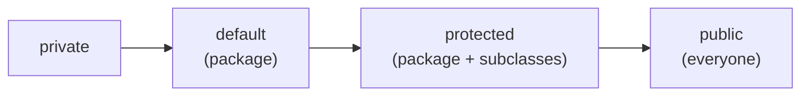
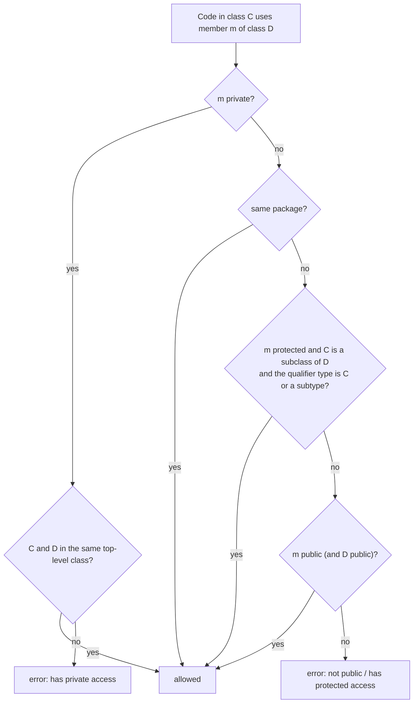
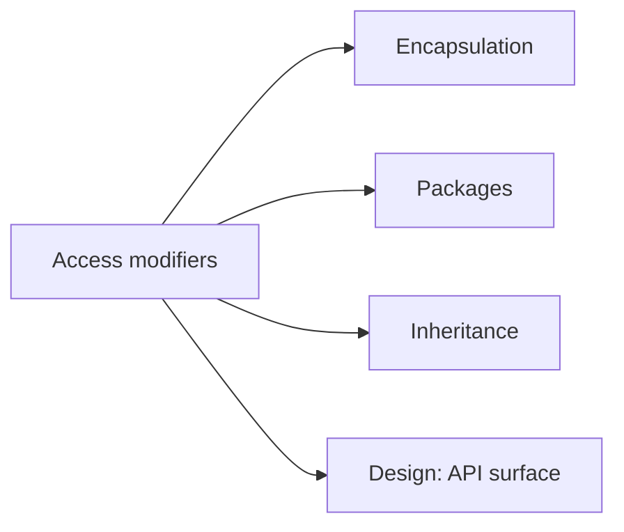

# Access Modifiers in Java: `public`, `protected`, default (package-private) and `private`

**TL;DR:** Access modifiers decide **who can see** a class or a member. `private` = only inside the same top-level class. **Default** (no keyword, "package-private") = anything in the same package. `protected` = the same package **plus** subclasses in other packages (with a catch). `public` = everyone. Top-level classes can only be `public` or default. When overriding, you may **widen** access but never narrow it.

## Table of Contents

1. [TL;DR](#1-tldr)
2. [Why it matters](#2-why-it-matters)
3. [Prerequisites](#3-prerequisites)
4. [Mental model](#4-mental-model)
5. [Core concepts](#5-core-concepts)
6. [How it works](#6-how-it-works)
7. [Examples](#7-examples)
8. [Comparisons](#8-comparisons)
9. [Trade-offs](#9-trade-offs)
10. [Gotchas](#10-gotchas)
11. [Practical application](#11-practical-application)
12. [Interview prep](#12-interview-prep)
13. [Interview question bank](#13-interview-question-bank)
14. [Tricky code snippets](#14-tricky-code-snippets)
15. [Connections](#15-connections)
16. [Summary](#16-summary)
17. [Answers](#answers)

> **Scope note.** The Encapsulation note covers *why* to hide data. This note is the full rulebook for the four modifiers, with real multi-package tests. The detailed `protected` rule for other packages has its own note (Accessing Protected Members Outside the Package); packages themselves are in the Packages note.

---

## 1. TL;DR

| Modifier | Same class | Same package | Subclass, other package | Anywhere else |
|---|---|---|---|---|
| `private` | ✅ | ❌ | ❌ | ❌ |
| default (none) | ✅ | ✅ | ❌ | ❌ |
| `protected` | ✅ | ✅ | ✅ (through subclass types) | ❌ |
| `public` | ✅ | ✅ | ✅ | ✅ |

- Errors tell you which door is closed: *has private access*, *is not public … cannot be accessed from outside package*, *has protected access* (Snippets 2, 3, 4).
- Top-level classes: only `public` or default; `private`/`protected` are errors (Snippets 12, 13).
- Override rule: same or wider access only (Snippets 14, 15).
- `private` methods are not inherited, so they aren't overridden (Snippet 16).
- Private constructors enable Singleton and factory patterns (Snippets 17, 18).

**The analogy: rooms in an office building.**

| Real world | Java |
|---|---|
| Your own desk drawer | `private`: only you (the class) |
| The open-plan floor, any colleague on the floor | default: same package |
| The floor plus your relatives' offices in other buildings who inherit the key | `protected`: package plus subclasses |
| The lobby | `public`: everyone |

**Running example:** package `shop` with `Item` (a `public name`, `protected stock`, default `code`, `private cost`), a `Clerk` in the same package, and a `Supplier` subclass in package `other` (Snippet 1, 6.2).

---

## 2. Why it matters

**The problem.** If every field and method is visible to everyone, any code can depend on any detail, and you can never change internals safely. Access modifiers let you publish a small, stable surface (the API) and hide the rest.

**What goes wrong** (verified on Java 21):

| Code | Result | Snippet |
|---|---|---|
| Reading another class's `private` field | Compile error: has private access | 2 |
| Using a default member from another package | Compile error: is not public … outside package | 3 |
| `protected` member from a non-subclass in another package | Compile error: has protected access | 4 |
| `protected` member via a *parent-typed* reference in a subclass | Compile error | 6 |
| Class declared `private` at top level | Compile error | 12 |
| Overriding with weaker access | Compile error | 14 |
| `new` on a private constructor | Compile error | 18 |
| `private public int x` | Compile error: illegal combination | 24 |
| `private int x` as a local variable | Compile error | 25 |
| Reading a record's field `p.x` | Compile error: private | 26 |

**Why interviewers ask.** "Explain the four access modifiers", "can a top-level class be private/protected?", "difference between default and protected", "can you reduce visibility when overriding?", "how do you make a class a Singleton?" are guaranteed fundamentals.

---

## 3. Prerequisites

| Prerequisite | One-line refresher | Importance |
|---|---|---|
| Classes and members | Fields, methods, constructors | Essential |
| Packages | A namespace, matching the folder layout | Essential |
| Inheritance | `extends`; subclasses inherit accessible members | Essential |
| Overriding | Same signature, different class | Important |
| Encapsulation | Hide data, expose behaviour | Helpful |

---

## 4. Mental model

> **The one picture to keep in your head:** four concentric zones around a member. `private` is the innermost (just the class), default adds the package, `protected` adds *subclasses anywhere*, `public` is everyone. Each modifier simply chooses how many rings can see the member.

```
 ┌──────────────────────── everyone (public) ───────────────────────┐
 │  ┌───────────── subclasses in other packages (protected) ──────┐ │
 │  │  ┌──────────── same package (default) ───────────────────┐  │ │
 │  │  │  ┌──────── same class (private) ────────┐             │  │ │
 │  │  │  │   the member lives here              │             │  │ │
 │  │  │  └──────────────────────────────────────┘             │  │ │
 │  │  └───────────────────────────────────────────────────────┘  │ │
 │  └─────────────────────────────────────────────────────────────┘ │
 └───────────────────────────────────────────────────────────────────┘
```
*The wider the ring, the more code depends on the member.*


*Ordered from most restrictive to least.*

---

## 5. Core concepts

### 5.1 Glossary

- **Access modifier:** a keyword controlling visibility of a class or member.
- **Default / package-private:** no keyword; visible within the package.
- **Package:** the namespace (and directory) containing a class.
- **Member:** field, method, constructor or nested type.
- **Top-level class:** not nested in another class.
- **Encapsulation:** hiding state behind a controlled interface.
- **API surface:** the `public`/`protected` members others may depend on.
- **Nestmate:** classes nested in the same top-level class; share private access.

### 5.2 The four modifiers in detail

**`private`**
- Visible only inside the **top-level class body**, including nested classes (Snippets 8, 9).
- Another *instance* of the same class can access it (Snippet 8): `private` is class-level, not object-level.
- Not inherited, so it can't be overridden (Snippet 16) and a subclass can't read it (Snippet 36). A same-named subclass field is unrelated (Snippet 35).
- Reflection can bypass it (`setAccessible(true)`) (Snippet 23) ⚠️ unless modules or a `SecurityManager` block it.

**default (package-private)**
- Written as *nothing*. Visible to every class in the **same package** (Snippet 33), not to subclasses in other packages (Snippet 21) and not to other packages (Snippet 3).
- Not the same as `protected`.
- Default is *not* implied inside an interface: interface members are implicitly `public` (Snippet 32).

**`protected`**
- Same package: like default (Snippet 34).
- Other packages: only through **inheritance**: a subclass can use the inherited member on `this` or on references of its own (or a sub-) type (Snippets 5, 7), not through a reference typed as the parent (Snippet 6) and not from non-subclasses (Snippet 4).
- Applies to constructors too: `new A()` from outside is an error (Snippet 19), `super()` from a subclass is fine (Snippet 20).
- Protected statics are accessible to subclasses (Snippet 22).
- An anonymous subclass counts as a subclass (Snippet 28).

**`public`**
- Visible everywhere (subject to module exports, ⚠️ beyond this note).

### 5.3 Where each modifier can appear

| Element | public | protected | default | private |
|---|---|---|---|---|
| Top-level class/interface/enum/record | ✅ | ❌ (Snippet 13) | ✅ | ❌ (Snippet 12) |
| Nested (member) class | ✅ | ✅ | ✅ | ✅ |
| Field, method, constructor | ✅ | ✅ | ✅ | ✅ |
| Local variable / parameter | ❌ | ❌ | n/a | ❌ (Snippet 25) |
| Interface member (before `private` methods) | implicit | ❌ | ❌ | ✅ for methods since Java 9 |
| Enum constructor | ❌ | ❌ | ✅ (implicitly private) | ✅ |

### 5.4 Class-level rules

- A `public` top-level class must live in a file with the same name (Snippet 11).
- A package-private class isn't importable from other packages (Snippet 10).
- A public class can extend a package-private one; inherited public methods remain callable (Snippet 30).
- You can't combine two access modifiers (Snippet 24).

### 5.5 Override and access

- An overriding method must have the **same or wider** access: `protected` → `public` is fine (Snippet 15); `public` → `protected` is an error (Snippet 14). Implementing an interface method with default access is the classic mistake (Snippet 32).
- `private` methods are invisible to subclasses, so a same-named method is a brand-new method (Snippet 16).

### 5.6 Constructors

- `private` constructor: only the class itself (and nestmates) can call `new` (Snippets 17, 18): Singleton, factory methods, utility classes.
- `protected` constructor: subclasses may call `super(...)` (Snippet 20); others can't `new` (Snippet 19).
- Default constructors get the **same access as the class** (public class → public constructor).

### 5.7 Records and encapsulation

A record's component fields are `private final`; use the accessor `p.x()` (Snippets 26, 27). Getters/setters give controlled, validated access (Snippet 31).

### 5.8 Special cases

- `Object.clone()` is `protected`: calling it on an `Object` reference outside the class fails (Snippet 29).
- Protected access to a member inherited from a *different-package* parent through the parent type is rejected even inside the subclass (Snippet 6), the most-tested protected rule.

---

## 6. How it works

### 6.1 The compiler's access check


*The check is purely compile-time (plus reflection/linking rules at run time).*

### 6.2 Worked trace: shop and other

```java
// File: shop/Item.java
package shop;
public class Item {
    public String name = "pen";
    protected int stock = 5;
    int code = 7;
    private double cost = 1.5;
    public double costView() { return cost; }
}
// File: shop/Clerk.java
package shop;
public class Clerk {
    public String peek(Item i) { return i.name + " " + i.stock + " " + i.code; }
}
// File: other/Supplier.java
package other;
import shop.Item;
public class Supplier extends Item {
    public String peek() { return name + " " + stock; }
}
// File: Main.java
import shop.*;
import other.Supplier;
public class Main {
    public static void main(String[] args) {
        Item i = new Item();
        System.out.println(i.name + " " + i.costView());
        System.out.println(new Clerk().peek(i));
        System.out.println(new Supplier().peek());
    }
}
```

Output (verified, Java 21, compiled as separate packages):

```
pen 1.5
pen 5 7
pen 5
```

| Who | Sees `name` | `stock` | `code` | `cost` |
|---|---|---|---|---|
| `Main` (other package, not a subclass) | ✅ | ❌ | ❌ | ❌ (uses `costView()`) |
| `Clerk` (same package) | ✅ | ✅ | ✅ | ❌ |
| `Supplier` (subclass, other package) | ✅ | ✅ | ❌ | ❌ |

### 6.3 Access to a protected member from a subclass in another package

The compiler requires the *expression's type* to be the subclass (or a subtype). `this.x`, `x`, `other.x` where `other` is a `B` all work (Snippets 5, 7); `other.x` where `other` is the parent type `A` doesn't (Snippet 6). Reason: otherwise a subclass could peek into unrelated siblings' state.

### 6.4 Private is by top-level class

Nested classes and their outer class share private members (Snippet 9) because they are in the same top-level class body (Java 11+ nestmates make this direct at run time ⚠️ implementation detail).

### 6.5 Runtime and reflection

The JVM re-checks access when linking and via reflection. `setAccessible(true)` lifts the check for private members in the unnamed module (Snippet 23); strong encapsulation in modules (JPMS) can still block it ⚠️ (not demonstrated).

---

## 7. Examples

### 7.1 Toy example

```java
class Account {
    private double balance;
    void deposit(double a) { if (a <= 0) throw new IllegalArgumentException("bad amount"); balance += a; }
    double balance() { return balance; }
}
```
Valid deposits update the private field; invalid ones are rejected: `bad amount`, balance `50.0` (Snippet 31).

### 7.2 Real-world examples

- **JDK:** `ArrayList.elementData` is `private`; `AbstractList.modCount` is `protected`; `Object.clone`/`finalize` are `protected`.
- **Singleton:** private constructor plus a static accessor (Snippet 17).
- **Utility classes:** `private` constructor so nobody instantiates `Math`-like classes.
- **Frameworks:** JPA/Jackson read private fields through reflection ⚠️ (not run here).
- **Libraries:** public API in one package; implementation in `internal` packages with package-private classes.
- **Template Method:** `protected` hook methods for subclasses (Snippet 28).

---

## 8. Comparisons

### 8.1 `protected` vs default

| Aspect | default | `protected` |
|---|---|---|
| Same package | ✅ | ✅ |
| Subclass in another package | ❌ (Snippet 21) | ✅ (Snippet 5) |
| Non-subclass in another package | ❌ | ❌ |
| Written as | nothing | `protected` |

### 8.2 `private` vs default: encapsulation strength

| | `private` | default |
|---|---|---|
| Visible to same-package classes | No | Yes |
| Overridable | No | Yes (within the package) |
| Good for | Internal state | Package-internal helpers |

### 8.3 Class-level vs member-level

| | Top-level class | Member |
|---|---|---|
| Allowed modifiers | public, default | all four |
| `private`/`protected` | Error | Allowed |

### 8.4 Overriding access (same or wider)

| Parent → child | Allowed? |
|---|---|
| `public` → `public` | ✅ |
| `public` → `protected`/default/`private` | ❌ (Snippet 14) |
| `protected` → `public` | ✅ (Snippet 15) |
| `protected` → `protected` | ✅ |
| default → `protected`/`public`/default | ✅ (same package) |
| `private` | n/a, not inherited (Snippet 16) |

### 8.5 Access modifiers vs other keywords

| Concept | Controls |
|---|---|
| Access modifier | Who can see it |
| `final` | Whether it can change/override |
| `static` | Whether it belongs to the class |
| `abstract` | Whether it needs an implementation |

---

## 9. Trade-offs

| Decision | Benefit | Cost | Use when |
|---|---|---|---|
| `private` fields | Free to change internals | Need accessors | Default for state |
| Default (package-private) | Collaboration within a package without publishing | Hidden coupling in the package | Package-internal helpers |
| `protected` | Extension hooks | Subclass coupling; it's still API | Designed-for-inheritance classes |
| `public` | Easy use | Permanent API commitment | Intended API only |
| Getters/setters on private fields | Validation, invariants | Boilerplate | Anything with rules |
| Records | Concise immutable data | Fixed shape | Value types |
| Private constructor + factory | Control instances | No direct `new` | Singleton, caching |
| Widening access when overriding | Exposes more | Larger API | Rarely, deliberately |
| Reflection to reach private | Frameworks work | Breaks encapsulation | Frameworks only |

---

## 10. Gotchas

### Myths

- ❌ **Myth:** "`private` is per object." ✅ **Reality:** per class; another instance of the same class can read it (Snippet 8).
- ❌ **Myth:** "Default and `protected` are the same." ✅ **Reality:** only `protected` reaches subclasses in other packages (Snippets 5, 21).
- ❌ **Myth:** "A subclass can read a `protected` member through any reference." ✅ **Reality:** only through its own type (Snippets 6, 7).
- ❌ **Myth:** "A top-level class can be `private` or `protected`." ✅ **Reality:** only `public` or default (Snippets 12, 13).
- ❌ **Myth:** "`private` methods can be overridden." ✅ **Reality:** a same-named method is unrelated (Snippet 16).
- ❌ **Myth:** "You can reduce visibility when overriding." ✅ **Reality:** only widen (Snippets 14, 15).
- ❌ **Myth:** "Interface methods are package-private by default." ✅ **Reality:** public (Snippet 32).
- ❌ **Myth:** "`private` means unreadable." ✅ **Reality:** reflection can reach it (Snippet 23).
- ❌ **Myth:** "A record's fields are public." ✅ **Reality:** private; use accessors (Snippets 26, 27).
- ❌ **Myth:** "Local variables can have modifiers like `private`." ✅ **Reality:** only `final` (Snippet 25).

### Common mistakes and edge cases

- **Forgetting `public` when implementing an interface method** (Snippet 32).
- **Calling a `protected` member from a non-subclass in another package** (Snippet 4).
- **Accessing protected via the parent type** (Snippet 6).
- **Naming a `public` class differently from its file** (Snippet 11).
- **Making fields `public` "for convenience".**
- **Expecting a private field to be hidden from `this`'s subclass** (it is hidden; they see their own) (Snippet 35).
- **Putting `protected` on a top-level class** (Snippet 13).
- **Assuming `clone()` is callable** (Snippet 29).

---

## 11. Practical application

### Checklist
- [ ] Make fields `private`; expose behaviour, not data.
- [ ] Make classes and members as restrictive as possible; widen only when needed.
- [ ] Use package-private for helpers that collaborate inside a package.
- [ ] Use `protected` only for deliberate extension points, and document them.
- [ ] Keep constructors `private`/protected for Singleton, factories and abstract bases.
- [ ] When overriding or implementing, never narrow access.
- [ ] Mark interface implementations `public`.
- [ ] Put one public class per file, named exactly like the file.

### Hands-on exercise

In package `bank`, create `Account` with a `private double balance`, a `protected String owner`, a package-private `int id`, and a `public String describe()` returning `owner + ":" + id`. In package `app`, create `Savings extends bank.Account` and try, in a method, to read `owner`, `id` and `balance`. Which compile?

<details><summary>Solution</summary>

- `owner` compiles (`protected`, via inheritance).
- `id` does **not** compile: package-private, and `app` is a different package: *id is not public in Account; cannot be accessed from outside package*.
- `balance` does **not** compile: *balance has private access in Account*.

The same rules were verified with real two-package compilations (Snippets 21, 36 show the `id` and `balance` errors; Snippet 5 shows the allowed `protected` access).
</details>

---

## 12. Interview prep

Eight model answers, as you would say them aloud.

<details><summary>1. Explain the four access modifiers in Java.</summary>

`private`: only inside the same top-level class. Default (no keyword): the same package. `protected`: the same package plus subclasses in other packages, through their own type. `public`: everywhere. They go from most to least restrictive (1, 5.2; Snippets 1-7).
</details>

<details><summary>2. What is the difference between default and `protected`?</summary>

Both reach the whole package, but only `protected` reaches subclasses in *other* packages. A default member is invisible to a subclass in a different package; a protected one is inherited and usable there (Snippets 5, 21).
</details>

<details><summary>3. Which modifiers can a top-level class have?</summary>

Only `public` or default (package-private). `private` and `protected` are compile errors because they'd make no sense without an enclosing class; nested classes can use all four (Snippets 12, 13).
</details>

<details><summary>4. Can you reduce visibility when overriding?</summary>

No. An overrider must be at least as accessible: `public` can't become `protected`, but `protected` can become `public`. A classic mistake is implementing an interface method without `public` (Snippets 14, 15, 32).
</details>

<details><summary>5. Is `private` per object or per class?</summary>

Per class. Another instance of the same class, or a nested class, can read a private field; code outside the top-level class can't (Snippets 8, 9, 2).
</details>

<details><summary>6. Why make a constructor private?</summary>

To control instantiation: Singleton, static factory methods, utility classes, or classes only created by nested builders. Outside code gets "has private access" on `new` (Snippets 17, 18).
</details>

<details><summary>7. Why can't a subclass in another package read a `protected` field through a parent-type reference?</summary>

The rule requires the qualifier's type to be the subclass or its subtype, so a subclass can't peek into arbitrary parent-type (possibly sibling) objects. `this.x` or a `B` reference works; an `A` reference doesn't (6.3; Snippets 5, 6, 7).
</details>

<details><summary>8. Can reflection break `private`?</summary>

Yes: `setAccessible(true)` reads private members unless a module boundary or security policy blocks it. Access modifiers are compile-time and linking rules, not a security boundary ⚠️ (Snippet 23).
</details>

---

## 13. Interview question bank


### 13.1 Basics (Q1–Q14)

<details><summary>Q1. What is the default access level?</summary>

Package-private: visible in the same package only (Snippets 3, 33).
</details>

<details><summary>Q2. Is there a `default` keyword for access?</summary>

No; the absence of a modifier means default. (`default` is only for interface methods.)
</details>

<details><summary>Q3. Which is the most restrictive modifier?</summary>

`private`.
</details>

<details><summary>Q4. Which is the least restrictive?</summary>

`public`.
</details>

<details><summary>Q5. What does `private` allow?</summary>

Access within the same top-level class, including nested classes (Snippets 8, 9).
</details>

<details><summary>Q6. What does `protected` allow?</summary>

Same package, plus subclasses in other packages (Snippets 5, 34).
</details>

<details><summary>Q7. Can a non-subclass in another package use a protected member?</summary>

No (Snippet 4).
</details>

<details><summary>Q8. What do the error messages look like?</summary>

"has private access", "is not public in X; cannot be accessed from outside package", "has protected access" (Snippets 2, 3, 4).
</details>

<details><summary>Q9. Can access modifiers apply to local variables?</summary>

No (Snippet 25).
</details>

<details><summary>Q10. Can you combine `private public`?</summary>

No (Snippet 24).
</details>

<details><summary>Q11. Do default methods in interfaces use "default access"?</summary>

No; the keyword `default` is unrelated; interface members are public (Snippet 32).
</details>

<details><summary>Q12. What access do interface members have?</summary>

Public implicitly (private methods since Java 9).
</details>

<details><summary>Q13. What access does a default constructor get?</summary>

The same as its class.
</details>

<details><summary>Q14. Do access modifiers affect runtime performance?</summary>

No.
</details>


### 13.2 Classes (Q15–Q24)

<details><summary>Q15. Which modifiers can a top-level class have?</summary>

`public` or default (Snippets 12, 13).
</details>

<details><summary>Q16. Which can a nested class have?</summary>

All four.
</details>

<details><summary>Q17. Must a public class match its file name?</summary>

Yes (Snippet 11).
</details>

<details><summary>Q18. How many public top-level classes per file?</summary>

At most one.
</details>

<details><summary>Q19. Can a package-private class be used from another package?</summary>

No (Snippet 10).
</details>

<details><summary>Q20. Can a public class extend a package-private class?</summary>

Yes; public inherited methods stay callable (Snippet 30).
</details>

<details><summary>Q21. Can a package-private class have public methods?</summary>

Yes, but they're reachable only where the class is.
</details>

<details><summary>Q22. What is the access of an enum constructor?</summary>

Implicitly private (see the Enum note).
</details>

<details><summary>Q23. What is the access of a record's fields?</summary>

Private final; use accessors (Snippets 26, 27).
</details>

<details><summary>Q24. Can a class be both `public` and `abstract`/`final`?</summary>

Yes; those are independent of access.
</details>


### 13.3 Members and inheritance (Q25–Q38)

<details><summary>Q25. Can a subclass inherit a private field?</summary>

It exists in the object but isn't accessible (Snippets 35, 36).
</details>

<details><summary>Q26. If the subclass declares `x`, does it hide the parent's private `x`?</summary>

It's simply a different field (Snippet 35).
</details>

<details><summary>Q27. Can a private method be overridden?</summary>

No; a same-named method is new (Snippet 16).
</details>

<details><summary>Q28. Can you widen access when overriding?</summary>

Yes (Snippet 15).
</details>

<details><summary>Q29. Can you narrow it?</summary>

No (Snippet 14).
</details>

<details><summary>Q30. Why do implementers get "weaker access privileges"?</summary>

They forgot `public` on an interface method (Snippet 32).
</details>

<details><summary>Q31. Can a subclass in another package use a default member?</summary>

No (Snippet 21).
</details>

<details><summary>Q32. A protected member through `this`?</summary>

Yes (Snippet 5).
</details>

<details><summary>Q33. Through a parent-typed parameter?</summary>

No (Snippet 6).
</details>

<details><summary>Q34. Through a subclass-typed parameter?</summary>

Yes (Snippet 7).
</details>

<details><summary>Q35. Protected static members?</summary>

Accessible by subclasses via the inherited name or the class name (Snippet 22).
</details>

<details><summary>Q36. Anonymous subclasses and protected?</summary>

They count as subclasses (Snippet 28).
</details>

<details><summary>Q37. Is `Object.clone()` public?</summary>

No; protected (Snippet 29).
</details>

<details><summary>Q38. Can a public subclass expose a package-private parent's method?</summary>

The inherited public method is callable (Snippet 30).
</details>


### 13.4 Constructors and patterns (Q39–Q48)

<details><summary>Q39. How do you implement a Singleton with access modifiers?</summary>

Private constructor, a private static instance, a public static getter (Snippet 17).
</details>

<details><summary>Q40. What happens on `new` from outside?</summary>

"has private access" (Snippet 18).
</details>

<details><summary>Q41. How do you prevent instantiation of a utility class?</summary>

A private constructor (often throwing an error).
</details>

<details><summary>Q42. Can a protected constructor be called with `new` from another package?</summary>

No (Snippet 19).
</details>

<details><summary>Q43. Can a subclass call it?</summary>

Yes via `super()` (Snippet 20).
</details>

<details><summary>Q44. What is a static factory method?</summary>

A public static method returning instances, allowing a private constructor.
</details>

<details><summary>Q45. What is the Template Method's access pattern?</summary>

A public final template calling protected hooks (Snippet 28).
</details>

<details><summary>Q46. Why use getters/setters?</summary>

To validate and control access to private state (Snippet 31).
</details>

<details><summary>Q47. Does `private` give security?</summary>

No; reflection can reach it (Snippet 23).
</details>

<details><summary>Q48. What is encapsulation?</summary>

Hiding state behind a controlled interface using private fields and public methods.
</details>


### 13.5 Design (Q49–Q58)

<details><summary>Q49. What should your default access be?</summary>

As restrictive as possible, usually `private` for fields.
</details>

<details><summary>Q50. When use package-private?</summary>

For helpers collaborating within a package.
</details>

<details><summary>Q51. When use `protected`?</summary>

For deliberate extension points of a class designed for inheritance.
</details>

<details><summary>Q52. Is `protected` part of the public API?</summary>

Yes; subclasses outside depend on it.
</details>

<details><summary>Q53. What is "API surface"?</summary>

All public and protected members others can depend on.
</details>

<details><summary>Q54. Why avoid public fields?</summary>

Can't add validation or change representation later.
</details>

<details><summary>Q55. How do records handle encapsulation?</summary>

Private final fields and public accessors (Snippet 27).
</details>

<details><summary>Q56. What do modules (JPMS) add?</summary>

A level above packages: exports control which packages are visible ⚠️.
</details>

<details><summary>Q57. How do you test package-private code?</summary>

Put the test in the same package (Snippet 33).
</details>

<details><summary>Q58. Does `private` apply per instance or class?</summary>

Class (Snippet 8).
</details>

---

## 14. Tricky code snippets

36 snippets, each compiled and run on OpenJDK 21. Predict the output (or the compile error) before opening the answer. Snippets with several files show each file after a `// File:` comment, and were compiled together with `javac -d out`; `Main` is in the default package.

### Snippet 1: shop, other and Main

```java
// File: shop/Item.java
package shop;
public class Item {
    public String name = "pen";
    protected int stock = 5;
    int code = 7;
    private double cost = 1.5;
    public double costView() { return cost; }
}
// File: shop/Clerk.java
package shop;
public class Clerk {
    public String peek(Item i) { return i.name + " " + i.stock + " " + i.code; }
}
// File: other/Supplier.java
package other;
import shop.Item;
public class Supplier extends Item {
    public String peek() { return name + " " + stock; }
}
// File: Main.java
import shop.*;
import other.Supplier;
public class Main {
    public static void main(String[] args) {
        Item i = new Item();
        System.out.println(i.name + " " + i.costView());
        System.out.println(new Clerk().peek(i));
        System.out.println(new Supplier().peek());
    }
}
```

<details><summary>Answer</summary>

```
pen 1.5
pen 5 7
pen 5
```

Trace in 6.2: `Main` sees only public; `Clerk` the whole package; `Supplier` public and protected.
</details>

### Snippet 2: Reading another class's private field

```java
class A { private int x = 1; }
class B { int get(A a) { return a.x; } }
public class Main { public static void main(String[] args) { } }
```

<details><summary>Answer</summary>

Compile error: *x has private access in A*.

Even in the same package.
</details>

### Snippet 3: Default member from another package

```java
// File: p/A.java
package p;
public class A { int x = 1; }
// File: Main.java
import p.A;
public class Main { public static void main(String[] args) { System.out.println(new A().x); } }
```

<details><summary>Answer</summary>

Compile error: *x is not public in A; cannot be accessed from outside package*.

Package-private.
</details>

### Snippet 4: Protected from a non-subclass

```java
// File: p/A.java
package p;
public class A { protected int x = 1; }
// File: Main.java
import p.A;
public class Main { public static void main(String[] args) { System.out.println(new A().x); } }
```

<details><summary>Answer</summary>

Compile error: *x has protected access in A*.

`Main` doesn't extend `A`.
</details>

### Snippet 5: Protected through inheritance

```java
// File: p/A.java
package p;
public class A { protected int x = 1; protected void hi() { System.out.println("hi"); } }
// File: q/B.java
package q;
import p.A;
public class B extends A { public void test() { System.out.println(x); hi(); this.hi(); } }
// File: Main.java
public class Main { public static void main(String[] args) { new q.B().test(); } }
```

<details><summary>Answer</summary>

```
1
hi
hi
```

`x`, `hi()` and `this.hi()` are all fine in the subclass.
</details>

### Snippet 6: Protected via a parent-typed reference

```java
// File: p/A.java
package p;
public class A { protected int x = 1; }
// File: q/B.java
package q;
import p.A;
public class B extends A { public int test(A other) { return other.x; } }
// File: Main.java
public class Main { public static void main(String[] args) { } }
```

<details><summary>Answer</summary>

Compile error: *x has protected access in A*.

The qualifier type must be `B` or a subtype.
</details>

### Snippet 7: Protected via a subclass-typed reference

```java
// File: p/A.java
package p;
public class A { protected int x = 1; }
// File: q/B.java
package q;
import p.A;
public class B extends A { public int test(B other) { return other.x; } }
// File: Main.java
public class Main { public static void main(String[] args) { System.out.println(new q.B().test(new q.B())); } }
```

<details><summary>Answer</summary>

```
1
```

`other` is a `B`, so it's allowed.
</details>

### Snippet 8: Private across instances

```java
public class Main {
    private int v;
    Main(int v) { this.v = v; }
    boolean same(Main o) { return this.v == o.v; }
    public static void main(String[] args) { System.out.println(new Main(3).same(new Main(3))); }
}
```

<details><summary>Answer</summary>

```
true
```

`private` is class-level.
</details>

### Snippet 9: Nested class reading a private field

```java
public class Main {
    private int secret = 9;
    static class N { int read(Main m) { return m.secret; } }
    public static void main(String[] args) { System.out.println(new N().read(new Main())); }
}
```

<details><summary>Answer</summary>

```
9
```

Same top-level class.
</details>

### Snippet 10: Importing a package-private class

```java
// File: p/Hidden.java
package p;
class Hidden { public int x = 1; }
// File: Main.java
import p.Hidden;
public class Main { public static void main(String[] args) { } }
```

<details><summary>Answer</summary>

Compile error: *Hidden is not public in p; cannot be accessed from outside package*.

Not accessible outside `p`.
</details>

### Snippet 11: Public class in the wrong file

```java
// File: Wrong.java
public class Other { }
// File: Main.java
public class Main { public static void main(String[] args) { } }
```

<details><summary>Answer</summary>

Compile error: *class Other is public, should be declared in a file named Other.java*.

File name must match.
</details>

### Snippet 12: `private` top-level class

```java
private class A { }
public class Main { public static void main(String[] args) { } }
```

<details><summary>Answer</summary>

Compile error: *modifier private not allowed here*.

Top-level classes are public or default.
</details>

### Snippet 13: `protected` top-level class

```java
protected class A { }
public class Main { public static void main(String[] args) { } }
```

<details><summary>Answer</summary>

Compile error: *modifier protected not allowed here*.

Same.
</details>

### Snippet 14: Narrowing access when overriding

```java
class A { public void m() { } }
class B extends A { protected void m() { } }
public class Main { public static void main(String[] args) { } }
```

<details><summary>Answer</summary>

Compile error: *m() in B cannot override m() in A*.

The detail: attempting to assign weaker access privileges; was public.
</details>

### Snippet 15: Widening access when overriding

```java
class A { protected void m() { System.out.println("A"); } }
class B extends A { public void m() { System.out.println("B"); } }
public class Main { public static void main(String[] args) { new B().m(); } }
```

<details><summary>Answer</summary>

```
B
```

`protected` → `public` is allowed.
</details>

### Snippet 16: Private method and a same-named subclass method

```java
class A {
    private void m() { System.out.println("A.m"); }
    void call() { m(); }
}
class B extends A { void m() { System.out.println("B.m"); } }
public class Main { public static void main(String[] args) { new B().call(); } }
```

<details><summary>Answer</summary>

```
A.m
```

`call()` in `A` uses `A`'s private `m`; `B.m` is unrelated.
</details>

### Snippet 17: Singleton

```java
class Single {
    private static final Single I = new Single();
    private Single() { }
    static Single get() { return I; }
}
public class Main {
    public static void main(String[] args) {
        System.out.println(Single.get() == Single.get());
    }
}
```

<details><summary>Answer</summary>

```
true
```

Both calls return the single instance.
</details>

### Snippet 18: `new` on a private constructor

```java
// File: p/Single.java
package p;
public class Single { private Single() { } }
// File: Main.java
import p.Single;
public class Main { public static void main(String[] args) { new Single(); } }
```

<details><summary>Answer</summary>

Compile error: *Single() has private access in Single*.

Not callable from `Main`.
</details>

### Snippet 19: `new` on a protected constructor

```java
// File: p/A.java
package p;
public class A { protected A() { } }
// File: Main.java
import p.A;
public class Main { public static void main(String[] args) { new A(); } }
```

<details><summary>Answer</summary>

Compile error: *A() has protected access in A*.

Protected constructors can't be called with `new` outside the package.
</details>

### Snippet 20: `super()` to a protected constructor

```java
// File: p/A.java
package p;
public class A { protected A() { System.out.println("A()"); } }
// File: q/B.java
package q;
public class B extends p.A { public B() { super(); System.out.println("B()"); } }
// File: Main.java
public class Main { public static void main(String[] args) { new q.B(); } }
```

<details><summary>Answer</summary>

```
A()
B()
```

A subclass constructor may call it.
</details>

### Snippet 21: Subclass reading a default member from another package

```java
// File: p/A.java
package p;
public class A { int x = 1; }
// File: q/B.java
package q;
public class B extends p.A { public int get() { return x; } }
// File: Main.java
public class Main { public static void main(String[] args) { } }
```

<details><summary>Answer</summary>

Compile error: *x is not public in A; cannot be accessed from outside package*.

Default isn't inherited across packages.
</details>

### Snippet 22: Protected static from a subclass

```java
// File: p/A.java
package p;
public class A { protected static String tag() { return "tag"; } }
// File: q/B.java
package q;
public class B extends p.A { public String t() { return tag() + " " + p.A.tag(); } }
// File: Main.java
public class Main { public static void main(String[] args) { System.out.println(new q.B().t()); } }
```

<details><summary>Answer</summary>

```
tag tag
```

Accessible by simple name and through `p.A`.
</details>

### Snippet 23: Reflection and `private`

```java
import java.lang.reflect.Field;
class A { private int x = 42; }
public class Main {
    public static void main(String[] args) throws Exception {
        Field f = A.class.getDeclaredField("x");
        f.setAccessible(true);
        System.out.println(f.get(new A()));
    }
}
```

<details><summary>Answer</summary>

```
42
```

`setAccessible(true)` lifts the check ⚠️.
</details>

### Snippet 24: `private public`

```java
class A { private public int x; }
public class Main { public static void main(String[] args) { } }
```

<details><summary>Answer</summary>

Compile error: *illegal combination of modifiers: public and private*.

One access modifier only.
</details>

### Snippet 25: `private` local variable

```java
public class Main { public static void main(String[] args) { private int x = 1; } }
```

<details><summary>Answer</summary>

Compile error: *illegal start of expression*.

Locals take no access modifiers.
</details>

### Snippet 26: Record field access

```java
record P(int x) { }
class Use { int f(P p) { return p.x; } }
public class Main { public static void main(String[] args) { } }
```

<details><summary>Answer</summary>

Compile error: *x has private access in P*.

Use `p.x()`.
</details>

### Snippet 27: Record accessor

```java
record P(int x) { }
public class Main { public static void main(String[] args) { System.out.println(new P(4).x()); } }
```

<details><summary>Answer</summary>

```
4
```

Accessors are public.
</details>

### Snippet 28: Anonymous subclass using a protected method

```java
// File: p/A.java
package p;
public class A { protected void hook() { System.out.println("hook"); } }
// File: Main.java
import p.A;
public class Main {
    public static void main(String[] args) {
        new A() { void run() { hook(); } }.run();
    }
}
```

<details><summary>Answer</summary>

```
hook
```

An anonymous subclass is a subclass.
</details>

### Snippet 29: `clone()` on an `Object`

```java
public class Main {
    public static void main(String[] args) throws Exception {
        Object o = new Object();
        Object c = o.clone();
    }
}
```

<details><summary>Answer</summary>

Compile error: *clone() has protected access in Object*.

Protected, and `Main` isn't `Object`.
</details>

### Snippet 30: Public subclass of a package-private parent

```java
// File: p/Base.java
package p;
class Base { public String hi() { return "hi"; } }
// File: p/Pub.java
package p;
public class Pub extends Base { }
// File: Main.java
public class Main { public static void main(String[] args) { System.out.println(new p.Pub().hi()); } }
```

<details><summary>Answer</summary>

```
hi
```

The inherited public method is reachable via `Pub`.
</details>

### Snippet 31: Validation through methods

```java
class Account {
    private double balance;
    void deposit(double a) { if (a <= 0) throw new IllegalArgumentException("bad amount"); balance += a; }
    double balance() { return balance; }
}
public class Main {
    public static void main(String[] args) {
        Account a = new Account();
        a.deposit(50);
        try { a.deposit(-1); } catch (IllegalArgumentException e) { System.out.println(e.getMessage()); }
        System.out.println(a.balance());
    }
}
```

<details><summary>Answer</summary>

```
bad amount
50.0
```

The private field is protected by `deposit`.
</details>

### Snippet 32: Implementing without `public`

```java
interface I { int X = 1; void m(); }
class C implements I { void m() { } }
public class Main { public static void main(String[] args) { } }
```

<details><summary>Answer</summary>

Compile error: *m() in C cannot implement m() in I*.

The detail: attempting to assign weaker access privileges; was public.
</details>

### Snippet 33: Default access within a package

```java
// File: p/A.java
package p;
public class A { int x = 5; }
// File: p/B.java
package p;
public class B { public int get() { return new A().x; } }
// File: Main.java
public class Main { public static void main(String[] args) { System.out.println(new p.B().get()); } }
```

<details><summary>Answer</summary>

```
5
```

`B` and `A` share package `p`.
</details>

### Snippet 34: Protected within a package

```java
// File: p/A.java
package p;
public class A { protected int x = 3; }
// File: p/B.java
package p;
public class B { public int get(A a) { return a.x; } }
// File: Main.java
public class Main { public static void main(String[] args) { System.out.println(new p.B().get(new p.A())); } }
```

<details><summary>Answer</summary>

```
3
```

Same package, so allowed.
</details>

### Snippet 35: Subclass field with the same name

```java
class A { private int x = 1; int ax() { return x; } }
class B extends A { int x = 2; }
public class Main {
    public static void main(String[] args) {
        B b = new B();
        System.out.println(b.x + " " + b.ax() + " " + ((A) b).ax());
    }
}
```

<details><summary>Answer</summary>

```
2 1 1
```

`B.x` is a separate field; `A.ax()` reads `A`'s private `x`.
</details>

### Snippet 36: Subclass reading a private field

```java
class A { private int x = 1; }
class B extends A { int get() { return x; } }
public class Main { public static void main(String[] args) { } }
```

<details><summary>Answer</summary>

Compile error: *x has private access in A*.

Private isn't inherited.
</details>

---

## 15. Connections

| Related topic | How it connects |
|---|---|
| Encapsulation | Private fields plus public methods |
| Packages and imports | Default and protected depend on the package |
| Protected access outside the package | The detailed rule (next-but-two note) |
| Inheritance and overriding | Same-or-wider access; private isn't inherited |
| Constructors | Private/protected constructors; singleton, factories |
| Interfaces | Members are public; implementers need `public` |
| Inner classes | Share private access with the outer class |
| Records and enums | Private fields; private constructors |
| Reflection and modules | Can bypass or tighten access |


*Access control sits under most OOP design decisions.*

---

## 16. Summary

### 60-second card

- `private` < default < `protected` < `public`.
- `private`: same top-level class. Default: same package. `protected`: package + subclasses (via own type). `public`: all.
- Top-level classes: public or default only.
- Override: same or wider access.
- Private constructors: Singleton/factory. Protected: subclass-only.
- Records: private fields, public accessors.
- Reflection can bypass `private` (compile-time rule, not security).

### Cheat sheet

```java
package shop;
public class Item {
    public String name;        // everyone
    protected int stock;       // package + subclasses
    int code;                  // package only
    private double cost;       // this class only
    private Item() { }         // controlled creation
}
```

| Need | Use |
|---|---|
| Hide state | `private` + accessors |
| Package helper | default |
| Extension hook | `protected` |
| API | `public` |
| Control instances | `private` constructor |

### Self-test

1. Which modifiers can a top-level class use?
2. What's the difference between default and `protected`?
3. Can you override a `public` method as `protected`?
4. Can another instance of the same class read your private field?
5. Why can a subclass in another package not read `a.x` when `a` is the parent type?
6. What access do interface methods have?
7. How do you make a class a Singleton?
8. What can bypass `private`?

### Anki flashcards

```
private :: Same top-level class only
default (no keyword) :: Same package only
protected :: Same package + subclasses (through their own type)
public :: Everyone
Top-level class modifiers :: public or default only
Override access rule :: Same or wider, never narrower
Private constructor :: Singleton / factory / utility class
Interface members :: Implicitly public
Record fields :: private final; public accessors
```

### Resources

- *The Java Language Specification*, 6.6 (Access Control): docs.oracle.com/javase/specs
- The Java Tutorials, "Controlling Access to Members of a Class": docs.oracle.com/javase/tutorial
- *Effective Java*, Joshua Bloch: "Minimize the accessibility of classes and members"

---

## Answers

1. `public` or default.
2. `protected` also reaches subclasses in other packages.
3. No; access can't be narrowed.
4. Yes; `private` is per class.
5. The qualifier must be the subclass type, not the parent type.
6. Public.
7. A private constructor and a static accessor.
8. Reflection with `setAccessible(true)` ⚠️.
