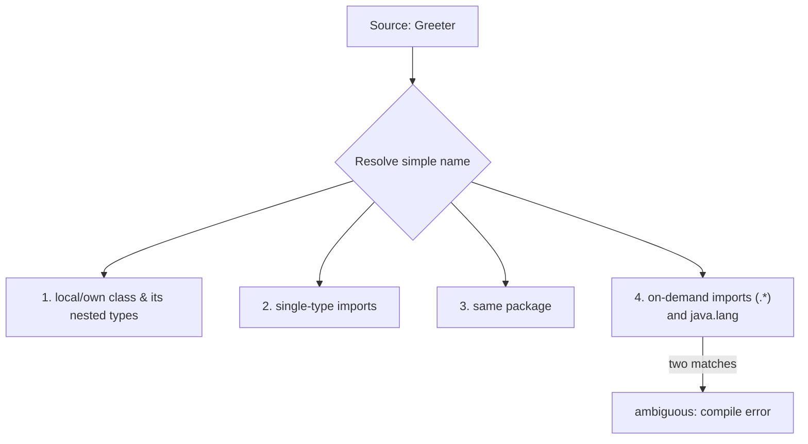
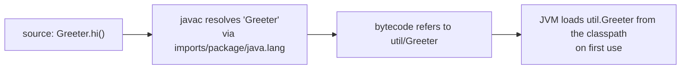
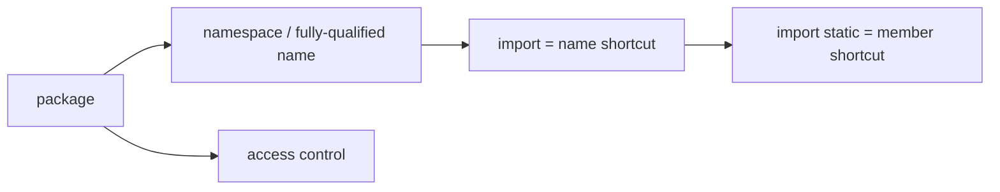

# Packages, `import` Statements and Static Imports in Java

**TL;DR:** A **package** is a namespace that groups related classes and (by convention) maps to a folder: `package util;` means the file lives in `util/`. An **`import`** statement is only a *naming shortcut* for the compiler: it lets you write `List` instead of `java.util.List`. It never loads or copies anything. **`import static`** does the same for static members (`sqrt(16)` instead of `Math.sqrt(16)`). Only `java.lang` is imported automatically. Wildcards (`.*`) import one package's classes, not its sub-packages, and clashes between two wildcards cause "ambiguous" errors unless you add a single-type import or a fully-qualified name.

## Table of Contents

1. [TL;DR](#1-tldr)
2. [Why it matters](#2-why-it-matters)
3. [Prerequisites](#3-prerequisites)
4. [Mental model](#4-mental-model)
5. [Core concepts](#5-core-concepts)
6. [How it works](#6-how-it-works)
7. [Examples](#7-examples)
8. [Comparisons](#8-comparisons)
9. [Trade-offs](#9-trade-offs)
10. [Gotchas](#10-gotchas)
11. [Practical application](#11-practical-application)
12. [Interview prep](#12-interview-prep)
13. [Interview question bank](#13-interview-question-bank)
14. [Tricky code snippets](#14-tricky-code-snippets)
15. [Connections](#15-connections)
16. [Summary](#16-summary)
17. [Answers](#answers)

> **Scope note.** Access levels tied to packages are in the Access Modifiers note. Constructor chaining across packages and protected access across packages have their own notes. Modules (JPMS) and build tools are mentioned only as ⚠️ pointers.

---

## 1. TL;DR

- `package util;` must be the **first statement** in the file (Snippet 10).
- Without `import`, you must use the **fully-qualified name**: `util.Greeter.hi()` (Snippets 2, 3).
- `import util.Greeter;` (single-type) and `import util.*;` (on-demand) are both just shortcuts (Snippets 1, 4).
- `.*` does **not** include sub-packages (Snippet 5).
- `java.lang` is auto-imported (Snippet 8); classes in the **same package** need no import (Snippet 9).
- Name clashes: two wildcards → ambiguous (Snippet 6); a single-type import wins (Snippet 7); your own class wins over a wildcard (Snippet 23); a single import clashing with your own class is an error (Snippet 22).
- `import static java.lang.Math.sqrt;` / `.*` imports static members (Snippets 12, 13); instance members can't be statically imported (Snippet 14).
- Imports **don't load classes** (Snippet 27).
- The default (unnamed) package can't be imported from a named package (Snippets 11, 32).

**The analogy: street addresses and speed-dial.**

| Real world | Java |
|---|---|
| A full postal address "12 Park Lane, Springfield" | Fully-qualified name `util.Greeter` |
| The street/neighbourhood name | Package |
| Saving "Greeter" as a speed-dial contact | `import util.Greeter;` |
| Saving the entire street's contacts | `import util.*;` |
| Two contacts both named "Date" from different streets | Ambiguity; use the full address |
| Speed-dial doesn't call anyone until you press it | Imports don't load classes |

**Running example:** a `util.Greeter` class used from `app.Main` with `import util.Greeter;` (Snippet 1, 6.2).

---

## 2. Why it matters

**The problem.** Big programs have thousands of classes; without namespaces two libraries could both define `Date` or `List` and collide. Packages organise code, avoid naming clashes, and carry access control (default and protected visibility are package-based).

**What goes wrong** (verified on Java 21):

| Code | Result | Snippet |
|---|---|---|
| Using a class from another package without import | Compile error: cannot find symbol | 2 |
| `import util.*;` then using `util.deep.D` as `D` | Compile error: cannot find symbol | 5 |
| `import java.util.*; import java.sql.*;` then `Date` | Compile error: reference to Date is ambiguous | 6 |
| `package` after `import` | Compile error: class, interface, enum, or record expected | 10 |
| Named-package class using a default-package class | Compile error: cannot find symbol | 11 |
| `import static java.lang.String.length;` | Compile error: cannot find symbol (instance method) | 14 |
| Two static wildcard imports both having `max(int,int)` | Compile error: ambiguous | 16 |
| `import java.lang.Math.*;` then `PI` | Compile error | 18 |
| `import util.Nope;` | Compile error: package util does not exist | 21 |
| `import java.util.List;` plus your own `class List` | Compile error: already defined | 22 |

**Why interviewers ask.** "What is a package and why use it?", "does `import` copy code or load the class?", "does `import pkg.*` include sub-packages?", "what is a static import?", "what is auto-imported?", "how do you resolve a clash between `java.util.Date` and `java.sql.Date`?" are standard.

---

## 3. Prerequisites

| Prerequisite | One-line refresher | Importance |
|---|---|---|
| Classes and files | One public class per file, named after it | Essential |
| Static members | Belong to the class | Essential (for static imports) |
| Access modifiers | Default access is package-based | Important |
| Compilation vs run | `javac` then `java` | Important |
| Directory structure | Folders mirror package names | Helpful |

---

## 4. Mental model

> **The one picture to keep in your head:** a package is a **folder of names**. A class's real name is `package.ClassName` (its fully-qualified name). `import` doesn't bring any code in; it only tells the compiler "when I write `Greeter`, I mean `util.Greeter`". The JVM always uses the full name.

```
 src/
 ├── util/Greeter.java        package util;   → class util.Greeter
 └── app/Main.java            package app;    → class app.Main
                              import util.Greeter;  // "Greeter" == "util.Greeter" in this file

 compiled to:  out/util/Greeter.class   out/app/Main.class
 run with:     java -cp out app.Main    (fully-qualified main class)
```
*Source folders, package names, and class files line up one-to-one.*


*Roughly the lookup order for a simple type name (⚠️ simplified; see JLS 6.4.1 for shadowing details).*

---

## 5. Core concepts

### 5.1 Glossary

- **Package:** a named group of classes/interfaces; a namespace.
- **Fully-qualified name (FQN):** `package.Class`, e.g. `java.util.List`.
- **`import`:** compile-time shortcut for a type name.
- **Single-type import:** `import java.util.List;`
- **On-demand (wildcard) import:** `import java.util.*;`
- **Static import:** `import static java.lang.Math.sqrt;` for static members.
- **Unnamed (default) package:** classes with no `package` line.
- **Classpath:** where the JVM looks for compiled classes.
- **Reverse-domain naming:** `com.company.product.module`.
- **Module:** a higher-level grouping above packages (JPMS) ⚠️.

### 5.2 Packages

- Declared by `package x.y.z;`, the **first non-comment statement** (Snippet 10).
- Convention: all lowercase, reverse domain name (`com.oxane.reports`).
- Folder layout should mirror the package: `com/oxane/reports/Report.java`.
- The package is part of the class's identity: `util.Greeter.class.getName()` is `util.Greeter`, `getSimpleName()` is `Greeter`, `getPackageName()` is `util` (Snippet 20).
- Two classes with the same simple name can live in different packages (Snippet 19).
- Sub-packages are **not special**: `p.q` is a completely separate package from `p`; there's no extra access (Snippet 28).
- Classes without a `package` line are in the **unnamed package** (`Main.class.getPackageName()` is empty, Snippet 20).

### 5.3 Using a class from another package

Three ways:
1. Fully-qualified name each time (Snippet 3).
2. Single-type import (Snippet 1).
3. Wildcard import (Snippet 4).

Without any of them: *cannot find symbol* (Snippet 2).

### 5.4 What is imported automatically

- `java.lang.*` (`String`, `Integer`, `Math`, `System`, `StringBuilder`...) (Snippet 8).
- Everything in the **same package** (Snippet 9).
- Nested classes are visible by their simple names inside the outer class; from elsewhere import `p.Outer.Inner` (Snippet 29).

### 5.5 Single-type vs wildcard imports

| | `import java.util.List;` | `import java.util.*;` |
|---|---|---|
| Imports | One type | All public types in that package |
| Sub-packages | n/a | **Not** included (Snippet 5) |
| Runtime cost | None | None |
| Clash behaviour | Wins over wildcards (Snippet 7) | Two matches → ambiguous (Snippet 6) |
| Readability | Explicit | Shorter, less explicit |

Wildcards have **no** performance penalty; they're a compile-time convenience.

### 5.6 Resolving name clashes

- Two wildcards with the same simple name (`java.util.Date`, `java.sql.Date`): ambiguous (Snippet 6).
- Add a single-type import for the one you want (Snippet 7).
- Or use fully-qualified names for both (Snippet 24).
- **Your own class** in the current file/package shadows a wildcard-imported one (Snippet 23).
- A **single-type import** conflicting with your own top-level class in the same file is an error (Snippet 22).
- Importing a non-existent package or class: "package util does not exist" (Snippet 21).

### 5.7 Static imports

```java
import static java.lang.Math.sqrt;   // one member
import static java.lang.Math.*;      // all static members
import static java.lang.System.out;  // a static field
```
- Imports static methods, fields, enum constants and nested static types (Snippets 12, 13, 17, 25, 30).
- An import of a method brings **all overloads** (Snippet 26).
- **Instance** members can't be imported (Snippet 14); neither can `private` ones (Snippet 31).
- It's `import static`, not `import` plus `*` on a class: `import java.lang.Math.*;` imports nested *types* named in `Math`, not its static members (Snippet 18).
- A method or field declared in **your own class** hides a static import of the same name (Snippet 15).
- Two static wildcards with the same member signature: ambiguous (Snippet 16).
- Over-use hurts readability: where does `max` come from? (Snippet 33 is a reasonable use.)

### 5.8 Imports don't load or include code

An `import` creates no run-time dependency by itself. A class is loaded when first *used*; an imported-but-unused class never loads (Snippet 27). Unused imports compile fine (IDEs flag them).

### 5.9 Default (unnamed) package

- Classes with no `package` statement.
- **Can't** be imported or referenced from a named package (Snippets 11, 32).
- Fine for tiny demos; avoid in real projects.

### 5.10 Compiling and running with packages

```
javac -d out util/Greeter.java app/Main.java
java -cp out app.Main
```
Use the **fully-qualified** main class name; `-cp` points at the root of the class folders. ⚠️ Build tools (Maven/Gradle) and JARs handle this for you, and JPMS modules add `exports`/`requires` (not covered here).

---

## 6. How it works

### 6.1 From name to class


*`javac` rewrites every simple name to its full name; the JVM never sees imports.*

### 6.2 Worked trace: util and app

```java
// File: util/Greeter.java
package util;
public class Greeter {
    public static String hello(String n) { return "Hello " + n; }
}
// File: app/Main.java
package app;
import util.Greeter;
import java.util.List;
public class Main {
    public static void main(String[] args) {
        List<String> names = List.of("raj", "asha");
        for (String n : names) System.out.println(Greeter.hello(n));
        System.out.println(Main.class.getName());
    }
}
```

Output (verified, Java 21; run with `java -cp out app.Main`):

```
Hello raj
Hello asha
app.Main
```

| Step | What happens |
|---|---|
| `package app;` | `Main` is `app.Main` |
| `import util.Greeter;` | `Greeter` means `util.Greeter` in this file |
| `import java.util.List;` | `List` means `java.util.List` |
| `Main.class.getName()` | `app.Main`: the package is part of the name |

### 6.3 Resolution priority (simplified)

1. Types declared in the file (and nested/inherited member types).
2. Single-type imports (and single static imports).
3. Types in the same package.
4. On-demand imports and `java.lang`.

That is why a local `Date` beats `import java.util.*` (Snippet 23) and a single import beats two wildcards (Snippet 7). ⚠️ Simplified; the JLS has additional shadowing cases.

### 6.4 Static import resolution

A static import adds the member's *simple name* to the file's scope. A method declared in the class itself (or inherited) shadows it (Snippet 15); with two imports of the same signature, the call is ambiguous (Snippet 16).

### 6.5 Package-based access

Default (package-private) and `protected` access are decided by package equality, not by folder or sub-package relationships (Snippet 28). See the Access Modifiers note.

---

## 7. Examples

### 7.1 Toy example

```java
import static java.lang.Math.*;
double r = 2;
System.out.printf("%.2f%n", PI * pow(r, 2));   // 12.57
```
Verified (Snippet 33).

### 7.2 Real-world examples

- **JDK:** `java.util`, `java.io`, `java.time`, `java.sql`; `java.lang` is auto-imported.
- **Company code:** `com.company.product.domain`, `.service`, `.repository`.
- **Tests:** `import static org.junit.Assertions.*;` ⚠️ (library not run here).
- **Constants:** `import static java.lang.System.out;` (Snippet 17) or enums (Snippet 25).
- **Libraries/JARs:** distribute packages; `-cp lib.jar` exposes them.
- **Large code bases:** package-by-feature or by-layer to avoid clashes.

---

## 8. Comparisons

### 8.1 Import vs fully-qualified name

| | `import` | Fully-qualified |
|---|---|---|
| Typing | Short | Long |
| Clash handling | Needs care | Always unambiguous |
| Runtime effect | None | None |

### 8.2 `import` vs `import static`

| | `import` | `import static` |
|---|---|---|
| Brings in | Types | Static members (and static nested types) |
| Syntax | `import java.util.List;` | `import static java.lang.Math.sqrt;` |
| Instance members | n/a | Not allowed |
| Use | Everywhere | Sparingly (constants, utility methods) |

### 8.3 Default package vs named package

| | Default | Named |
|---|---|---|
| `package` line | None | Yes |
| Importable | No | Yes |
| Can use default-package classes | Yes | No |
| Use | Demos | All real code |

### 8.4 `import` vs `#include` vs classpath

| Idea | Java `import` | C `#include` | Classpath |
|---|---|---|---|
| Copies code? | No | Yes | No |
| Locates class files? | No | n/a | Yes (at compile and run) |
| Effect | Name shortcut | Textual inclusion | Search path |

### 8.5 Wildcard import vs sub-package

| Import | Includes `util.A`? | Includes `util.deep.D`? |
|---|---|---|
| `import util.*;` | Yes | No (Snippet 5) |
| `import util.deep.*;` | No | Yes |

---

## 9. Trade-offs

| Decision | Benefit | Cost | Use when |
|---|---|---|---|
| Single-type imports | Explicit and clear | More lines | Default style |
| Wildcard imports | Short | May hide clashes | Many types from one package |
| Fully-qualified name | No ambiguity | Verbose | A rare clash |
| Static imports | Readable math/constants | Origin hidden; clashes | Few well-known members |
| Package by feature | Cohesive | Cross-feature dependencies | Most apps |
| Package by layer | Familiar | Features scatter | Small services |
| Deep package trees | Organised | Long names | Large teams |
| Default package | Simple | Can't be imported | Throwaway demos |

---

## 10. Gotchas

### Myths

- ❌ **Myth:** "`import` copies/loads the class." ✅ **Reality:** a name shortcut only; classes load on first use (Snippet 27).
- ❌ **Myth:** "`import util.*` includes sub-packages." ✅ **Reality:** it does not (Snippet 5).
- ❌ **Myth:** "Wildcard imports are slower." ✅ **Reality:** no run-time difference.
- ❌ **Myth:** "You must import `String` and `System`." ✅ **Reality:** `java.lang` is automatic (Snippet 8).
- ❌ **Myth:** "Same-package classes need an import." ✅ **Reality:** they don't (Snippet 9).
- ❌ **Myth:** "`package` can appear after imports." ✅ **Reality:** it must be first (Snippet 10).
- ❌ **Myth:** "Sub-packages get special access to the parent." ✅ **Reality:** `p.q` and `p` are unrelated (Snippet 28).
- ❌ **Myth:** "Static imports work for instance methods." ✅ **Reality:** static members only (Snippet 14).
- ❌ **Myth:** "`import java.lang.Math.*;` gives you `PI`." ✅ **Reality:** you need `import static` (Snippet 18).
- ❌ **Myth:** "Imports decide which class is loaded at run time." ✅ **Reality:** the compiled name does; the classpath finds it (6.1).

### Common mistakes and edge cases

- **Forgetting the import** → "cannot find symbol" (Snippet 2).
- **`java.util.Date` vs `java.sql.Date`** wildcard clash (Snippet 6).
- **A local class shadowing a JDK class** you meant to use (Snippet 23).
- **Static import shadowed by a local method** (Snippet 15).
- **Ambiguous static wildcards** (Snippet 16).
- **Using a default-package class from a named package** (Snippets 11, 32).
- **Running `java Main` instead of `java app.Main`** ⚠️ for packaged classes.
- **Folder structure not matching the package** ⚠️ (works with `javac -d`, but breaks conventions and tools).

---

## 11. Practical application

### Checklist
- [ ] Declare a package for every class; use reverse-domain, lowercase names.
- [ ] Mirror packages with folders.
- [ ] Prefer single-type imports; use wildcards for large sets from one package.
- [ ] Never leave real code in the default package.
- [ ] Resolve clashes with a single import or a fully-qualified name.
- [ ] Use static imports only for a handful of obvious members.
- [ ] Remove unused imports (IDE "organise imports").
- [ ] Compile with `-d` and run with the fully-qualified main class.

### Hands-on exercise

Create packages `geo` with `Point` (public fields `x`, `y`) and `geo.util` with `Dist` having `public static double between(Point a, Point b)`. From a `Main` in the default package, compute the distance between `(0,0)` and `(3,4)` using `import static geo.util.Dist.between;` and `import geo.Point;`. What do you print? Why would `import geo.*;` alone not be enough for `Dist`?

<details><summary>Solution</summary>

```java
// File: geo/Point.java
package geo;
public class Point { public double x, y; public Point(double x, double y) { this.x = x; this.y = y; } }
// File: geo/util/Dist.java
package geo.util;
import geo.Point;
public class Dist {
    public static double between(Point a, Point b) { return Math.hypot(a.x - b.x, a.y - b.y); }
}
// File: Main.java
import geo.Point;
import static geo.util.Dist.between;
public class Main {
    public static void main(String[] args) {
        System.out.println(between(new Point(0, 0), new Point(3, 4)));
    }
}
```

Output (verified on Java 21, compiled as three files): `5.0`.

`import geo.*;` covers only `geo.Point`, not the sub-package `geo.util`, so `Dist` would need its own import (Snippet 5).
</details>

---

## 12. Interview prep

Eight model answers, as you would say them aloud.

<details><summary>1. What is a package and why use it?</summary>

A named group of related classes and interfaces forming a namespace. It avoids name clashes (two libraries can both have `Date`), organises code, and drives package-private and `protected` access. By convention it's lowercase reverse-domain and mirrors the folder layout (5.2; Snippets 19, 20).
</details>

<details><summary>2. What does an `import` statement actually do?</summary>

It only lets you use a simple name instead of the fully-qualified one; the compiler rewrites it. It doesn't copy code, doesn't load the class, and the JVM never sees it. A class loads on first use, and an unused import is harmless (6.1; Snippets 2, 3, 27).
</details>

<details><summary>3. Does `import pkg.*` import sub-packages?</summary>

No. It imports the public types directly in `pkg`. `import util.*;` doesn't make `util.deep.D` visible as `D`; you need `import util.deep.*;` (Snippet 5).
</details>

<details><summary>4. What is imported automatically?</summary>

All of `java.lang` (`String`, `Math`, `System`, ...) and every class in the same package. Everything else needs an import or a fully-qualified name (Snippets 8, 9).
</details>

<details><summary>5. How do you resolve `Date` when you import both `java.util.*` and `java.sql.*`?</summary>

The simple name is ambiguous. Add a single-type import for the one you want (`import java.util.Date;`, which beats wildcards) or use fully-qualified names (Snippets 6, 7, 24).
</details>

<details><summary>6. What is a static import, and when is it appropriate?</summary>

`import static java.lang.Math.sqrt;` (or `.*`) lets you call static methods and use static fields and enum constants without the class name. Use it sparingly for obvious constants and utilities; overuse hides where a name comes from. It can't import instance or private members (Snippets 12, 14, 31).
</details>

<details><summary>7. What happens with a name defined both locally and imported?</summary>

Your own class or method wins over a wildcard or static import (Snippets 15, 23), but a single-type import that conflicts with your own top-level class in the same file is a compile error (Snippet 22).
</details>

<details><summary>8. What is the default (unnamed) package, and why avoid it?</summary>

The package of classes with no `package` line. Classes there can't be imported or referenced from named packages, so it's only suitable for tiny demos (Snippets 11, 32).
</details>

---

## 13. Interview question bank


### 13.1 Packages (Q1–Q14)

<details><summary>Q1. How do you declare a package?</summary>

`package com.company.app;` as the first statement (Snippet 10).
</details>

<details><summary>Q2. Must the package declaration be first?</summary>

Yes, before imports (Snippet 10).
</details>

<details><summary>Q3. What naming convention is used?</summary>

Lowercase, reverse domain: `com.company.product`.
</details>

<details><summary>Q4. Do folders need to match packages?</summary>

By convention and for tools; build output must mirror it (5.2, 5.10).
</details>

<details><summary>Q5. What's the fully-qualified name?</summary>

Package plus class: `util.Greeter` (Snippet 20).
</details>

<details><summary>Q6. How do you get a class's package at run time?</summary>

`getPackageName()` (Snippet 20).
</details>

<details><summary>Q7. Can two packages have the same class name?</summary>

Yes (Snippet 19).
</details>

<details><summary>Q8. Are `p` and `p.q` related?</summary>

No special access or inclusion (Snippet 28).
</details>

<details><summary>Q9. What is the unnamed package?</summary>

Classes with no `package` line (Snippet 20).
</details>

<details><summary>Q10. Can a named package use unnamed-package classes?</summary>

No (Snippets 11, 32).
</details>

<details><summary>Q11. Which package is always available?</summary>

`java.lang` (Snippet 8).
</details>

<details><summary>Q12. Does the same package need imports?</summary>

No (Snippet 9).
</details>

<details><summary>Q13. What's the benefit of packages for access control?</summary>

Default and protected access are package-based (Snippet 28).
</details>

<details><summary>Q14. How do you run a class in a package?</summary>

`java -cp out pkg.Main` (5.10, 6.2).
</details>


### 13.2 Imports (Q15–Q30)

<details><summary>Q15. What does `import` do?</summary>

Lets you use a simple name; nothing is copied or loaded (Snippet 27).
</details>

<details><summary>Q16. Single-type vs wildcard?</summary>

One type vs all types of one package; no runtime difference (5.5).
</details>

<details><summary>Q17. Does `.*` include sub-packages?</summary>

No (Snippet 5).
</details>

<details><summary>Q18. Without an import, what's the error?</summary>

cannot find symbol (Snippet 2).
</details>

<details><summary>Q19. Can you avoid imports?</summary>

Yes, with fully-qualified names (Snippet 3).
</details>

<details><summary>Q20. Does an unused import cause an error?</summary>

No; just a warning in IDEs.
</details>

<details><summary>Q21. What if the imported package doesn't exist?</summary>

"package util does not exist" (Snippet 21).
</details>

<details><summary>Q22. What if two wildcards provide the same simple name?</summary>

Ambiguity error on use (Snippet 6).
</details>

<details><summary>Q23. How do you fix it?</summary>

A single-type import or FQN (Snippets 7, 24).
</details>

<details><summary>Q24. Who wins: your own class or a wildcard import?</summary>

Your own class (Snippet 23).
</details>

<details><summary>Q25. Who wins: your own class or a single-type import?</summary>

Compile error for a clash in the same file (Snippet 22).
</details>

<details><summary>Q26. Can you import a nested class?</summary>

Yes, `import p.Outer.Inner;` (Snippet 29).
</details>

<details><summary>Q27. Does importing slow startup?</summary>

No; classes load lazily (Snippet 27).
</details>

<details><summary>Q28. Is the order of imports significant?</summary>

No.
</details>

<details><summary>Q29. What is `import java.lang.*;` for?</summary>

Redundant; implicit.
</details>

<details><summary>Q30. Can you import from the unnamed package?</summary>

No (Snippets 11, 32).
</details>


### 13.3 Static imports (Q31–Q44)

<details><summary>Q31. What's a static import?</summary>

Import of static members so you can use them without the class name (Snippet 12).
</details>

<details><summary>Q32. Syntax?</summary>

`import static pkg.Class.member;` or `.*` (Snippets 12, 13).
</details>

<details><summary>Q33. Can it import fields?</summary>

Yes, `out` from `System` (Snippet 17).
</details>

<details><summary>Q34. Enum constants?</summary>

Yes (Snippet 25).
</details>

<details><summary>Q35. Static nested classes?</summary>

Yes, they're static members.
</details>

<details><summary>Q36. Overloaded methods?</summary>

One import brings all overloads (Snippet 26).
</details>

<details><summary>Q37. Instance members?</summary>

No (Snippet 14).
</details>

<details><summary>Q38. Private members?</summary>

No (Snippet 31).
</details>

<details><summary>Q39. `import java.lang.Math.*;` (without static)?</summary>

Doesn't give `PI`; error (Snippet 18).
</details>

<details><summary>Q40. Who wins: a local method or a static import?</summary>

The local method (Snippet 15).
</details>

<details><summary>Q41. Two static wildcards with the same method?</summary>

Ambiguous (Snippet 16).
</details>

<details><summary>Q42. When is it good style?</summary>

A few obvious members: math, constants, test assertions (Snippet 33).
</details>

<details><summary>Q43. When is it bad?</summary>

Many wildcard static imports; readers can't tell the origin.
</details>

<details><summary>Q44. Can a class be both imported and statically imported?</summary>

Yes, independently.
</details>


### 13.4 Compilation and run (Q45–Q52)

<details><summary>Q45. How do you compile packaged code?</summary>

`javac -d out $(find src -name "*.java")`.
</details>

<details><summary>Q46. How do you run it?</summary>

`java -cp out app.Main` (fully-qualified).
</details>

<details><summary>Q47. What does `-cp` do?</summary>

Gives the root(s) where class files live.
</details>

<details><summary>Q48. What is the classpath?</summary>

The list of folders/JARs searched for classes.
</details>

<details><summary>Q49. What happens if a class isn't on the classpath?</summary>

`NoClassDefFoundError` / `ClassNotFoundException` ⚠️.
</details>

<details><summary>Q50. What are JARs?</summary>

Zip archives of packages.
</details>

<details><summary>Q51. What are modules?</summary>

Groups of packages with explicit exports, from Java 9 ⚠️.
</details>

<details><summary>Q52. Do imports exist in bytecode?</summary>

No; names are fully-qualified in class files (6.1).
</details>


### 13.5 Design (Q53–Q60)

<details><summary>Q53. How to organise packages?</summary>

By feature or by layer; avoid cycles.
</details>

<details><summary>Q54. Why reverse-domain names?</summary>

Global uniqueness.
</details>

<details><summary>Q55. Why avoid the default package?</summary>

It can't be imported (Snippet 11).
</details>

<details><summary>Q56. Should you use wildcards?</summary>

Fine within limits; many teams prefer single imports.
</details>

<details><summary>Q57. What is "organise imports"?</summary>

IDE feature removing unused and sorting.
</details>

<details><summary>Q58. How to handle `Date` clashes?</summary>

FQN or a single import (Snippets 7, 24).
</details>

<details><summary>Q59. Can you use classes from `java.sql` without a module?</summary>

It's in the JDK's `java.sql` module, available by default on a full JDK ⚠️.
</details>

<details><summary>Q60. What's the relation of packages to access modifiers?</summary>

Default and protected rely on them (see the Access Modifiers note).
</details>

---

## 14. Tricky code snippets

33 snippets, each compiled and run on OpenJDK 21. Predict the output (or the compile error) before opening the answer. Snippets with several files show each file after a `// File:` comment, and were compiled together with `javac -d out`; `Main` is in the default package.

### Snippet 1: util and app

```java
// File: util/Greeter.java
package util;
public class Greeter {
    public static String hello(String n) { return "Hello " + n; }
}
// File: app/Main.java
package app;
import util.Greeter;
import java.util.List;
public class Main {
    public static void main(String[] args) {
        List<String> names = List.of("raj", "asha");
        for (String n : names) System.out.println(Greeter.hello(n));
        System.out.println(Main.class.getName());
    }
}
// Main: app.Main
```

<details><summary>Answer</summary>

```
Hello raj
Hello asha
app.Main
```

Trace in 6.2. Run with `java -cp out app.Main`.
</details>

### Snippet 2: Class from another package, no import

```java
// File: util/Greeter.java
package util;
public class Greeter { }
// File: Main.java
public class Main { public static void main(String[] args) { Greeter g = new Greeter(); } }
```

<details><summary>Answer</summary>

Compile error: *cannot find symbol*.

The compiler doesn't know `Greeter`; the detail says `symbol: class Greeter` (reported twice, for the type and the constructor).
</details>

### Snippet 3: Fully-qualified name

```java
// File: util/Greeter.java
package util;
public class Greeter { public static String hi() { return "hi"; } }
// File: Main.java
public class Main { public static void main(String[] args) { System.out.println(util.Greeter.hi()); } }
```

<details><summary>Answer</summary>

```
hi
```

No import needed.
</details>

### Snippet 4: On-demand import

```java
// File: util/A.java
package util;
public class A { public static String a() { return "A"; } }
// File: util/B.java
package util;
public class B { public static String b() { return "B"; } }
// File: Main.java
import util.*;
public class Main { public static void main(String[] args) { System.out.println(A.a() + B.b()); } }
```

<details><summary>Answer</summary>

```
AB
```

Both `util.A` and `util.B` are visible.
</details>

### Snippet 5: `.*` and sub-packages

```java
// File: util/A.java
package util;
public class A { }
// File: util/deep/D.java
package util.deep;
public class D { }
// File: Main.java
import util.*;
public class Main { public static void main(String[] args) { D d = new D(); } }
```

<details><summary>Answer</summary>

Compile error: *cannot find symbol*.

`util.*` doesn't include `util.deep`.
</details>

### Snippet 6: Two wildcards, same simple name

```java
import java.util.*;
import java.sql.*;
public class Main { public static void main(String[] args) { Date d = null; } }
```

<details><summary>Answer</summary>

Compile error: *reference to Date is ambiguous*.

The detail: both class java.sql.Date in java.sql and class java.util.Date in java.util match.
</details>

### Snippet 7: Single-type import resolves the clash

```java
import java.util.*;
import java.sql.*;
import java.util.Date;
public class Main {
    public static void main(String[] args) {
        Date d = new Date(0);
        System.out.println(d.getClass().getName());
    }
}
```

<details><summary>Answer</summary>

```
java.util.Date
```

It takes priority over wildcards.
</details>

### Snippet 8: `java.lang` is automatic

```java
public class Main {
    public static void main(String[] args) {
        System.out.println(Integer.MAX_VALUE + " " + Math.abs(-3) + " " + new StringBuilder("x").append("y"));
    }
}
```

<details><summary>Answer</summary>

```
2147483647 3 xy
```

No imports for `Integer`, `Math`, `StringBuilder`.
</details>

### Snippet 9: Same package

```java
// File: p/A.java
package p;
public class A { public static String a() { return "A"; } }
// File: p/B.java
package p;
public class B { public static String b() { return A.a() + "B"; } }
// File: Main.java
public class Main { public static void main(String[] args) { System.out.println(p.B.b()); } }
```

<details><summary>Answer</summary>

```
AB
```

`B` uses `A` without an import.
</details>

### Snippet 10: `package` after `import`

```java
import java.util.List;
package p;
public class Main { public static void main(String[] args) { } }
```

<details><summary>Answer</summary>

Compile error: *class, interface, enum, or record expected*.

The package declaration must come first.
</details>

### Snippet 11: Named package using a default-package class

```java
// File: Helper.java
public class Helper { }
// File: p/A.java
package p;
public class A { Helper h; }
// File: Main.java
public class Main { public static void main(String[] args) { } }
```

<details><summary>Answer</summary>

Compile error: *cannot find symbol*.

`Helper` is in the unnamed package; `p.A` can't see it.
</details>

### Snippet 12: Static import of one method

```java
import static java.lang.Math.sqrt;
public class Main { public static void main(String[] args) { System.out.println(sqrt(16)); } }
```

<details><summary>Answer</summary>

```
4.0
```

`sqrt(16)` without `Math.`.
</details>

### Snippet 13: Static wildcard

```java
import static java.lang.Math.*;
public class Main { public static void main(String[] args) { System.out.println(PI > 3 ? max(2, 7) : 0); } }
```

<details><summary>Answer</summary>

```
7
```

`PI` and `max` both come from `Math`.
</details>

### Snippet 14: Static import of an instance method

```java
import static java.lang.String.length;
public class Main { public static void main(String[] args) { } }
```

<details><summary>Answer</summary>

Compile error: *cannot find symbol*.

The detail says `symbol: static length`: only static members can be imported.
</details>

### Snippet 15: Local method vs static import

```java
import static java.lang.Math.sqrt;
public class Main {
    static double sqrt(double d) { return -1; }
    public static void main(String[] args) { System.out.println(sqrt(16)); }
}
```

<details><summary>Answer</summary>

```
-1.0
```

Your own `sqrt` hides the imported one.
</details>

### Snippet 16: Two static wildcards, same method

```java
import static java.lang.Math.*;
import static java.lang.Integer.*;
public class Main { public static void main(String[] args) { System.out.println(max(1, 2)); } }
```

<details><summary>Answer</summary>

Compile error: *reference to max is ambiguous*.

The detail: both method max(int,int) in Math and method max(int,int) in Integer match.
</details>

### Snippet 17: Static import of a field

```java
import static java.lang.System.out;
public class Main { public static void main(String[] args) { out.println("via static import"); } }
```

<details><summary>Answer</summary>

```
via static import
```

`System.out` imported as `out`.
</details>

### Snippet 18: `import` (not static) with `.*`

```java
import java.lang.Math.*;
public class Main { public static void main(String[] args) { System.out.println(PI); } }
```

<details><summary>Answer</summary>

Compile error: *cannot find symbol*.

The detail says `symbol: variable PI`; `Math.*` without `static` imports nested types only.
</details>

### Snippet 19: Same class name in two packages

```java
// File: a/Item.java
package a;
public class Item { public String who() { return "a.Item"; } }
// File: b/Item.java
package b;
public class Item { public String who() { return "b.Item"; } }
// File: Main.java
import a.Item;
public class Main {
    public static void main(String[] args) {
        Item x = new Item();
        b.Item y = new b.Item();
        System.out.println(x.who() + " " + y.who());
    }
}
```

<details><summary>Answer</summary>

```
a.Item b.Item
```

One imported, one fully-qualified.
</details>

### Snippet 20: Name, simple name, package

```java
// File: util/Greeter.java
package util;
public class Greeter { }
// File: Main.java
public class Main {
    public static void main(String[] args) {
        System.out.println(util.Greeter.class.getName() + " " + util.Greeter.class.getSimpleName() + " " + util.Greeter.class.getPackageName());
        System.out.println(String.class.getPackageName() + " " + Main.class.getPackageName().isEmpty());
    }
}
```

<details><summary>Answer</summary>

```
util.Greeter Greeter util
java.lang true
```

The default package's name is the empty string.
</details>

### Snippet 21: Import of a missing package

```java
import util.Nope;
public class Main { public static void main(String[] args) { } }
```

<details><summary>Answer</summary>

Compile error: *package util does not exist*.

Nothing named `util` was compiled.
</details>

### Snippet 22: Single import vs own class

```java
import java.util.List;
class List { }
public class Main { public static void main(String[] args) { } }
```

<details><summary>Answer</summary>

Compile error: *List is already defined in this compilation unit*.

The import and the declaration collide.
</details>

### Snippet 23: Own class vs wildcard

```java
import java.util.*;
class Date { public String toString() { return "my Date"; } }
public class Main { public static void main(String[] args) { System.out.println(new Date()); } }
```

<details><summary>Answer</summary>

```
my Date
```

A type declared in the file shadows on-demand imports.
</details>

### Snippet 24: FQN for both `Date`s

```java
public class Main {
    public static void main(String[] args) {
        java.util.Date u = new java.util.Date(0);
        java.sql.Date s = new java.sql.Date(0);
        System.out.println(u.getClass().getName() + " " + s.getClass().getName());
    }
}
```

<details><summary>Answer</summary>

```
java.util.Date java.sql.Date
```

No ambiguity.
</details>

### Snippet 25: Static import of enum constants

```java
// File: p/Color.java
package p;
public enum Color { RED, GREEN }
// File: Main.java
import static p.Color.*;
public class Main { public static void main(String[] args) { System.out.println(RED + " " + GREEN.ordinal()); } }
```

<details><summary>Answer</summary>

```
RED 1
```

`RED` and `GREEN` without `Color.`.
</details>

### Snippet 26: All overloads imported

```java
import static java.lang.Math.abs;
public class Main { public static void main(String[] args) { System.out.println(abs(-1) + " " + abs(-1.5)); } }
```

<details><summary>Answer</summary>

```
1 1.5
```

`abs(int)` and `abs(double)` both available.
</details>

### Snippet 27: Imports don't load classes

```java
// File: p/Heavy.java
package p;
public class Heavy { static { System.out.println("Heavy loaded"); } public static void use() { } }
// File: Main.java
import p.Heavy;
public class Main {
    public static void main(String[] args) {
        System.out.println("start");
        if (args.length > 0) Heavy.use();
        System.out.println("end");
    }
}
```

<details><summary>Answer</summary>

```
start
end
```

`Heavy`'s static block never runs because it isn't used.
</details>

### Snippet 28: Sub-package access

```java
// File: p/A.java
package p;
public class A { public int get(p.q.B b) { return b.v; } }
// File: p/q/B.java
package p.q;
public class B { int v = 1; }
// File: Main.java
public class Main { public static void main(String[] args) { } }
```

<details><summary>Answer</summary>

Compile error: *v is not public in B; cannot be accessed from outside package*.

`p.q` is a different package from `p`.
</details>

### Snippet 29: Importing a nested class

```java
// File: p/Outer.java
package p;
public class Outer { public static class Inner { public String s() { return "inner"; } } }
// File: Main.java
import p.Outer.Inner;
public class Main { public static void main(String[] args) { System.out.println(new Inner().s()); } }
```

<details><summary>Answer</summary>

```
inner
```

`import p.Outer.Inner;`.
</details>

### Snippet 30: Static import of a field and a method

```java
// File: p/Util.java
package p;
public class Util { public static final int LIMIT = 10; public static int twice(int x) { return 2 * x; } }
// File: Main.java
import static p.Util.LIMIT;
import static p.Util.twice;
public class Main { public static void main(String[] args) { System.out.println(twice(LIMIT)); } }
```

<details><summary>Answer</summary>

```
20
```

`twice(LIMIT)` = 2 × 10.
</details>

### Snippet 31: Static import of a private method

```java
// File: p/Util.java
package p;
public class Util { private static int secret() { return 1; } }
// File: Main.java
import static p.Util.secret;
public class Main { public static void main(String[] args) { } }
```

<details><summary>Answer</summary>

Compile error: *cannot find symbol*.

The detail says `symbol: static secret`: only accessible static members are importable.
</details>

### Snippet 32: Static import from the unnamed package

```java
// File: Util.java
public class Util { public static int one() { return 1; } }
// File: p/A.java
package p;
import static Util.one;
public class A { }
// File: Main.java
public class Main { public static void main(String[] args) { } }
```

<details><summary>Answer</summary>

Compile error: *cannot find symbol*.

The detail names `class Util`; a second error says: static import only from classes and interfaces.
</details>

### Snippet 33: A reasonable static import

```java
import static java.lang.Math.*;
public class Main {
    public static void main(String[] args) {
        double r = 2;
        System.out.printf("%.2f%n", PI * pow(r, 2));
        System.out.println(abs(-5) + " " + min(3, 4) + " " + floor(2.7));
    }
}
```

<details><summary>Answer</summary>

```
12.57
5 3 2.0
```

`PI`, `pow`, `abs`, `min`, `floor` are all well-known.
</details>

---

## 15. Connections

| Related topic | How it connects |
|---|---|
| Access modifiers | Default and protected access are package-based |
| Constructor chaining with packages | Protected/default constructors across packages |
| Protected access outside the package | The detailed cross-package rule |
| Static members | What `import static` brings in |
| Classes and files | One public class per file named after it |
| Classpath, JARs and build tools | How packages are located and shipped |
| Modules (JPMS) | Packages grouped with `exports`/`requires` ⚠️ |
| Reflection and class loading | Classes load by fully-qualified name on first use |
| Enums and nested classes | Importable and statically importable |


*Packages give names and access boundaries; imports only shorten names.*

---

## 16. Summary

### 60-second card

- Package = namespace + folder; first statement in the file.
- `import` is a compile-time name shortcut: no copying, no loading.
- `java.lang` and same-package classes need no import.
- `.*` excludes sub-packages; two wildcards with the same name are ambiguous.
- Single import beats wildcards; own classes beat wildcards.
- `import static` brings static members (all overloads); not instance or private ones.
- Default package classes can't be imported.
- Compile with `-d`, run with the fully-qualified main class.

### Cheat sheet

```java
package com.company.app;
import java.util.List;            // single type
import java.util.*;               // on demand (not sub-packages)
import static java.lang.Math.*;   // static members
// javac -d out src/**/*.java ; java -cp out com.company.app.Main
```

| Need | Use |
|---|---|
| One class | `import pkg.Class;` |
| Many from one package | `import pkg.*;` |
| Static utility | `import static pkg.Class.member;` |
| Clash | single import or FQN |
| Run packaged class | `java -cp out pkg.Main` |

### Self-test

1. Does `import` load a class?
2. Does `import util.*` include `util.deep`?
3. What is imported without being written?
4. What's the fix for `Date` ambiguity?
5. Can you static-import an instance method?
6. Which wins: a local method or a static import?
7. Where must `package` appear?
8. Can a named package use a default-package class?

### Anki flashcards

```
Package :: Namespace for classes; mirrors folder layout
import :: Compile-time name shortcut; no loading
import pkg.* :: All types of pkg, NOT sub-packages
Auto-imported :: java.lang and the same package
Wildcard clash :: Ambiguous; fix with single import or FQN
import static :: Static members (all overloads); not instance/private
Own class vs wildcard :: Own class wins
Default package :: Can't be imported from a named package
Run packaged class :: java -cp out pkg.Main
```

### Resources

- *The Java Language Specification*, chapter 7 (Packages and Modules) and 6.4 (Shadowing): docs.oracle.com/javase/specs
- The Java Tutorials, "Packages": docs.oracle.com/javase/tutorial
- *Effective Java*, Joshua Bloch (items on API design and naming)

---

## Answers

1. No; it's only a name shortcut, and classes load on first use.
2. No; only classes directly in `util`.
3. `java.lang` and the current package's classes.
4. A single-type import or fully-qualified names.
5. No; static members only.
6. The local method.
7. First, before imports.
8. No.
