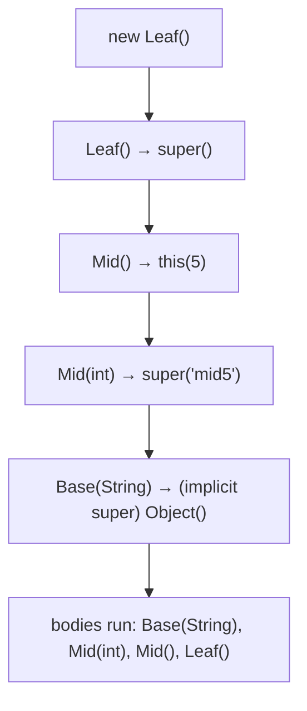
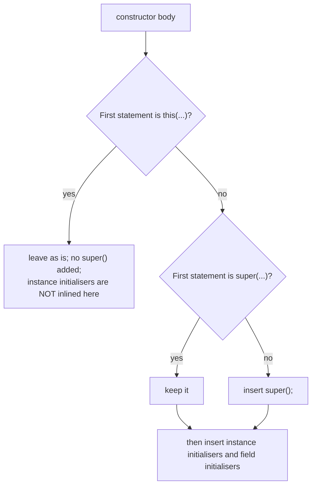
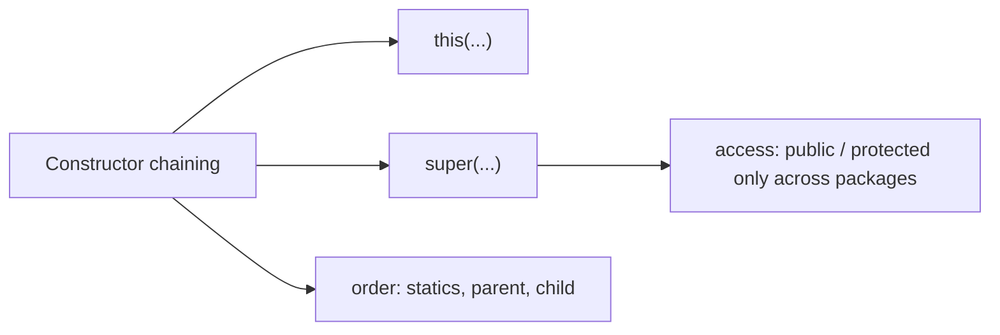

# Constructor Chaining in Java (with and without Packages)

**TL;DR:** **Constructor chaining** means one constructor calls another so initialisation is written once. Within a class you chain with `this(...)`; up the hierarchy with `super(...)`. Every constructor's **first statement** is either `this(...)`, `super(...)`, or an implicit `super();`, so the parent part of an object is always built first. Chains end at a constructor that calls `super(...)`. Across **packages**, the only new question is *access*: a subclass in another package can call a parent constructor that is `public` or `protected`, but not package-private or `private`. `new` on a protected constructor from outside the package fails, though `super(...)` and anonymous subclasses work.

## Table of Contents

1. [TL;DR](#1-tldr)
2. [Why it matters](#2-why-it-matters)
3. [Prerequisites](#3-prerequisites)
4. [Mental model](#4-mental-model)
5. [Core concepts](#5-core-concepts)
6. [How it works](#6-how-it-works)
7. [Examples](#7-examples)
8. [Comparisons](#8-comparisons)
9. [Trade-offs](#9-trade-offs)
10. [Gotchas](#10-gotchas)
11. [Practical application](#11-practical-application)
12. [Interview prep](#12-interview-prep)
13. [Interview question bank](#13-interview-question-bank)
14. [Tricky code snippets](#14-tricky-code-snippets)
15. [Connections](#15-connections)
16. [Summary](#16-summary)
17. [Answers](#answers)

> **Scope note.** The Constructors, `this` and `super`, and Inheritance notes cover the single-package basics. This note adds the **package dimension** (which constructors a subclass in another package may call), full initialisation order across packages, and many more edge cases. Access rules are in the Access Modifiers note.

---

## 1. TL;DR

- **Within a class:** `this(...)` delegates to another constructor (Snippet 4).
- **Up the hierarchy:** `super(...)` calls a parent constructor (Snippet 3). If you write neither, the compiler inserts `super();` (Snippets 2, 32).
- It must be the **first** statement, only **one** of them (Snippets 5, 7), and no cycles (Snippet 6).
- When `this(...)` is used, only the final constructor calls `super(...)`, so the parent runs once (Snippet 27).
- **Order:** parent static init → child static init → parent instance init + constructor → child instance init + constructor (Snippet 14).
- **Across packages:** parent constructors must be `public` or `protected` for a subclass in another package (Snippets 8, 9, 12). Package-private → error (Snippet 8); `private` → error (Snippet 12).
- `new Parent()` with a protected constructor from outside the package fails (Snippet 10), but an anonymous subclass works (Snippet 11).
- A subclass's constructors aren't inherited, and declaring any constructor removes the default one (Snippets 24, 25).

**The analogy: building a house in stages, with sub-contractors in different companies.**

| Real world | Java |
|---|---|
| A "complete house" order that internally calls "foundation + walls" orders | `this(...)` chaining within a class |
| The house company must first call the land-prep company | `super(...)`: the parent is built first |
| The land-prep company only takes orders from partners or the public | The parent constructor's access (`public`/`protected`) |
| A company whose order desk is "internal only" | Package-private or `private` constructor |
| You can't ring the partner-only desk yourself, but your own sub-company can | `new Parent()` fails; `super()` and an anonymous subclass work |

**Running example:** three packages `a.Base`, `b.Mid`, `c.Leaf` where each constructor chains with `this(...)` and `super(...)` (Snippet 1, 6.2).

---

## 2. Why it matters

**The problem.** Objects often need several construction shapes (defaults, partial data, full data). Duplicating the setup in each constructor invites bugs. Chaining keeps the real initialisation in one place, and the `super(...)` rule guarantees parents are initialised before children can use inherited state. When classes live in different packages, library authors also decide who may extend or instantiate their classes by choosing constructor access.

**What goes wrong** (verified on Java 21):

| Code | Result | Snippet |
|---|---|---|
| Parent has only `Parent(int)`; child has no `super(...)` | Compile error: constructor cannot be applied | 2 |
| `this(1); super();` together | Compile error | 5 |
| `this(1)` ↔ `this()` cycle | Compile error: recursive constructor invocation | 6 |
| Statement before `this(...)` | Compile error: must be first | 7 |
| Subclass in another package, parent ctor package-private | Compile error: not public … outside package | 8 |
| `new Parent()` with `protected` ctor from another package | Compile error: has protected access | 10 |
| Subclass calling a `private` parent constructor | Compile error: has private access | 12 |
| `this(base())` with an instance method | Compile error: cannot reference this before supertype constructor has been called | 17 |
| Parent ctor throws a checked exception, child doesn't declare | Compile error: unreported exception | 19 |
| `new A()` after declaring `A(int)` | Compile error | 24 |
| `new B(1)` when only `B()` exists | Compile error: ctors aren't inherited | 25 |

**Why interviewers ask.** "What is constructor chaining?", "`this()` vs `super()`", "what's the order of initialisation?", "can you call both?", "what if the parent has no default constructor?", "can a subclass in another package call a protected/default parent constructor?" are classic.

---

## 3. Prerequisites

| Prerequisite | One-line refresher | Importance |
|---|---|---|
| Constructors | Special methods that initialise an object | Essential |
| `this` and `super` | Current object; parent view | Essential |
| Inheritance | `extends` | Essential |
| Access modifiers and packages | Who can call what | Essential |
| Instance initialiser blocks | Run as part of construction | Important |

---

## 4. Mental model

> **The one picture to keep in your head:** construction is a **stack of constructor calls that always unwinds from the top ancestor down**. Chaining with `this(...)` just adds extra frames inside one level; `super(...)` adds the next level up. The first constructor to *finish its parent call* is the top (`Object`), and bodies then run from the top ancestor downwards.

```
 new Leaf()
   Leaf()           → implicit super()
     Mid()          → this(5)
       Mid(int)     → super("mid5")
         Base(String)      ← body runs FIRST ("Base(String) mid5")
       Mid(int) body       ← then ("Mid(int)")
     Mid() body            ← then ("Mid()")
   Leaf() body             ← last   ("Leaf()")
```
*Calls go down the chain; bodies run on the way back up, ancestor first.*


*Note that `Base()` (the no-arg version) never ran because `Mid(int)` chose `Base(String)`.*

---

## 5. Core concepts

### 5.1 Glossary

- **Constructor chaining:** a constructor calling another constructor.
- **`this(...)`:** call another constructor of the same class.
- **`super(...)`:** call a constructor of the direct parent.
- **Implicit `super()`:** inserted by the compiler when neither is written.
- **Master constructor:** the one constructor that does the real work.
- **Default constructor:** no-arg constructor supplied only if you declare none.
- **Instance initialiser block:** `{ ... }` run after `super(...)` and before the constructor body.
- **Static initialiser:** runs once when the class is initialised.
- **Package-private / protected / private constructor:** access limits on who can call it.

### 5.2 Chaining inside a class: `this(...)`

```java
Box()            { this(1);    ... }
Box(int a)       { this(a, 2); ... }
Box(int a, int b){ ... real work ... }
```
- Bodies run from the last delegated-to constructor outwards (Snippet 4: `Box(int,int)`, `Box(int)`, `Box()`).
- It must be the first statement (Snippet 7) and can't be combined with `super(...)` (Snippet 5).
- Cycles are rejected (Snippet 6).
- Arguments to `this(...)`/`super(...)` can't use instance members (Snippet 17); static methods are fine (Snippet 18).
- Records use the same idea with `this(...)` delegating to the canonical constructor (Snippet 21).

### 5.3 Chaining up: `super(...)`

- Chooses which parent constructor builds the parent layer, by overload resolution (Snippet 16: widening `int → long` beats boxing).
- Written explicitly when the parent has no no-arg constructor (Snippets 2, 3).
- Parent field values set in its constructor are visible afterwards (Snippet 30).
- If you write `this(...)`, the compiler does **not** also add `super()`; the delegated constructor does (Snippets 27, 31).

### 5.4 The implicit `super()`

- Added as the first statement if you write neither `this(...)` nor `super(...)`.
- Fails to compile if the parent has no accessible no-arg constructor (Snippet 2).
- Declaring any constructor in a class removes the compiler-supplied default (Snippet 24).
- Constructors are not inherited (Snippet 25).

### 5.5 Initialisation order

For `new Child()` where `Child extends Parent`:
1. Static initialisers: Parent, then Child (first use of the class only).
2. `Parent` instance initialisers and field initialisers (textual order), then the `Parent` constructor body.
3. `Child` instance initialisers and field initialisers, then the `Child` constructor body.

Verified with a real two-package pair (Snippet 14: the second `new` skips the static blocks). Instance blocks run **after** the `super(...)` call and **before** the rest of the constructor (Snippet 32), and with `this(...)` chaining only once, in the constructor that calls `super(...)` (Snippet 33).

### 5.6 Packages: who may call which parent constructor

| Parent constructor | Subclass in same package | Subclass in other package | `new Parent()` in other package |
|---|---|---|---|
| `public` | ✅ | ✅ | ✅ |
| `protected` | ✅ | ✅ via `super(...)` (Snippet 9) | ❌ (Snippet 10), ✅ via anonymous subclass (Snippet 11) |
| default (package-private) | ✅ | ❌ (Snippet 8) | ❌ |
| `private` | ❌ (except nested classes, Snippet 28) | ❌ (Snippet 12) | ❌ |

Related facts:
- The default constructor gets the **same access as the class**: a public class's default constructor is `public`; a package-private class's is package-private (Snippet 13).
- A `protected` constructor can be called with `new` from the **same package** (Snippet 23).
- A public subclass can inherit through a package-private parent, because the chain is evaluated in the parent's own package (Snippet 29).
- An abstract parent in another package with a `protected` constructor is typically extended by anonymous classes or named subclasses (Snippet 26).
- Nested classes can call an enclosing class's `private` constructor (Snippet 28).

### 5.7 Exceptions in chaining

If a parent constructor declares a checked exception, the child constructor must declare it too (or the call can't compile) (Snippets 19, 20). If a parent constructor throws, the child's body never runs (Snippet 20).

### 5.8 Overridable calls and `this` escape

Calling an overridable method from a constructor runs the **child's** override before the child's fields are initialised (Snippet 15: `Base sees null`, later `Kid sees kid`). This matters most across packages where the author of the child may not know the parent does it.

---

## 6. How it works

### 6.1 What the compiler does to each constructor


*Initialisers are inlined only into constructors that call `super(...)` (Snippet 33).*

### 6.2 Worked trace: Base, Mid, Leaf across three packages

```java
// File: a/Base.java
package a;
public class Base {
    public Base() { this("none"); System.out.println("Base()"); }
    public Base(String tag) { System.out.println("Base(String) " + tag); }
}
// File: b/Mid.java
package b;
public class Mid extends a.Base {
    public Mid() { this(5); System.out.println("Mid()"); }
    public Mid(int n) { super("mid" + n); System.out.println("Mid(int)"); }
}
// File: c/Leaf.java
package c;
public class Leaf extends b.Mid {
    public Leaf() { System.out.println("Leaf()"); }
}
// File: Main.java
public class Main { public static void main(String[] args) { new c.Leaf(); } }
```

Output (verified, Java 21, compiled as separate packages):

```
Base(String) mid5
Mid(int)
Mid()
Leaf()
```

| Step | What happens |
|---|---|
| `Leaf()` | No explicit call, so `super()` runs `Mid()` |
| `Mid()` | `this(5)` delegates to `Mid(int)` |
| `Mid(int)` | `super("mid5")` selects `Base(String)` |
| `Base(String)` | Implicit `Object()`, then prints `Base(String) mid5` |
| Unwinding | `Mid(int)`, `Mid()`, `Leaf()` print in that order |
| `Base()` | Never called, so `Base()` and its `this("none")` chain are unused here |

### 6.3 Initialisation order across packages (Snippet 14)

```
Parent static
Child static
Parent instance block
Parent field
Parent()
Child instance block
Child field
Child()
--
Parent instance block        <- second object: no static blocks again
Parent field
Parent()
Child instance block
Child field
Child()
```
Parent and child live in different packages (`p.Parent`, `q.Child`); package boundaries don't change the order.

### 6.4 Why `this(...)` arguments can't use instance members

During the explicit constructor call the object is not yet initialised enough to be referenced: `this(base())` with an instance `base()` is "cannot reference this before supertype constructor has been called" (Snippet 17). Static methods and constants are fine (Snippet 18).

### 6.5 Why `new Parent()` fails but `new Parent() { }` works

A `protected` constructor may be invoked from a subclass constructor via `super(...)`. An anonymous class is a subclass, and its implicit constructor calls `super(...)`, which is allowed (Snippets 9, 11, 26). A plain `new` is not a subclass call (Snippet 10).

---

## 7. Examples

### 7.1 Toy example

```java
class Box {
    Box()            { this(1);    System.out.println("Box()"); }
    Box(int a)       { this(a, 2); System.out.println("Box(int)"); }
    Box(int a, int b){ System.out.println("Box(int,int) " + a + b); }
}
new Box();   // Box(int,int) 12 / Box(int) / Box()
```
Verified (Snippet 4).

### 7.2 Real-world examples

- **Defaults and overloads:** `ArrayList()` vs `ArrayList(int)`; builder-like overloads delegating to a full constructor.
- **Exceptions:** `MyException(String msg)` calls `super(msg)`; `MyException(Throwable c)` calls `super(c)`.
- **Library base classes:** a framework's abstract class with a `protected` constructor that application classes extend (Snippet 26).
- **Singletons and factories:** private constructors, with nested subclasses allowed (Snippet 28).
- **Records:** short constructors delegating to the canonical one (Snippet 21).
- **Swing/Android/Spring style:** subclass constructors calling `super(context)` ⚠️ (frameworks not run here).

---

## 8. Comparisons

### 8.1 `this(...)` vs `super(...)`

| | `this(...)` | `super(...)` |
|---|---|---|
| Calls | Same class's constructor | Direct parent's constructor |
| Purpose | Reuse initialisation | Initialise the parent layer |
| First statement | Yes | Yes |
| Both together | No (Snippet 5) | No |
| Added automatically | Never | `super();` when neither is written |
| Instance initialisers run | In the final constructor only | In this constructor |

### 8.2 Constructor chaining vs method overloading with a helper

| | Chaining | Private `init()` helper |
|---|---|---|
| Can assign `final` fields | Yes (in the master constructor) | No |
| Order guarantee | Enforced (first statement) | Manual |
| Visible to subclasses | Not needed | May be overridden ⚠️ |

### 8.3 Parent constructor access and subclasses in another package

| Parent constructor | Child can `super(...)`? |
|---|---|
| public | Yes |
| protected | Yes |
| default | No |
| private | No |

### 8.4 Chaining order summary

| Action | Order |
|---|---|
| Constructor *calls* | Subclass → … → `Object` |
| Constructor *bodies* | `Object` → … → subclass |
| Static init | Parent → child, once |
| Instance init | Parent → child, per object |

### 8.5 Default constructor vs explicit

| | Compiler default | Explicit |
|---|---|---|
| Exists when | No constructor declared | Written |
| Access | Same as class | As written |
| Body | `super();` | As written |

---

## 9. Trade-offs

| Decision | Benefit | Cost | Use when |
|---|---|---|---|
| `this(...)` chaining | One place for initialisation; `final` fields | Control flow jumps between constructors | Several overloads |
| Telescoping constructors | Simple to call | Combinatorial overloads | Few optional params |
| Builder or static factories | Readable, flexible | Extra classes | Many optional params |
| `protected` constructor | Extensible by subclasses elsewhere | Not directly instantiable outside | Abstract/base classes in libraries |
| Package-private constructor | Library controls its own subclasses | Outsiders can't extend | Closed hierarchies |
| `private` constructor | Full control (Singleton, factories) | No subclassing outside nested classes | Utility/Singleton |
| Calling overridable methods in constructors | Compact | Sees uninitialised state | Avoid |
| Heavy work in constructors | Valid-on-creation objects | Slow, hard to test | Keep light; validate only |

---

## 10. Gotchas

### Myths

- ❌ **Myth:** "Constructors are inherited." ✅ **Reality:** only called via `super(...)` (Snippet 25).
- ❌ **Myth:** "The parent's no-arg constructor always runs." ✅ **Reality:** only if you (or the compiler) call it; `Mid(int)` chose `Base(String)` instead (Snippet 1).
- ❌ **Myth:** "`this(...)` and `super(...)` can be used together." ✅ **Reality:** only one, first statement (Snippet 5).
- ❌ **Myth:** "Parent constructors run after the child's." ✅ **Reality:** parent bodies finish first (Snippet 14).
- ❌ **Myth:** "A subclass in another package can call any parent constructor." ✅ **Reality:** only public/protected (Snippets 8, 9, 12).
- ❌ **Myth:** "A protected constructor can be called with `new` from anywhere." ✅ **Reality:** outside the package only via `super(...)` or an anonymous subclass (Snippets 10, 11).
- ❌ **Myth:** "Declaring `A(int)` still leaves the default `A()`." ✅ **Reality:** it's removed (Snippet 24).
- ❌ **Myth:** "Static blocks run on every `new`." ✅ **Reality:** once per class (Snippet 14).
- ❌ **Myth:** "`this(...)` creates a second object." ✅ **Reality:** one object, one construction (Snippet 22).
- ❌ **Myth:** "The default constructor is always public." ✅ **Reality:** it matches the class's access (Snippet 13).

### Common mistakes and edge cases

- **Forgetting `super(...)`** when the parent has no no-arg constructor (Snippet 2).
- **Cyclic `this(...)`** (Snippet 6).
- **Using instance methods in `this(...)` arguments** (Snippet 17).
- **Calling overridable methods from a constructor** (Snippet 15).
- **Missing exception declarations** on the child (Snippet 19).
- **Expecting instance initialisers to run in every chained constructor** (Snippet 33).
- **Choosing package-private constructors for a class meant to be extended elsewhere** (Snippet 8).
- **Overload surprises in `super(5)`** (`long` vs `Integer` vs `Object`) (Snippet 16).

---

## 11. Practical application

### Checklist
- [ ] Put the real initialisation in one "master" constructor and chain to it with `this(...)`.
- [ ] Give the parent a usable constructor (`public` or `protected`) if it's meant to be extended in other packages.
- [ ] Always call `super(...)` explicitly when the parent has no no-arg constructor.
- [ ] Don't call overridable methods from constructors.
- [ ] Declare checked exceptions consistently along the chain.
- [ ] Use static factory methods or a builder when there are many optional parameters.
- [ ] Use `private` constructors for Singleton and utility classes.
- [ ] Test the order with print statements if you're unsure.

### Hands-on exercise

Package `shape` has `public abstract class Shape` with `protected Shape(String name)` that prints `Shape(name)`. Package `app` has `Circle extends Shape` with `Circle()` calling `this(1.0)` and `Circle(double r)` calling `super("circle")` then printing `Circle(r)`. `Main` creates `new Circle()`. What is printed? Then, why does `new shape.Shape("x")` in `Main` fail, and what is the one-line workaround?

<details><summary>Solution</summary>

```java
// File: shape/Shape.java
package shape;
public abstract class Shape {
    protected Shape(String name) { System.out.println("Shape(" + name + ")"); }
    public abstract double area();
}
// File: app/Circle.java
package app;
public class Circle extends shape.Shape {
    public Circle() { this(1.0); }
    public Circle(double r) { super("circle"); System.out.println("Circle(" + r + ")"); }
    public double area() { return Math.PI * 1; }
}
// File: Main.java
public class Main { public static void main(String[] args) { new app.Circle(); } }
```

Output (verified on Java 21, three files compiled with `javac -d out`):

```
Shape(circle)
Circle(1.0)
```

`new shape.Shape("x")` fails twice: `Shape` is abstract, and its constructor is `protected` (Snippet 10 shows the protected-constructor error on a concrete class). The workaround is an anonymous subclass, `new shape.Shape("x") { public double area() { return 0; } }` (Snippet 26).
</details>

---

## 12. Interview prep

Eight model answers, as you would say them aloud.

<details><summary>1. What is constructor chaining and how do you do it?</summary>

One constructor calling another so initialisation lives in one place. Within a class use `this(...)`; up the hierarchy use `super(...)`. The call must be the first statement of the constructor; if you write neither, the compiler inserts `super();` (5.2, 5.3, 5.4; Snippets 3, 4).
</details>

<details><summary>2. In what order do constructors and initialisers run for a subclass object?</summary>

Static initialisers (parent, then child, once per class), then parent instance initialisers and constructor body, then child instance initialisers and constructor body. Calls go down the chain, but bodies finish from the top ancestor down, even across packages (5.5; Snippets 1, 14).
</details>

<details><summary>3. What if the parent has no no-arg constructor?</summary>

The implicit `super();` fails to compile; the child must call an existing parent constructor explicitly with `super(args)`. Likewise, declaring any constructor removes the compiler's default one (Snippets 2, 3, 24).
</details>

<details><summary>4. Can you use `this(...)` and `super(...)` together?</summary>

No. Each must be the first statement, so only one is allowed. With `this(...)`, the constructor it delegates to eventually calls `super(...)`, so the parent runs once. Cycles are a compile error (Snippets 5, 6, 7, 27).
</details>

<details><summary>5. Can a subclass in a different package call any parent constructor?</summary>

Only `public` or `protected` ones. A package-private parent constructor gives "is not public … cannot be accessed from outside package", and a private one "has private access" (Snippets 8, 9, 12).
</details>

<details><summary>6. A parent has a `protected` constructor in another package. Can you write `new Parent()`?</summary>

No: "has protected access". The subclass can call it with `super(...)`, and an anonymous subclass `new Parent() { }` works because it's a subclass. From the same package, `new` is fine (Snippets 10, 11, 23).
</details>

<details><summary>7. What access does the default constructor have?</summary>

The same as its class: a public class gets a public default constructor, a package-private class a package-private one (Snippet 13).
</details>

<details><summary>8. Why shouldn't constructors call overridable methods?</summary>

The child's override runs before the child's fields are initialised, so it sees default values (`null`, `0`), a bug that's hard to spot when parent and child are in different packages or teams (Snippet 15).
</details>

---

## 13. Interview question bank


### 13.1 Basics (Q1–Q14)

<details><summary>Q1. What is a constructor?</summary>

A special member that initialises a new object; same name as the class, no return type.
</details>

<details><summary>Q2. What is constructor chaining?</summary>

A constructor calling another constructor of the same or parent class (Snippets 1, 4).
</details>

<details><summary>Q3. Why chain?</summary>

To avoid duplicating initialisation, and to assign `final` fields in one place.
</details>

<details><summary>Q4. Which keyword chains within the class?</summary>

`this(...)` (Snippet 4).
</details>

<details><summary>Q5. Which keyword chains to the parent?</summary>

`super(...)` (Snippet 3).
</details>

<details><summary>Q6. Where must the call appear?</summary>

First statement (Snippet 7).
</details>

<details><summary>Q7. Can both appear?</summary>

No (Snippet 5).
</details>

<details><summary>Q8. Can `this(...)` calls form a cycle?</summary>

No: recursive constructor invocation (Snippet 6).
</details>

<details><summary>Q9. What's inserted if you write neither?</summary>

`super();` (Snippets 2, 32).
</details>

<details><summary>Q10. What if the parent has only `Parent(int)`?</summary>

The child must call `super(someInt)` (Snippets 2, 3).
</details>

<details><summary>Q11. Does declaring a constructor remove the default?</summary>

Yes (Snippet 24).
</details>

<details><summary>Q12. Are constructors inherited?</summary>

No (Snippet 25).
</details>

<details><summary>Q13. Can a constructor be overridden?</summary>

No.
</details>

<details><summary>Q14. How many objects does a chain create?</summary>

One (Snippet 22).
</details>


### 13.2 Order and initialisation (Q15–Q26)

<details><summary>Q15. In what order do chained constructor bodies run?</summary>

The last delegated-to one first, then back out (Snippet 4).
</details>

<details><summary>Q16. Do parent or child bodies run first?</summary>

Parent first (Snippets 1, 14).
</details>

<details><summary>Q17. When do static blocks run?</summary>

Once, on first use of the class, parent before child (Snippet 14).
</details>

<details><summary>Q18. When do instance blocks run?</summary>

After `super(...)`, before the rest of the constructor body (Snippet 32).
</details>

<details><summary>Q19. With `this(...)` chaining, how often do instance blocks run?</summary>

Once, in the constructor that calls `super(...)` (Snippet 33).
</details>

<details><summary>Q20. In which order: field initialisers or instance blocks?</summary>

Textual order within the class (Snippet 14).
</details>

<details><summary>Q21. Does the parent's no-arg constructor always run?</summary>

Only if it's called; `Mid(int)` chose `Base(String)` (Snippet 1).
</details>

<details><summary>Q22. When is the parent run once with `this(...)`?</summary>

Only the final constructor calls `super` (Snippets 27, 31).
</details>

<details><summary>Q23. What can `this(...)` arguments reference?</summary>

Static methods and constants, not instance members (Snippets 17, 18).
</details>

<details><summary>Q24. What does an overridable call in a constructor see?</summary>

Default field values (Snippet 15).
</details>

<details><summary>Q25. What if a parent constructor throws?</summary>

The child body never runs (Snippet 20).
</details>

<details><summary>Q26. Must the child declare the checked exception?</summary>

Yes (Snippet 19).
</details>


### 13.3 Overloads and records (Q27–Q34)

<details><summary>Q27. Which `super(5)` overload is chosen: `long`, `Integer`, `Object`?</summary>

`long` (widening before boxing) (Snippet 16).
</details>

<details><summary>Q28. How do records chain?</summary>

Non-canonical constructors call `this(...)` to the canonical one (Snippet 21).
</details>

<details><summary>Q29. Can enums chain constructors?</summary>

Yes with `this(...)`; `super(...)` isn't allowed.
</details>

<details><summary>Q30. Can a constructor call a method before `super()`?</summary>

Only static ones in the arguments (Snippet 18).
</details>

<details><summary>Q31. What is a telescoping constructor?</summary>

A series of overloads each delegating to the next with more parameters (Snippet 4).
</details>

<details><summary>Q32. How do you handle many optional parameters?</summary>

A builder or static factories.
</details>

<details><summary>Q33. Can constructor chaining set `final` fields?</summary>

Yes, in the master constructor.
</details>

<details><summary>Q34. Can a constructor call a private helper?</summary>

Yes, after the chaining call.
</details>


### 13.4 Packages (Q35–Q50)

<details><summary>Q35. Can a subclass in another package call a public parent constructor?</summary>

Yes.
</details>

<details><summary>Q36. A protected one?</summary>

Yes via `super(...)` (Snippet 9).
</details>

<details><summary>Q37. A package-private one?</summary>

No (Snippet 8).
</details>

<details><summary>Q38. A private one?</summary>

No (Snippet 12).
</details>

<details><summary>Q39. Can another class in a different package `new` a protected-constructor class?</summary>

No (Snippet 10).
</details>

<details><summary>Q40. Can it do `new Parent() { }`?</summary>

Yes (Snippet 11).
</details>

<details><summary>Q41. Can a class in the same package `new` it?</summary>

Yes (Snippet 23).
</details>

<details><summary>Q42. What's the default constructor's access?</summary>

Same as the class (Snippet 13).
</details>

<details><summary>Q43. Can nested classes call a private constructor of the enclosing class?</summary>

Yes (Snippet 28).
</details>

<details><summary>Q44. Can a package-private parent be indirectly extended from outside?</summary>

Via a public subclass in the same package (Snippet 29).
</details>

<details><summary>Q45. Does the package change the initialisation order?</summary>

No (Snippet 14).
</details>

<details><summary>Q46. Can a child in another package read a protected field set by the parent constructor?</summary>

Yes (Snippet 30).
</details>

<details><summary>Q47. How does an abstract parent in a library expose construction?</summary>

A `protected` constructor (Snippet 26).
</details>

<details><summary>Q48. What compile error appears for a package-private parent constructor?</summary>

"Parent() is not public in Parent; cannot be accessed from outside package" (Snippet 8).
</details>

<details><summary>Q49. For a private one?</summary>

"constructor Parent in class Parent cannot be applied to given types… reason: Parent() has private access" (Snippet 12).
</details>

<details><summary>Q50. Which access should an extensible library class use?</summary>

`public` or `protected`.
</details>


### 13.5 Design (Q51–Q58)

<details><summary>Q51. Should constructors do heavy work?</summary>

No; keep them light and validate.
</details>

<details><summary>Q52. How do you design for extension safely?</summary>

Avoid overridable calls; document constructor contracts.
</details>

<details><summary>Q53. Why prefer static factories sometimes?</summary>

Names, caching, subtype return.
</details>

<details><summary>Q54. How do you make a class non-extendable via constructors?</summary>

`private` constructors (or `final`).
</details>

<details><summary>Q55. What is "this escape"?</summary>

Passing `this` out of a constructor before it's complete (Snippet 15 is a related hazard).
</details>

<details><summary>Q56. How do you debug initialisation order?</summary>

Print statements in blocks and constructors (Snippet 14).
</details>

<details><summary>Q57. Where does `Object()` run?</summary>

First, at the top of every chain.
</details>

<details><summary>Q58. Why can't `this(...)` use instance members?</summary>

The object isn't initialised yet (Snippet 17).
</details>

---

## 14. Tricky code snippets

33 snippets, each compiled and run on OpenJDK 21. Predict the output (or the compile error) before opening the answer. Snippets with several files show each file after a `// File:` comment, and were compiled together with `javac -d out`; `Main` is in the default package.

### Snippet 1: Three packages, mixed chaining

```java
// File: a/Base.java
package a;
public class Base {
    public Base() { this("none"); System.out.println("Base()"); }
    public Base(String tag) { System.out.println("Base(String) " + tag); }
}
// File: b/Mid.java
package b;
public class Mid extends a.Base {
    public Mid() { this(5); System.out.println("Mid()"); }
    public Mid(int n) { super("mid" + n); System.out.println("Mid(int)"); }
}
// File: c/Leaf.java
package c;
public class Leaf extends b.Mid {
    public Leaf() { System.out.println("Leaf()"); }
}
// File: Main.java
public class Main { public static void main(String[] args) { new c.Leaf(); } }
```

<details><summary>Answer</summary>

```
Base(String) mid5
Mid(int)
Mid()
Leaf()
```

Trace in 6.2: `Mid(int)` chose `Base(String)`, so `Base()` never ran.
</details>

### Snippet 2: Parent without a no-arg constructor

```java
class Parent { Parent(int x) { } }
class Child extends Parent { Child() { } }
public class Main { public static void main(String[] args) { } }
```

<details><summary>Answer</summary>

Compile error: *constructor Parent in class Parent cannot be applied to given types;*.

The detail: required: int. The implicit `super();` can't compile.
</details>

### Snippet 3: Explicit `super(7)`

```java
class Parent { Parent(int x) { System.out.println("Parent " + x); } }
class Child extends Parent { Child() { super(7); System.out.println("Child"); } }
public class Main { public static void main(String[] args) { new Child(); } }
```

<details><summary>Answer</summary>

```
Parent 7
Child
```

Parent first.
</details>

### Snippet 4: `this(...)` chain

```java
class Box {
    Box() { this(1); System.out.println("Box()"); }
    Box(int a) { this(a, 2); System.out.println("Box(int)"); }
    Box(int a, int b) { System.out.println("Box(int,int) " + a + b); }
}
public class Main { public static void main(String[] args) { new Box(); } }
```

<details><summary>Answer</summary>

```
Box(int,int) 12
Box(int)
Box()
```

The last delegated constructor's body runs first.
</details>

### Snippet 5: `this(...)` and `super()`

```java
class P { }
class C extends P { C() { this(1); super(); } C(int x) { } }
public class Main { public static void main(String[] args) { } }
```

<details><summary>Answer</summary>

Compile error: *call to super must be first statement in constructor*.

Only one explicit call, first.
</details>

### Snippet 6: `this(...)` cycle

```java
class C { C() { this(1); } C(int x) { this(); } }
public class Main { public static void main(String[] args) { } }
```

<details><summary>Answer</summary>

Compile error: *recursive constructor invocation*.

`C()` and `C(int)` call each other.
</details>

### Snippet 7: Statement before `this(...)`

```java
class C { C() { System.out.println("x"); this(1); } C(int x) { } }
public class Main { public static void main(String[] args) { } }
```

<details><summary>Answer</summary>

Compile error: *call to this must be first statement in constructor*.

Must be first.
</details>

### Snippet 8: Package-private parent constructor

```java
// File: p/Parent.java
package p;
public class Parent { Parent() { } }
// File: q/Child.java
package q;
public class Child extends p.Parent { }
// File: Main.java
public class Main { public static void main(String[] args) { } }
```

<details><summary>Answer</summary>

Compile error: *Parent() is not public in Parent; cannot be accessed from outside package*.

`q.Child`'s implicit `super()` can't reach it.
</details>

### Snippet 9: Protected parent constructor via `super()`

```java
// File: p/Parent.java
package p;
public class Parent { protected Parent() { System.out.println("Parent()"); } }
// File: q/Child.java
package q;
public class Child extends p.Parent { public Child() { super(); System.out.println("Child()"); } }
// File: Main.java
public class Main { public static void main(String[] args) { new q.Child(); } }
```

<details><summary>Answer</summary>

```
Parent()
Child()
```

A subclass in another package may call it.
</details>

### Snippet 10: `new` on a protected constructor

```java
// File: p/Parent.java
package p;
public class Parent { protected Parent() { } }
// File: q/Other.java
package q;
public class Other { public void f() { new p.Parent(); } }
// File: Main.java
public class Main { public static void main(String[] args) { } }
```

<details><summary>Answer</summary>

Compile error: *Parent() has protected access in Parent*.

`Other` isn't a subclass.
</details>

### Snippet 11: Anonymous subclass

```java
// File: p/Parent.java
package p;
public class Parent { protected Parent() { System.out.println("Parent()"); } }
// File: Main.java
public class Main {
    public static void main(String[] args) {
        Object o = new p.Parent() { };
        System.out.println(o.getClass().getSuperclass().getName());
    }
}
```

<details><summary>Answer</summary>

```
Parent()
p.Parent
```

The anonymous class's `super()` call is allowed; its superclass is `p.Parent`.
</details>

### Snippet 12: Private parent constructor

```java
// File: p/Parent.java
package p;
public class Parent { private Parent() { } public Parent(int x) { } }
// File: q/Child.java
package q;
public class Child extends p.Parent { public Child() { super(); } }
// File: Main.java
public class Main { public static void main(String[] args) { } }
```

<details><summary>Answer</summary>

Compile error: *constructor Parent in class Parent cannot be applied to given types;*.

The detail line says: reason: Parent() has private access in Parent.
</details>

### Snippet 13: Default constructor access

```java
// File: p/Pub.java
package p;
public class Pub { }
// File: p/Pkg.java
package p;
class Pkg { }
// File: Main.java
import java.lang.reflect.Modifier;
public class Main {
    public static void main(String[] args) throws Exception {
        System.out.println(Modifier.toString(Class.forName("p.Pub").getDeclaredConstructors()[0].getModifiers()));
        System.out.println("[" + Modifier.toString(Class.forName("p.Pkg").getDeclaredConstructors()[0].getModifiers()) + "]");
    }
}
```

<details><summary>Answer</summary>

```
public
[]
```

Public class: `public`; package-private class: no modifier (empty).
</details>

### Snippet 14: Initialisation order

```java
// File: p/Parent.java
package p;
public class Parent {
    static { System.out.println("Parent static"); }
    { System.out.println("Parent instance block"); }
    protected String name = init("Parent field");
    public Parent() { System.out.println("Parent()"); }
    protected static String init(String s) { System.out.println(s); return s; }
}
// File: q/Child.java
package q;
public class Child extends p.Parent {
    static { System.out.println("Child static"); }
    { System.out.println("Child instance block"); }
    String own = init("Child field");
    public Child() { System.out.println("Child()"); }
}
// File: Main.java
public class Main { public static void main(String[] args) { new q.Child(); System.out.println("--"); new q.Child(); } }
```

<details><summary>Answer</summary>

```
Parent static
Child static
Parent instance block
Parent field
Parent()
Child instance block
Child field
Child()
--
Parent instance block
Parent field
Parent()
Child instance block
Child field
Child()
```

Statics once; instance parts per object, parent first.
</details>

### Snippet 15: Overridable call in the parent constructor

```java
// File: p/Base.java
package p;
public abstract class Base {
    public Base() { System.out.println("Base sees " + describe()); }
    protected abstract String describe();
}
// File: q/Kid.java
package q;
public class Kid extends p.Base {
    private String label = "kid";
    public Kid() { super(); System.out.println("Kid sees " + describe()); }
    protected String describe() { return label; }
}
// File: Main.java
public class Main { public static void main(String[] args) { new q.Kid(); } }
```

<details><summary>Answer</summary>

```
Base sees null
Kid sees kid
```

`label` isn't assigned until after `super()` returns.
</details>

### Snippet 16: `super(5)` overload

```java
class P {
    P(long x) { System.out.println("long"); }
    P(Integer x) { System.out.println("Integer"); }
    P(Object x) { System.out.println("Object"); }
}
class C extends P { C() { super(5); } }
public class Main { public static void main(String[] args) { new C(); } }
```

<details><summary>Answer</summary>

```
long
```

Widening beats boxing beats `Object`.
</details>

### Snippet 17: Instance method in `this(...)` arguments

```java
class C {
    int base() { return 1; }
    C() { this(base()); }
    C(int x) { }
}
public class Main { public static void main(String[] args) { } }
```

<details><summary>Answer</summary>

Compile error: *cannot reference this before supertype constructor has been called*.

The object isn't ready.
</details>

### Snippet 18: Static method in `this(...)` arguments

```java
class C {
    static int base() { return 7; }
    C() { this(base()); }
    C(int x) { System.out.println("C(" + x + ")"); }
}
public class Main { public static void main(String[] args) { new C(); } }
```

<details><summary>Answer</summary>

```
C(7)
```

Allowed.
</details>

### Snippet 19: Child ignoring a parent's checked exception

```java
class P { P() throws Exception { throw new Exception("parent failed"); } }
class C extends P { C() { } }
public class Main { public static void main(String[] args) { } }
```

<details><summary>Answer</summary>

Compile error: *unreported exception Exception; must be caught or declared to be thrown*.

The child constructor must declare it.
</details>

### Snippet 20: Parent constructor throwing

```java
class P {
    P() throws Exception { System.out.println("P()"); throw new Exception("parent failed"); }
}
class C extends P { C() throws Exception { super(); System.out.println("C() done"); } }
public class Main {
    public static void main(String[] args) {
        try { new C(); } catch (Exception e) { System.out.println(e.getMessage()); }
    }
}
```

<details><summary>Answer</summary>

```
P()
parent failed
```

`C() done` never printed.
</details>

### Snippet 21: Record constructor chain

```java
record P(int x, int y) {
    P(int x) { this(x, 0); }
    P() { this(9); }
}
public class Main { public static void main(String[] args) { System.out.println(new P() + " " + new P(3)); } }
```

<details><summary>Answer</summary>

```
P[x=9, y=0] P[x=3, y=0]
```

`P()` → `P(int)` → canonical.
</details>

### Snippet 22: Chain creates one object each

```java
class C {
    static int created = 0;
    C() { this(1); }
    C(int x) { this(x, 2); }
    C(int x, int y) { created++; }
}
public class Main { public static void main(String[] args) { new C(); new C(5); System.out.println(C.created); } }
```

<details><summary>Answer</summary>

```
2
```

Two `new` calls, so two increments, one per object.
</details>

### Snippet 23: `new` on a protected constructor, same package

```java
// File: p/A.java
package p;
public class A { protected A() { System.out.println("A()"); } }
// File: p/User.java
package p;
public class User { public void go() { new A(); } }
// File: Main.java
public class Main { public static void main(String[] args) { new p.User().go(); } }
```

<details><summary>Answer</summary>

```
A()
```

Allowed within the package.
</details>

### Snippet 24: Default constructor removed

```java
class A { A(int x) { } }
public class Main { public static void main(String[] args) { new A(); } }
```

<details><summary>Answer</summary>

Compile error: *constructor A in class A cannot be applied to given types;*.

The detail: required: int.
</details>

### Snippet 25: Constructors aren't inherited

```java
class A { A(int x) { } }
class B extends A { B() { super(0); } }
public class Main { public static void main(String[] args) { new B(1); } }
```

<details><summary>Answer</summary>

Compile error: *constructor B in class B cannot be applied to given types;*.

`B(int)` doesn't exist even though `A(int)` does.
</details>

### Snippet 26: Abstract class with a protected constructor

```java
// File: p/Shape.java
package p;
public abstract class Shape {
    protected final String name;
    protected Shape(String name) { this.name = name; System.out.println("Shape(" + name + ")"); }
    public abstract double area();
}
// File: Main.java
public class Main {
    public static void main(String[] args) {
        p.Shape s = new p.Shape("sq") { public double area() { return 4; } };
        System.out.println(s.area());
    }
}
```

<details><summary>Answer</summary>

```
Shape(sq)
4.0
```

An anonymous subclass supplies `area()` and calls the constructor.
</details>

### Snippet 27: `this(...)` and the parent

```java
class P { P() { System.out.println("P()"); } }
class C extends P {
    C() { this(1); System.out.println("C()"); }
    C(int x) { System.out.println("C(int)"); }
}
public class Main { public static void main(String[] args) { new C(); } }
```

<details><summary>Answer</summary>

```
P()
C(int)
C()
```

The parent constructor ran once.
</details>

### Snippet 28: Nested subclass of a private constructor

```java
class Outer {
    private Outer() { System.out.println("Outer()"); }
    static class In extends Outer { In() { super(); System.out.println("In()"); } }
}
public class Main { public static void main(String[] args) { new Outer.In(); } }
```

<details><summary>Answer</summary>

```
Outer()
In()
```

Nested classes share private access.
</details>

### Snippet 29: Public subclass of a package-private parent

```java
// File: p/Base.java
package p;
class Base { Base() { System.out.println("Base()"); } }
// File: p/Sub.java
package p;
public class Sub extends Base { public Sub() { System.out.println("Sub()"); } }
// File: Main.java
public class Main { public static void main(String[] args) { new p.Sub(); } }
```

<details><summary>Answer</summary>

```
Base()
Sub()
```

Both in package `p`; `Main` just creates `Sub`.
</details>

### Snippet 30: Protected field set by the parent constructor

```java
// File: p/P.java
package p;
public class P { protected int id; public P(int id) { this.id = id; } }
// File: q/C.java
package q;
public class C extends p.P {
    public C() { super(42); System.out.println("id=" + id); }
}
// File: Main.java
public class Main { public static void main(String[] args) { new q.C(); } }
```

<details><summary>Answer</summary>

```
id=42
```

The child reads it after `super(42)`.
</details>

### Snippet 31: `this(...)` delegating to a `super(...)` constructor

```java
class P { P(String s) { System.out.println("P " + s); } }
class C extends P {
    C() { this("x"); System.out.println("C()"); }
    C(String s) { super(s + "!"); System.out.println("C(String)"); }
}
public class Main { public static void main(String[] args) { new C(); } }
```

<details><summary>Answer</summary>

```
P x!
C(String)
C()
```

`C()` → `C(String)` → `super("x!")`.
</details>

### Snippet 32: Instance block timing

```java
class P { P() { System.out.println("P()"); } }
class C extends P {
    { System.out.println("C block"); }
    C() { System.out.println("C()"); }
}
public class Main { public static void main(String[] args) { new C(); } }
```

<details><summary>Answer</summary>

```
P()
C block
C()
```

After `super()`, before the body.
</details>

### Snippet 33: Instance block with `this(...)`

```java
class C {
    { System.out.println("block"); }
    C() { this(1); System.out.println("C()"); }
    C(int x) { System.out.println("C(int)"); }
}
public class Main { public static void main(String[] args) { new C(); } }
```

<details><summary>Answer</summary>

```
block
C(int)
C()
```

The block runs once, in the constructor that reaches `super()`.
</details>

---

## 15. Connections

| Related topic | How it connects |
|---|---|
| Constructors and reference initialisation | The basics of constructors |
| `this` and `super` | The keywords used for chaining |
| Inheritance | The hierarchy being chained through |
| Access modifiers and packages | Which parent constructors a subclass can call |
| Protected access outside the package | The cross-package rule for protected constructors and members |
| Abstract classes | Protected constructors, anonymous subclasses |
| Static members | Static initialisation order |
| Records and enums | Chaining to a canonical constructor; enum constructors |
| Exceptions | Checked exceptions declared along the chain |
| Design patterns | Builder, factory, Singleton |


*Chaining is where inheritance, initialisation order and access control meet.*

---

## 16. Summary

### 60-second card

- `this(...)`: another constructor in this class. `super(...)`: a parent constructor. First statement, only one, no cycles.
- Neither written → compiler adds `super();`.
- `this(...)` present → only the target reaches `super`, so the parent runs once; instance initialisers also run once.
- Order: parent static → child static → parent instance + constructor → child instance + constructor.
- Another package: parent constructor must be `public`/`protected`. `new` on a protected constructor outside the package fails; `super(...)` and anonymous subclasses work.
- Default constructor access = class access; declaring any constructor removes it.
- Don't call overridable methods from constructors.

### Cheat sheet

```java
class Box {
    Box()             { this(1); }              // delegate
    Box(int a)        { this(a, 2); }
    Box(int a, int b) { super(); /* real work */ }
}
// other package: Child extends Parent → Parent's constructor must be public/protected
new Parent() { };   // OK for protected constructors from another package
```

| Need | Use |
|---|---|
| Reuse initialisation | `this(...)` |
| Initialise parent | `super(...)` |
| Library base class | `protected` constructor |
| Block extension | `private` or package-private constructor |
| Many optional fields | Builder / factory |

### Self-test

1. What's inserted if a constructor has no `this`/`super` call?
2. Can `this(...)` and `super(...)` appear together?
3. In what order do static blocks, instance blocks and constructors run?
4. Can a subclass in another package call a package-private parent constructor?
5. How can code outside the package instantiate a class with a protected constructor?
6. What access does a default constructor have?
7. Why can't `this(...)` arguments call instance methods?
8. What happens if a parent constructor throws?

### Anki flashcards

```
this(...) :: Calls another constructor of the same class; first statement
super(...) :: Calls a parent constructor; first statement
Neither written :: Compiler inserts super();
this(...) + super(...) :: Not allowed together
Initialisation order :: parent static, child static, parent instance+ctor, child instance+ctor
Other-package subclass :: Parent ctor must be public or protected
new with protected ctor outside package :: Error; use super(...) or an anonymous subclass
Default constructor access :: Same as the class
Declare any constructor :: Default constructor disappears
```

### Resources

- *The Java Language Specification*, 8.8 (Constructor Declarations) and 12.5 (Creation of New Class Instances): docs.oracle.com/javase/specs
- The Java Tutorials, "Providing Constructors for Your Classes": docs.oracle.com/javase/tutorial
- *Effective Java*, Joshua Bloch: "Consider static factory methods", "Consider a builder when faced with many constructor parameters", "Design and document for inheritance"

---

## Answers

1. `super();`.
2. No; one explicit call only, and it must be first.
3. Static blocks (parent then child, once), then per object: parent instance blocks and constructor, then child's.
4. No; it must be `public` or `protected`.
5. A subclass constructor with `super(...)`, or an anonymous subclass.
6. The same as its class.
7. The object isn't initialised yet.
8. The child's body never runs; the exception propagates.
