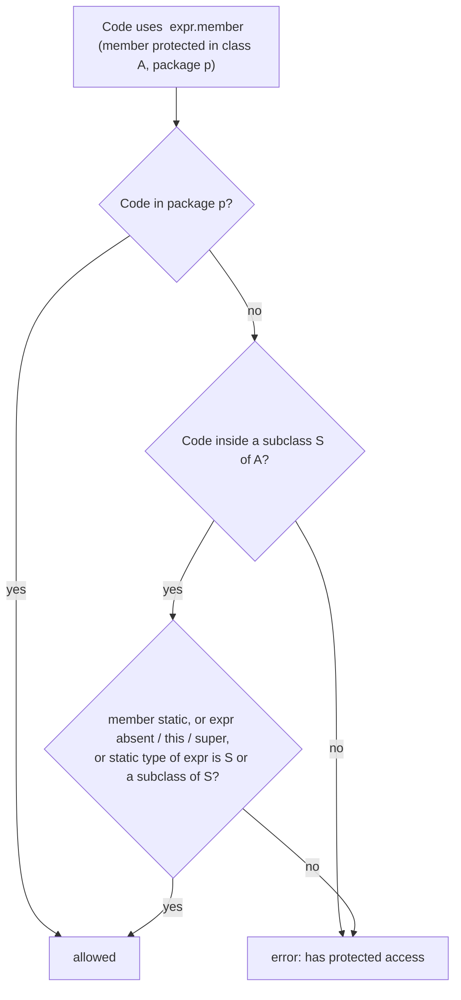
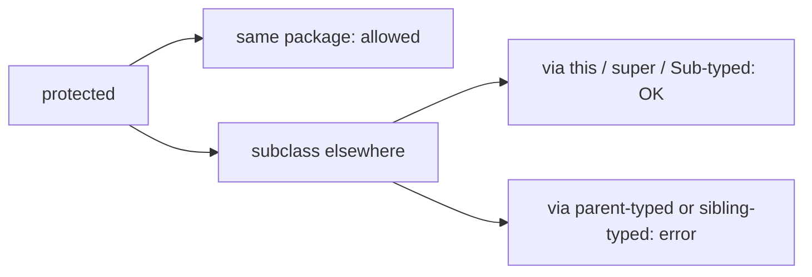

# Accessing Protected Variables and Methods Outside the Package in Java

**TL;DR:** Inside its own package, `protected` behaves like default access. Outside the package, a `protected` member of class `A` is accessible only **inside the body of a subclass of A**, and only through an expression whose **type is that subclass (or one of its subclasses)**: `this.x`, `x`, `super.x`, or a reference declared as the subclass. It is **not** accessible through a reference typed as `A`, through a sibling subclass, from non-subclasses (even in the subclass's own package), or through a cast to `A`. `protected static` members are the exception: a subclass may use them through any qualifier. For constructors, `new` doesn't work outside the package, but `super(...)` and anonymous subclasses do.

## Table of Contents

1. [TL;DR](#1-tldr)
2. [Why it matters](#2-why-it-matters)
3. [Prerequisites](#3-prerequisites)
4. [Mental model](#4-mental-model)
5. [Core concepts](#5-core-concepts)
6. [How it works](#6-how-it-works)
7. [Examples](#7-examples)
8. [Comparisons](#8-comparisons)
9. [Trade-offs](#9-trade-offs)
10. [Gotchas](#10-gotchas)
11. [Practical application](#11-practical-application)
12. [Interview prep](#12-interview-prep)
13. [Interview question bank](#13-interview-question-bank)
14. [Tricky code snippets](#14-tricky-code-snippets)
15. [Connections](#15-connections)
16. [Summary](#16-summary)
17. [Answers](#answers)

> **Scope note.** The Access Modifiers note introduces all four modifiers with a handful of protected cases. This note is the complete treatment of the cross-package `protected` rule (JLS 6.6.2), with 31 verified cases. Packages are in the Packages note; protected constructors are also in the Constructor Chaining note.

---

## 1. TL;DR

Let `Animal` (package `p`) declare `protected int legs`, and `Dog extends Animal` live in package `q`.

| Where the code is | Expression | Allowed? | Snippet |
|---|---|---|---|
| Inside `Dog` | `legs`, `this.legs`, `super.legs` | ✅ | 1 |
| Inside `Dog` | `dogRef.legs` (type `Dog` or a subclass of `Dog`) | ✅ | 3, 4 |
| Inside `Dog` | `animalRef.legs` (type `Animal`) | ❌ | 2 |
| Inside `Dog` | `catRef.legs` (sibling subclass `Cat`) | ❌ | 5 |
| Inside `Dog` | `((Animal) this).legs` | ❌ | 17 |
| Inside `Dog` | `((Dog) animalRef).legs` | ✅ | 18 |
| `Main` in a third package | `new Dog().legs` | ❌ | 6 |
| `Vet` in `Dog`'s own package `q` | `dog.legs` | ❌ | 7 |
| Class in package `p` | `animal.legs` | ✅ (same package as the declaration) | 23 |

- **Static** protected members are the exception: usable through any qualifier from a subclass (Snippet 10), but not from non-subclasses (Snippet 11).
- **Redeclaring** the member in `Dog` (overriding a method) changes who can reach it: it becomes a protected member *of `q.Dog`*, so `q` classes can use it (Snippet 8).
- **Widen to `public`** when overriding to open it up, but only through `Dog`-typed references (Snippet 9).

**The analogy: a family heirloom kept in the family home's study.**

| Real world | Java |
|---|---|
| The heirloom belongs to the family (class `Animal`) | The protected member |
| Anyone living in the family's own house (package `p`) can use it | Same-package access |
| A child living in another city may use *their own* heirloom, or their own children's | A subclass in another package, through `this`/`Dog`-typed references |
| The child may not walk into a sibling's house and take *their* heirloom | No access through `Cat`-typed references |
| The child may not use the family-house copy by calling it "the family's heirloom" | No access through `Animal`-typed references |
| A friend of the child (same city, not family) can't use it | Same package as the subclass doesn't help |

**Running example:** `p.Animal` with `protected int legs` and `protected String sound()`, `q.Dog extends p.Animal`, a `Main` in the default package (Snippet 1, 6.2).

---

## 2. Why it matters

**The problem.** `protected` is the most misunderstood access modifier. "Package + subclasses" is the textbook summary, but the real rule has an extra clause about the *type of the expression* used to reach the member. Interview and code-review mistakes come from forgetting that clause: "my subclass can't read the parent's protected field through the parent object!"

**What goes wrong** (verified on Java 21):

| Code in subclass `Dog` (package `q`) | Result | Snippet |
|---|---|---|
| `animal.legs` with `Animal animal` | Compile error: has protected access | 2 |
| `cat.legs` with `Cat` a sibling subclass | Compile error | 5 |
| `((Animal) this).legs` | Compile error | 17 |
| `a::sound` with `Animal a` | Compile error: invalid method reference | 16 |
| Static method taking `Animal a` and reading `a.legs` | Compile error | 20 |
| `new p.Animal()` with a protected constructor | Compile error | 31 |
| `Object o; o.clone()` | Compile error: clone() has protected access in Object | 25 |
| Code in another class `Vet` of package `q` | Compile error | 7 |

**Why interviewers ask.** "Explain `protected`", "can a subclass in another package access a protected member of the parent through a parent reference?", "difference between default and protected", "why can't I call `clone()` on an Object reference?" These separate people who memorised the table from those who understand the rule.

---

## 3. Prerequisites

| Prerequisite | One-line refresher | Importance |
|---|---|---|
| Inheritance | `extends`, inherited members | Essential |
| Packages | Same namespace/folder | Essential |
| Access modifiers | The four levels | Essential |
| Reference types | Static (declared) type vs object type | Essential |
| Upcasting/downcasting | Casts change the expression's type | Important |
| Constructors | `super(...)` | Helpful |

---

## 4. Mental model

> **The one picture to keep in your head:** for a protected member declared in package `p`, access from a subclass in another package `q` is allowed only when the **qualifier expression's static type** is the subclass itself (or its subclass). The compiler asks: "are you reaching *your own* inherited copy, or someone else's?" `this`, `super`, and `Dog`-typed references are "your own kind" of object; `Animal`-typed references could be any animal (a `Cat`!), so they're refused.

```
 package p                         package q
 ┌───────────────────┐             ┌───────────────────────────────┐
 │ class Animal      │             │ class Dog extends Animal       │
 │   protected legs  │◀────────────│   this.legs        ✅          │
 │                   │             │   dogRef.legs      ✅          │
 │  (same package:   │             │   puppyRef.legs    ✅          │
 │   everything OK)  │             │   animalRef.legs   ❌ (could be a Cat)
 └───────────────────┘             │   catRef.legs      ❌          │
                                   └───────────────────────────────┘
                                   class Vet (also in q, not a subclass) ❌
```
*The qualifier's type is checked at compile time, not the object's real class.*


*The core of JLS 6.6.2.1.*

---

## 5. Core concepts

### 5.1 Glossary

- **Protected member:** declared with `protected`; field, method, constructor or nested type.
- **Declaring package:** the package where the protected member is declared (here `p`).
- **Subclass body:** the code lexically inside a subclass `S`, including its nested classes, lambdas and anonymous classes.
- **Qualifier:** the expression before the dot in `expr.member`.
- **Static type of the qualifier:** its declared type, not the runtime class.
- **Sibling subclass:** another class that extends the same parent (`Cat` for `Dog`).
- **Inheritance of protected members:** the subclass inherits the member; access is still governed by the rule.

### 5.2 The rule in words

Access to a protected *instance* member `m` of `A` (declared in package `p`) from code in package `q ≠ p` is permitted only if both:
1. The access occurs **within the body of a subclass `S` of `A`**; and
2. The access is via the simple name, `this.m`, `super.m`, or a qualifier expression whose static type is **`S` or a subclass of `S`**.

Same-package code (`p`) has full access (Snippet 23).

### 5.3 What works inside the subclass

- **Simple name, `this`, `super`** (Snippet 1).
- **A reference of the subclass type**: `Dog d; d.legs` (Snippet 3) and **a subclass of it** (Snippet 4); chained results of the right type too (Snippet 30).
- **A cast to the subclass type**: `((Dog) animal).legs` (Snippet 18). Compiles; it can throw `ClassCastException` at run time ⚠️ for a non-Dog.
- **In nested/inner/anonymous classes and lambdas** within the subclass (Snippets 12, 13, 14), and a *static* nested class with a `Dog` parameter (Snippet 12).
- **Static methods of the subclass**, as long as the qualifier is `Dog`-typed (Snippet 19).
- **Generic type parameters bounded by the subclass** (`<T extends Dog>`) (Snippet 21).
- **Initialiser blocks** (Snippet 22).
- **Method references** `this::sound`, `super::sound` (Snippet 15).
- **Three levels deep across packages**: `r.Puppy extends q.Dog extends p.Animal` (Snippet 29).

### 5.4 What doesn't

- Qualifier typed as the **parent** (`Animal a; a.legs`) (Snippet 2); same for a cast `((Animal) this).legs` (Snippet 17) and a method reference `a::sound` (Snippet 16).
- Qualifier typed as a **sibling** (`Cat c; c.legs`) (Snippet 5).
- **Non-subclasses** in another package (Snippet 6).
- **Non-subclasses in the subclass's package** (Snippet 7): protected is tied to the *declaring* package, not the subclass's.
- A **static method** of the subclass using an `Animal`-typed qualifier (Snippet 20).
- **`new Animal()`** with a protected constructor (Snippet 31).

### 5.5 Static protected members

A `protected static` member can be reached from a subclass body through **any** qualifier or simple name, including the parent type (Snippet 10). Non-subclasses elsewhere still can't (Snippet 11).

### 5.6 Redeclaring changes the picture

If `Dog` overrides a protected method (still protected), it becomes a protected member declared in `q.Dog`; classes in package `q` can now call `dog.sound()` (Snippet 8), even though they couldn't touch the inherited `legs` field (Snippet 7). A `public` override opens it everywhere through `Dog`-typed references; through an `Animal`-typed reference the *declared* (protected) member is used and the call is rejected (Snippet 9).

### 5.7 Protected constructors

- `super(...)` from a subclass constructor: ✅.
- `new Animal()` outside the package: ❌ (Snippet 31). Same-package: ✅.
- Anonymous subclass `new Animal() { }`: ✅ (see the Constructor Chaining note).

### 5.8 A real JDK case: `Object.clone()`

`clone()` is `protected` in `Object` (package `java.lang`). Inside your own class you can call `super.clone()` or `this.clone()`, or `m.clone()` for an `m` typed as your class (Snippet 24); from outside, or through an `Object`-typed reference, it's the same error as Snippet 2 (Snippet 25). This is why classes override `clone()` as `public`.

### 5.9 Other facts

- `protected` isn't allowed on interface members (Snippet 26).
- Reflection reports `protected` as a modifier (Snippet 27).
- A subclass's own same-named field hides the parent's; `super.tag` reaches the parent's protected one (Snippet 28).

---

## 6. How it works

### 6.1 The compiler check

The check looks at the **static type of the qualifier** and the **location of the access**. The run-time object is irrelevant: in Snippet 2 an `Animal`-typed parameter might be a `Dog` at run time, but the compiler rejects it because it might also be a `Cat`.

### 6.2 Worked trace: Animal, Dog, Main

```java
// File: p/Animal.java
package p;
public class Animal {
    protected int legs = 4;
    protected String sound() { return "..."; }
}
// File: q/Dog.java
package q;
public class Dog extends p.Animal {
    public String report() { return legs + " " + sound() + " " + this.legs + " " + super.sound(); }
}
// File: Main.java
public class Main { public static void main(String[] args) { System.out.println(new q.Dog().report()); } }
```

Output (verified, Java 21, compiled as separate packages):

```
4 ... 4 ...
```

| Expression in `Dog.report()` | Qualifier | Allowed? |
|---|---|---|
| `legs` | none (implicit `this`) | ✅ |
| `sound()` | none | ✅ |
| `this.legs` | `this` (type `Dog`) | ✅ |
| `super.sound()` | `super` | ✅ |

`Main` can only call the **public** `report()`; `new q.Dog().legs` from `Main` would be an error (Snippet 6).

### 6.3 Why the qualifier-type clause exists

Without it, a `Dog` could read or modify the protected state of *any* `Animal` (a `Cat`, a `Bird`) just by upcasting a reference, breaking the encapsulation that the `Animal` author gave only to *its own inheritors for their own instances*. The qualifier clause limits a subclass to "its own kind" of object.

### 6.4 Why casts to the subclass work, to the parent don't

A cast changes the **static type** of the expression. `((Dog) a).legs` has qualifier type `Dog` (allowed, with a run-time check); `((Animal) this).legs` widens the qualifier type to `Animal` (rejected). That makes `((Animal) this).legs` a compile error, unlike plain `this.legs` (Snippets 17, 18).

### 6.5 Why same package as the subclass doesn't count

Protected access is defined relative to the *declaring* package (`p`) and to subclasses. A class that merely sits in `Dog`'s package `q` is neither, so it fails (Snippet 7). A method the subclass *redeclares* is a member declared in `q`, which changes the answer (Snippet 8).

### 6.6 Static members

For static members there is no instance, so the qualifier-type check has nothing to protect; the rule is simply "inside a subclass body" (Snippet 10).

---

## 7. Examples

### 7.1 Toy example

```java
class Dog extends p.Animal {
    int peek(Dog d)      { return d.legs; }   // OK: Dog-typed
    int peek(p.Animal a) { return a.legs; }   // ERROR: Animal-typed
}
```
Verified (Snippets 3, 2).

### 7.2 Real-world examples

- **`Object.clone()`**: `protected`; override it as `public` and call `super.clone()` (Snippet 24).
- **`AbstractList.modCount`** is `protected`: subclasses in other packages use it on `this` only.
- **Template Method hooks**: `protected abstract String describe();` implemented by subclasses in other packages (see the Abstract Class note).
- **Frameworks**: servlet/Spring/Android base classes expose `protected` hooks to your subclasses ⚠️ (not run here).
- **Exceptions**: `Throwable` has protected constructors patterns in custom hierarchies.
- **Library design**: protected constructors on abstract bases (Snippet 31).

---

## 8. Comparisons

### 8.1 Protected vs default

| | default | `protected` |
|---|---|---|
| Same package | ✅ | ✅ |
| Subclass elsewhere, via `this` | ❌ | ✅ |
| Subclass elsewhere, via parent-typed reference | ❌ | ❌ (Snippet 2) |
| Non-subclass elsewhere | ❌ | ❌ |

### 8.2 Protected instance vs protected static

| | Instance member | Static member |
|---|---|---|
| From subclass via `this`/subclass type | ✅ | ✅ |
| From subclass via parent type | ❌ (Snippet 2) | ✅ (Snippet 10) |
| From non-subclass elsewhere | ❌ | ❌ (Snippet 11) |

### 8.3 Qualifier forms inside the subclass

| Form | Allowed | Snippet |
|---|---|---|
| `m` / `this.m` / `super.m` | ✅ | 1 |
| `subRef.m` | ✅ | 3 |
| `subSubRef.m` | ✅ | 4 |
| `parentRef.m` | ❌ | 2 |
| `siblingRef.m` | ❌ | 5 |
| `((Parent) this).m` | ❌ | 17 |
| `((Sub) parentRef).m` | ✅ | 18 |
| `this::m`, `super::m` | ✅ | 15 |
| `parentRef::m` | ❌ | 16 |

### 8.4 Who can use a protected member of `p.Animal`

| Code location | Access |
|---|---|
| Package `p` | Yes |
| Subclass body in another package | Via own type only |
| Same package as the subclass | No (Snippet 7) |
| Anywhere else | No |

### 8.5 Public override vs protected override

| | `protected` override | `public` override |
|---|---|---|
| Callable from package `q` through `Dog` | ✅ (Snippet 8) | ✅ |
| From a third package | ❌ | ✅ via `Dog`-typed refs (Snippet 9) |
| Via `Animal`-typed ref in third package | ❌ | ❌ (declared member is protected) |

---

## 9. Trade-offs

| Decision | Benefit | Cost | Use when |
|---|---|---|---|
| `protected` field | Subclasses read/write state directly | Breaks encapsulation; subclasses depend on internals | Rare; prefer `protected` accessors |
| `protected` method (hook) | Clean extension points | Becomes API for subclassers | Template Method |
| `protected` constructor | Abstract/base classes can't be created directly | Needs `super(...)` or anonymous subclass | Library base classes |
| Public override of a protected method | Opens it up | Larger public API | Intentional widening |
| Package-private instead | Fewer dependents | Can't be extended in other packages | Closed hierarchies |
| Casting to `Sub` to reach members | Works | Run-time `ClassCastException` risk | Last resort |
| Accessors on a parent-typed object | Always allowed if public | Boilerplate | Cross-object access |

---

## 10. Gotchas

### Myths

- ❌ **Myth:** "Protected means subclass and package: any subclass code can use it any way." ✅ **Reality:** outside the package, only through the subclass's own type (Snippets 2, 5, 17).
- ❌ **Myth:** "A subclass can access protected members of a parent object." ✅ **Reality:** not through `Animal`-typed references (Snippet 2).
- ❌ **Myth:** "Classes in the subclass's package get protected access." ✅ **Reality:** they don't (Snippet 7).
- ❌ **Myth:** "A cast to the parent type is harmless." ✅ **Reality:** `((Animal) this).legs` doesn't compile (Snippet 17).
- ❌ **Myth:** "Static protected members have the same restriction." ✅ **Reality:** any qualifier works in a subclass (Snippet 10).
- ❌ **Myth:** "Overriding a protected method keeps the original declaration's package." ✅ **Reality:** the override is declared in the subclass's package (Snippet 8).
- ❌ **Myth:** "`o.clone()` works if the class is `Cloneable`." ✅ **Reality:** on an `Object`-typed reference it doesn't compile (Snippet 25).
- ❌ **Myth:** "Interfaces can have protected members." ✅ **Reality:** they can't (Snippet 26).
- ❌ **Myth:** "The runtime class decides." ✅ **Reality:** the compile-time type of the qualifier decides (6.1).

### Common mistakes and edge cases

- **Reading a protected field via a parent-typed parameter** in a subclass method (Snippet 2).
- **Comparing two objects by reaching into the other's protected field** with the parent type (Snippets 2, 20).
- **Sibling access**: `Dog` touching `Cat`'s inherited field (Snippet 5).
- **Helper class in the subclass's package** expecting access (Snippet 7).
- **Method references on a parent-typed object** (Snippet 16).
- **`new` on a protected constructor** (Snippet 31).
- **`clone()` through `Object`** (Snippet 25).
- **Assuming a public override is reachable via the parent type** (Snippet 9).

---

## 11. Practical application

### Checklist
- [ ] Prefer protected *methods* (hooks) to protected *fields*.
- [ ] Access protected members via `this`/`super` inside the subclass.
- [ ] If you need another object's protected state, expose a public accessor on it.
- [ ] Override `clone()` as `public` when implementing `Cloneable`.
- [ ] Document protected members as part of your API.
- [ ] Put cooperating helper classes in the *declaring* package if they need access.
- [ ] Use `protected` constructors on abstract bases; subclasses call `super(...)`.
- [ ] Don't use casts to dodge the rule.

### Hands-on exercise

`bank.Account` has `protected double balance` and `protected void audit()`. In package `app`, `Savings extends bank.Account` has a method `boolean richer(Savings other)` returning `balance > other.balance`, and a method `boolean richerThan(bank.Account other)` doing the same. Which compiles? Fix the one that doesn't without changing `bank.Account`'s modifiers.

<details><summary>Solution</summary>

- `richer(Savings other)` compiles: `other` is `Savings`-typed (Snippet 3).
- `richerThan(bank.Account other)` does **not**: `other.balance` is *has protected access in Account* (Snippet 2).

Fixes: take a `Savings` parameter, or cast after a check: `other instanceof Savings s && balance > s.balance` (a cast to the subclass type works, Snippet 18), or add a public `getBalance()` to `Account`.

Verified on Java 21 with a two-package compile: the first method compiles; the second gives the protected-access error.
</details>

---

## 12. Interview prep

Eight model answers, as you would say them aloud.

<details><summary>1. Explain `protected` in one breath.</summary>

Same-package access, plus access from subclasses in other packages, but outside the package only inside the subclass body and only through `this`/`super`/an expression typed as the subclass (or its subclass) (5.2; Snippets 1-5).
</details>

<details><summary>2. Can a subclass in another package read a protected field through a parent-typed reference?</summary>

No. `Animal a; a.legs` fails with "has protected access" because `a` could be a sibling like `Cat`. Use `this.legs`, a `Dog`-typed reference, or a public accessor (6.3; Snippets 2, 5).
</details>

<details><summary>3. Does being in the subclass's package give protected access?</summary>

No. Protected is defined against the declaring package and subclass bodies. A non-subclass `Vet` in `Dog`'s package fails (Snippet 7). A method `Dog` redeclares is a different case, since it is declared in `q` (Snippet 8).
</details>

<details><summary>4. How do casts interact with protected access?</summary>

A cast changes the qualifier's static type. `((Dog) a).legs` compiles (Snippet 18); `((Animal) this).legs` does not (Snippet 17).
</details>

<details><summary>5. Is protected static different?</summary>

Yes. Inside a subclass any qualifier works, including the parent type, because no instance is involved. A non-subclass elsewhere still can't (Snippets 10, 11).
</details>

<details><summary>6. Why can't I call `clone()` on an `Object` variable?</summary>

`Object.clone()` is protected in `java.lang`. Your class can call `super.clone()` or `clone()` on its own type, but an `Object`-typed qualifier is rejected. Override as `public` to expose it (5.8; Snippets 24, 25).
</details>

<details><summary>7. How do protected constructors behave outside the package?</summary>

`super(...)` from a subclass constructor works and an anonymous subclass works, but plain `new Animal()` is an error (Snippet 31).
</details>

<details><summary>8. Protected vs default in one sentence?</summary>

Both allow the declaring package; protected additionally lets subclasses elsewhere use the member through their own type, and default never leaves the package (8.1).
</details>

---

## 13. Interview question bank


### 13.1 Basics (Q1–Q12)

<details><summary>Q1. What does `protected` allow?</summary>

Access from the declaring package and from subclasses (with the qualifier rule outside the package).
</details>

<details><summary>Q2. Where is `protected` weaker than `public`?</summary>

Non-subclass code outside the package can't use it (Snippet 6).
</details>

<details><summary>Q3. Where is `protected` stronger than default?</summary>

Subclasses in other packages can use it (Snippet 1).
</details>

<details><summary>Q4. Can a top-level class be `protected`?</summary>

No; only `public` or default. Nested classes can be.
</details>

<details><summary>Q5. What can be `protected`?</summary>

Fields, methods, constructors and nested types (not top-level types, not interface members: Snippet 26).
</details>

<details><summary>Q6. Is `protected` allowed in an interface?</summary>

No: modifier protected not allowed here (Snippet 26).
</details>

<details><summary>Q7. Does the subclass inherit protected members?</summary>

Yes; access is still governed by the rule.
</details>

<details><summary>Q8. Inside the subclass, which forms always work?</summary>

Simple name, `this.m`, `super.m` (Snippet 1).
</details>

<details><summary>Q9. Does the run-time class of the object matter?</summary>

No; the compile-time type of the qualifier decides (6.1).
</details>

<details><summary>Q10. Which JLS section defines the rule?</summary>

6.6.2 (Details on protected access).
</details>

<details><summary>Q11. Does same-package access need a subclass?</summary>

No (Snippet 23).
</details>

<details><summary>Q12. Does `protected` imply the member is inherited?</summary>

Inheritance is separate; access decides whether you can use it.
</details>


### 13.2 The qualifier-type rule (Q13–Q26)

<details><summary>Q13. Subclass reads `animal.legs` with `Animal animal`: result?</summary>

Compile error (Snippet 2).
</details>

<details><summary>Q14. Why is it an error?</summary>

The object might be a different subclass, e.g. `Cat` (6.3).
</details>

<details><summary>Q15. `dog.legs` with `Dog dog` inside `Dog`?</summary>

OK (Snippet 3).
</details>

<details><summary>Q16. A subclass of `Dog`-typed reference?</summary>

OK (Snippet 4).
</details>

<details><summary>Q17. Sibling-typed reference `Cat c; c.legs`?</summary>

Error (Snippet 5).
</details>

<details><summary>Q18. `((Animal) this).legs`?</summary>

Error (Snippet 17).
</details>

<details><summary>Q19. `((Dog) animal).legs`?</summary>

Compiles; may throw `ClassCastException` (Snippet 18).
</details>

<details><summary>Q20. Is `this.legs` different from `legs`?</summary>

No; both are allowed (Snippet 1).
</details>

<details><summary>Q21. `super.legs`?</summary>

Allowed (Snippet 1).
</details>

<details><summary>Q22. Method call `a.sound()` with `Animal a`?</summary>

Error, same rule (Snippet 2 pattern).
</details>

<details><summary>Q23. `this::sound` and `super::sound`?</summary>

Allowed (Snippet 15).
</details>

<details><summary>Q24. `a::sound` with `Animal a`?</summary>

Error: invalid method reference (Snippet 16).
</details>

<details><summary>Q25. Generic `<T extends Dog> T t; t.legs`?</summary>

Allowed (Snippet 21).
</details>

<details><summary>Q26. Static method with an `Animal` parameter reading `a.legs`?</summary>

Error (Snippet 20); with a `Dog` parameter, fine (Snippet 19).
</details>


### 13.3 Other classes and packages (Q27–Q36)

<details><summary>Q27. `Main` in another package reads `new Dog().legs`?</summary>

Error (Snippet 6).
</details>

<details><summary>Q28. Non-subclass in the subclass's package?</summary>

Error (Snippet 7).
</details>

<details><summary>Q29. Non-subclass in the declaring package?</summary>

OK (Snippet 23).
</details>

<details><summary>Q30. Why does the subclass's package not help?</summary>

Protected is tied to the declaring package and subclass bodies.
</details>

<details><summary>Q31. A sub-subclass in a third package?</summary>

Works through its own type (Snippet 29).
</details>

<details><summary>Q32. Inner class of the subclass?</summary>

Allowed (Snippet 12).
</details>

<details><summary>Q33. Lambda inside the subclass?</summary>

Allowed (Snippet 13).
</details>

<details><summary>Q34. Anonymous subclass of the parent?</summary>

Allowed (Snippet 14).
</details>

<details><summary>Q35. Static nested class of the subclass with a `Dog` parameter?</summary>

Allowed (Snippet 12).
</details>

<details><summary>Q36. Instance initialiser block of the subclass?</summary>

Allowed (Snippet 22).
</details>


### 13.4 Methods, overriding and redeclaring (Q37–Q44)

<details><summary>Q37. Override a protected method as `public`?</summary>

Allowed (widening). Through a `Dog`-typed reference it's public everywhere (Snippet 9).
</details>

<details><summary>Q38. Same override called through `Animal`-typed reference from another package?</summary>

Error; the declared member is protected (Snippet 9).
</details>

<details><summary>Q39. Override as private?</summary>

Error: can't reduce access.
</details>

<details><summary>Q40. Override keeping `protected`: who can call it in `q`?</summary>

Classes in `q` (Snippet 8).
</details>

<details><summary>Q41. Why does that differ from the field?</summary>

The override is declared in `q.Dog`; the inherited field is declared in `p.Animal` (6.5).
</details>

<details><summary>Q42. Field hiding: how reach the parent's protected field?</summary>

`super.tag` (Snippet 28).
</details>

<details><summary>Q43. Does hiding a field change access rules?</summary>

The hiding field has its own access; `super.tag` follows the parent's.
</details>

<details><summary>Q44. Can a protected method be abstract?</summary>

Yes (Template Method hooks).
</details>


### 13.5 Static, constructors and clone (Q45–Q56)

<details><summary>Q45. Protected static member from a subclass through the parent type?</summary>

Allowed (Snippet 10).
</details>

<details><summary>Q46. From a non-subclass in another package?</summary>

Error (Snippet 11).
</details>

<details><summary>Q47. `super(...)` to a protected constructor in another package?</summary>

Allowed.
</details>

<details><summary>Q48. `new Animal()` to a protected constructor in another package?</summary>

Error (Snippet 31).
</details>

<details><summary>Q49. Anonymous subclass `new Animal() { }`?</summary>

Allowed.
</details>

<details><summary>Q50. `new Animal()` in the same package?</summary>

Allowed.
</details>

<details><summary>Q51. Why is `Object.clone()` protected?</summary>

So classes opt in to cloning by overriding it.
</details>

<details><summary>Q52. Calling `super.clone()` in your class?</summary>

Allowed; `m.clone()` for your own type too (Snippet 24).
</details>

<details><summary>Q53. `obj.clone()` on an `Object` reference?</summary>

Error (Snippet 25).
</details>

<details><summary>Q54. How to make cloning public?</summary>

Override `clone()` as `public` and call `super.clone()`.
</details>

<details><summary>Q55. How does reflection see `protected`?</summary>

`Modifier.toString` shows `protected` (Snippet 27); `setAccessible` can bypass access ⚠️.
</details>

<details><summary>Q56. Best practice for protected fields?</summary>

Prefer protected methods or private fields with accessors.
</details>

---

## 14. Tricky code snippets

31 snippets, each compiled and run on OpenJDK 21. Predict the output (or the compile error) before opening the answer. Snippets with several files show each file after a `// File:` comment, and were compiled together with `javac -d out`; `Main` is in the default package.

### Snippet 1: Running example across packages

```java
// File: p/Animal.java
package p;
public class Animal {
    protected int legs = 4;
    protected String sound() { return "..."; }
}
// File: q/Dog.java
package q;
public class Dog extends p.Animal {
    public String report() { return legs + " " + sound() + " " + this.legs + " " + super.sound(); }
}
// File: Main.java
public class Main { public static void main(String[] args) { System.out.println(new q.Dog().report()); } }
```

<details><summary>Answer</summary>

```
4 ... 4 ...
```

`legs`, `sound()`, `this.legs` and `super.sound()` are all fine inside `Dog` (6.2).
</details>

### Snippet 2: Reading `legs` through an `Animal` reference

```java
// File: p/Animal.java
package p;
public class Animal { protected int legs = 4; }
// File: q/Dog.java
package q;
public class Dog extends p.Animal { public int peek(p.Animal a) { return a.legs; } }
// File: Main.java
public class Main { public static void main(String[] args) { } }
```

<details><summary>Answer</summary>

Compile error: *legs has protected access in Animal*.

The qualifier's static type is `Animal`, not `Dog`; the object might be a `Cat` (6.3).
</details>

### Snippet 3: Reading `legs` through a `Dog` reference

```java
// File: p/Animal.java
package p;
public class Animal { protected int legs = 4; }
// File: q/Dog.java
package q;
public class Dog extends p.Animal { public int peek(Dog d) { return d.legs; } }
// File: Main.java
public class Main { public static void main(String[] args) { System.out.println(new q.Dog().peek(new q.Dog())); } }
```

<details><summary>Answer</summary>

```
4
```

A `Dog`-typed qualifier is "your own kind".
</details>

### Snippet 4: Through a subclass of `Dog`

```java
// File: p/Animal.java
package p;
public class Animal { protected int legs = 4; }
// File: q/Dog.java
package q;
public class Dog extends p.Animal { public int peek(Puppy x) { return x.legs; } }
// File: q/Puppy.java
package q;
public class Puppy extends Dog { }
// File: Main.java
public class Main { public static void main(String[] args) { System.out.println(new q.Dog().peek(new q.Puppy())); } }
```

<details><summary>Answer</summary>

```
4
```

A subclass of the accessing subclass is also allowed.
</details>

### Snippet 5: Through a sibling subclass `Cat`

```java
// File: p/Animal.java
package p;
public class Animal { protected int legs = 4; }
// File: q/Dog.java
package q;
public class Dog extends p.Animal { public int peek(Cat c) { return c.legs; } }
// File: q/Cat.java
package q;
public class Cat extends p.Animal { }
// File: Main.java
public class Main { public static void main(String[] args) { } }
```

<details><summary>Answer</summary>

Compile error: *legs has protected access in Animal*.

`Cat` is not `Dog` or a subclass of `Dog`.
</details>

### Snippet 6: `Main` in another package reads `legs`

```java
// File: p/Animal.java
package p;
public class Animal { protected int legs = 4; }
// File: q/Dog.java
package q;
public class Dog extends p.Animal { }
// File: Main.java
public class Main { public static void main(String[] args) { System.out.println(new q.Dog().legs); } }
```

<details><summary>Answer</summary>

Compile error: *legs has protected access in Animal*.

Not a subclass and not in package `p`.
</details>

### Snippet 7: `Vet` in `Dog`'s package

```java
// File: p/Animal.java
package p;
public class Animal { protected int legs = 4; }
// File: q/Dog.java
package q;
public class Dog extends p.Animal { }
// File: q/Vet.java
package q;
public class Vet { public int count(Dog d) { return d.legs; } }
// File: Main.java
public class Main { public static void main(String[] args) { } }
```

<details><summary>Answer</summary>

Compile error: *legs has protected access in Animal*.

Protected is tied to the declaring package `p`, not to `Dog`'s package.
</details>

### Snippet 8: `Dog` redeclares `sound()`

```java
// File: p/Animal.java
package p;
public class Animal { protected String sound() { return "..."; } }
// File: q/Dog.java
package q;
public class Dog extends p.Animal { protected String sound() { return "woof"; } }
// File: q/Vet.java
package q;
public class Vet { public String listen(Dog d) { return d.sound(); } }
// File: Main.java
public class Main { public static void main(String[] args) { System.out.println(new q.Vet().listen(new q.Dog())); } }
```

<details><summary>Answer</summary>

```
woof
```

The override is a protected member declared in `q.Dog`, so `q.Vet` may call it (5.6).
</details>

### Snippet 9: Public override, parent-typed call

```java
// File: p/Animal.java
package p;
public class Animal { protected String sound() { return "..."; } }
// File: q/Dog.java
package q;
public class Dog extends p.Animal { public String sound() { return "woof"; } }
// File: Main.java
public class Main {
    public static void main(String[] args) {
        System.out.println(new q.Dog().sound());
        p.Animal a = new q.Dog();
        System.out.println(a.sound());
    }
}
```

<details><summary>Answer</summary>

Compile error: *sound() has protected access in Animal*.

`new q.Dog().sound()` is fine (public), but `a.sound()` through a `p.Animal` reference uses the protected declaration.
</details>

### Snippet 10: Protected static through the parent type

```java
// File: p/Animal.java
package p;
public class Animal { protected static int count = 3; }
// File: q/Dog.java
package q;
public class Dog extends p.Animal {
    public int read(p.Animal a) { return count + p.Animal.count + Dog.count + a.count; }
}
// File: Main.java
public class Main { public static void main(String[] args) { System.out.println(new q.Dog().read(new p.Animal())); } }
```

<details><summary>Answer</summary>

```
12
```

Static members have no qualifier-type restriction inside a subclass.
</details>

### Snippet 11: Protected static from a non-subclass

```java
// File: p/Animal.java
package p;
public class Animal { protected static int count = 3; }
// File: Main.java
public class Main { public static void main(String[] args) { System.out.println(p.Animal.count); } }
```

<details><summary>Answer</summary>

Compile error: *count has protected access in Animal*.

Still needs to be a subclass body or package `p`.
</details>

### Snippet 12: Inner and nested classes of the subclass

```java
// File: p/Animal.java
package p;
public class Animal { protected int legs = 4; }
// File: q/Dog.java
package q;
public class Dog extends p.Animal {
    class Helper { int f() { return legs; } }
    static class Nested { int g(Dog d) { return d.legs; } }
    public String run() { return new Helper().f() + " " + new Nested().g(this); }
}
// File: Main.java
public class Main { public static void main(String[] args) { System.out.println(new q.Dog().run()); } }
```

<details><summary>Answer</summary>

```
4 4
```

Code lexically inside the subclass body counts; the nested class still needs a `Dog`-typed qualifier.
</details>

### Snippet 13: Lambda in the subclass

```java
// File: p/Animal.java
package p;
public class Animal { protected int legs = 4; }
// File: q/Dog.java
package q;
import java.util.function.Supplier;
public class Dog extends p.Animal {
    public int run() { Supplier<Integer> s = () -> legs; return s.get(); }
}
// File: Main.java
public class Main { public static void main(String[] args) { System.out.println(new q.Dog().run()); } }
```

<details><summary>Answer</summary>

```
4
```

A lambda body is inside the subclass body.
</details>

### Snippet 14: Anonymous subclass

```java
// File: p/Animal.java
package p;
public class Animal { protected int legs = 4; }
// File: Main.java
public class Main {
    public static void main(String[] args) {
        int n = new p.Animal() { int f() { return legs; } }.f();
        System.out.println(n);
    }
}
```

<details><summary>Answer</summary>

```
4
```

An anonymous class extending the parent is itself a subclass.
</details>

### Snippet 15: `this::sound` and `super::sound`

```java
// File: p/Animal.java
package p;
public class Animal { protected String sound() { return "..."; } }
// File: q/Dog.java
package q;
import java.util.function.Supplier;
public class Dog extends p.Animal {
    protected String sound() { return "woof"; }
    public String run() { Supplier<String> a = this::sound, b = super::sound; return a.get() + " " + b.get(); }
}
// File: Main.java
public class Main { public static void main(String[] args) { System.out.println(new q.Dog().run()); } }
```

<details><summary>Answer</summary>

```
woof ...
```

Same qualifier rule as method calls.
</details>

### Snippet 16: `a::sound` with `Animal a`

```java
// File: p/Animal.java
package p;
public class Animal { protected String sound() { return "..."; } }
// File: q/Dog.java
package q;
import java.util.function.Supplier;
public class Dog extends p.Animal {
    public Supplier<String> of(p.Animal a) { return a::sound; }
}
// File: Main.java
public class Main { public static void main(String[] args) { } }
```

<details><summary>Answer</summary>

Compile error: *incompatible types: invalid method reference*.

The detail: `sound() has protected access in Animal`.
</details>

### Snippet 17: `((Animal) this).legs`

```java
// File: p/Animal.java
package p;
public class Animal { protected int legs = 4; }
// File: q/Dog.java
package q;
public class Dog extends p.Animal { public int f() { return ((p.Animal) this).legs; } }
// File: Main.java
public class Main { public static void main(String[] args) { } }
```

<details><summary>Answer</summary>

Compile error: *legs has protected access in Animal*.

The cast widens the qualifier's static type (6.4).
</details>

### Snippet 18: `((Dog) animal).legs`

```java
// File: p/Animal.java
package p;
public class Animal { protected int legs = 4; }
// File: q/Dog.java
package q;
public class Dog extends p.Animal { public int f(p.Animal a) { return ((Dog) a).legs; } }
// File: Main.java
public class Main { public static void main(String[] args) { System.out.println(new q.Dog().f(new q.Dog())); } }
```

<details><summary>Answer</summary>

```
4
```

The qualifier type is `Dog`; a non-Dog would throw `ClassCastException` at run time.
</details>

### Snippet 19: Static method of `Dog` with a `Dog` parameter

```java
// File: p/Animal.java
package p;
public class Animal { protected int legs = 4; }
// File: q/Dog.java
package q;
public class Dog extends p.Animal {
    static int fromDog(Dog d) { return d.legs; }
    public static int test() { return fromDog(new Dog()); }
}
// File: Main.java
public class Main { public static void main(String[] args) { System.out.println(q.Dog.test()); } }
```

<details><summary>Answer</summary>

```
4
```

Still inside the subclass body, with a `Dog`-typed qualifier.
</details>

### Snippet 20: Static method with an `Animal` parameter

```java
// File: p/Animal.java
package p;
public class Animal { protected int legs = 4; }
// File: q/Dog.java
package q;
public class Dog extends p.Animal { static int fromAnimal(p.Animal a) { return a.legs; } }
// File: Main.java
public class Main { public static void main(String[] args) { } }
```

<details><summary>Answer</summary>

Compile error: *legs has protected access in Animal*.

Static context doesn't relax the qualifier rule for instance members.
</details>

### Snippet 21: `<T extends Dog>`

```java
// File: p/Animal.java
package p;
public class Animal { protected int legs = 4; }
// File: q/Dog.java
package q;
public class Dog extends p.Animal { static <T extends Dog> int legsOf(T t) { return t.legs; } public static int test() { return legsOf(new Dog()); } }
// File: Main.java
public class Main { public static void main(String[] args) { System.out.println(q.Dog.test()); } }
```

<details><summary>Answer</summary>

```
4
```

The type variable's bound is `Dog`.
</details>

### Snippet 22: Instance initialiser block

```java
// File: p/Animal.java
package p;
public class Animal { protected int legs = 4; }
// File: q/Bird.java
package q;
public class Bird extends p.Animal { { legs = 2; } public int legs() { return legs; } }
// File: Main.java
public class Main { public static void main(String[] args) { System.out.println(new q.Bird().legs()); } }
```

<details><summary>Answer</summary>

```
2
```

An initialiser block belongs to the subclass body.
</details>

### Snippet 23: Non-subclass in the declaring package

```java
// File: p/Animal.java
package p;
public class Animal { protected int legs = 4; }
// File: p/Zoo.java
package p;
public class Zoo { public int count(Animal a) { return a.legs; } }
// File: Main.java
public class Main { public static void main(String[] args) { System.out.println(new p.Zoo().count(new p.Animal())); } }
```

<details><summary>Answer</summary>

```
4
```

Same package as `Animal`, so protected acts like default access.
</details>

### Snippet 24: `clone()` on your own type

```java
public class Main implements Cloneable {
    int v = 5;
    Main copy() throws CloneNotSupportedException { return (Main) super.clone(); }
    public static void main(String[] args) throws Exception {
        Main m = new Main();
        Main c = m.copy();
        System.out.println(c.v + " " + (c != m));
        Main d = (Main) m.clone();
        System.out.println(d.v);
    }
}
```

<details><summary>Answer</summary>

```
5 true
5
```

`super.clone()` and `m.clone()` for an `m` typed as your class work inside that class.
</details>

### Snippet 25: `clone()` through an `Object`

```java
public class Main {
    public static void main(String[] args) throws Exception {
        Object o = new Main();
        Object c = o.clone();
    }
}
```

<details><summary>Answer</summary>

Compile error: *clone() has protected access in Object*.

`Object` is in `java.lang`; the qualifier is `Object`, not your class.
</details>

### Snippet 26: `protected` on an interface member

```java
interface I { protected void m(); }
public class Main { public static void main(String[] args) { } }
```

<details><summary>Answer</summary>

Compile error: *modifier protected not allowed here*.

Interface members are public (or private).
</details>

### Snippet 27: Reflection shows the modifier

```java
import java.lang.reflect.*;
public class Main {
    protected int x;
    protected void m() { }
    public static void main(String[] args) throws Exception {
        System.out.println(Modifier.toString(Main.class.getDeclaredField("x").getModifiers()) + " " + Modifier.toString(Main.class.getDeclaredMethod("m").getModifiers()));
    }
}
```

<details><summary>Answer</summary>

```
protected protected
```

`Modifier.toString` reports the member's declared modifier for both field and method.
</details>

### Snippet 28: Field hiding and `super.tag`

```java
// File: p/Animal.java
package p;
public class Animal { protected String tag = "animal"; }
// File: q/Dog.java
package q;
public class Dog extends p.Animal {
    protected String tag = "dog";
    public String both() { return tag + " " + super.tag; }
}
// File: Main.java
public class Main { public static void main(String[] args) { System.out.println(new q.Dog().both()); } }
```

<details><summary>Answer</summary>

```
dog animal
```

`tag` is `Dog`'s own; `super.tag` reaches the parent's protected field.
</details>

### Snippet 29: `p.Animal` ← `q.Dog` ← `r.Puppy`

```java
// File: p/Animal.java
package p;
public class Animal { protected int legs = 4; }
// File: q/Dog.java
package q;
public class Dog extends p.Animal { }
// File: r/Puppy.java
package r;
public class Puppy extends q.Dog { public int f() { return legs; } public int g(Puppy o) { return o.legs; } }
// File: Main.java
public class Main { public static void main(String[] args) { System.out.println(new r.Puppy().f() + " " + new r.Puppy().g(new r.Puppy())); } }
```

<details><summary>Answer</summary>

```
4 4
```

A sub-subclass in a third package follows the same rule through its own type.
</details>

### Snippet 30: A `Dog`-typed value used inside `Dog`

```java
// File: p/Animal.java
package p;
public class Animal { protected int legs = 4; }
// File: q/Dog.java
package q;
public class Dog extends p.Animal { public Dog self() { return this; } public int legsOf(Dog d) { return d.self().legs; } }
// File: Main.java
public class Main { public static void main(String[] args) { System.out.println(new q.Dog().legsOf(new q.Dog())); } }
```

<details><summary>Answer</summary>

```
4
```

Even a value fetched via a method counts if its static type is `Dog`.
</details>

### Snippet 31: `new Animal()` vs `super()`

```java
// File: p/Animal.java
package p;
public class Animal { protected Animal() { } }
// File: q/Dog.java
package q;
public class Dog extends p.Animal { public Dog() { super(); } public p.Animal make() { return new p.Animal(); } }
// File: Main.java
public class Main { public static void main(String[] args) { } }
```

<details><summary>Answer</summary>

Compile error: *Animal() has protected access in Animal*.

`super()` is fine, but `new p.Animal()` inside `q.Dog` is a plain `new` outside the package.
</details>

---

## 15. Connections

| Related topic | How it connects |
|---|---|
| Access modifiers | The four levels; this note is the deep dive on protected |
| Packages and imports | The "declaring package" in the rule |
| Inheritance and upcasting | The qualifier's static type, casts |
| Constructor chaining | `super(...)` and protected constructors across packages |
| Abstract classes | Protected hooks and constructors |
| `Object.clone()` | The best-known protected JDK method |
| Reflection | Reports and can bypass modifiers ⚠️ |
| Design patterns | Template Method, Prototype |


*Protected outside the package is about the qualifier's static type.*

---

## 16. Summary

### 60-second card

- Same package: protected = default access.
- Other package: only inside a subclass body, through `this`, `super`, or an expression typed as that subclass (or its subclass).
- Parent-typed, sibling-typed, `((Parent) this)`, `parent::method`: errors.
- Classes in the subclass's package don't get access to inherited protected members; a redeclared method is the exception.
- `protected static`: any qualifier from a subclass.
- Constructors: `super(...)` and anonymous subclasses work; `new` doesn't.
- `Object.clone()` is the classic example; override it as `public`.

### Cheat sheet

```java
// p.Animal: protected int legs; protected String sound()
class Dog extends p.Animal {
    void ok(Dog d)      { int a = legs + this.legs + d.legs; }   // OK
    void bad(p.Animal a){ int x = a.legs; }                      // ERROR
}
```

| Qualifier | Allowed? |
|---|---|
| none / `this` / `super` | ✅ |
| `Sub` / subclass of `Sub` | ✅ |
| `Parent`, sibling, `Object` | ❌ |
| cast to `Sub` | ✅ |
| cast to `Parent` | ❌ |

### Self-test

1. Can a subclass in another package read `parent.field` for a `Parent`-typed `parent`?
2. Does being in the subclass's package give access?
3. What changes for `protected static` members?
4. Why is `((Animal) this).legs` rejected?
5. How can outside code create an object whose class has a protected constructor?
6. Why can't you call `clone()` on an `Object` reference?
7. Can a public override be called through a parent-typed reference in another package?
8. Are protected members allowed in interfaces?

### Anki flashcards

```
protected outside the package :: Only in a subclass body via this/super/Sub-typed qualifier
parentRef.field in subclass :: Error: qualifier type is the parent
((Parent) this).field :: Error: cast widens the type
Same package as subclass :: No access to the parent's protected members
protected static :: Any qualifier from a subclass
new with protected constructor elsewhere :: Error; use super(...) or anonymous subclass
Object.clone() :: Protected; override as public
protected in interface :: Not allowed
```

### Resources

- *The Java Language Specification*, 6.6.2 (Details on protected access) and 6.6.2.2 (Qualified Access to a protected Constructor): docs.oracle.com/javase/specs
- The Java Tutorials, "Controlling Access to Members of a Class": docs.oracle.com/javase/tutorial
- *Effective Java*, Joshua Bloch: "Minimize the accessibility of classes and members", "Override clone judiciously"

---

## Answers

1. No; compile error (qualifier type is the parent).
2. No; only the declaring package and subclass bodies count.
3. Any qualifier works inside a subclass.
4. The cast widens the qualifier's static type to `Animal`.
5. `super(...)` in a subclass constructor or an anonymous subclass.
6. `clone()` is protected in `java.lang.Object` and the qualifier is `Object`.
7. No; the declared member is protected, so it fails (Snippet 9).
8. No.
