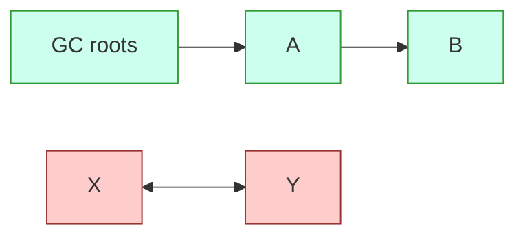
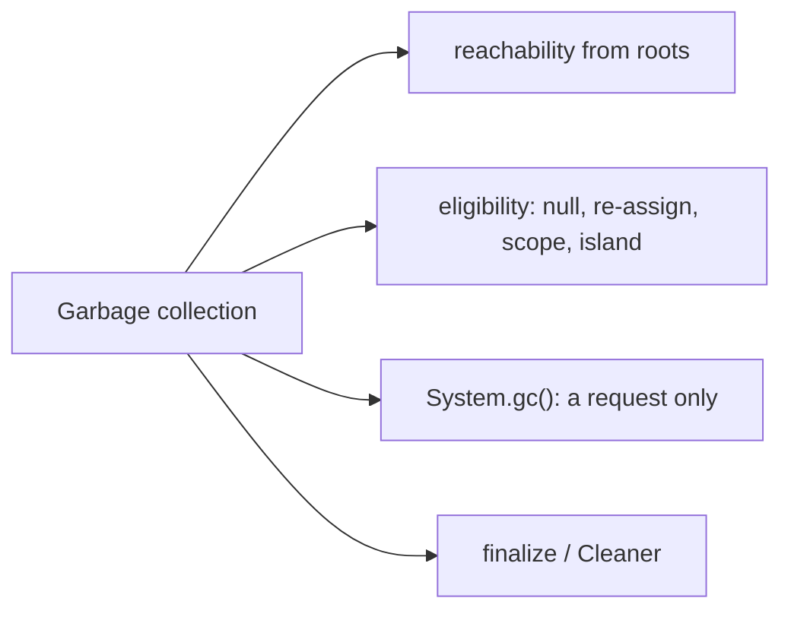

# Garbage Collection in Java

**TL;DR:** Java frees heap memory automatically. The garbage collector (GC) reclaims objects that are **unreachable**: no chain of references leads to them from a **GC root** (local variables on live thread stacks, static fields, active threads, JNI handles). You can make an object eligible by **nulling** its reference, **re-assigning** the reference, letting a local variable go out of scope, or by cutting off an **island of isolation** (objects that reference only each other). `System.gc()` / `Runtime.getRuntime().gc()` are only **requests**; the JVM may ignore them. "Eligible" does not mean "collected now."

## Table of Contents

1. [TL;DR](#1-tldr)
2. [Why it matters](#2-why-it-matters)
3. [Prerequisites](#3-prerequisites)
4. [Mental model](#4-mental-model)
5. [Core concepts](#5-core-concepts)
6. [How it works](#6-how-it-works)
7. [Examples](#7-examples)
8. [Comparisons](#8-comparisons)
9. [Trade-offs](#9-trade-offs)
10. [Gotchas](#10-gotchas)
11. [Practical application](#11-practical-application)
12. [Interview prep](#12-interview-prep)
13. [Interview question bank](#13-interview-question-bank)
14. [Tricky code snippets](#14-tricky-code-snippets)
15. [Connections](#15-connections)
16. [Summary](#16-summary)
17. [Answers](#answers)

> **Scope note.** The `finalize()` method has its own note (6 of 6). Heap and stack layout is in the Heap and Stack Memory note. Which collector algorithms exist is covered here at interview depth; tuning flags are out of scope.

---

## 1. TL;DR

| Way to become eligible | Example | Snippet |
|---|---|---|
| Null the only reference | `o = null;` | 1 |
| Null one of two references | still reachable via the other | 3 |
| Re-assign the reference | `o = new Object();` | 4 |
| Re-assign to another existing object | old one eligible | 5 |
| Island of isolation | `a.other=b; b.other=a; a=b=null;` | 6, 8 |
| Local goes out of scope | object created in a method | 9 |
| Anonymous object, no reference kept | `new Object();` | 11 |

**The analogy: a library that removes books nobody can find.**

| Real world | Java |
|---|---|
| A book on the shelf (heap) | An object |
| A reader's loan card, a catalogue entry (roots) | Local variables, static fields |
| A card pointing at the book | A reference |
| Books referenced only by other forgotten books | Island of isolation |
| A librarian who clears unreachable books when she decides to | The GC |
| Asking the librarian "please tidy up now" | `System.gc()` |

**Running example:** a `WeakReference` watching an object; set the strong reference to `null`, request GC, see the weak reference cleared (Snippet 1, 6.2).

---

## 2. Why it matters

**The problem.** Java has no `free()`. Memory is reclaimed by reachability, so what you must understand is *when an object stops being reachable* (and what keeps it alive by accident).

**What goes wrong** (verified on Java 21):

| Mistake | Result | Snippet |
|---|---|---|
| Nulling one of two references | Object stays alive | 3 |
| Keeping objects in a static collection | Never collected: a leak | 12, 13 |
| Expecting `System.gc()` to guarantee collection | It's only a request ⚠️ | 20 |
| Assuming a cycle `a↔b` is never freed | It's freed, once unreachable from roots | 6, 8 |
| Expecting a string literal to be freed | It stays (constant pool) | 15 |
| Holding objects reachable until `OutOfMemoryError` | OOM: Java heap space | 25 |
| Expecting an inner class to always pin its outer | Only if it uses it (javac 18+) | 18, 19 |

**Why interviewers ask.** "How many objects are eligible after this code?", "does `System.gc()` run the collector?", "what's an island of isolation?", "can Java have memory leaks?" are staples. They probe whether you think in terms of reachability and know what is guaranteed and what is not.

---

## 3. Prerequisites

| Prerequisite | One-line refresher | Importance |
|---|---|---|
| Heap and stack memory | Objects on the heap; references on the stack | Essential |
| Reference variables | A variable holds a reference, not the object | Essential |
| Object creation | `new` allocates on the heap | Essential |
| Static members | Static fields are GC roots | Important |
| Collections | Collections hold strong references | Important |
| Threads (basic) | Each live thread's stack is a root | Helpful |

---

## 4. Mental model

> **The one picture to keep in your head:** the heap is a graph. Start from the **roots** and follow every reference; whatever you can reach is live. Everything else is garbage, even if those objects still point at each other.

```
 ROOTS (stack locals, statics, threads)
   │
   ▼
 ┌─────┐   ┌─────┐
 │  A  │──▶│  B  │         reachable → kept
 └─────┘   └─────┘

        ┌─────┐   ┌─────┐
        │  X  │◀─▶│  Y  │  no path from roots → garbage (island of isolation)
        └─────┘   └─────┘
```
*Reachability, not reference counts, decides.*


*X and Y reference each other but nothing reachable references them.*

---

## 5. Core concepts

### 5.1 Glossary

- **Garbage collection:** automatic reclamation of heap memory held by unreachable objects.
- **Reachable / live:** some chain of references from a GC root leads to the object.
- **GC root:** local variables and parameters on active thread stacks, static fields, active threads, JNI references.
- **Eligible for GC:** unreachable; may be collected at the JVM's discretion.
- **Island of isolation:** a group of objects that reference each other but are not reachable from any root.
- **`System.gc()`:** a request that the JVM run a collection; no guarantee.
- **Stop-the-world pause:** the application threads are paused while the GC works (collectors differ in how much).
- **Memory leak (Java sense):** objects that are still reachable but no longer needed.
- **Reference types:** strong (normal), soft, weak, phantom (`java.lang.ref`).

### 5.2 Making an object eligible

**1. Nulling a reference variable.** `o = null;` removes the only strong reference (Snippet 1). If another reference exists, the object stays (Snippet 3).

**2. Re-assigning a reference variable.** `o = new Object();` or `o = other;` leaves the previous object unreferenced (Snippets 4, 5). In a loop, only the last one is still referenced (Snippet 28).

**3. Island of isolation.** Objects pointing at each other are still collectable when no root reaches them (Snippets 6, 8). One outside reference keeps the whole island alive (Snippet 7).

**4. Scope.** An object created in a method and not returned or stored is unreachable once the method returns (Snippet 9). If returned, it lives as long as the caller keeps it (Snippet 10).

**5. Anonymous objects.** `new Object();` with no reference is eligible immediately (Snippet 11).

### 5.3 What keeps objects alive (accidentally)

- **Static fields** (Snippet 12).
- **Collections** you forgot to clear or remove from (Snippets 13, 29).
- **Arrays** where only some elements are nulled (Snippet 14).
- **Inner-class instances** that use their outer (Snippet 19). Note javac 18+ omits the hidden outer reference when the inner class doesn't use it (Snippet 18) ⚠️.
- **Listeners, caches, ThreadLocals** ⚠️ (common real leaks; not run here).

### 5.4 Requesting garbage collection

`System.gc()` and `Runtime.getRuntime().gc()` are equivalent: they *suggest* a collection (Snippets 20, 22). HotSpot usually honours them (we used that in the demos), but:
- the language specification doesn't require it;
- `-XX:+DisableExplicitGC` turns them into no-ops ⚠️;
- calling it in production code is considered a smell (it can cause a long full-GC pause).

### 5.5 Values that are never "freed" the way you expect

- **String literals** live in the constant pool and stay reachable (Snippet 15). `new String("x")` is a normal heap object (Snippet 16).
- **Small boxed values** (`Integer` -128..127) come from a cache (Snippet 17).
- **Primitives** aren't garbage-collected; they live in the stack frame or inside an object.

### 5.6 Reference strength

| Type | Cleared when | Snippet |
|---|---|---|
| Strong (normal) | never while reachable | 2 |
| `SoftReference` | memory is tight (survived `System.gc()` here) ⚠️ | 23 |
| `WeakReference` | next GC if only weakly reachable | 1, 23 |
| `PhantomReference` | after finalisation; `get()` is always null | (finalize note) |

`WeakHashMap` drops entries whose key is only weakly reachable (Snippet 24).

### 5.7 Heap generations (interview level) ⚠️

HotSpot collectors split the heap by object age:
- **Young generation** (Eden + survivor spaces): most objects die young; collected by frequent, quick *minor GCs*.
- **Old generation**: long-lived objects; collected less often (*major/full GC*).
- **Metaspace** holds class metadata (outside the heap).

---

## 6. How it works

### 6.1 Mark, sweep, compact (conceptually)

1. **Mark:** from the roots, mark every reachable object.
2. **Sweep/evacuate:** reclaim the rest.
3. **Compact** (some collectors): move survivors together to avoid fragmentation.

### 6.2 Worked trace: the running example

```java
import java.lang.ref.WeakReference;
public class Main {
    public static void main(String[] args) {
        Object o = new Object();
        WeakReference<Object> w = new WeakReference<>(o);
        System.out.println(w.get() != null);
        o = null;
        System.gc();
        System.out.println(w.get() == null);
    }
}
```

Output (verified, Java 21, five identical runs):

```
true
true
```

| Step | Strong refs | Weak ref `w.get()` |
|---|---|---|
| `new Object()` | `o` | non-null |
| `o = null` | none | non-null until a GC runs |
| `System.gc()` | none | cleared (null) |

The first line proves the object was alive; the second shows it was reclaimed after we dropped the last strong reference and requested a collection.

### 6.3 Why `WeakReference` for demos

You can't observe "collected" directly. A weak reference doesn't keep its referent alive and becomes `null` after collection, so it's the honest probe. (`finalize()` is another probe: Snippet 27, and the next note.)

### 6.4 Collectors (interview level) ⚠️

| Collector | Notes |
|---|---|
| Serial | Single-threaded; small heaps |
| Parallel | Multi-threaded throughput collector |
| G1 | Default on server-class machines since Java 9; region-based, pause-time goals |
| ZGC | Low-latency, mostly concurrent; production since Java 15; generational mode added in 21 |
| Shenandoah | Low-pause collector (not in every JDK build) |
| CMS | Removed in Java 14 |

Which one runs depends on the JVM version, machine and flags.

### 6.5 What you control and don't

You control **reachability** (the references you keep). You don't control **when** collection happens, **which** objects are collected first, or the **order**.

### 6.6 Out of memory

If live objects fill the heap, the JVM throws `OutOfMemoryError: Java heap space` (Snippet 25). The same loop with unreachable temporaries doesn't (Snippet 26): the GC reclaims them as needed.

---

## 7. Examples

### 7.1 Toy example

```java
Object a = new Object();   // object #1
Object b = new Object();   // object #2
a = b;                     // #1 eligible (re-assigned)
b = null;                  // #2 still reachable through a
a = null;                  // #2 now eligible too
```
Same patterns as Snippets 3, 4, 5.

### 7.2 Real-world examples

- **Static cache never cleared** → leak; use `WeakHashMap`, size limits, or a cache library (Snippets 12, 13, 24).
- **Event listeners not unregistered** keep UI objects alive ⚠️.
- **`ThreadLocal` in thread pools** can retain values ⚠️.
- **Large temporaries in loops** are fine; they become garbage each iteration (Snippet 26).
- **Soft references** used for memory-sensitive caches (Snippet 23).
- **Closing resources** (files, sockets) is *not* GC's job: use try-with-resources.

---

## 8. Comparisons

### 8.1 Eligible vs collected

| | Eligible | Collected |
|---|---|---|
| Meaning | Unreachable | Memory actually reclaimed |
| Who decides | Your references | The JVM |
| Timing | As soon as unreachable | Some time later, maybe never |

### 8.2 Null vs re-assign vs scope

| | Nulling | Re-assigning | Scope end |
|---|---|---|---|
| Code | `o = null` | `o = new X()` | method returns |
| Snippet | 1 | 4 | 9 |
| Notes | Explicit | Often accidental | Automatic |

### 8.3 `System.gc()` vs `Runtime.getRuntime().gc()`

Equivalent; `System.gc()` calls the `Runtime` method (Snippets 20, 22).

### 8.4 Java GC vs manual memory management

| | Java | C/C++ |
|---|---|---|
| Free | Automatic | `free`/`delete` |
| Dangling pointers | No | Possible |
| Leaks | Reachable-but-unused only | Also unreleased memory |
| Pauses | Possible | No collector pauses |

### 8.5 Reference types

| | Strong | Soft | Weak | Phantom |
|---|---|---|---|---|
| Prevents collection | Yes | Until memory is low | No | No |
| `get()` | object | object or null | object or null | always null |

---

## 9. Trade-offs

| Decision | Benefit | Cost | Use when |
|---|---|---|---|
| Rely on GC | No manual frees, no dangling pointers | Non-deterministic timing, pauses | Default |
| Call `System.gc()` | May reclaim now | Unpredictable full-GC pause | Demos, tests, rarely |
| Null out references | Helps in long-lived structures | Clutter if overused | Large arrays/caches you hold |
| WeakHashMap/soft refs for caches | Memory-sensitive | Entries vanish unpredictably | Caches where misses are OK |
| Object pooling | Fewer allocations | Complexity, can pin memory | Rare, measured need |
| Larger heap | Fewer collections | Longer pauses, more memory | Throughput-tuned apps |

---

## 10. Gotchas

### Myths

- ❌ **Myth:** "`System.gc()` runs the garbage collector." ✅ **Reality:** it requests one; the JVM may ignore it (5.4).
- ❌ **Myth:** "Eligible objects are freed immediately." ✅ **Reality:** eligibility only; collection happens later.
- ❌ **Myth:** "Objects referencing each other can never be freed." ✅ **Reality:** islands of isolation are collectable (Snippets 6, 8).
- ❌ **Myth:** "Setting one reference to null frees the object." ✅ **Reality:** only if it was the last one (Snippet 3).
- ❌ **Myth:** "Java can't leak memory." ✅ **Reality:** reachable-but-unused objects leak (Snippets 12, 13).
- ❌ **Myth:** "Reference counting is how Java does it." ✅ **Reality:** tracing from roots.
- ❌ **Myth:** "You can see exactly when an object is collected." ✅ **Reality:** only via probes (weak refs, finalizers) and even those are timing-dependent.
- ❌ **Myth:** "String literals get collected when you null the variable." ✅ **Reality:** they stay in the pool (Snippet 15).
- ❌ **Myth:** "GC also closes files." ✅ **Reality:** it only reclaims memory.

### Common mistakes and edge cases

- **Nulling only one of several references** (Snippet 3).
- **Forgetting the collection** that holds the object (Snippets 13, 29).
- **Setting an array element to null but keeping a second slot** (Snippet 14).
- **Counting the last loop object as garbage** (Snippet 28).
- **Using `System.gc()` as a correctness mechanism.**
- **Assuming output order of GC-dependent programs** ⚠️.

---

## 11. Practical application

### Checklist
- [ ] Think in reachability: who still refers to this object?
- [ ] Remove entries from long-lived collections when done.
- [ ] Prefer scoped locals to long-lived fields.
- [ ] Close resources with try-with-resources, not GC.
- [ ] Don't call `System.gc()` in production code.
- [ ] Use weak/soft references or bounded caches for caches.
- [ ] Watch heap use (GC logs, profilers) before tuning ⚠️.
- [ ] Don't rely on `finalize()` (next note).

### Hands-on exercise

Count the objects eligible for GC at the `// HERE` line.

```java
Object a = new Object();   // #1
Object b = new Object();   // #2
Object c = new Object();   // #3
a = b;
b = c;
c = null;
// HERE
```

<details><summary>Solution</summary>

One object (#1). After `a = b`, `a` and `b` both point to #2 and #1 has no reference. After `b = c`, `b` points to #3 and `c` too. After `c = null`, #3 is still referenced by `b`; #2 is still referenced by `a`. Only #1 is eligible.

Verified with `WeakReference`s on the three objects after `System.gc()`: first cleared, the other two alive (same technique as Snippets 3-5).
</details>

---

## 12. Interview prep

Eight model answers, as you would say them aloud.

<details><summary>1. What is garbage collection and how does Java decide what to collect?</summary>

The JVM automatically reclaims heap memory of objects that are unreachable, meaning no chain of references leads to them from a GC root (stack locals, static fields, active threads). It traces from roots; it doesn't count references (5.1, 6.1; Snippets 1, 6).
</details>

<details><summary>2. Does `System.gc()` guarantee a collection?</summary>

No. `System.gc()` and `Runtime.getRuntime().gc()` are equivalent requests that the JVM may ignore (for example with `-XX:+DisableExplicitGC`). HotSpot usually runs one, which is why the demos work, but it isn't guaranteed (5.4; Snippets 20, 22).
</details>

<details><summary>3. How can an object become eligible for garbage collection?</summary>

Null the only reference, re-assign the reference to another object, let the reference go out of scope, create it anonymously with no reference, or have it in an island of isolation (5.2; Snippets 1, 4, 9, 11, 6).
</details>

<details><summary>4. What is an island of isolation?</summary>

A group of objects that reference each other but that no GC root can reach. Because Java traces from roots, the whole island is collectable; one outside reference would keep all of it alive (Snippets 6, 7, 8).
</details>

<details><summary>5. Is "eligible" the same as "collected"?</summary>

No. Eligible means unreachable. When (or whether) the memory is reclaimed is up to the JVM (8.1).
</details>

<details><summary>6. Can Java programs leak memory?</summary>

Yes. Objects that are still reachable but never used again, such as entries in a static map or an uncleared list, are never collected (Snippets 12, 13).
</details>

<details><summary>7. Why does nulling one reference sometimes not help?</summary>

Another strong reference (a second variable, a field, a collection) still reaches the object (Snippets 3, 13).
</details>

<details><summary>8. What are soft, weak and phantom references?</summary>

Reference types in `java.lang.ref` with weaker hold on the referent: soft refs are cleared when memory is tight, weak refs at the next GC when only weakly reachable, phantom refs are for post-finalisation clean-up and `get()` returns null (5.6; Snippets 23, 24).
</details>

---

## 13. Interview question bank


### 13.1 Basics (Q1–Q12)

<details><summary>Q1. What is garbage collection?</summary>

Automatic reclamation of heap memory of unreachable objects.
</details>

<details><summary>Q2. Who runs the garbage collector?</summary>

The JVM, in its own thread(s).
</details>

<details><summary>Q3. Can you force garbage collection?</summary>

No; you can request it (Snippet 20).
</details>

<details><summary>Q4. What's reclaimed: stack or heap?</summary>

Heap objects. Stack frames are popped automatically.
</details>

<details><summary>Q5. Is there a `free()` in Java?</summary>

No.
</details>

<details><summary>Q6. What is a GC root?</summary>

Local variables and parameters on live thread stacks, static fields, active threads, JNI references.
</details>

<details><summary>Q7. What does reachable mean?</summary>

A chain of references from a root leads to the object.
</details>

<details><summary>Q8. Does Java use reference counting?</summary>

No; it traces reachability from roots.
</details>

<details><summary>Q9. What is an unreachable object called?</summary>

Eligible for garbage collection.
</details>

<details><summary>Q10. Is eligible the same as collected?</summary>

No (8.1).
</details>

<details><summary>Q11. Are primitives garbage-collected?</summary>

No; they live in frames or inside objects.
</details>

<details><summary>Q12. Who benefits from GC?</summary>

Developers: no dangling pointers, no manual free.
</details>


### 13.2 Making objects eligible (Q13–Q26)

<details><summary>Q13. Ways to make an object eligible?</summary>

Null the reference, re-assign it, scope end, anonymous object, island of isolation (5.2).
</details>

<details><summary>Q14. Does `o = null` always make it eligible?</summary>

Only if it was the last reference (Snippet 3).
</details>

<details><summary>Q15. What happens to the old object on `o = new Object()`?</summary>

Eligible if nothing else refers to it (Snippet 4).
</details>

<details><summary>Q16. `o = keep;` where `keep` is another existing object?</summary>

Old object eligible; `keep`'s object stays (Snippet 5).
</details>

<details><summary>Q17. Objects created inside a method?</summary>

Eligible after the method returns unless returned or stored (Snippet 9).
</details>

<details><summary>Q18. Returned object?</summary>

Lives while the caller holds it (Snippet 10).
</details>

<details><summary>Q19. `new Object();` with no variable?</summary>

Eligible immediately (Snippet 11).
</details>

<details><summary>Q20. How many objects are eligible after `a=b; b=c; c=null;` for three distinct objects?</summary>

One (exercise in 11).
</details>

<details><summary>Q21. Is a self-referencing object collectable?</summary>

Yes (Snippet 8).
</details>

<details><summary>Q22. Two objects referencing each other, both variables nulled?</summary>

Both collectable (Snippet 6).
</details>

<details><summary>Q23. Same, but one variable still set?</summary>

Both stay alive (Snippet 7).
</details>

<details><summary>Q24. A loop creating objects into one variable?</summary>

Only the last is still referenced (Snippet 28).
</details>

<details><summary>Q25. Setting an array element to null?</summary>

That element's object becomes eligible if unreferenced elsewhere (Snippet 14).
</details>

<details><summary>Q26. Clearing a list?</summary>

Objects become eligible if nothing else holds them (Snippet 13).
</details>


### 13.3 Island of isolation (Q27–Q32)

<details><summary>Q27. Define island of isolation.</summary>

Objects referencing each other, unreachable from any root.
</details>

<details><summary>Q28. Why can't it be freed by reference counting?</summary>

Counts never reach zero; Java doesn't count, so this isn't a problem.
</details>

<details><summary>Q29. Does it matter how many objects are in the island?</summary>

No; all are collected.
</details>

<details><summary>Q30. What keeps an island alive?</summary>

Any one reference from a root into it (Snippet 7).
</details>

<details><summary>Q31. Typical interview question?</summary>

"How many objects are eligible?" with objects linked in a cycle.
</details>

<details><summary>Q32. Example in code?</summary>

Snippet 6.
</details>


### 13.4 Requesting GC (Q33–Q42)

<details><summary>Q33. What are the two ways to request GC?</summary>

`System.gc()` and `Runtime.getRuntime().gc()` (Snippets 20, 22).
</details>

<details><summary>Q34. Are they different?</summary>

No; `System.gc()` calls the `Runtime` method.
</details>

<details><summary>Q35. Is the request guaranteed?</summary>

No.
</details>

<details><summary>Q36. What flag disables explicit GC calls?</summary>

`-XX:+DisableExplicitGC` ⚠️.
</details>

<details><summary>Q37. Does `System.gc()` return when the GC finishes?</summary>

Typically HotSpot completes a full GC before returning, but it's not specified ⚠️.
</details>

<details><summary>Q38. Should production code call it?</summary>

Rarely; it can cause a long pause.
</details>

<details><summary>Q39. What does `Runtime.totalMemory()` mean?</summary>

Memory currently reserved by the JVM heap (Snippet 21).
</details>

<details><summary>Q40. `freeMemory()`?</summary>

Unused part of `totalMemory()`.
</details>

<details><summary>Q41. `maxMemory()`?</summary>

Upper limit the heap can grow to.
</details>

<details><summary>Q42. Why use `WeakReference` in tests of GC?</summary>

It lets you observe collection without keeping the object alive (6.3).
</details>


### 13.5 Memory model, leaks and references (Q43–Q56)

<details><summary>Q43. What is a memory leak in Java?</summary>

Reachable but unused objects.
</details>

<details><summary>Q44. Common leak sources?</summary>

Static collections, listeners, caches, ThreadLocals ⚠️.
</details>

<details><summary>Q45. Does GC close files or sockets?</summary>

No; use try-with-resources.
</details>

<details><summary>Q46. What does a `WeakHashMap` do?</summary>

Drops entries whose keys are only weakly reachable (Snippet 24).
</details>

<details><summary>Q47. What is a `SoftReference` good for?</summary>

Memory-sensitive caches (Snippet 23).
</details>

<details><summary>Q48. What does a `PhantomReference` return from `get()`?</summary>

Always null.
</details>

<details><summary>Q49. Are string literals collected?</summary>

Not while their class is loaded; they're in the constant pool (Snippet 15).
</details>

<details><summary>Q50. `new String("x")`?</summary>

Ordinary heap object; collectable (Snippet 16).
</details>

<details><summary>Q51. Boxed `Integer` 100?</summary>

Comes from a cache; not collected (Snippet 17).
</details>

<details><summary>Q52. Does an inner class instance keep its outer alive?</summary>

If it uses the outer, yes (Snippet 19). javac 18+ omits the hidden reference otherwise (Snippet 18) ⚠️.
</details>

<details><summary>Q53. What is OutOfMemoryError: Java heap space?</summary>

Live objects fill the heap (Snippet 25).
</details>

<details><summary>Q54. Do temporaries cause OOM?</summary>

No; they become garbage (Snippet 26).
</details>

<details><summary>Q55. What are young and old generations?</summary>

Age-based heap regions; minor and full GCs ⚠️.
</details>

<details><summary>Q56. Default collector?</summary>

G1 on server-class machines since Java 9 ⚠️.
</details>

---

## 14. Tricky code snippets

29 snippets, each compiled and run on OpenJDK 21. Predict the output (or the compile error) before opening the answer. Garbage collection is the JVM's decision, so most snippets observe it with a `WeakReference` (`get()` returns `null` once the referent is collected). Each was run five times with identical output. ⚠️ HotSpot behaviour on Java 21, not a language guarantee.

### Snippet 1: Weak reference watching an object

```java
import java.lang.ref.WeakReference;
public class Main {
    public static void main(String[] args) {
        Object o = new Object();
        WeakReference<Object> w = new WeakReference<>(o);
        System.out.println(w.get() != null);
        o = null;
        System.gc();
        System.out.println(w.get() == null);
    }
}
```

<details><summary>Answer</summary>

```
true
true
```

Alive first; cleared after the last strong reference is nulled and GC is requested (6.2).
</details>

### Snippet 2: A strong reference keeps it alive

```java
import java.lang.ref.WeakReference;
public class Main {
    public static void main(String[] args) {
        Object o = new Object();
        WeakReference<Object> w = new WeakReference<>(o);
        System.gc();
        System.out.println(w.get() != null);
        System.out.println(o.hashCode() == o.hashCode());
    }
}
```

<details><summary>Answer</summary>

```
true
true
```

`o` is still reachable (and used afterwards), so `System.gc()` can't take it.
</details>

### Snippet 3: Nulling one of two references

```java
import java.lang.ref.WeakReference;
public class Main {
    public static void main(String[] args) {
        Object a = new Object();
        Object b = a;
        WeakReference<Object> w = new WeakReference<>(a);
        a = null;
        System.gc();
        System.out.println(w.get() != null);
        b = null;
        System.gc();
        System.out.println(w.get() == null);
    }
}
```

<details><summary>Answer</summary>

```
true
true
```

Object survives while `b` points at it; once both are null it is collected.
</details>

### Snippet 4: Re-assigning a reference

```java
import java.lang.ref.WeakReference;
public class Main {
    public static void main(String[] args) {
        Object o = new Object();
        WeakReference<Object> first = new WeakReference<>(o);
        o = new Object();
        System.gc();
        System.out.println(first.get() == null);
    }
}
```

<details><summary>Answer</summary>

```
true
```

The first object lost its only reference when `o` was re-assigned.
</details>

### Snippet 5: Re-assigning to another existing object

```java
import java.lang.ref.WeakReference;
public class Main {
    public static void main(String[] args) {
        Object keep = new Object();
        Object o = new Object();
        WeakReference<Object> w = new WeakReference<>(o);
        o = keep;
        System.gc();
        System.out.println(w.get() == null);
        System.out.println(o == keep);
    }
}
```

<details><summary>Answer</summary>

```
true
true
```

The original is eligible; `o` and `keep` share the other object.
</details>

### Snippet 6: Island of isolation

```java
import java.lang.ref.WeakReference;
public class Main {
    static class Node { Node other; }
    public static void main(String[] args) {
        Node a = new Node();
        Node b = new Node();
        a.other = b;
        b.other = a;
        WeakReference<Node> wa = new WeakReference<>(a);
        WeakReference<Node> wb = new WeakReference<>(b);
        a = null;
        b = null;
        System.gc();
        System.out.println(wa.get() == null);
        System.out.println(wb.get() == null);
    }
}
```

<details><summary>Answer</summary>

```
true
true
```

`a` and `b` reference each other, but no root reaches either, so both are collected.
</details>

### Snippet 7: Island with one outside reference

```java
import java.lang.ref.WeakReference;
public class Main {
    static class Node { Node other; }
    public static void main(String[] args) {
        Node a = new Node();
        Node b = new Node();
        a.other = b;
        b.other = a;
        WeakReference<Node> wb = new WeakReference<>(b);
        b = null;
        System.gc();
        System.out.println(wb.get() != null);
        a = null;
        System.gc();
        System.out.println(wb.get() == null);
    }
}
```

<details><summary>Answer</summary>

```
true
true
```

`a` still reaches `b`, so both live; after `a = null` both go.
</details>

### Snippet 8: Self-referencing object

```java
import java.lang.ref.WeakReference;
public class Main {
    static class Node { Node self; Node() { self = this; } }
    public static void main(String[] args) {
        Node n = new Node();
        WeakReference<Node> w = new WeakReference<>(n);
        n = null;
        System.gc();
        System.out.println(w.get() == null);
    }
}
```

<details><summary>Answer</summary>

```
true
```

A self-reference doesn't keep an object alive.
</details>

### Snippet 9: Object created in a method

```java
import java.lang.ref.WeakReference;
public class Main {
    static WeakReference<Object> make() {
        Object local = new Object();
        return new WeakReference<>(local);
    }
    public static void main(String[] args) {
        WeakReference<Object> w = make();
        System.gc();
        System.out.println(w.get() == null);
    }
}
```

<details><summary>Answer</summary>

```
true
```

Unreachable once `make()` returns.
</details>

### Snippet 10: Returned object

```java
import java.lang.ref.WeakReference;
public class Main {
    static Object make() { return new Object(); }
    public static void main(String[] args) {
        Object o = make();
        WeakReference<Object> w = new WeakReference<>(o);
        System.gc();
        System.out.println(w.get() != null);
    }
}
```

<details><summary>Answer</summary>

```
true
```

The caller's variable keeps it reachable.
</details>

### Snippet 11: No reference kept

```java
import java.lang.ref.WeakReference;
public class Main {
    public static void main(String[] args) {
        WeakReference<Object> w = new WeakReference<>(new Object());
        System.gc();
        System.out.println(w.get() == null);
    }
}
```

<details><summary>Answer</summary>

```
true
```

Only the weak reference points at it.
</details>

### Snippet 12: Static field as a root

```java
import java.lang.ref.WeakReference;
public class Main {
    static Object holder = new Object();
    public static void main(String[] args) {
        WeakReference<Object> w = new WeakReference<>(holder);
        System.gc();
        System.out.println(w.get() != null);
        holder = null;
        System.gc();
        System.out.println(w.get() == null);
    }
}
```

<details><summary>Answer</summary>

```
true
true
```

Alive while `holder` references it; collected after `holder = null`.
</details>

### Snippet 13: Collection holds the object

```java
import java.lang.ref.WeakReference;
import java.util.*;
public class Main {
    public static void main(String[] args) {
        List<Object> list = new ArrayList<>();
        Object o = new Object();
        list.add(o);
        WeakReference<Object> w = new WeakReference<>(o);
        o = null;
        System.gc();
        System.out.println(w.get() != null);
        list.clear();
        System.gc();
        System.out.println(w.get() == null);
    }
}
```

<details><summary>Answer</summary>

```
true
true
```

The list keeps it alive until `clear()`.
</details>

### Snippet 14: Nulling one array slot

```java
import java.lang.ref.WeakReference;
public class Main {
    public static void main(String[] args) {
        Object[] arr = { new Object(), new Object() };
        WeakReference<Object> w0 = new WeakReference<>(arr[0]);
        WeakReference<Object> w1 = new WeakReference<>(arr[1]);
        arr[0] = null;
        System.gc();
        System.out.println(w0.get() == null);
        System.out.println(w1.get() != null);
    }
}
```

<details><summary>Answer</summary>

```
true
true
```

Slot 0's object is eligible; slot 1's is still in the array.
</details>

### Snippet 15: String literal

```java
import java.lang.ref.WeakReference;
public class Main {
    public static void main(String[] args) {
        String lit = "hello";
        WeakReference<String> w = new WeakReference<>(lit);
        lit = null;
        System.gc();
        System.out.println(w.get() != null);
    }
}
```

<details><summary>Answer</summary>

```
true
```

The constant pool keeps the literal reachable.
</details>

### Snippet 16: `new String("hello")`

```java
import java.lang.ref.WeakReference;
public class Main {
    public static void main(String[] args) {
        String s = new String("hello");
        WeakReference<String> w = new WeakReference<>(s);
        s = null;
        System.gc();
        System.out.println(w.get() == null);
    }
}
```

<details><summary>Answer</summary>

```
true
```

A fresh heap object with no other reference.
</details>

### Snippet 17: Cached `Integer`

```java
import java.lang.ref.WeakReference;
public class Main {
    public static void main(String[] args) {
        Integer small = 100;
        WeakReference<Integer> w = new WeakReference<>(small);
        small = null;
        System.gc();
        System.out.println(w.get() != null);
    }
}
```

<details><summary>Answer</summary>

```
true
```

`Integer.valueOf(100)` comes from the cache, which holds a strong reference.
</details>

### Snippet 18: Inner class that does not use its outer

```java
import java.lang.ref.WeakReference;
public class Main {
    class Inner {}
    public static void main(String[] args) {
        Main outer = new Main();
        Inner in = outer.new Inner();
        WeakReference<Main> w = new WeakReference<>(outer);
        outer = null;
        System.gc();
        System.out.println(w.get() != null);
        in = null;
        System.gc();
        System.out.println(w.get() == null);
    }
}
```

<details><summary>Answer</summary>

```
false
true
```

Since javac 18 an unused hidden outer reference is omitted, so nulling `outer` freed it even though `in` is alive. ⚠️ Version-specific.
</details>

### Snippet 19: Inner class that uses its outer

```java
import java.lang.ref.WeakReference;
public class Main {
    int x = 7;
    class Inner { int get() { return x; } }
    public static void main(String[] args) {
        Main outer = new Main();
        Inner in = outer.new Inner();
        WeakReference<Main> w = new WeakReference<>(outer);
        outer = null;
        System.gc();
        System.out.println(w.get() != null);
        System.out.println(in.get());
        in = null;
        System.gc();
        System.out.println(w.get() == null);
    }
}
```

<details><summary>Answer</summary>

```
true
7
true
```

`in` keeps `outer` alive while it uses the outer's field; collected after `in = null`.
</details>

### Snippet 20: The two request methods

```java
public class Main {
    public static void main(String[] args) {
        System.gc();
        Runtime.getRuntime().gc();
        System.out.println("returned normally");
    }
}
```

<details><summary>Answer</summary>

```
returned normally
```

Both calls return; neither promises a collection.
</details>

### Snippet 21: Memory figures

```java
public class Main {
    public static void main(String[] args) {
        Runtime r = Runtime.getRuntime();
        System.out.println(r.totalMemory() >= r.freeMemory());
        System.out.println(r.maxMemory() >= r.totalMemory());
        System.out.println(r.availableProcessors() > 0);
    }
}
```

<details><summary>Answer</summary>

```
true
true
true
```

`totalMemory ≥ freeMemory`, `maxMemory ≥ totalMemory`, processors > 0.
</details>

### Snippet 22: `Runtime.getRuntime().gc()`

```java
import java.lang.ref.WeakReference;
public class Main {
    public static void main(String[] args) {
        Object o = new Object();
        WeakReference<Object> w = new WeakReference<>(o);
        o = null;
        Runtime.getRuntime().gc();
        System.out.println(w.get() == null);
    }
}
```

<details><summary>Answer</summary>

```
true
```

Same effect as `System.gc()`.
</details>

### Snippet 23: Weak vs soft

```java
import java.lang.ref.*;
public class Main {
    public static void main(String[] args) {
        SoftReference<Object> soft = new SoftReference<>(new Object());
        WeakReference<Object> weak = new WeakReference<>(new Object());
        System.gc();
        System.out.println(soft.get() != null);
        System.out.println(weak.get() == null);
    }
}
```

<details><summary>Answer</summary>

```
true
true
```

The soft reference survived a `System.gc()`; the weak one was cleared. ⚠️ Soft refs are cleared when memory is tight.
</details>

### Snippet 24: WeakHashMap

```java
import java.util.*;
public class Main {
    public static void main(String[] args) throws Exception {
        Map<Object, String> m = new WeakHashMap<>();
        Object key = new Object();
        m.put(key, "v");
        System.out.println(m.size());
        key = null;
        for (int i = 0; i < 50 && m.size() > 0; i++) { System.gc(); Thread.sleep(20); }
        System.out.println(m.size());
    }
}
```

<details><summary>Answer</summary>

```
1
0
```

The entry disappears after the key becomes unreachable (the loop retries until the map is purged).
</details>

### Snippet 25: Reachable arrays until OOM

```java
import java.util.*;
public class Main {
    public static void main(String[] args) {
        List<long[]> keep = new ArrayList<>();
        try {
            while (true) keep.add(new long[1_000_000]);
        } catch (OutOfMemoryError e) {
            keep = null;
            System.out.println("OOM: " + e.getMessage());
        }
    }
}
```

<details><summary>Answer</summary>

```
OOM: Java heap space
```

Everything in `keep` stays reachable, so the heap fills.
</details>

### Snippet 26: Unreachable temporaries

```java
public class Main {
    public static void main(String[] args) {
        for (int i = 0; i < 2000; i++) { long[] tmp = new long[1_000_000]; }
        System.out.println("done");
    }
}
```

<details><summary>Answer</summary>

```
done
```

Each array is garbage after its iteration; the GC reclaims them.
</details>

### Snippet 27: A finaliser observed

```java
public class Main {
    static class R { @Override protected void finalize() { System.out.println("finalized"); } }
    public static void main(String[] args) throws Exception {
        new R();
        System.gc();
        Thread.sleep(300);
        System.out.println("end");
    }
}
```

<details><summary>Answer</summary>

```
finalized
end
```

⚠️ Not guaranteed; deprecated for removal (see the next note).
</details>

### Snippet 28: Loop re-assigning one variable

```java
import java.lang.ref.WeakReference;
import java.util.*;
public class Main {
    public static void main(String[] args) {
        Object o = null;
        List<WeakReference<Object>> refs = new ArrayList<>();
        for (int i = 0; i < 3; i++) { o = new Object(); refs.add(new WeakReference<>(o)); }
        System.gc();
        int alive = 0;
        for (WeakReference<Object> r : refs) if (r.get() != null) alive++;
        System.out.println(alive);
    }
}
```

<details><summary>Answer</summary>

```
1
```

Only the last object is still referenced by `o`.
</details>

### Snippet 29: Map still holds the value

```java
import java.lang.ref.WeakReference;
import java.util.*;
public class Main {
    public static void main(String[] args) {
        Map<String, Object> cache = new HashMap<>();
        Object v = new Object();
        cache.put("k", v);
        WeakReference<Object> w = new WeakReference<>(v);
        v = null;
        System.gc();
        System.out.println(w.get() != null);
        cache.remove("k");
        System.gc();
        System.out.println(w.get() == null);
    }
}
```

<details><summary>Answer</summary>

```
true
true
```

Nulling `v` isn't enough; `cache.remove("k")` frees it.
</details>

---

## 15. Connections

| Related topic | How it connects |
|---|---|
| Heap and stack memory | Where objects and references live |
| Reference variables | Reachability is about references |
| Static members | Static fields are GC roots |
| Finalize method | A pre-collection hook (deprecated) |
| Collections | Hold strong references; common leak source |
| Inner classes | Hidden outer reference |
| Strings and the pool | Literals aren't collected |
| Threads | Each live thread stack is a root |
| JVM architecture | The runtime data areas the GC manages |


*GC is reachability analysis; everything you control is about references.*

---

## 16. Summary

### 60-second card

- GC reclaims **unreachable** heap objects; it traces from roots, no reference counting.
- Eligible by: nulling, re-assigning, scope end, anonymous object, island of isolation.
- Nulling one of several references does nothing; collections and statics keep objects alive.
- `System.gc()` / `Runtime.gc()`: requests only.
- Eligible ≠ collected.
- Leaks = reachable but unused.
- `WeakReference` is the probe; soft/weak/phantom differ in how weak.
- Don't use GC for resources; don't rely on `finalize()`.

### Cheat sheet

```java
Object o = new Object();
o = null;                        // eligible if last ref
o = new Object();                // old one eligible
a.other = b; b.other = a; a = b = null;   // island: both collectable
System.gc();                     // request only
```

| Need | Use |
|---|---|
| Observe collection | `WeakReference` |
| Cache that can shrink | `WeakHashMap`, `SoftReference` |
| Release files/sockets | try-with-resources |
| Free a collection's contents | `clear()` / `remove` |

### Self-test

1. What makes an object eligible for GC?
2. What is a GC root?
3. Does `System.gc()` guarantee collection?
4. What is an island of isolation?
5. After `Object a = new Object(); Object b = a; a = null;` is the object eligible?
6. Can Java leak memory?
7. Are string literals collected when the variable is nulled?
8. Difference between eligible and collected?

### Anki flashcards

```
Eligible for GC :: Unreachable from any GC root
GC root :: Stack locals, static fields, active threads, JNI refs
System.gc() :: A request; not guaranteed
Island of isolation :: Objects referencing each other but unreachable; collectable
Nulling one of two refs :: Object stays alive
Java memory leak :: Reachable but no longer needed objects
String literal :: Stays in the constant pool
WeakReference :: Doesn't prevent collection; get() becomes null
```

### Resources

- The Java Tutorials, "Garbage Collection" (JVM/HotSpot docs): docs.oracle.com/javase
- *Java Virtual Machine Specification* and the HotSpot Virtual Machine Garbage Collection Tuning Guide: docs.oracle.com/en/java/javase
- *Effective Java*, Joshua Bloch: "Eliminate obsolete object references"
- API docs: `java.lang.ref.WeakReference`, `Runtime.gc()`

---

## Answers

1. Being unreachable from any GC root.
2. A starting point of tracing: live thread stack variables, static fields, active threads, JNI references.
3. No; it's a request.
4. Objects referencing each other with no path from a root; collectable.
5. No; `b` still references it.
6. Yes, by keeping unneeded objects reachable.
7. No; they stay in the constant pool.
8. Eligible = unreachable; collected = memory actually reclaimed, later and not guaranteed.
