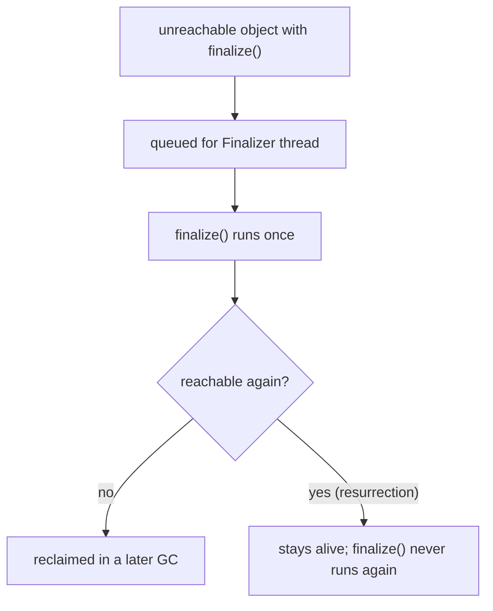
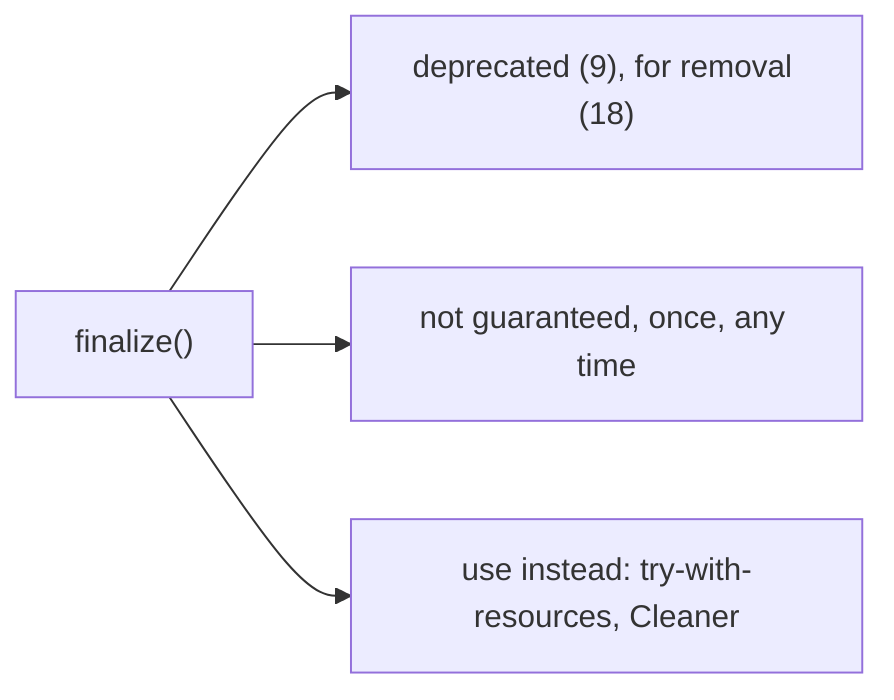

# The finalize() Method in Java

**TL;DR:** `Object.finalize()` is a hook the garbage collector *may* call once on an object just before reclaiming it. It is **deprecated since Java 9 and deprecated for removal since Java 18** (JEP 421), but still works on Java 21 unless you run with `--finalization=disabled`. It is **not guaranteed to run**, has **no timing or ordering guarantees**, runs **at most once** per object, runs on a separate **Finalizer thread**, and **swallows exceptions**. Never use it to release resources; use **try-with-resources** (`AutoCloseable`) and, as a safety net, a **`Cleaner`**.

## Table of Contents

1. [TL;DR](#1-tldr)
2. [Why it matters](#2-why-it-matters)
3. [Prerequisites](#3-prerequisites)
4. [Mental model](#4-mental-model)
5. [Core concepts](#5-core-concepts)
6. [How it works](#6-how-it-works)
7. [Examples](#7-examples)
8. [Comparisons](#8-comparisons)
9. [Trade-offs](#9-trade-offs)
10. [Gotchas](#10-gotchas)
11. [Practical application](#11-practical-application)
12. [Interview prep](#12-interview-prep)
13. [Interview question bank](#13-interview-question-bank)
14. [Tricky code snippets](#14-tricky-code-snippets)
15. [Connections](#15-connections)
16. [Summary](#16-summary)
17. [Answers](#answers)

> **Scope note.** What makes an object collectable is in the Garbage Collection note. This note covers `finalize()` itself, its guarantees and pitfalls, and the replacements. Everything about the deprecation is version-specific ⚠️.

---

## 1. TL;DR

| Fact | Detail | Snippet |
|---|---|---|
| Signature | `protected void finalize() throws Throwable` | 6, 23 |
| Who calls it | The JVM's `Finalizer` thread | 4 |
| When | Some time after the object becomes unreachable; maybe never | 2, 3 |
| How often | At most once per object (even after resurrection) | 7 |
| Exceptions | Ignored; the thread goes on | 8 |
| Explicit call | Just a normal method call; doesn't free anything | 5 |
| Status | Deprecated (9), for removal (18); can be disabled | 14 |
| Replacements | try-with-resources, `Cleaner`, `PhantomReference` | 16-19 |

**The analogy: a "last wish" note left with the librarian.**

| Real world | Java |
|---|---|
| A book that nobody can reach any more | An unreachable object |
| A note inside: "before you shred me, do X" | `finalize()` |
| The librarian reads notes when she gets round to it, maybe never | The Finalizer thread, no guarantees |
| The note is read once, even if the book is saved from the shredder | At most once; resurrection |
| Closing the book yourself when you finish reading | try-with-resources / `close()` |
| A second, safer system that shreds with a checklist | `Cleaner` |

**Running example:** a `Res` class whose `finalize()` prints; `r = null; System.gc();` then a short sleep to let the Finalizer thread run (Snippet 1, 6.2).

---

## 2. Why it matters

**The problem.** Java programmers coming from C++ expect a destructor. `finalize()` looks like one but isn't: it may run late or never, so code that depends on it for correctness is broken.

**What goes wrong** (verified on Java 21):

| Mistake | Result | Snippet |
|---|---|---|
| Relying on finalize at program exit | Never runs | 3 |
| Expecting it while the object is reachable | Not called | 2 |
| Expecting a specific order or a prompt call | None guaranteed | 11, 15 |
| Throwing from `finalize()` | Silently ignored | 8 |
| Subclass overriding without `super.finalize()` | Parent's finaliser skipped | 9 |
| Expecting a second call after resurrection | Called only once | 7 |
| Typo `finalise()` or `finalize(int)` | Never called, compiles fine | 21, 22 |
| Constructor throws | Finaliser can still run (finaliser attacks) | 25 |
| Relying on it | Deprecated for removal ⚠️ | 14 |

**Why interviewers ask.** "What is `finalize()`?", "is it guaranteed to be called?", "how many times?", "what's resurrection?", "what replaced it?" They test whether you know it's a trap and can name the alternatives.

---

## 3. Prerequisites

| Prerequisite | One-line refresher | Importance |
|---|---|---|
| Garbage collection | Unreachable = eligible; timing is the JVM's | Essential |
| `Object` methods | `finalize()`, `clone()`, ... are inherited | Essential |
| Overriding | Same signature; `@Override` catches typos | Essential |
| Exceptions | `throws Throwable` | Important |
| try-with-resources | `AutoCloseable.close()` | Important |
| Threads (basic) | A separate thread runs finalisers | Helpful |

---

## 4. Mental model

> **The one picture to keep in your head:** `finalize()` is not "called when the object is destroyed." It is "called *once*, on a background thread, *some time after* the GC discovers the object is unreachable, *if* the JVM gets round to it." The object's memory is reclaimed only in a *later* GC cycle, after the finaliser has run.

```
 object created ──▶ in use ──▶ becomes unreachable
                                   │
                          GC notices: object has finalize()
                                   │
                         queued for the Finalizer thread
                                   │
                          finalize() runs (once, maybe late)
                                   │
                  if still unreachable: reclaimed in a later GC
                  if finalize() stored `this` somewhere: resurrected
```
*Finalisable objects need at least two GC cycles to disappear.*


*The finaliser gives the object one last chance, once.*

---

## 5. Core concepts

### 5.1 Glossary

- **Finaliser:** an override of `Object.finalize()`.
- **Finalizer thread:** the JVM daemon thread that runs finalisers (Snippet 4).
- **Resurrection:** making a dying object reachable again from within `finalize()` (Snippet 7).
- **Finaliser attack:** a subclass that exploits a finaliser to capture a partly constructed object (Snippet 25) ⚠️.
- **`Cleaner`:** a Java 9+ API that runs registered actions when an object becomes phantom reachable (Snippets 17, 18).
- **`PhantomReference`:** a reference whose referent is already finalised; used with a `ReferenceQueue` (Snippet 19).
- **`--finalization=disabled`:** JVM option (Java 18+) that turns finalisation off ⚠️.

### 5.2 The method

```java
protected void finalize() throws Throwable { }
```
Declared in `Object`, so every class has it. It is `protected`: you can't call `obj.finalize()` from unrelated code (Snippet 6).

### 5.3 The guarantees (and non-guarantees)

| | Guaranteed? |
|---|---|
| Called before the object's memory is reclaimed | Only *if* it is called; not guaranteed to be called |
| Called at all | No; not at program exit (Snippet 3) |
| Called promptly | No (Snippets 15, 20) |
| Called in a particular order | No |
| Called at most once | **Yes** (Snippet 7) |
| Exceptions propagate | No, ignored (Snippet 8) |
| Called on the calling thread | No: `Finalizer` thread (Snippet 4) |

### 5.4 Explicit calls

`r.finalize()` from inside the class or a subclass is an ordinary method call (Snippet 5): it doesn't free anything, and the JVM can still call it again later (the "once" rule applies to the JVM's call).

### 5.5 Inheritance

A subclass override should call `super.finalize()` in a `finally` block; otherwise the parent's finaliser is skipped (Snippets 9, 10).

### 5.6 Resurrection

If `finalize()` stores `this` in a static field, the object becomes reachable again. The JVM will not call its finaliser a second time, even if it later becomes unreachable again (Snippet 7).

### 5.7 Typos and non-overrides

`finalise()` or `finalize(int)` are just other methods (Snippets 21, 22). `@Override` turns the typo into a compile error. A `static finalize()` is an error (Snippet 24); you can't override a `final` one (Snippets 26, 27).

### 5.8 Deprecation timeline ⚠️

- Java 9: `Object.finalize()` deprecated.
- Java 18: deprecated for removal (JEP 421); javac prints a `[removal]` warning (Snippet 14).
- Java 18+: `java --finalization=disabled` turns finalisation off (verified: nothing printed in Snippet 1's program).
- Removal itself has not happened in Java 21.

### 5.9 Replacements

| Need | Use | Snippet |
|---|---|---|
| Release a file/socket/lock | try-with-resources + `AutoCloseable` | 16 |
| Safety net if the user forgets `close()` | `Cleaner` registered in the constructor | 17, 18 |
| Know when an object was collected | `PhantomReference` + `ReferenceQueue` | 19 |
| Observe collection in a test | `WeakReference` (GC note) | 13 |

---

## 6. How it works

### 6.1 Lifecycle

1. Object with a non-trivial `finalize()` is allocated; the JVM records it as *finalisable*.
2. It becomes unreachable. The GC (not you) notices.
3. The JVM adds it to the finalisation queue; the Finalizer thread calls `finalize()`.
4. After that, if still unreachable, a later GC reclaims the memory.

Weak references to the object are cleared *before* its finaliser runs (Snippet 13).

### 6.2 Worked trace: the running example

```java
public class Main {
    static class Res {
        String name; Res(String n) { name = n; }
        @Override protected void finalize() { System.out.println("finalize " + name); }
    }
    public static void main(String[] args) throws Exception {
        Res r = new Res("A");
        r = null;
        System.gc();
        Thread.sleep(300);
        System.out.println("end");
    }
}
```

Output (verified, Java 21, repeated runs identical):

```
finalize A
end
```

| Step | State |
|---|---|
| `r = null` | object unreachable |
| `System.gc()` | GC notices; queues it |
| `Thread.sleep(300)` | gives the Finalizer thread time to run |
| `end` | after the finaliser printed |

Remove the `sleep` and `end` may print first, or the program may exit before `finalize` runs (Snippet 3). Run with `--finalization=disabled` and only `end` is printed (verified).

### 6.3 Why it can be slow and risky

- Finalisable objects survive at least one extra GC cycle.
- A slow finaliser delays others on the same thread (Snippet 20).
- Finalisers can resurrect objects, complicating the GC.
- Constructors that throw can still leave a finalisable object (Snippet 25), the basis of finaliser attacks; making the finaliser `final` (Snippet 26) is the old defence ⚠️.

### 6.4 `System.runFinalization()`

Asks the JVM to run pending finalisers. Also only a request, deprecated for removal in 18 ⚠️ (Snippet 15). Its old companion `runFinalizersOnExit` was removed (finalisers don't run at exit: Snippet 3).

### 6.5 `Cleaner` in short

```java
static final Cleaner CLEANER = Cleaner.create();
Cleanable c = CLEANER.register(this, () -> releaseNativeStuff());
// close() { c.clean(); }   (the action runs at most once: Snippet 18)
```
The cleaning action must not reference the object itself, or it will never become unreachable ⚠️.

---

## 7. Examples

### 7.1 Toy example

```java
class Res {
    @Override protected void finalize() throws Throwable {
        try { System.out.println("cleanup"); }   // best-effort only
        finally { super.finalize(); }
    }
}
```
Pattern from Snippets 9, 10.

### 7.2 Real-world examples

- **Legacy code** like old `FileInputStream`s relied on finalisers; they were migrated to `Cleaner` ⚠️.
- **Native resources** (handles, buffers): use `Cleaner` as a backstop for forgotten `close()`.
- **Everyday resources:** `try (var in = Files.newBufferedReader(p)) { ... }`.
- **Tests:** observe collection with `WeakReference`, not finalisers.
- **Interviews:** "predict the output" with resurrection and `System.gc()`.

---

## 8. Comparisons

### 8.1 `finalize()` vs `close()`

| | `finalize()` | `close()` |
|---|---|---|
| Called by | JVM, maybe | You / try-with-resources |
| Timing | Unpredictable | Deterministic |
| Guaranteed | No | Yes (try-with-resources) |
| Status | Deprecated for removal | Standard |

### 8.2 `finalize()` vs `Cleaner` vs `PhantomReference`

| | `finalize()` | `Cleaner` | `PhantomReference` |
|---|---|---|---|
| Needs a method on the class | Yes | No (action registered) | No |
| Can resurrect object | Yes | No | No |
| Runs on | Finalizer thread | Cleaner thread | You poll the queue |
| At most once | Yes | Yes (Snippet 18) | n/a |
| Status | Deprecated for removal | Recommended | Low-level |

### 8.3 Finalizer vs C++ destructor

| | Java finaliser | C++ destructor |
|---|---|---|
| Called | Maybe, later | Deterministically at scope end/delete |
| Order | Unspecified | Defined |
| Resurrection | Possible | Not applicable |

### 8.4 `finalize()` vs `static` / `final` variants

| Declaration | Effect | Snippet |
|---|---|---|
| `protected void finalize()` | Overrides | 1 |
| `protected final void finalize()` | Overrides; subclasses can't | 26, 27 |
| `protected static void finalize()` | Compile error | 24 |
| `finalise()` / `finalize(int)` | Not an override | 21, 22 |

---

## 9. Trade-offs

| Decision | Benefit | Cost | Use when |
|---|---|---|---|
| Implement `finalize()` | Safety net for leaked resources | Unreliable, slow, deprecated | Never in new code |
| try-with-resources | Deterministic cleanup | Callers must use it | Always, for resources |
| `Cleaner` | Backstop without a finaliser | Extra code; must not capture `this` | Native/off-heap resources |
| `PhantomReference` | Fine control | Manual queue polling | Frameworks |
| Disable finalisation (`--finalization=disabled`) | Finds code that depends on it | May expose leaks | Testing ⚠️ |

---

## 10. Gotchas

### Myths

- ❌ **Myth:** "`finalize()` is Java's destructor." ✅ **Reality:** no guaranteed timing or even execution (Snippets 2, 3).
- ❌ **Myth:** "It runs when the program exits." ✅ **Reality:** it doesn't (Snippet 3).
- ❌ **Myth:** "`System.gc()` runs finalisers immediately." ✅ **Reality:** it requests a GC; finalisers run later on another thread (Snippets 1, 15).
- ❌ **Myth:** "It's called every time the object becomes unreachable." ✅ **Reality:** at most once (Snippet 7).
- ❌ **Myth:** "Calling `obj.finalize()` frees the object." ✅ **Reality:** it's an ordinary call (Snippet 5).
- ❌ **Myth:** "An exception in `finalize()` crashes the program." ✅ **Reality:** ignored (Snippet 8).
- ❌ **Myth:** "Subclass finalisers automatically call the parent's." ✅ **Reality:** you must call `super.finalize()` (Snippet 9).
- ❌ **Myth:** "`finalize()` is fine in new code." ✅ **Reality:** deprecated for removal (Snippet 14).
- ❌ **Myth:** "Finalisers run in creation or reverse order." ✅ **Reality:** unspecified (Snippet 11 prints a sorted set for that reason).

### Common mistakes and edge cases

- **Freeing files/sockets in `finalize()`** instead of try-with-resources.
- **Forgetting `super.finalize()`** (Snippet 9).
- **Misspelling the method** and forgetting `@Override` (Snippets 21, 22).
- **Printing from finalisers in tests** and expecting stable output.
- **Resurrecting objects** without understanding the once-only rule (Snippet 7).
- **A `Cleaner` action that references the object** (never fires) ⚠️.
- **Slow finalisers** blocking the queue (Snippet 20).

---

## 11. Practical application

### Checklist
- [ ] Don't write `finalize()`; don't rely on one.
- [ ] Implement `AutoCloseable` and use try-with-resources.
- [ ] Add a `Cleaner` only for native/off-heap resources, as a backstop.
- [ ] Keep cleaning actions free of references to the owning object.
- [ ] Use `@Override` so typos fail to compile.
- [ ] If you must keep one, call `super.finalize()` in `finally`.
- [ ] Test with `--finalization=disabled` to find hidden dependencies ⚠️.
- [ ] Observe collection with `WeakReference`, not finalisers.

### Hands-on exercise

Predict: how many times is `finalize #` printed, and what is `count`?

```java
static Res saved;
static class Res {
    static int count;
    protected void finalize() { count++; System.out.println("finalize #" + count); saved = this; }
}
// main: new Res(); gc; sleep; saved = null; gc; sleep; print count
```

<details><summary>Solution</summary>

`finalize #1` is printed once and `count = 1`. The first collection finalises the object, which resurrects itself in `saved`. After `saved = null` it becomes unreachable again, but the JVM never calls `finalize()` a second time on the same object.

Verified: output is `finalize #1`, `resurrected: true`, `count = 1` (Snippet 7).
</details>

---

## 12. Interview prep

Eight model answers, as you would say them aloud.

<details><summary>1. What is `finalize()`?</summary>

A `protected void finalize() throws Throwable` method on `Object` that the JVM may call once, on its Finalizer thread, after an object becomes unreachable and before its memory is reclaimed. It is deprecated since Java 9 and for removal since Java 18 (5.2, 5.8; Snippets 1, 4, 14).
</details>

<details><summary>2. Is `finalize()` guaranteed to run?</summary>

No. It may run late or never, and it does not run at program exit. Don't use it for anything that must happen (5.3; Snippets 2, 3).
</details>

<details><summary>3. How many times can the JVM call it for one object?</summary>

At most once. If `finalize()` resurrects the object by storing `this` somewhere, the JVM won't call it again when the object later becomes unreachable (Snippet 7).
</details>

<details><summary>4. What happens if `finalize()` throws?</summary>

The exception is ignored and the Finalizer thread carries on with other objects (Snippet 8).
</details>

<details><summary>5. Does calling `obj.finalize()` free the object?</summary>

No. An explicit call is an ordinary method call; the JVM may still call it later (5.4; Snippet 5).
</details>

<details><summary>6. What should a subclass override do?</summary>

Call `super.finalize()`, ideally in a `finally` block; otherwise the parent's cleanup is skipped (Snippets 9, 10).
</details>

<details><summary>7. What replaces `finalize()`?</summary>

try-with-resources with `AutoCloseable` for deterministic cleanup; `Cleaner` as a safety net for resources a caller forgot to close; `PhantomReference` with a `ReferenceQueue` for low-level tracking (5.9; Snippets 16-19).
</details>

<details><summary>8. Why is `finalize()` considered harmful?</summary>

Unpredictable timing, performance cost (extra GC cycles, one slow finaliser delays others), exceptions swallowed, resurrection, and security issues such as finaliser attacks. Hence deprecation for removal (6.3).
</details>

---

## 13. Interview question bank


### 13.1 Basics (Q1–Q12)

<details><summary>Q1. What is `finalize()`?</summary>

An `Object` method the GC may call once before reclaiming an object.
</details>

<details><summary>Q2. Signature?</summary>

`protected void finalize() throws Throwable` (Snippets 6, 23).
</details>

<details><summary>Q3. Who calls it?</summary>

The JVM's Finalizer thread (Snippet 4).
</details>

<details><summary>Q4. Can you call it yourself?</summary>

From the class or a subclass, as an ordinary method (Snippet 5); `obj.finalize()` from unrelated code doesn't compile (Snippet 6).
</details>

<details><summary>Q5. Is it like a C++ destructor?</summary>

No; no guaranteed timing or execution.
</details>

<details><summary>Q6. Is it called while the object is reachable?</summary>

No (Snippet 2).
</details>

<details><summary>Q7. Is it called at program exit?</summary>

No (Snippet 3).
</details>

<details><summary>Q8. Is it deprecated?</summary>

Since Java 9; for removal since Java 18 (Snippet 14) ⚠️.
</details>

<details><summary>Q9. Is it removed in Java 21?</summary>

No; it still runs by default.
</details>

<details><summary>Q10. How to turn it off?</summary>

`java --finalization=disabled` (Java 18+) ⚠️.
</details>

<details><summary>Q11. Which thread runs it?</summary>

A daemon thread named `Finalizer` (Snippet 4).
</details>

<details><summary>Q12. Does `System.gc()` run it?</summary>

Not directly; it requests a GC after which finalisers may run later (Snippet 1).
</details>


### 13.2 Guarantees and behaviour (Q13–Q26)

<details><summary>Q13. How many times at most?</summary>

Once (Snippet 7).
</details>

<details><summary>Q14. What is resurrection?</summary>

Making the object reachable again inside `finalize()` (Snippet 7).
</details>

<details><summary>Q15. After resurrection, is `finalize()` called again?</summary>

No.
</details>

<details><summary>Q16. Exception thrown in `finalize()`?</summary>

Ignored; the thread continues (Snippet 8).
</details>

<details><summary>Q17. Is the order of finalisation defined?</summary>

No (Snippet 11).
</details>

<details><summary>Q18. Is the timing defined?</summary>

No.
</details>

<details><summary>Q19. Are weak references cleared before the finaliser runs?</summary>

Yes (Snippet 13).
</details>

<details><summary>Q20. Are both objects of an island of isolation finalised?</summary>

Yes, in no particular order (Snippet 11).
</details>

<details><summary>Q21. Do all unreachable finalisable objects get finalised?</summary>

Usually, given time, but not guaranteed (Snippet 12 waits for all 100).
</details>

<details><summary>Q22. Does an explicit call count as the one call?</summary>

No; the JVM's call is separate (Snippet 5).
</details>

<details><summary>Q23. Does a failed constructor prevent finalisation?</summary>

No; the object can still be finalised (Snippet 25).
</details>

<details><summary>Q24. What's a finaliser attack?</summary>

A subclass exploiting a finaliser to get hold of a partly constructed object ⚠️.
</details>

<details><summary>Q25. How to defend against it (old advice)?</summary>

Make `finalize()` `final` in sensitive classes (Snippet 26).
</details>

<details><summary>Q26. Why can a slow finaliser hurt?</summary>

It delays other finalisers (Snippet 20).
</details>


### 13.3 Overriding and typos (Q27–Q38)

<details><summary>Q27. Can `finalize()` be `public` in an override?</summary>

Yes, widening is allowed.
</details>

<details><summary>Q28. Can an override omit `throws Throwable`?</summary>

Yes (Snippet 1).
</details>

<details><summary>Q29. Can an override throw a checked exception?</summary>

Yes; `Object.finalize` declares `Throwable` (Snippet 23).
</details>

<details><summary>Q30. Must a subclass call `super.finalize()`?</summary>

Not enforced, but without it the parent's finaliser is skipped (Snippet 9).
</details>

<details><summary>Q31. Best form of the call?</summary>

In `finally` (Snippet 10).
</details>

<details><summary>Q32. What if you write `finalise()`?</summary>

Not an override; never called (Snippet 21).
</details>

<details><summary>Q33. `finalize(int x)`?</summary>

An overload, never called by the JVM (Snippet 22).
</details>

<details><summary>Q34. How to catch such typos?</summary>

`@Override`.
</details>

<details><summary>Q35. Can `finalize()` be static?</summary>

No: compile error (Snippet 24).
</details>

<details><summary>Q36. Can you override a `final finalize()`?</summary>

No (Snippet 27).
</details>

<details><summary>Q37. Can a subclass of a class with `final finalize()` still be finalised?</summary>

Yes, using the inherited one (Snippet 26).
</details>

<details><summary>Q38. Is `finalize()` declared in an interface?</summary>

No; it's in `Object`.
</details>


### 13.4 Alternatives (Q39–Q50)

<details><summary>Q39. What is the first-choice alternative?</summary>

try-with-resources with `AutoCloseable` (Snippet 16).
</details>

<details><summary>Q40. What is `Cleaner`?</summary>

A Java 9+ API that runs a registered action when an object becomes phantom reachable (Snippet 17).
</details>

<details><summary>Q41. Can a `Cleaner` action run twice?</summary>

No (Snippet 18).
</details>

<details><summary>Q42. What mustn't a `Cleaner` action reference?</summary>

The object itself ⚠️.
</details>

<details><summary>Q43. What does `PhantomReference.get()` return?</summary>

Always null (Snippet 19).
</details>

<details><summary>Q44. How do you detect collection with a `PhantomReference`?</summary>

Poll its `ReferenceQueue` (Snippet 19).
</details>

<details><summary>Q45. `WeakReference` vs finaliser for observing GC?</summary>

Weak refs are simpler and safer (Snippet 13).
</details>

<details><summary>Q46. How do you close resources automatically?</summary>

Implement `AutoCloseable` and use try-with-resources.
</details>

<details><summary>Q47. Where does `Cleaner` make sense?</summary>

As a backstop for native/off-heap resources ⚠️.
</details>

<details><summary>Q48. Should the `close()` also clean?</summary>

Yes: `cleanable.clean()` (Snippet 17).
</details>

<details><summary>Q49. What replaced `runFinalizersOnExit`?</summary>

Nothing; it was removed (finalisers don't run at exit, Snippet 3).
</details>

<details><summary>Q50. What does `System.runFinalization()` do?</summary>

Requests that pending finalisers run; deprecated for removal (Snippet 15) ⚠️.
</details>


### 13.5 Interview tricks and design (Q51–Q58)

<details><summary>Q51. Why do finalisable objects take longer to free?</summary>

They survive until after finalisation, at least one more GC cycle.
</details>

<details><summary>Q52. Does `finalize()` run on the main thread?</summary>

No.
</details>

<details><summary>Q53. Can `finalize()` make an object immortal?</summary>

It can resurrect once; after that, no finaliser runs.
</details>

<details><summary>Q54. Does `finalize()` get called for arrays or primitives?</summary>

Only for objects of classes overriding it.
</details>

<details><summary>Q55. Should logging in `finalize()` be trusted in tests?</summary>

No; timing varies.
</details>

<details><summary>Q56. Why did JEP 421 deprecate it?</summary>

Reliability, performance and security problems ⚠️.
</details>

<details><summary>Q57. What do you do in a legacy codebase?</summary>

Replace with try-with-resources and `Cleaner`; test with finalisation disabled.
</details>

<details><summary>Q58. One-line answer to "what is finalize()?"</summary>

A deprecated, non-guaranteed, run-once last-chance hook; avoid it.
</details>

---

## 14. Tricky code snippets

27 snippets, each compiled and run on OpenJDK 21. Predict the output (or the compile error) before opening the answer. Finaliser output depends on the GC and the finaliser thread, so these snippets wait (`Thread.sleep` or a polling loop) before printing results and use order-independent output where several finalisers run. Each was run several times with identical output. ⚠️ HotSpot behaviour on Java 21, not a language guarantee.

### Snippet 1: A finaliser runs after the object is dropped

```java
public class Main {
    static class Res {
        String name; Res(String n) { name = n; }
        @Override protected void finalize() { System.out.println("finalize " + name); }
    }
    public static void main(String[] args) throws Exception {
        Res r = new Res("A");
        r = null;
        System.gc();
        Thread.sleep(300);
        System.out.println("end");
    }
}
```

<details><summary>Answer</summary>

```
finalize A
end
```

Trace in 6.2. The sleep gives the Finalizer thread time. ⚠️ Not guaranteed.
</details>

### Snippet 2: Reachable object

```java
public class Main {
    static class Res { @Override protected void finalize() { System.out.println("finalize"); } }
    public static void main(String[] args) throws Exception {
        Res r = new Res();
        System.gc();
        Thread.sleep(300);
        System.out.println("still reachable: " + (r != null));
    }
}
```

<details><summary>Answer</summary>

```
still reachable: true
```

`r` is still in use, so there's nothing to finalise.
</details>

### Snippet 3: Program exits first

```java
public class Main {
    static class Res { @Override protected void finalize() { System.out.println("finalize"); } }
    public static void main(String[] args) {
        Res r = new Res();
        r = null;
        System.out.println("main ends");
    }
}
```

<details><summary>Answer</summary>

```
main ends
```

Finalisers aren't run at exit.
</details>

### Snippet 4: Which thread?

```java
public class Main {
    static class Res { @Override protected void finalize() { System.out.println(Thread.currentThread().getName()); } }
    public static void main(String[] args) throws Exception {
        new Res();
        System.gc();
        Thread.sleep(300);
    }
}
```

<details><summary>Answer</summary>

```
Finalizer
```

A dedicated JVM thread, not `main`.
</details>

### Snippet 5: Calling `finalize()` yourself

```java
public class Main {
    static class Res {
        int calls;
        @Override protected void finalize() { calls++; System.out.println("finalize call " + calls); }
    }
    public static void main(String[] args) throws Exception {
        Res r = new Res();
        r.finalize();
        System.out.println("object still usable: " + r.calls);
    }
}
```

<details><summary>Answer</summary>

```
finalize call 1
object still usable: 1
```

An ordinary call; nothing is freed.
</details>

### Snippet 6: `o.finalize()` on an Object

```java
public class Main {
    public static void main(String[] args) throws Throwable {
        Object o = new Object();
        o.finalize();
    }
}
```

<details><summary>Answer</summary>

Compile error: *finalize() has protected access in Object*.

`finalize()` is protected in `java.lang.Object`.
</details>

### Snippet 7: Resurrection

```java
public class Main {
    static Res saved;
    static class Res {
        static int count;
        @Override protected void finalize() { count++; System.out.println("finalize #" + count); saved = this; }
    }
    public static void main(String[] args) throws Exception {
        new Res();
        System.gc(); Thread.sleep(300);
        System.out.println("resurrected: " + (saved != null));
        saved = null;
        System.gc(); Thread.sleep(300);
        System.out.println("count = " + Res.count);
    }
}
```

<details><summary>Answer</summary>

```
finalize #1
resurrected: true
count = 1
```

The second time the object became unreachable, `finalize()` was not called again.
</details>

### Snippet 8: Exception in a finaliser

```java
import java.util.concurrent.ConcurrentSkipListSet;
public class Main {
    static ConcurrentSkipListSet<String> ran = new ConcurrentSkipListSet<>();
    static class Bad { @Override protected void finalize() { ran.add("Bad"); throw new RuntimeException("boom"); } }
    static class Good { @Override protected void finalize() { ran.add("Good"); } }
    public static void main(String[] args) throws Exception {
        new Bad(); new Good();
        for (int i = 0; i < 20 && ran.size() < 2; i++) { System.gc(); Thread.sleep(50); }
        System.out.println(ran);
        System.out.println("main still running");
    }
}
```

<details><summary>Answer</summary>

```
[Bad, Good]
main still running
```

Both finalisers ran; `Bad`'s exception was swallowed. A sorted set makes the output order-independent.
</details>

### Snippet 9: Missing `super.finalize()`

```java
public class Main {
    static class Parent { @Override protected void finalize() throws Throwable { System.out.println("Parent.finalize"); super.finalize(); } }
    static class Child extends Parent { @Override protected void finalize() { System.out.println("Child.finalize"); } }
    public static void main(String[] args) throws Exception {
        new Child();
        System.gc(); Thread.sleep(300);
    }
}
```

<details><summary>Answer</summary>

```
Child.finalize
```

Parent's finaliser is not called automatically.
</details>

### Snippet 10: `super.finalize()` in `finally`

```java
public class Main {
    static class Parent { @Override protected void finalize() throws Throwable { System.out.println("Parent.finalize"); super.finalize(); } }
    static class Child extends Parent {
        @Override protected void finalize() throws Throwable { try { System.out.println("Child.finalize"); } finally { super.finalize(); } }
    }
    public static void main(String[] args) throws Exception {
        new Child();
        System.gc(); Thread.sleep(300);
    }
}
```

<details><summary>Answer</summary>

```
Child.finalize
Parent.finalize
```

The recommended pattern.
</details>

### Snippet 11: Island of isolation

```java
import java.util.concurrent.ConcurrentSkipListSet;
public class Main {
    static ConcurrentSkipListSet<String> ran = new ConcurrentSkipListSet<>();
    static class Node {
        Node other; String n; Node(String n) { this.n = n; }
        @Override protected void finalize() { ran.add(n); }
    }
    public static void main(String[] args) throws Exception {
        Node a = new Node("a"), b = new Node("b");
        a.other = b; b.other = a;
        a = null; b = null;
        for (int i = 0; i < 20 && ran.size() < 2; i++) { System.gc(); Thread.sleep(50); }
        System.out.println(ran);
    }
}
```

<details><summary>Answer</summary>

```
[a, b]
```

Both objects are finalised; their order isn't specified, so we print a sorted set.
</details>

### Snippet 12: 100 temporary finalisable objects

```java
import java.util.concurrent.atomic.AtomicInteger;
public class Main {
    static AtomicInteger n = new AtomicInteger();
    static class R { @Override protected void finalize() { n.incrementAndGet(); } }
    public static void main(String[] args) throws Exception {
        for (int i = 0; i < 100; i++) new R();
        for (int i = 0; i < 20 && n.get() < 100; i++) { System.gc(); Thread.sleep(50); }
        System.out.println(n.get());
    }
}
```

<details><summary>Answer</summary>

```
100
```

All finalised, once we gave the JVM time. ⚠️ Not a guarantee.
</details>

### Snippet 13: Weak reference vs finaliser

```java
import java.lang.ref.WeakReference;
public class Main {
    static class R { @Override protected void finalize() { System.out.println("finalize"); } }
    public static void main(String[] args) throws Exception {
        R r = new R();
        WeakReference<R> w = new WeakReference<>(r);
        r = null;
        System.gc(); Thread.sleep(300);
        System.out.println(w.get() == null);
    }
}
```

<details><summary>Answer</summary>

```
finalize
true
```

The weak reference is cleared as the object becomes finalisable.
</details>

### Snippet 14: Compiling a class that overrides `finalize()`

```java
public class Main {
    static class R { @Override protected void finalize() { } }
    public static void main(String[] args) { new R(); System.out.println("compiled"); }
}
```

<details><summary>Answer</summary>

```
compiled
```

It compiles, but javac prints `warning: [removal] finalize() in Object has been deprecated and marked for removal`. ⚠️ Java 18+.
</details>

### Snippet 15: `System.runFinalization()`

```java
public class Main {
    static class R { @Override protected void finalize() { System.out.println("finalize"); } }
    public static void main(String[] args) throws Exception {
        new R();
        System.gc();
        System.runFinalization();
        Thread.sleep(300);
        System.out.println("end");
    }
}
```

<details><summary>Answer</summary>

```
finalize
end
```

A request only; deprecated for removal in 18. The sleep makes the output deterministic. ⚠️
</details>

### Snippet 16: try-with-resources

```java
public class Main {
    static class Res implements AutoCloseable {
        @Override public void close() { System.out.println("closed"); }
    }
    public static void main(String[] args) {
        try (Res r = new Res()) { System.out.println("using"); }
        System.out.println("done");
    }
}
```

<details><summary>Answer</summary>

```
using
closed
done
```

`close()` runs deterministically.
</details>

### Snippet 17: `Cleaner` as a safety net

```java
import java.lang.ref.Cleaner;
public class Main {
    static final Cleaner CLEANER = Cleaner.create();
    static class Res implements AutoCloseable {
        private final Cleaner.Cleanable cleanable;
        Res() { cleanable = CLEANER.register(this, () -> System.out.println("cleaned")); }
        @Override public void close() { cleanable.clean(); }
    }
    public static void main(String[] args) throws Exception {
        try (Res r = new Res()) { System.out.println("using"); }
        Res leaked = new Res();
        leaked = null;
        System.gc(); Thread.sleep(300);
        System.out.println("end");
    }
}
```

<details><summary>Answer</summary>

```
using
cleaned
cleaned
end
```

The first `cleaned` comes from `close()`; the second from the leaked object being collected. ⚠️ GC-dependent.
</details>

### Snippet 18: Cleaning action runs once

```java
import java.lang.ref.Cleaner;
public class Main {
    static final Cleaner CLEANER = Cleaner.create();
    public static void main(String[] args) {
        Object o = new Object();
        Cleaner.Cleanable c = CLEANER.register(o, () -> System.out.println("action"));
        c.clean();
        c.clean();
        System.out.println("done");
    }
}
```

<details><summary>Answer</summary>

```
action
done
```

The second `clean()` does nothing.
</details>

### Snippet 19: PhantomReference and ReferenceQueue

```java
import java.lang.ref.*;
public class Main {
    public static void main(String[] args) throws Exception {
        ReferenceQueue<Object> q = new ReferenceQueue<>();
        Object o = new Object();
        PhantomReference<Object> p = new PhantomReference<>(o, q);
        System.out.println(p.get());
        o = null;
        System.gc();
        Reference<?> r = q.remove(2000);
        System.out.println(r == p);
    }
}
```

<details><summary>Answer</summary>

```
null
true
```

`get()` is always null; the reference appears on the queue after collection.
</details>

### Snippet 20: Slow finaliser

```java
public class Main {
    static class Slow { @Override protected void finalize() throws Exception { Thread.sleep(200); System.out.println("slow done"); } }
    public static void main(String[] args) throws Exception {
        new Slow();
        System.gc(); Thread.sleep(600);
        System.out.println("end");
    }
}
```

<details><summary>Answer</summary>

```
slow done
end
```

It still ran, but any finaliser queued behind it would wait.
</details>

### Snippet 21: `finalise()` (spelling)

```java
public class Main {
    static class R { protected void finalise() { System.out.println("never called"); } }
    public static void main(String[] args) throws Exception {
        new R(); System.gc(); Thread.sleep(300);
        System.out.println("end");
    }
}
```

<details><summary>Answer</summary>

```
end
```

Not an override; `@Override` would have caught it.
</details>

### Snippet 22: `finalize(int)`

```java
public class Main {
    static class R { protected void finalize(int x) { System.out.println("never called"); } }
    public static void main(String[] args) throws Exception {
        new R(); System.gc(); Thread.sleep(300);
        System.out.println("end");
    }
}
```

<details><summary>Answer</summary>

```
end
```

An overload; the JVM calls only `finalize()`.
</details>

### Snippet 23: `throws Throwable`

```java
public class Main {
    static class R { @Override protected void finalize() throws Throwable { super.finalize(); } }
    public static void main(String[] args) { new R(); System.out.println("compiled"); }
}
```

<details><summary>Answer</summary>

```
compiled
```

`Object.finalize()` declares `Throwable`, so an override may too.
</details>

### Snippet 24: `static finalize()`

```java
public class Main {
    static class R { protected static void finalize() { } }
    public static void main(String[] args) { }
}
```

<details><summary>Answer</summary>

Compile error: *finalize() in R cannot override finalize() in Object*.

The detail: overriding method is static.
</details>

### Snippet 25: Constructor throws

```java
public class Main {
    static class R {
        R() { throw new RuntimeException("ctor"); }
        @Override protected void finalize() { System.out.println("finalize after failed ctor"); }
    }
    public static void main(String[] args) throws Exception {
        try { new R(); } catch (RuntimeException e) { System.out.println("caught " + e.getMessage()); }
        System.gc(); Thread.sleep(300);
        System.out.println("end");
    }
}
```

<details><summary>Answer</summary>

```
caught ctor
finalize after failed ctor
end
```

The partly built object can still be finalised, the basis of finaliser attacks. ⚠️
</details>

### Snippet 26: `final finalize()` still runs for subclasses

```java
public class Main {
    static class R { @Override protected final void finalize() { System.out.println("final finalize"); } }
    static class S extends R { }
    public static void main(String[] args) throws Exception {
        new S(); System.gc(); Thread.sleep(300);
    }
}
```

<details><summary>Answer</summary>

```
final finalize
```

A subclass can't override it, but the inherited finaliser still runs.
</details>

### Snippet 27: Overriding a `final finalize()`

```java
public class Main {
    static class R { @Override protected final void finalize() { } }
    static class S extends R { @Override protected void finalize() { } }
    public static void main(String[] args) { }
}
```

<details><summary>Answer</summary>

Compile error: *finalize() in S cannot override finalize() in R*.

The detail: overridden method is final.
</details>

---

## 15. Connections

| Related topic | How it connects |
|---|---|
| Garbage collection | Finalisation happens after a GC finds the object unreachable |
| try-with-resources / `AutoCloseable` | The right way to release resources |
| `Cleaner` and reference types | Modern replacements |
| Overriding | `@Override`, `super.finalize()`, `protected` |
| Exceptions | `throws Throwable`; exceptions swallowed |
| Threads | The Finalizer thread |
| Access modifiers | `protected finalize()` in `Object` |
| Island of isolation | Both objects finalised |


*Treat `finalize()` as legacy.*

---

## 16. Summary

### 60-second card

- `finalize()`: protected `Object` method, called by the Finalizer thread, at most once, maybe late or never.
- Not called at exit, not while reachable, exceptions ignored, order unspecified.
- Explicit call = ordinary method call.
- Resurrection possible; no second call.
- Subclass: call `super.finalize()` in `finally`; use `@Override`.
- Deprecated (9) / for removal (18); `--finalization=disabled` available; still runs on Java 21 by default ⚠️.
- Use try-with-resources; `Cleaner` as a backstop.

### Cheat sheet

```java
// Don't:
@Override protected void finalize() throws Throwable { try { release(); } finally { super.finalize(); } }

// Do:
class Res implements AutoCloseable { public void close() { release(); } }
try (Res r = new Res()) { /* use */ }
```

| Need | Use |
|---|---|
| Deterministic cleanup | try-with-resources |
| Backstop for leaks | `Cleaner` |
| Detect collection | `WeakReference` / `PhantomReference` |
| Test without finalisers | `--finalization=disabled` ⚠️ |

### Self-test

1. Is `finalize()` guaranteed to run?
2. How many times can the JVM call it per object?
3. What happens to an exception thrown in it?
4. Does it run at program exit?
5. What is resurrection?
6. Why use `@Override` on it?
7. What replaces it for resource cleanup?
8. Since which Java version is it deprecated for removal?

### Anki flashcards

```
finalize() :: Protected Object method; GC may call it once, maybe never
Thread that runs it :: Finalizer
Called at exit? :: No
Calls per object :: At most one (even after resurrection)
Exception in finalize() :: Ignored
Explicit obj.finalize() :: Ordinary method call
Deprecated for removal :: Java 18 (JEP 421); deprecated since 9
Replacements :: try-with-resources, Cleaner, PhantomReference
```

### Resources

- JEP 421: Deprecate Finalization for Removal: openjdk.org/jeps/421
- API docs: `java.lang.Object#finalize`, `java.lang.ref.Cleaner`, `java.lang.ref.PhantomReference`
- *Effective Java*, Joshua Bloch: "Avoid finalizers and cleaners"
- The Java Tutorials, "The try-with-resources Statement": docs.oracle.com/javase/tutorial

---

## Answers

1. No.
2. At most once.
3. It is ignored; the Finalizer thread continues.
4. No.
5. Making the object reachable again from within `finalize()`; the finaliser won't run again.
6. A typo like `finalise()` becomes a compile error.
7. try-with-resources with `AutoCloseable` (plus `Cleaner` as a backstop).
8. Java 18 (deprecated since 9).
