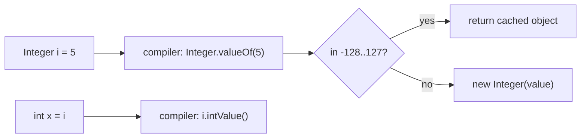
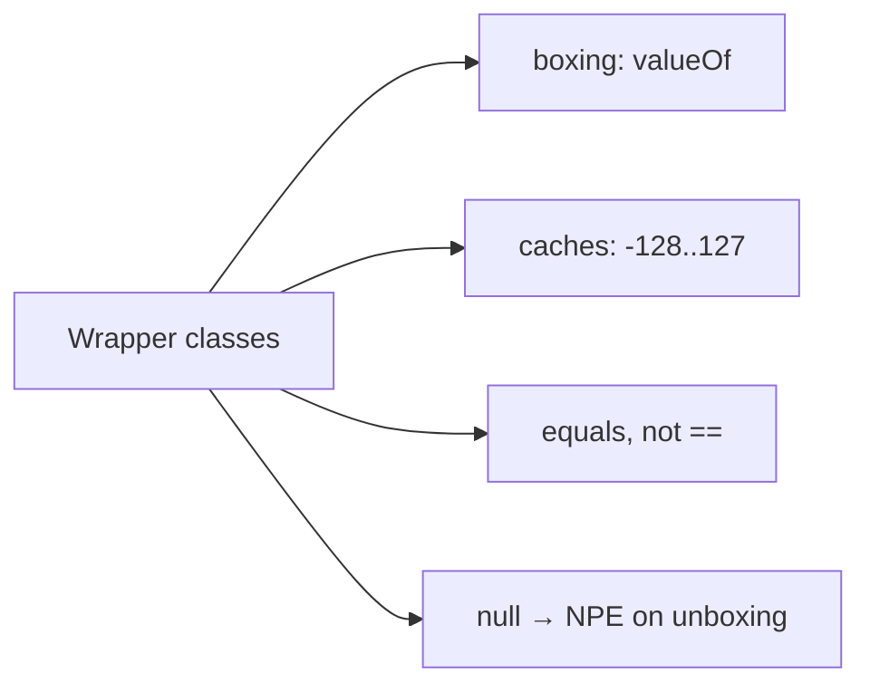

# Wrapper Classes and Constant Pools in Java

**TL;DR:** Each of the 8 primitives has an immutable object twin (`Integer`, `Long`, `Double`, `Boolean`, `Character`, `Byte`, `Short`, `Float`). **Autoboxing** (`Integer i = 5`) compiles to `Integer.valueOf(5)`; **unboxing** (`int x = i`) compiles to `i.intValue()`. `valueOf` reuses cached objects for small values (`Integer`/`Short`/`Long`/`Byte`: -128..127, `Character`: 0..127, `Boolean`: both values; `Float`/`Double`: never), so `==` on boxed values is true for small numbers and false for large ones. **Always compare wrappers with `equals`.** Unboxing `null` throws `NullPointerException`. "Constant pool" means two things: the per-class **runtime constant pool** (literals, symbolic references) and, loosely, these **wrapper caches**; the String pool is in the next note.

## Table of Contents

1. [TL;DR](#1-tldr)
2. [Why it matters](#2-why-it-matters)
3. [Prerequisites](#3-prerequisites)
4. [Mental model](#4-mental-model)
5. [Core concepts](#5-core-concepts)
6. [How it works](#6-how-it-works)
7. [Examples](#7-examples)
8. [Comparisons](#8-comparisons)
9. [Trade-offs](#9-trade-offs)
10. [Gotchas](#10-gotchas)
11. [Practical application](#11-practical-application)
12. [Interview prep](#12-interview-prep)
13. [Interview question bank](#13-interview-question-bank)
14. [Tricky code snippets](#14-tricky-code-snippets)
15. [Connections](#15-connections)
16. [Summary](#16-summary)
17. [Answers](#answers)

> **Scope note.** Primitives are in the Primitive vs Reference Types note; the String pool is in the next note; overload resolution in general is in the Polymorphism note. This note covers wrappers, boxing, caches and the class constant pool.

---

## 1. TL;DR

| Primitive | Wrapper | Cached by `valueOf` | Superclass |
|---|---|---|---|
| `byte` | `Byte` | all 256 values | `Number` |
| `short` | `Short` | -128..127 | `Number` |
| `int` | `Integer` | -128..127 (upper bound tunable) | `Number` |
| `long` | `Long` | -128..127 | `Number` |
| `float` | `Float` | none | `Number` |
| `double` | `Double` | none | `Number` |
| `char` | `Character` | 0..127 | `Object` |
| `boolean` | `Boolean` | `TRUE`, `FALSE` | `Object` |

**The analogy: a coat check with a rack of the most popular coats pre-hung.**

| Real world | Java |
|---|---|
| Your coat (a plain value) | A primitive |
| A numbered ticket for a coat in the cloakroom | A wrapper object |
| Popular sizes always hung on a shared rack | The cache for -128..127 |
| Two people given the same rack coat | `==` true for small values |
| Unusual sizes made to order for each person | `==` false for 1000 |
| Handing in an empty ticket | Unboxing `null` → NPE |

**Running example:** `Integer boxed = 42; int prim = boxed;` then `Integer.valueOf("7")` and `Integer.parseInt("8")` (Snippet 1).

---

## 2. Why it matters

**The problem.** Collections and generics hold objects, not primitives, so Java converts silently. That convenience hides object identity, caching and `null`.

**What goes wrong** (verified on Java 21):

| Mistake | Result | Snippet |
|---|---|---|
| `Integer a=127,b=127; a==b` | true (cache) | 2 |
| `Integer a=128,b=128; a==b` | false | 2 |
| `Long.equals(Integer)` | false | 10 |
| Unboxing `null` | NullPointerException | 11, 12, 24 |
| `list.remove(1)` on `List<Integer>` | removes index 1 | 18 |
| `Long l = 5;` | compile error | 29 |
| `Double.valueOf(0.0).equals(-0.0)` | false | 25 |
| `Math.abs(Integer.MIN_VALUE)` | still negative | 19 |

**Why interviewers ask.** The `Integer` cache question (127 vs 128) is a classic. Also: autoboxing performance, `equals` vs `==`, `remove(int)` vs `remove(Object)`, `Integer.parseInt` vs `valueOf`, and what "constant pool" means.

---

## 3. Prerequisites

| Prerequisite | One-line refresher | Importance |
|---|---|---|
| Primitive types | 8 types, fixed sizes, no methods | Essential |
| Reference types and `==` | `==` compares references for objects | Essential |
| `equals` and `hashCode` | Value equality contract | Essential |
| Generics/collections | They hold references only | Important |
| Method overloading | Resolution phases | Important |
| Immutability | Fields can't change after creation | Helpful |

---

## 4. Mental model

> **The one picture to keep in your head:** a wrapper is an immutable box holding one primitive. `valueOf` may hand you a box that already exists (small values); `new` always makes a fresh one. `==` asks "same box?", `equals` asks "same contents?".

```
 Integer a = 100;  Integer b = 100;      Integer c = 1000;  Integer d = 1000;
   a ─┐                                    c ──▶ [Integer 1000]
      ├──▶ [Integer 100]  (cache)          d ──▶ [Integer 1000]   (separate objects)
   b ─┘
   a == b  → true                          c == d → false,  c.equals(d) → true
```
*The cache is a shared array of pre-built boxes for -128..127.*


*Boxing goes through `valueOf`; unboxing through `xxxValue()`.*

---

## 5. Core concepts

### 5.1 Glossary

- **Wrapper class:** an object type representing a primitive (`java.lang`).
- **Boxing / unboxing:** primitive → wrapper / wrapper → primitive.
- **Autoboxing:** boxing done by the compiler.
- **Wrapper cache:** pre-built instances reused by `valueOf` (5.4).
- **Runtime constant pool:** a per-class table in the JVM holding literals and symbolic references (5.7).
- **`Number`:** abstract parent of the six numeric wrappers (Snippet 27).
- **Immutable:** a wrapper's value never changes (Snippets 32, 33).

### 5.2 Creating wrappers

| Way | Example | Notes |
|---|---|---|
| Autoboxing | `Integer i = 5;` | Uses `valueOf` |
| `valueOf` | `Integer.valueOf(5)`, `valueOf("5")` | May reuse cached object |
| Constructor | `new Integer(5)` | Deprecated for removal ⚠️; always a new object (Snippet 3) |
| Parse | `Integer.parseInt("5")` | Returns primitive `int` (Snippet 17) |

### 5.3 Autoboxing and unboxing

The compiler inserts `valueOf` / `intValue()`. `javap -v` on `Integer x = 1000;` shows `Integer.valueOf:(I)` in the constant pool (verified).

Unboxing happens in arithmetic, comparisons with `<`/`>`, assignment to a primitive, and `switch`. `Integer == int` unboxes the wrapper (Snippet 9). Unboxing `null` throws NPE (Snippets 11, 12, 24).

Assignment rules:
- `Long l = 5;` and `Double d = 1;` don't compile: boxing doesn't widen first (Snippets 29, 30).
- `Byte b = 10; Short s = 10; Character c = 65;` compile: a constant that fits is narrowed then boxed (Snippet 30). But `int i = 65; Character c = i;` does not (Snippet 31).
- `Object o = 1;` boxes to `Integer` (Snippet 30).

### 5.4 The caches

| Wrapper | Cached range | Snippet |
|---|---|---|
| `Integer` | -128..127; upper bound adjustable with `-XX:AutoBoxCacheMax=N` ⚠️ | 2 |
| `Long`, `Short` | -128..127 | 4, 6 |
| `Byte` | all values | 6 |
| `Character` | 0..127 | 5 |
| `Boolean` | `TRUE`, `FALSE` | 7 |
| `Float`, `Double` | none | 8 |

Verified: `Integer x=1000,y=1000; x==y` is false, but true with `java -XX:AutoBoxCacheMax=2000`. The 127 limit is the *specified minimum* for autoboxing (JLS 5.1.7); the JVM may cache more.

`new Integer(5)` is never cached (Snippet 3).

### 5.5 Equality rules

| Expression | Meaning |
|---|---|
| `a == b` (both wrappers) | Same object? Depends on cache |
| `a == prim` | Unboxes `a`, compares values (Snippet 9) |
| `a.equals(b)` | Same type *and* same value (Snippet 10) |
| `a.compareTo(b)`, `Integer.compare(x, y)` | Ordering (Snippet 20) |

`Integer.equals(Long)` is false even for equal numbers (Snippet 10). `Double.equals` uses bit patterns: `NaN.equals(NaN)` true, `0.0.equals(-0.0)` false, unlike `==` on primitives (Snippet 25).

### 5.6 Useful static methods

- Parsing: `parseInt`, `valueOf`; failures throw `NumberFormatException` with message `For input string: "12.5"`; `null` gives `Cannot parse null string` (Snippet 17).
- Conversion: `toString`, `toBinaryString`, `toHexString`, `toOctalString`, `parseInt(s, radix)` (Snippet 21).
- `Character`: `isDigit`, `isLetter`, `getNumericValue`, `toUpperCase` (Snippet 22).
- Constants: `MAX_VALUE`, `MIN_VALUE`, `SIZE` (bits), `BYTES` (Snippet 19). `Double.MIN_VALUE` is the smallest *positive* value (Snippet 25).
- `hashCode`: `Integer` is the value; `Boolean` 1231 / 1237 (Snippet 26).

### 5.7 Constant pools

**Runtime constant pool.** Each loaded class has one, built from the class file's constant pool: literals (strings, numbers), class/method/field *symbolic references*. `javap -v Main` shows entries such as `#25 = String #26 // hello` and `Methodref ... Integer.valueOf:(I)` (verified). Literal strings from it end up in the **String pool** (next note).

**Wrapper "pools"** are the caches above. They are ordinary heap objects held in a static array in e.g. `Integer.IntegerCache`, not the class constant pool. Interviewers who say "Integer constant pool" mean this cache.

### 5.8 Overloading with boxing

Java picks overloads in three phases: (1) no boxing, no varargs (widening allowed); (2) boxing/unboxing; (3) varargs.
- `m(long)` beats `m(Integer)` for `m(5)` (Snippet 13).
- `m(Integer)` beats `m(int...)` and, being more specific, `m(Object)` (Snippet 14).
- `m(Object)` beats `m(int...)` (Snippet 15).
- `m(Long)` is not applicable to an `int`; `Object` is chosen (Snippet 16).

---

## 6. How it works

### 6.1 `Integer.valueOf(int)`

```java
public static Integer valueOf(int i) {
    if (i >= IntegerCache.low && i <= IntegerCache.high)
        return IntegerCache.cache[i + (-IntegerCache.low)];
    return new Integer(i);
}
```
Simplified from the JDK source ⚠️. The cache is filled once when `Integer` loads.

### 6.2 Worked trace: the running example

```java
Integer boxed = 42;          // Integer.valueOf(42)
int prim = boxed;            // boxed.intValue()
Integer v = Integer.valueOf("7");
int p = Integer.parseInt("8");
System.out.println(boxed + " " + prim + " " + v + " " + p);
System.out.println(boxed.getClass().getName());
```

Output (verified, Java 21):

```
42 42 7 8
java.lang.Integer
```

| Statement | What happens |
|---|---|
| `Integer boxed = 42` | cached object for 42 |
| `int prim = boxed` | `intValue()` |
| `valueOf("7")` | parse then box |
| `parseInt("8")` | parse only, returns `int` |

### 6.3 Immutability

A wrapper never changes. `a++` on an `Integer` creates (or fetches) another object and re-points `a` (Snippet 33); passing a wrapper to a method and changing it doesn't affect the caller (Snippet 32). Compound assignment works via unbox, compute, box (Snippet 37).

### 6.4 Cost

Each boxing of a non-cached value allocates. A `Long sum` in a loop boxes on every `+=` (Snippet 38 shows it works; it just allocates). Use primitives for hot loops; `List<Integer>` costs more memory than `int[]`.

### 6.5 Why `remove(1)` surprises

`List<Integer>.remove(int index)` and `remove(Object o)` both exist; `remove(1)` picks `int` (phase 1, no boxing); `remove(Integer.valueOf(1))` removes the element (Snippet 18).

---

## 7. Examples

### 7.1 Toy example

```java
Integer a = 1000, b = 1000;
System.out.println(a == b);       // false
System.out.println(a.equals(b));  // true
```
(Snippet 2.)

### 7.2 Real-world examples

- **Collections:** `Map<Character,Integer>` frequency count with `merge` (Snippet 23).
- **Parsing input:** `Integer.parseInt(args[0])` with `NumberFormatException` handling (Snippet 17).
- **Nullable numbers:** DB columns map to `Integer`/`Long` so `null` is representable; unbox only after a null check.
- **Generics:** `List<int>` is illegal; use `List<Integer>`.
- **Base conversion:** binary/hex strings (Snippet 21).

---

## 8. Comparisons

### 8.1 Primitive vs wrapper

| | `int` | `Integer` |
|---|---|---|
| Can be `null` | No | Yes |
| Usable in generics | No | Yes |
| Methods | None | Yes |
| Memory | 4 bytes | Object (header + field) plus reference |
| `==` | Value | Identity (cache-dependent) |
| Default in a field | 0 | `null` |

### 8.2 `parseInt` vs `valueOf`

| | `parseInt(String)` | `valueOf(String)` |
|---|---|---|
| Returns | `int` | `Integer` |
| Cache | n/a | Yes |
| Errors | `NumberFormatException` | same |

### 8.3 `==` vs `equals` on wrappers

| | `==` | `equals` |
|---|---|---|
| `127, 127` | true | true |
| `1000, 1000` | false | true |
| `Integer` vs `Long` | compile error (incomparable types) | false |
| `Integer` vs `int` | unboxes: true if equal | n/a |

### 8.3b Boxed vs unboxed comparison operators

`<`, `>`, `<=`, `>=` always unbox, so `x <= y && x >= y` is true for equal values even when `x == y` is false (Snippet 9).

### 8.4 Wrapper caches vs String pool

| | Wrapper cache | String pool |
|---|---|---|
| Fed by | `valueOf` / autoboxing | Literals, `intern()` |
| Range | Fixed small range | Unbounded |
| Applies to | Numeric/char/boolean | `String` only |

---

## 9. Trade-offs

| Decision | Benefit | Cost | Use when |
|---|---|---|---|
| Use wrappers | Generics, `null`, methods | Memory, boxing, NPE risk | Collections, nullable data |
| Use primitives | Fast, compact | No `null` | Locals, loops, arrays |
| `valueOf` over `new` | Reuses cache | None | Always |
| `equals` over `==` | Correct | Slightly verbose | Always for wrappers |
| `parseInt` over `valueOf` when you need an `int` | No boxing | None | Arithmetic |
| Specialised streams (`IntStream`) | No boxing | Different API | Numeric pipelines |

---

## 10. Gotchas

### Myths

- ❌ **Myth:** "`==` works on `Integer`s." ✅ **Reality:** only inside the cache range (Snippet 2).
- ❌ **Myth:** "The cache is -128..127 for every wrapper." ✅ **Reality:** `Character` 0..127, `Byte` all, `Float`/`Double` none (Snippets 5, 6, 8).
- ❌ **Myth:** "`Integer` can hold any int without cost." ✅ **Reality:** each is an object.
- ❌ **Myth:** "`new Integer(5)` is fine." ✅ **Reality:** deprecated for removal; use `valueOf` (Snippet 3).
- ❌ **Myth:** "`Integer.equals(Long)` compares numbers." ✅ **Reality:** types must match (Snippet 10).
- ❌ **Myth:** "`Long l = 5;` works." ✅ **Reality:** compile error; write `5L` (Snippet 29).
- ❌ **Myth:** "`a++` on an `Integer` changes the object." ✅ **Reality:** wrappers are immutable (Snippet 33).
- ❌ **Myth:** "`Integer.valueOf('5')` gives 5." ✅ **Reality:** it gives the char code 53 (Snippet 35).
- ❌ **Myth:** "`Math.abs` is never negative." ✅ **Reality:** `abs(Integer.MIN_VALUE)` is negative (Snippet 19).
- ❌ **Myth:** "Wrapper caches are the class constant pool." ✅ **Reality:** different things (5.7).

### Common mistakes and edge cases

- **`list.remove(i)` vs `remove(Integer.valueOf(i))`** (Snippet 18).
- **Ternary with a null wrapper** unboxes and throws (Snippet 12).
- **`switch` on a null wrapper** throws NPE (Snippet 24).
- **Comparing `Double`s with `equals` and expecting numeric equality** for `0.0`/`-0.0`/`NaN` (Snippet 25).
- **`Character c = intVar`** doesn't compile (Snippet 31).
- **Comparing wrappers from collections with `==`** (Snippet 36).
- **Extending a wrapper:** they're `final` (Snippet 28).

---

## 11. Practical application

### Checklist
- [ ] Compare wrappers with `equals` (or unbox deliberately).
- [ ] Prefer primitives in loops and hot paths.
- [ ] Null-check before unboxing.
- [ ] Use `valueOf`, never `new Integer(...)`.
- [ ] Use `5L`, `1.0`, `1f` literals to match the wrapper type.
- [ ] Use `remove(Integer.valueOf(x))` to remove by value.
- [ ] Catch `NumberFormatException` around parsing user input.
- [ ] Use `Integer.compare` for comparators (avoid `a - b` overflow).

### Hands-on exercise

What does this print?

```java
Integer a = 100, b = 100, c = 200, d = 200;
System.out.println((a == b) + " " + (c == d) + " " + c.equals(d) + " " + (c <= d && c >= d));
```

<details><summary>Solution</summary>

`true false true true`. `100` is cached so `a == b`; `200` isn't so `c == d` is false; `equals` compares values; `<=`/`>=` unbox.

Verified on Java 21 (same patterns as Snippets 2 and 9).
</details>

---

## 12. Interview prep

Eight model answers, as you would say them aloud.

<details><summary>1. What are wrapper classes and why do they exist?</summary>

Immutable object versions of the 8 primitives (`Integer`, `Double`, ...). Generics, collections and `null` need objects, and wrappers add utility methods like `parseInt` and `compare` (5.1, 5.6; Snippet 1).
</details>

<details><summary>2. What is autoboxing and what does the compiler generate?</summary>

Automatic primitive-to-wrapper conversion. `Integer i = 5` becomes `Integer.valueOf(5)`, and unboxing `int x = i` becomes `i.intValue()` (5.3; Snippet 1).
</details>

<details><summary>3. Why is `Integer a=127,b=127; a==b` true but 128 false?</summary>

`valueOf` returns cached objects for -128..127, so both variables point to the same object; 128 creates two separate objects. Use `equals` (5.4; Snippet 2).
</details>

<details><summary>4. Which wrappers are cached, and over what range?</summary>

`Integer`, `Short`, `Long`: -128..127; `Byte`: all values; `Character`: 0..127; `Boolean`: `TRUE`/`FALSE`; `Float` and `Double`: none. The `Integer` upper bound can be raised with `-XX:AutoBoxCacheMax` (5.4; Snippets 2-8).
</details>

<details><summary>5. What is a common autoboxing exception?</summary>

`NullPointerException` when a `null` wrapper is unboxed: assignment to a primitive, arithmetic, `switch`, or a ternary mixing a wrapper with a primitive (Snippets 11, 12, 24).
</details>

<details><summary>6. Difference between `parseInt` and `valueOf`?</summary>

`parseInt` returns a primitive `int`; `valueOf` returns an `Integer` (possibly cached). Both throw `NumberFormatException` for bad input (8.2; Snippet 17).
</details>

<details><summary>7. What does "constant pool" mean in Java?</summary>

The per-class runtime constant pool holds literals and symbolic references (visible with `javap -v`). The wrapper caches are separate, and String literals are interned in the String pool (5.7).
</details>

<details><summary>8. Why does `list.remove(1)` on a `List<Integer>` surprise people?</summary>

`remove(int index)` matches without boxing, so it removes the element at index 1. To remove the value 1 use `remove(Integer.valueOf(1))` (6.5; Snippet 18).
</details>

---

## 13. Interview question bank


### 13.1 Basics (Q1–Q12)

<details><summary>Q1. Name the eight wrapper classes.</summary>

`Byte`, `Short`, `Integer`, `Long`, `Float`, `Double`, `Character`, `Boolean`.
</details>

<details><summary>Q2. Are wrappers mutable?</summary>

No, immutable (Snippets 32, 33).
</details>

<details><summary>Q3. Which package?</summary>

`java.lang` (no import).
</details>

<details><summary>Q4. Superclass of the numeric wrappers?</summary>

`Number` (Snippet 27).
</details>

<details><summary>Q5. Superclass of `Character` and `Boolean`?</summary>

`Object`.
</details>

<details><summary>Q6. Can you extend `Integer`?</summary>

No, it's `final` (Snippet 28).
</details>

<details><summary>Q7. Why use wrappers?</summary>

Generics, collections, nullability, utility methods.
</details>

<details><summary>Q8. What's autoboxing?</summary>

Compiler-inserted `valueOf` (5.3).
</details>

<details><summary>Q9. What's unboxing?</summary>

Compiler-inserted `xxxValue()`.
</details>

<details><summary>Q10. Is `List<int>` legal?</summary>

No; use `List<Integer>`.
</details>

<details><summary>Q11. What's the default value of an `Integer` field?</summary>

`null`.
</details>

<details><summary>Q12. Does `Integer` have a no-arg constructor?</summary>

No (Snippet 28).
</details>


### 13.2 Caches and equality (Q13–Q28)

<details><summary>Q13. `Integer a=127,b=127; a==b`?</summary>

true (Snippet 2).
</details>

<details><summary>Q14. `Integer a=128,b=128; a==b`?</summary>

false (Snippet 2).
</details>

<details><summary>Q15. Why?</summary>

Cache for -128..127; otherwise separate objects.
</details>

<details><summary>Q16. `new Integer(5) == new Integer(5)`?</summary>

false (Snippet 3).
</details>

<details><summary>Q17. `Integer.valueOf(5) == Integer.valueOf(5)`?</summary>

true (Snippet 3).
</details>

<details><summary>Q18. `Long` 127 vs 128?</summary>

true / false (Snippet 4).
</details>

<details><summary>Q19. `Character` 127 vs 128?</summary>

true / false (Snippet 5).
</details>

<details><summary>Q20. `Byte` cache?</summary>

All values (Snippet 6).
</details>

<details><summary>Q21. `Short` 1000 == 1000?</summary>

false (Snippet 6).
</details>

<details><summary>Q22. `Boolean` `==`?</summary>

Always true for equal values from `valueOf`/autoboxing (Snippet 7).
</details>

<details><summary>Q23. `Double` 1.0 == 1.0 (boxed)?</summary>

false (Snippet 8).
</details>

<details><summary>Q24. `Integer` 1000 == `int` 1000?</summary>

true; the wrapper is unboxed (Snippet 9).
</details>

<details><summary>Q25. `Integer.equals(Long)`?</summary>

false (Snippet 10).
</details>

<details><summary>Q26. `Long.equals(1)`?</summary>

false: `1` boxes to `Integer` (Snippet 10).
</details>

<details><summary>Q27. Can you change the cache size?</summary>

`-XX:AutoBoxCacheMax=N` for `Integer` ⚠️ (verified).
</details>

<details><summary>Q28. Why is the cache there?</summary>

Saves allocations for common small values.
</details>


### 13.3 Boxing rules and overloading (Q29–Q42)

<details><summary>Q29. `Long l = 5;`?</summary>

Compile error (Snippet 29).
</details>

<details><summary>Q30. `Long l = 5L;`?</summary>

OK.
</details>

<details><summary>Q31. `Double d = 1;`?</summary>

Compile error (Snippet 29).
</details>

<details><summary>Q32. `Byte b = 10;`?</summary>

OK: constant fits (Snippet 30).
</details>

<details><summary>Q33. `Character c = 65;`?</summary>

OK (Snippet 30).
</details>

<details><summary>Q34. `int i=65; Character c = i;`?</summary>

Error (Snippet 31).
</details>

<details><summary>Q35. `Object o = 1;`?</summary>

Boxes to `Integer` (Snippet 30).
</details>

<details><summary>Q36. Overload `m(long)`, `m(Integer)`, `m(Object)`, call `m(5)`?</summary>

`m(long)` (Snippet 13).
</details>

<details><summary>Q37. `m(Integer)`, `m(int...)`, `m(Object)`, call `m(5)`?</summary>

`m(Integer)` (Snippet 14).
</details>

<details><summary>Q38. `m(Object)` vs `m(int...)`, call `m(5)`?</summary>

`m(Object)` (Snippet 15).
</details>

<details><summary>Q39. `m(Long)` and `m(Object)`, call `m(5)`?</summary>

`m(Object)` (Snippet 16).
</details>

<details><summary>Q40. Three overload phases?</summary>

No boxing/varargs, boxing, varargs (5.8).
</details>

<details><summary>Q41. `i += 5` for `Integer i`?</summary>

Unbox, add, box (Snippet 37).
</details>

<details><summary>Q42. `Byte b; b++`?</summary>

Allowed (Snippet 37).
</details>


### 13.4 Methods and exceptions (Q43–Q54)

<details><summary>Q43. What does `Integer.parseInt("12.5")` throw?</summary>

`NumberFormatException` (Snippet 17).
</details>

<details><summary>Q44. `parseInt(null)` message?</summary>

`Cannot parse null string` (Snippet 17).
</details>

<details><summary>Q45. `parseInt("+7")`?</summary>

7 (Snippet 17).
</details>

<details><summary>Q46. `Integer.valueOf('5')`?</summary>

53, the char code (Snippet 35).
</details>

<details><summary>Q47. Digit char to int?</summary>

`c - '0'` or `Character.getNumericValue(c)` (Snippets 22, 35).
</details>

<details><summary>Q48. `Math.abs(Integer.MIN_VALUE)`?</summary>

`Integer.MIN_VALUE` (Snippet 19).
</details>

<details><summary>Q49. `Integer.MAX_VALUE + 1`?</summary>

`Integer.MIN_VALUE` (Snippet 19).
</details>

<details><summary>Q50. Binary string of 10?</summary>

`Integer.toBinaryString(10)` is `1010` (Snippet 21).
</details>

<details><summary>Q51. Hex parse?</summary>

`Integer.parseInt("ff", 16)` is 255.
</details>

<details><summary>Q52. `switch` on a null `Integer`?</summary>

NPE (Snippet 24).
</details>

<details><summary>Q53. Ternary `flag ? 1 : nullInteger`?</summary>

NPE when the null branch is chosen (Snippet 12).
</details>

<details><summary>Q54. `Double.valueOf(0.0).equals(-0.0)`?</summary>

false (Snippet 25).
</details>


### 13.5 Design, constant pool and performance (Q55–Q64)

<details><summary>Q55. What is the runtime constant pool?</summary>

A per-class table of literals and symbolic references (5.7).
</details>

<details><summary>Q56. How can you see it?</summary>

`javap -v ClassName`.
</details>

<details><summary>Q57. Is the Integer cache the constant pool?</summary>

No; a static array in `Integer.IntegerCache` (5.7).
</details>

<details><summary>Q58. Is the cache thread-safe?</summary>

It's immutable after initialisation.
</details>

<details><summary>Q59. Why avoid boxing in loops?</summary>

Allocation and GC cost (6.4).
</details>

<details><summary>Q60. Streams without boxing?</summary>

`IntStream`, `LongStream`, `DoubleStream`.
</details>

<details><summary>Q61. `Integer.compare` vs `a - b`?</summary>

`compare` avoids overflow (Snippet 20).
</details>

<details><summary>Q62. `hashCode` of `Boolean`?</summary>

1231 / 1237 (Snippet 26).
</details>

<details><summary>Q63. `Integer.hashCode`?</summary>

The value (Snippet 26).
</details>

<details><summary>Q64. Is `new Integer(5)` supported in Java 21?</summary>

Compiles, but deprecated for removal ⚠️.
</details>

---

## 14. Tricky code snippets

38 snippets, each compiled and run on OpenJDK 21. Predict the output (or the compile error) before opening the answer. Classes are declared inside `Main` or without `public` so each snippet is one file. `new Integer(5)` compiles but javac warns it is deprecated for removal ⚠️.

### Snippet 1: Boxing, unboxing, parse

```java
public class Main {
    public static void main(String[] args) {
        Integer boxed = 42;
        int prim = boxed;
        Integer v = Integer.valueOf("7");
        int p = Integer.parseInt("8");
        System.out.println(boxed + " " + prim + " " + v + " " + p);
        System.out.println(boxed.getClass().getName());
    }
}
```

<details><summary>Answer</summary>

```
42 42 7 8
java.lang.Integer
```

Trace in 6.2.
</details>

### Snippet 2: The classic cache question

```java
public class Main {
    public static void main(String[] args) {
        Integer a = 127, b = 127;
        Integer c = 128, d = 128;
        System.out.println(a == b);
        System.out.println(c == d);
        System.out.println(c.equals(d));
    }
}
```

<details><summary>Answer</summary>

```
true
false
true
```

127 is cached; 128 creates two objects; `equals` compares values.
</details>

### Snippet 3: `new Integer` vs `valueOf`

```java
public class Main {
    public static void main(String[] args) {
        Integer a = new Integer(5);
        Integer b = new Integer(5);
        Integer c = Integer.valueOf(5);
        Integer d = Integer.valueOf(5);
        System.out.println(a == b);
        System.out.println(c == d);
        System.out.println(a == c);
    }
}
```

<details><summary>Answer</summary>

```
false
true
false
```

`new` never uses the cache, so `a` and `c` are different objects. (javac warns that the constructor is deprecated for removal.)
</details>

### Snippet 4: `Long` cache

```java
public class Main {
    public static void main(String[] args) {
        Long a = 127L, b = 127L, c = 128L, d = 128L;
        System.out.println(a == b);
        System.out.println(c == d);
    }
}
```

<details><summary>Answer</summary>

```
true
false
```

Same -128..127 rule.
</details>

### Snippet 5: `Character` cache

```java
public class Main {
    public static void main(String[] args) {
        Character a = 127, b = 127, c = 128, d = 128;
        System.out.println(a == b);
        System.out.println(c == d);
    }
}
```

<details><summary>Answer</summary>

```
true
false
```

Cached for 0..127 only.
</details>

### Snippet 6: `Byte` and `Short`

```java
public class Main {
    public static void main(String[] args) {
        Byte b1 = 100, b2 = 100;
        Short s1 = 100, s2 = 100, s3 = 1000, s4 = 1000;
        System.out.println(b1 == b2);
        System.out.println(s1 == s2);
        System.out.println(s3 == s4);
    }
}
```

<details><summary>Answer</summary>

```
true
true
false
```

`Byte` is cached fully; `Short` for -128..127 only.
</details>

### Snippet 7: `Boolean`

```java
public class Main {
    public static void main(String[] args) {
        Boolean a = true, b = true;
        Boolean c = Boolean.valueOf("TRUE"), d = Boolean.valueOf(true);
        System.out.println(a == b);
        System.out.println(c == d);
        System.out.println(Boolean.valueOf("yes"));
    }
}
```

<details><summary>Answer</summary>

```
true
true
false
```

Only two instances exist; `valueOf("yes")` is `false`, not an error.
</details>

### Snippet 8: `Double` and `Float`

```java
public class Main {
    public static void main(String[] args) {
        Double a = 1.0, b = 1.0;
        Float c = 1f, d = 1f;
        System.out.println(a == b);
        System.out.println(c == d);
        System.out.println(a.equals(b));
    }
}
```

<details><summary>Answer</summary>

```
false
false
true
```

No cache; `equals` still compares values.
</details>

### Snippet 9: Wrapper vs primitive

```java
public class Main {
    public static void main(String[] args) {
        Integer big = 1000;
        int prim = 1000;
        System.out.println(big == prim);
        Integer x = 1000, y = 1000;
        System.out.println(x == y);
        System.out.println(x <= y && x >= y);
    }
}
```

<details><summary>Answer</summary>

```
true
false
true
```

`Integer == int` unboxes. Two `Integer` 1000s differ by `==`, but `<=`/`>=` unbox.
</details>

### Snippet 10: `equals` across types

```java
public class Main {
    public static void main(String[] args) {
        Integer i = 1;
        Long l = 1L;
        System.out.println(i.equals(l));
        System.out.println(l.equals(1));
        System.out.println(l.equals(1L));
        System.out.println(i.longValue() == l);
    }
}
```

<details><summary>Answer</summary>

```
false
false
true
true
```

`Integer` vs `Long` never equal; `1` boxes to `Integer`; `longValue() == l` unboxes `l`.
</details>

### Snippet 11: Unboxing null

```java
public class Main {
    public static void main(String[] args) {
        Integer n = null;
        try { int x = n; } catch (NullPointerException e) { System.out.println("NPE on unboxing"); }
    }
}
```

<details><summary>Answer</summary>

```
NPE on unboxing
```

`n.intValue()` on `null`.
</details>

### Snippet 12: Ternary with wrapper and primitive

```java
public class Main {
    public static void main(String[] args) {
        Integer n = null;
        boolean flag = false;
        try {
            Integer r = flag ? 1 : n;
            System.out.println(r);
        } catch (NullPointerException e) { System.out.println("NPE from ternary"); }
        Integer ok = flag ? Integer.valueOf(1) : n;
        System.out.println(ok);
    }
}
```

<details><summary>Answer</summary>

```
NPE from ternary
null
```

`flag ? 1 : n` has type `int`, so `n` is unboxed; with both wrappers no unboxing occurs.
</details>

### Snippet 13: Overload: `long`, `Integer`, `Object`

```java
public class Main {
    static void m(long x) { System.out.println("long"); }
    static void m(Integer x) { System.out.println("Integer"); }
    static void m(Object x) { System.out.println("Object"); }
    public static void main(String[] args) { m(5); }
}
```

<details><summary>Answer</summary>

```
long
```

Phase 1 (no boxing) finds `m(long)`.
</details>

### Snippet 14: Overload: `Integer`, `int...`, `Object`

```java
public class Main {
    static void m(Integer x) { System.out.println("Integer"); }
    static void m(int... x) { System.out.println("varargs"); }
    static void m(Object x) { System.out.println("Object"); }
    public static void main(String[] args) { m(5); }
}
```

<details><summary>Answer</summary>

```
Integer
```

Phase 2 beats varargs; `Integer` is more specific than `Object`.
</details>

### Snippet 15: Overload: `Object` vs `int...`

```java
public class Main {
    static void m(Object x) { System.out.println("Object"); }
    static void m(int... x) { System.out.println("varargs"); }
    public static void main(String[] args) { m(5); m(5, 6); m(); }
}
```

<details><summary>Answer</summary>

```
Object
varargs
varargs
```

`m(5)` uses boxing (phase 2); `m(5,6)` and `m()` need varargs.
</details>

### Snippet 16: Overload: `Long` vs `Object`

```java
public class Main {
    static void m(Long x) { System.out.println("Long"); }
    static void m(Object x) { System.out.println("Object"); }
    public static void main(String[] args) { m(5); m(5L); }
}
```

<details><summary>Answer</summary>

```
Object
Long
```

An `int` can't box to `Long`, so `m(5)` picks `Object`; `5L` boxes to `Long`.
</details>

### Snippet 17: Parsing and its errors

```java
public class Main {
    public static void main(String[] args) {
        int a = Integer.parseInt("12");
        Integer b = Integer.valueOf("12");
        System.out.println(a + b);
        try { Integer.parseInt("12.5"); } catch (NumberFormatException e) { System.out.println(e.getMessage()); }
        try { Integer.parseInt(""); } catch (NumberFormatException e) { System.out.println(e.getMessage()); }
        try { Integer.parseInt(null); } catch (NumberFormatException e) { System.out.println(e.getMessage()); }
        System.out.println(Integer.parseInt("+7") + Integer.parseInt("-3"));
    }
}
```

<details><summary>Answer</summary>

```
24
For input string: "12.5"
For input string: ""
Cannot parse null string
4
```

`24` is `12 + 12`; the last line is `7 + -3`.
</details>

### Snippet 18: `remove(int)` vs `remove(Object)`

```java
import java.util.*;
public class Main {
    public static void main(String[] args) {
        List<Integer> list = new ArrayList<>(List.of(10, 20, 30, 1));
        list.remove(1);
        System.out.println(list);
        list.remove(Integer.valueOf(1));
        System.out.println(list);
    }
}
```

<details><summary>Answer</summary>

```
[10, 30, 1]
[10, 30]
```

`remove(1)` removes index 1; `remove(Integer.valueOf(1))` removes the value.
</details>

### Snippet 19: Overflow and constants

```java
public class Main {
    public static void main(String[] args) {
        System.out.println(Integer.MAX_VALUE + 1);
        System.out.println(Math.abs(Integer.MIN_VALUE));
        System.out.println(Integer.MIN_VALUE == -Integer.MIN_VALUE);
        System.out.println(Integer.SIZE + " " + Integer.BYTES + " " + Long.SIZE + " " + Character.BYTES);
    }
}
```

<details><summary>Answer</summary>

```
-2147483648
-2147483648
true
32 4 64 2
```

Two's complement: `MIN_VALUE` has no positive twin.
</details>

### Snippet 20: `compare` helpers

```java
public class Main {
    public static void main(String[] args) {
        System.out.println(Integer.compare(3, 5));
        System.out.println(Integer.valueOf(5).compareTo(5));
        System.out.println(Character.compare('b', 'a'));
        System.out.println(Boolean.compare(true, false));
        System.out.println(Integer.signum(-9));
    }
}
```

<details><summary>Answer</summary>

```
-1
0
1
1
-1
```

Sign of the comparison; `Character.compare('b','a')` is the char difference.
</details>

### Snippet 21: Radix conversions

```java
public class Main {
    public static void main(String[] args) {
        System.out.println(Integer.toBinaryString(10));
        System.out.println(Integer.toHexString(255));
        System.out.println(Integer.toOctalString(8));
        System.out.println(Integer.parseInt("ff", 16));
        System.out.println(Integer.toString(255, 2));
        System.out.println(Integer.toBinaryString(-1).length());
    }
}
```

<details><summary>Answer</summary>

```
1010
ff
10
255
11111111
32
```

`toBinaryString(-1)` shows all 32 bits.
</details>

### Snippet 22: `Character` helpers

```java
public class Main {
    public static void main(String[] args) {
        System.out.println(Character.isDigit('7') + " " + Character.isLetter('x') + " " + Character.isLetterOrDigit('_'));
        System.out.println(Character.getNumericValue('7') + " " + (int) '7');
        System.out.println(Character.toUpperCase('a') + " " + Character.isWhitespace(' '));
        System.out.println(Character.toString(97) + " " + (char) 97);
    }
}
```

<details><summary>Answer</summary>

```
true true false
7 55
A true
a a
```

`_` isn't a letter or digit; `'7'` has numeric value 7 and code 55.
</details>

### Snippet 23: Frequency count

```java
import java.util.*;
public class Main {
    public static void main(String[] args) {
        Map<Character, Integer> freq = new TreeMap<>();
        for (char c : "banana".toCharArray()) freq.merge(c, 1, Integer::sum);
        System.out.println(freq);
    }
}
```

<details><summary>Answer</summary>

```
{a=3, b=1, n=2}
```

`merge(c, 1, Integer::sum)` boxes/unboxes for you.
</details>

### Snippet 24: `switch` on a wrapper

```java
public class Main {
    public static void main(String[] args) {
        Integer n = 2;
        switch (n) { case 1: System.out.println("one"); break; case 2: System.out.println("two"); break; }
        Integer nothing = null;
        try { switch (nothing) { case 1: break; } } catch (NullPointerException e) { System.out.println("NPE in switch"); }
    }
}
```

<details><summary>Answer</summary>

```
two
NPE in switch
```

The switch unboxes the wrapper; `null` throws.
</details>

### Snippet 25: `NaN` and `-0.0`

```java
public class Main {
    public static void main(String[] args) {
        double nan = Double.NaN;
        System.out.println(nan == nan);
        System.out.println(Double.valueOf(nan).equals(Double.NaN));
        System.out.println(0.0 == -0.0);
        System.out.println(Double.valueOf(0.0).equals(-0.0));
        System.out.println(Double.compare(0.0, -0.0));
        System.out.println(Double.MIN_VALUE > 0);
    }
}
```

<details><summary>Answer</summary>

```
false
true
true
false
1
true
```

Primitive `==` and `Double.equals` disagree for `NaN` and `-0.0`; `MIN_VALUE` is positive.
</details>

### Snippet 26: `hashCode` values

```java
public class Main {
    public static void main(String[] args) {
        System.out.println(Integer.valueOf(42).hashCode());
        System.out.println(Boolean.TRUE.hashCode() + " " + Boolean.FALSE.hashCode());
        System.out.println(Character.valueOf('A').hashCode());
        System.out.println(Long.valueOf(1L << 32).hashCode());
    }
}
```

<details><summary>Answer</summary>

```
42
1231 1237
65
1
```

`Long` hash is `(int)(v ^ (v >>> 32))`, so `1L << 32` hashes to 1.
</details>

### Snippet 27: `Number`

```java
import java.util.*;
public class Main {
    public static void main(String[] args) {
        List<Number> nums = List.of(1, 2.5, 3L, 4.5f);
        double sum = 0;
        for (Number n : nums) sum += n.doubleValue();
        System.out.println(sum);
        Number n = 300;
        System.out.println(n.byteValue() + " " + n.intValue());
    }
}
```

<details><summary>Answer</summary>

```
11.0
44 300
```

`doubleValue()` sums; `byteValue()` of 300 wraps to 44.
</details>

### Snippet 28: Extending `Integer`

```java
public class Main {
    static class MyInt extends Integer { }
    public static void main(String[] args) { }
}
```

<details><summary>Answer</summary>

Compile error: *cannot inherit from final Integer*.

Wrapper classes are `final`.
</details>

### Snippet 29: `Long l = 5`

```java
public class Main {
    public static void main(String[] args) {
        Long l = 5;
        Double d = 1;
        Object o = 1;
        System.out.println(o.getClass().getSimpleName());
    }
}
```

<details><summary>Answer</summary>

Compile error: *incompatible types: int cannot be converted to Long*.

The same applies to `Double d = 1`; boxing doesn't widen first.
</details>

### Snippet 30: Assignments that compile

```java
public class Main {
    public static void main(String[] args) {
        Long l = 5L;
        long l2 = 5;
        Double d = 1.0;
        Byte b = 10;
        Short s = 10;
        Character c = 65;
        Object o = 1;
        System.out.println(l + " " + l2 + " " + d + " " + b + " " + s + " " + c + " " + o.getClass().getSimpleName());
    }
}
```

<details><summary>Answer</summary>

```
5 5 1.0 10 10 A Integer
```

Matching literals; constants that fit `byte`/`short`/`char` box to those types.
</details>

### Snippet 31: `int` variable to `Character`

```java
public class Main {
    public static void main(String[] args) {
        int i = 65;
        Character c = i;
    }
}
```

<details><summary>Answer</summary>

Compile error: *incompatible types: int cannot be converted to Character*.

Only constant expressions get the implicit narrowing.
</details>

### Snippet 32: Passing and aliasing

```java
public class Main {
    static void change(Integer x) { x = x + 1; }
    public static void main(String[] args) {
        Integer n = 5;
        change(n);
        System.out.println(n);
        Integer a = 5;
        Integer b = a;
        a++;
        System.out.println(a + " " + b);
    }
}
```

<details><summary>Answer</summary>

```
5
6 5
```

`x = x + 1` rebinds the parameter; `a++` rebinds `a` and leaves `b` alone.
</details>

### Snippet 33: Increment creates a new object

```java
public class Main {
    public static void main(String[] args) {
        Integer a = 127;
        Integer b = a;
        a++;
        System.out.println(a + " " + b + " " + (a == 128));
        Integer c = 1000, d = c;
        c++; c--;
        System.out.println(c == d);
        System.out.println(c.equals(d));
    }
}
```

<details><summary>Answer</summary>

```
128 127 true
false
true
```

`c++; c--` ends at 1000 but as a different object than `d`.
</details>

### Snippet 34: String conversions

```java
public class Main {
    public static void main(String[] args) {
        Integer i = 12;
        String s1 = i.toString();
        String s2 = String.valueOf(i);
        String s3 = "" + i;
        System.out.println(s1 + s2 + s3);
        System.out.println(Integer.valueOf(s1) + 1);
    }
}
```

<details><summary>Answer</summary>

```
121212
13
```

Three ways to get `"12"`; `valueOf` parses it back.
</details>

### Snippet 35: `valueOf(char)`

```java
public class Main {
    public static void main(String[] args) {
        char c = '5';
        System.out.println(Integer.valueOf(c));
        System.out.println(Integer.valueOf(String.valueOf(c)));
        System.out.println(c - '0');
    }
}
```

<details><summary>Answer</summary>

```
53
5
5
```

`valueOf(c)` widens the `char` to `int` (code 53).
</details>

### Snippet 36: Elements from collections

```java
import java.util.*;
public class Main {
    public static void main(String[] args) {
        List<Integer> a = new ArrayList<>(List.of(1000));
        List<Integer> b = new ArrayList<>(List.of(1000));
        System.out.println(a.get(0) == b.get(0));
        System.out.println(a.get(0).equals(b.get(0)));
        System.out.println(a.equals(b));
    }
}
```

<details><summary>Answer</summary>

```
false
true
true
```

`get(0) == get(0)` compares references for 1000; `List.equals` uses `equals`.
</details>

### Snippet 37: Compound assignment

```java
public class Main {
    public static void main(String[] args) {
        Integer i = 10;
        i += 5;
        i *= 2;
        System.out.println(i);
        Byte b = 10;
        try { b++; System.out.println(b); } catch (Exception e) { System.out.println("fail"); }
    }
}
```

<details><summary>Answer</summary>

```
30
11
```

`i += 5; i *= 2` unbox/compute/box; `b++` on `Byte` is allowed.
</details>

### Snippet 38: `Long` accumulator

```java
public class Main {
    public static void main(String[] args) {
        Long sum = 0L;
        for (int i = 0; i < 5; i++) sum += i;
        System.out.println(sum);
        Long x = 1L;
        System.out.println(x + 1);
        System.out.println((Object) (x + 1) instanceof Long);
    }
}
```

<details><summary>Answer</summary>

```
10
2
true
```

It works, but each `+=` allocates a `Long` (outside the cache).
</details>

---

## 15. Connections

| Related topic | How it connects |
|---|---|
| Primitive vs reference types | Wrappers bridge the two |
| String and String pool | Another pool; `valueOf` parses strings |
| Collections and generics | Why boxing exists |
| `equals` and `hashCode` | Value equality for wrappers |
| Overloading | Boxing phases in resolution |
| Exceptions | `NumberFormatException`, NPE on unboxing |
| JVM architecture | Runtime constant pool, method area |
| Streams | `IntStream` avoids boxing |


*Four ideas cover most interview questions.*

---

## 16. Summary

### 60-second card

- 8 immutable wrappers; `Number` parents the six numeric ones.
- Boxing = `valueOf`, unboxing = `xxxValue()`.
- Caches: `Integer`/`Short`/`Long` -128..127, `Byte` all, `Character` 0..127, `Boolean` both, `Float`/`Double` none.
- `==` on wrappers depends on the cache; use `equals`.
- Unboxing `null` → NPE (assignment, arithmetic, switch, ternary).
- `Long l = 5;` doesn't compile; `5L` does.
- `remove(1)` removes by index.
- Runtime constant pool ≠ wrapper cache ≠ String pool.

### Cheat sheet

```java
Integer a = 127, b = 127;     a == b        // true  (cache)
Integer c = 128, d = 128;     c == d        // false
c.equals(d)                                 // true
Integer.parseInt("12")  // int      Integer.valueOf("12") // Integer
list.remove(Integer.valueOf(1));            // remove by value
```

| Need | Use |
|---|---|
| Compare wrappers | `equals` / `compare` |
| Parse to primitive | `parseInt` |
| Nullable number | `Integer` with null check |
| Avoid boxing | primitives, `IntStream` |

### Self-test

1. What does `Integer x = 5;` compile to?
2. What's the `Integer` cache range?
3. Result of `Integer a=1000,b=1000; a==b`?
4. Does `Integer.equals(Long)` compare numerically?
5. Why does `Long l = 5;` not compile?
6. What does `list.remove(1)` do on `List<Integer>`?
7. What is the runtime constant pool?
8. How do you raise the `Integer` cache upper bound?

### Anki flashcards

```
Autoboxing :: Compiler inserts valueOf
Unboxing :: Compiler inserts xxxValue()
Integer cache :: -128..127 (upper bound tunable)
Character cache :: 0..127
Float/Double cache :: None
Integer.equals(Long) :: false
Long l = 5; :: Compile error; use 5L
Unboxing null :: NullPointerException
```

### Resources

- *The Java Language Specification*, 5.1.7 (Boxing Conversion) and 15.12.2 (overload resolution): docs.oracle.com/javase/specs
- API docs: `java.lang.Integer`, `java.lang.Number`
- *Effective Java*, Joshua Bloch: "Prefer primitive types to boxed primitives"
- The Java Tutorials, "Autoboxing and Unboxing": docs.oracle.com/javase/tutorial

---

## Answers

1. `Integer x = Integer.valueOf(5);`.
2. -128..127 by default.
3. false.
4. No; different types are never equal.
5. `5` is an `int`; boxing doesn't widen to `Long` first.
6. Removes the element at index 1.
7. A per-class table of literals and symbolic references.
8. `-XX:AutoBoxCacheMax=N` ⚠️.
