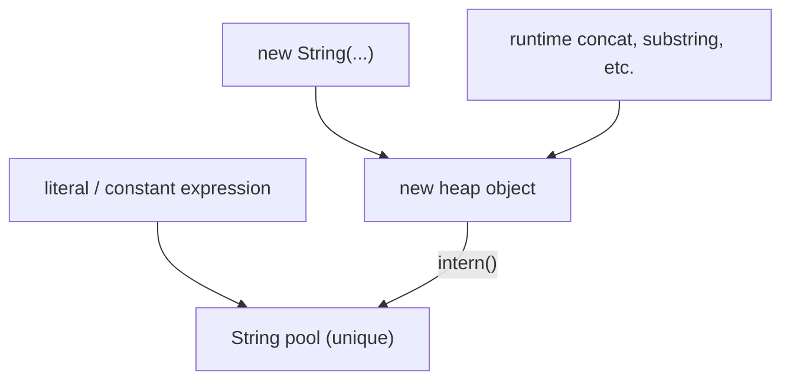
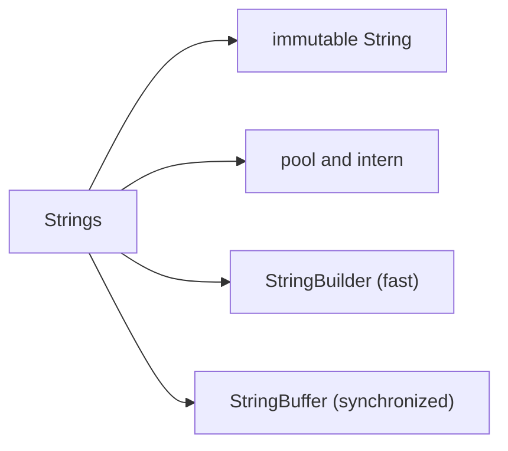

# String, StringBuffer, StringBuilder and the String Pool in Java

**TL;DR:** `String` is **immutable**: every "change" returns a new object. String **literals** (and compile-time constant expressions) live in the **String pool**, so `"a" == "a"` is true, while `new String("a")` always creates a separate heap object; `intern()` returns the pooled one. Compare content with `equals`, never `==`. `StringBuilder` is a **mutable**, fast, not-thread-safe buffer (`append`, `insert`, `reverse`, `delete`); `StringBuffer` is the same API but **synchronized** (legacy, slower). Build strings in loops with `StringBuilder`. `StringBuilder`/`StringBuffer` don't override `equals`.

## Table of Contents

1. [TL;DR](#1-tldr)
2. [Why it matters](#2-why-it-matters)
3. [Prerequisites](#3-prerequisites)
4. [Mental model](#4-mental-model)
5. [Core concepts](#5-core-concepts)
6. [How it works](#6-how-it-works)
7. [Examples](#7-examples)
8. [Comparisons](#8-comparisons)
9. [Trade-offs](#9-trade-offs)
10. [Gotchas](#10-gotchas)
11. [Practical application](#11-practical-application)
12. [Interview prep](#12-interview-prep)
13. [Interview question bank](#13-interview-question-bank)
14. [Tricky code snippets](#14-tricky-code-snippets)
15. [Connections](#15-connections)
16. [Summary](#16-summary)
17. [Answers](#answers)

> **Scope note.** The earlier *Java String Master Notes* in this project go deeper on regex and formatting. This note is the interview-focused treatment of immutability, the pool, and the three classes. Wrapper caches are in the previous note.

---

## 1. TL;DR

| | `String` | `StringBuilder` | `StringBuffer` |
|---|---|---|---|
| Mutable | No | Yes | Yes |
| Thread-safe | Yes (immutable) | No | Yes (synchronized) |
| Speed for edits | Slow (new object each) | Fastest | Slower than builder |
| `equals` compares content | Yes | No (identity) | No (identity) |
| Since | 1.0 | 1.5 | 1.0 |
| Final class | Yes | Yes | Yes |

**The analogy: printed books vs a whiteboard.**

| Real world | Java |
|---|---|
| A printed page: to change it you reprint | `String` is immutable |
| A shelf of common pages shared by everyone | The String pool |
| Two readers handed the same shared page | `"a" == "a"` |
| A private photocopy of the page | `new String("a")` |
| A whiteboard you erase and rewrite | `StringBuilder` |
| A whiteboard with a lock so one writer at a time | `StringBuffer` |

**Running example:** `"java"` literal twice, `new String("java")`, and `intern()` (Snippet 1).

---

## 2. Why it matters

**The problem.** `String` is the most used class. The pool makes `==` look sometimes right and sometimes wrong, and string-building in loops is a classic performance question.

**What goes wrong** (verified on Java 21):

| Mistake | Result | Snippet |
|---|---|---|
| `s.toUpperCase();` ignoring the result | `s` unchanged | 6 |
| `new String("a") == "a"` | false | 1, 2 |
| `s == part + "lo"` | false (runtime concat) | 3 |
| `1 + 2 + "3" + 4 + 5` | `3345` | 13 |
| `"a".concat(null)` | NPE (but `"a" + null` is `anull`) | 12 |
| `sb1.equals(sb2)` | false | 16 |
| `"a|b".split("|")` | `[a, |, b]` | 27 |
| `"a.b".replaceAll(".", "-")` | `---` | 26 |
| `"a,b,,".split(",")` | length 2 (trailing empties dropped) | 27 |
| `char c = "a";` | compile error | 30 |

**Why interviewers ask.** "Why is String immutable?", "String vs StringBuilder vs StringBuffer", "how many objects does `new String("x")` create?", `==` vs `equals`, `intern()`, "is `String` thread-safe?", "why is `char[]` preferred for passwords?"

---

## 3. Prerequisites

| Prerequisite | One-line refresher | Importance |
|---|---|---|
| Reference types and `==` | Identity vs equality | Essential |
| `equals` / `hashCode` | Contract | Essential |
| Immutability and `final` | Fields that never change | Important |
| Heap memory | Objects live on the heap | Important |
| Arrays / `char[]` | Strings wrap character data | Helpful |
| Threads (basic) | Why synchronization costs | Helpful |

---

## 4. Mental model

> **The one picture to keep in your head:** a `String` object never changes. The pool is a lookup table of unique strings for literals. `==` asks "same object?"; the pool makes that true for equal literals, but `new`, runtime concatenation and most method results are fresh objects.

```
  String pool (shared, unique)            Heap (ordinary objects)
  ┌────────────────┐
  │ "java"  ◀──────┼── a, b   (literals)       ┌────────────┐
  └────────────────┘                           │ "java"     │◀── c = new String("java")
          ▲                                    └────────────┘
          └──── c.intern() returns the pooled one → d
  a == b  true     a == c  false     a.equals(c)  true     a == d  true
```
*One pooled object, one separate heap copy.*


*Only literals, constant expressions and `intern()` return pooled strings.*

---

## 5. Core concepts

### 5.1 Glossary

- **Immutable:** state can't change after construction.
- **String pool (intern pool):** a table of unique `String` objects for literals.
- **`intern()`:** returns the pooled string equal to this one, adding it if absent.
- **Compile-time constant expression:** literals and `final` constant variables combined with operators; folded by the compiler (5.4).
- **`StringBuilder`:** mutable char sequence, not synchronized.
- **`StringBuffer`:** mutable, synchronized methods.
- **Capacity:** size of the builder's internal buffer; `length()` is how much is used.
- **`CharSequence`:** interface implemented by all three.

### 5.2 Why `String` is immutable

- **Pool safety:** shared literals can't be changed by one user.
- **Thread safety:** no synchronization needed.
- **Security:** class names, file paths, URLs, passwords as arguments can't change after validation.
- **Hash caching:** `hashCode` is computed once, so `String` is a good `HashMap` key (Snippet 21).
- **Class loading and `switch`:** rely on stable contents.

Consequence: methods like `toUpperCase`, `concat`, `replace`, `trim` return new strings (Snippet 6). If nothing changes, some return `this` (Snippet 19).

### 5.3 Creating strings

| Way | Pooled? |
|---|---|
| `"text"` literal | Yes |
| `new String("text")` | The literal is pooled; the new object isn't |
| `s.intern()` | Returns the pooled one |
| `a + b` at runtime | No |
| `"a" + "b"` | Yes (constant folding) |
| `String.valueOf`, `substring`, `toUpperCase` (changed) | No |

`new String("java")` can create up to **two** objects: the pooled literal (if not already there) and the heap copy.

### 5.4 Constant expressions

`"hel" + "lo"` is folded to `"hello"` at compile time, so it equals the literal (Snippet 3). A `final String` initialised with a constant is also a constant variable (Snippet 4). Non-final variables or values from method calls break folding (Snippets 3, 4, 5).

### 5.5 Pool details ⚠️

Since Java 7 the pool lives in the heap (it was in PermGen). Its size is tunable (`-XX:StringTableSize`). Pooled strings are collectable once unreferenced.

`intern()` after `new` (Snippet 36): the first `intern()` for text not yet pooled stores *that object* (so it returns itself); if the text is already pooled it returns the pooled one. Literal resolution is lazy in HotSpot, which is why Snippet 36's last lines are true.

### 5.6 Common `String` methods

- Inspect: `length`, `charAt`, `indexOf`, `lastIndexOf`, `contains`, `startsWith`, `endsWith`, `isEmpty`, `isBlank` (11) (Snippets 8, 22).
- Extract: `substring(begin)`, `substring(begin, end)` (end exclusive) (Snippet 9).
- Transform: `toUpperCase`, `toLowerCase`, `trim`, `strip` (11), `replace`, `replaceAll`, `repeat` (11), `join` (Snippets 8, 22, 26, 28).
- Split: `split(regex)` drops trailing empty strings unless a negative limit is given (Snippet 27).
- Compare: `equals`, `equalsIgnoreCase`, `compareTo`, `compareToIgnoreCase`, `contentEquals` (Snippets 11, 16, 37).
- Convert: `toCharArray`, `getBytes`, `String.valueOf`, `String.format` (Snippets 24, 29).
- Text blocks (Java 15): `"""..."""` (Snippet 23).

### 5.7 Operator `+` and `null`

`"a" + null` gives `"anull"` (Snippet 12); `"a".concat(null)` throws NPE. Evaluation is left to right, so `1 + 2 + "3"` is `"33"` (Snippet 13). `char + int` is `int` arithmetic: `'a' + 1` is 98 (Snippet 13).

### 5.8 `StringBuilder` and `StringBuffer`

Common API (same for both): `append`, `insert`, `delete`, `deleteCharAt`, `replace`, `reverse`, `setCharAt`, `setLength`, `charAt`, `indexOf`, `length`, `capacity`, `toString` (Snippets 15, 39).
- Most mutators return `this`, enabling chaining (Snippet 19).
- Default capacity 16; `new StringBuilder("abc")` has 16 + length = 19; `new StringBuilder(5)` has 5. When full, capacity becomes `(old + 1) * 2` (verified 16 → 34) (Snippet 17).
- They don't override `equals`/`hashCode`; compare with `toString().equals(...)`, `contentEquals` or `compareTo` (Java 11) (Snippet 16).
- `StringBuffer` methods are `synchronized`: two threads appending 10 000 chars each always give length 20 000 (Snippet 18). With `StringBuilder` such a race can lose characters or throw ⚠️ (not shown because it's non-deterministic).

### 5.9 Passing strings and builders

A `String` parameter can't be changed by the callee; a `StringBuilder` parameter can (Snippet 20).

---

## 6. How it works

### 6.1 Inside `String` ⚠️

Since Java 9 a `String` stores a `byte[]` with a coder flag (Latin-1 or UTF-16) — "compact strings" (JEP 254). `hashCode()` = `s[0]*31^(n-1) + ... + s[n-1]`, cached in a field. Different strings can collide (`"Aa"` and `"BB"`, Snippet 21).

### 6.2 Worked trace: the running example

```java
String a = "java";
String b = "java";
String c = new String("java");
String d = c.intern();
System.out.println(a == b);   // true
System.out.println(a == c);   // false
System.out.println(a.equals(c)); // true
System.out.println(a == d);   // true
```

Output (verified, Java 21):

```
true
false
true
true
```

| Variable | Refers to |
|---|---|
| `a`, `b` | the pooled `"java"` |
| `c` | a separate heap object |
| `d` | the pooled `"java"` (via `intern`) |

### 6.3 How `+` is compiled

For non-constant concatenation javac (Java 9+) emits `invokedynamic makeConcatWithConstants` (verified with `javap -c`); with `--release 8` it emits a `StringBuilder` chain. Either way, each `s += x` in a loop builds a new string, so a loop of `n` appends is O(n²) copying; use a `StringBuilder` (Snippet 34 shows both give the same result).

### 6.4 Builder growth

When `length` exceeds capacity the internal array is reallocated to `(old+1)*2` (at least the needed size) (Snippet 17). Give a capacity up front if you know the size. `trimToSize()` shrinks it.

### 6.5 `switch` on strings

`switch (s)` uses `hashCode` then `equals`; a `null` selector throws NPE (Snippet 14).

### 6.6 Unicode

`length()` counts UTF-16 chars, not code points: an emoji is 2 (Snippet 38). Use `codePointCount`, `codePoints()`; `StringBuilder.reverse()` treats surrogate pairs as units.

---

## 7. Examples

### 7.1 Toy example

```java
String s = "hello";
s.toUpperCase();              // result discarded
System.out.println(s);        // hello
s = s.toUpperCase();
System.out.println(s);        // HELLO
```
(Snippet 6.)

### 7.2 Real-world examples

- **Joining:** `String.join`, `StringJoiner`, `Collectors.joining` (Snippet 35).
- **Building output in a loop:** `StringBuilder` (Snippet 34).
- **Case-insensitive lookup keys:** `equalsIgnoreCase`.
- **Anagram check:** sort `toCharArray()` (Snippet 29).
- **Passwords:** hold in `char[]` so you can overwrite it; strings linger until GC.
- **Parsing:** `split("\\s+")` after `trim()` (Snippet 27).
- **Multi-line SQL/JSON:** text blocks (Snippet 23).

---

## 8. Comparisons

### 8.1 `==` vs `equals` on strings

| Expression | Result |
|---|---|
| `"a" == "a"` | true |
| `new String("a") == "a"` | false |
| `new String("a").equals("a")` | true |
| `s1.intern() == s2.intern()` (equal content) | true |

### 8.2 `String` vs `StringBuilder` vs `StringBuffer`

See the table in section 1; use `String` for fixed text, `StringBuilder` for single-threaded building, `StringBuffer` only for legacy shared-buffer code.

### 8.3 `replace` vs `replaceAll`

| | `replace(CharSequence, CharSequence)` | `replaceAll(regex, repl)` |
|---|---|---|
| Pattern | Literal | Regex |
| `"a.b".…(".", "-")` | `a-b` | `---` (`.` matches any) |

Snippet 26.

### 8.4 `trim` vs `strip` (Java 11)

`trim` removes chars ≤ U+0020; `strip` removes Unicode whitespace (`Character.isWhitespace`). Neither removes the non-breaking space U+00A0 (Snippet 28).

### 8.5 `isEmpty` vs `isBlank`

`""` is empty; `"  "` is blank but not empty (Snippet 22).

### 8.6 `concat` vs `+`

| | `concat` | `+` |
|---|---|---|
| `null` argument | NPE | `"null"` appended |
| Accepts non-strings | No | Yes |

### 8.7 `contentEquals` vs `equals`

`"abc".contentEquals(sb)` compares with any `CharSequence`; `"abc".equals(sb)` is false (Snippets 16, 37).

---

## 9. Trade-offs

| Decision | Benefit | Cost | Use when |
|---|---|---|---|
| `String` | Immutable, safe, pooled, hash cached | New object per change | Fixed text, keys |
| `StringBuilder` | Fast edits | Not thread-safe | Local building |
| `StringBuffer` | Thread-safe appends | Slower; locking | Legacy shared state |
| `+` in a loop | Readable | O(n²) | Few iterations |
| `intern()` | Dedup memory, `==` possible | Pool lookup cost | Many repeated long strings (rare) ⚠️ |
| `char[]` | Wipeable | Awkward API | Secrets |
| `String.format` | Readable templates | Slower | Messages, not hot paths |

---

## 10. Gotchas

### Myths

- ❌ **Myth:** "`s.toUpperCase()` changes `s`." ✅ **Reality:** returns a new string (Snippet 6).
- ❌ **Myth:** "`==` is fine for strings." ✅ **Reality:** works only for pooled values (Snippets 1, 3).
- ❌ **Myth:** "`new String("a")` creates one object." ✅ **Reality:** up to two (5.3).
- ❌ **Myth:** "`StringBuilder.equals` compares text." ✅ **Reality:** identity (Snippet 16).
- ❌ **Myth:** "`StringBuffer` is the modern thread-safe choice." ✅ **Reality:** legacy; prefer `StringBuilder` plus confinement or other concurrency tools.
- ❌ **Myth:** "`split` keeps all empty strings." ✅ **Reality:** trailing empties are removed (Snippet 27).
- ❌ **Myth:** "`s += x` is as fast as `append`." ✅ **Reality:** copies each time (6.3).
- ❌ **Myth:** "`"a" + null` throws." ✅ **Reality:** `"anull"` (Snippet 12).
- ❌ **Myth:** "`length()` is the number of characters." ✅ **Reality:** UTF-16 units (Snippet 38).
- ❌ **Myth:** "`trim()` removes all whitespace." ✅ **Reality:** only chars ≤ U+0020 (Snippet 28).

### Common mistakes and edge cases

- **Ignoring the return value** of a `String` method (Snippet 6).
- **`"|"` and `"."` in `split`/`replaceAll`** are regex (Snippets 26, 27).
- **`substring(begin, end)`** `end` is exclusive; out-of-range throws `StringIndexOutOfBoundsException` (Snippets 9, 10).
- **`compareTo`** returns char difference or length difference, not just ±1 (Snippet 11).
- **`switch` on a null string** (Snippet 14).
- **Comparing `StringBuilder` with a `String` via `==`** doesn't compile (Snippet 31).
- **`valueOf(char[] null)`** NPE vs `valueOf((Object) null)` → `"null"` (Snippet 24).
- **`switch` and `equals` ordering:** put the literal first: `"a".equals(s)` (Snippet 25).

---

## 11. Practical application

### Checklist
- [ ] Compare strings with `equals` (literal first) or `Objects.equals`.
- [ ] Use `StringBuilder` for loops and large concatenation.
- [ ] Assign the result of every transformation.
- [ ] Escape regex metacharacters (`\\.`, `\\|`) or use `replace`.
- [ ] Pass a negative limit to `split` if you need trailing empties.
- [ ] Use `strip`/`isBlank` for Unicode-aware whitespace (Java 11+).
- [ ] Use `char[]` for passwords.
- [ ] Don't rely on `intern()` for correctness.

### Hands-on exercise

Predict the four lines:

```java
String s1 = "ab";
String s2 = "a";
String s3 = s2 + "b";
System.out.println((s1 == s3) + " " + (s1 == s3.intern()) + " " + s1.equals(s3) + " " + ("a" + "b" == s1));
```

<details><summary>Solution</summary>

`false true true true`. `s3` is built at runtime (new object), so `s1 == s3` is false; `s3.intern()` returns the pooled `"ab"` (the same as `s1`); `equals` compares text; `"a" + "b"` is a constant expression folded to `"ab"`.

Verified on Java 21 (same patterns as Snippets 3 and 4).
</details>

---

## 12. Interview prep

Eight model answers, as you would say them aloud.

<details><summary>1. Why is `String` immutable in Java?</summary>

So pooled literals can be shared safely, so it's thread-safe without locks, so security-sensitive values (paths, class names) can't change after checks, and so its hash can be cached for use as a `HashMap` key (5.2; Snippets 6, 21).
</details>

<details><summary>2. What is the String pool?</summary>

A table of unique `String` objects for literals and compile-time constants (kept in the heap since Java 7). Equal literals share one object, so `"a" == "a"` is true; `new String("a")` makes a separate object, and `intern()` returns the pooled one (5.3; Snippets 1, 2).
</details>

<details><summary>3. How many objects does `new String("java")` create?</summary>

Up to two: the pooled literal `"java"` (if not already pooled) and the new heap object. The variable refers to the heap object (5.3; Snippet 1).
</details>

<details><summary>4. `==` vs `equals` for strings?</summary>

`==` compares references, `equals` compares content. Literals and constant expressions give `==` true; runtime concatenation, `new`, `substring` etc. give new objects, so always use `equals` (8.1; Snippets 1, 3, 4).
</details>

<details><summary>5. String vs StringBuilder vs StringBuffer?</summary>

`String` is immutable. `StringBuilder` is mutable and fast but not thread-safe. `StringBuffer` is mutable with synchronized methods, so thread-safe but slower. Use `StringBuilder` for building strings in loops (section 1; Snippets 15, 18).
</details>

<details><summary>6. What does `intern()` do?</summary>

Returns the canonical pooled string equal to this one, adding it if absent. After `s1.intern() == s2.intern()` is true for equal text (Snippets 2, 36).
</details>

<details><summary>7. Why is `s += x` in a loop slow?</summary>

Every iteration creates a new string and copies all the characters, O(n²) overall. `StringBuilder.append` amortises growth (6.3, 6.4; Snippet 34).
</details>

<details><summary>8. Do `StringBuilder`s compare by content?</summary>

No, they don't override `equals`, so it's identity. Compare `toString()` values, use `contentEquals`, or `compareTo` (Java 11) (Snippet 16).
</details>

---

## 13. Interview question bank


### 13.1 Basics (Q1–Q12)

<details><summary>Q1. Is `String` a primitive?</summary>

No, a class (`java.lang.String`).
</details>

<details><summary>Q2. Is `String` final?</summary>

Yes (Snippet 32).
</details>

<details><summary>Q3. Is it mutable?</summary>

No.
</details>

<details><summary>Q4. Does `s.concat("x")` change `s`?</summary>

No (Snippet 6).
</details>

<details><summary>Q5. How to change a string's value?</summary>

Reassign the variable to the returned new string.
</details>

<details><summary>Q6. Which interfaces does it implement?</summary>

`CharSequence`, `Comparable<String>`, `Serializable`.
</details>

<details><summary>Q7. Default value of a `String` field?</summary>

`null`.
</details>

<details><summary>Q8. `length()` of `""`?</summary>

0.
</details>

<details><summary>Q9. Index of first char?</summary>

0.
</details>

<details><summary>Q10. `charAt(3)` on `"abc"`?</summary>

`StringIndexOutOfBoundsException` (Snippet 10).
</details>

<details><summary>Q11. Is `String` thread-safe?</summary>

Yes, because immutable.
</details>

<details><summary>Q12. What does `toString()` on a string return?</summary>

Itself.
</details>


### 13.2 String pool and equality (Q13–Q28)

<details><summary>Q13. Where is the pool?</summary>

The heap since Java 7 ⚠️.
</details>

<details><summary>Q14. `"a" == "a"`?</summary>

true (Snippet 1).
</details>

<details><summary>Q15. `new String("a") == "a"`?</summary>

false (Snippet 2).
</details>

<details><summary>Q16. `new String("a").equals("a")`?</summary>

true.
</details>

<details><summary>Q17. `s1.intern() == s2.intern()`?</summary>

true for equal text (Snippet 2).
</details>

<details><summary>Q18. `"hel" + "lo" == "hello"`?</summary>

true (Snippet 3).
</details>

<details><summary>Q19. `part + "lo" == "hello"` with a non-final `part`?</summary>

false (Snippet 3).
</details>

<details><summary>Q20. Same with `final String part = "hel"`?</summary>

true (Snippet 4).
</details>

<details><summary>Q21. `final` initialised from a method?</summary>

Not a constant; false (Snippet 5).
</details>

<details><summary>Q22. Is a runtime-concatenated string pooled?</summary>

No, unless interned (Snippet 3).
</details>

<details><summary>Q23. Does `substring` return a pooled string?</summary>

No (new object, or `this` for the full range).
</details>

<details><summary>Q24. Does `toUpperCase()` on an uppercase string return `this`?</summary>

Yes (Snippet 19).
</details>

<details><summary>Q25. What does `intern()` return for text not yet pooled?</summary>

The receiver itself, now pooled (Snippet 36) ⚠️.
</details>

<details><summary>Q26. Are pooled strings garbage-collected?</summary>

Yes once unreferenced ⚠️.
</details>

<details><summary>Q27. Can you resize the pool?</summary>

`-XX:StringTableSize` ⚠️.
</details>

<details><summary>Q28. Should you intern strings?</summary>

Rarely; only to save memory on many duplicates.
</details>


### 13.3 Methods and pitfalls (Q29–Q44)

<details><summary>Q29. `substring(2,2)`?</summary>

Empty string (Snippet 9).
</details>

<details><summary>Q30. `substring(6)` on a 5-char string?</summary>

Exception (Snippet 9).
</details>

<details><summary>Q31. Is the end index in `substring` inclusive?</summary>

No, exclusive.
</details>

<details><summary>Q32. `"apple".compareTo("banana")`?</summary>

-1 (difference of first differing chars) (Snippet 11).
</details>

<details><summary>Q33. `"a".compareTo("abc")`?</summary>

-2 (length difference) (Snippet 11).
</details>

<details><summary>Q34. `"a" + null`?</summary>

`"anull"` (Snippet 12).
</details>

<details><summary>Q35. `"a".concat(null)`?</summary>

NPE (Snippet 12).
</details>

<details><summary>Q36. `1 + 2 + "3" + 4 + 5`?</summary>

`"3345"` (Snippet 13).
</details>

<details><summary>Q37. `'a' + 1`?</summary>

98 (int) (Snippet 13).
</details>

<details><summary>Q38. `"" + 'a' + 1`?</summary>

`"a1"`.
</details>

<details><summary>Q39. `"a,b,,".split(",").length`?</summary>

2 (Snippet 27).
</details>

<details><summary>Q40. How to keep trailing empties?</summary>

`split(",", -1)` (Snippet 27).
</details>

<details><summary>Q41. `"a|b".split("|")`?</summary>

`[a, |, b]` (Snippet 27).
</details>

<details><summary>Q42. `"a.b".replaceAll(".", "-")`?</summary>

`---` (Snippet 26).
</details>

<details><summary>Q43. `trim()` vs `strip()`?</summary>

`strip` is Unicode-aware (Snippet 28).
</details>

<details><summary>Q44. `isEmpty` vs `isBlank`?</summary>

`"  "` is blank, not empty (Snippet 22).
</details>


### 13.4 StringBuilder and StringBuffer (Q45–Q58)

<details><summary>Q45. Why use `StringBuilder`?</summary>

Mutable; avoids creating many strings.
</details>

<details><summary>Q46. `StringBuffer` vs `StringBuilder`?</summary>

Synchronized vs not (Snippet 18).
</details>

<details><summary>Q47. Which is faster?</summary>

`StringBuilder`.
</details>

<details><summary>Q48. Default capacity?</summary>

16 (Snippet 17).
</details>

<details><summary>Q49. Capacity of `new StringBuilder("abc")`?</summary>

19 (Snippet 17).
</details>

<details><summary>Q50. Growth formula?</summary>

`(old + 1) * 2` (Snippet 17).
</details>

<details><summary>Q51. `sb.equals(sb2)`?</summary>

Identity (Snippet 16).
</details>

<details><summary>Q52. How to compare content?</summary>

`toString().equals`, `contentEquals`, `compareTo` (Snippet 16).
</details>

<details><summary>Q53. Does `append` return `this`?</summary>

Yes, enabling chaining (Snippet 19).
</details>

<details><summary>Q54. `reverse()` in place?</summary>

Yes (Snippet 15).
</details>

<details><summary>Q55. `setLength(0)`?</summary>

Empties the builder (Snippet 39).
</details>

<details><summary>Q56. `insert` beyond length?</summary>

`StringIndexOutOfBoundsException` (Snippet 33).
</details>

<details><summary>Q57. Passing a builder to a method that appends?</summary>

The caller sees the change (Snippet 20).
</details>

<details><summary>Q58. Is `StringBuilder` thread-safe?</summary>

No.
</details>


### 13.5 Design and memory (Q59–Q66)

<details><summary>Q59. Why is `String` a good `HashMap` key?</summary>

Immutable and hash cached (Snippet 21).
</details>

<details><summary>Q60. Can different strings have the same hash?</summary>

Yes: `"Aa"` and `"BB"` (Snippet 21).
</details>

<details><summary>Q61. Why `char[]` for passwords?</summary>

You can overwrite it; strings stay in memory until collected.
</details>

<details><summary>Q62. How is `s1 + s2` compiled?</summary>

`invokedynamic` concat in Java 9+, `StringBuilder` before ⚠️.
</details>

<details><summary>Q63. What are compact strings?</summary>

Latin-1 `byte[]` storage when possible (Java 9) ⚠️.
</details>

<details><summary>Q64. Does `length()` count code points?</summary>

No, UTF-16 units (Snippet 38).
</details>

<details><summary>Q65. What are text blocks?</summary>

Multi-line literals with `"""` (Java 15) (Snippet 23).
</details>

<details><summary>Q66. Does `switch` accept strings?</summary>

Yes since Java 7; null throws NPE (Snippet 14).
</details>

---

## 14. Tricky code snippets

39 snippets, each compiled and run on OpenJDK 21. Predict the output (or the compile error) before opening the answer. Snippet 36 depends on when the JVM resolves a string literal, so treat it as HotSpot behaviour ⚠️. Exception messages for out-of-range indexes are the ones printed by Java 21 and differ between versions ⚠️.

### Snippet 1: Literal, `new`, `intern`

```java
public class Main {
    public static void main(String[] args) {
        String a = "java";
        String b = "java";
        String c = new String("java");
        String d = c.intern();
        System.out.println(a == b);
        System.out.println(a == c);
        System.out.println(a.equals(c));
        System.out.println(a == d);
    }
}
```

<details><summary>Answer</summary>

```
true
false
true
true
```

Trace in 6.2.
</details>

### Snippet 2: Two `new String`s

```java
public class Main {
    public static void main(String[] args) {
        String s1 = new String("hi");
        String s2 = new String("hi");
        System.out.println(s1 == s2);
        System.out.println(s1.intern() == s2.intern());
        System.out.println(s1.intern() == "hi");
    }
}
```

<details><summary>Answer</summary>

```
false
true
true
```

Two heap objects; both `intern()` to the single pooled `"hi"`.
</details>

### Snippet 3: Constant vs runtime concatenation

```java
public class Main {
    public static void main(String[] args) {
        String s = "hello";
        System.out.println(s == "hel" + "lo");
        String part = "hel";
        System.out.println(s == part + "lo");
        System.out.println(s == (part + "lo").intern());
    }
}
```

<details><summary>Answer</summary>

```
true
false
true
```

`"hel" + "lo"` is folded; `part + "lo"` is built at run time; `intern()` finds the pooled `"hello"`.
</details>

### Snippet 4: `final` local constant

```java
public class Main {
    public static void main(String[] args) {
        final String a = "hel";
        String b = "hel";
        System.out.println("hello" == a + "lo");
        System.out.println("hello" == b + "lo");
    }
}
```

<details><summary>Answer</summary>

```
true
false
```

A `final String` initialised with a constant is a constant variable.
</details>

### Snippet 5: `final` but not a constant

```java
public class Main {
    static String lo() { return "lo"; }
    public static void main(String[] args) {
        final String a = "hel";
        final String c = lo();
        System.out.println("hello" == a + "lo");
        System.out.println("hello" == a + c);
        final String nul = null;
        System.out.println(("x" + nul));
    }
}
```

<details><summary>Answer</summary>

```
true
false
xnull
```

`a` is constant, `c` comes from a method call. `"x" + null` is `"xnull"`.
</details>

### Snippet 6: Ignoring the returned string

```java
public class Main {
    public static void main(String[] args) {
        String s = "hello";
        s.toUpperCase();
        s.concat(" world");
        s.replace('l', 'L');
        System.out.println(s);
        s = s.toUpperCase();
        System.out.println(s);
    }
}
```

<details><summary>Answer</summary>

```
hello
HELLO
```

Only the assignment `s = s.toUpperCase()` changes what `s` refers to.
</details>

### Snippet 7: `+=` vs `append`

```java
public class Main {
    public static void main(String[] args) {
        String s = "a";
        String t = s;
        s += "b";
        System.out.println(s + " " + t + " " + (s == t));
        StringBuilder sb = new StringBuilder("a");
        StringBuilder sb2 = sb;
        sb.append("b");
        System.out.println(sb + " " + sb2 + " " + (sb == sb2));
    }
}
```

<details><summary>Answer</summary>

```
ab a false
ab ab true
```

`s += "b"` builds a new string; `sb.append` mutates the shared builder.
</details>

### Snippet 8: Common methods

```java
public class Main {
    public static void main(String[] args) {
        String s = "  Hello, World  ";
        String t = s.trim();
        System.out.println(t.length() + " " + t.charAt(1) + " " + t.indexOf('o') + " " + t.lastIndexOf('o'));
        System.out.println(t.substring(7) + "|" + t.substring(0, 5) + "|" + t.replace('l', 'L'));
        System.out.println(t.contains("World") + " " + t.startsWith("He") + " " + t.endsWith("d") + " " + t.isEmpty());
        System.out.println(String.join("-", "a", "b", "c") + " " + "a,b".split(",").length);
    }
}
```

<details><summary>Answer</summary>

```
12 e 4 8
World|Hello|HeLLo, WorLd
true true true false
a-b-c 2
```

`trim()` gives `"Hello, World"` (length 12); `substring(7)` is `"World"`.
</details>

### Snippet 9: `substring` boundaries

```java
public class Main {
    public static void main(String[] args) {
        String s = "hello";
        System.out.println("[" + s.substring(2, 2) + "]");
        System.out.println("[" + s.substring(5) + "]");
        try { s.substring(6); } catch (StringIndexOutOfBoundsException e) { System.out.println(e.getMessage()); }
        try { s.substring(3, 2); } catch (StringIndexOutOfBoundsException e) { System.out.println(e.getMessage()); }
    }
}
```

<details><summary>Answer</summary>

```
[]
[]
Range [6, 5) out of bounds for length 5
Range [3, 2) out of bounds for length 5
```

Equal indexes give `""`. ⚠️ Message text is the Java 21 one.
</details>

### Snippet 10: `charAt` out of range

```java
public class Main {
    public static void main(String[] args) {
        try { "abc".charAt(3); } catch (StringIndexOutOfBoundsException e) { System.out.println(e.getMessage()); }
        try { "abc".charAt(-1); } catch (StringIndexOutOfBoundsException e) { System.out.println(e.getMessage()); }
    }
}
```

<details><summary>Answer</summary>

```
Index 3 out of bounds for length 3
Index -1 out of bounds for length 3
```

`StringIndexOutOfBoundsException` ⚠️ message is version-specific.
</details>

### Snippet 11: `compareTo` values

```java
public class Main {
    public static void main(String[] args) {
        System.out.println("apple".compareTo("banana"));
        System.out.println("a".compareTo("abc"));
        System.out.println("abc".compareTo("abc"));
        System.out.println("Apple".compareToIgnoreCase("apple"));
        System.out.println("Java".equalsIgnoreCase("JAVA"));
        System.out.println("b".compareTo("A"));
    }
}
```

<details><summary>Answer</summary>

```
-1
-2
0
0
true
33
```

Character difference (`a` - `b`), else length difference (1 - 3), `'b' - 'A'` = 33.
</details>

### Snippet 12: `+` and `concat` with null

```java
public class Main {
    public static void main(String[] args) {
        String s = null;
        System.out.println("a" + s);
        System.out.println(s + s);
        try { "a".concat(s); } catch (NullPointerException e) { System.out.println("concat NPE"); }
        try { s.length(); } catch (NullPointerException e) { System.out.println("length NPE"); }
    }
}
```

<details><summary>Answer</summary>

```
anull
nullnull
concat NPE
length NPE
```

`+` converts null with `String.valueOf`; `concat` and method calls dereference it.
</details>

### Snippet 13: Left-to-right `+`

```java
public class Main {
    public static void main(String[] args) {
        System.out.println(1 + 2 + "3" + 4 + 5);
        System.out.println("1" + 2 + 3);
        System.out.println(1 + 2 + "" + (1 + 2));
        System.out.println('a' + 1);
        System.out.println("" + 'a' + 1);
        System.out.println((char) ('a' + 1));
        System.out.println('a' + 'b' + "c");
    }
}
```

<details><summary>Answer</summary>

```
3345
123
33
98
a1
b
195c
```

`1+2` happens before the first string; `'a'+'b'` is `int` 195.
</details>

### Snippet 14: `switch` on strings

```java
public class Main {
    public static void main(String[] args) {
        String s = "two";
        switch (s) { case "one": System.out.println(1); break; case "two": System.out.println(2); break; default: System.out.println(0); }
        String n = null;
        try { switch (n) { case "x": break; } } catch (NullPointerException e) { System.out.println("NPE in switch"); }
    }
}
```

<details><summary>Answer</summary>

```
2
NPE in switch
```

Uses `hashCode` and `equals`; null selector throws.
</details>

### Snippet 15: Builder operations

```java
public class Main {
    public static void main(String[] args) {
        StringBuilder sb = new StringBuilder("hello");
        sb.append(' ').append("world").append(1).append(2.5).append(true);
        System.out.println(sb);
        sb.setLength(11);
        System.out.println(sb);
        sb.insert(0, ">> ").reverse();
        System.out.println(sb);
        sb.reverse().delete(0, 3).deleteCharAt(0).replace(0, 4, "J");
        System.out.println(sb);
        sb.setCharAt(0, 'j');
        System.out.println(sb + " " + sb.length() + " " + sb.indexOf("w") + " " + sb.charAt(2));
    }
}
```

<details><summary>Answer</summary>

```
hello world12.5true
hello world
dlrow olleh >>
J world
j world 7 2 w
```

Step by step edits; `append` accepts any type.
</details>

### Snippet 16: Builder equality

```java
public class Main {
    public static void main(String[] args) {
        StringBuilder a = new StringBuilder("abc");
        StringBuilder b = new StringBuilder("abc");
        System.out.println(a.equals(b));
        System.out.println(a.toString().equals(b.toString()));
        System.out.println(a.compareTo(b));
        System.out.println("abc".contentEquals(a));
        System.out.println("abc".equals(a));
    }
}
```

<details><summary>Answer</summary>

```
false
true
0
true
false
```

Identity `equals`; `compareTo` (Java 11) compares content; `String.equals(StringBuilder)` is false.
</details>

### Snippet 17: Capacity

```java
public class Main {
    public static void main(String[] args) {
        StringBuilder a = new StringBuilder();
        StringBuilder b = new StringBuilder("abc");
        StringBuilder c = new StringBuilder(5);
        System.out.println(a.capacity() + " " + b.capacity() + " " + c.capacity());
        a.append("12345678901234567");
        System.out.println(a.length() + " " + a.capacity());
        a.trimToSize();
        System.out.println(a.capacity());
    }
}
```

<details><summary>Answer</summary>

```
16 19 5
17 34
17
```

Growth `(16+1)*2 = 34`; `trimToSize` shrinks to length.
</details>

### Snippet 18: `StringBuffer` under two threads

```java
public class Main {
    public static void main(String[] args) throws Exception {
        StringBuffer sbuf = new StringBuffer();
        Runnable r = () -> { for (int i = 0; i < 10000; i++) sbuf.append('x'); };
        Thread t1 = new Thread(r), t2 = new Thread(r);
        t1.start(); t2.start(); t1.join(); t2.join();
        System.out.println(sbuf.length());
    }
}
```

<details><summary>Answer</summary>

```
20000
```

Synchronised appends never lose characters.
</details>

### Snippet 19: Returns `this` or a new string

```java
public class Main {
    public static void main(String[] args) {
        StringBuilder sb = new StringBuilder();
        System.out.println(sb.append("x") == sb);
        String s = "x";
        System.out.println(s.concat("y") == s);
        System.out.println(s.concat("") == s);
        System.out.println(s.toUpperCase() == s);
        System.out.println("X".toUpperCase() == "X");
    }
}
```

<details><summary>Answer</summary>

```
true
false
true
false
true
```

`concat("")` and `toUpperCase()` on an unchanged string return `this`.
</details>

### Snippet 20: Pass to a method

```java
public class Main {
    static void change(String s) { s += " world"; }
    static void change(StringBuilder sb) { sb.append(" world"); }
    public static void main(String[] args) {
        String s = "hello";
        StringBuilder sb = new StringBuilder("hello");
        change(s);
        change(sb);
        System.out.println(s + " | " + sb);
    }
}
```

<details><summary>Answer</summary>

```
hello | hello world
```

The `String` parameter is reassigned locally; the builder is mutated.
</details>

### Snippet 21: `hashCode`

```java
public class Main {
    public static void main(String[] args) {
        System.out.println("abc".hashCode());
        System.out.println("Aa".hashCode() + " " + "BB".hashCode());
        System.out.println("Aa".equals("BB"));
        System.out.println("".hashCode());
    }
}
```

<details><summary>Answer</summary>

```
96354
2112 2112
false
0
```

`"Aa"` and `"BB"` collide; equal hashes don't imply equal strings.
</details>

### Snippet 22: Java 11+ helpers

```java
public class Main {
    public static void main(String[] args) {
        System.out.println("ab".repeat(3));
        System.out.println("  ".isBlank() + " " + "".isEmpty() + " " + "  ".isEmpty());
        System.out.println("  hi  ".strip() + "|" + "  hi  ".stripLeading() + "|" + "  hi  ".stripTrailing() + "|");
        System.out.println("a\nb\nc".lines().count());
        System.out.println(String.format("%05d|%-5s|%.2f|%x", 42, "ab", 3.14159, 255));
        System.out.println("hello".chars().filter(c -> c == 'l').count());
    }
}
```

<details><summary>Answer</summary>

```
ababab
true true false
hi|hi  |  hi|
3
00042|ab   |3.14|ff
2
```

`repeat`, `isBlank`, `strip*`, `lines`, `format`, `chars`.
</details>

### Snippet 23: Text block

```java
public class Main {
    public static void main(String[] args) {
        String tb = """
            Hello,
              World!
            """;
        System.out.print(tb);
        System.out.println(tb.length());
    }
}
```

<details><summary>Answer</summary>

```
Hello,
World!
16
```

The common indentation is stripped; the closing `"""` on its own line adds a final newline (16 chars).
</details>

### Snippet 24: `valueOf` overloads

```java
public class Main {
    public static void main(String[] args) {
        Object o = null;
        System.out.println(String.valueOf(o));
        char[] cs = null;
        try { String.valueOf(cs); } catch (NullPointerException e) { System.out.println("NPE for char[]"); }
        System.out.println(String.valueOf(new char[] {'h', 'i'}) + new String(new char[] {'o', 'k'}));
        System.out.println(String.valueOf(3.0f) + String.valueOf(true) + String.valueOf('c'));
    }
}
```

<details><summary>Answer</summary>

```
null
NPE for char[]
hiok
3.0truec
```

`valueOf((Object) null)` is `"null"`; `valueOf(char[])` dereferences.
</details>

### Snippet 25: `equals` and null

```java
import java.util.Objects;
public class Main {
    public static void main(String[] args) {
        String s = null;
        System.out.println("a".equals(s));
        System.out.println(Objects.equals(s, null));
        try { s.equals("a"); } catch (NullPointerException e) { System.out.println("NPE"); }
        System.out.println("a".equals((Object) 'a'));
    }
}
```

<details><summary>Answer</summary>

```
false
true
NPE
false
```

Put the literal first; `"a".equals('a')` is false (a `Character`).
</details>

### Snippet 26: Literal vs regex

```java
public class Main {
    public static void main(String[] args) {
        System.out.println("a.b.c".replace(".", "-"));
        System.out.println("a.b.c".replaceAll(".", "-"));
        System.out.println("a.b.c".replaceAll("\\.", "-"));
        System.out.println("aaa".replace("aa", "b"));
        System.out.println("x".replace("", "-"));
    }
}
```

<details><summary>Answer</summary>

```
a-b-c
-----
a-b-c
ba
-x-
```

`.` matches any char in `replaceAll`; `replace("", "-")` inserts between all chars.
</details>

### Snippet 27: `split` behaviour

```java
import java.util.Arrays;
public class Main {
    public static void main(String[] args) {
        System.out.println("a,b,,".split(",").length);
        System.out.println("a,b,,".split(",", -1).length);
        System.out.println(Arrays.toString("a|b".split("|")));
        System.out.println(Arrays.toString("a|b".split("\\|")));
        System.out.println("".split(",").length);
        System.out.println(",a".split(",").length);
        System.out.println(Arrays.toString(" a  b ".trim().split("\\s+")));
    }
}
```

<details><summary>Answer</summary>

```
2
4
[a, |, b]
[a, b]
1
2
[a, b]
```

Trailing empties are dropped; `"|"` is regex alternation of empties; `"".split(",")` is `[""]`.
</details>

### Snippet 28: `trim` vs `strip`

```java
public class Main {
    public static void main(String[] args) {
        String s = "\u2003hi\u2003";
        System.out.println(s.trim().length());
        System.out.println(s.strip().length());
        String n = "\u00A0hi\u00A0";
        System.out.println(n.strip().length());
        System.out.println(" \t x\n".trim().length());
    }
}
```

<details><summary>Answer</summary>

```
4
2
4
1
```

U+2003 isn't ≤ U+0020 so `trim` keeps it, `strip` removes it; U+00A0 is not whitespace for either.
</details>

### Snippet 29: Chars and bytes

```java
import java.util.Arrays;
public class Main {
    public static void main(String[] args) {
        char[] cs = "hello".toCharArray();
        Arrays.sort(cs);
        System.out.println(new String(cs));
        String a = "listen", b = "silent";
        char[] x = a.toCharArray(), y = b.toCharArray();
        Arrays.sort(x); Arrays.sort(y);
        System.out.println(Arrays.equals(x, y));
        System.out.println(Arrays.toString("hi".getBytes()));
    }
}
```

<details><summary>Answer</summary>

```
ehllo
true
[104, 105]
```

Sort the char array for anagram checks.
</details>

### Snippet 30: `char`/`String` mix-up

```java
public class Main {
    public static void main(String[] args) {
        char c = "a";
        String s = 'a';
    }
}
```

<details><summary>Answer</summary>

Compile error: *incompatible types: String cannot be converted to char*.

The second line also fails: `char` cannot be converted to `String`.
</details>

### Snippet 31: `StringBuilder == String`

```java
public class Main {
    public static void main(String[] args) {
        StringBuilder sb = new StringBuilder("abc");
        System.out.println(sb == "abc");
    }
}
```

<details><summary>Answer</summary>

Compile error: *incomparable types: StringBuilder and String*.

Unrelated classes can't be compared with `==`.
</details>

### Snippet 32: Extending `String`

```java
public class Main {
    static class MyString extends String { }
    public static void main(String[] args) { }
}
```

<details><summary>Answer</summary>

Compile error: *cannot inherit from final String*.

`String` is `final`.
</details>

### Snippet 33: Builder range errors

```java
public class Main {
    public static void main(String[] args) {
        StringBuilder sb = new StringBuilder("abc");
        try { sb.insert(5, "x"); } catch (StringIndexOutOfBoundsException e) { System.out.println(e.getMessage()); }
        try { sb.deleteCharAt(3); } catch (StringIndexOutOfBoundsException e) { System.out.println(e.getMessage()); }
        try { sb.setLength(-1); } catch (StringIndexOutOfBoundsException e) { System.out.println(e.getMessage()); }
    }
}
```

<details><summary>Answer</summary>

```
Range [5, 3) out of bounds for length 3
Index 3 out of bounds for length 3
String index out of range: -1
```

All are `StringIndexOutOfBoundsException` ⚠️ with Java 21 messages.
</details>

### Snippet 34: Loop concatenation

```java
public class Main {
    public static void main(String[] args) {
        String s = "";
        StringBuilder sb = new StringBuilder();
        for (int i = 0; i < 5; i++) { s += i; sb.append(i); }
        System.out.println(s + " " + sb + " " + s.equals(sb.toString()));
    }
}
```

<details><summary>Answer</summary>

```
01234 01234 true
```

Same result; the builder just avoids copying.
</details>

### Snippet 35: Joining

```java
import java.util.*;
import java.util.stream.*;
public class Main {
    public static void main(String[] args) {
        StringJoiner sj = new StringJoiner(", ", "[", "]");
        sj.add("a").add("b");
        System.out.println(sj);
        System.out.println(String.join("/", List.of("x", "y", "z")));
        System.out.println(Stream.of(1, 2, 3).map(String::valueOf).collect(Collectors.joining("+")));
    }
}
```

<details><summary>Answer</summary>

```
[a, b]
x/y/z
1+2+3
```

`StringJoiner` with prefix/suffix, `String.join`, `Collectors.joining`.
</details>

### Snippet 36: `intern()` subtleties

```java
public class Main {
    public static void main(String[] args) {
        String a = new String("pool");
        String b = "pool";
        System.out.println(a.intern() == b);
        String c = new String("fresh") + "";
        System.out.println(c.intern() == c);
        String d = new String("x") + new String("y");
        System.out.println(d.intern() == d);
        System.out.println("xy" == d);
    }
}
```

<details><summary>Answer</summary>

```
true
false
true
true
```

Line 2: `"fresh"` was already pooled, so `intern()` returns that, not `c`. Lines 3-4: `"xy"` wasn't pooled yet when `d.intern()` ran (literals resolve lazily), so `d` itself was pooled. ⚠️ HotSpot-specific.
</details>

### Snippet 37: `contentEquals` and `intern`

```java
public class Main {
    public static void main(String[] args) {
        String a = "abc";
        StringBuilder sb = new StringBuilder("abc");
        System.out.println(a.contentEquals(sb));
        System.out.println(a.equals(sb.toString()));
        System.out.println(sb.toString() == sb.toString());
        System.out.println(a == sb.toString().intern());
    }
}
```

<details><summary>Answer</summary>

```
true
true
false
true
```

Each `toString()` is a new object; `intern()` returns the pooled `"abc"`.
</details>

### Snippet 38: Surrogate pairs

```java
public class Main {
    public static void main(String[] args) {
        String s = "a😀b";
        System.out.println(s.length());
        System.out.println(s.codePointCount(0, s.length()));
        System.out.println(new StringBuilder(s).reverse().codePointAt(1) == 0x1F600);
    }
}
```

<details><summary>Answer</summary>

```
4
3
true
```

The emoji takes two `char`s; `reverse()` keeps the pair intact.
</details>

### Snippet 39: Builder queries

```java
public class Main {
    public static void main(String[] args) {
        StringBuilder sb = new StringBuilder("hello world");
        System.out.println(sb.substring(6));
        System.out.println(sb.indexOf("o") + " " + sb.lastIndexOf("o"));
        sb.replace(0, 5, "HELLO");
        System.out.println(sb);
        System.out.println(sb.isEmpty());
        sb.setLength(0);
        System.out.println(sb.isEmpty() + " " + sb.length());
    }
}
```

<details><summary>Answer</summary>

```
world
4 7
HELLO world
false
true 0
```

`replace(0, 5, ...)`, `setLength(0)` and `isEmpty()` (Java 15).
</details>

---

## 15. Connections

| Related topic | How it connects |
|---|---|
| Wrapper classes | Another cache; `valueOf`/`parseInt` convert strings |
| Heap memory | Pool and `new String` objects live there |
| Immutability and `final` | Why `String` is final |
| `equals` / `hashCode` | Content equality and cached hash |
| Collections | `String` as map keys; `StringJoiner` |
| Regex | `split`, `replaceAll`, `matches` |
| Concurrency | `StringBuffer` vs `StringBuilder` |
| Garbage collection | Pooled strings are collectable |
| Exceptions | `StringIndexOutOfBoundsException`, NPE |


*Pick the class by mutability and threading.*

---

## 16. Summary

### 60-second card

- `String` is immutable; methods return new strings (assign the result).
- Literals and constant expressions are pooled; `new`, runtime `+`, most method results are not.
- `==` identity, `equals` content; `intern()` returns the pooled one.
- `new String("x")` → up to 2 objects.
- `StringBuilder`: mutable, fast, not thread-safe; `StringBuffer`: synchronized, legacy.
- Builders use identity `equals`; compare via `toString()`/`contentEquals`.
- `split`/`replaceAll` take regex; trailing empty strings dropped.
- `"a" + null` = `"anull"`; `concat(null)` = NPE; `1 + 2 + "3"` = `"33"`.

### Cheat sheet

```java
String a = "x", b = "x", c = new String("x");
a == b;   a == c;   a.equals(c);   a == c.intern();   // true false true true
StringBuilder sb = new StringBuilder().append("a").append(1).reverse();
String joined = String.join(",", list);
```

| Need | Use |
|---|---|
| Compare text | `equals` / `equalsIgnoreCase` |
| Build in a loop | `StringBuilder` |
| Shared mutable buffer across threads | `StringBuffer` (legacy) |
| Literal replace | `replace` |
| Regex replace/split | `replaceAll` / `split` |
| Join | `String.join`, `StringJoiner` |

### Self-test

1. Why is `String` immutable?
2. How many objects can `new String("java")` create?
3. Result of `"a" == "a"` and `new String("a") == "a"`?
4. What does `intern()` do?
5. Difference between `StringBuilder` and `StringBuffer`?
6. What does `1 + 2 + "3" + 4 + 5` print?
7. Does `StringBuilder.equals` compare content?
8. Why is `"a|b".split("|")` surprising?

### Anki flashcards

```
String :: Immutable, final, pooled literals
String pool :: Unique strings for literals; in the heap since Java 7
new String("a") :: Up to 2 objects; never == the literal
intern() :: Returns the pooled equal string
StringBuilder :: Mutable, not thread-safe, fast
StringBuffer :: Mutable, synchronized, legacy
StringBuilder.equals :: Identity, not content
1 + 2 + "3" + 4 + 5 :: "3345"
```

### Resources

- API docs: `java.lang.String`, `java.lang.StringBuilder`, `java.lang.StringBuffer`
- *The Java Language Specification*, 3.10.5 (String Literals), 15.29 (Constant Expressions): docs.oracle.com/javase/specs
- JEP 254: Compact Strings: openjdk.org/jeps/254
- The Java Tutorials, "Strings": docs.oracle.com/javase/tutorial
- *Effective Java*, Joshua Bloch: "Avoid creating unnecessary objects"

---

## Answers

1. Pool safety, thread safety, security, cached hash.
2. Up to two: the pooled literal and the heap copy.
3. `true` and `false`.
4. Returns the pooled string with the same content, adding it if absent.
5. `StringBuffer` is synchronized (slower, legacy); `StringBuilder` isn't.
6. `3345`.
7. No; it's identity.
8. `|` is a regex metacharacter, so it splits between every character.
