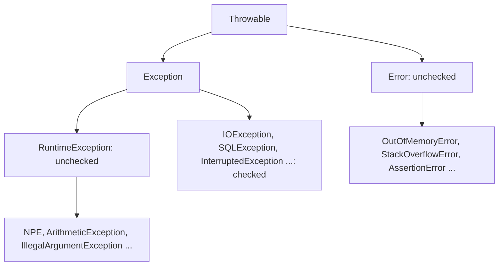
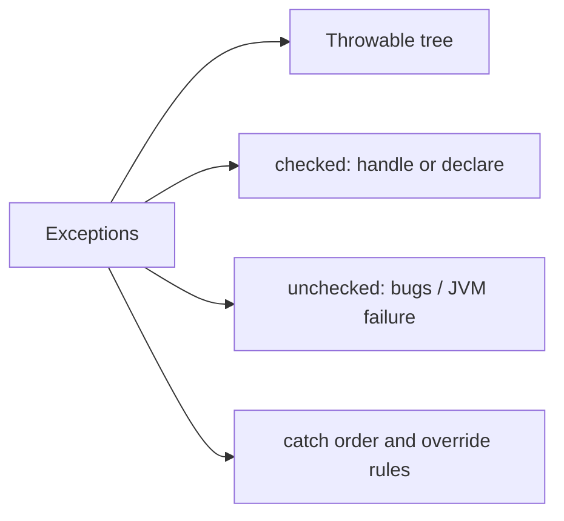

# Exception Hierarchy, Errors, Checked and Unchecked Exceptions in Java

**TL;DR:** Everything throwable extends `java.lang.Throwable`, which splits into **`Error`** (serious JVM/system problems you normally don't catch: `OutOfMemoryError`, `StackOverflowError`) and **`Exception`** (problems your program can handle). Under `Exception`, **`RuntimeException`** and its subclasses are **unchecked** (programming bugs: `NullPointerException`, `ArrayIndexOutOfBoundsException`, `IllegalArgumentException`). Every other `Exception` (e.g. `IOException`, `InterruptedException`, `SQLException`) is **checked**: the compiler forces you to catch it or declare it with `throws`. `Error` and its subclasses are also unchecked. `Throwable` itself and any direct subclass of it are checked.

## Table of Contents

1. [TL;DR](#1-tldr)
2. [Why it matters](#2-why-it-matters)
3. [Prerequisites](#3-prerequisites)
4. [Mental model](#4-mental-model)
5. [Core concepts](#5-core-concepts)
6. [How it works](#6-how-it-works)
7. [Examples](#7-examples)
8. [Comparisons](#8-comparisons)
9. [Trade-offs](#9-trade-offs)
10. [Gotchas](#10-gotchas)
11. [Practical application](#11-practical-application)
12. [Interview prep](#12-interview-prep)
13. [Interview question bank](#13-interview-question-bank)
14. [Tricky code snippets](#14-tricky-code-snippets)
15. [Connections](#15-connections)
16. [Summary](#16-summary)
17. [Answers](#answers)

> **Scope note.** This note is about the *types*. Propagation, `try/catch/finally`, `throws`/`throw`, multi-catch and user-defined exceptions each have their own note in this batch.

---

## 1. TL;DR

```
Object
 └── Throwable
      ├── Error                         (unchecked)
      │    ├── VirtualMachineError → OutOfMemoryError, StackOverflowError, InternalError
      │    ├── LinkageError → NoClassDefFoundError, ExceptionInInitializerError
      │    └── AssertionError
      └── Exception                     (checked, except RuntimeException branch)
           ├── RuntimeException         (unchecked)
           │    ├── NullPointerException, ClassCastException, ArithmeticException
           │    ├── IllegalArgumentException → NumberFormatException
           │    ├── IllegalStateException, UnsupportedOperationException
           │    ├── IndexOutOfBoundsException → ArrayIndexOutOfBounds, StringIndexOutOfBounds
           │    ├── ArrayStoreException, NegativeArraySizeException
           │    └── ConcurrentModificationException, NoSuchElementException
           ├── IOException → FileNotFoundException, ...
           ├── InterruptedException, SQLException, ...
           └── ReflectiveOperationException → ClassNotFoundException, ...
```
*Verified with `getSuperclass()` in Snippets 1 and 2.*

| | Checked | Unchecked |
|---|---|---|
| Types | `Exception` (not `RuntimeException`), and `Throwable` | `RuntimeException`, `Error` and subclasses |
| Compiler forces handling | Yes | No |
| Typical cause | Recoverable external conditions (I/O, DB) | Bugs (null, bad index) or JVM failure |
| Snippets | 3, 4, 5 | 6, 10 |

**The analogy: a hospital triage.**

| Real world | Java |
|---|---|
| Any medical event | `Throwable` |
| A building collapse: nothing a nurse can do | `Error` |
| A patient problem the staff can treat | `Exception` |
| A paperwork mistake by staff (a bug) | `RuntimeException`: unchecked |
| Hospital rule: "you must have a plan for known risks" | Checked: handle or declare |

**Running example:** walking `getSuperclass()` from `ArithmeticException`, `FileNotFoundException` and `OutOfMemoryError` (Snippet 1).

---

## 2. Why it matters

**The problem.** Java makes error handling part of the type system. Picking the wrong class (or the wrong catch) changes whether code compiles, who must handle the failure, and whether you accidentally swallow a fatal `Error`.

**What goes wrong** (verified on Java 21):

| Mistake | Result | Snippet |
|---|---|---|
| `throw new Exception()` with no handling | Compile error: unreported exception | 3 |
| `Thread.sleep(10)` unhandled | Compile error | 5 |
| `catch (Exception)` before `catch (ArithmeticException)` | Compile error: already caught | 17 |
| `catch (IOException)` where nothing throws it | Compile error | 18 |
| Overriding with a broader `throws` | Compile error | 20 |
| `catch (Exception)` expecting to stop an `Error` | The `Error` passes through | 16 |
| Removing from a list while iterating | `ConcurrentModificationException` | 11 |
| Static initialiser failing | `ExceptionInInitializerError`, then `NoClassDefFoundError` | 23 |

**Why interviewers ask.** "Hierarchy of exceptions", "checked vs unchecked", "Error vs Exception", "can you catch an Error?", "is `Throwable` checked?", "which exceptions are thrown by the JVM", plus override/`throws` rules.

---

## 3. Prerequisites

| Prerequisite | One-line refresher | Importance |
|---|---|---|
| Inheritance | Subclass is-a superclass; `instanceof` | Essential |
| Methods and the call stack | Methods call methods | Essential |
| Overriding rules | Signature, access, return type | Important |
| Packages | Where `java.lang` / `java.io` live | Helpful |
| Strings | `getMessage()` returns a String | Helpful |

---

## 4. Mental model

> **The one picture to keep in your head:** exceptions are objects arranged in a class tree. The compiler checks only one branch of the tree: everything below `Throwable` **except** the `RuntimeException` and `Error` subtrees. For those checked types, each method must either handle them or announce them with `throws`.


*Checked = Throwable minus (RuntimeException ∪ Error).*

```
 throw new X()  →  is X (or a superclass) catchable here?
     X unchecked?  → no declaration needed
     X checked?    → must be inside try/catch, or the method must declare `throws`
```
*The only compile-time rule is on checked exceptions.*

---

## 5. Core concepts

### 5.1 Glossary

- **Exception:** an object representing an abnormal event, thrown with `throw`.
- **`Throwable`:** root class; carries message, cause and stack trace.
- **`Error`:** serious problem, usually not recoverable.
- **Checked exception:** compiler-enforced "catch or declare".
- **Unchecked exception:** `RuntimeException` or `Error` (and subclasses).
- **Stack trace:** the call chain at the point the exception was created (Snippet 9).
- **Cause:** the underlying throwable (`getCause()`).
- **Catch-or-declare:** the rule for checked exceptions (JLS 11.2).

### 5.2 `Throwable`'s API

| Method | Returns |
|---|---|
| `getMessage()` | The message (may be `null`) |
| `toString()` | `ClassName: message` (or just `ClassName`) |
| `getCause()` | Wrapped throwable or `null` |
| `getStackTrace()` | `StackTraceElement[]` |
| `printStackTrace()` | Prints to `System.err` (or a given stream) |
| `addSuppressed` / `getSuppressed` | Suppressed exceptions (try-with-resources) |

Snippets 8, 9, 26. `new RuntimeException(cause)` sets the message to `cause.toString()` (Snippet 26).

### 5.3 Errors

Thrown by the JVM, not by your code. Common ones:

| Error | Meaning | Snippet |
|---|---|---|
| `StackOverflowError` | Call stack exhausted (runaway recursion) | 14 |
| `OutOfMemoryError` | Heap (or other memory) exhausted | 15 |
| `ExceptionInInitializerError` | A static initialiser threw | 23 |
| `NoClassDefFoundError` | Class couldn't be (re)loaded, e.g. after the above | 23 |
| `AssertionError` | Failed `assert` (when enabled) or thrown manually | 16, 27 |

You *can* catch them (Snippets 14, 15), but recovery is rarely meaningful. Catching `Exception` doesn't catch an `Error` (Snippet 16).

### 5.4 Common unchecked exceptions (thrown for bugs)

`NullPointerException`, `ArrayIndexOutOfBoundsException`, `StringIndexOutOfBoundsException`, `ClassCastException`, `ArithmeticException` (integer `/ 0`), `NumberFormatException` (an `IllegalArgumentException`), `NegativeArraySizeException`, `ArrayStoreException`, `UnsupportedOperationException` (e.g. `List.of(...).add`), `NoSuchElementException`, `IllegalStateException`, `ConcurrentModificationException` (Snippets 10, 11, 28). Integer `/ 0` and `% 0` throw; floating-point gives `Infinity`/`NaN` (Snippet 12).

Helpful `NullPointerException` messages (Java 14+) name what was null; local names appear as `<local1>` unless compiled with `-g` ⚠️ (Snippet 13).

### 5.5 Common checked exceptions

`IOException` (and `FileNotFoundException`), `InterruptedException`, `SQLException`, `ClassNotFoundException`, `CloneNotSupportedException`, `TimeoutException`. Using an API that declares them forces you to handle them (Snippets 4, 5).

### 5.6 How to tell checked from unchecked

Is it a subclass of `RuntimeException` or `Error`? Then unchecked; otherwise checked (Snippet 7). Note `Exception` and `Throwable` themselves are checked (Snippets 3, 32).

### 5.7 Catch rules the compiler enforces

- A more general catch before a more specific one is an error: "has already been caught" (Snippet 17).
- Catching a *checked* exception that the `try` body can't throw is an error (Snippet 18).
- `catch (Exception)` and `catch (Throwable)` are always allowed, since unchecked exceptions can occur anywhere (Snippet 19).
- `throw null` compiles and throws `NullPointerException` (Snippet 24).
- Code after `throw` is unreachable (Snippet 25).

### 5.8 Overriding and `throws`

An overriding method may:
- throw the same checked exceptions, narrower ones (subclasses), or none (Snippet 21);
- add any unchecked exceptions (Snippet 21);
- not throw *new or broader* checked exceptions (Snippet 20).

The caller is checked against the *declared* type: via an `A` reference, `f()` still "throws IOException" even if `C.f()` doesn't (Snippet 22).

---

## 6. How it works

### 6.1 What happens on `throw`

1. An exception object is created; its stack trace is filled in at construction.
2. The JVM looks for a matching `catch` in the current method, then unwinds to the caller, and so on (propagation note).
3. If none is found, the thread's uncaught-exception handler prints the stack trace; for `main` the program ends with exit code 1 (Snippet 33).

### 6.2 Worked trace: the running example

```java
static void chain(Class<?> c) {
    StringBuilder sb = new StringBuilder();
    for (Class<?> k = c; k != null; k = k.getSuperclass())
        sb.append(k.getSimpleName()).append(k.getSuperclass() == null ? "" : " -> ");
    System.out.println(sb);
}
// chain(ArithmeticException.class); chain(FileNotFoundException.class); chain(OutOfMemoryError.class);
```

Output (verified, Java 21):

```
ArithmeticException -> RuntimeException -> Exception -> Throwable -> Object
FileNotFoundException -> IOException -> Exception -> Throwable -> Object
OutOfMemoryError -> VirtualMachineError -> Error -> Throwable -> Object
```

| Class | Checked? |
|---|---|
| `ArithmeticException` | Unchecked (via `RuntimeException`) |
| `FileNotFoundException` | Checked (via `IOException` → `Exception`) |
| `OutOfMemoryError` | Unchecked (via `Error`) |

### 6.3 Why the compiler distinguishes

Checked exceptions model *anticipated, recoverable* failures at API boundaries; unchecked ones model *bugs* that you fix rather than handle. Languages after Java mostly dropped checked exceptions; Java keeps them, and lambdas/streams make them awkward ⚠️ (design opinion).

### 6.4 Exceptions in initialisers

If a static initialiser throws, the class gets an `ExceptionInInitializerError` the first time, and `NoClassDefFoundError` on every later use (Snippet 23).

### 6.5 Stack trace

`printStackTrace(System.out)` shows `ClassName: message` then `at Class.method(File.java:line)` lines, innermost first (Snippet 9). `getStackTrace()[0]` is where the exception was created (Snippet 8).

### 6.6 Assertions

`assert cond : msg;` is a no-op unless the JVM runs with `-ea`; failure throws `AssertionError` (an `Error`) (Snippet 27).

---

## 7. Examples

### 7.1 Toy example

```java
try {
    Integer.parseInt("abc");               // NumberFormatException (unchecked)
} catch (IllegalArgumentException e) {     // its superclass works
    System.out.println("bad number");
}
```
(Snippet 30.)

### 7.2 Real-world examples

- **Reading files:** `FileNotFoundException`/`IOException` (checked): handle or declare.
- **Input validation:** throw `IllegalArgumentException` for bad arguments, `IllegalStateException` for wrong object state.
- **Collections:** `List.of(...).add` → `UnsupportedOperationException`; iterator misuse → `ConcurrentModificationException`.
- **Threads:** `InterruptedException` (checked) from `sleep`/`wait`.
- **Out-of-memory handling:** monitoring/alerting, not recovery.

---

## 8. Comparisons

### 8.1 Checked vs unchecked

| | Checked | Unchecked |
|---|---|---|
| Compile-time check | Yes | No |
| Must declare/catch | Yes | No |
| Extends | `Exception` (not `RuntimeException`) | `RuntimeException` or `Error` |
| Use for | Recoverable, expected failures | Programming errors |
| Example | `IOException` | `NullPointerException` |

### 8.2 `Error` vs `Exception`

| | `Error` | `Exception` |
|---|---|---|
| Meaning | JVM/system failure | Application-level problem |
| Recoverable | Usually not | Often |
| Should you catch it? | Rarely | Yes, as appropriate |
| Compiler-checked | No | Checked branch only |

### 8.3 `Throwable` vs `Exception` in `catch`

`catch (Throwable)` also catches `Error`s (Snippet 16); `catch (Exception)` doesn't.

### 8.4 `IllegalArgumentException` vs `IllegalStateException`

| | `IllegalArgumentException` | `IllegalStateException` |
|---|---|---|
| Problem | The argument is wrong | The object isn't in the right state |
| Example | `Integer.parseInt("x")` → subclass | `Iterator.remove()` before `next()` |

### 8.5 `ClassNotFoundException` vs `NoClassDefFoundError`

| | `ClassNotFoundException` | `NoClassDefFoundError` |
|---|---|---|
| Kind | Checked exception | Error |
| When | Dynamic load by name fails (`Class.forName`) | A class present at compile time can't be loaded/initialised (Snippet 23) |

### 8.6 `StackOverflowError` vs `OutOfMemoryError`

Stack overflow: too-deep call chain (stack memory). OOM: heap (or metaspace, native memory) exhausted.

---

## 9. Trade-offs

| Decision | Benefit | Cost | Use when |
|---|---|---|---|
| Checked exception | Forces callers to consider failure | Boilerplate, leaky APIs | Recoverable, external failures |
| Unchecked exception | Concise | Easy to overlook | Bugs, precondition violations |
| Catch `Exception` broadly | Resilience | Swallows bugs | Top-level handlers only |
| Catch specific types | Precise handling | More code | Default |
| Catch `Throwable`/`Error` | Last-ditch logging | May mask JVM failure | Thread top level |
| Wrap in unchecked | Simplifies signatures | Loses compile-time hints | Inside lambdas/frameworks |

---

## 10. Gotchas

### Myths

- ❌ **Myth:** "All exceptions must be caught." ✅ **Reality:** only checked ones need handling (Snippet 6).
- ❌ **Myth:** "`Error` is a kind of `Exception`." ✅ **Reality:** both extend `Throwable` (Snippet 31).
- ❌ **Myth:** "`Throwable` is unchecked." ✅ **Reality:** it's checked (Snippet 32).
- ❌ **Myth:** "`catch (Exception e)` catches everything." ✅ **Reality:** not `Error`s (Snippet 16).
- ❌ **Myth:** "`1.0 / 0` throws." ✅ **Reality:** `Infinity` (Snippet 12).
- ❌ **Myth:** "A subclass overriding method can throw anything." ✅ **Reality:** no broader checked exceptions (Snippet 20).
- ❌ **Myth:** "Removing during for-each always throws CME." ✅ **Reality:** removing the second-to-last element doesn't (Snippet 11).
- ❌ **Myth:** "`NumberFormatException` is checked." ✅ **Reality:** it's an `IllegalArgumentException` (Snippet 30).
- ❌ **Myth:** "`assert` always runs." ✅ **Reality:** off unless `-ea` (Snippet 27).
- ❌ **Myth:** "After an `ExceptionInInitializerError` you can retry." ✅ **Reality:** later uses throw `NoClassDefFoundError` (Snippet 23).

### Common mistakes and edge cases

- **Catching a general type first** (Snippet 17).
- **Catching a checked exception nothing throws** (Snippet 18).
- **Forgetting `InterruptedException` handling** (Snippet 5).
- **Treating `getMessage()` as non-null** (Snippet 26).
- **Assuming a narrower override changes what callers must handle** (Snippet 22).
- **Using `throw null` accidentally** with an uninitialised variable (Snippet 24).
- **Relying on messages' exact text** across Java versions ⚠️ (Snippets 13, 28).

---

## 11. Practical application

### Checklist
- [ ] Throw the most specific standard exception that fits.
- [ ] Use unchecked exceptions for programming errors, checked for recoverable conditions.
- [ ] Don't catch `Error`s except at a thread's top level for logging.
- [ ] Never catch `Exception` and ignore it.
- [ ] Include context in messages; keep the cause when wrapping.
- [ ] Declare checked exceptions with the narrowest type.
- [ ] Catch specific exceptions before general ones.
- [ ] Don't rely on assertions for validation.

### Hands-on exercise

Classify each as checked or unchecked: `IOException`, `NullPointerException`, `StackOverflowError`, `InterruptedException`, `Throwable`.

<details><summary>Solution</summary>

Checked: `IOException`, `InterruptedException`, `Throwable`. Unchecked: `NullPointerException` (`RuntimeException`), `StackOverflowError` (`Error`).

Verified with the `instanceof RuntimeException || instanceof Error` helper in Snippet 7.
</details>

---

## 12. Interview prep

Eight model answers, as you would say them aloud.

<details><summary>1. Draw the exception hierarchy.</summary>

`Object → Throwable → {Error, Exception}`. `Exception` has `RuntimeException` (unchecked: NPE, ClassCast, IllegalArgument, IndexOutOfBounds...) plus checked ones like `IOException`, `SQLException`, `InterruptedException`. `Error` has `VirtualMachineError` (OOM, StackOverflow), `LinkageError`, `AssertionError` (section 1; Snippets 1, 2).
</details>

<details><summary>2. What is the difference between checked and unchecked exceptions?</summary>

The compiler forces you to catch or declare checked exceptions (`Exception` subclasses other than `RuntimeException`, plus `Throwable`). Unchecked ones (`RuntimeException`, `Error` and subclasses) need no declaration and usually signal bugs (8.1; Snippets 3, 6).
</details>

<details><summary>3. Error vs Exception?</summary>

Both extend `Throwable`. An `Error` is a serious JVM or system failure (OutOfMemoryError, StackOverflowError) that applications normally don't handle; an `Exception` is a condition the application can reasonably handle (8.2; Snippets 14-16).
</details>

<details><summary>4. Can you catch an `Error`?</summary>

Yes, via `catch (Error e)` or `catch (Throwable t)`, but `catch (Exception e)` won't catch it. Recovery is rarely meaningful, so catch only at a top level to log (Snippets 14, 15, 16).
</details>

<details><summary>5. Is `Throwable` checked?</summary>

Yes. Anything that is not a `RuntimeException`, an `Error` or a subclass of those is checked, including `Throwable` and direct subclasses (5.6; Snippets 7, 32).
</details>

<details><summary>6. Which rules apply when overriding a method that declares `throws`?</summary>

The override may throw the same or narrower checked exceptions, or none, and any unchecked ones; it may not add new or broader checked exceptions (5.8; Snippets 20, 21).
</details>

<details><summary>7. Name common unchecked exceptions and when the JVM throws them.</summary>

`NullPointerException` (null dereference), `ArrayIndexOutOfBoundsException`, `ClassCastException` (bad cast), `ArithmeticException` (integer divide by zero), `NumberFormatException` (bad parse), `NegativeArraySizeException`, `ArrayStoreException` (5.4; Snippet 10).
</details>

<details><summary>8. What does the compiler check about `catch` clauses?</summary>

General-before-specific ordering is an error; catching a checked exception the body can't throw is an error; `catch (Exception)`/`catch (Throwable)` is always allowed (5.7; Snippets 17, 18, 19).
</details>

---

## 13. Interview question bank


### 13.1 Basics and hierarchy (Q1–Q14)

<details><summary>Q1. Root of all exceptions?</summary>

`java.lang.Throwable` (Snippet 1).
</details>

<details><summary>Q2. Two main subclasses of `Throwable`?</summary>

`Error` and `Exception` (Snippet 31).
</details>

<details><summary>Q3. Superclass of `RuntimeException`?</summary>

`Exception` (Snippet 1).
</details>

<details><summary>Q4. Superclass of `FileNotFoundException`?</summary>

`IOException` (Snippet 1).
</details>

<details><summary>Q5. Superclass of `NumberFormatException`?</summary>

`IllegalArgumentException` (Snippet 2).
</details>

<details><summary>Q6. Superclass of `ArrayIndexOutOfBoundsException`?</summary>

`IndexOutOfBoundsException` (Snippet 2).
</details>

<details><summary>Q7. Superclass of `StackOverflowError`?</summary>

`VirtualMachineError` (Snippet 2).
</details>

<details><summary>Q8. Superclass of `AssertionError`?</summary>

`Error` (Snippet 2).
</details>

<details><summary>Q9. Superclass of `ClassNotFoundException`?</summary>

`ReflectiveOperationException` (Snippet 2).
</details>

<details><summary>Q10. Superclass of `NoClassDefFoundError`?</summary>

`LinkageError` (Snippet 2).
</details>

<details><summary>Q11. Is `Exception` checked?</summary>

Yes (Snippet 3).
</details>

<details><summary>Q12. Is `Throwable` checked?</summary>

Yes (Snippet 32).
</details>

<details><summary>Q13. Is `Error` checked?</summary>

No.
</details>

<details><summary>Q14. Is `Throwable` an `Exception`?</summary>

No (Snippet 31).
</details>


### 13.2 Checked vs unchecked (Q15–Q28)

<details><summary>Q15. Define checked exception.</summary>

Subclass of `Throwable` not under `RuntimeException` or `Error`; must be caught or declared.
</details>

<details><summary>Q16. Define unchecked exception.</summary>

`RuntimeException`, `Error` and subclasses.
</details>

<details><summary>Q17. Is `InterruptedException` checked?</summary>

Yes (Snippet 5).
</details>

<details><summary>Q18. Is `IOException` checked?</summary>

Yes (Snippet 4).
</details>

<details><summary>Q19. Is `NullPointerException` checked?</summary>

No.
</details>

<details><summary>Q20. Do you have to declare `throws` for `IllegalStateException`?</summary>

No (Snippet 6).
</details>

<details><summary>Q21. Do you have to declare `throws Error`?</summary>

No (Snippet 6).
</details>

<details><summary>Q22. Compile result of `throw new Exception()` in `main` with no handling?</summary>

Error: unreported exception (Snippet 3).
</details>

<details><summary>Q23. Can you declare unchecked exceptions in `throws`?</summary>

Yes, optionally (Snippet 21).
</details>

<details><summary>Q24. How do you test whether a throwable is checked?</summary>

Not an instance of `RuntimeException` or `Error` (Snippet 7).
</details>

<details><summary>Q25. Why have checked exceptions at all?</summary>

To force callers to handle anticipated failures.
</details>

<details><summary>Q26. What is the main criticism?</summary>

Boilerplate and leaky signatures ⚠️.
</details>

<details><summary>Q27. Which should user code throw for invalid arguments?</summary>

`IllegalArgumentException`.
</details>

<details><summary>Q28. For invalid object state?</summary>

`IllegalStateException`.
</details>


### 13.3 Errors and the JVM (Q29–Q38)

<details><summary>Q29. Cause of `StackOverflowError`?</summary>

Runaway recursion (Snippet 14).
</details>

<details><summary>Q30. Cause of `OutOfMemoryError`?</summary>

Heap or other memory exhausted (Snippet 15).
</details>

<details><summary>Q31. Can you catch `StackOverflowError`?</summary>

Yes, but it's rarely useful (Snippet 14).
</details>

<details><summary>Q32. Does `catch (Exception e)` catch an `AssertionError`?</summary>

No (Snippet 16).
</details>

<details><summary>Q33. What happens when a static initialiser throws?</summary>

`ExceptionInInitializerError` (Snippet 23).
</details>

<details><summary>Q34. Subsequent use of that class?</summary>

`NoClassDefFoundError` (Snippet 23).
</details>

<details><summary>Q35. Are assertions enabled by default?</summary>

No; use `-ea` (Snippet 27).
</details>

<details><summary>Q36. What is thrown by a failed `assert`?</summary>

`AssertionError`.
</details>

<details><summary>Q37. `ClassNotFoundException` vs `NoClassDefFoundError`?</summary>

Checked exception on dynamic load vs an `Error` (8.5).
</details>

<details><summary>Q38. Should you catch `Throwable`?</summary>

Only at a top level for logging.
</details>


### 13.4 Overriding and catch rules (Q39–Q52)

<details><summary>Q39. Can an override throw a broader checked exception?</summary>

No (Snippet 20).
</details>

<details><summary>Q40. Narrower?</summary>

Yes (Snippet 21).
</details>

<details><summary>Q41. None?</summary>

Yes (Snippet 21).
</details>

<details><summary>Q42. Add an unchecked exception?</summary>

Yes (Snippet 21).
</details>

<details><summary>Q43. What does the caller see via the parent type?</summary>

The parent's declared `throws` (Snippet 22).
</details>

<details><summary>Q44. `catch (Exception)` before `catch (ArithmeticException)`?</summary>

Compile error (Snippet 17).
</details>

<details><summary>Q45. `catch (IOException)` with a body that can't throw it?</summary>

Compile error (Snippet 18).
</details>

<details><summary>Q46. Same with `catch (Exception)`?</summary>

Allowed (Snippet 19).
</details>

<details><summary>Q47. Same with `catch (Throwable)`?</summary>

Allowed (Snippet 19).
</details>

<details><summary>Q48. Statement after `throw`?</summary>

Unreachable statement error (Snippet 25).
</details>

<details><summary>Q49. `throw null`?</summary>

Throws NPE (Snippet 24).
</details>

<details><summary>Q50. Can you throw a `Throwable` subclass that is not an `Exception`?</summary>

Yes, but it's checked (Snippet 32).
</details>

<details><summary>Q51. Can `main` declare `throws Exception`?</summary>

Yes; an uncaught exception ends the program (Snippet 33).
</details>

<details><summary>Q52. Which catch matches a custom `RuntimeException` subclass first?</summary>

The first compatible catch in source order (Snippet 29).
</details>


### 13.5 Common exceptions and Throwable API (Q53–Q64)

<details><summary>Q53. Integer `1 / 0`?</summary>

`ArithmeticException: / by zero` (Snippet 12).
</details>

<details><summary>Q54. `1.0 / 0`?</summary>

`Infinity` (Snippet 12).
</details>

<details><summary>Q55. `5 % 0`?</summary>

`ArithmeticException` (Snippet 12).
</details>

<details><summary>Q56. `List.of(1).add(2)`?</summary>

`UnsupportedOperationException` (Snippet 10).
</details>

<details><summary>Q57. Removing from a list inside for-each?</summary>

`ConcurrentModificationException`, except in a special case (Snippet 11).
</details>

<details><summary>Q58. `Object[] o = new String[1]; o[0] = 1;`?</summary>

`ArrayStoreException` (Snippet 10).
</details>

<details><summary>Q59. `new int[-1]`?</summary>

`NegativeArraySizeException` (Snippet 10).
</details>

<details><summary>Q60. `getMessage()` of `new RuntimeException()`?</summary>

`null` (Snippet 26).
</details>

<details><summary>Q61. `getMessage()` of `new RuntimeException(cause)`?</summary>

`cause.toString()` (Snippet 26).
</details>

<details><summary>Q62. What's in `toString()`?</summary>

`ClassName: message` (Snippet 8).
</details>

<details><summary>Q63. How do you see the call chain?</summary>

`printStackTrace()` or `getStackTrace()` (Snippet 9).
</details>

<details><summary>Q64. What is a helpful NPE message?</summary>

Java 14+ message saying what was null ⚠️ (Snippet 13).
</details>

---

## 14. Tricky code snippets

33 snippets, each compiled and run on OpenJDK 21. Predict the output (or the compile error) before opening the answer. Stack-trace line numbers and exception messages are the ones printed by Java 21 and can differ between versions ⚠️. Snippet 33 ends with an uncaught exception, so its last line goes to standard error and the process exits with code 1.

### Snippet 1: Walking the class hierarchy

```java
public class Main {
    static void chain(Class<?> c) {
        StringBuilder sb = new StringBuilder();
        for (Class<?> k = c; k != null; k = k.getSuperclass()) sb.append(k.getSimpleName()).append(k.getSuperclass() == null ? "" : " -> ");
        System.out.println(sb);
    }
    public static void main(String[] args) {
        chain(ArithmeticException.class);
        chain(java.io.FileNotFoundException.class);
        chain(OutOfMemoryError.class);
    }
}
```

<details><summary>Answer</summary>

```
ArithmeticException -> RuntimeException -> Exception -> Throwable -> Object
FileNotFoundException -> IOException -> Exception -> Throwable -> Object
OutOfMemoryError -> VirtualMachineError -> Error -> Throwable -> Object
```

Trace in 6.2.
</details>

### Snippet 2: Direct superclasses

```java
public class Main {
    public static void main(String[] args) {
        System.out.println(NumberFormatException.class.getSuperclass().getSimpleName());
        System.out.println(ArrayIndexOutOfBoundsException.class.getSuperclass().getSimpleName());
        System.out.println(StringIndexOutOfBoundsException.class.getSuperclass().getSimpleName());
        System.out.println(java.io.IOException.class.getSuperclass().getSimpleName());
        System.out.println(InterruptedException.class.getSuperclass().getSimpleName());
        System.out.println(StackOverflowError.class.getSuperclass().getSimpleName());
        System.out.println(AssertionError.class.getSuperclass().getSimpleName());
        System.out.println(ClassNotFoundException.class.getSuperclass().getSimpleName());
        System.out.println(NoClassDefFoundError.class.getSuperclass().getSimpleName());
    }
}
```

<details><summary>Answer</summary>

```
IllegalArgumentException
IndexOutOfBoundsException
IndexOutOfBoundsException
Exception
Exception
VirtualMachineError
Error
ReflectiveOperationException
LinkageError
```

In order: `NumberFormatException`, `ArrayIndexOutOfBoundsException`, `StringIndexOutOfBoundsException`, `IOException`, `InterruptedException`, `StackOverflowError`, `AssertionError`, `ClassNotFoundException`, `NoClassDefFoundError`.
</details>

### Snippet 3: Throwing `Exception`

```java
public class Main {
    public static void main(String[] args) {
        throw new Exception("checked");
    }
}
```

<details><summary>Answer</summary>

Compile error: *unreported exception Exception; must be caught or declared to be thrown*.

`Exception` is checked.
</details>

### Snippet 4: A method that declares `FileNotFoundException`

```java
import java.io.FileReader;
public class Main {
    public static void main(String[] args) {
        FileReader r = new FileReader("x.txt");
    }
}
```

<details><summary>Answer</summary>

Compile error: *unreported exception FileNotFoundException; must be caught or declared to be thrown*.

`new FileReader(String)` declares it, so callers must handle it.
</details>

### Snippet 5: `Thread.sleep`

```java
public class Main {
    public static void main(String[] args) {
        Thread.sleep(10);
    }
}
```

<details><summary>Answer</summary>

Compile error: *unreported exception InterruptedException; must be caught or declared to be thrown*.

`InterruptedException` is checked.
</details>

### Snippet 6: Unchecked needs no `throws`

```java
public class Main {
    static void f() { throw new IllegalStateException("fine"); }
    static void g() { throw new Error("also fine"); }
    public static void main(String[] args) {
        try { f(); } catch (RuntimeException e) { System.out.println(e.getMessage()); }
        try { g(); } catch (Error e) { System.out.println(e.getMessage()); }
    }
}
```

<details><summary>Answer</summary>

```
fine
also fine
```

`RuntimeException` and `Error` subclasses.
</details>

### Snippet 7: Classifying throwables

```java
import java.io.*;
public class Main {
    static String kind(Throwable t) {
        if (t instanceof RuntimeException || t instanceof Error) return "unchecked";
        return "checked";
    }
    public static void main(String[] args) {
        Throwable[] ts = { new Exception(), new IOException(), new FileNotFoundException(), new InterruptedException(),
            new RuntimeException(), new NullPointerException(), new Error(), new StackOverflowError(), new Throwable() };
        for (Throwable t : ts) System.out.println(t.getClass().getSimpleName() + ": " + kind(t));
    }
}
```

<details><summary>Answer</summary>

```
Exception: checked
IOException: checked
FileNotFoundException: checked
InterruptedException: checked
RuntimeException: unchecked
NullPointerException: unchecked
Error: unchecked
StackOverflowError: unchecked
Throwable: checked
```

Checked unless a `RuntimeException` or `Error`.
</details>

### Snippet 8: `Throwable` API

```java
public class Main {
    static void boom() { throw new IllegalArgumentException("bad arg"); }
    public static void main(String[] args) {
        try { boom(); } catch (Exception e) {
            System.out.println(e.getMessage());
            System.out.println(e);
            System.out.println(e.getCause());
            System.out.println(e.getStackTrace()[0].getMethodName() + " " + e.getStackTrace()[1].getMethodName());
        }
    }
}
```

<details><summary>Answer</summary>

```
bad arg
java.lang.IllegalArgumentException: bad arg
null
boom main
```

Message, `toString`, no cause, innermost frame first.
</details>

### Snippet 9: Stack trace

```java
public class Main {
    static void a() { b(); }
    static void b() { throw new RuntimeException("deep"); }
    public static void main(String[] args) {
        try { a(); } catch (RuntimeException e) { e.printStackTrace(System.out); }
    }
}
```

<details><summary>Answer</summary>

```
java.lang.RuntimeException: deep
at Main.b(Main.java:3)
at Main.a(Main.java:2)
at Main.main(Main.java:5)
```

Innermost call first. ⚠️ Line numbers depend on the file.
</details>

### Snippet 10: Which exception is thrown

```java
import java.util.*;
public class Main {
    static void run(Runnable r) {
        try { r.run(); } catch (Throwable t) { System.out.println(t.getClass().getSimpleName()); }
    }
    public static void main(String[] args) {
        run(() -> { String s = null; s.length(); });
        run(() -> { int[] a = new int[2]; a[2] = 1; });
        run(() -> { Object o = "s"; Integer i = (Integer) o; });
        run(() -> { int x = 1 / 0; });
        run(() -> Integer.parseInt("x"));
        run(() -> { int[] a = new int[-1]; });
        run(() -> { Object[] o = new String[1]; o[0] = 1; });
        run(() -> List.of(1).add(2));
        run(() -> new ArrayList<Integer>().iterator().next());
        run(() -> "abc".substring(5));
        run(() -> new ArrayList<>(List.of(1)).get(3));
        run(() -> Optional.empty().get());
        run(() -> { throw new IllegalStateException(); });
    }
}
```

<details><summary>Answer</summary>

```
NullPointerException
ArrayIndexOutOfBoundsException
ClassCastException
ArithmeticException
NumberFormatException
NegativeArraySizeException
ArrayStoreException
UnsupportedOperationException
NoSuchElementException
StringIndexOutOfBoundsException
IndexOutOfBoundsException
NoSuchElementException
IllegalStateException
```

One line per `run(...)`: `Optional.empty().get()` and an empty iterator's `next()` both give `NoSuchElementException`; `ArrayList.get(3)` gives plain `IndexOutOfBoundsException`.
</details>

### Snippet 11: Removing inside for-each

```java
import java.util.*;
public class Main {
    public static void main(String[] args) {
        List<Integer> list = new ArrayList<>(List.of(1, 2, 3));
        try { for (Integer i : list) if (i == 2) list.remove(i); System.out.println(list); }
        catch (ConcurrentModificationException e) { System.out.println("CME"); }
        List<Integer> l2 = new ArrayList<>(List.of(1, 2, 3));
        try { for (Integer i : l2) if (i == 1) l2.remove(i); System.out.println(l2); }
        catch (ConcurrentModificationException e) { System.out.println("CME"); }
    }
}
```

<details><summary>Answer</summary>

```
[1, 3]
CME
```

Removing the second-to-last element makes `hasNext()` false, so no check happens; removing the first element triggers `ConcurrentModificationException`.
</details>

### Snippet 12: Division by zero

```java
public class Main {
    public static void main(String[] args) {
        System.out.println(1.0 / 0);
        System.out.println(-1.0 / 0);
        System.out.println(0.0 / 0);
        try { System.out.println(5 % 0); } catch (ArithmeticException e) { System.out.println(e.getMessage()); }
        try { System.out.println(1 / 0); } catch (ArithmeticException e) { System.out.println(e.getMessage()); }
        System.out.println(5.5 % 0);
    }
}
```

<details><summary>Answer</summary>

```
Infinity
-Infinity
NaN
/ by zero
/ by zero
NaN
```

Integer `/` and `%` throw; floating point doesn't (`5.5 % 0` is `NaN`).
</details>

### Snippet 13: Helpful NPE message

```java
public class Main {
    static class A { B b; }
    static class B { String s; }
    public static void main(String[] args) {
        A a = new A();
        try { a.b.s.length(); } catch (NullPointerException e) { System.out.println(e.getMessage()); }
    }
}
```

<details><summary>Answer</summary>

```
Cannot read field "s" because "<local1>.b" is null
```

⚠️ Java 14+. The local is shown as `<local1>` because the snippet wasn't compiled with `-g`.
</details>

### Snippet 14: Catching `StackOverflowError`

```java
public class Main {
    static int depth = 0;
    static void recurse() { depth++; recurse(); }
    public static void main(String[] args) {
        try { recurse(); } catch (StackOverflowError e) { System.out.println("SOE caught " + (depth > 1000)); }
    }
}
```

<details><summary>Answer</summary>

```
SOE caught true
```

Possible, but rarely useful.
</details>

### Snippet 15: `OutOfMemoryError` from a huge array

```java
public class Main {
    public static void main(String[] args) {
        try { long[] big = new long[Integer.MAX_VALUE]; }
        catch (OutOfMemoryError e) { System.out.println(e.getClass().getSimpleName()); }
    }
}
```

<details><summary>Answer</summary>

```
OutOfMemoryError
```

The requested size exceeds what the JVM allows. ⚠️ Message text varies.
</details>

### Snippet 16: `Exception` vs `Error`

```java
public class Main {
    public static void main(String[] args) {
        try { throw new AssertionError("oops"); }
        catch (Exception e) { System.out.println("exception"); }
        catch (Error e) { System.out.println("error " + e.getMessage()); }
    }
}
```

<details><summary>Answer</summary>

```
error oops
```

`AssertionError` isn't an `Exception`.
</details>

### Snippet 17: General before specific

```java
public class Main {
    public static void main(String[] args) {
        try { int x = 1 / 0; }
        catch (Exception e) { System.out.println("E"); }
        catch (ArithmeticException e) { System.out.println("A"); }
    }
}
```

<details><summary>Answer</summary>

Compile error: *exception ArithmeticException has already been caught*.

`catch (Exception)` already covers it.
</details>

### Snippet 18: Catching an impossible checked exception

```java
import java.io.IOException;
public class Main {
    public static void main(String[] args) {
        try { System.out.println("hi"); }
        catch (IOException e) { }
    }
}
```

<details><summary>Answer</summary>

Compile error: *exception IOException is never thrown in body of corresponding try statement*.

The `try` body can't throw `IOException`.
</details>

### Snippet 19: `Exception` and `Throwable` are exempt

```java
public class Main {
    public static void main(String[] args) {
        try { System.out.println("hi"); }
        catch (Exception e) { System.out.println("never"); }
        try { System.out.println("hi2"); }
        catch (Throwable t) { System.out.println("never"); }
    }
}
```

<details><summary>Answer</summary>

```
hi
hi2
```

Unchecked exceptions could always occur, so these catches compile.
</details>

### Snippet 20: Broader `throws` in an override

```java
import java.io.IOException;
public class Main {
    static class A { void f() throws IOException { } }
    static class B extends A { @Override void f() throws Exception { } }
    public static void main(String[] args) { }
}
```

<details><summary>Answer</summary>

Compile error: *f() in B cannot override f() in A*.

The detail: overridden method does not throw `Exception`.
</details>

### Snippet 21: Valid overrides

```java
import java.io.*;
public class Main {
    static class A { void f() throws IOException { } }
    static class B extends A { @Override void f() throws FileNotFoundException { System.out.println("narrower"); } }
    static class C extends A { @Override void f() { System.out.println("none"); } }
    static class D extends A { @Override void f() throws IllegalStateException { System.out.println("unchecked"); } }
    public static void main(String[] args) throws Exception {
        new B().f(); new C().f(); new D().f();
        A a = new C();
        a.f();
    }
}
```

<details><summary>Answer</summary>

```
narrower
none
unchecked
none
```

Narrower, none, or unchecked are fine.
</details>

### Snippet 22: Static type decides

```java
import java.io.*;
public class Main {
    static class A { void f() throws IOException { } }
    static class C extends A { @Override void f() { } }
    public static void main(String[] args) {
        C c = new C();
        c.f();
        A a = c;
        a.f();
    }
}
```

<details><summary>Answer</summary>

Compile error: *unreported exception IOException; must be caught or declared to be thrown*.

`c.f()` is fine (C's `f` throws nothing); `a.f()` uses `A`'s declaration.
</details>

### Snippet 23: Failing static initialiser

```java
public class Main {
    static class Bad {
        static int v = 1 / 0;
        static void hi() { System.out.println("hi"); }
    }
    public static void main(String[] args) {
        try { Bad.hi(); } catch (Throwable t) { System.out.println(t.getClass().getSimpleName() + " cause " + t.getCause().getClass().getSimpleName()); }
        try { Bad.hi(); } catch (Throwable t) { System.out.println(t.getClass().getSimpleName()); }
    }
}
```

<details><summary>Answer</summary>

```
ExceptionInInitializerError cause ArithmeticException
NoClassDefFoundError
```

The class can't be initialised again.
</details>

### Snippet 24: `throw null`

```java
public class Main {
    public static void main(String[] args) {
        try { throw null; } catch (NullPointerException e) { System.out.println("NPE from throw null"); }
        RuntimeException r = null;
        try { throw r; } catch (NullPointerException e) { System.out.println("NPE again"); }
    }
}
```

<details><summary>Answer</summary>

```
NPE from throw null
NPE again
```

Throwing a `null` reference throws `NullPointerException`.
</details>

### Snippet 25: Code after `throw`

```java
public class Main {
    public static void main(String[] args) {
        throw new RuntimeException("x");
        System.out.println("never");
    }
}
```

<details><summary>Answer</summary>

Compile error: *unreachable statement*.

`throw` always completes abruptly.
</details>

### Snippet 26: Message and cause

```java
public class Main {
    public static void main(String[] args) {
        System.out.println(new RuntimeException().getMessage());
        System.out.println(new RuntimeException());
        RuntimeException w = new RuntimeException(new IllegalStateException("inner"));
        System.out.println(w.getMessage());
        System.out.println(w.getCause().getMessage());
        System.out.println(new RuntimeException("outer", new Error("e")).getCause());
    }
}
```

<details><summary>Answer</summary>

```
null
java.lang.RuntimeException
java.lang.IllegalStateException: inner
inner
java.lang.Error: e
```

With only a cause, the message is `cause.toString()`.
</details>

### Snippet 27: `assert`

```java
public class Main {
    public static void main(String[] args) {
        assert 1 > 2 : "never evaluated";
        System.out.println("assertions are off by default");
    }
}
```

<details><summary>Answer</summary>

```
assertions are off by default
```

Needs `java -ea`.
</details>

### Snippet 28: Messages for common bugs

```java
public class Main {
    public static void main(String[] args) {
        try { Object o = "s"; Integer i = (Integer) o; } catch (ClassCastException e) { System.out.println(e.getMessage()); }
        try { int[] a = new int[-3]; } catch (NegativeArraySizeException e) { System.out.println(e.getMessage()); }
        try { Object[] o = new String[1]; o[0] = 1; } catch (ArrayStoreException e) { System.out.println(e.getMessage()); }
        try { new int[2][1][0].toString(); int[] z = new int[2]; z[2] = 0; } catch (ArrayIndexOutOfBoundsException e) { System.out.println(e.getMessage()); }
    }
}
```

<details><summary>Answer</summary>

```
class java.lang.String cannot be cast to class java.lang.Integer (java.lang.String and java.lang.Integer are in module java.base of loader 'bootstrap')
-3
java.lang.Integer
Index 2 out of bounds for length 2
```

⚠️ Java 21 texts; `ArrayStoreException` shows the stored type.
</details>

### Snippet 29: First matching catch

```java
public class Main {
    static class AppEx extends RuntimeException { AppEx(String m) { super(m); } }
    public static void main(String[] args) {
        try { throw new AppEx("custom"); }
        catch (IllegalArgumentException e) { System.out.println("IAE"); }
        catch (RuntimeException e) { System.out.println("RTE " + e.getMessage()); }
    }
}
```

<details><summary>Answer</summary>

```
RTE custom
```

`AppEx` is not an `IllegalArgumentException`, so the second clause matches.
</details>

### Snippet 30: Catch a superclass

```java
public class Main {
    public static void main(String[] args) {
        try { Integer.parseInt("abc"); }
        catch (IllegalArgumentException e) { System.out.println("caught as IAE: " + e.getClass().getSimpleName()); }
        System.out.println(new NumberFormatException() instanceof RuntimeException);
    }
}
```

<details><summary>Answer</summary>

```
caught as IAE: NumberFormatException
true
```

`NumberFormatException` extends `IllegalArgumentException`.
</details>

### Snippet 31: `instanceof` across the tree

```java
public class Main {
    public static void main(String[] args) {
        Throwable t = new StackOverflowError();
        System.out.println(t instanceof Error);
        System.out.println(t instanceof Exception);
        System.out.println(t instanceof VirtualMachineError);
        System.out.println(new Exception() instanceof Throwable);
        System.out.println(new Throwable() instanceof Exception);
    }
}
```

<details><summary>Answer</summary>

```
true
false
true
true
false
```

`StackOverflowError` is an `Error` and a `VirtualMachineError`, not an `Exception`; a plain `Throwable` isn't an `Exception`.
</details>

### Snippet 32: Subclassing `Throwable` directly

```java
public class Main {
    static class Strange extends Throwable { }
    static void f() { throw new Strange(); }
    public static void main(String[] args) { }
}
```

<details><summary>Answer</summary>

Compile error: *unreported exception Strange; must be caught or declared to be thrown*.

A direct `Throwable` subclass is checked.
</details>

### Snippet 33: Uncaught exception from `main`

```java
public class Main {
    public static void main(String[] args) throws Exception {
        System.out.println("start");
        throw new Exception("from main");
    }
}
```

<details><summary>Answer</summary>

```
start
Exception in thread "main" java.lang.Exception: from main
```

The second line goes to standard error (followed by the stack trace) and the process exits with code 1.
</details>

---

## 15. Connections

| Related topic | How it connects |
|---|---|
| Exception propagation | How a thrown exception travels up the call stack |
| try-catch-finally, throws, throw | The syntax that handles or declares these types |
| User-defined exceptions | Extending `Exception` or `RuntimeException` |
| Inheritance and overriding | `throws` rules for overrides; catch ordering |
| JVM architecture | Where `StackOverflowError`, `OutOfMemoryError` arise |
| Garbage collection | `OutOfMemoryError` |
| Wrapper classes and strings | `NumberFormatException`, `StringIndexOutOfBoundsException` |
| Collections | `ConcurrentModificationException`, `UnsupportedOperationException` |
| Threads | `InterruptedException` |


*Know the tree, the checked rule, and the catch/override rules.*

---

## 16. Summary

### 60-second card

- `Throwable` → `Error` | `Exception`; `Exception` → `RuntimeException` (unchecked) | everything else (checked).
- Checked: must catch or declare. Unchecked: `RuntimeException`, `Error` (and subclasses).
- `Throwable` and its direct subclasses are checked.
- `catch (Exception)` doesn't catch `Error`; `catch (Throwable)` does.
- Catch specific before general; can't catch a checked exception nothing throws (except `Exception`/`Throwable`).
- Override may throw same/narrower/no checked exceptions, any unchecked.
- Integer `/ 0` throws; `1.0 / 0` is `Infinity`.
- Static init failure: `ExceptionInInitializerError`, then `NoClassDefFoundError`.

### Cheat sheet

```java
// checked:   IOException, SQLException, InterruptedException, ClassNotFoundException
// unchecked: NullPointerException, ArithmeticException, ClassCastException, IllegalArgumentException
// errors:    OutOfMemoryError, StackOverflowError, AssertionError, NoClassDefFoundError
boolean checked = !(t instanceof RuntimeException || t instanceof Error);
```

| Situation | Exception |
|---|---|
| Bad argument | `IllegalArgumentException` |
| Wrong object state | `IllegalStateException` |
| Unsupported operation | `UnsupportedOperationException` |
| Missing element | `NoSuchElementException` |
| I/O problem | `IOException` (checked) |

### Self-test

1. Draw the top of the hierarchy under `Throwable`.
2. What makes an exception checked?
3. Is `Throwable` checked?
4. Does `catch (Exception e)` catch `StackOverflowError`?
5. What can an overriding method declare in `throws`?
6. What happens when a static initialiser throws?
7. `1.0 / 0` vs `1 / 0`?
8. Why is `catch (IOException e)` with a body that doesn't throw it an error?

### Anki flashcards

```
Throwable subclasses :: Error and Exception
Checked exception :: Exception not under RuntimeException (also Throwable); catch or declare
Unchecked exception :: RuntimeException, Error and subclasses
Error examples :: OutOfMemoryError, StackOverflowError, AssertionError
catch (Exception) and Error :: Does not catch it
Override throws rule :: Same or narrower checked; any unchecked
Static initialiser throws :: ExceptionInInitializerError, then NoClassDefFoundError
Integer / 0 :: ArithmeticException; floating point gives Infinity
```

### Resources

- *The Java Language Specification*, Chapter 11 (Exceptions): docs.oracle.com/javase/specs
- The Java Tutorials, "Lesson: Exceptions": docs.oracle.com/javase/tutorial
- API docs: `java.lang.Throwable`, `java.lang.Error`, `java.lang.RuntimeException`
- *Effective Java*, Joshua Bloch: "Use exceptions only for exceptional conditions", "Use checked exceptions for recoverable conditions and runtime exceptions for programming errors"

---

## Answers

1. `Throwable` → `Error` and `Exception`; `Exception` → `RuntimeException` and the checked exceptions.
2. It's a `Throwable` that is not a `RuntimeException`, `Error` or subclass of them.
3. Yes.
4. No; `StackOverflowError` is an `Error`.
5. The same or narrower checked exceptions, none, and any unchecked ones.
6. `ExceptionInInitializerError` first, then `NoClassDefFoundError` on later use.
7. `Infinity` vs `ArithmeticException`.
8. The compiler knows the body can't throw that checked exception, so the catch is unreachable.
