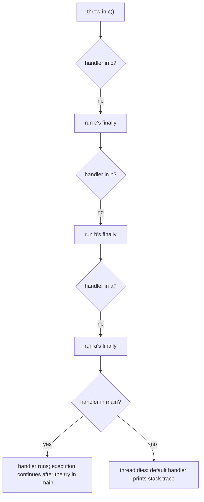
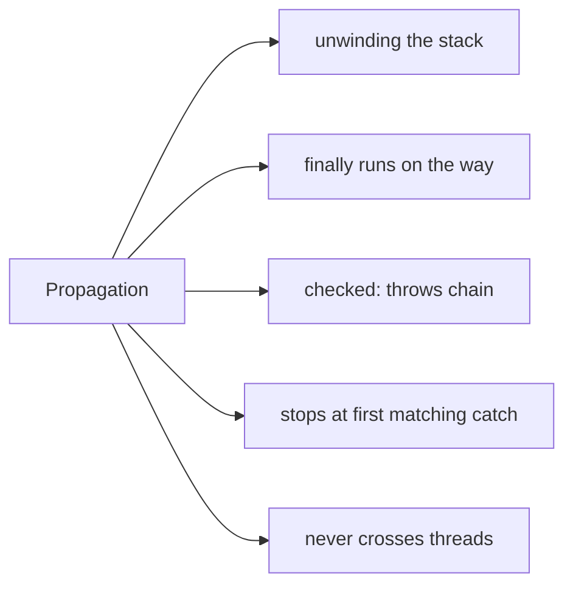

# Exception Propagation in Java

**TL;DR:** When a method throws an exception it doesn't handle, the JVM **unwinds the call stack**: the current method ends abruptly (running its `finally` blocks), and the exception is offered to the **caller**, then the caller's caller, and so on until a matching `catch` is found. If it reaches the bottom of the thread's stack, the thread dies, and the default handler prints the stack trace (for `main`, the process exits with code 1). **Unchecked** exceptions propagate automatically; **checked** exceptions propagate only through methods that **declare** them with `throws`. Exceptions **never cross threads**: a thread's exception stays in that thread (executors wrap it in `ExecutionException`).

## Table of Contents

1. [TL;DR](#1-tldr)
2. [Why it matters](#2-why-it-matters)
3. [Prerequisites](#3-prerequisites)
4. [Mental model](#4-mental-model)
5. [Core concepts](#5-core-concepts)
6. [How it works](#6-how-it-works)
7. [Examples](#7-examples)
8. [Comparisons](#8-comparisons)
9. [Trade-offs](#9-trade-offs)
10. [Gotchas](#10-gotchas)
11. [Practical application](#11-practical-application)
12. [Interview prep](#12-interview-prep)
13. [Interview question bank](#13-interview-question-bank)
14. [Tricky code snippets](#14-tricky-code-snippets)
15. [Connections](#15-connections)
16. [Summary](#16-summary)
17. [Answers](#answers)

> **Scope note.** The exception types are in the previous note; `try/catch/finally`, `throws`/`throw` syntax and multi-catch are in the next. This note follows an exception *through the call stack*.

---

## 1. TL;DR

| Situation | What happens | Snippet |
|---|---|---|
| Unchecked exception, no handler in the method | Propagates to the caller automatically | 2 |
| Checked exception, method neither catches nor declares | Compile error | 3 |
| Checked exception, `throws` declared up the chain | Propagates | 4 |
| No handler anywhere | Thread terminates; stack trace on stderr; exit code 1 for `main` | 5 |
| Handler in a middle method | Propagation stops there; callers continue normally | 6 |
| `finally` blocks on the way | Run in order, innermost first | 7 |
| Wrong catch type | Skipped; propagation continues | 8 |
| Exception in another thread | Never reaches the starter thread | 19, 20 |

**The analogy: a hot potato passed back up a chain of people.**

| Real world | Java |
|---|---|
| Someone drops a hot potato (a problem) | `throw` |
| Each person either handles it or passes it back up the chain | Each method either `catch`es or lets it propagate |
| Each person must tidy their desk before leaving | `finally` blocks |
| The boss at the top has no handler | The JVM prints the stack trace and exits |
| "Report formally to your manager" rules for serious problems | `throws` for checked exceptions |

**Running example:** `main → a → b → c`, where `c` throws `IllegalStateException` and only `main` catches it (Snippet 1, 6.2).

---

## 2. Why it matters

**The problem.** Exceptions travel through code you don't control. Knowing *where* they stop, *what runs on the way*, and *what gets lost* (swallowed, replaced or hidden) decides whether failures are diagnosable.

**What goes wrong** (verified on Java 21):

| Mistake | Result | Snippet |
|---|---|---|
| Not declaring a checked exception in an intermediate method | Compile error | 3 |
| `return` inside `finally` | Exception silently swallowed | 13 |
| `throw` inside `finally` | Replaces the original exception | 12 |
| `throw new X(msg)` without the cause | Original stack trace lost | 11 |
| Expecting `main` to see a thread's exception | It doesn't | 19 |
| Throwing a checked exception from a lambda | Compile error | 18 |
| Catching `InterruptedException` and doing nothing | Interrupt flag lost | 26 |
| Exception in a constructor | No object is created | 15 |

**Why interviewers ask.** "What is exception propagation?", "what happens if an exception isn't caught?", "do checked and unchecked propagate differently?", "does `finally` run when an exception propagates?", "what happens if both `try` and `finally` throw?"

---

## 3. Prerequisites

| Prerequisite | One-line refresher | Importance |
|---|---|---|
| Exception hierarchy | Checked vs unchecked | Essential |
| The call stack | Each call pushes a frame | Essential |
| `try`/`catch`/`finally` basics | Syntax | Essential |
| `throws` | Declares checked exceptions | Important |
| Threads (basic) | Each has its own stack | Helpful |
| Lambdas | Functional interfaces rarely declare `throws` | Helpful |

---

## 4. Mental model

> **The one picture to keep in your head:** the call stack is a pile of frames. `throw` makes the top frame end abruptly; the JVM looks in that frame for a `catch` that matches the exception's type. If there is none, it discards the frame (after running its `finally` code) and repeats the search in the frame below. The first matching `catch` wins; if the stack empties, the thread dies.

```
 stack grows downward →   main()  ──▶ a() ──▶ b() ──▶ c()  throw!
                                                          │ no catch in c  (finally runs)
                                                   b ◀────┘ no catch       (finally runs)
                                             a ◀──────┘ no catch           (finally runs)
                         main ◀───────┘ catch (IllegalStateException)  ✔ handled here
```
*Unwinding goes back through the callers; the search stops at the first matching handler.*


*"No" at every level leaves the thread's top frame and terminates it.*

---

## 5. Core concepts

### 5.1 Glossary

- **Propagation:** an unhandled exception moving from callee to caller.
- **Stack unwinding:** discarding frames, running `finally` blocks, while searching for a handler.
- **Handler:** a matching `catch` clause.
- **Uncaught exception:** one that reaches the top of a thread's stack.
- **Default uncaught-exception handler:** prints the stack trace; replaceable (Snippet 21).
- **Rethrow:** catching and throwing again (same or new exception).
- **Exception chaining:** wrapping with a `cause` (Snippet 11).
- **Suppressed exception:** one recorded on the primary exception (Snippet 22).

### 5.2 Unchecked vs checked propagation

- **Unchecked** (`RuntimeException`, `Error`): propagate through any method with no declaration (Snippet 2). Declaring one in `throws` is optional and changes nothing (Snippet 28).
- **Checked:** every method on the path must catch it or declare it (Snippets 3, 4). The compiler checks each call site against the callee's declared `throws`.

### 5.3 Where propagation stops

At the **first** `catch` whose parameter type is the exception's class or a superclass (Snippet 8 shows a non-matching handler being skipped, Snippet 14 shows an exception thrown inside a handler leaving that `try`). Code after the `try` in the handling method then runs normally; the callee's remaining code does *not* (Snippet 1 prints no "b: after c", "a: after b").

### 5.4 `finally` during propagation

Each frame's `finally` runs as the exception leaves it, innermost to outermost (Snippets 7, 23). Nested `try` blocks inside one method behave the same (Snippet 24).

### 5.5 Uncaught exceptions

- The thread terminates; its stack trace is printed to `System.err` by the default handler (Snippet 5).
- If it's the `main` thread, the JVM exits with code 1 once other non-daemon threads finish ⚠️.
- You can install a handler per thread or globally (Snippets 19, 21).

### 5.6 Rethrowing

- `catch (X e) { throw e; }` keeps the original stack trace (Snippet 9).
- `e.fillInStackTrace()` resets it to the rethrow location (Snippet 10).
- Wrapping: `throw new Y("msg", e)` keeps the original as `getCause()`, and the new exception's trace begins where it was created (Snippet 11).
- Java 7 *precise rethrow*: `catch (Exception e) { throw e; }` may rethrow only the checked types the `try` body can throw, so `throws IOException` suffices (Snippet 29).

### 5.7 Exceptions that get lost

- **`throw` in `finally`** replaces the in-flight exception (Snippet 12).
- **`return` in `finally`** discards it (Snippet 13); only `javac -Xlint:finally` warns about it.
- **An exception thrown inside a `catch`** replaces the caught one, but `finally` still runs (Snippet 14).
- **try-with-resources** keeps the body's exception as primary and adds `close()` exceptions as *suppressed* (Snippet 22).

### 5.8 Constructors and initialisers

An exception in a constructor or instance initialiser propagates out of `new`, and no object reference is produced (Snippets 15, 16). A static initialiser failure becomes `ExceptionInInitializerError` (previous note).

### 5.9 Lambdas and streams

Unchecked exceptions propagate out of `forEach`/`map`, stopping the pipeline (Snippets 17, 25). A checked exception can't be thrown from a standard functional interface body unless it's caught or the interface declares it (Snippet 18).

### 5.10 Threads

A thread's uncaught exception ends *that* thread only (Snippet 19). `ExecutorService.submit` captures it in the `Future`; `get()` throws `ExecutionException` with the original as cause (Snippet 20). `InterruptedException` clears the interrupt flag; restore it with `Thread.currentThread().interrupt()` if you don't propagate (Snippet 26).

### 5.11 Overriding

Propagation follows the actual runtime method: an override that throws an unchecked exception surfaces through a parent-typed call (Snippet 27).

---

## 6. How it works

### 6.1 The search algorithm

For each frame from the top: look through that method's exception table for a `try` range covering the current instruction with a catch type that is a superclass of the thrown type. First match → jump to the handler. No match → pop the frame (running `finally` code, which the compiler inlined or duplicated into the exception table) and continue.

### 6.2 Worked trace: the running example

```java
static void c() { System.out.println("c: throwing"); throw new IllegalStateException("boom"); }
static void b() { System.out.println("b: calling c"); c(); System.out.println("b: after c"); }
static void a() { System.out.println("a: calling b"); b(); System.out.println("a: after b"); }
public static void main(String[] args) {
    try { a(); }
    catch (IllegalStateException e) { System.out.println("main caught " + e.getMessage()); }
    System.out.println("main continues");
}
```

Output (verified, Java 21):

```
a: calling b
b: calling c
c: throwing
main caught boom
main continues
```

| Frame | What ran | What was skipped |
|---|---|---|
| `c` | prints, throws | nothing after `throw` |
| `b` | prints "calling c" | `b: after c` |
| `a` | prints "calling b" | `a: after b` |
| `main` | handler, then continues | n/a |

### 6.3 Stack trace contents

The trace is captured when the exception is *created*, not thrown or caught. Frames list innermost first; `getStackTrace()[0]` is the creation point (Snippet 9). A rethrow doesn't change it unless you call `fillInStackTrace()` (Snippet 10).

### 6.4 Cost

Creating an exception fills the stack trace, which is relatively expensive; don't use exceptions for ordinary control flow ⚠️.

### 6.5 Recursion

Each recursive frame's `finally` runs as the exception unwinds: depth 3 prints `unwind 0, 1, 2, 3` (Snippet 23).

---

## 7. Examples

### 7.1 Toy example

```java
static int f() { try { return g(); } finally { System.out.println("f finally"); } }
static int g() { throw new RuntimeException("g failed"); }
// main: try { f(); } catch (RuntimeException e) { System.out.println("caught " + e.getMessage()); }
```
Prints `f finally` then `caught g failed`: `f`'s `finally` runs even though no `return` completes.

### 7.2 Real-world examples

- **Web frameworks:** a controller throws; a global handler at the top of the stack turns it into an HTTP error.
- **Data layer wraps low-level exceptions** (`SQLException`) into domain exceptions with the cause attached (Snippet 11).
- **Resource cleanup:** `finally`/try-with-resources run while the exception propagates (Snippets 7, 22).
- **Thread pools:** `Future.get()` surfaces task failures (Snippet 20).
- **Top-level logging:** a default uncaught-exception handler logs anything that escapes (Snippet 21).

---

## 8. Comparisons

### 8.1 Handle vs propagate vs wrap

| | Handle (`catch`) | Propagate | Wrap and rethrow |
|---|---|---|---|
| Code | `catch (X e) { ... }` | do nothing (or `throws X`) | `throw new Y("...", e)` |
| Caller sees | Normal return | The same exception | A different exception with cause |
| Use when | You can recover | Caller is better placed to decide | Crossing an abstraction boundary |

### 8.2 `throw e` vs `throw new X(e)`

| | `throw e` | `throw new X("...", e)` |
|---|---|---|
| Type | Same | New |
| Stack trace | Original | New trace + original as cause |
| Snippet | 9 | 11 |

### 8.3 `throw e` vs `fillInStackTrace`

`throw e` leaves the trace at the original creation point; calling `e.fillInStackTrace()` first resets it (Snippet 10).

### 8.4 Checked vs unchecked propagation

| | Checked | Unchecked |
|---|---|---|
| Intermediate methods must declare | Yes | No |
| Compiler error if forgotten | Yes (Snippet 3) | No |
| Through lambdas | Not allowed by default (Snippet 18) | Fine (Snippet 17) |

### 8.5 Same thread vs other threads

| | Same thread | Another thread |
|---|---|---|
| Catchable by the caller | Yes | No (Snippet 19) |
| How to observe | `catch` | Uncaught handler or `Future.get()` (Snippets 19, 20) |

### 8.6 try-with-resources vs finally

With `finally`, an exception from cleanup *replaces* the original (Snippet 12). With try-with-resources it is *suppressed* and attached to the original (Snippet 22).

---

## 9. Trade-offs

| Decision | Benefit | Cost | Use when |
|---|---|---|---|
| Let exceptions propagate | Less code; handled where context exists | Callers must cope | Default |
| Catch and handle locally | Recover immediately | Hides failures if swallowed | You can truly recover |
| Wrap with cause | Abstraction-friendly, keeps history | Longer traces | Crossing layers |
| Rethrow same exception | Preserves trace | Layer leakage | Logging then rethrow |
| Catch broadly at the top | Central logging | May mask bugs | Request/thread boundary |
| Convert checked → unchecked | Cleaner signatures, lambdas | Callers lose compile-time hint | Frameworks, streams |

---

## 10. Gotchas

### Myths

- ❌ **Myth:** "Code after the call keeps running if the callee throws." ✅ **Reality:** the rest of the callee (and callers up to the handler) is skipped (Snippet 1).
- ❌ **Myth:** "`finally` is skipped when an exception propagates." ✅ **Reality:** it runs on the way (Snippet 7).
- ❌ **Myth:** "An exception in a thread stops the program." ✅ **Reality:** only that thread; `main` continues (Snippet 19).
- ❌ **Myth:** "`throw new X(msg)` keeps the original exception." ✅ **Reality:** only if you pass the cause (Snippet 11).
- ❌ **Myth:** "`return` in `finally` is harmless." ✅ **Reality:** it swallows exceptions (Snippet 13).
- ❌ **Myth:** "A `finally` exception is added to the original." ✅ **Reality:** it replaces it (Snippet 12); only try-with-resources suppresses (Snippet 22).
- ❌ **Myth:** "Declaring an unchecked exception in `throws` is required." ✅ **Reality:** optional (Snippet 28).
- ❌ **Myth:** "A failed constructor leaves a half-built object you can use." ✅ **Reality:** `new` yields no reference (Snippet 15).
- ❌ **Myth:** "Catching `Exception` and rethrowing needs `throws Exception`." ✅ **Reality:** precise rethrow needs only what the body can throw (Snippet 29).

### Common mistakes and edge cases

- **Forgetting `throws` on intermediate methods** (Snippet 3).
- **Swallowing exceptions** with an empty `catch`.
- **Logging and rethrowing at every level**, producing duplicate logs.
- **Losing the cause** when wrapping (Snippet 11).
- **Ignoring `InterruptedException`** (Snippet 26).
- **Expecting `try/catch` in the parent thread to catch a child thread's exception** (Snippet 19).
- **Checked exceptions in lambdas** (Snippet 18).
- **Relying on `finally` to preserve an exception while it throws or returns** (Snippets 12, 13).

---

## 11. Practical application

### Checklist
- [ ] Catch an exception only where you can do something useful.
- [ ] Declare checked exceptions precisely on intermediate methods.
- [ ] When wrapping, pass the original as the cause.
- [ ] Log an exception once, at the place that handles it.
- [ ] Never `return` or `throw` from `finally` unless you mean to.
- [ ] Use try-with-resources so cleanup exceptions are suppressed, not replacing.
- [ ] Handle or `get()` the `Future` result so task failures aren't lost.
- [ ] Restore the interrupt flag when you swallow `InterruptedException`.

### Hands-on exercise

Predict the output:

```java
static int f() { try { return g(); } finally { System.out.println("f finally"); } }
static int g() { System.out.println("g"); throw new RuntimeException("g failed"); }
public static void main(String[] a) {
    try { int x = f(); System.out.println("x=" + x); }
    catch (RuntimeException e) { System.out.println("caught " + e.getMessage()); }
    System.out.println("end");
}
```

<details><summary>Solution</summary>

```
g
f finally
caught g failed
end
```
`g` prints, then throws; `f`'s `finally` runs while the exception propagates; `x=` is never printed; `main` handles it and continues.

Verified on Java 21.
</details>

---

## 12. Interview prep

Eight model answers, as you would say them aloud.

<details><summary>1. What is exception propagation?</summary>

When a method doesn't handle an exception, it ends abruptly and the exception is passed to its caller, then the caller's caller, down the call stack until a matching `catch` is found. If none is found the thread terminates and the stack trace is printed (4, 5.3; Snippets 1, 5).
</details>

<details><summary>2. Do checked and unchecked exceptions propagate differently?</summary>

Unchecked exceptions propagate through any method automatically. A checked exception propagates only through methods that declare it in `throws`; otherwise the compiler rejects the code (5.2; Snippets 2, 3, 4).
</details>

<details><summary>3. What happens if no method catches the exception?</summary>

The thread dies and the default handler prints the stack trace to `System.err`. If it was `main`, the process ends with exit code 1 (once other non-daemon threads finish) (5.5; Snippet 5).
</details>

<details><summary>4. Does `finally` run while an exception propagates?</summary>

Yes. Each frame's `finally` runs as the exception leaves it, innermost first, before the caller's handler (5.4; Snippets 7, 23).
</details>

<details><summary>5. What if `finally` throws or returns?</summary>

A `throw` in `finally` replaces the original exception; a `return` in `finally` discards it. try-with-resources instead records close failures as suppressed exceptions (5.7; Snippets 12, 13, 22).
</details>

<details><summary>6. How do you rethrow without losing information?</summary>

`throw e` keeps the original stack trace; wrapping with `new X("msg", e)` keeps the original as the cause. Passing only a message loses it (5.6; Snippets 9, 11).
</details>

<details><summary>7. Does an exception in a child thread reach the parent thread?</summary>

No. It ends that thread; use an uncaught-exception handler, or an `ExecutorService` where `Future.get()` throws `ExecutionException` wrapping it (5.10; Snippets 19, 20).
</details>

<details><summary>8. What happens when a constructor throws?</summary>

The exception propagates out of `new`, no reference is produced, and the variable keeps its previous value (5.8; Snippet 15).
</details>

---

## 13. Interview question bank


### 13.1 Basics (Q1–Q12)

<details><summary>Q1. Define exception propagation.</summary>

An unhandled exception moving up the call stack to callers until handled (Snippet 1).
</details>

<details><summary>Q2. What is stack unwinding?</summary>

Discarding frames, running `finally` blocks, while searching for a handler.
</details>

<details><summary>Q3. Which handler runs?</summary>

The first matching `catch` found going up the stack.
</details>

<details><summary>Q4. Does code after the throwing call run in the callee?</summary>

No (Snippet 1).
</details>

<details><summary>Q5. Does code after the `try` in the handling method run?</summary>

Yes (Snippet 1, 6).
</details>

<details><summary>Q6. Can a middle method stop propagation?</summary>

Yes, by catching it (Snippet 6).
</details>

<details><summary>Q7. What if the `catch` type doesn't match?</summary>

Skipped; propagation continues (Snippet 8).
</details>

<details><summary>Q8. Does a `catch` for a superclass match?</summary>

Yes.
</details>

<details><summary>Q9. What if no handler exists anywhere?</summary>

Thread dies; trace printed; `main` exits with code 1 (Snippet 5).
</details>

<details><summary>Q10. Where is the stack trace printed by default?</summary>

`System.err`.
</details>

<details><summary>Q11. Can you change the default behaviour?</summary>

`Thread.setDefaultUncaughtExceptionHandler` (Snippet 21).
</details>

<details><summary>Q12. Is propagation compile-time or run-time?</summary>

Run-time search; compile-time checks only for checked exceptions.
</details>


### 13.2 Checked vs unchecked (Q13–Q24)

<details><summary>Q13. Must intermediate methods declare unchecked exceptions?</summary>

No (Snippet 2).
</details>

<details><summary>Q14. Must they declare checked ones?</summary>

Yes, or catch them (Snippet 3).
</details>

<details><summary>Q15. Compile error when a checked exception isn't declared?</summary>

`unreported exception ... must be caught or declared to be thrown` (Snippet 3).
</details>

<details><summary>Q16. Does declaring an unchecked exception change behaviour?</summary>

No (Snippet 28).
</details>

<details><summary>Q17. Can `main` declare `throws Exception`?</summary>

Yes; the JVM then reports it if thrown.
</details>

<details><summary>Q18. Can a checked exception escape a lambda body?</summary>

Not through standard functional interfaces (Snippet 18).
</details>

<details><summary>Q19. Unchecked exceptions in `forEach`?</summary>

Propagate and stop the iteration (Snippet 17).
</details>

<details><summary>Q20. Do stream pipelines continue after an exception?</summary>

No (Snippet 25).
</details>

<details><summary>Q21. How to propagate a checked exception through a lambda?</summary>

Wrap in an unchecked exception.
</details>

<details><summary>Q22. Precise rethrow?</summary>

`catch (Exception e) { throw e; }` only needs `throws` for what the body can throw (Snippet 29).
</details>

<details><summary>Q23. Does an overridden method's unchecked exception propagate via the parent type?</summary>

Yes (Snippet 27).
</details>

<details><summary>Q24. Are `Error`s propagated the same way?</summary>

Yes.
</details>


### 13.3 finally, rethrow and wrapping (Q25–Q40)

<details><summary>Q25. Does `finally` run during propagation?</summary>

Yes (Snippet 7).
</details>

<details><summary>Q26. In what order?</summary>

Innermost frame first (Snippets 7, 23).
</details>

<details><summary>Q27. Exception thrown in `finally`?</summary>

Replaces the original (Snippet 12).
</details>

<details><summary>Q28. `return` in `finally`?</summary>

Swallows the exception (Snippet 13).
</details>

<details><summary>Q29. Exception thrown inside `catch`?</summary>

Replaces the caught one; `finally` still runs (Snippet 14).
</details>

<details><summary>Q30. `throw e` in a catch?</summary>

Keeps the original trace (Snippet 9).
</details>

<details><summary>Q31. What does `fillInStackTrace()` do?</summary>

Resets the trace to the current location (Snippet 10).
</details>

<details><summary>Q32. Wrapping with a cause?</summary>

`new X(msg, e)`; `getCause()` returns `e` (Snippet 11).
</details>

<details><summary>Q33. Is the new exception's trace the original?</summary>

No; its own, with the original as cause (Snippet 11).
</details>

<details><summary>Q34. When is the stack trace captured?</summary>

When the exception object is created.
</details>

<details><summary>Q35. Suppressed exceptions?</summary>

Secondary exceptions attached to a primary one (Snippet 22).
</details>

<details><summary>Q36. Which construct produces suppressed exceptions?</summary>

try-with-resources.
</details>

<details><summary>Q37. Do nested `try` blocks in one method follow the same rules?</summary>

Yes (Snippet 24).
</details>

<details><summary>Q38. Does recursion run every level's `finally`?</summary>

Yes (Snippet 23).
</details>

<details><summary>Q39. What is a swallowed exception?</summary>

One caught and ignored, losing diagnostic information.
</details>

<details><summary>Q40. Should you log and rethrow?</summary>

Usually pick one to avoid duplicate logs.
</details>


### 13.4 Constructors and threads (Q41–Q52)

<details><summary>Q41. Exception in a constructor?</summary>

Propagates from `new`; no object (Snippet 15).
</details>

<details><summary>Q42. Exception in an instance initialiser?</summary>

Same (Snippet 16).
</details>

<details><summary>Q43. Exception in a static initialiser?</summary>

`ExceptionInInitializerError`.
</details>

<details><summary>Q44. Child thread's exception reaches the parent?</summary>

No (Snippet 19).
</details>

<details><summary>Q45. How to observe it?</summary>

An uncaught-exception handler (Snippet 19).
</details>

<details><summary>Q46. Executor task fails?</summary>

`Future.get()` throws `ExecutionException` (Snippet 20).
</details>

<details><summary>Q47. Where is the original?</summary>

`getCause()` of the `ExecutionException` (Snippet 20).
</details>

<details><summary>Q48. Default handler for all threads?</summary>

`Thread.setDefaultUncaughtExceptionHandler` (Snippet 21).
</details>

<details><summary>Q49. Exit code if `main` throws?</summary>

1 (Snippets 5, 21).
</details>

<details><summary>Q50. `InterruptedException` and the interrupt flag?</summary>

Catching it clears the flag; restore it (Snippet 26).
</details>

<details><summary>Q51. Does an exception in a daemon thread stop the JVM?</summary>

No.
</details>

<details><summary>Q52. Can `finally` prevent an exception from reaching the handler?</summary>

Yes, via `return` (Snippet 13).
</details>


### 13.5 Design and practice (Q53–Q62)

<details><summary>Q53. Where should you catch exceptions?</summary>

Where you can handle or translate them.
</details>

<details><summary>Q54. Why wrap exceptions between layers?</summary>

To avoid leaking implementation types.
</details>

<details><summary>Q55. Why keep the cause?</summary>

To preserve the root-cause stack trace (Snippet 11).
</details>

<details><summary>Q56. Are exceptions expensive?</summary>

Creating one captures a stack trace ⚠️.
</details>

<details><summary>Q57. Use exceptions for control flow?</summary>

No.
</details>

<details><summary>Q58. Global handler benefits?</summary>

Central logging, consistent responses.
</details>

<details><summary>Q59. Why not catch `Throwable` everywhere?</summary>

It hides `Error`s and bugs.
</details>

<details><summary>Q60. Does `throws` on a method affect callers of unchecked types?</summary>

No.
</details>

<details><summary>Q61. What does a precise stack trace show first?</summary>

The innermost call where the exception was created (Snippet 9).
</details>

<details><summary>Q62. What is a good exception message?</summary>

Context: what failed and with which values.
</details>

---

## 14. Tricky code snippets

29 snippets, each compiled and run on OpenJDK 21. Predict the output (or the compile error) before opening the answer. Stack-trace line numbers are those of the snippet file ⚠️. Snippet 5 ends with an uncaught exception, so its last line goes to standard error and the process exits with code 1.

### Snippet 1: Throw in `c`, catch in `main`

```java
public class Main {
    static void c() { System.out.println("c: throwing"); throw new IllegalStateException("boom"); }
    static void b() { System.out.println("b: calling c"); c(); System.out.println("b: after c"); }
    static void a() { System.out.println("a: calling b"); b(); System.out.println("a: after b"); }
    public static void main(String[] args) {
        try { a(); }
        catch (IllegalStateException e) { System.out.println("main caught " + e.getMessage()); }
        System.out.println("main continues");
    }
}
```

<details><summary>Answer</summary>

```
a: calling b
b: calling c
c: throwing
main caught boom
main continues
```

Trace in 6.2: the "after" lines in `b` and `a` never print.
</details>

### Snippet 2: Unchecked propagation

```java
public class Main {
    static void c() { throw new ArithmeticException("deep"); }
    static void b() { c(); }
    static void a() { b(); }
    public static void main(String[] args) {
        try { a(); } catch (ArithmeticException e) { System.out.println("caught " + e.getMessage()); }
    }
}
```

<details><summary>Answer</summary>

```
caught deep
```

No `throws` needed on `b` or `a`.
</details>

### Snippet 3: Checked exception, intermediate method silent

```java
import java.io.IOException;
public class Main {
    static void c() throws IOException { throw new IOException("io"); }
    static void b() { c(); }
    public static void main(String[] args) { }
}
```

<details><summary>Answer</summary>

Compile error: *unreported exception IOException; must be caught or declared to be thrown*.

`b()` calls `c()` which declares `IOException`; `b` must catch or declare it.
</details>

### Snippet 4: Checked exception declared up the chain

```java
import java.io.IOException;
public class Main {
    static void c() throws IOException { throw new IOException("io"); }
    static void b() throws IOException { c(); }
    public static void main(String[] args) {
        try { b(); } catch (IOException e) { System.out.println("caught " + e.getMessage()); }
    }
}
```

<details><summary>Answer</summary>

```
caught io
```

Every method on the path declares or catches it.
</details>

### Snippet 5: Nobody catches

```java
public class Main {
    static void c() { throw new RuntimeException("nobody catches me"); }
    public static void main(String[] args) {
        System.out.println("before");
        c();
        System.out.println("after");
    }
}
```

<details><summary>Answer</summary>

```
before
Exception in thread "main" java.lang.RuntimeException: nobody catches me
```

The second line goes to standard error (followed by the stack trace); `after` never prints and the exit code is 1.
</details>

### Snippet 6: Handler in the middle

```java
public class Main {
    static void c() { throw new RuntimeException("c failed"); }
    static void b() {
        try { c(); } catch (RuntimeException e) { System.out.println("b handled " + e.getMessage()); }
        System.out.println("b continues");
    }
    static void a() { b(); System.out.println("a continues"); }
    public static void main(String[] args) { a(); System.out.println("main continues"); }
}
```

<details><summary>Answer</summary>

```
b handled c failed
b continues
a continues
main continues
```

Callers above `b` never see the exception.
</details>

### Snippet 7: `finally` on the way up

```java
public class Main {
    static void c() { try { throw new RuntimeException("x"); } finally { System.out.println("c finally"); } }
    static void b() { try { c(); } finally { System.out.println("b finally"); } }
    static void a() { try { b(); } finally { System.out.println("a finally"); } }
    public static void main(String[] args) {
        try { a(); } catch (RuntimeException e) { System.out.println("main caught " + e.getMessage()); }
    }
}
```

<details><summary>Answer</summary>

```
c finally
b finally
a finally
main caught x
```

Innermost frame first; the handler runs last.
</details>

### Snippet 8: Non-matching handler

```java
public class Main {
    static void b() {
        try { throw new IllegalStateException("ise"); }
        catch (IllegalArgumentException e) { System.out.println("wrong handler"); }
        finally { System.out.println("b finally"); }
    }
    public static void main(String[] args) {
        try { b(); }
        catch (IllegalStateException e) { System.out.println("main caught " + e.getMessage()); }
    }
}
```

<details><summary>Answer</summary>

```
b finally
main caught ise
```

`IllegalArgumentException` doesn't match `IllegalStateException`; `finally` still runs.
</details>

### Snippet 9: `throw e` keeps the trace

```java
public class Main {
    static void c() { throw new RuntimeException("orig"); }
    static void b() { try { c(); } catch (RuntimeException e) { System.out.println("b logs"); throw e; } }
    public static void main(String[] args) {
        try { b(); } catch (RuntimeException e) {
            StackTraceElement[] st = e.getStackTrace();
            System.out.println(st[0].getMethodName() + ":" + st[0].getLineNumber());
            System.out.println(st[1].getMethodName() + ":" + st[1].getLineNumber());
        }
    }
}
```

<details><summary>Answer</summary>

```
b logs
c:2
b:3
```

Frame 0 is `c` at the original throw line; the rethrow in `b` doesn't change it.
</details>

### Snippet 10: `fillInStackTrace()`

```java
public class Main {
    static void c() { throw new RuntimeException("orig"); }
    static void b() {
        try { c(); } catch (RuntimeException e) { e.fillInStackTrace(); throw e; }
    }
    public static void main(String[] args) {
        try { b(); } catch (RuntimeException e) { System.out.println(e.getStackTrace()[0].getMethodName()); }
    }
}
```

<details><summary>Answer</summary>

```
b
```

The trace now starts where the exception was rethrown.
</details>

### Snippet 11: Wrapping with a cause

```java
public class Main {
    static void c() { throw new IllegalArgumentException("low-level"); }
    static void b() { try { c(); } catch (IllegalArgumentException e) { throw new IllegalStateException("high-level", e); } }
    public static void main(String[] args) {
        try { b(); } catch (IllegalStateException e) {
            System.out.println(e.getMessage() + " <- " + e.getCause().getMessage());
            System.out.println(e.getStackTrace()[0].getMethodName() + " " + e.getCause().getStackTrace()[0].getMethodName());
        }
    }
}
```

<details><summary>Answer</summary>

```
high-level <- low-level
b c
```

The new exception's trace starts in `b`; the cause's in `c`.
</details>

### Snippet 12: `throw` in `finally`

```java
public class Main {
    static void f() {
        try { throw new RuntimeException("original"); }
        finally { throw new IllegalStateException("from finally"); }
    }
    public static void main(String[] args) {
        try { f(); } catch (RuntimeException e) { System.out.println(e.getMessage() + " " + e.getSuppressed().length); }
    }
}
```

<details><summary>Answer</summary>

```
from finally 0
```

The original is lost: not even recorded as suppressed.
</details>

### Snippet 13: `return` in `finally`

```java
public class Main {
    @SuppressWarnings("finally")
    static int f() {
        try { throw new RuntimeException("lost"); }
        finally { return 7; }
    }
    public static void main(String[] args) { System.out.println(f()); }
}
```

<details><summary>Answer</summary>

```
7
```

The exception disappears. (Only `javac -Xlint:finally` warns: `finally clause cannot complete normally`.)
</details>

### Snippet 14: Exception inside `catch`

```java
public class Main {
    static void f() {
        try { throw new RuntimeException("first"); }
        catch (RuntimeException e) { System.out.println("handling"); throw new IllegalStateException("second"); }
        finally { System.out.println("finally still runs"); }
    }
    public static void main(String[] args) {
        try { f(); } catch (IllegalStateException e) { System.out.println("main " + e.getMessage()); }
    }
}
```

<details><summary>Answer</summary>

```
handling
finally still runs
main second
```

`second` replaces `first`; `finally` runs before it propagates.
</details>

### Snippet 15: Constructor throws

```java
public class Main {
    static class Res {
        Res() { System.out.println("ctor starts"); throw new IllegalStateException("ctor failed"); }
    }
    public static void main(String[] args) {
        Res r = null;
        try { r = new Res(); } catch (IllegalStateException e) { System.out.println("caught " + e.getMessage()); }
        System.out.println(r);
    }
}
```

<details><summary>Answer</summary>

```
ctor starts
caught ctor failed
null
```

The assignment never happened, so `r` is still `null`.
</details>

### Snippet 16: Field initialiser throws

```java
public class Main {
    static class P {
        int x = init();
        static int init() { throw new RuntimeException("field init"); }
    }
    public static void main(String[] args) {
        try { new P(); } catch (RuntimeException e) { System.out.println("caught " + e.getMessage()); }
    }
}
```

<details><summary>Answer</summary>

```
caught field init
```

Instance initialisers run as part of construction.
</details>

### Snippet 17: Unchecked from a lambda

```java
import java.util.List;
public class Main {
    public static void main(String[] args) {
        try {
            List.of(1, 2, 0, 4).forEach(x -> System.out.println(10 / x));
        } catch (ArithmeticException e) { System.out.println("stopped: " + e.getMessage()); }
    }
}
```

<details><summary>Answer</summary>

```
10
5
stopped: / by zero
```

Elements 1 and 2 were processed; the third throws and the loop stops.
</details>

### Snippet 18: Checked from a lambda

```java
import java.util.List;
public class Main {
    public static void main(String[] args) {
        List.of(1, 2).forEach(x -> { throw new Exception("checked in lambda"); });
    }
}
```

<details><summary>Answer</summary>

Compile error: *unreported exception Exception; must be caught or declared to be thrown*.

`Consumer.accept` doesn't declare `throws`.
</details>

### Snippet 19: Child thread exception

```java
public class Main {
    public static void main(String[] args) throws Exception {
        Thread t = new Thread(() -> { throw new RuntimeException("in thread"); });
        t.setUncaughtExceptionHandler((th, ex) -> System.out.println("handler: " + ex.getMessage()));
        t.start();
        t.join();
        System.out.println("main unaffected");
    }
}
```

<details><summary>Answer</summary>

```
handler: in thread
main unaffected
```

Only the handler on that thread sees it.
</details>

### Snippet 20: Executor task exception

```java
import java.util.concurrent.*;
public class Main {
    public static void main(String[] args) throws Exception {
        ExecutorService ex = Executors.newSingleThreadExecutor();
        Future<Integer> f = ex.submit(() -> { if (true) throw new IllegalStateException("task failed"); return 1; });
        try { f.get(); }
        catch (ExecutionException e) { System.out.println(e.getClass().getSimpleName() + " cause: " + e.getCause()); }
        ex.shutdown();
    }
}
```

<details><summary>Answer</summary>

```
ExecutionException cause: java.lang.IllegalStateException: task failed
```

`Future.get()` rethrows it wrapped.
</details>

### Snippet 21: Global handler

```java
public class Main {
    public static void main(String[] args) {
        Thread.setDefaultUncaughtExceptionHandler((t, e) -> System.out.println("default handler: " + e.getMessage() + " on " + t.getName()));
        throw new RuntimeException("escaped main");
    }
}
```

<details><summary>Answer</summary>

```
default handler: escaped main on main
```

The handler replaces the default trace printing (the exit code is still 1).
</details>

### Snippet 22: Suppressed exceptions

```java
public class Main {
    static class R implements AutoCloseable {
        public void close() { throw new IllegalStateException("close failed"); }
    }
    public static void main(String[] args) {
        try (R r = new R()) { throw new RuntimeException("body failed"); }
        catch (RuntimeException e) {
            System.out.println(e.getMessage() + " | suppressed: " + e.getSuppressed()[0].getMessage());
        }
    }
}
```

<details><summary>Answer</summary>

```
body failed | suppressed: close failed
```

The body's exception is primary; the close failure is attached.
</details>

### Snippet 23: Recursive frames

```java
public class Main {
    static void down(int n) {
        try {
            if (n == 0) throw new RuntimeException("bottom");
            down(n - 1);
        } finally { System.out.println("unwind " + n); }
    }
    public static void main(String[] args) {
        try { down(3); } catch (RuntimeException e) { System.out.println("caught " + e.getMessage()); }
    }
}
```

<details><summary>Answer</summary>

```
unwind 0
unwind 1
unwind 2
unwind 3
caught bottom
```

The deepest frame cleans up first.
</details>

### Snippet 24: Nested `try`

```java
public class Main {
    public static void main(String[] args) {
        try {
            try { throw new IllegalArgumentException("inner"); }
            catch (IllegalStateException e) { System.out.println("inner handler"); }
            finally { System.out.println("inner finally"); }
        } catch (RuntimeException e) { System.out.println("outer caught " + e.getMessage()); }
        finally { System.out.println("outer finally"); }
    }
}
```

<details><summary>Answer</summary>

```
inner finally
outer caught inner
outer finally
```

The inner handler doesn't match, so the exception leaves the inner `try` after its `finally`.
</details>

### Snippet 25: Exception in a stream

```java
import java.util.stream.*;
public class Main {
    public static void main(String[] args) {
        try {
            Stream.of("1", "2", "x", "4").map(s -> { System.out.println("parse " + s); return Integer.parseInt(s); }).forEach(i -> {});
        } catch (NumberFormatException e) { System.out.println("stopped"); }
    }
}
```

<details><summary>Answer</summary>

```
parse 1
parse 2
parse x
stopped
```

Elements are processed lazily one by one; `"4"` is never reached.
</details>

### Snippet 26: Interrupt flag

```java
public class Main {
    public static void main(String[] args) {
        Thread.currentThread().interrupt();
        try { Thread.sleep(100); }
        catch (InterruptedException e) {
            System.out.println("flag after catch: " + Thread.currentThread().isInterrupted());
            Thread.currentThread().interrupt();
            System.out.println("flag restored: " + Thread.currentThread().isInterrupted());
        }
    }
}
```

<details><summary>Answer</summary>

```
flag after catch: false
flag restored: true
```

`InterruptedException` clears the flag; restore it with `interrupt()`.
</details>

### Snippet 27: Override throws unchecked

```java
public class Main {
    static class Base { void run() { System.out.println("base"); } }
    static class Sub extends Base { @Override void run() { throw new UnsupportedOperationException("sub"); } }
    public static void main(String[] args) {
        Base b = new Sub();
        try { b.run(); } catch (UnsupportedOperationException e) { System.out.println("caught " + e.getMessage()); }
    }
}
```

<details><summary>Answer</summary>

```
caught sub
```

The runtime method is `Sub.run`.
</details>

### Snippet 28: `throws` of an unchecked type

```java
public class Main {
    static void f() throws IllegalArgumentException { throw new IllegalArgumentException("declared but unchecked"); }
    static void g() { f(); }
    public static void main(String[] args) {
        try { g(); } catch (IllegalArgumentException e) { System.out.println(e.getMessage()); }
    }
}
```

<details><summary>Answer</summary>

```
declared but unchecked
```

`g` didn't need to declare anything.
</details>

### Snippet 29: Precise rethrow

```java
import java.io.IOException;
public class Main {
    static void f() throws IOException { throw new IOException("precise"); }
    static void g() throws IOException {
        try { f(); } catch (Exception e) { throw e; }
    }
    public static void main(String[] args) {
        try { g(); } catch (IOException e) { System.out.println("caught " + e.getMessage()); }
    }
}
```

<details><summary>Answer</summary>

```
caught precise
```

The body only throws `IOException`, so `throws IOException` is enough although `Exception` is caught.
</details>

---

## 15. Connections

| Related topic | How it connects |
|---|---|
| Exception hierarchy | Which types need `throws` to propagate |
| try-catch-finally, throws, throw | The syntax behind each step |
| User-defined exceptions | Wrapping and chaining across layers |
| Call stack / JVM architecture | Frames being unwound |
| Threads and executors | Exceptions don't cross threads |
| Lambdas and streams | Checked exceptions and pipeline abort |
| try-with-resources | Suppressed exceptions |
| Overriding | Runtime method may throw unchecked exceptions |


*Follow the exception down the stack, one frame at a time.*

---

## 16. Summary

### 60-second card

- Unhandled exception → current method ends, caller gets it, repeat; first matching `catch` wins.
- Unchecked propagate freely; checked need `throws` (or a catch) on every method on the path.
- `finally` runs in every frame as the exception passes; innermost first.
- No handler → thread dies, stack trace to `System.err`; `main` exits with code 1.
- `throw` or `return` in `finally` loses the original; try-with-resources suppresses instead.
- `throw e` keeps the trace; wrap with a cause to keep history.
- Exceptions don't cross threads; use handlers or `Future.get()`.
- A failed constructor yields no object.

### Cheat sheet

```java
try { risky(); }
catch (IOException e) { throw new AppException("while reading config", e); }  // wrap + cause
finally { cleanup(); }                                                         // runs on propagation too
```

| Need | Use |
|---|---|
| Let it bubble | declare `throws` / do nothing |
| Recover | `catch` where you can |
| Change type, keep history | `throw new X(msg, cause)` |
| Same exception, original trace | `throw e` |
| Observe thread failures | uncaught handler / `Future.get()` |

### Self-test

1. What is exception propagation?
2. What must a method do for a checked exception it doesn't handle?
3. What happens when no one catches an exception in `main`?
4. In what order do `finally` blocks run during unwinding?
5. What happens if `finally` throws?
6. What does `throw e` do to the stack trace?
7. Does a child thread's exception reach the parent?
8. After a constructor throws, what does the variable hold?

### Anki flashcards

```
Propagation :: Unhandled exception moves up the call stack to callers
Unchecked propagation :: Automatic
Checked propagation :: Needs throws on every method (or catch)
Uncaught exception in main :: Trace on stderr, exit code 1
finally during propagation :: Runs in each frame, innermost first
throw in finally :: Replaces the original exception
throw e :: Keeps original stack trace
Exceptions and threads :: Don't cross threads; use handler / Future.get()
```

### Resources

- *The Java Language Specification*, Chapter 11, "Exceptions", and 14.20 (The try statement): docs.oracle.com/javase/specs
- The Java Tutorials, "Lesson: Exceptions": docs.oracle.com/javase/tutorial
- API docs: `Thread.UncaughtExceptionHandler`, `Throwable#addSuppressed`
- *Effective Java*, Joshua Bloch: "Prefer standard exceptions", "Throw exceptions appropriate to the abstraction", "Don't ignore exceptions"

---

## Answers

1. An unhandled exception moving from callee to caller up the call stack until a handler is found.
2. Declare it with `throws` (or catch it).
3. The thread ends, the trace goes to `System.err` and the process exits with code 1.
4. Innermost frame first.
5. It replaces the original exception.
6. Leaves it unchanged (original creation point).
7. No.
8. Its previous value (e.g. `null`); no object was created.
