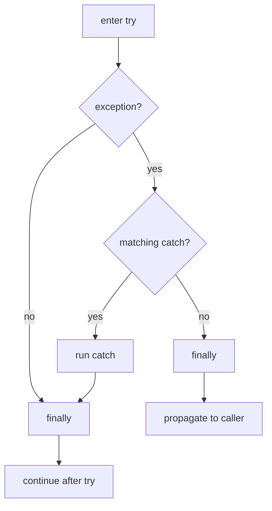
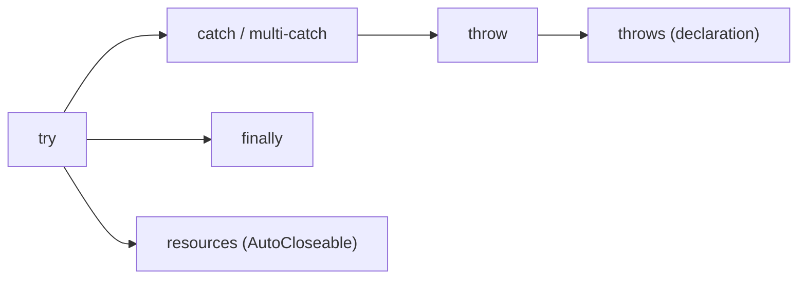

# try-catch-finally, throws, throw and Multi-catch in Java

**TL;DR:** `try` wraps risky code; each `catch (Type e)` handles a matching exception (first match wins, so list specific types before general ones); `finally` runs **almost always** (after the try/catch, even if they `return` or throw; not if the JVM exits via `System.exit` or dies). **`throw`** is a *statement* that throws one exception object; **`throws`** is a *method clause* that declares the checked exceptions a method may let escape. A **multi-catch** `catch (A | B e)` handles several unrelated types with one block; the alternatives can't be subclasses of each other, and `e` is implicitly `final`. A `try` needs at least one `catch`, a `finally`, or resources (**try-with-resources**), which are closed automatically in reverse order.

## Table of Contents

1. [TL;DR](#1-tldr)
2. [Why it matters](#2-why-it-matters)
3. [Prerequisites](#3-prerequisites)
4. [Mental model](#4-mental-model)
5. [Core concepts](#5-core-concepts)
6. [How it works](#6-how-it-works)
7. [Examples](#7-examples)
8. [Comparisons](#8-comparisons)
9. [Trade-offs](#9-trade-offs)
10. [Gotchas](#10-gotchas)
11. [Practical application](#11-practical-application)
12. [Interview prep](#12-interview-prep)
13. [Interview question bank](#13-interview-question-bank)
14. [Tricky code snippets](#14-tricky-code-snippets)
15. [Connections](#15-connections)
16. [Summary](#16-summary)
17. [Answers](#answers)

> **Scope note.** Exception types are in the hierarchy note; how exceptions travel is in the propagation note; defining your own types is the next note.

---

## 1. TL;DR

```java
try {
    // code that may throw
} catch (SpecificException | OtherException e) {   // multi-catch
    // handle
} catch (Exception e) {                           // general, last
    // handle
} finally {
    // cleanup: runs whether or not an exception occurred
}
```

| Construct | Role | Key rule | Snippets |
|---|---|---|---|
| `try` | Guarded block | Needs `catch`, `finally` or resources | 10, 11 |
| `catch` | Handler | First matching clause wins; specific before general | 12, 13 |
| multi-catch `A \| B` | One handler, several types | Not subclass-related; `e` is final | 14-21 |
| `finally` | Cleanup | Runs after try/catch, even on `return` | 2-9 |
| `throw` | Statement: throw one object | Must be a `Throwable` | 22, 23 |
| `throws` | Method clause: declare checked exceptions | Callers must handle them | 24-27 |
| try-with-resources | Auto-close `AutoCloseable`s | Reverse order, before `catch` | 30-35 |

**The analogy: a safety net under a trapeze act.**

| Real world | Java |
|---|---|
| The act | `try` block |
| Nets sized for different falls | `catch` clauses (specific first) |
| One net that covers two kinds of falls | Multi-catch |
| The crew that always clears the stage afterwards | `finally` |
| Performer deliberately dropping the prop | `throw` |
| Warning sign "this act may drop props" on the program | `throws` |

**Running example:** parse `"abc"`, catch `NumberFormatException`, always print `finally` (Snippet 1, 6.2).

---

## 2. Why it matters

**The problem.** Beginners use these keywords correctly in the happy case and wrongly at the edges: return values and `finally`, catch ordering, scope of resources and variables, and the `throw`/`throws` confusion.

**What goes wrong** (verified on Java 21):

| Mistake | Result | Snippet |
|---|---|---|
| `try { }` alone | Compile error | 10 |
| `catch (RuntimeException)` before `catch (ArithmeticException)` | Compile error | 13 |
| `catch (A \| B)` with `B extends A` | Compile error | 15 |
| Assigning to a multi-catch parameter | Compile error | 16 |
| `finally { x = 99 }` after `return x` | Returned value is the old one | 4 |
| `finally` with `return` | Overrides the try's return | 6 |
| `System.exit` inside `try` | `finally` skipped | 8 |
| `throw "error"` | Compile error | 23 |
| Using a variable assigned only in `try` | "might not have been initialized" | 38 |
| `throws` on a method, caller ignores it | Compile error (even if it never throws) | 25 |

**Why interviewers ask.** "Does `finally` always run?", "what does this return?", "`throw` vs `throws`", "multi-catch rules", "try-with-resources order", "can you have `try` without `catch`?", "can `finally` change the returned value?"

---

## 3. Prerequisites

| Prerequisite | One-line refresher | Importance |
|---|---|---|
| Exception hierarchy | Checked vs unchecked, subclass relationships | Essential |
| Propagation | How unhandled exceptions move up | Essential |
| Methods and return values | `return` semantics | Essential |
| Inheritance | Subtype matching in `catch` | Important |
| Interfaces | `AutoCloseable` | Helpful |
| Lambdas | Where `throws` can't go | Helpful |

---

## 4. Mental model

> **The one picture to keep in your head:** `try` is a protected region. If something inside throws, control jumps out of the region to the **first `catch` whose type matches**, skipping the rest of the region. Whatever happens (normal completion, exception, `return`, `break`, `continue`), control passes through `finally` on its way out.

```
          ┌──────── try ────────┐
 normal ─▶│ stmt1  stmt2  stmt3 │──────────────┐
          └───────┬─────────────┘              ▼
                  │ exception                finally ─▶ continue after the try
                  ▼                            ▲
        first matching catch ──────────────────┘
        (none matches ─▶ finally ─▶ propagate to caller)
```
*The `finally` block sits on every exit path.*


*Even with `return` in try or catch, the value is computed first, then `finally` runs, then the method returns.*

---

## 5. Core concepts

### 5.1 Glossary

- **`try` block:** code in which exceptions are handled.
- **`catch` clause:** handler for an exception type; its parameter names the caught object.
- **`finally` block:** code that runs after the `try`/`catch` completes, whatever the outcome.
- **Multi-catch:** one `catch` listing alternatives with `|`.
- **`throw`:** statement that throws an exception object.
- **`throws`:** clause in a method/constructor declaration listing checked exceptions.
- **try-with-resources:** `try (Resource r = ...)` that closes `AutoCloseable`s automatically.
- **Definite assignment:** compiler's proof that a local is set before use.

### 5.2 `try` / `catch`

Syntax: `try { ... } catch (Type name) { ... }` (repeat `catch` as needed).
- Statements in the `try` after the throwing one are skipped (Snippet 41).
- If nothing throws, all `catch` clauses are skipped (Snippet 2).
- The first matching clause runs; the rest are skipped (Snippet 12).
- A subclass handler after a superclass handler is a compile error (Snippet 13).
- The catch parameter is a local variable scoped to the clause (Snippet 36) and can't reuse the name of a local already in scope (Snippet 37). In an ordinary single-type catch it can be reassigned (Snippet 17).
- You may catch `Exception` for everything checked or unchecked (Snippet 43).

### 5.3 `finally`

Rules, all verified:
- Runs after the try (and catch, if any) whether or not an exception occurred (Snippets 1, 2).
- Runs even when the try or catch executes `return`: the return value is evaluated first, then `finally`, then the method returns (Snippets 3, 7, 44).
- Primitives: modifying the variable in `finally` doesn't change the already-computed return value (Snippet 4). For objects the *state* change is visible (Snippet 5).
- `return` in `finally` overrides everything, including exceptions (Snippet 6; previous note).
- Throwing in `finally` replaces the outcome (Snippet 45).
- Runs on `break`/`continue` too (Snippet 9).
- Does **not** run if the JVM exits (`System.exit`, crash) (Snippet 8) or the thread is killed / infinite loop earlier ⚠️.
- `try`+`finally` without `catch` is legal (Snippet 11); `try` alone isn't (Snippet 10).

### 5.4 Multi-catch (Java 7)

`catch (IOException | NumberFormatException e)`.
- Alternatives must not be related by subclassing: error "Alternatives in a multi-catch statement cannot be related by subclassing" (Snippet 15).
- The parameter is implicitly `final`: assigning is an error (Snippet 16); in a single-type catch it's allowed (Snippet 17).
- The static type of `e` is the **least upper bound** of the alternatives (e.g. `RuntimeException` for two runtime exceptions, `Exception` for a checked + runtime mix), so only members of that type are accessible; a method specific to one alternative gives `cannot find symbol` (Snippets 18, 19).
- At run time `e` is the actual exception (`getClass()` shows the real type) (Snippet 14).
- Can mix checked and unchecked alternatives (Snippet 20).
- Order relative to other `catch` clauses still follows the specific-before-general rule (Snippet 21).

### 5.5 `throw`

`throw expr;` where `expr` is a `Throwable` (or subclass) reference.
- `throw new IllegalArgumentException("msg")` (Snippet 22).
- Non-`Throwable` expressions don't compile (Snippet 23).
- `throw null` → NPE (previous note).
- Allowed in switch expressions (Snippet 28) and lambdas (Snippet 29).
- A checked exception thrown must be caught or declared; an unchecked one need not be.
- A `throw` statement ends the current block: code after it is unreachable.

### 5.6 `throws`

Clause on methods and constructors: `void read() throws IOException, InterruptedException`.
- Lists **checked** exceptions the method may propagate (unchecked listing is optional).
- Callers must catch or declare them *even if the body never throws* (Snippet 25).
- Multiple types are comma-separated (Snippet 26).
- Works on constructors (Snippet 27).
- Overriding methods can't declare broader checked exceptions (previous note).
- Functional interfaces only allow checked exceptions if their method declares them (Snippet 46).

### 5.7 `throw` vs `throws`

| | `throw` | `throws` |
|---|---|---|
| Is a | Statement | Clause in a declaration |
| Where | Inside a body | After the parameter list |
| Takes | One exception *object* | One or more exception *types* |
| Effect | Actually throws | Warns callers (compile-time) |

### 5.8 try-with-resources (Java 7/9)

`try (R a = new R(); R b = new R()) { ... }`
- Resources must implement `AutoCloseable`; otherwise compile error (Snippet 34).
- Closed automatically **in reverse order of creation**, *before* any `catch` or `finally` runs (Snippet 30).
- If creating a later resource fails, earlier ones are closed (Snippet 31).
- A `null` resource is skipped silently (Snippet 32).
- Java 9: an existing effectively final variable may be used: `try (r)` (Snippet 33).
- If `close()` declares a checked exception, it must be handled (Snippet 35).
- Exceptions from `close()` are added as suppressed exceptions when the body also threw (previous note).

### 5.9 Definite assignment

A variable assigned only inside `try` isn't definitely assigned after the `try/catch` if the `catch` doesn't assign or exit (Snippet 38); fix by assigning in both paths (Snippet 39).

### 5.10 Loops and recovery

A `try/catch` inside a loop lets processing continue after a failure (Snippet 40).

---

## 6. How it works

### 6.1 Control flow

1. Run the `try` block.
2. If an exception is thrown, look through the `catch` clauses top to bottom for the first compatible type.
3. Run that handler (or none).
4. Run `finally` (on every exit path).
5. If the exception wasn't handled (or was thrown from a handler), it continues propagating after `finally`.

### 6.2 Worked trace: the running example

```java
try {
    System.out.println("try: start");
    int x = Integer.parseInt("abc");
    System.out.println("try: never reached " + x);
} catch (NumberFormatException e) {
    System.out.println("catch: " + e.getMessage());
} finally {
    System.out.println("finally");
}
System.out.println("after");
```

Output (verified, Java 21):

```
try: start
catch: For input string: "abc"
finally
after
```

| Step | Result |
|---|---|
| `parseInt("abc")` | throws `NumberFormatException`; rest of `try` skipped |
| `catch` | prints the message |
| `finally` | runs |
| next statement | `after` prints |

### 6.3 `return` and `finally`: what exactly happens

For `try { return expr; } finally { ... }` the JVM (1) evaluates `expr` and stores the result, (2) runs `finally`, (3) returns the stored result (Snippet 7 prints "evaluating return" before "finally"). A primitive stored value isn't affected by later changes to the variable (Snippet 4); an object reference still points at the same object, whose state can change (Snippet 5). A `return` inside `finally` replaces the stored result (Snippet 6).

### 6.4 try-with-resources desugaring (conceptually) ⚠️

```java
R r = new R();
Throwable primary = null;
try { body } catch (Throwable t) { primary = t; throw t; }
finally { if (r != null) { if (primary != null) { try { r.close(); } catch (Throwable s) { primary.addSuppressed(s); } } else r.close(); } }
```
The real expansion is JLS 14.20.3 (simplified here).

### 6.5 Worked trace: try-with-resources order

Snippet 30 prints: `open A`, `open B`, `body`, `close B`, `close A`, `catch fail`, `finally`: resources close in reverse, then the `catch`, then `finally`.

### 6.6 The multi-catch type

`catch (A | B e)` compiles `e` with type `lub(A, B)`; one copy of the handler code serves both (Snippet 19 shows `RuntimeException` as the type).

---

## 7. Examples

### 7.1 Toy example

```java
static int f() {
    int x = 1;
    try { x = 2; return x; }
    finally { x = 3; System.out.println("finally x=" + x); }
}
// prints "finally x=3" and then returns 2
```
Same behaviour as Snippet 4: the return value was fixed before `finally`.

### 7.2 Real-world examples

- **Input parsing:** `try { parse } catch (NumberFormatException e) { default }` (Snippet 39).
- **I/O:** try-with-resources around readers/streams/connections (Snippet 30).
- **Validation:** `if (bad) throw new IllegalArgumentException(...)` (Snippet 22).
- **Library methods:** `throws IOException` on file APIs (Snippet 24).
- **Batch processing:** per-item `try/catch` inside the loop (Snippet 40).
- **Retry:** loop with `try/catch`, counting attempts.

---

## 8. Comparisons

### 8.1 `throw` vs `throws`

See 5.7.

### 8.2 `final` vs `finally` vs `finalize`

| | `final` | `finally` | `finalize()` |
|---|---|---|---|
| Is | Modifier | Block | Method |
| Purpose | Constants/no override/no subclass | Cleanup after try | Pre-GC hook (deprecated) |

### 8.3 Single catch vs multi-catch

| | Single-type catches | Multi-catch |
|---|---|---|
| Code duplication | More | Less |
| Parameter reassignable | Yes | No (Snippet 16) |
| Type of `e` | That type | Least upper bound (Snippet 19) |
| Related types | Fine | Not allowed (Snippet 15) |

### 8.4 try-with-resources vs try/finally

| | try-with-resources | try/finally |
|---|---|---|
| Boilerplate | Little | More |
| Close order | Reverse, automatic | Manual |
| `close()` exception with body exception | Suppressed | Replaces the original |
| Null resource | Skipped | Needs a null check |

### 8.5 `catch (Exception)` vs specific catches

`Exception` handles everything non-`Error`, but hides which failure occurred; specific catches let you react differently.

### 8.6 Return in `try` vs `finally`

| | `return` in `try` | `return` in `finally` |
|---|---|---|
| Value | Fixed before `finally` | Overrides |
| Pending exception | Unaffected | Discarded |

### 8.7 `finally` vs `System.exit`

`finally` runs on `return`, `break`, `continue` and exceptions; `System.exit` stops the JVM before it can (Snippet 8).

---

## 9. Trade-offs

| Decision | Benefit | Cost | Use when |
|---|---|---|---|
| try-with-resources | Safe cleanup, concise | Needs `AutoCloseable` | Any closeable resource |
| `finally` | Works for non-closeable cleanup | Easy to misuse (`return`/`throw`) | Unlocking, resetting state |
| Multi-catch | Less duplication | Final param; lub type | Same handling for unrelated types |
| Separate catches | Different handling | Verbose | Different recovery |
| Catch `Exception` | Simple | Masks bugs | Top-level only |
| `throws` checked | Compiler enforces handling | Signature churn | Recoverable, expected failures |
| Unchecked `throw` | No signature impact | Callers may overlook | Preconditions, bugs |

---

## 10. Gotchas

### Myths

- ❌ **Myth:** "`finally` always runs." ✅ **Reality:** not after `System.exit` or a JVM crash (Snippet 8).
- ❌ **Myth:** "`finally` can change the returned primitive." ✅ **Reality:** the value was already fixed (Snippet 4).
- ❌ **Myth:** "You need a `catch` for every `try`." ✅ **Reality:** `finally` or resources suffice (Snippet 11).
- ❌ **Myth:** "`throw` and `throws` are the same." ✅ **Reality:** a statement vs a declaration (5.7).
- ❌ **Myth:** "`throws` means the method throws." ✅ **Reality:** it only says it may; callers must still handle (Snippet 25).
- ❌ **Myth:** "Multi-catch can list a class and its subclass." ✅ **Reality:** compile error (Snippet 15).
- ❌ **Myth:** "You can reassign a multi-catch parameter." ✅ **Reality:** implicitly final (Snippet 16).
- ❌ **Myth:** "try-with-resources closes in creation order." ✅ **Reality:** reverse (Snippet 30).
- ❌ **Myth:** "Resources are closed after `catch`." ✅ **Reality:** before (Snippet 30).
- ❌ **Myth:** "Variables set in `try` are usable after." ✅ **Reality:** definite assignment applies (Snippet 38).
- ❌ **Myth:** "A `null` resource throws NPE." ✅ **Reality:** skipped (Snippet 32).

### Common mistakes and edge cases

- **Catch order** (Snippet 13).
- **`return` or `throw` in `finally`** (Snippets 6, 45).
- **Expecting statements after the throwing line to run** (Snippet 41).
- **Reusing the catch parameter name** of an outer local (Snippet 37).
- **Using a catch parameter outside its clause** (Snippet 36).
- **Forgetting that `close()` can throw a checked exception** (Snippet 35).
- **Declaring `throws` and forgetting callers must handle** (Snippet 25).
- **Calling subtype-specific methods on a multi-catch parameter** (Snippet 19).

---

## 11. Practical application

### Checklist
- [ ] Prefer try-with-resources to manual `finally` cleanup.
- [ ] Catch the most specific exceptions you can handle; general last.
- [ ] Use multi-catch when handling is identical.
- [ ] Never `return`, `break` or `throw` from `finally` unintentionally.
- [ ] Use `throws` only for checked exceptions callers can act on.
- [ ] Validate arguments with `throw new IllegalArgumentException(...)`.
- [ ] Keep `try` blocks small.
- [ ] Don't catch and ignore.

### Hands-on exercise

What does this print?

```java
static int f() {
    int x = 1;
    try { x = 2; return x; }
    finally { x = 3; System.out.println("finally x=" + x); }
}
public static void main(String[] a) { System.out.println(f()); }
```

<details><summary>Solution</summary>

```
finally x=3
2
```
`return x` stores 2 before `finally`; the change to 3 doesn't affect it.

Verified on Java 21.
</details>

---

## 12. Interview prep

Eight model answers, as you would say them aloud.

<details><summary>1. How do `try`, `catch` and `finally` work together?</summary>

Code in `try` runs; if it throws, the first `catch` with a compatible type runs and the rest of the `try` is skipped; `finally` then runs on every exit path (normal, exception, `return`, `break`, `continue`). If no catch matches, the exception propagates after `finally` (6.1; Snippets 1, 2, 12).
</details>

<details><summary>2. Does `finally` always run?</summary>

Almost: not if the JVM exits (`System.exit`, crash) or the thread never gets there (infinite loop, killed). It runs even when `try` or `catch` executes `return` (5.3; Snippets 3, 8).
</details>

<details><summary>3. What does `return` do in a method with `finally`?</summary>

The return value is evaluated first, then `finally` runs, then the method returns the stored value. Changes to a primitive in `finally` don't affect it; changes to an object's state do; `return` in `finally` overrides everything (6.3; Snippets 4, 5, 6, 7).
</details>

<details><summary>4. `throw` vs `throws`?</summary>

`throw` is a statement that throws one exception object. `throws` is a clause in a method or constructor signature declaring the checked exceptions it may let escape; callers must handle them (5.7; Snippets 22, 24, 25).
</details>

<details><summary>5. What are the rules for multi-catch?</summary>

`catch (A | B e)`: alternatives can't be related by subclassing, the parameter is implicitly final, and its static type is the least upper bound of the alternatives, so you can only use members of that type (5.4; Snippets 14-19).
</details>

<details><summary>6. Can you have `try` without `catch`?</summary>

Yes with `finally` or with resources (try-with-resources); a bare `try` is a compile error (Snippets 10, 11, 30).
</details>

<details><summary>7. In what order are try-with-resources resources closed?</summary>

In reverse order of creation, and before any `catch` or `finally` block runs. Null resources are skipped, and a failing resource constructor closes the earlier ones (5.8; Snippets 30, 31, 32).
</details>

<details><summary>8. Why does the catch order matter?</summary>

The first compatible handler wins, and the compiler rejects a subclass handler after its superclass handler as unreachable: "exception X has already been caught" (5.2; Snippets 12, 13).
</details>

---

## 13. Interview question bank


### 13.1 try and catch (Q1–Q14)

<details><summary>Q1. Purpose of `try`?</summary>

Marks code whose exceptions are to be handled.
</details>

<details><summary>Q2. Can `try` stand alone?</summary>

No (Snippet 10).
</details>

<details><summary>Q3. Can there be several `catch` blocks?</summary>

Yes (Snippet 12).
</details>

<details><summary>Q4. Which `catch` runs?</summary>

The first compatible one (Snippet 12).
</details>

<details><summary>Q5. Are statements after the throwing line in `try` run?</summary>

No (Snippet 41).
</details>

<details><summary>Q6. Are `catch` blocks skipped when nothing is thrown?</summary>

Yes (Snippet 2).
</details>

<details><summary>Q7. Subclass handler after superclass handler?</summary>

Compile error (Snippet 13).
</details>

<details><summary>Q8. Superclass handler after subclass handler?</summary>

Fine.
</details>

<details><summary>Q9. Scope of the catch parameter?</summary>

The catch block only (Snippet 36).
</details>

<details><summary>Q10. Can the catch parameter shadow a local?</summary>

No: already defined (Snippet 37).
</details>

<details><summary>Q11. Can a single-type catch parameter be reassigned?</summary>

Yes (Snippet 17).
</details>

<details><summary>Q12. `catch (Exception e)` catches?</summary>

All exceptions, checked and unchecked, not `Error`s (Snippet 43).
</details>

<details><summary>Q13. Can `catch` body throw?</summary>

Yes; propagates after `finally` (previous note).
</details>

<details><summary>Q14. Does `try` limit variable scope?</summary>

Variables declared inside are local to the block (Snippet 38).
</details>


### 13.2 finally and return (Q15–Q32)

<details><summary>Q15. When does `finally` run?</summary>

After try/catch on every exit path (Snippets 1, 2, 9).
</details>

<details><summary>Q16. Does it run after `return` in `try`?</summary>

Yes (Snippet 3).
</details>

<details><summary>Q17. Is the return value computed before `finally`?</summary>

Yes (Snippet 7).
</details>

<details><summary>Q18. `try { return x; } finally { x = 99; }` returns?</summary>

The old value (Snippet 4).
</details>

<details><summary>Q19. Same with a `StringBuilder` modified in `finally`?</summary>

The modification is visible (Snippet 5).
</details>

<details><summary>Q20. `return` in `finally`?</summary>

Overrides the try's return (Snippet 6).
</details>

<details><summary>Q21. `return` in `finally` with a pending exception?</summary>

Discards it.
</details>

<details><summary>Q22. `throw` in `finally`?</summary>

Replaces the outcome (Snippet 45).
</details>

<details><summary>Q23. Does `finally` run on `break`/`continue`?</summary>

Yes (Snippet 9).
</details>

<details><summary>Q24. Does `finally` run after `System.exit`?</summary>

No (Snippet 8).
</details>

<details><summary>Q25. Can `try`/`finally` have no `catch`?</summary>

Yes (Snippet 11).
</details>

<details><summary>Q26. Return from `catch` and `finally` prints?</summary>

`finally` first, then returns the catch value (Snippet 44).
</details>

<details><summary>Q27. Does `finally` run if the `catch` throws?</summary>

Yes (previous note).
</details>

<details><summary>Q28. Is `finally` guaranteed on a thread kill?</summary>

No ⚠️.
</details>

<details><summary>Q29. What is it used for?</summary>

Cleanup: unlocking, restoring state.
</details>

<details><summary>Q30. Why prefer try-with-resources?</summary>

Safer and shorter for closeable resources.
</details>

<details><summary>Q31. Does `finally` run before the exception propagates?</summary>

Yes.
</details>

<details><summary>Q32. Nested try-finally order?</summary>

Inner first (Snippet 42).
</details>


### 13.3 throw and throws (Q33–Q44)

<details><summary>Q33. What can `throw` throw?</summary>

Any `Throwable` reference (Snippet 22).
</details>

<details><summary>Q34. `throw "x"`?</summary>

Compile error (Snippet 23).
</details>

<details><summary>Q35. Where is `throws` placed?</summary>

After the parameter list.
</details>

<details><summary>Q36. Does `throws` list unchecked exceptions?</summary>

It may; not required.
</details>

<details><summary>Q37. Does a method with `throws` have to throw?</summary>

No; callers must still handle (Snippet 25).
</details>

<details><summary>Q38. Multiple exceptions in `throws`?</summary>

Comma-separated (Snippet 26).
</details>

<details><summary>Q39. `throws` on constructors?</summary>

Allowed (Snippet 27).
</details>

<details><summary>Q40. `throw` in a lambda?</summary>

Unchecked only unless the interface declares it (Snippets 29, 46).
</details>

<details><summary>Q41. `throw` in a switch expression?</summary>

Allowed (Snippet 28).
</details>

<details><summary>Q42. Is `throw` followed by code legal?</summary>

Not in the same block: unreachable.
</details>

<details><summary>Q43. Can `main` declare `throws`?</summary>

Yes.
</details>

<details><summary>Q44. Override throws rules?</summary>

Same or narrower checked exceptions (previous note).
</details>


### 13.4 Multi-catch (Q45–Q54)

<details><summary>Q45. Syntax?</summary>

`catch (A | B e)`.
</details>

<details><summary>Q46. Since which version?</summary>

Java 7.
</details>

<details><summary>Q47. Can `A` and its subclass `B` be listed together?</summary>

No (Snippet 15).
</details>

<details><summary>Q48. Is the parameter final?</summary>

Implicitly (Snippet 16).
</details>

<details><summary>Q49. What's the static type of `e`?</summary>

Least upper bound of the alternatives (Snippet 19).
</details>

<details><summary>Q50. Can you call a method only `A` has?</summary>

No: cannot find symbol (Snippet 19).
</details>

<details><summary>Q51. What is `e.getClass()` at run time?</summary>

The actual exception class (Snippet 14).
</details>

<details><summary>Q52. Mix checked and unchecked?</summary>

Yes (Snippet 20).
</details>

<details><summary>Q53. Can a later `catch` handle a broader type?</summary>

Yes, and it should be listed after (Snippet 21).
</details>

<details><summary>Q54. Why use multi-catch?</summary>

Avoid duplicated handlers.
</details>


### 13.5 try-with-resources and other rules (Q55–Q66)

<details><summary>Q55. What must a resource implement?</summary>

`AutoCloseable` (Snippet 34).
</details>

<details><summary>Q56. Closing order?</summary>

Reverse of creation (Snippet 30).
</details>

<details><summary>Q57. Closed before or after `catch`?</summary>

Before (Snippet 30).
</details>

<details><summary>Q58. Null resource?</summary>

Skipped (Snippet 32).
</details>

<details><summary>Q59. Resource constructor fails?</summary>

Earlier resources are closed (Snippet 31).
</details>

<details><summary>Q60. Reuse an existing variable?</summary>

Java 9: `try (r)` if effectively final (Snippet 33).
</details>

<details><summary>Q61. `close()` throws a checked exception?</summary>

Must be handled (Snippet 35).
</details>

<details><summary>Q62. Exception from `close()` plus body exception?</summary>

Suppressed on the primary (previous note).
</details>

<details><summary>Q63. Definite assignment after try/catch?</summary>

Assign in all paths (Snippets 38, 39).
</details>

<details><summary>Q64. Try inside a loop?</summary>

Lets processing continue (Snippet 40).
</details>

<details><summary>Q65. `final` vs `finally` vs `finalize`?</summary>

Modifier, block, deprecated method (8.2).
</details>

<details><summary>Q66. Is `catch` parameter name reusable across sibling catches?</summary>

Yes, each is its own scope.
</details>

---

## 14. Tricky code snippets

46 snippets, each compiled and run on OpenJDK 21. Predict the output (or the compile error) before opening the answer. Snippet 8 ends the program with `System.exit(0)`, so its `finally` never runs. Compile errors show javac's first message line; the detail lines are explained under each snippet.

### Snippet 1: Basic try / catch / finally

```java
public class Main {
    public static void main(String[] args) {
        try {
            System.out.println("try: start");
            int x = Integer.parseInt("abc");
            System.out.println("try: never reached " + x);
        } catch (NumberFormatException e) {
            System.out.println("catch: " + e.getMessage());
        } finally {
            System.out.println("finally");
        }
        System.out.println("after");
    }
}
```

<details><summary>Answer</summary>

```
try: start
catch: For input string: "abc"
finally
after
```

Trace in 6.2.
</details>

### Snippet 2: No exception

```java
public class Main {
    public static void main(String[] args) {
        try { System.out.println("try"); }
        catch (Exception e) { System.out.println("catch"); }
        finally { System.out.println("finally"); }
    }
}
```

<details><summary>Answer</summary>

```
try
finally
```

The `catch` is skipped; `finally` still runs.
</details>

### Snippet 3: `return` in `try`

```java
public class Main {
    static int f() {
        try { System.out.println("try"); return 1; }
        finally { System.out.println("finally"); }
    }
    public static void main(String[] args) { System.out.println(f()); }
}
```

<details><summary>Answer</summary>

```
try
finally
1
```

`finally` runs before the method actually returns.
</details>

### Snippet 4: Changing the variable in `finally`

```java
public class Main {
    static int f() {
        int x = 1;
        try { return x; }
        finally { x = 99; }
    }
    public static void main(String[] args) { System.out.println(f()); }
}
```

<details><summary>Answer</summary>

```
1
```

The return value was copied before `finally`.
</details>

### Snippet 5: Changing an object in `finally`

```java
public class Main {
    static StringBuilder f() {
        StringBuilder sb = new StringBuilder("a");
        try { return sb; }
        finally { sb.append("b"); }
    }
    public static void main(String[] args) { System.out.println(f()); }
}
```

<details><summary>Answer</summary>

```
ab
```

The returned reference points to the same, now modified, `StringBuilder`.
</details>

### Snippet 6: `return` in `finally`

```java
public class Main {
    @SuppressWarnings("finally")
    static int f() {
        try { return 1; }
        finally { return 2; }
    }
    public static void main(String[] args) { System.out.println(f()); }
}
```

<details><summary>Answer</summary>

```
2
```

It replaces the stored value (and would discard an exception).
</details>

### Snippet 7: Evaluation order

```java
public class Main {
    static int log(String s, int v) { System.out.println(s); return v; }
    static int f() {
        try { return log("evaluating return", 1); }
        finally { log("finally", 0); }
    }
    public static void main(String[] args) { System.out.println(f()); }
}
```

<details><summary>Answer</summary>

```
evaluating return
finally
1
```

The return expression is evaluated first, then `finally`.
</details>

### Snippet 8: `System.exit` in `try`

```java
public class Main {
    public static void main(String[] args) {
        try { System.out.println("try"); System.exit(0); }
        finally { System.out.println("finally"); }
    }
}
```

<details><summary>Answer</summary>

```
try
```

The JVM stops; `finally` never runs.
</details>

### Snippet 9: `continue` and `break`

```java
public class Main {
    public static void main(String[] args) {
        for (int i = 0; i < 3; i++) {
            try {
                if (i == 0) continue;
                if (i == 2) break;
                System.out.println("body " + i);
            } finally { System.out.println("finally " + i); }
        }
    }
}
```

<details><summary>Answer</summary>

```
finally 0
body 1
finally 1
finally 2
```

`finally` runs on every way out of the `try`.
</details>

### Snippet 10: `try` alone

```java
public class Main {
    public static void main(String[] args) {
        try { System.out.println("x"); }
    }
}
```

<details><summary>Answer</summary>

Compile error: *'try' without 'catch', 'finally' or resource declarations*.

A `try` needs a `catch`, a `finally`, or resources.
</details>

### Snippet 11: `try`/`finally` without `catch`

```java
public class Main {
    public static void main(String[] args) {
        try { System.out.println("x"); }
        finally { System.out.println("y"); }
    }
}
```

<details><summary>Answer</summary>

```
x
y
```

Legal; exceptions would still propagate.
</details>

### Snippet 12: First matching `catch`

```java
public class Main {
    public static void main(String[] args) {
        try { Object o = "s"; Integer i = (Integer) o; }
        catch (NumberFormatException e) { System.out.println("NFE"); }
        catch (ClassCastException e) { System.out.println("CCE"); }
        catch (RuntimeException e) { System.out.println("RTE"); }
    }
}
```

<details><summary>Answer</summary>

```
CCE
```

`NumberFormatException` doesn't match; the `ClassCastException` handler does and the later one is skipped.
</details>

### Snippet 13: Wrong catch order

```java
public class Main {
    public static void main(String[] args) {
        try { int x = 1 / 0; }
        catch (RuntimeException e) { System.out.println("R"); }
        catch (ArithmeticException e) { System.out.println("A"); }
    }
}
```

<details><summary>Answer</summary>

Compile error: *exception ArithmeticException has already been caught*.

`RuntimeException` already covers it.
</details>

### Snippet 14: Multi-catch

```java
public class Main {
    static void test(int k) {
        try {
            if (k == 0) throw new IllegalArgumentException("iae");
            if (k == 1) throw new IllegalStateException("ise");
            System.out.println("no exception");
        } catch (IllegalArgumentException | IllegalStateException e) {
            System.out.println(e.getClass().getSimpleName() + ": " + e.getMessage());
        }
    }
    public static void main(String[] args) { test(0); test(1); test(2); }
}
```

<details><summary>Answer</summary>

```
IllegalArgumentException: iae
IllegalStateException: ise
no exception
```

One handler for both; `e` is the real exception.
</details>

### Snippet 15: Related alternatives

```java
import java.io.*;
public class Main {
    public static void main(String[] args) {
        try { new FileReader("x"); }
        catch (FileNotFoundException | IOException e) { }
    }
}
```

<details><summary>Answer</summary>

Compile error: *Alternatives in a multi-catch statement cannot be related by subclassing*.

`FileNotFoundException` extends `IOException`.
</details>

### Snippet 16: Assigning the parameter

```java
public class Main {
    public static void main(String[] args) {
        try { Integer.parseInt("x"); }
        catch (NumberFormatException | ArithmeticException e) { e = null; }
    }
}
```

<details><summary>Answer</summary>

Compile error: *multi-catch parameter e may not be assigned*.

Implicitly final.
</details>

### Snippet 17: Single-type catch

```java
public class Main {
    public static void main(String[] args) {
        try { Integer.parseInt("x"); }
        catch (NumberFormatException e) { e = new NumberFormatException("replaced"); System.out.println(e.getMessage()); }
    }
}
```

<details><summary>Answer</summary>

```
replaced
```

A normal catch parameter can be reassigned.
</details>

### Snippet 18: Using `e` as the common type

```java
import java.io.*;
public class Main {
    public static void main(String[] args) {
        try { if (args.length == 0) throw new FileNotFoundException("fnf"); }
        catch (FileNotFoundException | IllegalStateException e) {
            System.out.println(e.getMessage());
            Exception same = e;
            System.out.println(same.getClass().getSimpleName());
        }
    }
}
```

<details><summary>Answer</summary>

```
fnf
FileNotFoundException
```

`e` is assignable to `Exception` (the common supertype); `getClass()` shows the actual type.
</details>

### Snippet 19: Subtype-only method

```java
public class Main {
    static class A extends RuntimeException { void onlyA() { } }
    static class B extends RuntimeException { }
    public static void main(String[] args) {
        try { throw new A(); }
        catch (A | B e) { e.onlyA(); }
    }
}
```

<details><summary>Answer</summary>

Compile error: *cannot find symbol*.

The detail: `location: variable e of type RuntimeException`, the least upper bound of `A` and `B`.
</details>

### Snippet 20: Checked and unchecked together

```java
import java.io.*;
public class Main {
    static void f(int k) throws IOException {
        if (k == 0) throw new IOException("checked");
        if (k == 1) throw new NumberFormatException("unchecked");
    }
    public static void main(String[] args) {
        for (int k = 0; k < 2; k++) {
            try { f(k); }
            catch (IOException | NumberFormatException e) { System.out.println(e.getMessage()); }
        }
    }
}
```

<details><summary>Answer</summary>

```
checked
unchecked
```

Allowed in one multi-catch.
</details>

### Snippet 21: Multi-catch then general

```java
public class Main {
    public static void main(String[] args) {
        try { throw new IllegalStateException("x"); }
        catch (IllegalArgumentException | NullPointerException e) { System.out.println("first group"); }
        catch (RuntimeException e) { System.out.println("fallback " + e.getMessage()); }
    }
}
```

<details><summary>Answer</summary>

```
fallback x
```

`IllegalStateException` isn't in the first group, so the general handler runs.
</details>

### Snippet 22: `throw` for validation

```java
public class Main {
    static void check(int age) {
        if (age < 0) throw new IllegalArgumentException("age must be >= 0: " + age);
        System.out.println("ok " + age);
    }
    public static void main(String[] args) {
        check(5);
        try { check(-1); } catch (IllegalArgumentException e) { System.out.println(e.getMessage()); }
    }
}
```

<details><summary>Answer</summary>

```
ok 5
age must be >= 0: -1
```

`throw` creates and throws the exception object.
</details>

### Snippet 23: `throw` a String

```java
public class Main {
    public static void main(String[] args) {
        throw "error";
    }
}
```

<details><summary>Answer</summary>

Compile error: *incompatible types: String cannot be converted to Throwable*.

Only `Throwable` references can be thrown.
</details>

### Snippet 24: `throws` clause

```java
import java.io.IOException;
public class Main {
    static void read(boolean fail) throws IOException {
        if (fail) throw new IOException("disk");
        System.out.println("read ok");
    }
    public static void main(String[] args) {
        try { read(false); read(true); }
        catch (IOException e) { System.out.println("caught " + e.getMessage()); }
    }
}
```

<details><summary>Answer</summary>

```
read ok
caught disk
```

The second call throws and the caller handles it.
</details>

### Snippet 25: `throws` that is never used

```java
import java.io.IOException;
public class Main {
    static void quiet() throws IOException { System.out.println("never throws"); }
    public static void main(String[] args) {
        quiet();
    }
}
```

<details><summary>Answer</summary>

Compile error: *unreported exception IOException; must be caught or declared to be thrown*.

Callers are checked against the declaration, not the body.
</details>

### Snippet 26: Several exceptions

```java
import java.io.IOException;
public class Main {
    static void f(int k) throws IOException, InterruptedException {
        if (k == 0) throw new IOException("io");
        if (k == 1) throw new InterruptedException("int");
        System.out.println("fine");
    }
    public static void main(String[] args) {
        for (int k = 0; k < 3; k++) {
            try { f(k); }
            catch (IOException | InterruptedException e) { System.out.println(e.getClass().getSimpleName()); }
        }
    }
}
```

<details><summary>Answer</summary>

```
IOException
InterruptedException
fine
```

Comma-separated in `throws`; multi-catch handles both.
</details>

### Snippet 27: Constructor with `throws`

```java
import java.io.*;
public class Main {
    static class Reader1 {
        Reader1(String path) throws IOException { if (path.isEmpty()) throw new IOException("empty path"); }
    }
    public static void main(String[] args) {
        try { new Reader1(""); } catch (IOException e) { System.out.println(e.getMessage()); }
    }
}
```

<details><summary>Answer</summary>

```
empty path
```

Works like a method.
</details>

### Snippet 28: `throw` as a switch arm

```java
public class Main {
    static int code(String s) {
        return switch (s) {
            case "a" -> 1;
            case "b" -> 2;
            default -> throw new IllegalArgumentException("unknown: " + s);
        };
    }
    public static void main(String[] args) {
        System.out.println(code("b"));
        try { code("z"); } catch (IllegalArgumentException e) { System.out.println(e.getMessage()); }
    }
}
```

<details><summary>Answer</summary>

```
2
unknown: z
```

A `throw` can replace a value in `default ->`.
</details>

### Snippet 29: Unchecked from lambdas

```java
import java.util.function.Supplier;
public class Main {
    public static void main(String[] args) {
        Supplier<String> s = () -> { throw new UnsupportedOperationException("not yet"); };
        try { s.get(); } catch (UnsupportedOperationException e) { System.out.println(e.getMessage()); }
        java.util.Optional<String> o = java.util.Optional.empty();
        try { o.orElseThrow(() -> new IllegalStateException("empty")); } catch (IllegalStateException e) { System.out.println(e.getMessage()); }
    }
}
```

<details><summary>Answer</summary>

```
not yet
empty
```

`Optional.orElseThrow` takes a supplier of the exception.
</details>

### Snippet 30: try-with-resources order

```java
public class Main {
    static class R implements AutoCloseable {
        final String n; R(String n) { this.n = n; System.out.println("open " + n); }
        public void close() { System.out.println("close " + n); }
    }
    public static void main(String[] args) {
        try (R a = new R("A"); R b = new R("B")) {
            System.out.println("body");
            throw new RuntimeException("fail");
        } catch (RuntimeException e) {
            System.out.println("catch " + e.getMessage());
        } finally {
            System.out.println("finally");
        }
    }
}
```

<details><summary>Answer</summary>

```
open A
open B
body
close B
close A
catch fail
finally
```

Reverse close, then `catch`, then `finally`.
</details>

### Snippet 31: Second resource fails to open

```java
public class Main {
    static class R implements AutoCloseable {
        final String n;
        R(String n) { this.n = n; if (n.equals("B")) throw new IllegalStateException("cannot open B"); System.out.println("open " + n); }
        public void close() { System.out.println("close " + n); }
    }
    public static void main(String[] args) {
        try (R a = new R("A"); R b = new R("B")) { System.out.println("body"); }
        catch (IllegalStateException e) { System.out.println("catch " + e.getMessage()); }
    }
}
```

<details><summary>Answer</summary>

```
open A
close A
catch cannot open B
```

`A` is closed; the `body` never runs.
</details>

### Snippet 32: `null` resource

```java
public class Main {
    static class R implements AutoCloseable { public void close() { System.out.println("closed"); } }
    public static void main(String[] args) {
        try (R r = null) { System.out.println("body with null resource"); }
        System.out.println("done");
    }
}
```

<details><summary>Answer</summary>

```
body with null resource
done
```

Nothing to close, no NPE.
</details>

### Snippet 33: `try (r)` (Java 9)

```java
public class Main {
    static class R implements AutoCloseable { public void close() { System.out.println("closed"); } }
    public static void main(String[] args) {
        R r = new R();
        try (r) { System.out.println("body"); }
    }
}
```

<details><summary>Answer</summary>

```
body
closed
```

An effectively final variable can be a resource.
</details>

### Snippet 34: Not `AutoCloseable`

```java
public class Main {
    static class R { }
    public static void main(String[] args) {
        try (R r = new R()) { }
    }
}
```

<details><summary>Answer</summary>

Compile error: *incompatible types: try-with-resources not applicable to variable type*.

The resource type must implement `AutoCloseable`.
</details>

### Snippet 35: `close()` declares `Exception`

```java
public class Main {
    static class R implements AutoCloseable { public void close() throws Exception { } }
    public static void main(String[] args) {
        try (R r = new R()) { System.out.println("body"); }
    }
}
```

<details><summary>Answer</summary>

Compile error: *unreported exception Exception; must be caught or declared to be thrown*.

The detail: `exception thrown from implicit call to close() on resource variable 'r'`.
</details>

### Snippet 36: Catch parameter outside the clause

```java
public class Main {
    public static void main(String[] args) {
        try { Integer.parseInt("x"); }
        catch (NumberFormatException e) { System.out.println("in catch"); }
        System.out.println(e);
    }
}
```

<details><summary>Answer</summary>

Compile error: *cannot find symbol*.

`e` exists only inside its `catch` block.
</details>

### Snippet 37: Catch parameter reuses a local name

```java
public class Main {
    public static void main(String[] args) {
        Exception e = new Exception();
        try { Integer.parseInt("x"); }
        catch (NumberFormatException e) { }
    }
}
```

<details><summary>Answer</summary>

Compile error: *variable e is already defined in method main(String[])*.

The catch parameter is a new local in the same scope chain.
</details>

### Snippet 38: Variable assigned only in `try`

```java
public class Main {
    public static void main(String[] args) {
        int x;
        try { x = Integer.parseInt("5"); }
        catch (NumberFormatException e) { System.out.println("bad"); }
        System.out.println(x);
    }
}
```

<details><summary>Answer</summary>

Compile error: *variable x might not have been initialized*.

The `catch` path leaves `x` unset.
</details>

### Snippet 39: Assign in both paths

```java
public class Main {
    public static void main(String[] args) {
        int x;
        try { x = Integer.parseInt("zz"); }
        catch (NumberFormatException e) { x = -1; }
        System.out.println(x);
    }
}
```

<details><summary>Answer</summary>

```
-1
```

`catch` assigns a fallback.
</details>

### Snippet 40: `try` inside a loop

```java
public class Main {
    public static void main(String[] args) {
        String[] in = { "1", "x", "3" };
        int sum = 0;
        for (String s : in) {
            try { sum += Integer.parseInt(s); }
            catch (NumberFormatException e) { System.out.println("skip " + s); }
        }
        System.out.println(sum);
    }
}
```

<details><summary>Answer</summary>

```
skip x
4
```

A failure affects only that iteration.
</details>

### Snippet 41: Statements after the failure

```java
public class Main {
    public static void main(String[] args) {
        try {
            System.out.println("1");
            int[] a = new int[1];
            a[1] = 5;
            System.out.println("2 never");
        } catch (ArrayIndexOutOfBoundsException e) { System.out.println("caught"); }
        System.out.println("3");
    }
}
```

<details><summary>Answer</summary>

```
1
caught
3
```

`"2 never"` is skipped.
</details>

### Snippet 42: Nested `finally`

```java
public class Main {
    public static void main(String[] args) {
        try {
            try { System.out.println("inner try"); throw new RuntimeException("x"); }
            finally { System.out.println("inner finally"); }
        } catch (RuntimeException e) { System.out.println("outer catch"); }
        finally { System.out.println("outer finally"); }
    }
}
```

<details><summary>Answer</summary>

```
inner try
inner finally
outer catch
outer finally
```

Inner finishes first.
</details>

### Snippet 43: `catch (Exception)`

```java
import java.io.*;
public class Main {
    static void f(int k) throws IOException { if (k == 0) throw new IOException("c"); throw new IllegalStateException("u"); }
    public static void main(String[] args) {
        for (int k = 0; k < 2; k++) {
            try { f(k); } catch (Exception e) { System.out.println(e.getClass().getSimpleName()); }
        }
    }
}
```

<details><summary>Answer</summary>

```
IOException
IllegalStateException
```

Checked and unchecked.
</details>

### Snippet 44: `return` in `catch`

```java
public class Main {
    static String f() {
        try { throw new RuntimeException("x"); }
        catch (RuntimeException e) { return "from catch"; }
        finally { System.out.println("finally runs first"); }
    }
    public static void main(String[] args) { System.out.println(f()); }
}
```

<details><summary>Answer</summary>

```
finally runs first
from catch
```

`finally` runs before the value is returned.
</details>

### Snippet 45: `finally` throws after `return`

```java
public class Main {
    static int f() {
        try { return 1; }
        finally { throw new IllegalStateException("finally throws"); }
    }
    public static void main(String[] args) {
        try { System.out.println(f()); } catch (IllegalStateException e) { System.out.println(e.getMessage()); }
    }
}
```

<details><summary>Answer</summary>

```
finally throws
```

The exception replaces the pending return.
</details>

### Snippet 46: Functional interface that declares `throws`

```java
import java.io.IOException;
public class Main {
    interface Source { String read() throws IOException; }
    public static void main(String[] args) {
        Source s = () -> "data";
        try { System.out.println(s.read()); } catch (IOException e) { }
        Source t = () -> { throw new IOException("lambda io"); };
        try { t.read(); } catch (IOException e) { System.out.println(e.getMessage()); }
    }
}
```

<details><summary>Answer</summary>

```
data
lambda io
```

`Source.read()` declares `IOException`, so the lambda may throw it.
</details>

---

## 15. Connections

| Related topic | How it connects |
|---|---|
| Exception hierarchy | Which types are checked; `catch` matching by subclass |
| Exception propagation | What happens when no `catch` matches |
| User-defined exceptions | What you `throw` and declare with `throws` |
| Interfaces (`AutoCloseable`) | try-with-resources |
| Overriding | `throws` rules |
| Lambdas | Functional interfaces and checked exceptions |
| Control flow | `return`/`break`/`continue` through `finally` |
| Finalize method | Not the same as `finally` |
| Concurrency | Locks released in `finally` |


*`try` handles; `throw` raises; `throws` declares.*

---

## 16. Summary

### 60-second card

- `try` needs `catch`, `finally` or resources; first matching `catch` wins; specific before general.
- `finally` runs on every exit path except JVM exit; return value fixed before `finally`; `return`/`throw` in `finally` override.
- Multi-catch `A | B`: unrelated types, implicit final parameter, type is the least upper bound.
- `throw` = statement throwing one object; `throws` = declaration of checked exceptions.
- Callers must handle declared checked exceptions even if the body never throws.
- try-with-resources: `AutoCloseable`, reverse close, before `catch`/`finally`, null skipped.
- Variables set only in `try` aren't definitely assigned afterwards.

### Cheat sheet

```java
try (var in = open()) {                       // closed automatically
    use(in);
} catch (IOException | IllegalStateException e) {   // multi-catch
    log(e);
    throw new AppException("failed", e);       // throw (statement)
} finally {
    cleanup();                                 // runs on every exit path
}
void open() throws IOException { ... }         // throws (declaration)
```

| Need | Use |
|---|---|
| Close resources | try-with-resources |
| Same handling, different types | multi-catch |
| Signal invalid input | `throw new IllegalArgumentException(...)` |
| Declare checked failure | `throws` |
| Cleanup that isn't a resource | `finally` |

### Self-test

1. Does `finally` always run?
2. What does `try { return x; } finally { x = 99; }` return?
3. Difference between `throw` and `throws`?
4. Can multi-catch list `IOException | FileNotFoundException`?
5. Can you reassign a multi-catch parameter?
6. In what order are try-with-resources resources closed?
7. Can you write `try` without `catch`?
8. Why does a method with `throws IOException` that never throws still need handling by callers?

### Anki flashcards

```
finally :: Runs on every exit path except System.exit / JVM crash
return value and finally :: Value computed first; primitive changes in finally don't affect it
return in finally :: Overrides the try's return and swallows exceptions
throw :: Statement that throws one Throwable object
throws :: Clause declaring checked exceptions
Multi-catch rules :: Unrelated types, implicit final param, lub type
try-with-resources order :: Reverse of creation, before catch/finally
try alone :: Compile error
```

### Resources

- *The Java Language Specification*, 14.20 (The try statement), 14.18 (The throw statement), 8.4.6 (Method throws): docs.oracle.com/javase/specs
- The Java Tutorials, "The try-with-resources Statement" and "Catching and Handling Exceptions": docs.oracle.com/javase/tutorial
- API docs: `java.lang.AutoCloseable`
- *Effective Java*, Joshua Bloch: "Prefer try-with-resources to try-finally"

---

## Answers

1. Almost always; not after `System.exit` or a JVM crash.
2. The original value of `x`.
3. `throw` throws an object; `throws` declares checked exception types.
4. No: related by subclassing.
5. No; it's implicitly final.
6. Reverse order of creation.
7. Yes with `finally` or resources.
8. Callers are checked against the declaration, not the implementation.
