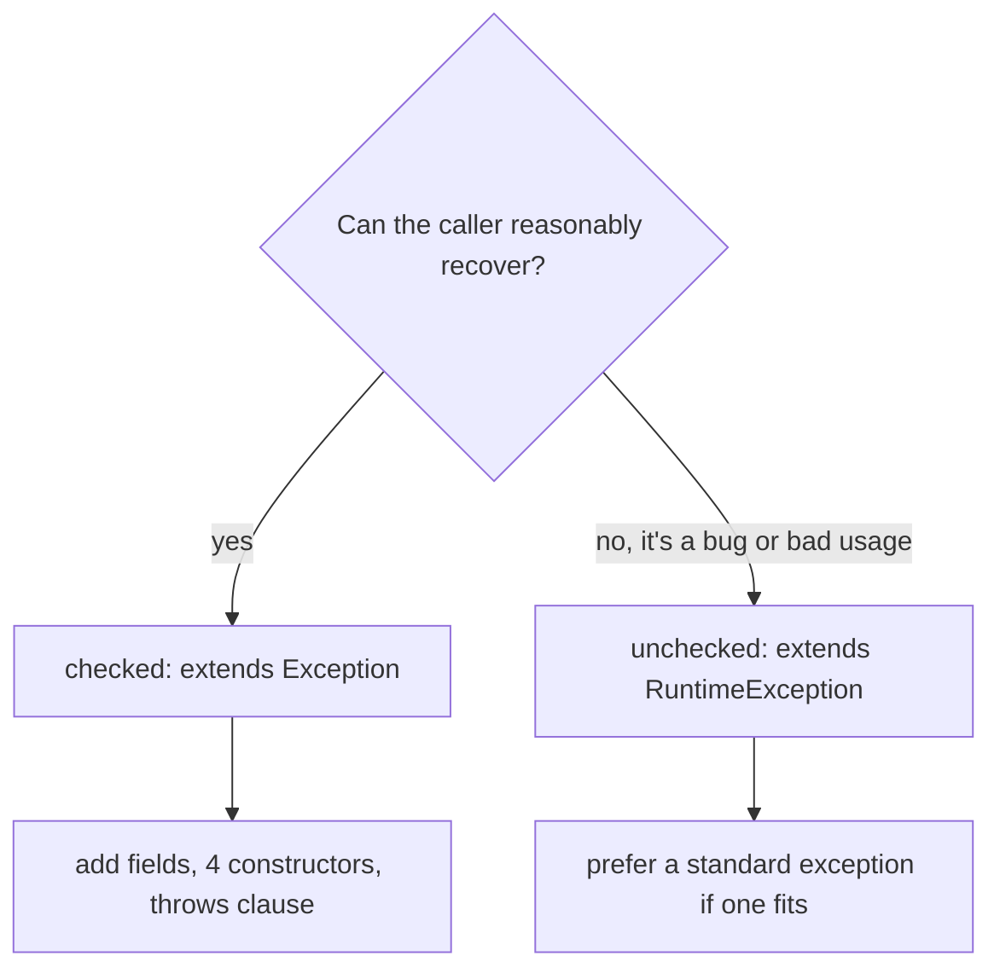
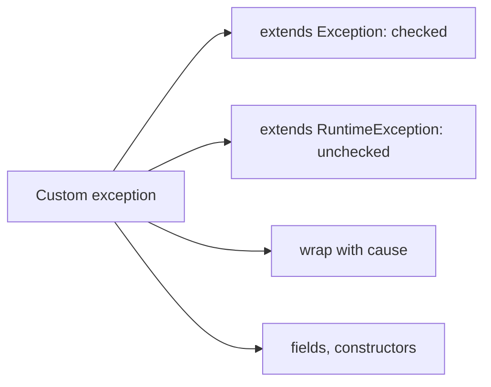

# User-defined (Custom) Checked and Unchecked Exceptions in Java

**TL;DR:** A custom exception is just a class that extends an existing exception. Extend **`Exception`** to make it **checked** (callers must catch or declare it); extend **`RuntimeException`** to make it **unchecked** (no declaration needed). Give it the standard constructors (`()`, `(String)`, `(String, Throwable)`, `(Throwable)`), pass the message and **cause** up with `super(...)`, add useful fields (error code, values) with getters, name it `SomethingException`, and prefer a standard exception (`IllegalArgumentException`, `IllegalStateException`...) when one fits. Use `throw new MyException(...)` to raise it and `throws MyException` to declare a checked one. Don't extend `Error` or `Throwable` directly, and generic exception classes aren't allowed.

## Table of Contents

1. [TL;DR](#1-tldr)
2. [Why it matters](#2-why-it-matters)
3. [Prerequisites](#3-prerequisites)
4. [Mental model](#4-mental-model)
5. [Core concepts](#5-core-concepts)
6. [How it works](#6-how-it-works)
7. [Examples](#7-examples)
8. [Comparisons](#8-comparisons)
9. [Trade-offs](#9-trade-offs)
10. [Gotchas](#10-gotchas)
11. [Practical application](#11-practical-application)
12. [Interview prep](#12-interview-prep)
13. [Interview question bank](#13-interview-question-bank)
14. [Tricky code snippets](#14-tricky-code-snippets)
15. [Connections](#15-connections)
16. [Summary](#16-summary)
17. [Answers](#answers)

> **Scope note.** The hierarchy, propagation and `try/catch/throws/throw` mechanics are in the previous three notes; this note is about *defining* your own types and designing them well.

---

## 1. TL;DR

| | Custom **checked** | Custom **unchecked** |
|---|---|---|
| Extends | `Exception` (or a checked subclass like `IOException`) | `RuntimeException` (or a subclass such as `IllegalArgumentException`) |
| Callers must handle | Yes (Snippet 3) | No (Snippet 4) |
| `throws` needed on methods | Yes | Optional |
| Use for | Recoverable, expected business failures (insufficient funds, item not found) | Programming errors, invalid arguments/state, framework-level failures |
| Example | `InsufficientFundsException` (Snippet 1) | `ValidationException` (Snippet 2) |

**The analogy: a hospital's own incident forms.**

| Real world | Java |
|---|---|
| A generic "incident report" | `Exception` |
| A specific form: "Medication Error Report" | `MedicationErrorException` (custom) |
| Fields on the form: patient, drug, dose | Custom fields and getters |
| "Must be filed before leaving the ward" forms | Checked exceptions |
| "Note it if you can" forms | Unchecked exceptions |
| Attaching the original incident to the follow-up | Wrapping with a cause |

**Running example:** `InsufficientFundsException` (checked) thrown by `Account.withdraw` and handled in `main` (Snippet 1, 6.2).

---

## 2. Why it matters

**The problem.** The standard exceptions describe *technical* failures. Business code needs to say what went wrong in domain terms ("insufficient funds", "order not found") and carry details the handler can use.

**What goes wrong** (verified on Java 21):

| Mistake | Result | Snippet |
|---|---|---|
| Custom checked exception, caller ignores it | Compile error | 3 |
| `catch (Base)` before `catch (Derived)` | Compile error | 9 |
| Extending `Throwable` directly | Checked, and `catch (Exception)` doesn't match | 12 |
| `class Box<T> extends Exception` | Compile error | 13 |
| Override throwing an unrelated checked exception | Compile error | 15 |
| Wrapping without the cause | Root cause lost | 16 |
| Using `getMessage()` on a no-arg exception | `null` | 5, 27 |
| `catch (Exception)` for an `Error` subclass | Not caught | 11 |

**Why interviewers ask.** "How do you create a custom exception?", "checked or unchecked, and why?", "what constructors should it have?", "how do you preserve the root cause?", "can a custom exception be generic?", "what should the exception hierarchy of a library look like?"

---

## 3. Prerequisites

| Prerequisite | One-line refresher | Importance |
|---|---|---|
| Exception hierarchy | Checked vs unchecked branches | Essential |
| `try/catch/finally`, `throw`, `throws` | Syntax | Essential |
| Inheritance and `super(...)` | Constructors chain upward | Essential |
| Propagation | Where exceptions travel | Important |
| Access modifiers | Public constructors/getters | Helpful |
| Enums | Error codes | Helpful |

---

## 4. Mental model

> **The one picture to keep in your head:** a custom exception is an ordinary subclass. *Which parent you choose decides everything the compiler does about it*: under `Exception` (not `RuntimeException`) → checked; under `RuntimeException` → unchecked. Everything else (message, cause, stack trace) is inherited from `Throwable`.

```
 Throwable
  ├── Exception                 ── YourBusinessException            (checked)
  │    │                              ├── NotFoundException
  │    │                              └── DuplicateException
  │    └── RuntimeException     ── YourValidationException          (unchecked)
  │                                   └── (or extend IllegalArgumentException)
  └── Error                     ── (do not extend for application errors)
```
*Pick the parent; add your fields; call `super(message, cause)`.*


*The decision most interviews ask for.*

---

## 5. Core concepts

### 5.1 Glossary

- **User-defined (custom) exception:** a class you write that extends an exception type.
- **Checked custom exception:** extends `Exception` but not `RuntimeException`.
- **Unchecked custom exception:** extends `RuntimeException`.
- **Exception translation (wrapping):** catching a low-level exception and throwing a higher-level one with the original as cause.
- **Exception chaining:** the `getCause()` linkage.
- **Error code:** an application-defined identifier carried by the exception.
- **`serialVersionUID`:** version field recommended because `Throwable` is `Serializable` ⚠️.

### 5.2 Creating one

```java
class InsufficientFundsException extends Exception {           // checked
    private final double balance, amount;
    InsufficientFundsException(double balance, double amount) {
        super("Balance " + balance + " is less than " + amount);
        this.balance = balance; this.amount = amount;
    }
    double shortfall() { return amount - balance; }
}
```
Use it with `throw new InsufficientFundsException(b, a)`; declare it with `throws InsufficientFundsException` on the method (Snippet 1). The unchecked version just extends `RuntimeException` (Snippet 2).

### 5.3 Checked vs unchecked: which to choose

- **Checked** when callers can recover and the API should force them to think about it (insufficient funds, file missing, remote service unavailable).
- **Unchecked** for programming errors, violated preconditions, and failures callers can't meaningfully handle (invalid argument, illegal state, configuration errors).
- Common modern practice favours unchecked for most application exceptions to avoid signature churn ⚠️ (design opinion; interviewers expect you to articulate both sides).

### 5.4 The four standard constructors

```java
AppException()                                  // message null
AppException(String message)
AppException(String message, Throwable cause)
AppException(Throwable cause)                   // message = cause.toString()
```
Verified outputs (Snippet 5): `null`, `msg`, `msg / root`, `java.lang.IllegalStateException: root`. Always offer the `(message, cause)` form so wrapping is possible.

### 5.5 Message, `toString`, name

- `getMessage()` returns what you passed to `super(...)`; `null` if none (Snippets 5, 27).
- `toString()` is `fully.qualified.ClassName: message` (Snippet 6; nested classes show `Main$MyEx`).
- You can override `getMessage()` (Snippet 7) or `toString()` (Snippet 20); keep them informative.
- Build detailed messages with `String.format` (Snippet 30).

### 5.6 Fields and getters

Add data a handler needs: codes, offending values, lists of violations. Make them `final` (Snippets 19, 28). An enum is a good error code type (Snippet 19).

### 5.7 Hierarchies

Create a base exception for your library/module and derived ones for specific cases; callers can catch the base or a specific type (Snippet 8). Catch derived before base (Snippet 9).

### 5.8 Extending standard exceptions

`extends IllegalArgumentException` gives you a more specific type that existing `catch (IllegalArgumentException)` code still handles (Snippet 10). Extending `IOException` lets overriding methods declare it where `IOException` is allowed (Snippet 14).

### 5.9 What *not* to extend or do

- **`Error`:** reserved for JVM/system problems; it compiles and bypasses `catch (Exception)` (Snippet 11), but don't.
- **`Throwable` directly:** it's checked, and `catch (Exception)` can't catch it (Snippet 12).
- **Generics:** `class Box<T> extends Exception` is a compile error (Snippet 13) because `catch` can't distinguish parameterised types at run time.
- **Override `throws`:** a custom checked exception in an override must be the same as or a subclass of what the parent declares (Snippets 14, 15).

### 5.10 Chaining and translation

Wrap lower-level exceptions into domain exceptions *with the cause* (Snippets 16, 18): callers see an abstraction-appropriate type, and `getCause()` keeps the root cause (Snippet 17 walks the chain).

### 5.11 Performance knobs

`Throwable(message, cause, enableSuppression, writableStackTrace)` is `protected`; a subclass constructor can call it with `false, false` to skip stack-trace capture (Snippet 21). Overriding `fillInStackTrace()` to return `this` does the same (Snippet 22). Use only for exceptions thrown at very high frequency, since you lose diagnostics ⚠️.

### 5.12 Other integration points

- **Lambdas:** wrap a checked custom exception in an unchecked one (Snippet 23).
- **`Optional.orElseThrow(Supplier)`**: supplies your exception (Snippet 24).
- **try-with-resources:** `close()` may throw a custom checked exception (Snippet 25).
- **Static initialisers:** exceptions become `ExceptionInInitializerError` (Snippet 29).
- **Serialization:** exceptions are `Serializable`; javac with `-Xlint:serial` warns when `serialVersionUID` is missing (Snippet 31).

---

## 6. How it works

### 6.1 What the compiler does

1. `extends Exception` (non-runtime) → treats the class as a checked type: every `throw` of it needs a handler or `throws` (Snippet 3).
2. `extends RuntimeException` → no checks (Snippet 4).
3. `catch` clauses and overriding rules use the ordinary subclass relationship (Snippets 8, 9, 14, 15, 26).

### 6.2 Worked trace: the running example

```java
class InsufficientFundsException extends Exception { /* balance, amount, shortfall() */ }
class Account {
    double balance = 100;
    void withdraw(double amount) throws InsufficientFundsException {
        if (amount > balance) throw new InsufficientFundsException(balance, amount);
        balance -= amount;
    }
}
// main: try { a.withdraw(30); a.withdraw(200); } catch (InsufficientFundsException e) { ... }
```

Output (verified, Java 21):

```
Balance 70.0 is less than 200.0 (short by 130.0)
```

| Call | Effect |
|---|---|
| `withdraw(30)` | balance becomes 70 |
| `withdraw(200)` | 200 > 70 → throws; handler prints message and `shortfall()` |

### 6.3 `Throwable` does the heavy lifting

Your class inherits stack-trace capture, `getMessage`, `getCause`, `printStackTrace`, `addSuppressed`. The constructors just forward to `super`.

### 6.4 Why generics are banned

A `catch (Box<String> e)` would require run-time knowledge of the type argument, which erasure removes, so the compiler forbids generic subclasses of `Throwable` (Snippet 13).

### 6.5 Why `Throwable` itself is a poor parent

`catch (Exception)` can't catch it, methods must declare it, and tools/frameworks expect `Exception` or `Error` (Snippet 12).

---

## 7. Examples

### 7.1 Toy example

```java
class InvalidAgeException extends Exception {
    private final int age;
    public InvalidAgeException(int age) { super("Age " + age + " is below 18"); this.age = age; }
    public int getAge() { return age; }
}
static void register(int age) throws InvalidAgeException {
    if (age < 18) throw new InvalidAgeException(age);
    System.out.println("registered " + age);
}
```
`register(20)` then `register(15)` prints `registered 20` and `Age 15 is below 18 / 15` when caught (verified).

### 7.2 Real-world examples

- **Domain errors:** `InsufficientFundsException`, `OrderNotFoundException`, `OutOfStockException` (Snippet 30).
- **Layer translation:** `DataAccessException` wraps `SQLException` (Snippet 16).
- **REST APIs:** `ApiException` with an HTTP status in an enum (Snippet 19).
- **Validation:** one exception carrying all field errors (Snippet 28).
- **Input handling:** `InvalidInputException` wraps `NumberFormatException` (Snippet 18).
- **Frameworks:** Spring's `DataAccessException`, JPA's `PersistenceException` are unchecked wrappers ⚠️.

---

## 8. Comparisons

### 8.1 Checked vs unchecked custom exceptions

See section 1. Rule of thumb: could a typical caller do something sensible about it? If yes → checked (or at least documented unchecked); if it signals a bug → unchecked.

### 8.2 Custom vs standard exception

| | Standard (`IllegalArgumentException`) | Custom |
|---|---|---|
| Familiar to everyone | Yes | Needs docs |
| Carries domain data | No | Yes |
| Catch by meaning | Generic | Specific |
| Use when | A standard type describes it exactly | You need domain meaning or extra data |

### 8.3 Extend `Exception` vs `RuntimeException` vs `Throwable` vs `Error`

| Parent | Checked? | Catch with `catch (Exception)`? | Recommended? |
|---|---|---|---|
| `Exception` | Yes | Yes | For recoverable failures |
| `RuntimeException` | No | Yes | For bugs/preconditions |
| `Throwable` | Yes | No (Snippet 12) | No |
| `Error` | No | No (Snippet 11) | No |

### 8.4 `getMessage()` vs `toString()` vs `getLocalizedMessage()`

| | Returns |
|---|---|
| `getMessage()` | The message (may be `null`) |
| `toString()` | `ClassName: message` (Snippet 6) |
| `getLocalizedMessage()` | By default the same as `getMessage()` (Snippet 20) |

### 8.5 Wrapping vs not wrapping

| | Wrapped with cause | Message only |
|---|---|---|
| Root cause visible | Yes (`getCause()`, Snippet 17) | No |
| Stack trace | Chained | Only the new one |

### 8.6 Flat vs hierarchical custom exceptions

A hierarchy lets callers catch broadly (`AppException`) or narrowly (`NotFoundException`) (Snippet 8); a flat set of unrelated types forces multi-catch.

---

## 9. Trade-offs

| Decision | Benefit | Cost | Use when |
|---|---|---|---|
| Custom checked exception | Forces handling | Signature noise | Recoverable domain failures |
| Custom unchecked exception | Clean signatures | Easily ignored | Preconditions, framework code |
| Fields and getters | Handler can act on details | More code, must stay immutable | Error codes, offending values |
| Exception hierarchy | Flexible catching | More classes | Libraries/modules |
| Standard exception instead | No new class | Less specific | A standard one fits exactly |
| Disable stack trace | Cheaper throws | No diagnostics | Hot-path control flow (rare) ⚠️ |
| Wrap with cause | Keeps root cause | Deeper chains | Layer boundaries |

---

## 10. Gotchas

### Myths

- ❌ **Myth:** "Custom exceptions must be checked." ✅ **Reality:** extend `RuntimeException` for unchecked (Snippet 4).
- ❌ **Myth:** "Any subclass of `Throwable` works like an exception." ✅ **Reality:** `Throwable` itself is checked and escapes `catch (Exception)` (Snippet 12).
- ❌ **Myth:** "A custom exception can be generic." ✅ **Reality:** compile error (Snippet 13).
- ❌ **Myth:** "Overrides can throw any custom checked exception." ✅ **Reality:** only the same or subclasses (Snippets 14, 15).
- ❌ **Myth:** "The message is never null." ✅ **Reality:** null with the no-arg constructor (Snippet 27).
- ❌ **Myth:** "A message alone preserves the root cause." ✅ **Reality:** pass the cause (Snippets 16, 17).
- ❌ **Myth:** "Catch order doesn't matter for custom hierarchies." ✅ **Reality:** base before derived is a compile error (Snippet 9).
- ❌ **Myth:** "`toString()` prints just the simple name." ✅ **Reality:** the binary name, e.g. `Main$MyEx` (Snippet 6).
- ❌ **Myth:** "A custom exception that extends `IllegalArgumentException` is invisible to old handlers." ✅ **Reality:** it's still an IAE (Snippet 10).

### Common mistakes and edge cases

- **Only providing a message constructor**, so wrapping a cause is impossible.
- **Making fields mutable or non-final** so handlers can change them.
- **Forgetting `throws`** on methods that throw a custom checked exception (Snippet 3).
- **Using `catch (Exception)`** and losing the custom type's data.
- **Extending `Error`** for business failures (Snippet 11).
- **Naming** a class `MyError` or without the `Exception` suffix ⚠️ (convention).
- **Forgetting `serialVersionUID`** (Snippet 31) ⚠️.
- **Throwing checked custom exceptions from lambdas** without wrapping (Snippet 23).

---

## 11. Practical application

### Checklist
- [ ] Use a standard exception if it describes the failure exactly.
- [ ] Choose checked only when callers can recover.
- [ ] Name it `SomethingException`; keep it in a sensible package.
- [ ] Provide `(message)` and `(message, cause)` constructors at least.
- [ ] Make fields `final`; expose getters only.
- [ ] Always pass the cause when translating exceptions.
- [ ] Document with `@throws` in Javadoc.
- [ ] Add a base exception for your module so callers can catch broadly.
- [ ] Add `serialVersionUID` if your code base is serialization-sensitive ⚠️.

### Hands-on exercise

Write a **checked** `InvalidAgeException` carrying the age, and `register(int age)` that throws it when `age < 18`. In `main`, call `register(20)` then `register(15)` and print the message and age when caught.

<details><summary>Solution</summary>

```java
public class Main {
    static class InvalidAgeException extends Exception {
        private final int age;
        public InvalidAgeException(int age) { super("Age " + age + " is below 18"); this.age = age; }
        public int getAge() { return age; }
    }
    static void register(int age) throws InvalidAgeException {
        if (age < 18) throw new InvalidAgeException(age);
        System.out.println("registered " + age);
    }
    public static void main(String[] args) {
        try { register(20); register(15); }
        catch (InvalidAgeException e) { System.out.println(e.getMessage() + " / " + e.getAge()); }
    }
}
```

Output (verified on Java 21):

```
registered 20
Age 15 is below 18 / 15
```
Making it unchecked would only require `extends RuntimeException`; the `throws` clause and the `try/catch` would then become optional.
</details>

---

## 12. Interview prep

Eight model answers, as you would say them aloud.

<details><summary>1. How do you create a user-defined exception?</summary>

Extend an existing exception class: `Exception` for a checked one, `RuntimeException` for an unchecked one. Add constructors that call `super(message)` / `super(message, cause)`, add fields with getters if useful, then `throw new MyException(...)` and, for checked ones, declare it with `throws` (5.2; Snippets 1, 2).
</details>

<details><summary>2. Checked or unchecked: how do you decide?</summary>

Checked when callers can reasonably recover and the API should force them to deal with it (insufficient funds, not found). Unchecked for programming errors and violated preconditions, and when forcing handlers would only add noise. Many modern codebases default to unchecked (5.3; Snippets 3, 4).
</details>

<details><summary>3. Which constructors should a custom exception have?</summary>

At least `()`, `(String message)`, `(String message, Throwable cause)` and `(Throwable cause)`. The cause constructor is what lets you wrap low-level exceptions without losing the root cause (5.4; Snippets 5, 16).
</details>

<details><summary>4. How do you preserve the original exception when translating it?</summary>

Pass it as the cause: `throw new DataAccessException("msg", e)`. `getCause()` then returns it and the stack trace prints "Caused by:" (5.10; Snippets 16, 17, 18).
</details>

<details><summary>5. Can a custom exception be generic?</summary>

No: "a generic class may not extend java.lang.Throwable", because `catch` needs the exact type at run time and generics are erased (6.4; Snippet 13).
</details>

<details><summary>6. What happens if you extend `Throwable` or `Error` directly?</summary>

`Throwable` subclasses are checked and `catch (Exception)` doesn't catch them; `Error` subclasses are unchecked but also bypass `catch (Exception)`. Neither is appropriate for application errors (5.9; Snippets 11, 12).
</details>

<details><summary>7. What are the rules when overriding a method that declares a custom checked exception?</summary>

The override may declare the same exception, a subclass of it, or none, but not an unrelated or broader checked exception (Snippets 14, 15).
</details>

<details><summary>8. Should you use a custom exception or a standard one?</summary>

Use a standard one (`IllegalArgumentException`, `IllegalStateException`, `UnsupportedOperationException`...) when it describes the failure exactly; create a custom one when you need domain meaning or extra data for handlers (8.2).
</details>

---

## 13. Interview question bank


### 13.1 Basics (Q1–Q12)

<details><summary>Q1. What is a user-defined exception?</summary>

A class you write by extending an exception class.
</details>

<details><summary>Q2. How to make it checked?</summary>

Extend `Exception` (Snippet 1).
</details>

<details><summary>Q3. How to make it unchecked?</summary>

Extend `RuntimeException` (Snippet 2).
</details>

<details><summary>Q4. Must callers handle a custom checked exception?</summary>

Yes (Snippet 3).
</details>

<details><summary>Q5. A custom unchecked one?</summary>

No (Snippet 4).
</details>

<details><summary>Q6. How do you raise it?</summary>

`throw new MyException(...)`.
</details>

<details><summary>Q7. How do you declare a checked one?</summary>

`throws MyException` on the method (Snippet 1).
</details>

<details><summary>Q8. What name convention?</summary>

End with `Exception`.
</details>

<details><summary>Q9. Where does the message go?</summary>

`super(message)` (Snippet 5).
</details>

<details><summary>Q10. Default `getMessage()` with no argument?</summary>

`null` (Snippets 5, 27).
</details>

<details><summary>Q11. What does `toString()` show?</summary>

`ClassName: message`, with the binary name (Snippet 6).
</details>

<details><summary>Q12. Can you override `getMessage()`?</summary>

Yes (Snippet 7).
</details>


### 13.2 Design and constructors (Q13–Q26)

<details><summary>Q13. Four standard constructors?</summary>

`()`, `(String)`, `(String, Throwable)`, `(Throwable)` (Snippet 5).
</details>

<details><summary>Q14. What's the message of `new AppException(cause)`?</summary>

`cause.toString()` (Snippet 5).
</details>

<details><summary>Q15. Why a `(message, cause)` constructor?</summary>

To wrap and keep the root cause.
</details>

<details><summary>Q16. Why add fields?</summary>

Give handlers data: codes, values (Snippets 1, 19).
</details>

<details><summary>Q17. Should the fields be final?</summary>

Yes (Snippets 19, 28).
</details>

<details><summary>Q18. How to carry an error code?</summary>

An enum field (Snippet 19).
</details>

<details><summary>Q19. How to carry several errors?</summary>

A copied, immutable list (Snippet 28).
</details>

<details><summary>Q20. How to format a message?</summary>

`String.format` in the constructor (Snippet 30).
</details>

<details><summary>Q21. Base exception for a module?</summary>

Lets callers catch broadly (Snippet 8).
</details>

<details><summary>Q22. Which catch goes first in a hierarchy?</summary>

The derived type (Snippet 9).
</details>

<details><summary>Q23. Can you extend a standard exception such as `IllegalArgumentException`?</summary>

Yes (Snippet 10).
</details>

<details><summary>Q24. Why extend `IOException`?</summary>

So overrides can declare it (Snippet 14).
</details>

<details><summary>Q25. Should custom exceptions be top-level?</summary>

Usually yes, in their own files; nested here for brevity.
</details>

<details><summary>Q26. What's `serialVersionUID` for?</summary>

Serialization versioning; `-Xlint:serial` warns if absent (Snippet 31) ⚠️.
</details>


### 13.3 Rules and restrictions (Q27–Q40)

<details><summary>Q27. Can a custom exception be generic?</summary>

No (Snippet 13).
</details>

<details><summary>Q28. Why not?</summary>

Erasure: `catch` can't distinguish parameterised types (6.4).
</details>

<details><summary>Q29. Extend `Throwable` directly?</summary>

Allowed but checked and not caught by `catch (Exception)` (Snippet 12).
</details>

<details><summary>Q30. Extend `Error`?</summary>

Compiles but discouraged; not caught by `catch (Exception)` (Snippet 11).
</details>

<details><summary>Q31. Override with a broader custom checked exception?</summary>

Compile error (Snippet 15).
</details>

<details><summary>Q32. Override with a subclass?</summary>

Allowed (Snippet 14).
</details>

<details><summary>Q33. Override with no `throws`?</summary>

Allowed.
</details>

<details><summary>Q34. Can an unchecked custom exception appear in `throws`?</summary>

Yes, optionally.
</details>

<details><summary>Q35. Custom exception in a static initialiser?</summary>

Wrapped in `ExceptionInInitializerError` (Snippet 29).
</details>

<details><summary>Q36. Custom checked exception in a lambda?</summary>

Wrap it (Snippet 23).
</details>

<details><summary>Q37. `Optional.orElseThrow` with a custom exception?</summary>

Pass a supplier (Snippet 24).
</details>

<details><summary>Q38. Custom exception from `close()`?</summary>

Must be handled (Snippet 25).
</details>

<details><summary>Q39. Is a custom exception an instance of its parents?</summary>

Yes (Snippet 26).
</details>

<details><summary>Q40. Can two custom exceptions be caught in one multi-catch?</summary>

Yes if unrelated.
</details>


### 13.4 Chaining and translation (Q41–Q52)

<details><summary>Q41. What is exception translation?</summary>

Catching a low-level exception and throwing a higher-level one (Snippet 16).
</details>

<details><summary>Q42. Why translate?</summary>

Hide implementation details; present domain-level failures.
</details>

<details><summary>Q43. How to keep the original?</summary>

Pass it as the cause (Snippets 16, 18).
</details>

<details><summary>Q44. How to read the cause?</summary>

`getCause()` (Snippet 16).
</details>

<details><summary>Q45. How to find the root cause?</summary>

Loop on `getCause()` (Snippet 17).
</details>

<details><summary>Q46. What prints in a stack trace for a cause?</summary>

A `Caused by:` section.
</details>

<details><summary>Q47. Translate unchecked to checked?</summary>

Possible (Snippet 18).
</details>

<details><summary>Q48. Translate checked to unchecked?</summary>

Common in lambdas and frameworks (Snippet 23).
</details>

<details><summary>Q49. Should every layer wrap?</summary>

Only at abstraction boundaries.
</details>

<details><summary>Q50. What's lost if you don't pass the cause?</summary>

The root stack trace and type.
</details>

<details><summary>Q51. Can the cause be null?</summary>

Yes; `getCause()` returns `null` (Snippet 17 loop ends).
</details>

<details><summary>Q52. Does `new X(cause)` set a message?</summary>

Yes: `cause.toString()` (Snippet 5).
</details>


### 13.5 Practice and performance (Q53–Q62)

<details><summary>Q53. Cost of throwing an exception?</summary>

Mostly stack-trace capture ⚠️.
</details>

<details><summary>Q54. How to skip stack-trace capture?</summary>

Protected 4-arg constructor with `writableStackTrace=false` (Snippet 21).
</details>

<details><summary>Q55. Another way?</summary>

Override `fillInStackTrace()` (Snippet 22).
</details>

<details><summary>Q56. When is that justified?</summary>

Very hot paths using exceptions for flow control (rare) ⚠️.
</details>

<details><summary>Q57. What goes into a good message?</summary>

Context: what failed and with which values (Snippet 30).
</details>

<details><summary>Q58. Should exception classes have behaviour?</summary>

Light helpers are fine (`shortfall()`, Snippet 1).
</details>

<details><summary>Q59. Should exceptions be immutable?</summary>

Yes, fields final.
</details>

<details><summary>Q60. Standard vs custom?</summary>

Prefer standard when exact (8.2).
</details>

<details><summary>Q61. Do you need a custom exception for every error?</summary>

No; group by what callers need to distinguish.
</details>

<details><summary>Q62. Where do you document them?</summary>

Javadoc `@throws`.
</details>

---

## 14. Tricky code snippets

31 snippets, each compiled and run on OpenJDK 21. Predict the output (or the compile error) before opening the answer. Exception classes are nested in `Main` to keep each snippet to one file, so `toString()` shows `Main$MyEx` (Snippet 6). In real code they are top-level classes with their own files and a `serialVersionUID` ⚠️.

### Snippet 1: A checked custom exception with data

```java
public class Main {
    static class InsufficientFundsException extends Exception {
        private final double balance, amount;
        InsufficientFundsException(double balance, double amount) {
            super("Balance " + balance + " is less than " + amount);
            this.balance = balance; this.amount = amount;
        }
        double shortfall() { return amount - balance; }
    }
    static class Account {
        double balance = 100;
        void withdraw(double amount) throws InsufficientFundsException {
            if (amount > balance) throw new InsufficientFundsException(balance, amount);
            balance -= amount;
        }
    }
    public static void main(String[] args) {
        Account a = new Account();
        try { a.withdraw(30); a.withdraw(200); }
        catch (InsufficientFundsException e) { System.out.println(e.getMessage() + " (short by " + e.shortfall() + ")"); }
    }
}
```

<details><summary>Answer</summary>

```
Balance 70.0 is less than 200.0 (short by 130.0)
```

Trace in 6.2.
</details>

### Snippet 2: A custom unchecked exception

```java
public class Main {
    static class ValidationException extends RuntimeException {
        ValidationException(String msg) { super(msg); }
    }
    static void validate(String name) { if (name == null || name.isBlank()) throw new ValidationException("name required"); }
    public static void main(String[] args) {
        validate("Ann");
        try { validate(" "); } catch (ValidationException e) { System.out.println(e.getMessage()); }
    }
}
```

<details><summary>Answer</summary>

```
name required
```

`validate` declares nothing; the handler is optional.
</details>

### Snippet 3: Ignoring a custom checked exception

```java
public class Main {
    static class AppException extends Exception { AppException(String m) { super(m); } }
    static void run() throws AppException { throw new AppException("x"); }
    public static void main(String[] args) {
        run();
    }
}
```

<details><summary>Answer</summary>

Compile error: *unreported exception AppException; must be caught or declared to be thrown*.

`run()` declares it, so `main` must handle it.
</details>

### Snippet 4: No `throws` needed

```java
public class Main {
    static class AppRuntimeException extends RuntimeException { AppRuntimeException(String m) { super(m); } }
    static void run() { throw new AppRuntimeException("no throws needed"); }
    public static void main(String[] args) {
        try { run(); } catch (AppRuntimeException e) { System.out.println(e.getMessage()); }
    }
}
```

<details><summary>Answer</summary>

```
no throws needed
```

It extends `RuntimeException`.
</details>

### Snippet 5: The four constructors

```java
public class Main {
    static class AppException extends Exception {
        AppException() { super(); }
        AppException(String message) { super(message); }
        AppException(String message, Throwable cause) { super(message, cause); }
        AppException(Throwable cause) { super(cause); }
    }
    public static void main(String[] args) {
        Throwable root = new IllegalStateException("root");
        System.out.println(new AppException().getMessage());
        System.out.println(new AppException("msg").getMessage());
        AppException c = new AppException("msg", root);
        System.out.println(c.getMessage() + " / " + c.getCause().getMessage());
        AppException d = new AppException(root);
        System.out.println(d.getMessage());
    }
}
```

<details><summary>Answer</summary>

```
null
msg
msg / root
java.lang.IllegalStateException: root
```

With only a cause, the message is `cause.toString()`.
</details>

### Snippet 6: `toString` of a nested exception

```java
public class Main {
    static class MyEx extends Exception { MyEx(String m) { super(m); } }
    public static void main(String[] args) {
        System.out.println(new MyEx("boom"));
        System.out.println(new MyEx("boom").getClass().getName());
        System.out.println(new MyEx("boom").getClass().getSimpleName());
    }
}
```

<details><summary>Answer</summary>

```
Main$MyEx: boom
Main$MyEx
MyEx
```

`toString` uses the binary class name; a top-level class would show `MyEx: boom`.
</details>

### Snippet 7: Overriding `getMessage()`

```java
public class Main {
    static class CodeException extends RuntimeException {
        final int code;
        CodeException(int code) { this.code = code; }
        @Override public String getMessage() { return "error code " + code; }
    }
    public static void main(String[] args) {
        try { throw new CodeException(404); }
        catch (CodeException e) { System.out.println(e.getMessage() + " | " + e); }
    }
}
```

<details><summary>Answer</summary>

```
error code 404 | Main$CodeException: error code 404
```

`Throwable.toString()` calls `getLocalizedMessage()`, which calls `getMessage()`.
</details>

### Snippet 8: Base and derived exceptions

```java
public class Main {
    static class AppException extends Exception { AppException(String m) { super(m); } }
    static class NotFoundException extends AppException { NotFoundException(String m) { super(m); } }
    static class DuplicateException extends AppException { DuplicateException(String m) { super(m); } }
    static void op(int k) throws AppException {
        if (k == 0) throw new NotFoundException("nf");
        if (k == 1) throw new DuplicateException("dup");
        throw new AppException("generic");
    }
    public static void main(String[] args) {
        for (int k = 0; k < 3; k++) {
            try { op(k); }
            catch (NotFoundException e) { System.out.println("not found: " + e.getMessage()); }
            catch (AppException e) { System.out.println("app: " + e.getMessage() + " (" + e.getClass().getSimpleName() + ")"); }
        }
    }
}
```

<details><summary>Answer</summary>

```
not found: nf
app: dup (DuplicateException)
app: generic (AppException)
```

The derived handler is first; the base handler catches the rest.
</details>

### Snippet 9: Wrong catch order

```java
public class Main {
    static class AppException extends Exception { }
    static class NotFoundException extends AppException { }
    static void op() throws AppException { }
    public static void main(String[] args) {
        try { op(); }
        catch (AppException e) { }
        catch (NotFoundException e) { }
    }
}
```

<details><summary>Answer</summary>

Compile error: *exception NotFoundException has already been caught*.

`AppException` already covers it.
</details>

### Snippet 10: Extending `IllegalArgumentException`

```java
public class Main {
    static class NegativeAgeException extends IllegalArgumentException {
        NegativeAgeException(int age) { super("age < 0: " + age); }
    }
    static void set(int age) { if (age < 0) throw new NegativeAgeException(age); }
    public static void main(String[] args) {
        try { set(-5); } catch (IllegalArgumentException e) { System.out.println("caught as IAE: " + e.getMessage()); }
    }
}
```

<details><summary>Answer</summary>

```
caught as IAE: age < 0: -5
```

A subclass of a standard exception remains catchable as that type.
</details>

### Snippet 11: Extending `Error`

```java
public class Main {
    static class FatalConfigError extends Error { FatalConfigError(String m) { super(m); } }
    public static void main(String[] args) {
        try { throw new FatalConfigError("bad config"); }
        catch (Exception e) { System.out.println("not here"); }
        catch (Error e) { System.out.println("Error subclass: " + e.getMessage()); }
    }
}
```

<details><summary>Answer</summary>

```
Error subclass: bad config
```

`catch (Exception)` doesn't match an `Error`.
</details>

### Snippet 12: Extending `Throwable`

```java
public class Main {
    static class Odd extends Throwable { }
    static void f() throws Odd { throw new Odd(); }
    public static void main(String[] args) {
        try { f(); } catch (Exception e) { System.out.println("never"); }
    }
}
```

<details><summary>Answer</summary>

Compile error: *unreported exception Odd; must be caught or declared to be thrown*.

`Odd` isn't an `Exception`, so `catch (Exception)` doesn't handle it.
</details>

### Snippet 13: Generic exception class

```java
public class Main {
    static class Box<T> extends Exception { }
    public static void main(String[] args) { }
}
```

<details><summary>Answer</summary>

Compile error: *a generic class may not extend java.lang.Throwable*.

Erasure makes `catch` on a parameterised type impossible.
</details>

### Snippet 14: Narrower custom exception in an override

```java
import java.io.IOException;
public class Main {
    static class ConfigException extends IOException { ConfigException(String m) { super(m); } }
    static class Reader1 { void read() throws IOException { } }
    static class Reader2 extends Reader1 { @Override void read() throws ConfigException { throw new ConfigException("bad cfg"); } }
    public static void main(String[] args) {
        try { new Reader2().read(); } catch (IOException e) { System.out.println(e.getClass().getSimpleName() + ": " + e.getMessage()); }
    }
}
```

<details><summary>Answer</summary>

```
ConfigException: bad cfg
```

`ConfigException` is an `IOException`, as allowed by the parent's `throws`.
</details>

### Snippet 15: Unrelated checked exception in an override

```java
public class Main {
    static class AException extends Exception { }
    static class BException extends Exception { }
    static class P { void f() throws AException { } }
    static class C extends P { @Override void f() throws BException { } }
    public static void main(String[] args) { }
}
```

<details><summary>Answer</summary>

Compile error: *f() in C cannot override f() in P*.

The detail: overridden method does not throw `BException`.
</details>

### Snippet 16: Translation with a cause

```java
public class Main {
    static class DataAccessException extends RuntimeException {
        DataAccessException(String m, Throwable cause) { super(m, cause); }
    }
    static int parse(String s) { return Integer.parseInt(s); }
    static int load(String raw) {
        try { return parse(raw); }
        catch (NumberFormatException e) { throw new DataAccessException("cannot load value '" + raw + "'", e); }
    }
    public static void main(String[] args) {
        try { load("x1"); }
        catch (DataAccessException e) {
            System.out.println(e.getMessage());
            System.out.println("cause: " + e.getCause().getClass().getSimpleName() + " - " + e.getCause().getMessage());
        }
    }
}
```

<details><summary>Answer</summary>

```
cannot load value 'x1'
cause: NumberFormatException - For input string: "x1"
```

The domain exception carries the original.
</details>

### Snippet 17: Walking the cause chain

```java
public class Main {
    static Throwable root(Throwable t) { while (t.getCause() != null) t = t.getCause(); return t; }
    public static void main(String[] args) {
        Throwable t = new RuntimeException("top", new IllegalStateException("mid", new ArithmeticException("root")));
        System.out.println(root(t).getMessage());
        for (Throwable x = t; x != null; x = x.getCause()) System.out.println(x.getClass().getSimpleName() + ": " + x.getMessage());
    }
}
```

<details><summary>Answer</summary>

```
root
RuntimeException: top
IllegalStateException: mid
ArithmeticException: root
```

Follow `getCause()` until it's `null`.
</details>

### Snippet 18: Unchecked to checked translation

```java
public class Main {
    static class InvalidInputException extends Exception {
        InvalidInputException(String m, Throwable c) { super(m, c); }
    }
    static int readAge(String s) throws InvalidInputException {
        try { return Integer.parseInt(s); }
        catch (NumberFormatException e) { throw new InvalidInputException("age must be a number: " + s, e); }
    }
    public static void main(String[] args) {
        try { readAge("abc"); } catch (InvalidInputException e) { System.out.println(e.getMessage() + " <- " + e.getCause().getClass().getSimpleName()); }
    }
}
```

<details><summary>Answer</summary>

```
age must be a number: abc <- NumberFormatException
```

Callers must now handle `InvalidInputException`.
</details>

### Snippet 19: Enum error code

```java
public class Main {
    enum ErrorCode { NOT_FOUND(404), CONFLICT(409); final int http; ErrorCode(int h) { http = h; } }
    static class ApiException extends RuntimeException {
        private final ErrorCode code;
        ApiException(ErrorCode code, String msg) { super(msg); this.code = code; }
        ErrorCode code() { return code; }
    }
    public static void main(String[] args) {
        try { throw new ApiException(ErrorCode.CONFLICT, "already exists"); }
        catch (ApiException e) { System.out.println(e.code() + " " + e.code().http + " " + e.getMessage()); }
    }
}
```

<details><summary>Answer</summary>

```
CONFLICT 409 already exists
```

The enum carries the HTTP status.
</details>

### Snippet 20: Custom `toString`

```java
public class Main {
    static class Tagged extends RuntimeException {
        Tagged(String m) { super(m); }
        @Override public String toString() { return "[Tagged] " + getMessage(); }
    }
    public static void main(String[] args) {
        System.out.println(new Tagged("hello"));
        System.out.println(new Tagged("hello").getLocalizedMessage());
    }
}
```

<details><summary>Answer</summary>

```
[Tagged] hello
hello
```

`getLocalizedMessage()` still returns the plain message.
</details>

### Snippet 21: No stack trace

```java
public class Main {
    static class Light extends RuntimeException {
        Light(String m) { super(m, null, false, false); }
    }
    public static void main(String[] args) {
        System.out.println(new Light("x").getStackTrace().length);
        System.out.println(new RuntimeException("x").getStackTrace().length > 0);
    }
}
```

<details><summary>Answer</summary>

```
0
true
```

The protected constructor with `writableStackTrace = false` skips capture. ⚠️ Loses diagnostics.
</details>

### Snippet 22: `fillInStackTrace` override

```java
public class Main {
    static class Cheap extends RuntimeException {
        Cheap(String m) { super(m); }
        @Override public synchronized Throwable fillInStackTrace() { return this; }
    }
    public static void main(String[] args) {
        System.out.println(new Cheap("c").getStackTrace().length);
    }
}
```

<details><summary>Answer</summary>

```
0
```

Returning `this` without filling skips the trace.
</details>

### Snippet 23: Wrapping in a lambda

```java
import java.util.List;
public class Main {
    static class BadItemException extends Exception { BadItemException(String m) { super(m); } }
    static void check(String s) throws BadItemException { if (s.isEmpty()) throw new BadItemException("empty item"); }
    public static void main(String[] args) {
        try {
            List.of("a", "", "c").forEach(s -> {
                try { check(s); System.out.println("ok " + s); }
                catch (BadItemException e) { throw new IllegalStateException(e); }
            });
        } catch (IllegalStateException e) { System.out.println("wrapped: " + e.getCause().getMessage()); }
    }
}
```

<details><summary>Answer</summary>

```
ok a
wrapped: empty item
```

`forEach` can't throw a checked exception, so it's wrapped in `IllegalStateException`.
</details>

### Snippet 24: `orElseThrow` with a custom exception

```java
import java.util.Optional;
public class Main {
    static class NotFoundException extends Exception { NotFoundException(String m) { super(m); } }
    static String find(int id) throws NotFoundException {
        Optional<String> r = id == 1 ? Optional.of("one") : Optional.empty();
        return r.orElseThrow(() -> new NotFoundException("no item " + id));
    }
    public static void main(String[] args) throws Exception {
        System.out.println(find(1));
        try { find(2); } catch (NotFoundException e) { System.out.println(e.getMessage()); }
    }
}
```

<details><summary>Answer</summary>

```
one
no item 2
```

The supplier creates the exception only when empty.
</details>

### Snippet 25: `close()` throwing a custom exception

```java
public class Main {
    static class CloseFailed extends Exception { CloseFailed(String m) { super(m); } }
    static class Res implements AutoCloseable {
        public void close() throws CloseFailed { throw new CloseFailed("cannot close"); }
    }
    public static void main(String[] args) {
        try (Res r = new Res()) { System.out.println("using"); }
        catch (CloseFailed e) { System.out.println("caught " + e.getMessage()); }
    }
}
```

<details><summary>Answer</summary>

```
using
caught cannot close
```

try-with-resources propagates it to `catch`.
</details>

### Snippet 26: Subclass relationships

```java
public class Main {
    static class AppException extends Exception { }
    static class DbException extends AppException { }
    public static void main(String[] args) {
        Exception e = new DbException();
        System.out.println((e instanceof AppException) + " " + (e instanceof DbException) + " " + (e instanceof RuntimeException));
        System.out.println(AppException.class.isAssignableFrom(DbException.class));
    }
}
```

<details><summary>Answer</summary>

```
true true false
true
```

`DbException` is an `AppException` but not a `RuntimeException`.
</details>

### Snippet 27: Message with the no-arg constructor

```java
public class Main {
    static class E1 extends RuntimeException { }
    static class E2 extends RuntimeException { E2() { super("preset"); } }
    public static void main(String[] args) {
        System.out.println(new E1().getMessage());
        System.out.println(new E2().getMessage());
        System.out.println(new E1() instanceof RuntimeException);
    }
}
```

<details><summary>Answer</summary>

```
null
preset
true
```

`E2` supplies a fixed message through `super`.
</details>

### Snippet 28: Immutable detail list

```java
import java.util.List;
public class Main {
    static class MultiValidationException extends RuntimeException {
        private final List<String> errors;
        MultiValidationException(List<String> errors) { super(errors.size() + " validation errors"); this.errors = List.copyOf(errors); }
        List<String> errors() { return errors; }
    }
    public static void main(String[] args) {
        try { throw new MultiValidationException(List.of("name missing", "age < 0")); }
        catch (MultiValidationException e) { System.out.println(e.getMessage() + ": " + e.errors()); }
    }
}
```

<details><summary>Answer</summary>

```
2 validation errors: [name missing, age < 0]
```

`List.copyOf` stores an immutable copy.
</details>

### Snippet 29: Custom exception in a static initialiser

```java
public class Main {
    static class ConfigError extends RuntimeException { ConfigError(String m) { super(m); } }
    static class Cfg { static final String VALUE = load(); static String load() { throw new ConfigError("missing file"); } }
    public static void main(String[] args) {
        try { System.out.println(Cfg.VALUE); }
        catch (ExceptionInInitializerError e) { System.out.println("wrapped: " + e.getCause().getMessage()); }
    }
}
```

<details><summary>Answer</summary>

```
wrapped: missing file
```

The initialiser's exception is wrapped in `ExceptionInInitializerError`.
</details>

### Snippet 30: Formatted message

```java
public class Main {
    static class OutOfStockException extends Exception {
        OutOfStockException(String sku, int wanted, int have) {
            super(String.format("SKU %s: wanted %d, only %d left", sku, wanted, have));
        }
    }
    public static void main(String[] args) {
        try { throw new OutOfStockException("A-17", 5, 2); }
        catch (OutOfStockException e) { System.out.println(e.getMessage()); }
    }
}
```

<details><summary>Answer</summary>

```
SKU A-17: wanted 5, only 2 left
```

`String.format` keeps messages informative.
</details>

### Snippet 31: Missing `serialVersionUID`

```java
public class Main {
    static class MyEx extends Exception { }
    public static void main(String[] args) { System.out.println("compiles; -Xlint:serial would warn"); }
}
```

<details><summary>Answer</summary>

```
compiles; -Xlint:serial would warn
```

With `javac -Xlint:serial` the warning is `serializable class MyEx has no definition of serialVersionUID`. ⚠️
</details>

---

## 15. Connections

| Related topic | How it connects |
|---|---|
| Exception hierarchy | Choosing the parent decides checked vs unchecked |
| try-catch-finally, throws, throw | How you raise and handle them |
| Propagation | Chaining and translation across layers |
| Inheritance and overriding | `super(...)`, `throws` rules |
| Enums | Error codes |
| Interfaces and lambdas | Wrapping checked exceptions |
| Immutability | Final fields in exceptions |
| Design patterns | Exception translation, domain errors |
| Serialization | `Throwable` is `Serializable` |


*Pick the parent, add detail, preserve the cause.*

---

## 16. Summary

### 60-second card

- Custom exception = subclass: `Exception` → checked, `RuntimeException` → unchecked.
- Provide `()`, `(msg)`, `(msg, cause)`, `(cause)` constructors; forward to `super`.
- Add final fields + getters (codes, values); override `getMessage`/`toString` sparingly.
- Wrap lower-level exceptions with the cause; walk `getCause()` for the root.
- No generic exceptions; don't extend `Throwable`/`Error` for app errors.
- Overrides may only declare the same or narrower checked exceptions.
- Prefer standard exceptions when they fit; document with `@throws`.

### Cheat sheet

```java
public class OrderNotFoundException extends Exception {          // checked
    private final long orderId;
    public OrderNotFoundException(long orderId) { super("Order " + orderId + " not found"); this.orderId = orderId; }
    public OrderNotFoundException(long orderId, Throwable cause) { super("Order " + orderId + " not found", cause); this.orderId = orderId; }
    public long getOrderId() { return orderId; }
}
// unchecked variant: extends RuntimeException
```

| Need | Use |
|---|---|
| Recoverable domain failure | custom checked |
| Precondition / bug | standard or custom unchecked |
| Keep root cause | `super(message, cause)` |
| Broad catch across a module | base exception class |
| Cheap flow-control exception | disable stack trace ⚠️ |

### Self-test

1. How do you make a custom checked exception? An unchecked one?
2. Which constructors should a custom exception provide?
3. How do you preserve the root cause when translating?
4. Why can't a custom exception be generic?
5. What happens if you extend `Throwable` directly?
6. What can an overriding method declare in `throws`?
7. When should you use a standard exception instead?
8. What's the message of `new AppException(cause)`?

### Anki flashcards

```
Custom checked exception :: extends Exception (not RuntimeException)
Custom unchecked exception :: extends RuntimeException
Standard constructors :: (), (String), (String, Throwable), (Throwable)
Exception translation :: Wrap low-level exception with cause in a domain exception
Generic exception class :: Compile error (erasure)
extends Throwable :: Checked; not caught by catch (Exception)
new X(cause).getMessage() :: cause.toString()
Override throws rule :: Same or narrower checked exceptions
```

### Resources

- The Java Tutorials, "Lesson: Exceptions" (including "How to Throw Exceptions"): docs.oracle.com/javase/tutorial
- *The Java Language Specification*, 8.1.2 (Generic Classes and Type Parameters, restriction on `Throwable`) and Chapter 11: docs.oracle.com/javase/specs
- API docs: `java.lang.Throwable`, `java.lang.Exception`, `java.lang.RuntimeException`
- *Effective Java*, Joshua Bloch: "Use checked exceptions for recoverable conditions...", "Favor the use of standard exceptions", "Include failure-capture information in detail messages"

---

## Answers

1. Extend `Exception` (checked) / extend `RuntimeException` (unchecked).
2. `()`, `(String)`, `(String, Throwable)`, `(Throwable)`.
3. Pass it as the cause: `super(message, cause)` / `new X(msg, e)`.
4. `catch` needs the exact run-time type, and generics are erased.
5. It's checked and `catch (Exception)` won't catch it.
6. The same or narrower (subclass) checked exceptions, or none.
7. When a standard one describes the failure exactly.
8. `cause.toString()`.
