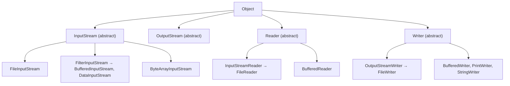
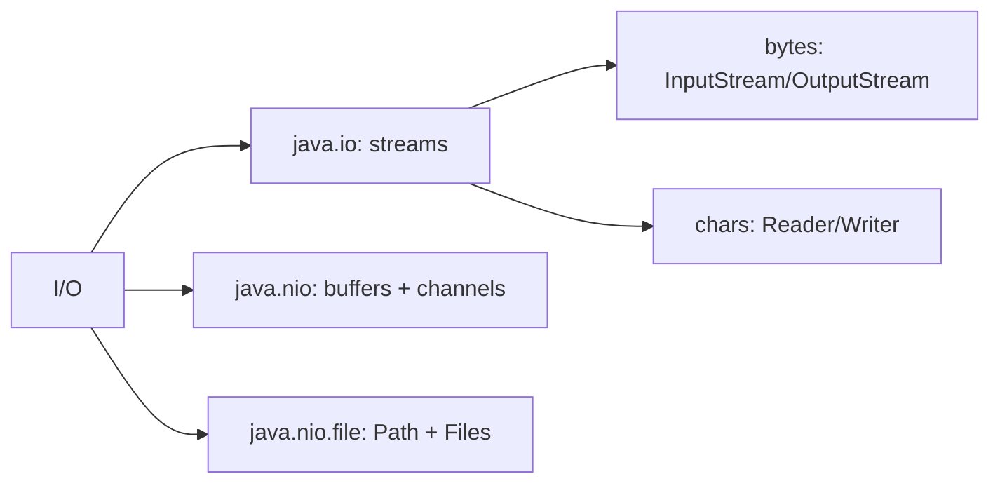

# Java I/O Streams (InputStream, OutputStream, Reader, Writer) and the NIO Package

**TL;DR:** `java.io` models data as **streams**: **byte** streams (`InputStream`/`OutputStream`) and **character** streams (`Reader`/`Writer`). Despite the topic name, these four are **abstract classes**, not interfaces. Streams are **decorated** (wrapped) to add behaviour: `BufferedReader(new InputStreamReader(new FileInputStream(f), UTF_8))`. `read()` returns an `int` (0-255, or `-1` at end), always close resources (try-with-resources) and flush buffered writers. **NIO** (`java.nio`, `java.nio.file`) adds `Path`/`Files` (modern file API), **buffers** (`ByteBuffer` with position/limit/capacity and `flip()`), **channels** (`FileChannel`) and **charsets**. For everyday file work prefer `Files.readString/readAllLines/write` over hand-written stream loops.

## Table of Contents

1. [TL;DR](#1-tldr)
2. [Why it matters](#2-why-it-matters)
3. [Prerequisites](#3-prerequisites)
4. [Mental model](#4-mental-model)
5. [Core concepts](#5-core-concepts)
6. [How it works](#6-how-it-works)
7. [Examples](#7-examples)
8. [Comparisons](#8-comparisons)
9. [Trade-offs](#9-trade-offs)
10. [Gotchas](#10-gotchas)
11. [Practical application](#11-practical-application)
12. [Interview prep](#12-interview-prep)
13. [Interview question bank](#13-interview-question-bank)
14. [Tricky code snippets](#14-tricky-code-snippets)
15. [Connections](#15-connections)
16. [Summary](#16-summary)
17. [Answers](#answers)

> **Scope note.** Object serialization (`ObjectOutputStream`) has its own note next. This note is the introduction to I/O classes and NIO fundamentals.

---

## 1. TL;DR

| | Bytes | Characters |
|---|---|---|
| Input | `InputStream` | `Reader` |
| Output | `OutputStream` | `Writer` |
| File | `FileInputStream`, `FileOutputStream` | `FileReader`, `FileWriter` |
| In-memory | `ByteArrayInputStream/OutputStream` | `StringReader`, `StringWriter`, `CharArrayReader/Writer` |
| Buffered | `BufferedInputStream/OutputStream` | `BufferedReader`, `BufferedWriter` |
| Primitives | `DataInputStream/OutputStream` | n/a |
| Bridge | `InputStreamReader`, `OutputStreamWriter` (bytes ↔ chars with a charset) | |
| Formatted output | `PrintStream` | `PrintWriter` |

| NIO piece | Purpose |
|---|---|
| `Path` / `Paths` | Immutable file-system path |
| `Files` | Static helpers: read, write, copy, move, walk, delete |
| `ByteBuffer` etc. | Block of data with position/limit/capacity |
| `FileChannel` | Read/write files through buffers |
| `Charset`, `StandardCharsets` | Encode/decode text |

**The analogy: plumbing.**

| Real world | Java |
|---|---|
| Water flowing through a pipe, one drop at a time | Byte stream |
| A filter or tank spliced into the pipe | Buffered/Data decorators |
| A translator at the junction | `InputStreamReader` with a charset |
| Closing the tap when done | `close()` / try-with-resources |
| Pressure tank that releases only when told | `flush()` on buffered writers |
| A bucket you fill, then empty (`flip`) | NIO buffers |

**Running example:** write four bytes into a `ByteArrayOutputStream`, then read them back one at a time until `-1` (Snippet 1).

---

## 2. Why it matters

**The problem.** All real programs read or write something: files, sockets, consoles. The API is large and old (1.0), layered with decorators, with traps around bytes vs characters, encoding, closing and flushing.

**What goes wrong** (verified on Java 21):

| Mistake | Result | Snippet |
|---|---|---|
| `new InputStream()` | Compile error: abstract | 2 |
| Treating `read()` as a `byte` | Returns 0-255, `-1` at the end | 6 |
| Using `FileWriter(f)` twice | Second overwrites the first | 9 |
| Not flushing a `BufferedWriter` | File still empty | 10 |
| Reading data in a different order than written | `EOFException` / garbage | 13 |
| Wrong charset when decoding | Wrong characters (length 2 vs 1) | 35 |
| `Files.copy` to an existing file | `FileAlreadyExistsException` | 26 |
| `ByteBuffer` without `flip()` | Reads nothing/garbage | 28 |
| Forgetting to close | Leaked handles ⚠️ | 20, 21 |

**Why interviewers ask.** "Byte stream vs character stream", "why `BufferedReader`?", "what is the decorator pattern in `java.io`?", "`java.io.File` vs `java.nio.file.Path`", "what's a `ByteBuffer` `flip`?", "what are channels?", "how do you read a file line by line?", "what does `flush` do?"

---

## 3. Prerequisites

| Prerequisite | One-line refresher | Importance |
|---|---|---|
| Exceptions | `IOException` is checked | Essential |
| try-with-resources | Closes `AutoCloseable`s | Essential |
| Inheritance and abstract classes | The stream base classes are abstract | Essential |
| Strings and charsets | Text ↔ bytes needs an encoding | Important |
| Arrays | `byte[]` buffers | Important |
| Decorator pattern | Wrapping to add behaviour | Helpful |

---

## 4. Mental model

> **The one picture to keep in your head:** a stream is a one-way, one-direction flow of data that you consume sequentially. Byte streams carry raw 8-bit values; character streams carry text and do the byte ↔ char translation for you using a charset. You build the stream you need by **wrapping** simple ones in more capable ones.

```
 File ──▶ FileInputStream ──▶ InputStreamReader(UTF-8) ──▶ BufferedReader ──▶ readLine()
          (bytes)             (bytes → chars)              (buffering, lines)

 NIO:  Path ──▶ Files.readAllLines(path)             (one call)
       FileChannel ◀──▶ ByteBuffer  (you control position/limit; flip between write and read)
```
*Wrap from the inside out; closing the outermost stream closes the ones inside it.*


*Four abstract roots; many concrete and decorating subclasses.*

---

## 5. Core concepts

### 5.1 Glossary

- **Stream:** sequential flow of data; one direction.
- **Byte stream:** `InputStream`/`OutputStream`: 8-bit values.
- **Character stream:** `Reader`/`Writer`: 16-bit `char`s.
- **Decorator (wrapper) stream:** a stream built on another stream to add behaviour.
- **Buffering:** collecting data in memory to reduce expensive operations.
- **Flush:** push buffered data to the destination.
- **EOF:** end of stream: `read()` returns `-1`.
- **Charset:** mapping between characters and bytes (UTF-8, ISO-8859-1).
- **NIO:** "New I/O": buffers, channels, `Path`/`Files`.
- **Buffer:** fixed-capacity container with `position`, `limit`, `capacity` (and `mark`).
- **Channel:** connection to an entity (file, socket) that reads/writes buffers.

### 5.2 `InputStream` and `OutputStream`

Both are `abstract class`es (Snippet 2) implementing `Closeable` (and so `AutoCloseable`); `OutputStream` is also `Flushable` (Snippet 3).

`InputStream` core methods:
- `int read()`: next byte as 0-255, or `-1` at end (Snippets 1, 6).
- `int read(byte[] b)`: fills the array, returns the **count** read, or `-1` (Snippet 5); the count may be less than the array length.
- `readAllBytes()` (Java 9), `transferTo(OutputStream)` (Java 9) (Snippet 17).
- `skip(n)`, `available()`, `mark(limit)`/`reset()`/`markSupported()` (Snippet 18).
- `close()`.

`OutputStream` core methods: `write(int)` (low 8 bits), `write(byte[])`, `write(byte[], off, len)`, `flush()`, `close()`.

### 5.3 Concrete byte streams

- **`FileInputStream` / `FileOutputStream`:** files (Snippet 4). `FileOutputStream(f)` truncates; `new FileOutputStream(f, true)` appends. A missing input file throws `FileNotFoundException` (Snippet 11).
- **`ByteArrayInputStream` / `ByteArrayOutputStream`:** in-memory (Snippet 1), handy for tests.
- **`BufferedInputStream` / `BufferedOutputStream`:** add buffering and `mark/reset` support (Snippet 19).
- **`DataInputStream` / `DataOutputStream`:** read/write primitives and UTF strings in a portable binary format (big-endian); read in the **same order** as written (Snippets 12, 13).
- **`PrintStream`:** convenient `print/println/printf`; `System.out` and `System.err` are `PrintStream`s; `System.in` is an `InputStream` (a `FilterInputStream`, here a `BufferedInputStream`) (Snippet 14).
- **`ObjectInputStream`/`ObjectOutputStream`:** serialization (next note).

### 5.4 `Reader` and `Writer`

Abstract classes for text.
- `Reader.read()` returns an `int` char (0-65535) or `-1` (Snippet 34); `read(char[])` returns count.
- `Writer.write(String)`, `write(char[])`, `append(...)`, `flush()`, `close()`.

Concrete:
- **`InputStreamReader` / `OutputStreamWriter`:** bridges: bytes ↔ chars using a `Charset` (Snippets 7, 35).
- **`FileReader` / `FileWriter`:** shortcuts over those; `FileWriter(f)` overwrites, `FileWriter(f, true)` appends (Snippets 8, 9). Since Java 11 they accept a `Charset`; the default charset is UTF-8 from Java 18 ⚠️.
- **`BufferedReader`:** `readLine()` (returns `null` at EOF), `lines()` stream (Snippet 36). **`BufferedWriter`:** `newLine()`.
- **`StringReader` / `StringWriter` / `CharArray*`:** in memory (Snippet 16).
- **`PrintWriter`:** `print/printf/println` to a writer or stream (Snippet 15).

### 5.5 Bytes vs characters and encodings

A `char` is not a byte. `"é€"` has 2 chars but 5 bytes in UTF-8 and 2 bytes in ISO-8859-1 (Snippet 7). Decode with the same charset used to encode; the wrong one yields different lengths/characters (Snippets 7, 35). Always pass `StandardCharsets.UTF_8` explicitly when portability matters.

### 5.6 Closing and flushing

- Use **try-with-resources**: resources close in reverse order (Snippet 20).
- Closing a wrapper closes the wrapped stream (Snippet 21).
- Buffered output may not reach the destination until `flush()` or `close()` (Snippet 10).
- Unclosed streams leak file handles ⚠️.

### 5.7 Standard streams

`System.in` (`InputStream`), `System.out` and `System.err` (`PrintStream`) (Snippet 14). `Scanner` parses tokens from any source, including a `String` (Snippet 22).

### 5.8 `java.io.File` vs NIO `Path`

`File` is the legacy path/metadata class (many methods return `boolean` instead of throwing); `Path` + `Files` is the modern API with rich exceptions (`NoSuchFileException`, `FileAlreadyExistsException`) and features (symbolic links, attributes, walking trees) (Snippets 26, 33).

### 5.9 `Path`

Immutable; operations return new paths (Snippet 23):
`Path.of(...)`/`Paths.get(...)`, `getFileName()`, `getParent()`, `normalize()` (removes `.` and `..`), `resolve(other)`, `relativize(other)`, `isAbsolute()`, `getNameCount()`, `toFile()`, `File.toPath()`.

### 5.10 `Files`

| Task | Method |
|---|---|
| Read all text | `Files.readString(p)` (Java 11), `readAllLines(p)` |
| Stream lines lazily | `Files.lines(p)` (close it!) |
| Write | `writeString(p, s)`, `write(p, bytes/lines)`; default truncates (Snippet 25) |
| Append | `StandardOpenOption.APPEND` (Snippet 25) |
| Copy / move | `copy(src, dst, REPLACE_EXISTING)`, `move(...)` (Snippets 26, 27) |
| Exists / size | `exists`, `size`, `isRegularFile`, `isDirectory` |
| Create | `createFile`, `createDirectories`, `createTempFile`, `createTempDirectory` |
| Delete | `delete` (throws if missing), `deleteIfExists` (Snippet 26) |
| Traverse | `walk`, `list` (streams: close them) (Snippet 27) |

### 5.11 Buffers

A `Buffer` has **capacity** (fixed), **limit** (first index you may not touch), **position** (next index). New buffer: position 0, limit = capacity.
- Writing (`put`) advances position (Snippet 28).
- `flip()`: limit = position; position = 0 → switch from writing to reading.
- `clear()`: position = 0; limit = capacity (ready to write again; data isn't erased).
- `compact()`: copies unread data to the start, then positions after it, ready for more writing.
- Overflow/underflow throw `BufferOverflowException` / `BufferUnderflowException` (Snippet 29).
- `ByteBuffer.allocate(n)` (heap) vs `allocateDirect(n)` (native memory); `wrap(byte[])`.
- Byte order: big-endian by default (Snippet 30); `order(ByteOrder.LITTLE_ENDIAN)` changes it.

### 5.12 Channels and charsets

`FileChannel.open(path, options)` reads into/writes from `ByteBuffer`s; `read` returns count or `-1`, `write` returns bytes written (Snippet 31). Channels can also be bidirectional and support memory-mapping and transfers between channels ⚠️ (not run here). `Charset.encode/decode` convert between `CharBuffer` and `ByteBuffer` (Snippet 32).

---

## 6. How it works

### 6.1 `read()` returns `int` because of `-1`

A `byte` is signed (-128..127), so `-1` would be ambiguous. `read()` returns the unsigned value 0-255 and uses `-1` for EOF: `(byte) 0xFF` is `-1` as a `byte` but reads back as `255` (Snippet 6).

### 6.2 Worked trace: the running example

```java
ByteArrayOutputStream out = new ByteArrayOutputStream();
out.write(72); out.write(105); out.write(new byte[] {33, 10});
byte[] data = out.toByteArray();
System.out.println(data.length);
InputStream in = new ByteArrayInputStream(data);
int b;
while ((b = in.read()) != -1) System.out.print((char) b);
System.out.println("EOF read returned " + in.read());
```

Output (verified, Java 21):

```
4
Hi!
EOF read returned -1
```

| Step | Result |
|---|---|
| writes 72, 105, 33, 10 | `H`, `i`, `!`, newline |
| `toByteArray()` | 4 bytes |
| loop | prints `Hi!` + newline until `-1` |
| `read()` at EOF | `-1` (repeatedly) |

### 6.3 The read loop

```java
int n; byte[] buf = new byte[8192];
while ((n = in.read(buf)) != -1) out.write(buf, 0, n);   // use n, not buf.length
```
The last chunk is usually short (Snippet 5).

### 6.4 Decorator chain

`new BufferedReader(new InputStreamReader(new FileInputStream(f), UTF_8))`: the file bytes are decoded to chars, then buffered, then split into lines. Each layer delegates to the one below; `close()` propagates down (Snippet 21).

### 6.5 Buffered writer behaviour

`BufferedWriter.write` appends to an internal char buffer; data reaches the file when the buffer fills, or on `flush()`/`close()`. Snippet 10: file length is 0 before `flush()` and 5 after.

### 6.6 Buffer state machine

```
 allocate(8):      [pos 0 ............ lim 8]
 put 3 bytes:      [123 pos3 ......... lim 8]
 flip():           [pos0 ... lim3]    (read mode)
 get 2:            [pos2, lim3]
 compact():        [3rd byte moved to index 0; pos1; lim 8]   (write mode again)
 clear():          [pos 0, lim 8]
```
Matches Snippet 28's output: `0 8 8` → `3 8 5` → `0 3 3` → (read 1, 2) → `1 8` → `0 8`.

### 6.7 `Files` and exceptions

`Files` methods throw `IOException` subclasses: `NoSuchFileException`, `FileAlreadyExistsException`, `DirectoryNotEmptyException`... `Files.walk`/`list`/`lines` return streams backed by open resources: use try-with-resources (Snippets 24, 27).

---

## 7. Examples

### 7.1 Toy example

```java
byte[] bytes = "hello".getBytes();
InputStream in = new ByteArrayInputStream(bytes);
int b;
while ((b = in.read()) != -1) System.out.print((char) b);
```

### 7.2 Real-world examples

- **Read a text file line by line:** `try (BufferedReader br = Files.newBufferedReader(p)) { ... }` or `Files.lines(p)`.
- **Write a report:** `Files.writeString(p, text)`; append with `APPEND`.
- **Copy streams:** `in.transferTo(out)` (Snippet 17).
- **Binary protocols:** `DataOutputStream`/`ByteBuffer` with explicit byte order (Snippets 12, 30).
- **Large files:** `FileChannel` with direct buffers or memory-mapping ⚠️.
- **Tests:** `ByteArrayInputStream`/`StringReader` to fake input (Snippets 1, 16, 22).
- **Directory scans:** `Files.walk` (Snippet 27).

---

## 8. Comparisons

### 8.1 Byte streams vs character streams

| | Byte | Character |
|---|---|---|
| Unit | 8-bit byte | 16-bit `char` |
| Classes | `InputStream`/`OutputStream` | `Reader`/`Writer` |
| Use for | Images, audio, serialized data | Text |
| Encoding handled | No | Yes (via charset) |

### 8.2 `FileInputStream` vs `FileReader`

Bytes vs decoded chars; `FileReader` uses a charset (default UTF-8 since 18).

### 8.3 `Buffered*` vs unbuffered

| | Unbuffered | Buffered |
|---|---|---|
| System calls | Many | Few |
| `readLine` | No | `BufferedReader` |
| Need to flush | Rarely | Yes |
| `mark/reset` | Often unsupported (Snippet 18) | Supported (Snippet 19) |

### 8.4 `java.io.File` vs `java.nio.file.Path`/`Files`

| | `File` | `Path` + `Files` |
|---|---|---|
| Errors | `boolean` results (e.g. `delete()` returns `false`) | Exceptions with reasons |
| Symlinks/attributes | Limited | Rich |
| Walking trees | Manual | `Files.walk` |
| Immutable | No | `Path` is |

Snippet 33 shows `File.delete()` quietly returning `false` for a missing file; `Files.delete` throws (Snippet 26).

### 8.5 `java.io` streams vs NIO channels/buffers

| | Streams | Channels + buffers |
|---|---|---|
| Direction | One way | Often both (`FileChannel`) |
| Data unit | Byte/char at a time or array | Block via buffer |
| Blocking | Blocking | Blocking or non-blocking (selectors for sockets) ⚠️ |
| Complexity | Simple | More control, more code |

### 8.6 `PrintStream` vs `PrintWriter`

`PrintStream` writes bytes (and swallows `IOException`s; `System.out`); `PrintWriter` writes chars to a `Writer` or stream (Snippet 15).

### 8.7 `Files.readAllLines` vs `Files.lines`

`readAllLines` loads everything into a `List`; `lines` is lazy and must be closed (Snippet 24).

### 8.8 `clear()` vs `flip()` vs `compact()`

See 5.11 and 6.6.

---

## 9. Trade-offs

| Decision | Benefit | Cost | Use when |
|---|---|---|---|
| `Files.readString/write` | One-liners | Loads whole file | Small/medium text files |
| `BufferedReader` loop | Streams large files | More code | Line-by-line processing |
| Byte arrays + `read(buf)` | Fast copying | Manual loop | Binary data |
| `DataStreams` | Easy primitives | Custom, Java-specific format | Simple internal formats |
| `FileChannel`/direct buffers | Throughput, memory-mapping | Complex, native memory | Very large/perf-critical I/O |
| Explicit charset | Portable behaviour | Slightly verbose | Always for text |
| `File` | Familiar | Weak error reporting | Legacy APIs only |

---

## 10. Gotchas

### Myths

- ❌ **Myth:** "`InputStream` is an interface." ✅ **Reality:** abstract class (Snippets 2, 3).
- ❌ **Myth:** "`read()` returns a byte." ✅ **Reality:** an `int` 0-255 or `-1` (Snippet 6).
- ❌ **Myth:** "`read(buf)` fills the whole array." ✅ **Reality:** returns how many were read (Snippet 5).
- ❌ **Myth:** "`FileWriter` appends by default." ✅ **Reality:** it truncates unless `append=true` (Snippet 9).
- ❌ **Myth:** "Data is in the file once `write` returns." ✅ **Reality:** buffered until flush/close (Snippet 10).
- ❌ **Myth:** "A `char` is one byte." ✅ **Reality:** `"é€"` is 5 UTF-8 bytes (Snippet 7).
- ❌ **Myth:** "Closing the outer stream leaves the inner open." ✅ **Reality:** closes it (Snippet 21).
- ❌ **Myth:** "`File.delete()` throws if missing." ✅ **Reality:** returns `false` (Snippet 33).
- ❌ **Myth:** "`Files.copy` overwrites." ✅ **Reality:** fails without `REPLACE_EXISTING` (Snippet 26).
- ❌ **Myth:** "You can read from a buffer right after `put`." ✅ **Reality:** `flip()` first (Snippet 28).
- ❌ **Myth:** "`FileInputStream` supports `mark/reset`." ✅ **Reality:** `markSupported()` is false (Snippet 18).

### Common mistakes and edge cases

- **Writing `buf.length` instead of `n`** in a copy loop.
- **Not closing `Files.lines/walk/list` streams.**
- **Relying on the platform charset** (UTF-8 default only from Java 18).
- **Reading primitives in a different order than written** (Snippet 13).
- **Forgetting to `flip()` after filling a `ByteBuffer`** (Snippet 28).
- **Assuming `available()` is the file size.**
- **`System.in` closed by wrapping and closing** a `Scanner` ⚠️.
- **Platform line separators:** `BufferedReader.readLine` handles `\n`, `\r\n` (Snippet 36).

---

## 11. Practical application

### Checklist
- [ ] Use try-with-resources for every stream, channel and `Files` stream.
- [ ] Prefer `Files`/`Path` over `File`.
- [ ] Specify `StandardCharsets.UTF_8` for text.
- [ ] Buffer file I/O; flush when you must see data early.
- [ ] Loop with the returned count, not the array length.
- [ ] Read primitives in the exact order written.
- [ ] `flip()` NIO buffers between filling and draining.
- [ ] Don't read huge files with `readAllBytes`/`readString`.

### Hands-on exercise

What does this print?

```java
ByteArrayInputStream in = new ByteArrayInputStream(new byte[]{(byte) 0x80, 65});
System.out.println(in.read() + " " + in.read() + " " + in.read());
```

<details><summary>Solution</summary>

`128 65 -1`. The byte `0x80` is `-128` as a signed `byte` but `read()` returns the unsigned value 128; then 65; then `-1` at end of stream.

Verified on Java 21 (same idea as Snippet 6).
</details>

---

## 12. Interview prep

Eight model answers, as you would say them aloud.

<details><summary>1. What is the difference between byte streams and character streams?</summary>

Byte streams (`InputStream`/`OutputStream`) move raw 8-bit data (images, serialized objects). Character streams (`Reader`/`Writer`) move text and convert between bytes and chars using a charset. Use character streams for text, byte streams for binary (8.1; Snippets 7, 35).
</details>

<details><summary>2. Are `InputStream`, `OutputStream`, `Reader` and `Writer` interfaces?</summary>

No, they're abstract classes. They implement `Closeable` (and `OutputStream`/`Writer` implement `Flushable`), so they work with try-with-resources (5.2; Snippets 2, 3).
</details>

<details><summary>3. Why does `InputStream.read()` return `int`?</summary>

To return a byte as an unsigned 0-255 value while still having `-1` as an end-of-stream marker that no byte can equal (6.1; Snippet 6).
</details>

<details><summary>4. Why use `BufferedReader` or `BufferedWriter`?</summary>

They batch I/O in memory, reducing costly system calls, and add `readLine()`/`newLine()`. Buffered writers must be flushed or closed or data may not be written (8.3; Snippets 8, 10).
</details>

<details><summary>5. What is the decorator pattern in `java.io`?</summary>

Streams wrap other streams to add behaviour, e.g. `new BufferedReader(new InputStreamReader(new FileInputStream(f), UTF_8))`. Closing the outermost stream closes the inner ones (6.4; Snippets 19, 21).
</details>

<details><summary>6. How does NIO differ from classic I/O?</summary>

NIO adds `Path`/`Files` (better errors, attributes, tree walking), buffers with position/limit/capacity, channels that read and write buffers (and can be non-blocking), and charsets (8.4, 8.5; Snippets 23-31).
</details>

<details><summary>7. What does `ByteBuffer.flip()` do?</summary>

Sets limit to the current position and position to 0, switching from writing to reading. `clear()` resets for writing again, `compact()` keeps unread data (5.11; Snippet 28).
</details>

<details><summary>8. How do you read a text file line by line in modern Java?</summary>

`Files.lines(path)` (lazy, close it) or `Files.readAllLines(path)` for small files, or `try (BufferedReader br = Files.newBufferedReader(path))` with `readLine()` until `null` (5.10; Snippets 8, 24).
</details>

---

## 13. Interview question bank


### 13.1 Streams basics (Q1–Q14)

<details><summary>Q1. What is a stream?</summary>

A sequential flow of data in one direction.
</details>

<details><summary>Q2. Four abstract roots of `java.io`?</summary>

`InputStream`, `OutputStream`, `Reader`, `Writer` (Snippet 2).
</details>

<details><summary>Q3. Interfaces or classes?</summary>

Abstract classes (Snippet 2).
</details>

<details><summary>Q4. What does `read()` return at end?</summary>

`-1` (Snippet 1).
</details>

<details><summary>Q5. Range of `read()` values?</summary>

0-255 (Snippet 6).
</details>

<details><summary>Q6. What does `read(byte[])` return?</summary>

Bytes read, or `-1` (Snippet 5).
</details>

<details><summary>Q7. Can it return less than the array length?</summary>

Yes (Snippet 5).
</details>

<details><summary>Q8. Which interface makes them usable in try-with-resources?</summary>

`Closeable`/`AutoCloseable` (Snippet 3).
</details>

<details><summary>Q9. Which one is `Flushable`?</summary>

`OutputStream`, `Writer` (Snippet 3).
</details>

<details><summary>Q10. What does `flush()` do?</summary>

Pushes buffered data to the destination (Snippet 10).
</details>

<details><summary>Q11. What is `System.in`?</summary>

An `InputStream` (Snippet 14).
</details>

<details><summary>Q12. What are `System.out`/`System.err`?</summary>

`PrintStream`s (Snippet 14).
</details>

<details><summary>Q13. What does `readAllBytes()` do?</summary>

Reads the rest of the stream into a byte array (Java 9) (Snippet 17).
</details>

<details><summary>Q14. What does `transferTo` do?</summary>

Copies to an `OutputStream` (Java 9) (Snippet 17).
</details>


### 13.2 Files, buffers and data streams (Q15–Q30)

<details><summary>Q15. Overwrite or append by default for `FileOutputStream`?</summary>

Overwrite; pass `true` to append.
</details>

<details><summary>Q16. `FileWriter(f)` twice?</summary>

Second overwrites (Snippet 9).
</details>

<details><summary>Q17. How to append?</summary>

`new FileWriter(f, true)` (Snippet 9).
</details>

<details><summary>Q18. Missing file for `FileInputStream`?</summary>

`FileNotFoundException` (Snippet 11).
</details>

<details><summary>Q19. What does `BufferedReader.readLine()` return at EOF?</summary>

`null` (Snippet 36).
</details>

<details><summary>Q20. Does `readLine` handle `\r\n`?</summary>

Yes (Snippet 36).
</details>

<details><summary>Q21. Why close streams?</summary>

Release file handles; flush buffers.
</details>

<details><summary>Q22. Does closing a `BufferedInputStream` close the inner stream?</summary>

Yes (Snippet 21).
</details>

<details><summary>Q23. Order of closing in try-with-resources?</summary>

Reverse of opening (Snippet 20).
</details>

<details><summary>Q24. What does `DataOutputStream` write?</summary>

Primitives/UTF strings in big-endian binary (Snippet 12).
</details>

<details><summary>Q25. Read back in different order?</summary>

Garbage or `EOFException` (Snippet 13).
</details>

<details><summary>Q26. Does `FileInputStream` support mark/reset?</summary>

No (Snippet 18).
</details>

<details><summary>Q27. Does `BufferedInputStream`?</summary>

Yes (Snippet 19).
</details>

<details><summary>Q28. What does `skip(n)` do?</summary>

Skips up to `n` bytes (Snippet 18).
</details>

<details><summary>Q29. What does `available()` return?</summary>

Estimated bytes readable without blocking (Snippet 18).
</details>

<details><summary>Q30. `PrintStream` vs `PrintWriter`?</summary>

Bytes vs chars (8.6; Snippet 15).
</details>


### 13.3 Characters and encodings (Q31–Q40)

<details><summary>Q31. Is a `char` one byte?</summary>

No (Snippet 7).
</details>

<details><summary>Q32. Bytes of `"é€"` in UTF-8?</summary>

5 (Snippet 7).
</details>

<details><summary>Q33. In ISO-8859-1?</summary>

2 (`€` can't be represented) (Snippet 7).
</details>

<details><summary>Q34. Bridge from bytes to chars?</summary>

`InputStreamReader` with a charset (Snippet 7).
</details>

<details><summary>Q35. Bridge from chars to bytes?</summary>

`OutputStreamWriter`.
</details>

<details><summary>Q36. Decode with the wrong charset?</summary>

Wrong characters/length (Snippet 35).
</details>

<details><summary>Q37. What is the default charset in Java 18+?</summary>

UTF-8 (JEP 400) ⚠️.
</details>

<details><summary>Q38. Return type of `Reader.read()`?</summary>

`int` char or `-1` (Snippet 34).
</details>

<details><summary>Q39. `StringReader`/`StringWriter` use?</summary>

In-memory text I/O (Snippet 16).
</details>

<details><summary>Q40. How to parse tokens from a string?</summary>

`Scanner(String)` (Snippet 22).
</details>


### 13.4 NIO: Path, Files, buffers, channels (Q41–Q58)

<details><summary>Q41. `Path.of` vs `Paths.get`?</summary>

Equivalent; `Path.of` is newer (Java 11) (Snippet 23).
</details>

<details><summary>Q42. What does `normalize()` do?</summary>

Removes `.` and `..` (Snippet 23).
</details>

<details><summary>Q43. `resolve` vs `relativize`?</summary>

Join paths vs compute a relative path (Snippet 23).
</details>

<details><summary>Q44. Read a whole text file?</summary>

`Files.readString` (Snippet 24).
</details>

<details><summary>Q45. Write text?</summary>

`Files.writeString` (truncates by default) (Snippet 25).
</details>

<details><summary>Q46. Append?</summary>

`StandardOpenOption.APPEND` (Snippet 25).
</details>

<details><summary>Q47. `Files.copy` to an existing target?</summary>

`FileAlreadyExistsException` unless `REPLACE_EXISTING` (Snippet 26).
</details>

<details><summary>Q48. `Files.delete` of a missing file?</summary>

`NoSuchFileException` (Snippet 26).
</details>

<details><summary>Q49. `deleteIfExists`?</summary>

Returns false if absent (Snippet 26).
</details>

<details><summary>Q50. `File.delete()` of a missing file?</summary>

`false` (Snippet 33).
</details>

<details><summary>Q51. Which `Files` methods need closing?</summary>

`lines`, `walk`, `list` (Snippets 24, 27).
</details>

<details><summary>Q52. Three buffer indices?</summary>

position, limit, capacity.
</details>

<details><summary>Q53. `flip()`?</summary>

limit=position, position=0 (Snippet 28).
</details>

<details><summary>Q54. `clear()`?</summary>

position=0, limit=capacity (Snippet 28).
</details>

<details><summary>Q55. `compact()`?</summary>

Keeps unread bytes at the start (Snippet 28).
</details>

<details><summary>Q56. Overflow/underflow exceptions?</summary>

`BufferOverflowException` / `BufferUnderflowException` (Snippet 29).
</details>

<details><summary>Q57. Default byte order?</summary>

Big-endian (Snippets 29, 30).
</details>

<details><summary>Q58. What does `FileChannel.read` return?</summary>

Count or `-1` (Snippet 31).
</details>


### 13.5 Design (Q59–Q66)

<details><summary>Q59. Heap vs direct `ByteBuffer`?</summary>

Heap array vs native memory ⚠️.
</details>

<details><summary>Q60. What's a channel?</summary>

A connection that reads/writes buffers (Snippet 31).
</details>

<details><summary>Q61. Blocking vs non-blocking?</summary>

Classic streams block; NIO channels can be non-blocking with selectors ⚠️.
</details>

<details><summary>Q62. When to use `FileChannel`?</summary>

Large/perf-critical file I/O.
</details>

<details><summary>Q63. When to use `Files.lines`?</summary>

Lazy processing of big text files.
</details>

<details><summary>Q64. What does `StandardCharsets` provide?</summary>

Constants such as `UTF_8` (Snippet 32).
</details>

<details><summary>Q65. How do `Charset.encode/decode` work?</summary>

Between `CharBuffer` and `ByteBuffer` (Snippet 32).
</details>

<details><summary>Q66. Name the decorator streams.</summary>

`Buffered*`, `Data*`, `Print*`, `Object*`, `InputStreamReader`.
</details>

---

## 14. Tricky code snippets

36 snippets, each compiled and run on OpenJDK 21. Predict the output (or the compile error) before opening the answer. Snippets that touch the file system use temporary files and delete them afterwards. Messages such as `No such file or directory` come from Linux ⚠️ and differ on Windows. Default charset is UTF-8 since Java 18 (JEP 400) ⚠️.

### Snippet 1: Write bytes, read until -1

```java
import java.io.*;
public class Main {
    public static void main(String[] args) throws IOException {
        ByteArrayOutputStream out = new ByteArrayOutputStream();
        out.write(72); out.write(105); out.write(new byte[] {33, 10});
        byte[] data = out.toByteArray();
        System.out.println(data.length);
        InputStream in = new ByteArrayInputStream(data);
        int b;
        while ((b = in.read()) != -1) System.out.print((char) b);
        System.out.println("EOF read returned " + in.read());
    }
}
```

<details><summary>Answer</summary>

```
4
Hi!
EOF read returned -1
```

Trace in 6.2.
</details>

### Snippet 2: `new InputStream()`

```java
import java.io.*;
public class Main {
    public static void main(String[] args) {
        InputStream in = new InputStream();
    }
}
```

<details><summary>Answer</summary>

Compile error: *InputStream is abstract; cannot be instantiated*.

The four roots are abstract classes.
</details>

### Snippet 3: Which interfaces?

```java
import java.io.*;
public class Main {
    public static void main(String[] args) {
        System.out.println(Closeable.class.isAssignableFrom(InputStream.class));
        System.out.println(Closeable.class.isAssignableFrom(Writer.class));
        System.out.println(Flushable.class.isAssignableFrom(OutputStream.class));
        System.out.println(AutoCloseable.class.isAssignableFrom(Closeable.class));
        System.out.println(InputStream.class.isInterface() + " " + java.lang.reflect.Modifier.isAbstract(InputStream.class.getModifiers()));
    }
}
```

<details><summary>Answer</summary>

```
true
true
true
true
false true
```

`InputStream` and `Writer` are `Closeable`; `OutputStream` is `Flushable`; `InputStream` is not an interface but is abstract.
</details>

### Snippet 4: File bytes round trip

```java
import java.io.*;
import java.nio.file.*;
public class Main {
    public static void main(String[] args) throws IOException {
        File f = File.createTempFile("demo", ".bin");
        try (FileOutputStream out = new FileOutputStream(f)) { out.write(new byte[] {1, 2, 3, (byte) 200}); }
        System.out.println(f.length());
        try (FileInputStream in = new FileInputStream(f)) {
            int b;
            while ((b = in.read()) != -1) System.out.print(b + " ");
            System.out.println();
        }
        f.delete();
    }
}
```

<details><summary>Answer</summary>

```
4
1 2 3 200
```

`(byte) 200` is read back as the unsigned 200.
</details>

### Snippet 5: Chunked read

```java
import java.io.*;
public class Main {
    public static void main(String[] args) throws IOException {
        InputStream in = new ByteArrayInputStream("abcdefghij".getBytes());
        byte[] buf = new byte[4];
        int n;
        while ((n = in.read(buf)) != -1) System.out.println(n + ": " + new String(buf, 0, n));
    }
}
```

<details><summary>Answer</summary>

```
4: abcd
4: efgh
2: ij
```

The last read returns only 2; use `n`, not the array length.
</details>

### Snippet 6: Signed byte vs `read()`

```java
import java.io.*;
public class Main {
    public static void main(String[] args) throws IOException {
        InputStream in = new ByteArrayInputStream(new byte[] {(byte) 0xFF});
        byte signed = (byte) 0xFF;
        System.out.println(signed);
        System.out.println(in.read());
        System.out.println(in.read());
    }
}
```

<details><summary>Answer</summary>

```
-1
255
-1
```

The byte `0xFF` is `-1` as a `byte`, `255` from `read()`, then `-1` at EOF.
</details>

### Snippet 7: Characters vs bytes

```java
import java.io.*;
import java.nio.charset.StandardCharsets;
public class Main {
    public static void main(String[] args) throws IOException {
        String s = "é€";
        byte[] utf8 = s.getBytes(StandardCharsets.UTF_8);
        byte[] latin1 = s.getBytes(StandardCharsets.ISO_8859_1);
        System.out.println(s.length() + " " + utf8.length + " " + latin1.length);
        Reader r = new InputStreamReader(new ByteArrayInputStream(utf8), StandardCharsets.UTF_8);
        int c; StringBuilder sb = new StringBuilder();
        while ((c = r.read()) != -1) sb.append((char) c);
        System.out.println(sb + " " + sb.length());
        System.out.println(new String(utf8, StandardCharsets.ISO_8859_1).length());
    }
}
```

<details><summary>Answer</summary>

```
2 5 2
é€ 2
5
```

Two chars, 5 UTF-8 bytes, 2 Latin-1 bytes (`€` becomes `?`); decoding the UTF-8 bytes as Latin-1 gives 5 chars.
</details>

### Snippet 8: Write and read text

```java
import java.io.*;
import java.nio.file.*;
public class Main {
    public static void main(String[] args) throws IOException {
        File f = File.createTempFile("demo", ".txt");
        try (Writer w = new FileWriter(f)) { w.write("line1\n"); w.write("line2\n"); }
        try (BufferedReader br = new BufferedReader(new FileReader(f))) {
            String line;
            while ((line = br.readLine()) != null) System.out.println("> " + line);
        }
        f.delete();
    }
}
```

<details><summary>Answer</summary>

```
> line1
> line2
```

`FileWriter` then `BufferedReader.readLine()` until `null`.
</details>

### Snippet 9: `FileWriter` overwrite vs append

```java
import java.io.*;
import java.nio.file.*;
public class Main {
    public static void main(String[] args) throws IOException {
        File f = File.createTempFile("demo", ".txt");
        try (Writer w = new FileWriter(f)) { w.write("A"); }
        try (Writer w = new FileWriter(f)) { w.write("B"); }
        System.out.println(Files.readString(f.toPath()));
        try (Writer w = new FileWriter(f, true)) { w.write("C"); }
        System.out.println(Files.readString(f.toPath()));
        f.delete();
    }
}
```

<details><summary>Answer</summary>

```
B
BC
```

The second writer truncated the file; `true` appends.
</details>

### Snippet 10: Buffered writer

```java
import java.io.*;
import java.nio.file.*;
public class Main {
    public static void main(String[] args) throws IOException {
        File f = File.createTempFile("demo", ".txt");
        BufferedWriter bw = new BufferedWriter(new FileWriter(f));
        bw.write("lost?");
        System.out.println("before flush: " + f.length());
        bw.flush();
        System.out.println("after flush: " + f.length());
        bw.close();
        f.delete();
    }
}
```

<details><summary>Answer</summary>

```
before flush: 0
after flush: 5
```

Data stays in the buffer until `flush()`.
</details>

### Snippet 11: Missing input file

```java
import java.io.*;
public class Main {
    public static void main(String[] args) {
        try { new FileInputStream("/no/such/file.txt"); }
        catch (FileNotFoundException e) { System.out.println(e.getMessage()); }
    }
}
```

<details><summary>Answer</summary>

```
/no/such/file.txt (No such file or directory)
```

`FileNotFoundException`. ⚠️ OS-specific message.
</details>

### Snippet 12: `Data*Stream`

```java
import java.io.*;
public class Main {
    public static void main(String[] args) throws IOException {
        ByteArrayOutputStream bos = new ByteArrayOutputStream();
        try (DataOutputStream out = new DataOutputStream(bos)) {
            out.writeInt(258); out.writeUTF("hi"); out.writeDouble(1.5); out.writeBoolean(true);
        }
        byte[] bytes = bos.toByteArray();
        System.out.println(bytes.length);
        try (DataInputStream in = new DataInputStream(new ByteArrayInputStream(bytes))) {
            System.out.println(in.readInt() + " " + in.readUTF() + " " + in.readDouble() + " " + in.readBoolean());
        }
    }
}
```

<details><summary>Answer</summary>

```
17
258 hi 1.5 true
```

4 (int) + 4 (UTF: 2-byte length + 2) + 8 (double) + 1 (boolean) = 17 bytes.
</details>

### Snippet 13: Reading too much

```java
import java.io.*;
public class Main {
    public static void main(String[] args) throws IOException {
        ByteArrayOutputStream bos = new ByteArrayOutputStream();
        try (DataOutputStream out = new DataOutputStream(bos)) { out.writeInt(1); }
        try (DataInputStream in = new DataInputStream(new ByteArrayInputStream(bos.toByteArray()))) {
            in.readInt();
            in.readInt();
        } catch (EOFException e) { System.out.println("EOFException"); }
    }
}
```

<details><summary>Answer</summary>

```
EOFException
```

The second `readInt()` finds no data.
</details>

### Snippet 14: `System.in/out/err`

```java
public class Main {
    public static void main(String[] args) {
        System.out.println(System.in.getClass().getSuperclass().getSimpleName());
        System.out.println(System.out.getClass().getSimpleName());
        System.out.println(System.err.getClass().getSimpleName());
        System.out.println(System.out instanceof java.io.OutputStream);
    }
}
```

<details><summary>Answer</summary>

```
FilterInputStream
PrintStream
PrintStream
true
```

`System.in` is a (buffered) filter stream; output streams are `PrintStream`s.
</details>

### Snippet 15: Formatted output

```java
import java.io.*;
public class Main {
    public static void main(String[] args) {
        StringWriter sw = new StringWriter();
        PrintWriter pw = new PrintWriter(sw);
        pw.printf("%d-%s", 7, "x"); pw.println(); pw.print(true);
        pw.flush();
        System.out.println(sw.toString().replace("\n", "|"));
        ByteArrayOutputStream bos = new ByteArrayOutputStream();
        PrintStream ps = new PrintStream(bos);
        ps.print("bytes"); ps.flush();
        System.out.println(bos.size());
    }
}
```

<details><summary>Answer</summary>

```
7-x|true
5
```

`PrintWriter` writes chars to a `StringWriter`; `PrintStream` writes 5 bytes.
</details>

### Snippet 16: In-memory text

```java
import java.io.*;
public class Main {
    public static void main(String[] args) throws IOException {
        StringReader sr = new StringReader("abc");
        System.out.println((char) sr.read() + "" + (char) sr.read());
        StringWriter sw = new StringWriter();
        sw.write("x"); sw.append("y").append('z');
        System.out.println(sw);
    }
}
```

<details><summary>Answer</summary>

```
ab
xyz
```

`StringReader` yields chars; `StringWriter` collects them.
</details>

### Snippet 17: `readAllBytes`, `transferTo`

```java
import java.io.*;
public class Main {
    public static void main(String[] args) throws IOException {
        InputStream in = new ByteArrayInputStream("hello".getBytes());
        byte[] all = in.readAllBytes();
        System.out.println(all.length);
        ByteArrayOutputStream out = new ByteArrayOutputStream();
        new ByteArrayInputStream("copy me".getBytes()).transferTo(out);
        System.out.println(out);
    }
}
```

<details><summary>Answer</summary>

```
5
copy me
```

Java 9 convenience methods.
</details>

### Snippet 18: `mark` / `reset`

```java
import java.io.*;
public class Main {
    public static void main(String[] args) throws IOException {
        InputStream in = new ByteArrayInputStream("abcdef".getBytes());
        System.out.println(in.markSupported() + " " + in.available());
        in.skip(2);
        in.mark(10);
        System.out.print((char) in.read()); System.out.print((char) in.read());
        in.reset();
        System.out.println((char) in.read());
        InputStream f = new FileInputStream(File.createTempFile("mmm", ".t"));
        System.out.println(f.markSupported());
        f.close();
    }
}
```

<details><summary>Answer</summary>

```
true 6
cdc
false
```

After skipping 2 and marking, `reset()` returns to `c`. `FileInputStream` doesn't support marks.
</details>

### Snippet 19: Buffering adds `mark`

```java
import java.io.*;
public class Main {
    public static void main(String[] args) throws IOException {
        File tmp = File.createTempFile("buf", ".t");
        try (FileOutputStream o = new FileOutputStream(tmp)) { o.write("buffered".getBytes()); }
        FileInputStream raw = new FileInputStream(tmp);
        BufferedInputStream bis = new BufferedInputStream(raw);
        System.out.println(raw.markSupported() + " " + bis.markSupported());
        System.out.println((char) bis.read());
        bis.close();
        Reader r = new BufferedReader(new InputStreamReader(new ByteArrayInputStream("xy".getBytes())));
        System.out.println((char) r.read());
        tmp.delete();
    }
}
```

<details><summary>Answer</summary>

```
false true
b
x
```

The wrapper supports `mark/reset` even if the raw stream doesn't.
</details>

### Snippet 20: Closing order

```java
import java.io.*;
public class Main {
    static class Tracked extends ByteArrayInputStream {
        Tracked() { super(new byte[0]); }
        @Override public void close() throws IOException { System.out.println("closed"); super.close(); }
    }
    public static void main(String[] args) throws IOException {
        try (Tracked t = new Tracked(); BufferedInputStream b = new BufferedInputStream(t)) {
            System.out.println("using");
        }
        System.out.println("done");
    }
}
```

<details><summary>Answer</summary>

```
using
closed
closed
done
```

The buffered wrapper closes first and closes `Tracked`; then `Tracked.close()` runs again (closing twice is harmless).
</details>

### Snippet 21: Wrapper close

```java
import java.io.*;
public class Main {
    static class Tracked extends ByteArrayInputStream {
        Tracked() { super(new byte[0]); }
        @Override public void close() throws IOException { System.out.println("inner closed"); }
    }
    public static void main(String[] args) throws IOException {
        BufferedInputStream b = new BufferedInputStream(new Tracked());
        b.close();
        System.out.println("after");
    }
}
```

<details><summary>Answer</summary>

```
inner closed
after
```

`BufferedInputStream.close()` closes the underlying stream.
</details>

### Snippet 22: `Scanner`

```java
import java.util.*;
public class Main {
    public static void main(String[] args) {
        Scanner sc = new Scanner("12 apples\nnext line");
        int n = sc.nextInt();
        String w = sc.next();
        sc.nextLine();
        System.out.println(n + " " + w + " [" + sc.nextLine() + "]");
        System.out.println(sc.hasNextLine());
    }
}
```

<details><summary>Answer</summary>

```
12 apples [next line]
false
```

`nextLine()` after `next()` consumes the rest of the first line.
</details>

### Snippet 23: `Path` operations

```java
import java.nio.file.*;
public class Main {
    public static void main(String[] args) {
        Path p = Path.of("/home/user/docs/../notes/file.txt");
        System.out.println(p.getFileName());
        System.out.println(p.getParent());
        System.out.println(p.normalize());
        System.out.println(p.getNameCount() + " " + p.isAbsolute());
        System.out.println(Path.of("/a/b").resolve("c.txt"));
        System.out.println(Path.of("/a/b").relativize(Path.of("/a/c/d")));
        System.out.println(Path.of("rel/x").isAbsolute());
        System.out.println(Paths.get("a", "b", "c"));
    }
}
```

<details><summary>Answer</summary>

```
file.txt
/home/user/docs/../notes
/home/user/notes/file.txt
6 true
/a/b/c.txt
../c/d
false
a/b/c
```

`normalize()` resolves `..`; `relativize` gives `../c/d`.
</details>

### Snippet 24: `Files` text helpers

```java
import java.nio.file.*;
import java.util.*;
public class Main {
    public static void main(String[] args) throws Exception {
        Path p = Files.createTempFile("nio", ".txt");
        Files.writeString(p, "one\ntwo\nthree\n");
        System.out.println(Files.readString(p).length());
        List<String> lines = Files.readAllLines(p);
        System.out.println(lines);
        System.out.println(Files.size(p) + " " + Files.exists(p));
        try (var s = Files.lines(p)) { System.out.println(s.filter(l -> l.contains("t")).count()); }
        Files.delete(p);
        System.out.println(Files.exists(p));
    }
}
```

<details><summary>Answer</summary>

```
14
[one, two, three]
14 true
2
false
```

14 chars; two lines contain `t`.
</details>

### Snippet 25: Truncate vs `APPEND`

```java
import java.nio.file.*;
import static java.nio.file.StandardOpenOption.*;
public class Main {
    public static void main(String[] args) throws Exception {
        Path p = Files.createTempFile("nio", ".txt");
        Files.writeString(p, "A");
        Files.writeString(p, "B");
        System.out.println(Files.readString(p));
        Files.writeString(p, "C", APPEND);
        System.out.println(Files.readString(p));
        Files.delete(p);
    }
}
```

<details><summary>Answer</summary>

```
B
BC
```

`writeString` truncates by default.
</details>

### Snippet 26: Exceptions from `Files`

```java
import java.nio.file.*;
import java.io.IOException;
public class Main {
    public static void main(String[] args) throws IOException {
        try { Files.readString(Path.of("/no/such/file")); } catch (NoSuchFileException e) { System.out.println("NoSuchFileException " + e.getMessage()); }
        Path a = Files.createTempFile("a", ".t"), b = Files.createTempFile("b", ".t");
        try { Files.copy(a, b); } catch (FileAlreadyExistsException e) { System.out.println("FileAlreadyExistsException"); }
        Files.copy(a, b, StandardCopyOption.REPLACE_EXISTING);
        System.out.println("copied with REPLACE_EXISTING");
        Files.delete(a); Files.delete(b);
        try { Files.delete(a); } catch (NoSuchFileException e) { System.out.println("delete missing"); }
        System.out.println(Files.deleteIfExists(a));
    }
}
```

<details><summary>Answer</summary>

```
NoSuchFileException /no/such/file
FileAlreadyExistsException
copied with REPLACE_EXISTING
delete missing
false
```

Specific exception types, unlike `File`'s `boolean`s.
</details>

### Snippet 27: Walk, list, move

```java
import java.nio.file.*;
import java.util.*;
import java.util.stream.*;
public class Main {
    public static void main(String[] args) throws Exception {
        Path dir = Files.createTempDirectory("tree");
        Path sub = Files.createDirectories(dir.resolve("a/b"));
        Files.writeString(sub.resolve("x.txt"), "x");
        Files.writeString(dir.resolve("y.txt"), "y");
        try (Stream<Path> s = Files.walk(dir)) {
            System.out.println(s.filter(Files::isRegularFile).map(p -> p.getFileName().toString()).sorted().collect(Collectors.toList()));
        }
        try (Stream<Path> s = Files.list(dir)) { System.out.println(s.count()); }
        Files.move(dir.resolve("y.txt"), dir.resolve("z.txt"));
        System.out.println(Files.exists(dir.resolve("y.txt")) + " " + Files.exists(dir.resolve("z.txt")));
        try (Stream<Path> s = Files.walk(dir)) { s.sorted(Comparator.reverseOrder()).forEach(p -> p.toFile().delete()); }
        System.out.println(Files.exists(dir));
    }
}
```

<details><summary>Answer</summary>

```
[x.txt, y.txt]
2
false true
false
```

The directory had `a` and `y.txt` at the top level (2); reverse-sorted deletion removes the tree.
</details>

### Snippet 28: Buffer state

```java
import java.nio.*;
public class Main {
    public static void main(String[] args) {
        ByteBuffer buf = ByteBuffer.allocate(8);
        System.out.println(buf.position() + " " + buf.limit() + " " + buf.capacity());
        buf.put((byte) 1).put((byte) 2).put((byte) 3);
        System.out.println(buf.position() + " " + buf.limit() + " " + buf.remaining());
        buf.flip();
        System.out.println(buf.position() + " " + buf.limit() + " " + buf.remaining());
        System.out.println(buf.get() + " " + buf.get());
        buf.compact();
        System.out.println(buf.position() + " " + buf.limit());
        buf.clear();
        System.out.println(buf.position() + " " + buf.limit());
    }
}
```

<details><summary>Answer</summary>

```
0 8 8
3 8 5
0 3 3
1 2
1 8
0 8
```

Trace in 6.6.
</details>

### Snippet 29: Buffer errors

```java
import java.nio.*;
public class Main {
    public static void main(String[] args) {
        ByteBuffer buf = ByteBuffer.allocate(2);
        buf.put((byte) 1).put((byte) 2);
        try { buf.put((byte) 3); } catch (BufferOverflowException e) { System.out.println("BufferOverflowException"); }
        buf.flip(); buf.get(); buf.get();
        try { buf.get(); } catch (BufferUnderflowException e) { System.out.println("BufferUnderflowException"); }
        System.out.println(ByteBuffer.allocate(4).putInt(1).array().length + " " + ByteBuffer.allocate(4).order());
    }
}
```

<details><summary>Answer</summary>

```
BufferOverflowException
BufferUnderflowException
4 BIG_ENDIAN
```

Putting past the limit or getting past it throws; default order is big-endian.
</details>

### Snippet 30: Byte order

```java
import java.nio.*;
public class Main {
    public static void main(String[] args) {
        ByteBuffer big = ByteBuffer.allocate(4).putInt(258);
        System.out.println(java.util.Arrays.toString(big.array()));
        ByteBuffer little = ByteBuffer.allocate(4).order(ByteOrder.LITTLE_ENDIAN).putInt(258);
        System.out.println(java.util.Arrays.toString(little.array()));
        System.out.println(ByteOrder.nativeOrder() == ByteOrder.LITTLE_ENDIAN);
    }
}
```

<details><summary>Answer</summary>

```
[0, 0, 1, 2]
[2, 1, 0, 0]
true
```

258 = 0x0102; the last line shows this machine's native order is little-endian ⚠️.
</details>

### Snippet 31: `FileChannel`

```java
import java.nio.*;
import java.nio.channels.*;
import java.nio.file.*;
import static java.nio.file.StandardOpenOption.*;
public class Main {
    public static void main(String[] args) throws Exception {
        Path p = Files.createTempFile("ch", ".bin");
        try (FileChannel ch = FileChannel.open(p, WRITE)) {
            ByteBuffer b = ByteBuffer.wrap("channel!".getBytes());
            System.out.println(ch.write(b));
        }
        try (FileChannel ch = FileChannel.open(p, READ)) {
            ByteBuffer b = ByteBuffer.allocate(4);
            int n = ch.read(b); b.flip();
            System.out.println(n + " " + new String(b.array(), 0, b.limit()) + " size=" + ch.size());
        }
        Files.delete(p);
    }
}
```

<details><summary>Answer</summary>

```
8
4 chan size=8
```

Writes 8 bytes; reads 4 into a 4-byte buffer.
</details>

### Snippet 32: `Charset` encode/decode

```java
import java.nio.*;
import java.nio.charset.*;
public class Main {
    public static void main(String[] args) {
        ByteBuffer bb = StandardCharsets.UTF_8.encode("héllo");
        System.out.println(bb.remaining());
        CharBuffer cb = StandardCharsets.UTF_8.decode(bb);
        System.out.println(cb.toString() + " " + cb.length());
        System.out.println(Charset.defaultCharset().name().equals("UTF-8"));
    }
}
```

<details><summary>Answer</summary>

```
6
héllo 5
```

`é` takes two UTF-8 bytes; the last line shows the default charset is UTF-8 here (Java 18+).
</details>

### Snippet 33: `File` vs `Files`

```java
import java.io.File;
import java.nio.file.*;
public class Main {
    public static void main(String[] args) {
        File f = new File("/no/such");
        System.out.println(f.delete());
        System.out.println(f.exists() + " " + Files.exists(f.toPath()));
        System.out.println(f.toPath().getClass().getSimpleName().length() > 0);
        System.out.println(Path.of("a/b").toFile().getPath());
    }
}
```

<details><summary>Answer</summary>

```
false
false false
true
a/b
```

`File.delete()` returns `false` instead of throwing.
</details>

### Snippet 34: `Reader.read()`

```java
import java.io.*;
public class Main {
    public static void main(String[] args) throws IOException {
        Reader r = new StringReader("€");
        int c = r.read();
        System.out.println(c + " " + (char) c + " " + r.read());
        char[] buf = new char[5];
        System.out.println(new StringReader("hi").read(buf));
    }
}
```

<details><summary>Answer</summary>

```
8364 € -1
2
```

`€` is char 8364; `read(char[])` returns the count.
</details>

### Snippet 35: Wrong charset

```java
import java.io.*;
import java.nio.charset.*;
public class Main {
    public static void main(String[] args) throws IOException {
        byte[] b = "ü".getBytes(StandardCharsets.UTF_8);
        String wrong = new String(b, StandardCharsets.ISO_8859_1);
        String right = new String(b, StandardCharsets.UTF_8);
        System.out.println(wrong.length() + " " + right.length() + " " + wrong.equals(right));
        System.out.println(new InputStreamReader(new ByteArrayInputStream(b), "UTF-8").getEncoding());
    }
}
```

<details><summary>Answer</summary>

```
2 1 false
UTF8
```

UTF-8 bytes of `ü` decoded as Latin-1 give 2 chars.
</details>

### Snippet 36: `lines()` and EOF

```java
import java.io.*;
import java.util.stream.*;
public class Main {
    public static void main(String[] args) throws IOException {
        BufferedReader br = new BufferedReader(new StringReader("a\nb\r\nc"));
        System.out.println(br.lines().collect(Collectors.joining(",")));
        System.out.println(new BufferedReader(new StringReader("")).readLine());
    }
}
```

<details><summary>Answer</summary>

```
a,b,c
null
```

Handles `\n` and `\r\n`; `readLine()` is `null` on an empty source.
</details>

---

## 15. Connections

| Related topic | How it connects |
|---|---|
| Serialization | `ObjectOutputStream`/`ObjectInputStream` are byte streams |
| Exceptions | `IOException`, try-with-resources |
| Strings and charsets | `getBytes`, `InputStreamReader` |
| Collections and streams API | `Files.lines`, `readAllLines` |
| Design patterns | Decorator |
| Concurrency | Non-blocking channels, selectors ⚠️ |
| Date/time | File timestamps via attributes ⚠️ |
| Wrapper classes | `Data*Stream` primitives |


*Pick the layer that matches your task; `Files` for most files.*

---

## 16. Summary

### 60-second card

- Four abstract roots: `InputStream`/`OutputStream` (bytes), `Reader`/`Writer` (chars).
- `read()` → int 0-255 or `-1`; `read(buf)` → count; loop with the count.
- Decorators: `Buffered*`, `Data*`, `Print*`, `InputStreamReader`; closing the outer closes the inner.
- Flush buffered output; use try-with-resources; set the charset.
- `FileWriter(f)` overwrites; `(f, true)` appends.
- NIO: `Path`/`Files` for files; `ByteBuffer` position/limit/capacity with `flip`/`clear`/`compact`; `FileChannel`.
- `Files` throws precise exceptions; close `lines/walk/list` streams.

### Cheat sheet

```java
String text = Files.readString(Path.of("a.txt"));                    // small text
try (BufferedReader br = Files.newBufferedReader(Path.of("a.txt"))) { // large text
    for (String line; (line = br.readLine()) != null; ) { /* ... */ }
}
Files.writeString(Path.of("b.txt"), "hi", StandardOpenOption.APPEND);
in.transferTo(out);
```

| Need | Use |
|---|---|
| Text file | `Files.readString/lines`, `BufferedReader` |
| Binary file | `Files.readAllBytes`, `InputStream` + buffer |
| Primitives | `DataInput/OutputStream`, `ByteBuffer` |
| Directory tree | `Files.walk` |
| Fine control / big files | `FileChannel` + `ByteBuffer` |

### Self-test

1. Are `InputStream` and `Reader` interfaces?
2. Why does `read()` return `int`?
3. What does `flip()` do?
4. How do you append with `FileWriter`? With `Files`?
5. What happens if you decode UTF-8 bytes as ISO-8859-1?
6. `File.delete()` vs `Files.delete()` on a missing file?
7. Which `Files` methods return streams that must be closed?
8. Why wrap a `FileInputStream` in a `BufferedInputStream`?

### Anki flashcards

```
Byte streams :: InputStream / OutputStream (abstract classes)
Char streams :: Reader / Writer (abstract classes)
read() returns :: int 0-255, or -1 at end
read(byte[]) returns :: Count read (or -1)
InputStreamReader :: Bytes to chars using a charset
BufferedWriter :: Needs flush() or close()
ByteBuffer.flip() :: limit = position; position = 0
Files.copy existing target :: FileAlreadyExistsException unless REPLACE_EXISTING
```

### Resources

- The Java Tutorials, "Basic I/O" and "File I/O (Featuring NIO.2)": docs.oracle.com/javase/tutorial/essential/io
- API docs: `java.io`, `java.nio`, `java.nio.file.Files`, `java.nio.ByteBuffer`
- JEP 400: UTF-8 by Default: openjdk.org/jeps/400
- *Effective Java*, Joshua Bloch: "Prefer try-with-resources to try-finally"

---

## Answers

1. No; they're abstract classes.
2. To return an unsigned byte value 0-255 plus `-1` for end of stream.
3. Sets limit to position and position to 0 (write → read mode).
4. `new FileWriter(f, true)`; `Files.writeString(p, s, APPEND)`.
5. Wrong characters/length (`ü` becomes 2 chars).
6. `File.delete()` returns `false`; `Files.delete` throws `NoSuchFileException`.
7. `Files.lines`, `walk`, `list`.
8. Fewer system calls; adds `mark/reset`.
