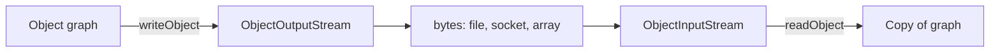
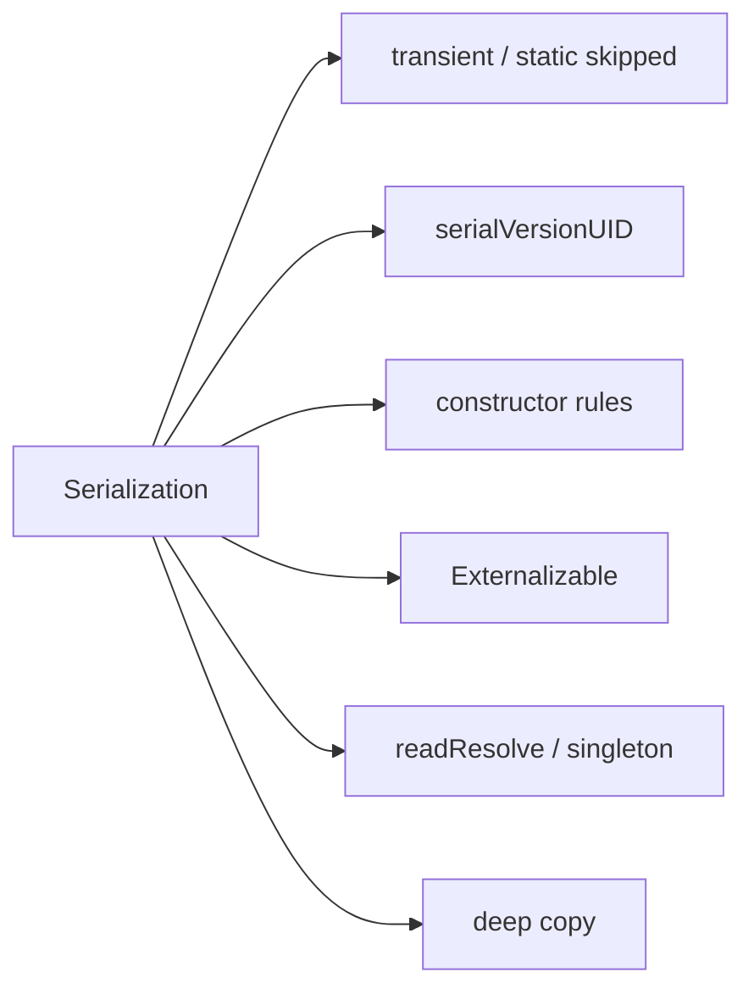

# Serialization and De-serialization in Java

**TL;DR:** **Serialization** turns an object graph into a byte stream (`ObjectOutputStream.writeObject`); **de-serialization** rebuilds it (`ObjectInputStream.readObject`). A class opts in by implementing the **marker interface** `java.io.Serializable` (no methods). `transient` and `static` fields are **not** saved; transient fields come back as `0/null/false`. De-serialization **does not call the constructor** of the serializable class (it calls the no-arg constructor of the first **non-serializable** parent). `serialVersionUID` guards class-version compatibility. `Externalizable` gives full manual control (needs a **public no-arg constructor**). Serialization is a security risk: never de-serialize untrusted data.

## Table of Contents

1. [TL;DR](#1-tldr)
2. [Why it matters](#2-why-it-matters)
3. [Prerequisites](#3-prerequisites)
4. [Mental model](#4-mental-model)
5. [Core concepts](#5-core-concepts)
6. [How it works](#6-how-it-works)
7. [Examples](#7-examples)
8. [Comparisons](#8-comparisons)
9. [Trade-offs](#9-trade-offs)
10. [Gotchas](#10-gotchas)
11. [Practical application](#11-practical-application)
12. [Interview prep](#12-interview-prep)
13. [Interview question bank](#13-interview-question-bank)
14. [Tricky code snippets](#14-tricky-code-snippets)
15. [Connections](#15-connections)
16. [Summary](#16-summary)
17. [Answers](#answers)

---

## 1. TL;DR

| Term | Meaning |
|---|---|
| Serialization | Object → bytes (`writeObject`) |
| De-serialization | Bytes → object (`readObject`) |
| `Serializable` | Marker interface; opt in |
| `transient` | Field skipped |
| `serialVersionUID` | Version stamp of the class |
| `Externalizable` | You write/read the fields yourself |
| `readResolve` | Replace the de-serialized object (singletons) |

**The analogy: flat-pack furniture.**

| Real world | Java |
|---|---|
| Disassembling a wardrobe into a box | Serialization |
| The box (shipped or stored) | Byte stream / file |
| Assembling it from the box | De-serialization |
| A part you choose not to pack (e.g. mirror) | `transient` field |
| Assembly manual version | `serialVersionUID` |
| Parts that were never in the box but belong to the shop | `static` fields |

**Running example:** a `User` (name `Ann`, age `30`) is written to a byte array and read back (Snippet 1).

---

## 2. Why it matters

**The problem.** Objects live in memory and die with the JVM. To save them, send them over a network, cache them or copy them, you need a byte representation.

**What goes wrong** (verified on Java 21):

| Mistake | Result | Snippet |
|---|---|---|
| Class doesn't implement `Serializable` | `NotSerializableException` | 2 |
| A field's class isn't serializable | `NotSerializableException` for the field's class | 9 |
| Expecting `transient` data back | `null` / `0` | 4, 27 |
| Expecting `static` values to be saved | Current static value is used | 5 |
| Expecting the constructor to run | It doesn't | 6 |
| Non-serializable parent | Parent's no-arg constructor runs; parent fields reset | 7 |
| Serializing a singleton | Creates a second instance | 24 |
| `Externalizable` without a public no-arg constructor | `InvalidClassException` | 16 |
| Reading in a different type | `ClassCastException` | 23 |
| Reading from a corrupt stream | `StreamCorruptedException` | 29 |

**Why interviewers ask.** "What is `Serializable`?", "what is `transient`?", "what's `serialVersionUID`?", "is the constructor called?", "serialization and inheritance", "how to protect a singleton?", "deep copy by serialization", "`Externalizable` vs `Serializable`", "security risks".

---

## 3. Prerequisites

| Prerequisite | One-line refresher | Importance |
|---|---|---|
| I/O streams | `ObjectOutputStream` wraps another `OutputStream` | Essential |
| Interfaces (marker) | An interface with no methods | Essential |
| Inheritance and constructors | Constructor chaining runs parents' constructors | Essential |
| Exceptions | `IOException`, `ClassNotFoundException` | Essential |
| `static` and `transient` | Per-class vs excluded | Important |
| Object references | Graphs, sharing, cycles | Important |

---

## 4. Mental model

> **The one picture to keep in your head:** serialization walks the **object graph** starting at the object you pass, writes each reachable object **once** (sharing and cycles are preserved), skips `transient` and `static` fields, and writes a **class descriptor** (name + `serialVersionUID`). De-serialization allocates objects **without running their constructors**, copies field values back, and only the first non-serializable ancestor is constructed normally.

```
 Object graph                      bytes                          new graph
 ┌──────┐   writeObject    AC ED 00 05 ... class desc, fields   readObject   ┌──────┐
 │ User │ ───────────────▶ (header)  ... values ...   ─────────▶ (no ctor)   │ User'│
 └──────┘                                                                      └──────┘
 transient / static fields are NOT in the bytes
```
*The stream starts with the magic header `AC ED 00 05`.*


*Serialization is a round trip: graph → bytes → equal-but-separate graph.*

---

## 5. Core concepts

### 5.1 Glossary

| Term | Definition |
|---|---|
| Object graph | The object plus everything reachable through fields |
| Marker interface | Interface with no methods (`Serializable`) |
| `ObjectOutputStream` | Writes objects and primitives (`writeObject`, `writeInt`...) |
| `ObjectInputStream` | Reads them back in the same order |
| `transient` | Modifier: field is not serialized |
| `serialVersionUID` | `static final long` identifying the class version |
| `defaultWriteObject` / `defaultReadObject` | Perform the standard field handling inside custom hooks |
| `readResolve` / `writeReplace` | Substitute the object after reading / before writing |
| `Externalizable` | Interface with `writeExternal`/`readExternal` |

### 5.2 Making a class serializable

```java
class User implements Serializable {   // opt in
    String name; int age;
}
```
`Serializable` has **no methods** (Snippet 3). The JVM checks `instanceof Serializable` at runtime; otherwise `NotSerializableException` (Snippet 2).

### 5.3 Writing and reading

```java
try (ObjectOutputStream o = new ObjectOutputStream(new FileOutputStream(f))) { o.writeObject(obj); }
try (ObjectInputStream i = new ObjectInputStream(new FileInputStream(f))) { Obj r = (Obj) i.readObject(); }
```
- `writeObject` throws `IOException`; `readObject` throws `IOException` **and** `ClassNotFoundException` (Snippet 31).
- Read in the **same order** you wrote; the type is only known at runtime, so you cast (Snippets 22, 23).
- You can mix `writeInt`, `writeUTF`... with `writeObject`.

### 5.4 What is and is not saved

| Member | Saved? | Snippet |
|---|---|---|
| Instance fields | Yes | 1 |
| `transient` fields | No (default value on read) | 4, 27 |
| `static` fields | No (class state, not object state) | 5 |
| `final` instance fields | Yes (restored by reflection) | 27 |
| Parent fields | Only if the parent is also `Serializable` | 7, 8, 30 |
| Methods | No (class bytes are not saved) | n/a |

### 5.5 Constructors and inheritance

| Situation | On de-serialization |
|---|---|
| Class is `Serializable` | Its constructor is **not** called (Snippet 6) |
| Parent is `Serializable` | Parent constructor **not** called (Snippet 8) |
| Parent **not** `Serializable` | Parent's **no-arg** constructor **is** called; parent fields get its initial values (Snippet 7) |
| Parent not serializable and has no no-arg constructor | Runtime `InvalidClassException` ⚠️ |

If a parent is `Serializable`, all subclasses are automatically serializable.

### 5.6 Object graphs, sharing and cycles

- Every object is written once; later references are written as handles, so **sharing is preserved** (Snippet 10) and **cycles work** (Snippet 11).
- Writing the same object twice to one stream writes it once; changes in between are **not** re-written unless you call `reset()` (Snippets 12, 13).
- **Every** reachable object must be serializable (Snippet 9).

### 5.7 `serialVersionUID`

- A `static final long` stamped into the stream. On read, it must match the local class, else `InvalidClassException`.
- If you don't declare it, the JVM **computes** one from the class structure (name, fields, methods) (Snippet 18); almost any edit changes it.
- Declare it explicitly (`private static final long serialVersionUID = 1L;`) for stable compatibility (Snippet 17). Compatible changes (adding fields) then still read.

### 5.8 Custom serialization hooks

```java
private void writeObject(ObjectOutputStream o) throws IOException { o.defaultWriteObject(); /* extra */ }
private void readObject(ObjectInputStream i) throws IOException, ClassNotFoundException { i.defaultReadObject(); /* extra */ }
```
- Must be `private` with these exact signatures; found by reflection (Snippet 14).
- Typical use: encrypt a `transient` password, or save derived state.

### 5.9 `Externalizable`

- Methods `writeExternal(ObjectOutput)` and `readExternal(ObjectInput)`.
- **You** write every field; nothing is automatic (Snippet 15).
- The class needs a **public no-arg constructor**, which **is** called on read (Snippets 15, 16).

### 5.10 `readResolve` and singletons

Ordinary serialization creates a **new** object, breaking singletons (Snippet 24). Adding `private Object readResolve() { return INSTANCE; }` fixes it. **Enums** are serialized by name and are safe singletons (Snippet 25).

### 5.11 Records, enums, collections

- **Enums:** by constant name; identity preserved (Snippet 25).
- **Records:** serialized by their components; the **canonical constructor is called** on read (Snippet 26) ⚠️ (an exception to "no constructor").
- **Collections:** `ArrayList`, `HashMap`, `LinkedList`, `TreeSet` are serializable (Snippet 20); `Optional` is **not** (Snippet 21).

---

## 6. How it works

### 6.1 The stream format

The stream begins with `AC ED` (magic) and `00 05` (version). Then come class descriptors (name, `serialVersionUID`, flags, field list) and values. A corrupt or foreign header raises `StreamCorruptedException` (Snippet 29); an empty stream raises `EOFException`.

### 6.2 Worked trace: the running example

```java
ObjectOutputStream o = new ObjectOutputStream(bo);   // 1
o.writeObject(new User());                           // 2
ObjectInputStream i = new ObjectInputStream(in);     // 3
User u = (User) i.readObject();                      // 4
```

| Step | What happens |
|---|---|
| 1 | Header `AC ED 00 05` written |
| 2 | Check `User` is `Serializable`; write class descriptor (name, UID); write `name`, `age` |
| 3 | Header read and validated |
| 4 | Descriptor read; local class found; `User` instance allocated **without its constructor**; fields filled |

Output: `Ann 30`.

### 6.3 Order of de-serialization with inheritance

1. Find the **first non-serializable** class up the hierarchy.
2. Run **its** no-arg constructor (and its parents').
3. Fill in the fields of each serializable class from the stream (parent first).

Snippet 7: `Parent ctor` prints, and `p` becomes `10` (set in that constructor), not the saved `50`.

### 6.4 `defaultWriteObject` flow

`ObjectOutputStream` looks for a private `writeObject`; if present it calls it. Inside, `defaultWriteObject()` writes the non-transient fields, then you write extras. `readObject` must read extras in the same order (Snippet 14).

### 6.5 Why a copy is deep

Because every reachable object is written and recreated, the result shares nothing with the original (Snippet 28). This is why serialization is a (slow) deep-copy trick.

---

## 7. Examples

### 7.1 Toy example

```java
static class User implements Serializable { String name = "Ann"; int age = 30; }
// write → bytes → read → "Ann 30"
```
Snippet 1.

### 7.2 Real-world examples

- **Saving state** to a file (game progress, caches) (Snippet 19).
- **Remote calls** (RMI) and old session replication.
- **Deep copy** via a serialization round trip (Snippet 28).
- **Protecting a secret** with `transient` or custom hooks (Snippets 4, 14).
- **Singleton safety** with `readResolve` (Snippet 24).

---

## 8. Comparisons

### 8.1 `Serializable` vs `Externalizable`

| | `Serializable` | `Externalizable` |
|---|---|---|
| Methods | None (marker) | `writeExternal`, `readExternal` |
| Fields saved | Automatic (non-transient) | You choose, all manual |
| Constructor on read | None for the class | **Public no-arg** constructor called |
| Speed/size | Slower, larger | Can be smaller/faster |
| Risk | Less code | More code, easier to get wrong |

### 8.2 `transient` vs `static`

| | `transient` | `static` |
|---|---|---|
| Belongs to | Instance | Class |
| Saved? | No | No |
| After read | Default value (`0/null/false`) | Whatever the class currently holds |

### 8.3 Serialization vs `clone()` vs copy constructor

| | Serialization | `clone()` | Copy constructor |
|---|---|---|---|
| Deep? | Yes, automatically | Shallow by default | You decide |
| Needs `Serializable` | Yes | `Cloneable` | No |
| Calls constructors | No | No | Yes |
| Speed | Slow | Fast | Fast |

### 8.4 `writeObject` hook vs `Externalizable`

| | Private `writeObject`/`readObject` | `Externalizable` |
|---|---|---|
| Starts from | Default behaviour (`defaultWriteObject`) | Nothing |
| Constructor | None | Public no-arg |

### 8.5 `writeObject` twice vs `reset()`

Without `reset()`, the second write is a back-reference (stale state, Snippet 12); with it, the object is re-written (Snippet 13). `writeUnshared` is a related API ⚠️.

### 8.6 Java serialization vs JSON

| | Java serialization | JSON (Jackson etc.) |
|---|---|---|
| Readable | No (binary) | Yes |
| Cross-language | No | Yes |
| Security | Risky with untrusted input | Safer, still validate |
| Needs library | No (JDK) | Yes |

---

## 9. Trade-offs

- **Convenience vs fragility:** one word (`implements Serializable`) saves state, but the byte format becomes part of your public API.
- **Compatibility:** changing fields/class names can break old data; pin `serialVersionUID`.
- **Security:** de-serializing untrusted bytes can run attacker-chosen code paths (gadget chains). Use allow-lists (`ObjectInputFilter`) ⚠️ or avoid Java serialization.
- **Performance:** slower and bigger than purpose-built formats.
- **Encapsulation:** private fields leak into the byte stream; protect secrets with `transient`.
- **Modern practice:** prefer JSON, Protobuf or similar for storage and transport; Effective Java advises avoiding Java serialization in new code.

---

## 10. Gotchas

### Myths

- ❌ **Myth:** "`Serializable` has methods to implement." ✅ **Reality:** it's an empty marker (Snippet 3).
- ❌ **Myth:** "The constructor runs on de-serialization." ✅ **Reality:** not for serializable classes (Snippet 6).
- ❌ **Myth:** "`static` fields are saved." ✅ **Reality:** they aren't (Snippet 5).
- ❌ **Myth:** "`transient` fields keep their old value." ✅ **Reality:** default value (Snippets 4, 27).
- ❌ **Myth:** "Parent fields are always saved." ✅ **Reality:** only if the parent is serializable (Snippet 7).
- ❌ **Myth:** "A serialized singleton is still a singleton." ✅ **Reality:** you get a new object without `readResolve` (Snippet 24).
- ❌ **Myth:** "Writing an object twice stores two copies." ✅ **Reality:** one copy plus a back-reference (Snippet 12).
- ❌ **Myth:** "All JDK classes are serializable." ✅ **Reality:** e.g. `Optional` isn't (Snippet 21).
- ❌ **Myth:** "`Externalizable` works without a public no-arg constructor." ✅ **Reality:** `InvalidClassException` (Snippet 16).

### Common mistakes and edge cases

- **A non-serializable field in a serializable class** (Snippet 9); mark it `transient` or make it serializable.
- **Forgetting `serialVersionUID`**: edits make old files unreadable.
- **Reading in the wrong order or type** (Snippets 22, 23).
- **Assuming records skip constructor validation** (Snippet 26).
- **Serializing huge graphs** accidentally (a field pointing to a big cache).
- **Reusing one `ObjectOutputStream` with changing objects** without `reset()` (Snippet 12).
- **Trusting data from the network** ⚠️.

---

## 11. Practical application

### Checklist
- [ ] Implement `Serializable` only when you must; document it.
- [ ] Declare `private static final long serialVersionUID`.
- [ ] Mark sensitive or derived fields `transient`.
- [ ] Ensure every field type is serializable (or transient).
- [ ] If a parent isn't serializable, give it an accessible no-arg constructor.
- [ ] Protect singletons with `readResolve` (or use an enum).
- [ ] Never de-serialize untrusted data; use `ObjectInputFilter` ⚠️.
- [ ] Use try-with-resources.

### Hands-on exercise

```java
static class A implements Serializable { int x = 1; transient int y = 2; static int z = 3; }
A o = new A(); o.x = 10; o.y = 20; A.z = 30;
// serialize o to bytes, then:
A.z = 99;
// de-serialize into r
System.out.println(r.x + " " + r.y + " " + A.z);
```
What is printed?

<details><summary>Solution</summary>

`10 0 99`. `x` is saved (10); `y` is `transient` so it becomes the default `0` (no constructor runs, so not `2` either); `z` is `static`, never part of the stream, so it stays at its current value `99`.

Verified on Java 21 (the stream also starts with `AC ED 00 05`).
</details>

---

## 12. Interview prep

Eight model answers, as you would say them aloud.

<details><summary>1. What is serialization and how do you do it?</summary>

Converting an object graph to bytes so it can be stored or sent. Implement `Serializable`, then `new ObjectOutputStream(out).writeObject(obj)`; read back with `ObjectInputStream.readObject()` and a cast (5.2, 5.3; Snippet 1).
</details>

<details><summary>2. What is the `Serializable` interface?</summary>

A marker interface with no methods; it tells the JVM the class may be serialized. Without it, `writeObject` throws `NotSerializableException` (5.2; Snippets 2, 3).
</details>

<details><summary>3. What does `transient` do, and what about `static`?</summary>

Both are skipped. A transient field comes back as `0/null/false`; a static field is class state, so the current class value is used (5.4; Snippets 4, 5).
</details>

<details><summary>4. Is the constructor called during de-serialization?</summary>

Not for serializable classes. The no-arg constructor of the first non-serializable parent is called, and parent fields reset to what it sets (5.5; Snippets 6, 7, 8).
</details>

<details><summary>5. What is `serialVersionUID`?</summary>

A version stamp checked on read; a mismatch gives `InvalidClassException`. Declare it explicitly, otherwise the JVM computes one from the class structure and almost any edit changes it (5.7; Snippets 17, 18).
</details>

<details><summary>6. How do you customize serialization?</summary>

Private `writeObject`/`readObject` hooks (calling `defaultWriteObject`/`defaultReadObject`) or implement `Externalizable` and write every field yourself, which needs a public no-arg constructor (5.8, 5.9; Snippets 14-16).
</details>

<details><summary>7. How do you keep a singleton a singleton?</summary>

Add `private Object readResolve() { return INSTANCE; }`, or use an enum (5.10; Snippets 24, 25).
</details>

<details><summary>8. What are the risks of Java serialization?</summary>

De-serializing untrusted bytes can trigger gadget-chain attacks; the format is fragile across versions and slow. Prefer JSON/Protobuf, or filter with `ObjectInputFilter` ⚠️ (Section 9).
</details>

---

## 13. Interview question bank


### 13.1 Basics (Q1–Q14)

<details><summary>Q1. What is serialization?</summary>

Converting an object graph to a byte stream (Snippet 1).
</details>

<details><summary>Q2. What is de-serialization?</summary>

Rebuilding the object graph from bytes (Snippet 1).
</details>

<details><summary>Q3. Which interface enables it?</summary>

`java.io.Serializable` (Snippet 2).
</details>

<details><summary>Q4. What is a marker interface?</summary>

One with no methods (Snippet 3).
</details>

<details><summary>Q5. Which class writes objects?</summary>

`ObjectOutputStream` (Snippet 1).
</details>

<details><summary>Q6. Which reads them?</summary>

`ObjectInputStream` (Snippet 1).
</details>

<details><summary>Q7. Which exceptions does `readObject` declare?</summary>

`IOException` and `ClassNotFoundException` (Snippet 31).
</details>

<details><summary>Q8. What if a class isn't serializable?</summary>

`NotSerializableException` (Snippet 2).
</details>

<details><summary>Q9. What if a field's class isn't serializable?</summary>

`NotSerializableException` naming that class (Snippet 9).
</details>

<details><summary>Q10. Magic header of the stream?</summary>

`AC ED 00 05` (Exercise).
</details>

<details><summary>Q11. Is the order of reading important?</summary>

Yes, same order as written (Snippet 22).
</details>

<details><summary>Q12. What if you cast to the wrong type?</summary>

`ClassCastException` (Snippet 23).
</details>

<details><summary>Q13. What does reading an empty stream do?</summary>

`EOFException` (Snippet 29).
</details>

<details><summary>Q14. What does reading junk do?</summary>

`StreamCorruptedException` (Snippet 29).
</details>


### 13.2 transient and static (Q15–Q24)

<details><summary>Q15. What does `transient` do?</summary>

Excludes the field (Snippet 4).
</details>

<details><summary>Q16. Value of a transient `int` after read?</summary>

`0` (Snippet 4).
</details>

<details><summary>Q17. Value of a transient `String`?</summary>

`null` (Snippet 4).
</details>

<details><summary>Q18. Value of a transient `boolean`/`double`?</summary>

`false`/`0.0` (Snippet 27).
</details>

<details><summary>Q19. Does the field initializer restore a transient value?</summary>

No, no constructor/initializers run (Snippet 27).
</details>

<details><summary>Q20. Are static fields serialized?</summary>

No (Snippet 5).
</details>

<details><summary>Q21. What value does a static field show after read?</summary>

The current value held by the class (Snippet 5).
</details>

<details><summary>Q22. Are `final` instance fields serialized?</summary>

Yes (Snippet 27).
</details>

<details><summary>Q23. Is a transient field in a parent restored?</summary>

No, default value (Snippet 30).
</details>

<details><summary>Q24. When would you make a field transient?</summary>

Secrets, caches, derived data, non-serializable resources (Snippet 4).
</details>


### 13.3 Constructors and inheritance (Q25–Q34)

<details><summary>Q25. Is the constructor called on read?</summary>

Not for serializable classes (Snippet 6).
</details>

<details><summary>Q26. Is the parent constructor called if the parent is serializable?</summary>

No (Snippet 8).
</details>

<details><summary>Q27. If the parent isn't serializable?</summary>

Its no-arg constructor runs (Snippet 7).
</details>

<details><summary>Q28. What values do parent fields get then?</summary>

Whatever that constructor/initializers set (Snippet 7).
</details>

<details><summary>Q29. What if that parent has no accessible no-arg constructor?</summary>

`InvalidClassException` at run time ⚠️.
</details>

<details><summary>Q30. If the parent is serializable, is the child?</summary>

Yes, automatically (Snippet 8).
</details>

<details><summary>Q31. Can a child be serializable while its parent isn't?</summary>

Yes (Snippet 7).
</details>

<details><summary>Q32. Are the parent's fields saved when the parent isn't serializable?</summary>

No (Snippet 7).
</details>

<details><summary>Q33. Which is constructed first?</summary>

The first non-serializable ancestor (6.3).
</details>

<details><summary>Q34. How are records handled?</summary>

Canonical constructor is called on read (Snippet 26).
</details>


### 13.4 Object graphs (Q35–Q42)

<details><summary>Q35. Is sharing preserved?</summary>

Yes (Snippet 10).
</details>

<details><summary>Q36. Are cycles supported?</summary>

Yes (Snippet 11).
</details>

<details><summary>Q37. Is the copy deep or shallow?</summary>

Deep, the whole graph is copied (Snippet 28).
</details>

<details><summary>Q38. Writing an object twice?</summary>

One copy plus a back-reference (Snippet 12).
</details>

<details><summary>Q39. How to force a rewrite?</summary>

`reset()` (Snippet 13).
</details>

<details><summary>Q40. Are collections serializable?</summary>

The standard ones are (Snippet 20).
</details>

<details><summary>Q41. Is `Optional` serializable?</summary>

No (Snippet 21).
</details>

<details><summary>Q42. Are enums serializable?</summary>

Yes, by name with identity preserved (Snippet 25).
</details>


### 13.5 serialVersionUID (Q43–Q48)

<details><summary>Q43. What is it?</summary>

A `long` version ID of the class (Snippet 17).
</details>

<details><summary>Q44. What if you don't declare it?</summary>

The JVM computes it (Snippet 18).
</details>

<details><summary>Q45. What if it differs on read?</summary>

`InvalidClassException`.
</details>

<details><summary>Q46. What does editing a class do to a computed UID?</summary>

Usually changes it (Snippet 18).
</details>

<details><summary>Q47. Is it `static`?</summary>

Yes, `static final long`; it's still written to the stream.
</details>

<details><summary>Q48. Which compatible changes are allowed with a fixed UID?</summary>

Adding fields, adding methods; removed/added fields get defaults.
</details>


### 13.6 Customization and Externalizable (Q49–Q58)

<details><summary>Q49. Name the custom hooks.</summary>

`writeObject`, `readObject`, `readResolve`, `writeReplace` (Snippets 14, 24).
</details>

<details><summary>Q50. What signature must `writeObject` have?</summary>

`private void writeObject(ObjectOutputStream) throws IOException` (Snippet 14).
</details>

<details><summary>Q51. What does `defaultWriteObject` do?</summary>

Writes the normal non-transient fields (Snippet 14).
</details>

<details><summary>Q52. Order of extra data?</summary>

Must be read in the same order as written (Snippet 14).
</details>

<details><summary>Q53. What is `Externalizable`?</summary>

Interface with `writeExternal`/`readExternal` (Snippet 15).
</details>

<details><summary>Q54. Which constructor is used?</summary>

The public no-arg constructor (Snippet 15).
</details>

<details><summary>Q55. Without it?</summary>

`InvalidClassException` (Snippet 16).
</details>

<details><summary>Q56. What fields are saved by default?</summary>

None, you write them (Snippet 15).
</details>

<details><summary>Q57. What does `readResolve` return?</summary>

The object to use instead of the new one (Snippet 24).
</details>

<details><summary>Q58. What does `writeReplace` do?</summary>

Substitutes another object before writing ⚠️.
</details>


### 13.7 Design and security (Q59–Q64)

<details><summary>Q59. How can you deep-copy with serialization?</summary>

Round-trip through a byte array (Snippet 28).
</details>

<details><summary>Q60. Why is it a poor choice for performance?</summary>

Reflection, class descriptors, large output.
</details>

<details><summary>Q61. What is the security risk?</summary>

Untrusted input can run gadget chains ⚠️.
</details>

<details><summary>Q62. How do you mitigate?</summary>

Avoid it, or use `ObjectInputFilter` allow-lists ⚠️.
</details>

<details><summary>Q63. Which alternatives exist?</summary>

JSON, Protobuf, Avro, custom formats.
</details>

<details><summary>Q64. What does Effective Java advise?</summary>

Avoid Java serialization in new designs; if you must, be careful.
</details>

---

## 14. Tricky code snippets

31 snippets, each compiled and run on OpenJDK 21. Predict the output (or the compile error) before opening the answer. Snippets use in-memory streams (`ByteArrayOutputStream`) or temporary files. Nested classes are `static` so they can be serialized without an outer instance. Exception messages that contain `Main$` are shortened to the class name ⚠️ (the full text differs by nesting).

### Snippet 1: Round trip

```java
import java.io.*;
public class Main {
    static class User implements Serializable { String name = "Ann"; int age = 30; }
    public static void main(String[] a) throws Exception {
        ByteArrayOutputStream bo = new ByteArrayOutputStream();
        try (ObjectOutputStream o = new ObjectOutputStream(bo)) { o.writeObject(new User()); }
        try (ObjectInputStream i = new ObjectInputStream(new ByteArrayInputStream(bo.toByteArray()))) {
            User u = (User) i.readObject();
            System.out.println(u.name + " " + u.age);
        }
    }
}
```

<details><summary>Answer</summary>

```
Ann 30
```

Trace in 6.2.
</details>

### Snippet 2: Not `Serializable`

```java
import java.io.*;
public class Main {
    static class P { }
    public static void main(String[] a) throws Exception {
        try (ObjectOutputStream o = new ObjectOutputStream(new ByteArrayOutputStream())) { o.writeObject(new P()); }
        catch (NotSerializableException e) { System.out.println("NotSerializableException: " + e.getMessage().replaceAll("^.*\\$", "")); }
    }
}
```

<details><summary>Answer</summary>

```
NotSerializableException: P
```

The class doesn't implement the marker interface.
</details>

### Snippet 3: `Serializable` members

```java
import java.io.*;
public class Main {
    public static void main(String[] a) {
        System.out.println(Serializable.class.getMethods().length);
        System.out.println(Serializable.class.isInterface());
    }
}
```

<details><summary>Answer</summary>

```
0
true
```

It's an interface with no methods.
</details>

### Snippet 4: `transient`

```java
import java.io.*;
public class Main {
    static class U implements Serializable { String name = "Ann"; transient String pwd = "secret"; transient int n = 7; }
    public static void main(String[] a) throws Exception {
        ByteArrayOutputStream bo = new ByteArrayOutputStream();
        try (ObjectOutputStream o = new ObjectOutputStream(bo)) { o.writeObject(new U()); }
        U u = (U) new ObjectInputStream(new ByteArrayInputStream(bo.toByteArray())).readObject();
        System.out.println(u.name + " " + u.pwd + " " + u.n);
    }
}
```

<details><summary>Answer</summary>

```
Ann null 0
```

Transient fields get default values; no constructor or initializer runs.
</details>

### Snippet 5: `static`

```java
import java.io.*;
public class Main {
    static class S implements Serializable { static int count = 1; int v = 5; }
    public static void main(String[] a) throws Exception {
        ByteArrayOutputStream bo = new ByteArrayOutputStream();
        try (ObjectOutputStream o = new ObjectOutputStream(bo)) { o.writeObject(new S()); }
        S.count = 99;
        S s = (S) new ObjectInputStream(new ByteArrayInputStream(bo.toByteArray())).readObject();
        System.out.println(s.v + " " + S.count);
    }
}
```

<details><summary>Answer</summary>

```
5 99
```

Statics aren't in the stream; the current value is `99`.
</details>

### Snippet 6: Constructor on read

```java
import java.io.*;
public class Main {
    static class S implements Serializable { int v; S() { System.out.println("S ctor"); v = 1; } }
    public static void main(String[] a) throws Exception {
        S s = new S(); s.v = 42;
        ByteArrayOutputStream bo = new ByteArrayOutputStream();
        try (ObjectOutputStream o = new ObjectOutputStream(bo)) { o.writeObject(s); }
        System.out.println("deserializing");
        S r = (S) new ObjectInputStream(new ByteArrayInputStream(bo.toByteArray())).readObject();
        System.out.println(r.v);
    }
}
```

<details><summary>Answer</summary>

```
S ctor
deserializing
42
```

The constructor ran once (when created), not during read.
</details>

### Snippet 7: Non-serializable parent

```java
import java.io.*;
public class Main {
    static class Parent { int p = 1; Parent() { System.out.println("Parent ctor"); p = 10; } }
    static class Child extends Parent implements Serializable { int c = 2; }
    public static void main(String[] a) throws Exception {
        Child ch = new Child(); ch.p = 50; ch.c = 60;
        ByteArrayOutputStream bo = new ByteArrayOutputStream();
        try (ObjectOutputStream o = new ObjectOutputStream(bo)) { o.writeObject(ch); }
        System.out.println("deserializing");
        Child r = (Child) new ObjectInputStream(new ByteArrayInputStream(bo.toByteArray())).readObject();
        System.out.println(r.p + " " + r.c);
    }
}
```

<details><summary>Answer</summary>

```
Parent ctor
deserializing
Parent ctor
10 60
```

The parent's no-arg constructor runs on read, so `p` is 10 (not 50); `c` is restored (60).
</details>

### Snippet 8: Serializable parent

```java
import java.io.*;
public class Main {
    static class Parent implements Serializable { int p = 1; Parent() { System.out.println("Parent ctor"); } }
    static class Child extends Parent { int c = 2; }
    public static void main(String[] a) throws Exception {
        Child ch = new Child(); ch.p = 50; ch.c = 60;
        ByteArrayOutputStream bo = new ByteArrayOutputStream();
        try (ObjectOutputStream o = new ObjectOutputStream(bo)) { o.writeObject(ch); }
        System.out.println("deserializing");
        Child r = (Child) new ObjectInputStream(new ByteArrayInputStream(bo.toByteArray())).readObject();
        System.out.println(r.p + " " + r.c);
    }
}
```

<details><summary>Answer</summary>

```
Parent ctor
deserializing
50 60
```

No constructor runs on read; both fields are restored.
</details>

### Snippet 9: Non-serializable field

```java
import java.io.*;
public class Main {
    static class Engine { }
    static class Car implements Serializable { Engine e = new Engine(); }
    public static void main(String[] a) throws Exception {
        try (ObjectOutputStream o = new ObjectOutputStream(new ByteArrayOutputStream())) { o.writeObject(new Car()); }
        catch (NotSerializableException e) { System.out.println("NotSerializableException: " + e.getMessage().replaceAll("^.*\\$", "")); }
    }
}
```

<details><summary>Answer</summary>

```
NotSerializableException: Engine
```

The exception names the field's class, not `Car`.
</details>

### Snippet 10: Sharing

```java
import java.io.*;
public class Main {
    static class Node implements Serializable { Node next; }
    static class Pair implements Serializable { Node x, y; }
    public static void main(String[] a) throws Exception {
        Pair p = new Pair(); p.x = new Node(); p.y = p.x;
        ByteArrayOutputStream bo = new ByteArrayOutputStream();
        try (ObjectOutputStream o = new ObjectOutputStream(bo)) { o.writeObject(p); }
        Pair r = (Pair) new ObjectInputStream(new ByteArrayInputStream(bo.toByteArray())).readObject();
        System.out.println((r.x == r.y) + " " + (r.x != p.x));
    }
}
```

<details><summary>Answer</summary>

```
true true
```

Shared references stay shared; the copy is a different object.
</details>

### Snippet 11: Cycles

```java
import java.io.*;
public class Main {
    static class Node implements Serializable { Node other; }
    public static void main(String[] a) throws Exception {
        Node n1 = new Node(), n2 = new Node(); n1.other = n2; n2.other = n1;
        ByteArrayOutputStream bo = new ByteArrayOutputStream();
        try (ObjectOutputStream o = new ObjectOutputStream(bo)) { o.writeObject(n1); }
        Node r = (Node) new ObjectInputStream(new ByteArrayInputStream(bo.toByteArray())).readObject();
        System.out.println(r.other.other == r);
    }
}
```

<details><summary>Answer</summary>

```
true
```

Back-references rebuild the cycle.
</details>

### Snippet 12: Writing twice

```java
import java.io.*;
public class Main {
    static class B implements Serializable { int v = 1; }
    public static void main(String[] a) throws Exception {
        B b = new B();
        ByteArrayOutputStream bo = new ByteArrayOutputStream();
        try (ObjectOutputStream o = new ObjectOutputStream(bo)) { o.writeObject(b); b.v = 2; o.writeObject(b); }
        ObjectInputStream i = new ObjectInputStream(new ByteArrayInputStream(bo.toByteArray()));
        B x = (B) i.readObject(), y = (B) i.readObject();
        System.out.println(x.v + " " + y.v + " " + (x == y));
    }
}
```

<details><summary>Answer</summary>

```
1 1 true
```

The second write is a back-reference to the first.
</details>

### Snippet 13: `reset()`

```java
import java.io.*;
public class Main {
    static class B implements Serializable { int v = 1; }
    public static void main(String[] a) throws Exception {
        B b = new B();
        ByteArrayOutputStream bo = new ByteArrayOutputStream();
        try (ObjectOutputStream o = new ObjectOutputStream(bo)) { o.writeObject(b); b.v = 2; o.reset(); o.writeObject(b); }
        ObjectInputStream i = new ObjectInputStream(new ByteArrayInputStream(bo.toByteArray()));
        B x = (B) i.readObject(), y = (B) i.readObject();
        System.out.println(x.v + " " + y.v + " " + (x == y));
    }
}
```

<details><summary>Answer</summary>

```
1 2 false
```

`reset()` clears the handle table, so the changed object is re-written.
</details>

### Snippet 14: Custom hooks

```java
import java.io.*;
public class Main {
    static class A implements Serializable {
        String user = "ann"; transient String pwd = "pw";
        private void writeObject(ObjectOutputStream o) throws IOException {
            o.defaultWriteObject(); o.writeObject(new StringBuilder(pwd).reverse().toString());
        }
        private void readObject(ObjectInputStream i) throws IOException, ClassNotFoundException {
            i.defaultReadObject(); pwd = new StringBuilder((String) i.readObject()).reverse().toString();
        }
    }
    public static void main(String[] a) throws Exception {
        ByteArrayOutputStream bo = new ByteArrayOutputStream();
        try (ObjectOutputStream o = new ObjectOutputStream(bo)) { o.writeObject(new A()); }
        A r = (A) new ObjectInputStream(new ByteArrayInputStream(bo.toByteArray())).readObject();
        System.out.println(r.user + " " + r.pwd);
    }
}
```

<details><summary>Answer</summary>

```
ann pw
```

The transient `pwd` is reversed on write and reversed back on read.
</details>

### Snippet 15: `Externalizable`

```java
import java.io.*;
public class Main {
    static class E implements Externalizable {
        int x = 1; int y = 2;
        public E() { System.out.println("public no-arg ctor"); x = 0; y = 0; }
        public void writeExternal(ObjectOutput o) throws IOException { o.writeInt(x); }
        public void readExternal(ObjectInput i) throws IOException { x = i.readInt(); }
    }
    public static void main(String[] a) throws Exception {
        E e = new E(); e.x = 5; e.y = 6;
        ByteArrayOutputStream bo = new ByteArrayOutputStream();
        try (ObjectOutputStream o = new ObjectOutputStream(bo)) { o.writeObject(e); }
        E r = (E) new ObjectInputStream(new ByteArrayInputStream(bo.toByteArray())).readObject();
        System.out.println(r.x + " " + r.y);
    }
}
```

<details><summary>Answer</summary>

```
public no-arg ctor
public no-arg ctor
5 0
```

The constructor runs on creation and on read; only `x` was written, so `y` is `0` (set in the constructor).
</details>

### Snippet 16: No no-arg constructor

```java
import java.io.*;
public class Main {
    static class E implements Externalizable {
        int x; E(int x) { this.x = x; }
        public void writeExternal(ObjectOutput o) throws IOException { o.writeInt(x); }
        public void readExternal(ObjectInput i) throws IOException { x = i.readInt(); }
    }
    public static void main(String[] a) throws Exception {
        ByteArrayOutputStream bo = new ByteArrayOutputStream();
        try (ObjectOutputStream o = new ObjectOutputStream(bo)) { o.writeObject(new E(1)); }
        try { new ObjectInputStream(new ByteArrayInputStream(bo.toByteArray())).readObject(); }
        catch (InvalidClassException e) { System.out.println("InvalidClassException: " + e.getMessage().replaceAll("^.*\\$", "")); }
    }
}
```

<details><summary>Answer</summary>

```
InvalidClassException: E; no valid constructor
```

`Externalizable` requires a public no-arg constructor. ⚠️ Message wording.
</details>

### Snippet 17: Explicit `serialVersionUID`

```java
import java.io.*;
public class Main {
    static class V1 implements Serializable { private static final long serialVersionUID = 1L; int x = 1; }
    public static void main(String[] a) throws Exception {
        ObjectStreamClass d = ObjectStreamClass.lookup(V1.class);
        System.out.println(d.getSerialVersionUID());
        System.out.println(ObjectStreamClass.lookup(String.class).getSerialVersionUID() != 0);
    }
}
```

<details><summary>Answer</summary>

```
1
true
```

Declared UID is used as is; `String` has one too.
</details>

### Snippet 18: Computed UID

```java
import java.io.*;
public class Main {
    static class N implements Serializable { int x; }
    static class M implements Serializable { int x; int y; }
    public static void main(String[] a) throws Exception {
        long u1 = ObjectStreamClass.lookup(N.class).getSerialVersionUID();
        long u2 = ObjectStreamClass.lookup(M.class).getSerialVersionUID();
        System.out.println((u1 != 0) + " " + (u1 != u2));
    }
}
```

<details><summary>Answer</summary>

```
true true
```

A UID is computed from the class structure, so different classes differ.
</details>

### Snippet 19: File round trip

```java
import java.io.*;
import java.util.*;
public class Main {
    static class S implements Serializable { String n; List<Integer> l = new ArrayList<>(); S(String n) { this.n = n; } }
    public static void main(String[] a) throws Exception {
        File f = File.createTempFile("ser", ".bin");
        S s = new S("x"); s.l.add(1); s.l.add(2);
        try (ObjectOutputStream o = new ObjectOutputStream(new FileOutputStream(f))) { o.writeObject(s); }
        try (ObjectInputStream i = new ObjectInputStream(new FileInputStream(f))) {
            S r = (S) i.readObject();
            System.out.println(r.n + " " + r.l);
        }
        System.out.println(f.length() > 0);
        f.delete();
    }
}
```

<details><summary>Answer</summary>

```
x [1, 2]
true
```

`ArrayList` is serializable too.
</details>

### Snippet 20: Collections

```java
import java.io.*;
import java.util.*;
public class Main {
    public static void main(String[] a) {
        System.out.println((new ArrayList<>() instanceof Serializable) + " " + (new HashMap<>() instanceof Serializable)
            + " " + (new LinkedList<>() instanceof Serializable) + " " + (new TreeSet<>() instanceof Serializable));
        System.out.println(Arrays.asList(1) instanceof Serializable);
    }
}
```

<details><summary>Answer</summary>

```
true true true true
true
```

Standard collections and `Arrays.asList` are serializable.
</details>

### Snippet 21: `Optional`

```java
import java.util.*;
import java.io.*;
public class Main {
    public static void main(String[] a) {
        Serializable s = Optional.empty();
        System.out.println(s);
    }
}
```

<details><summary>Answer</summary>

Compile error: *incompatible types: no instance(s) of type variable(s) T exist so that Optional<T> conforms to Serializable*.

`Optional` is deliberately not `Serializable`.
</details>

### Snippet 22: Mixed reads

```java
import java.io.*;
public class Main {
    public static void main(String[] a) throws Exception {
        ByteArrayOutputStream bo = new ByteArrayOutputStream();
        try (ObjectOutputStream o = new ObjectOutputStream(bo)) { o.writeObject("s"); o.writeInt(5); o.writeObject(Integer.valueOf(7)); }
        ObjectInputStream i = new ObjectInputStream(new ByteArrayInputStream(bo.toByteArray()));
        System.out.println(i.readObject() + " " + i.readInt() + " " + i.readObject());
        try { i.readObject(); } catch (EOFException e) { System.out.println("EOFException"); }
    }
}
```

<details><summary>Answer</summary>

```
s 5 7
EOFException
```

Read in the order written; a further read hits the end.
</details>

### Snippet 23: Wrong cast

```java
import java.io.*;
public class Main {
    public static void main(String[] a) throws Exception {
        ByteArrayOutputStream bo = new ByteArrayOutputStream();
        try (ObjectOutputStream o = new ObjectOutputStream(bo)) { o.writeObject("text"); }
        Object r = new ObjectInputStream(new ByteArrayInputStream(bo.toByteArray())).readObject();
        try { Integer i = (Integer) r; } catch (ClassCastException e) { System.out.println("ClassCastException"); }
        System.out.println(r.getClass().getSimpleName());
    }
}
```

<details><summary>Answer</summary>

```
ClassCastException
String
```

The stored object is a `String`.
</details>

### Snippet 24: Singleton

```java
import java.io.*;
public class Main {
    static class S1 implements Serializable { static final S1 I = new S1(); private S1() {} }
    static class S2 implements Serializable { static final S2 I = new S2(); private S2() {}
        private Object readResolve() { return I; } }
    static Object copy(Object o) throws Exception {
        ByteArrayOutputStream bo = new ByteArrayOutputStream();
        try (ObjectOutputStream out = new ObjectOutputStream(bo)) { out.writeObject(o); }
        return new ObjectInputStream(new ByteArrayInputStream(bo.toByteArray())).readObject();
    }
    public static void main(String[] a) throws Exception {
        System.out.println(copy(S1.I) == S1.I);
        System.out.println(copy(S2.I) == S2.I);
    }
}
```

<details><summary>Answer</summary>

```
false
true
```

Without `readResolve` a new instance is created.
</details>

### Snippet 25: Enum

```java
import java.io.*;
public class Main {
    enum C { RED, GREEN }
    public static void main(String[] a) throws Exception {
        ByteArrayOutputStream bo = new ByteArrayOutputStream();
        try (ObjectOutputStream o = new ObjectOutputStream(bo)) { o.writeObject(C.GREEN); }
        Object r = new ObjectInputStream(new ByteArrayInputStream(bo.toByteArray())).readObject();
        System.out.println((r == C.GREEN) + " " + (C.GREEN instanceof Serializable));
    }
}
```

<details><summary>Answer</summary>

```
true true
```

Enums are written by name and resolved to the constant.
</details>

### Snippet 26: Record

```java
import java.io.*;
public class Main {
    record P(int x, String s) implements Serializable {
        P { System.out.println("canonical ctor " + x); }
    }
    public static void main(String[] a) throws Exception {
        ByteArrayOutputStream bo = new ByteArrayOutputStream();
        try (ObjectOutputStream o = new ObjectOutputStream(bo)) { o.writeObject(new P(3, "a")); }
        System.out.println("deserializing");
        P r = (P) new ObjectInputStream(new ByteArrayInputStream(bo.toByteArray())).readObject();
        System.out.println(r);
    }
}
```

<details><summary>Answer</summary>

```
canonical ctor 3
deserializing
canonical ctor 3
P[x=3, s=a]
```

Records are rebuilt through the canonical constructor.
</details>

### Snippet 27: `final` and `transient` defaults

```java
import java.io.*;
public class Main {
    static class F implements Serializable { final int f = 5; transient boolean flag = true; transient String s = "x"; transient double d = 1.5; }
    public static void main(String[] a) throws Exception {
        ByteArrayOutputStream bo = new ByteArrayOutputStream();
        try (ObjectOutputStream o = new ObjectOutputStream(bo)) { o.writeObject(new F()); }
        F r = (F) new ObjectInputStream(new ByteArrayInputStream(bo.toByteArray())).readObject();
        System.out.println(r.f + " " + r.flag + " " + r.s + " " + r.d);
    }
}
```

<details><summary>Answer</summary>

```
5 false null 0.0
```

`final` is saved; transient fields get type defaults, not initializer values.
</details>

### Snippet 28: Deep copy

```java
import java.io.*;
import java.util.*;
public class Main {
    static class Box implements Serializable { List<String> items = new ArrayList<>(List.of("a")); }
    public static void main(String[] a) throws Exception {
        Box b = new Box();
        ByteArrayOutputStream bo = new ByteArrayOutputStream();
        try (ObjectOutputStream o = new ObjectOutputStream(bo)) { o.writeObject(b); }
        Box c = (Box) new ObjectInputStream(new ByteArrayInputStream(bo.toByteArray())).readObject();
        c.items.add("b");
        System.out.println(b.items + " " + c.items + " " + (b.items != c.items));
    }
}
```

<details><summary>Answer</summary>

```
[a] [a, b] true
```

The list is copied, so changes don't leak.
</details>

### Snippet 29: Bad header

```java
import java.io.*;
public class Main {
    public static void main(String[] a) throws Exception {
        try { new ObjectInputStream(new ByteArrayInputStream(new byte[]{1, 2, 3, 4})); }
        catch (StreamCorruptedException e) { System.out.println("StreamCorruptedException"); }
        try { new ObjectInputStream(new ByteArrayInputStream(new byte[0])); }
        catch (EOFException e) { System.out.println("EOFException"); }
    }
}
```

<details><summary>Answer</summary>

```
StreamCorruptedException
EOFException
```

Wrong magic bytes vs an empty stream; both are thrown by the constructor.
</details>

### Snippet 30: Transient in parent and child

```java
import java.io.*;
public class Main {
    static class P implements Serializable { transient int t = 1; int v = 2; }
    static class C extends P { transient int ct = 3; int cv = 4; }
    public static void main(String[] a) throws Exception {
        C c = new C(); c.t = 10; c.v = 20; c.ct = 30; c.cv = 40;
        ByteArrayOutputStream bo = new ByteArrayOutputStream();
        try (ObjectOutputStream o = new ObjectOutputStream(bo)) { o.writeObject(c); }
        C r = (C) new ObjectInputStream(new ByteArrayInputStream(bo.toByteArray())).readObject();
        System.out.println(r.t + " " + r.v + " " + r.ct + " " + r.cv);
    }
}
```

<details><summary>Answer</summary>

```
0 20 0 40
```

Both transient fields reset; both non-transient fields are restored.
</details>

### Snippet 31: Declared exceptions

```java
import java.io.*;
public class Main {
    public static void main(String[] a) throws Exception {
        System.out.println(ObjectInputStream.class.getMethod("readObject").getExceptionTypes().length);
        System.out.println(ObjectOutputStream.class.getMethod("writeObject", Object.class).getExceptionTypes()[0].getSimpleName());
    }
}
```

<details><summary>Answer</summary>

```
2
IOException
```

`readObject` declares two exceptions; `writeObject` declares `IOException`.
</details>

---

## 15. Connections

| Related topic | How it connects |
|---|---|
| I/O streams | `ObjectOutputStream`/`ObjectInputStream` wrap byte streams |
| Shallow vs deep copy | Serialization gives a deep copy |
| Object class | `equals/hashCode` aren't used by serialization, but matter after read |
| Singleton pattern | `readResolve`, enum singletons |
| Inheritance and constructors | Which constructors run on read |
| Collections | Standard collections are serializable |
| Records and enums | Special serialization rules |
| Security | Gadget chains, `ObjectInputFilter` ⚠️ |


*The main topics under serialization.*

---

## 16. Summary

### 60-second card

- `implements Serializable` (empty marker) + `ObjectOutputStream.writeObject` / `ObjectInputStream.readObject`.
- Whole object graph is saved; sharing and cycles preserved.
- `transient` and `static` are not saved; transient comes back as the default.
- Constructor of a serializable class is **not** called; first non-serializable parent's no-arg constructor **is**.
- Declare `serialVersionUID`.
- `Externalizable`: manual, public no-arg constructor required.
- `readResolve` or enum for singletons.
- Don't de-serialize untrusted data.

### Cheat sheet

```java
class Doc implements Serializable {
    private static final long serialVersionUID = 1L;
    String title; transient String cache;
}
try (var o = new ObjectOutputStream(new FileOutputStream("d.bin"))) { o.writeObject(doc); }
try (var i = new ObjectInputStream(new FileInputStream("d.bin")))  { Doc d = (Doc) i.readObject(); }
```

| Need | Use |
|---|---|
| Skip a field | `transient` |
| Version stability | explicit `serialVersionUID` |
| Customize | private `writeObject`/`readObject` |
| Full control | `Externalizable` |
| Safe singleton | `readResolve` or `enum` |
| Deep copy | Serialize round trip (or a copy constructor) |

### Self-test

1. What is a marker interface?
2. What does `transient` do? And `static`?
3. Is the constructor called during de-serialization?
4. What if the parent isn't serializable?
5. What is `serialVersionUID` for?
6. What must an `Externalizable` class have?
7. How do you keep a singleton after de-serialization?
8. Why is Java serialization risky?

### Anki flashcards

```
Serializable :: Marker interface (no methods)
transient :: Field not serialized; default value on read
static :: Not serialized (class state)
Constructor on read :: Not called for the serializable class
Non-serializable parent :: Its no-arg constructor runs
serialVersionUID :: Class version stamp; mismatch = InvalidClassException
Externalizable needs :: public no-arg constructor
readResolve :: Returns the instance to use after reading (singletons)
```

### Resources

- Java Object Serialization Specification: docs.oracle.com/en/java/javase/21/docs/specs/serialization/
- API docs: `java.io.Serializable`, `ObjectOutputStream`, `ObjectInputStream`, `ObjectInputFilter`
- *Effective Java*, Joshua Bloch: chapter on serialization (items on implementing `Serializable` carefully and on `readResolve`)

---

## Answers

1. An interface with no methods that tags a class (`Serializable`).
2. Both are skipped; transient gets a default value, static keeps the class's current value.
3. No, not for serializable classes (records use the canonical constructor).
4. The parent's no-arg constructor runs, and its fields are not restored from the stream.
5. To check that the class version on read matches the one written.
6. A public no-arg constructor, plus `writeExternal`/`readExternal`.
7. `readResolve` returning the instance, or use an `enum`.
8. Untrusted data can trigger malicious code paths (gadget chains); the format is also fragile.
