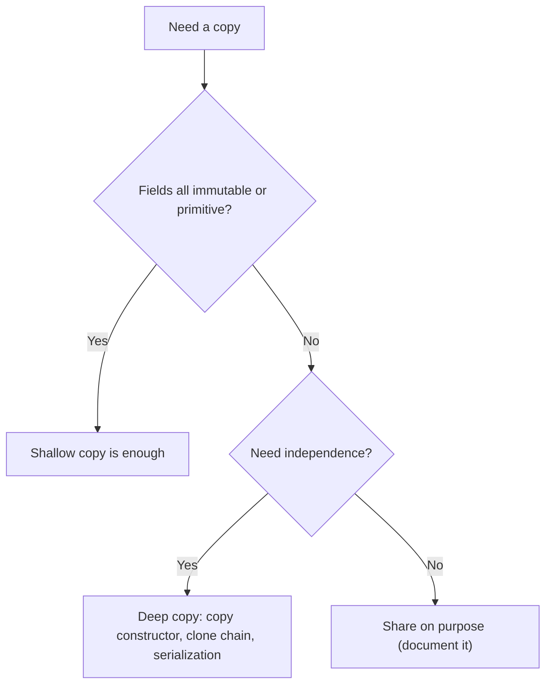
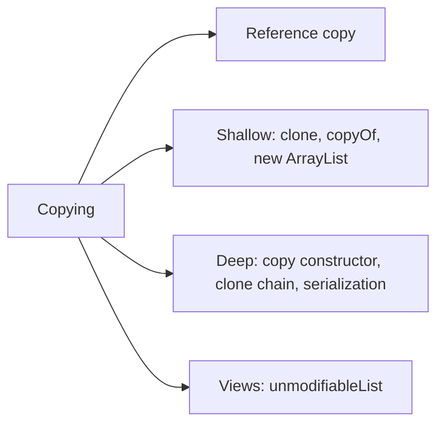

# Shallow Copy and Deep Copy in Java

**TL;DR:** `p2 = p1` copies the **reference**, not the object. A **shallow copy** (default `Object.clone()`, `new ArrayList<>(list)`, `Arrays.copyOf`, `array.clone()`) creates a new top-level object but its **reference fields still point to the same child objects**. A **deep copy** also copies the children (recursively), so nothing is shared. Java gives you shallow `clone()` (needs `Cloneable`, a marker interface; `Object.clone()` is `protected` and `native`; it **does not call constructors**). For deep copies prefer a **copy constructor** or a copy factory; serialization round trips also work but are slow. Immutable fields (`String`, wrappers) are safe to share.

## Table of Contents

1. [TL;DR](#1-tldr)
2. [Why it matters](#2-why-it-matters)
3. [Prerequisites](#3-prerequisites)
4. [Mental model](#4-mental-model)
5. [Core concepts](#5-core-concepts)
6. [How it works](#6-how-it-works)
7. [Examples](#7-examples)
8. [Comparisons](#8-comparisons)
9. [Trade-offs](#9-trade-offs)
10. [Gotchas](#10-gotchas)
11. [Practical application](#11-practical-application)
12. [Interview prep](#12-interview-prep)
13. [Interview question bank](#13-interview-question-bank)
14. [Tricky code snippets](#14-tricky-code-snippets)
15. [Connections](#15-connections)
16. [Summary](#16-summary)
17. [Answers](#answers)

---

## 1. TL;DR

| Kind | What is copied | Children shared? |
|---|---|---|
| Reference copy (`b = a`) | Only the reference | Everything shared (same object) |
| Shallow copy | The object's fields (references copied as-is) | **Yes** |
| Deep copy | The object and, recursively, everything it references | No |

**The analogy: photocopying a folder.**

| Real world | Java |
|---|---|
| Two sticky notes saying "see folder #7" | Reference copy |
| Photocopying the cover sheet only; the sheet still says "see folder #7" | Shallow copy |
| Photocopying the sheet and every document in the folder | Deep copy |
| A document that can't be edited (laminated) | Immutable field (`String`), safe to share |

**Running example:** `Person` has a `name` and an `Addr` (city). Clone it, change the name and the city on the clone, and see what leaks (Snippet 1).

---

## 2. Why it matters

**The problem.** You often need an independent copy (defensive copies, undo history, caches, snapshots). A shallow copy silently shares mutable state, so changing the "copy" changes the original.

**What goes wrong** (verified on Java 21):

| Mistake | Result | Snippet |
|---|---|---|
| `p2 = p1` expecting a copy | Same object | 2 |
| `clone()` without `Cloneable` | `CloneNotSupportedException` | 3 |
| Calling `clone()` from outside | Compile error: protected | 4 |
| Shallow `clone()` with an array/object field | Shared child | 1, 7 |
| `new ArrayList<>(list)` of mutable objects | Elements shared | 13 |
| `int[][].clone()` | Rows shared | 9 |
| `Arrays.copyOf` / `System.arraycopy` of objects | Elements shared | 10, 30 |
| Storing a caller's `Date` | Caller mutates your state | 25 |
| `final` mutable field in `clone()` | Can't reassign | 20, 21 |
| Deep clone but a member isn't cloned | Still shared | 17 |

**Why interviewers ask.** "Shallow vs deep copy", "how does `clone()` work?", "why is `Cloneable` considered broken?", "copy constructor vs clone", "deep copy by serialization", "is `ArrayList(Collection)` deep?", "defensive copying".

---

## 3. Prerequisites

| Prerequisite | One-line refresher | Importance |
|---|---|---|
| References vs objects | Variables hold references; assignment copies the reference | Essential |
| Pass by value | Objects are shared via reference | Essential |
| Heap/stack memory | Objects live on the heap | Essential |
| Constructors | A copy constructor takes an object of its own type | Important |
| Inheritance / `Object` methods | `clone()` is inherited from `Object` | Important |
| Immutability (`String`) | Immutable objects are safe to share | Important |
| Serialization | Can be used for deep copy | Helpful |

---

## 4. Mental model

> **The one picture to keep in your head:** an object is a **box with arrows** to other boxes. A shallow copy duplicates the first box and its arrows (the arrows still point to the **same** other boxes). A deep copy duplicates the whole connected structure, so the new box points to **new** boxes.

```
 Original          Shallow copy       Deep copy
 ┌────────┐        ┌────────┐         ┌────────┐
 │ name   │        │ name   │         │ name   │
 │ addr ──┼──┐     │ addr ──┼──┐      │ addr ──┼──▶ [Addr'] (new)
 └────────┘  │     └────────┘  │      └────────┘
             ▼                 ▼
          [ Addr ]  ◀──────────┘  (shared by both)
```
*Shallow copies share children; deep copies don't.*


*Decide by whether any mutable child is reachable.*

---

## 5. Core concepts

### 5.1 Glossary

| Term | Definition |
|---|---|
| Reference copy | `b = a`; two names, one object (Snippet 2) |
| Shallow copy | New object, same child references |
| Deep copy | New object and new children, recursively |
| `Cloneable` | Marker interface (no methods) that permits `Object.clone()` (Snippet 5) |
| `Object.clone()` | `protected native`; field-by-field copy without calling a constructor (Snippets 5, 6) |
| Copy constructor | `P(P other)` that copies the state you choose |
| Defensive copy | Copying mutable arguments/returns to protect invariants (Snippets 25, 26) |
| Aliasing | Two references to the same mutable object |

### 5.2 Reference copy

```java
P p2 = p1;     // same object
```
One object, two references; any change is visible through both (Snippet 2).

### 5.3 Shallow copy with `clone()`

```java
class P implements Cloneable {
    @Override public P clone() throws CloneNotSupportedException { return (P) super.clone(); }
}
```
- `super.clone()` allocates a new object of the **same runtime class** and copies each field's value: primitives by value, references as references (Snippet 1).
- It does **not call a constructor** (Snippet 6).
- Without `implements Cloneable` it throws `CloneNotSupportedException` (Snippet 3).
- `Object.clone()` is `protected` (Snippets 4, 5); override it as `public` and you may narrow the return type (covariant, Snippet 19).
- Subclasses that don't override `clone()` still produce an instance of their own class (Snippet 18).

### 5.4 Deep copy with `clone()`

Clone the children yourself after `super.clone()`:

```java
public P clone() throws CloneNotSupportedException {
    P c = (P) super.clone();
    c.addr = addr.clone();        // child must be cloneable too
    c.data = data.clone();        // arrays clone shallowly: fine for primitives
    return c;
}
```
Snippets 8, 16. If one child isn't cloned, it's still shared (Snippet 17).

### 5.5 Copy constructor / copy factory

```java
P(P o) { name = o.name; addr = new Addr(o.addr); tags = new ArrayList<>(o.tags); }
```
- No `Cloneable`, no checked exception, works with `final` fields, you choose what's deep (Snippet 15).
- Cost: you must update it when fields are added.

### 5.6 Immutable fields are safe

`String`, `Integer`, `LocalDate` etc. can't change, so sharing them is harmless (Snippets 11, 12). Reassigning the field in the copy doesn't touch the original.

### 5.7 Arrays

| Operation | Depth |
|---|---|
| `a.clone()` | Shallow: new array, same element references (Snippets 9, 29) |
| `Arrays.copyOf`, `System.arraycopy` | Shallow for objects (Snippets 10, 30) |
| `int[]` of primitives | Effectively independent |
| 2-D arrays | `clone()` copies only the outer array; rows shared (Snippet 9) |

Deep copy a 2-D array by cloning each row.

### 5.8 Collections

- `new ArrayList<>(other)`, `ArrayList.clone()`, `new HashMap<>(map)`, `HashMap.clone()` are **shallow** (Snippets 13, 14, 27).
- `List.copyOf` / `Map.copyOf` are shallow, immutable snapshots (Snippets 23, 24).
- `Collections.unmodifiableList` is a **view**, not a copy (Snippet 24).

### 5.9 `final` fields and `clone()`

After `super.clone()` you can't reassign a `final` field (Snippet 21), so a deep clone with final mutable fields is awkward (Snippet 20): that is a reason to prefer a copy constructor.

### 5.10 Deep copy by serialization

Write the object graph to a `ByteArrayOutputStream` and read it back (Snippet 22). Works for any serializable graph; slow, and every class must be `Serializable`.

### 5.11 Defensive copies

Copy mutable inputs in constructors and mutable outputs in getters (Snippets 25, 26). Prefer immutable types such as `java.time` instead of `Date`.

---

## 6. How it works

### 6.1 What `Object.clone()` does

1. Checks `this instanceof Cloneable`, else throws `CloneNotSupportedException`.
2. Allocates a new object of `this.getClass()` **without** running a constructor.
3. Copies every field's bits from the original.
4. Returns it as `Object`.

### 6.2 Worked trace: the running example

```java
Person p1 = new Person("Ann", new Addr("Pune"));
Person p2 = p1.clone();                 // 1
p2.name = "Bob"; p2.addr.city = "Delhi"; // 2
```

| Step | State |
|---|---|
| Before | `p1.addr` → `Addr@A("Pune")` |
| 1 | `p2` is a new `Person`; `p2.name` → same `"Ann"`; `p2.addr` → **same** `Addr@A` |
| 2a | `p2.name = "Bob"` changes only `p2`'s reference |
| 2b | `p2.addr.city = "Delhi"` changes `Addr@A`, visible via `p1.addr` |

Output: `Ann Delhi` / `Bob Delhi` / `true true`.

### 6.3 Why strings behave "deeply"

Both objects share the same immutable `String`. "Changing" it creates a new `String` and re-points only one field (Snippet 12).

### 6.4 Deep copy is a graph walk

A true deep copy visits every reachable object once and keeps shared references shared (and handles cycles). Hand-written copy constructors or `clone()` chains don't handle cycles; serialization does (Snippet 22).

---

## 7. Examples

### 7.1 Toy example

```java
Person p2 = p1.clone();   // shallow
p2.addr.city = "Delhi";   // p1 sees it too
```
Snippet 1.

### 7.2 Real-world examples

- **Undo stack / snapshots:** deep copy of state before a change.
- **Prototype pattern:** clone a template object.
- **Defensive copies** in constructors and getters (Snippets 25, 26).
- **Copying collections** for iteration without concurrent modification (shallow is usually enough).
- **Test data builders** that duplicate and tweak objects.

---

## 8. Comparisons

### 8.1 Shallow vs deep

| | Shallow | Deep |
|---|---|---|
| New top-level object | Yes | Yes |
| New children | No | Yes |
| Cost | Cheap | Proportional to graph size |
| Independence | Partial | Full |
| Safe with immutable fields | Yes | Unnecessary work |

### 8.2 `clone()` vs copy constructor

| | `clone()` | Copy constructor |
|---|---|---|
| Needs `Cloneable` | Yes | No |
| Checked exception | `CloneNotSupportedException` | None |
| Calls constructors | No | Yes |
| `final` fields | Awkward | Natural |
| Works with inheritance | Via `super.clone()` | Per class |
| Recommended | Rarely | Yes (Effective Java) |

### 8.3 Reference copy vs shallow vs deep (`Person` example)

| After `p2 = ...` and `p2.addr.city = "X"` | `p1.addr.city` |
|---|---|
| `p2 = p1` | `X` |
| shallow clone | `X` |
| deep copy | unchanged |

### 8.4 Copy tools

| Tool | Depth |
|---|---|
| `Object.clone()` | Shallow |
| `array.clone()` | Shallow |
| `Arrays.copyOf`, `System.arraycopy` | Shallow |
| `new ArrayList<>(c)` | Shallow |
| `List.copyOf` | Shallow, immutable |
| `Collections.unmodifiableList` | View, no copy |
| Copy constructor | Whatever you write |
| Serialization round trip | Deep |

### 8.5 `final` field in `clone()` vs copy constructor

| | `clone()` | Copy constructor |
|---|---|---|
| Reassign a final mutable field | Compile error (Snippet 21) | Fine: assign once in the constructor |

---

## 9. Trade-offs

- **Speed vs safety:** shallow copies are cheap but share state; deep copies are safe but cost time and memory.
- **Immutability beats copying:** immutable objects need no defensive copies.
- **`Cloneable` is a flawed design:** the marker interface has no `clone()`, `Object.clone()` is protected, skips constructors, and has awkward exceptions. Effective Java recommends copy constructors/factories.
- **Serialization copies** handle cycles and any graph, but are slow and require `Serializable`.
- **Maintenance:** deep clone code must be updated whenever a field is added.
- **Libraries** (Jackson mapper, MapStruct, records with `with`-style methods) are sometimes used for deep copies ⚠️.

---

## 10. Gotchas

### Myths

- ❌ **Myth:** "`b = a` copies the object." ✅ **Reality:** copies the reference (Snippet 2).
- ❌ **Myth:** "`clone()` is a deep copy." ✅ **Reality:** shallow by default (Snippet 1).
- ❌ **Myth:** "`Cloneable` declares `clone()`." ✅ **Reality:** it has no methods (Snippet 5).
- ❌ **Myth:** "`clone()` calls the constructor." ✅ **Reality:** it doesn't (Snippet 6).
- ❌ **Myth:** "`new ArrayList<>(list)` copies the elements." ✅ **Reality:** copies the references (Snippet 13).
- ❌ **Myth:** "`int[][].clone()` is a deep copy." ✅ **Reality:** the rows are shared (Snippet 9).
- ❌ **Myth:** "`unmodifiableList` is a copy." ✅ **Reality:** a read-only view (Snippet 24).
- ❌ **Myth:** "Strings need to be deep-copied." ✅ **Reality:** immutable, safe to share (Snippet 12).
- ❌ **Myth:** "`final` fields can be fixed in `clone()`." ✅ **Reality:** compile error (Snippet 21).

### Common mistakes and edge cases

- **Forgetting `implements Cloneable`** (Snippet 3).
- **Calling `clone()` on an `Object`-typed reference** (protected, Snippet 4).
- **Cloning children only partly** (Snippet 17).
- **Assuming `equals` is true for a clone of a class that doesn't override it** (Snippet 28).
- **Mutable `Date`/array fields stored or returned directly** (Snippets 25, 26).
- **Sharing mutable elements in copied collections** (Snippets 13, 14).
- **Deep copying cyclic structures by hand** (infinite recursion) ⚠️.

---

## 11. Practical application

### Checklist
- [ ] Ask: which fields are mutable objects? Those must be copied for a deep copy.
- [ ] Prefer copy constructors/factories over `Cloneable`.
- [ ] If you do use `clone()`: implement `Cloneable`, call `super.clone()`, make it `public`, narrow the return type, clone mutable children.
- [ ] Clone each row of a 2-D array.
- [ ] Use defensive copies for `Date`/arrays/collections in constructors and getters.
- [ ] Prefer immutable types and `List.copyOf` snapshots.
- [ ] Use serialization only when the graph is large/cyclic and speed doesn't matter.

### Hands-on exercise

```java
int[][] g = {{1, 2}, {3}};
int[][] c = g.clone();
c[0][0] = 9;
c[1] = new int[]{7};
System.out.println(g[0][0] + " " + g[1][0] + " " + (g[0] == c[0]));
```
What is printed?

<details><summary>Solution</summary>

`9 3 true`. `clone()` copies only the outer array, so rows are shared: `c[0][0] = 9` is visible in `g`. Replacing a whole row (`c[1] = ...`) changes only `c`'s outer array, so `g[1][0]` stays `3`.

Verified on Java 21 (see Snippet 9).
</details>

---

## 12. Interview prep

Eight model answers, as you would say them aloud.

<details><summary>1. What is the difference between shallow and deep copy?</summary>

A shallow copy duplicates the object but shares the objects its reference fields point to. A deep copy also duplicates those children (recursively), so the copy is independent (5.3, 5.4; Snippets 1, 16).
</details>

<details><summary>2. How does `Object.clone()` work?</summary>

It's `protected native`; for a `Cloneable` object it allocates a new instance of the same class and copies fields without calling a constructor. Without `Cloneable` it throws `CloneNotSupportedException` (6.1; Snippets 3, 6).
</details>

<details><summary>3. What is `Cloneable`?</summary>

A marker interface with no methods; it only permits `Object.clone()` to work (5.1; Snippet 5).
</details>

<details><summary>4. How do you make `clone()` produce a deep copy?</summary>

Call `super.clone()` and then clone each mutable child (and array) yourself, making sure those classes are cloneable too (5.4; Snippets 8, 16, 17).
</details>

<details><summary>5. Is `new ArrayList<>(list)` a deep copy?</summary>

No, a new list with the same element references; changing an element is visible in both (5.8; Snippets 13, 14).
</details>

<details><summary>6. Why prefer a copy constructor to `clone()`?</summary>

No marker interface or checked exception, constructors run, `final` fields work, and you control the depth (8.2; Snippets 15, 21).
</details>

<details><summary>7. How can you deep-copy any object graph?</summary>

Serialize and de-serialize it (all classes `Serializable`); it handles cycles but is slow (5.10; Snippet 22).
</details>

<details><summary>8. Why do defensive copies matter?</summary>

Storing or returning a mutable object lets callers alter your internal state, so copy it in and out, or use immutable types (5.11; Snippets 25, 26).
</details>

---

## 13. Interview question bank


### 13.1 Basics (Q1–Q14)

<details><summary>Q1. What does `p2 = p1` do?</summary>

Copies the reference; one object (Snippet 2).
</details>

<details><summary>Q2. What is a shallow copy?</summary>

New object, same child references (Snippet 1).
</details>

<details><summary>Q3. What is a deep copy?</summary>

New object and new children (Snippet 16).
</details>

<details><summary>Q4. Which is `clone()` by default?</summary>

Shallow (Snippet 1).
</details>

<details><summary>Q5. What is `Cloneable`?</summary>

Marker interface without methods (Snippet 5).
</details>

<details><summary>Q6. Where is `clone()` declared?</summary>

`Object`, `protected native` (Snippet 5).
</details>

<details><summary>Q7. What if the class isn't `Cloneable`?</summary>

`CloneNotSupportedException` (Snippet 3).
</details>

<details><summary>Q8. Can you call `obj.clone()` from outside?</summary>

Not unless the class makes it public (Snippet 4).
</details>

<details><summary>Q9. What does `clone()` return?</summary>

`Object`; override with a covariant type (Snippet 19).
</details>

<details><summary>Q10. Is the constructor run by `clone()`?</summary>

No (Snippet 6).
</details>

<details><summary>Q11. Does the clone have the same class?</summary>

Yes, the runtime class (Snippet 18).
</details>

<details><summary>Q12. Does the clone `equals` the original by default?</summary>

No, `equals` is identity (Snippet 28).
</details>

<details><summary>Q13. What are primitives and Strings in a shallow copy?</summary>

Safe, since values/immutable (Snippets 11, 12).
</details>

<details><summary>Q14. What is aliasing?</summary>

Two references to one mutable object (Snippet 2).
</details>


### 13.2 Arrays and collections (Q15–Q28)

<details><summary>Q15. Is `array.clone()` deep?</summary>

No, shallow (Snippets 7, 29).
</details>

<details><summary>Q16. Is a cloned `int[]` independent?</summary>

Yes (Snippet 8).
</details>

<details><summary>Q17. Is a cloned `int[][]` independent?</summary>

No, rows are shared (Snippet 9).
</details>

<details><summary>Q18. How to deep copy a 2-D array?</summary>

Clone every row (Snippet 9).
</details>

<details><summary>Q19. Is `Arrays.copyOf` deep?</summary>

No (Snippet 10).
</details>

<details><summary>Q20. Is `System.arraycopy` deep?</summary>

No (Snippet 30).
</details>

<details><summary>Q21. Is `new ArrayList<>(list)` deep?</summary>

No (Snippet 13).
</details>

<details><summary>Q22. Is `ArrayList.clone()` deep?</summary>

No (Snippet 14).
</details>

<details><summary>Q23. Is `HashMap.clone()` deep?</summary>

No (Snippet 27).
</details>

<details><summary>Q24. Is `Map.copyOf` deep?</summary>

No; immutable and shallow (Snippet 23).
</details>

<details><summary>Q25. What is `List.copyOf`?</summary>

An immutable shallow copy (Snippet 24).
</details>

<details><summary>Q26. Is `Collections.unmodifiableList` a copy?</summary>

No, a view (Snippet 24).
</details>

<details><summary>Q27. Does adding to the copy affect the original list?</summary>

No, only element mutation is shared (Snippet 13).
</details>

<details><summary>Q28. `String[].clone()` runtime type?</summary>

`String[]` (Snippet 29).
</details>


### 13.3 clone() details (Q29–Q40)

<details><summary>Q29. How do you deep clone with `clone()`?</summary>

`super.clone()`, then clone mutable children (Snippet 16).
</details>

<details><summary>Q30. What if a child class isn't cloneable?</summary>

The child is shared (Snippet 17).
</details>

<details><summary>Q31. Why is cloning a `final` mutable field hard?</summary>

You can't reassign it (Snippet 21).
</details>

<details><summary>Q32. What happens if you don't reassign it?</summary>

The child is shared (Snippet 20).
</details>

<details><summary>Q33. Can a subclass inherit `clone()`?</summary>

Yes, producing its own type (Snippet 18).
</details>

<details><summary>Q34. Can you narrow the return type?</summary>

Yes, covariant return (Snippet 19).
</details>

<details><summary>Q35. Why does `clone()` declare a checked exception?</summary>

`CloneNotSupportedException` from `Object.clone()` (Snippet 3).
</details>

<details><summary>Q36. Must you call `super.clone()`?</summary>

Yes, to get correct class and fields.
</details>

<details><summary>Q37. Does `clone()` copy `static` fields?</summary>

No, they're class-level.
</details>

<details><summary>Q38. Does it copy `transient` fields?</summary>

Yes; clone copies every instance field.
</details>

<details><summary>Q39. Is `Cloneable` well-designed?</summary>

No: no method, protected `clone`, skips constructors.
</details>

<details><summary>Q40. What does Effective Java recommend?</summary>

Copy constructors or factories.
</details>


### 13.4 Copy constructors and factories (Q41–Q48)

<details><summary>Q41. What is a copy constructor?</summary>

A constructor taking an object of its own class (Snippet 15).
</details>

<details><summary>Q42. Does it avoid `Cloneable`?</summary>

Yes (Snippet 15).
</details>

<details><summary>Q43. Does it work with `final` fields?</summary>

Yes.
</details>

<details><summary>Q44. How do you copy a list field in it?</summary>

`new ArrayList<>(o.tags)` (Snippet 15).
</details>

<details><summary>Q45. How do you deep-copy a nested object?</summary>

`new Addr(o.addr)` (Snippet 15).
</details>

<details><summary>Q46. What is a copy factory?</summary>

A static method such as `P.copyOf(p)`.
</details>

<details><summary>Q47. Which handles polymorphic types better?</summary>

`clone()` (preserves the runtime class); factories need care.
</details>

<details><summary>Q48. Downside of copy constructors?</summary>

Update when fields change.
</details>


### 13.5 Serialization and defensive copies (Q49–Q58)

<details><summary>Q49. How to deep copy via serialization?</summary>

Round trip through a byte array (Snippet 22).
</details>

<details><summary>Q50. Requirement?</summary>

All classes `Serializable`.
</details>

<details><summary>Q51. Handles cycles?</summary>

Yes.
</details>

<details><summary>Q52. What are the downsides?</summary>

Slow, exceptions, `transient` fields lost.
</details>

<details><summary>Q53. What is a defensive copy?</summary>

Copying a mutable object to protect your state (Snippet 26).
</details>

<details><summary>Q54. What if you store a caller's `Date`?</summary>

The caller can mutate yours (Snippet 25).
</details>

<details><summary>Q55. Where do you copy?</summary>

In constructors/setters and getters (Snippet 26).
</details>

<details><summary>Q56. How do you avoid copies altogether?</summary>

Immutable types.
</details>

<details><summary>Q57. Is `final` enough for protection?</summary>

No, only the reference is final (Snippet 25).
</details>

<details><summary>Q58. Does an unmodifiable view protect from source changes?</summary>

No (Snippet 24).
</details>

---

## 14. Tricky code snippets

30 snippets, each compiled and run on OpenJDK 21. Predict the output (or the compile error) before opening the answer. Nested classes are `static` so each snippet is self-contained. Hash codes are never compared because identity hash codes can, very rarely, collide ⚠️.

### Snippet 1: Shallow clone of `Person`

```java
import java.util.*;
public class Main {
    static class Addr { String city; Addr(String c) { city = c; } }
    static class Person implements Cloneable {
        String name; Addr addr;
        Person(String n, Addr a) { name = n; addr = a; }
        @Override protected Person clone() throws CloneNotSupportedException { return (Person) super.clone(); }
    }
    public static void main(String[] a) throws Exception {
        Person p1 = new Person("Ann", new Addr("Pune"));
        Person p2 = p1.clone();
        p2.name = "Bob"; p2.addr.city = "Delhi";
        System.out.println(p1.name + " " + p1.addr.city);
        System.out.println(p2.name + " " + p2.addr.city);
        System.out.println((p1 != p2) + " " + (p1.addr == p2.addr));
    }
}
```

<details><summary>Answer</summary>

```
Ann Delhi
Bob Delhi
true true
```

The name is separate; the `Addr` is shared (trace in 6.2).
</details>

### Snippet 2: `p2 = p1`

```java
public class Main {
    static class P { int x = 1; }
    public static void main(String[] a) {
        P p1 = new P(); P p2 = p1;
        p2.x = 9;
        System.out.println(p1.x + " " + (p1 == p2));
    }
}
```

<details><summary>Answer</summary>

```
9 true
```

One object, two references.
</details>

### Snippet 3: `clone()` without `Cloneable`

```java
public class Main {
    static class P { int x = 1; Object copy() throws CloneNotSupportedException { return super.clone(); } }
    public static void main(String[] a) throws Exception {
        try { new P().copy(); } catch (CloneNotSupportedException e) { System.out.println("CloneNotSupportedException: " + e.getMessage().replaceAll("^.*\\$", "")); }
    }
}
```

<details><summary>Answer</summary>

```
CloneNotSupportedException: P
```

`Object.clone()` requires the marker interface.
</details>

### Snippet 4: `p.clone()` from `main`

```java
public class Main {
    static class P implements Cloneable { int x = 1; }
    public static void main(String[] a) throws Exception {
        P p = new P();
        Object q = p.clone();
        System.out.println(q);
    }
}
```

<details><summary>Answer</summary>

Compile error: *clone() has protected access in Object*.

`P` didn't override `clone()` as public.
</details>

### Snippet 5: `Cloneable` and `clone()`

```java
import java.lang.reflect.Modifier;
public class Main {
    public static void main(String[] a) throws Exception {
        System.out.println(Cloneable.class.getMethods().length);
        System.out.println(Modifier.isProtected(Object.class.getDeclaredMethod("clone").getModifiers()) + " " + Modifier.isNative(Object.class.getDeclaredMethod("clone").getModifiers()));
    }
}
```

<details><summary>Answer</summary>

```
0
true true
```

`Cloneable` has no methods; `Object.clone()` is protected and native.
</details>

### Snippet 6: Constructor and `clone()`

```java
public class Main {
    static class P implements Cloneable {
        int x;
        P() { System.out.println("ctor"); x = 1; }
        public P clone() throws CloneNotSupportedException { return (P) super.clone(); }
    }
    public static void main(String[] a) throws Exception {
        P p = new P(); p.x = 7;
        System.out.println("cloning");
        P q = p.clone();
        System.out.println(q.x);
    }
}
```

<details><summary>Answer</summary>

```
ctor
cloning
7
```

The constructor ran only for `new P()`; the clone copied `x = 7`.
</details>

### Snippet 7: Shallow clone with an array

```java
import java.util.*;
public class Main {
    static class B implements Cloneable {
        int[] data = {1, 2, 3};
        public B clone() throws CloneNotSupportedException { return (B) super.clone(); }
    }
    public static void main(String[] a) throws Exception {
        B b1 = new B(); B b2 = b1.clone();
        b2.data[0] = 99;
        System.out.println(Arrays.toString(b1.data) + " " + (b1.data == b2.data));
    }
}
```

<details><summary>Answer</summary>

```
[99, 2, 3] true
```

Both objects share one array.
</details>

### Snippet 8: Array cloned in `clone()`

```java
import java.util.*;
public class Main {
    static class B implements Cloneable {
        int[] data = {1, 2, 3};
        public B clone() throws CloneNotSupportedException { B c = (B) super.clone(); c.data = data.clone(); return c; }
    }
    public static void main(String[] a) throws Exception {
        B b1 = new B(); B b2 = b1.clone();
        b2.data[0] = 99;
        System.out.println(Arrays.toString(b1.data) + " " + Arrays.toString(b2.data));
    }
}
```

<details><summary>Answer</summary>

```
[1, 2, 3] [99, 2, 3]
```

`data.clone()` gives each object its own array.
</details>

### Snippet 9: 2-D array clone

```java
import java.util.*;
public class Main {
    public static void main(String[] a) {
        int[][] g = {{1, 2}, {3, 4}};
        int[][] s = g.clone();
        s[0][0] = 99; s[1] = new int[]{7, 7};
        System.out.println(Arrays.deepToString(g) + " " + (g[0] == s[0]));
        int[][] d = new int[g.length][];
        for (int i = 0; i < g.length; i++) d[i] = g[i].clone();
        d[0][1] = -1;
        System.out.println(Arrays.deepToString(g) + " " + Arrays.deepToString(d));
    }
}
```

<details><summary>Answer</summary>

```
[[99, 2], [3, 4]] true
[[99, 2], [3, 4]] [[99, -1], [3, 4]]
```

The outer clone shares rows; replacing `s[1]` didn't affect `g`. Cloning each row isolates the copy.
</details>

### Snippet 10: `Arrays.copyOf`

```java
import java.util.*;
public class Main {
    static class N { int v = 1; }
    public static void main(String[] a) {
        N[] x = {new N()};
        N[] y = Arrays.copyOf(x, 1);
        y[0].v = 5;
        System.out.println(x[0].v + " " + (x[0] == y[0]) + " " + (x != y));
    }
}
```

<details><summary>Answer</summary>

```
5 true true
```

New array, same element objects.
</details>

### Snippet 11: Immutable fields

```java
public class Main {
    static class P implements Cloneable {
        String name = "Ann"; int age = 3; Integer boxed = 10;
        public P clone() throws CloneNotSupportedException { return (P) super.clone(); }
    }
    public static void main(String[] a) throws Exception {
        P p = new P(); P q = p.clone();
        q.name = "Bob"; q.age = 4; q.boxed = 11;
        System.out.println(p.name + " " + p.age + " " + p.boxed);
    }
}
```

<details><summary>Answer</summary>

```
Ann 3 10
```

Reassigning fields in the clone doesn't affect the original.
</details>

### Snippet 12: Strings in a clone

```java
public class Main {
    static class P implements Cloneable {
        String name = "Ann";
        public P clone() throws CloneNotSupportedException { return (P) super.clone(); }
    }
    public static void main(String[] a) throws Exception {
        P p = new P(); P q = p.clone();
        System.out.println(p.name == q.name);
        q.name += "!";
        System.out.println(p.name + " " + q.name);
    }
}
```

<details><summary>Answer</summary>

```
true
Ann Ann!
```

Shared at first, then `+=` makes a new `String` for one object.
</details>

### Snippet 13: `new ArrayList<>(list)`

```java
import java.util.*;
public class Main {
    static class N { int v = 1; }
    public static void main(String[] a) {
        List<N> l1 = new ArrayList<>(List.of(new N()));
        List<N> l2 = new ArrayList<>(l1);
        l2.add(new N());
        l2.get(0).v = 5;
        System.out.println(l1.size() + " " + l2.size() + " " + l1.get(0).v);
    }
}
```

<details><summary>Answer</summary>

```
1 2 5
```

Sizes differ (structural change), but the element is shared.
</details>

### Snippet 14: `ArrayList.clone()`

```java
import java.util.*;
public class Main {
    @SuppressWarnings("unchecked")
    public static void main(String[] a) {
        ArrayList<StringBuilder> l = new ArrayList<>();
        l.add(new StringBuilder("a"));
        ArrayList<StringBuilder> c = (ArrayList<StringBuilder>) l.clone();
        c.get(0).append("!");
        c.add(new StringBuilder("b"));
        System.out.println(l + " " + c);
    }
}
```

<details><summary>Answer</summary>

```
[a!] [a!, b]
```

Same `StringBuilder` element; the extra element is only in the copy.
</details>

### Snippet 15: Copy constructor

```java
import java.util.*;
public class Main {
    static class Addr { String city; Addr(String c) { city = c; } Addr(Addr o) { city = o.city; } }
    static class P {
        String name; Addr addr; List<String> tags = new ArrayList<>();
        P(String n, Addr a) { name = n; addr = a; }
        P(P o) { name = o.name; addr = new Addr(o.addr); tags = new ArrayList<>(o.tags); }
    }
    public static void main(String[] a) {
        P p = new P("Ann", new Addr("Pune")); p.tags.add("x");
        P q = new P(p);
        q.addr.city = "Delhi"; q.tags.add("y");
        System.out.println(p.addr.city + " " + p.tags + " " + q.addr.city + " " + q.tags);
    }
}
```

<details><summary>Answer</summary>

```
Pune [x] Delhi [x, y]
```

New `Addr` and new list.
</details>

### Snippet 16: Clone chain

```java
public class Main {
    static class Addr implements Cloneable {
        String city; Addr(String c) { city = c; }
        public Addr clone() throws CloneNotSupportedException { return (Addr) super.clone(); }
    }
    static class P implements Cloneable {
        Addr addr; P(Addr a) { addr = a; }
        public P clone() throws CloneNotSupportedException { P c = (P) super.clone(); c.addr = addr.clone(); return c; }
    }
    public static void main(String[] a) throws Exception {
        P p = new P(new Addr("Pune")); P q = p.clone();
        q.addr.city = "Delhi";
        System.out.println(p.addr.city + " " + q.addr.city + " " + (p.addr != q.addr));
    }
}
```

<details><summary>Answer</summary>

```
Pune Delhi true
```

`addr.clone()` produces a separate child.
</details>

### Snippet 17: Child not cloned

```java
public class Main {
    static class Addr { String city = "x"; }
    static class P implements Cloneable {
        Addr addr = new Addr();
        public P clone() throws CloneNotSupportedException { return (P) super.clone(); }
    }
    public static void main(String[] a) throws Exception {
        P p = new P(); P q = p.clone();
        System.out.println(p.addr == q.addr);
    }
}
```

<details><summary>Answer</summary>

```
true
```

`addr` is shared because `clone()` didn't copy it.
</details>

### Snippet 18: Subclass clone

```java
public class Main {
    static class A implements Cloneable {
        int a = 1;
        public A clone() throws CloneNotSupportedException { return (A) super.clone(); }
    }
    static class B extends A { int b = 2; }
    public static void main(String[] x) throws Exception {
        A r = new B().clone();
        System.out.println(r.getClass().getSimpleName() + " " + (r instanceof B));
    }
}
```

<details><summary>Answer</summary>

```
B true
```

`super.clone()` keeps the runtime class `B`.
</details>

### Snippet 19: Covariant `clone()`

```java
public class Main {
    static class A implements Cloneable {
        public A clone() throws CloneNotSupportedException { return (A) super.clone(); }
    }
    public static void main(String[] x) throws Exception {
        A a = new A();
        A b = a.clone();
        System.out.println((a != b) + " " + (a.getClass() == b.getClass()));
    }
}
```

<details><summary>Answer</summary>

```
true true
```

A different object, same class; no cast needed at the call site.
</details>

### Snippet 20: Final mutable field

```java
public class Main {
    static class P implements Cloneable {
        final StringBuilder sb = new StringBuilder("x");
        public P clone() throws CloneNotSupportedException {
            P c = (P) super.clone();
            // c.sb = new StringBuilder(sb);
            return c;
        }
    }
    public static void main(String[] a) throws Exception {
        P p = new P(); P q = p.clone();
        q.sb.append("y");
        System.out.println(p.sb + " " + (p.sb == q.sb));
    }
}
```

<details><summary>Answer</summary>

```
xy true
```

The final field can't be replaced, so it stays shared (shallow).
</details>

### Snippet 21: Reassigning a final field

```java
public class Main {
    static class P implements Cloneable {
        final StringBuilder sb = new StringBuilder("x");
        public P clone() throws CloneNotSupportedException {
            P c = (P) super.clone();
            c.sb = new StringBuilder(sb);
            return c;
        }
    }
    public static void main(String[] a) throws Exception { System.out.println(new P().clone().sb); }
}
```

<details><summary>Answer</summary>

Compile error: *cannot assign a value to final variable sb*.

Final fields can't be reassigned, even on another instance.
</details>

### Snippet 22: Serialization copy

```java
import java.io.*;
import java.util.*;
public class Main {
    static class Addr implements Serializable { String city = "Pune"; }
    static class P implements Serializable { Addr addr = new Addr(); List<Integer> l = new ArrayList<>(List.of(1)); }
    @SuppressWarnings("unchecked")
    static <T> T deepCopy(T o) throws Exception {
        ByteArrayOutputStream bo = new ByteArrayOutputStream();
        try (ObjectOutputStream out = new ObjectOutputStream(bo)) { out.writeObject(o); }
        return (T) new ObjectInputStream(new ByteArrayInputStream(bo.toByteArray())).readObject();
    }
    public static void main(String[] a) throws Exception {
        P p = new P(); P q = deepCopy(p);
        q.addr.city = "Delhi"; q.l.add(2);
        System.out.println(p.addr.city + " " + p.l + " " + q.addr.city + " " + q.l);
    }
}
```

<details><summary>Answer</summary>

```
Pune [1] Delhi [1, 2]
```

A full graph copy.
</details>

### Snippet 23: `HashMap` copy and `Map.copyOf`

```java
import java.util.*;
public class Main {
    public static void main(String[] a) {
        Map<String, List<Integer>> m = new HashMap<>();
        m.put("k", new ArrayList<>(List.of(1)));
        Map<String, List<Integer>> c1 = new HashMap<>(m);
        Map<String, List<Integer>> c2 = Map.copyOf(m);
        m.get("k").add(2);
        m.put("z", new ArrayList<>());
        System.out.println(c1.get("k") + " " + c1.size() + " " + c2.get("k") + " " + c2.size());
    }
}
```

<details><summary>Answer</summary>

```
[1, 2] 1 [1, 2] 1
```

Both copies are shallow: the list is shared, the new key isn't.
</details>

### Snippet 24: View vs copy

```java
import java.util.*;
public class Main {
    public static void main(String[] a) {
        List<Integer> src = new ArrayList<>(List.of(1, 2));
        List<Integer> view = Collections.unmodifiableList(src);
        List<Integer> copy = List.copyOf(src);
        src.add(3);
        System.out.println(view + " " + copy);
    }
}
```

<details><summary>Answer</summary>

```
[1, 2, 3] [1, 2]
```

The view reflects later changes; `List.copyOf` is a snapshot.
</details>

### Snippet 25: Stored `Date`

```java
import java.util.*;
public class Main {
    static class E { private final Date d; E(Date d) { this.d = d; } Date getD() { return d; } }
    public static void main(String[] a) {
        Date d = new Date(1000L);
        E e = new E(d);
        d.setTime(5000L);
        System.out.println(e.getD().getTime());
    }
}
```

<details><summary>Answer</summary>

```
5000
```

The field aliases the caller's mutable `Date`.
</details>

### Snippet 26: Defensive copies

```java
import java.util.*;
public class Main {
    static class E { private final Date d; E(Date d) { this.d = new Date(d.getTime()); } Date getD() { return new Date(d.getTime()); } }
    public static void main(String[] a) {
        Date d = new Date(1000L);
        E e = new E(d);
        d.setTime(5000L);
        e.getD().setTime(9000L);
        System.out.println(e.getD().getTime());
    }
}
```

<details><summary>Answer</summary>

```
1000
```

Copies on the way in and out protect the field.
</details>

### Snippet 27: `HashMap.clone()`

```java
import java.util.*;
public class Main {
    @SuppressWarnings("unchecked")
    public static void main(String[] a) {
        HashMap<String, int[]> m = new HashMap<>();
        m.put("k", new int[]{1});
        HashMap<String, int[]> c = (HashMap<String, int[]>) m.clone();
        c.get("k")[0] = 9;
        c.put("n", null);
        System.out.println(m.get("k")[0] + " " + m.size() + " " + c.size());
    }
}
```

<details><summary>Answer</summary>

```
9 1 2
```

The map structure is copied, the `int[]` value is shared.
</details>

### Snippet 28: `equals` after copying

```java
import java.util.*;
public class Main {
    static class P implements Cloneable {
        int x = 1;
        public P clone() throws CloneNotSupportedException { return (P) super.clone(); }
    }
    public static void main(String[] a) throws Exception {
        P p = new P(); P q = p.clone();
        System.out.println(p.equals(q));
        List<Integer> l = new ArrayList<>(List.of(1)); List<Integer> m = new ArrayList<>(l);
        System.out.println(l.equals(m) + " " + (l == m));
    }
}
```

<details><summary>Answer</summary>

```
false
true false
```

`P` has no `equals`, so identity is used; `ArrayList.equals` compares contents.
</details>

### Snippet 29: `String[].clone()`

```java
import java.util.*;
public class Main {
    public static void main(String[] a) {
        String[] s = {"a", "b"};
        String[] c = s.clone();
        c[0] = "z";
        System.out.println(Arrays.toString(s) + " " + Arrays.toString(c) + " " + c.getClass().getSimpleName());
    }
}
```

<details><summary>Answer</summary>

```
[a, b] [z, b] String[]
```

The clone keeps its array type; element changes in the clone don't affect `s` (Strings are replaced, not mutated).
</details>

### Snippet 30: `System.arraycopy`

```java
import java.util.*;
public class Main {
    static class N { int v = 1; }
    public static void main(String[] a) {
        N[] s = {new N(), new N()};
        N[] d = new N[2];
        System.arraycopy(s, 0, d, 0, 2);
        d[1].v = 8;
        System.out.println(s[1].v + " " + (s[0] == d[0]));
    }
}
```

<details><summary>Answer</summary>

```
8 true
```

Element references were copied.
</details>

---

## 15. Connections

| Related topic | How it connects |
|---|---|
| Pass by value / references | Copying a reference vs an object |
| Serialization | Round trip = deep copy |
| Immutability and `String` | Immutable fields are safe to share |
| `Object` class | `clone()`, `equals`, `hashCode` |
| Collections | Copy constructors, `List.copyOf`, views |
| Arrays | `clone`, `copyOf`, `arraycopy` |
| Design patterns | Prototype |
| Constructors | Copy constructor, constructor not run by `clone()` |


*Four things people call "a copy".*

---

## 16. Summary

### 60-second card

- `b = a` shares the object; shallow copies share children; deep copies share nothing.
- `clone()`: `Cloneable` marker, protected/native, no constructor, shallow by default.
- Deep clone = `super.clone()` + clone mutable children.
- Arrays, `ArrayList(c)`, `HashMap(m)`, `copyOf` are shallow; 2-D arrays share rows.
- Copy constructors beat `clone()`.
- Serialization round trip = deep copy (slow).
- Immutable fields are safe to share; defensive-copy mutable ones.

### Cheat sheet

```java
P(P o) { name = o.name; addr = new Addr(o.addr); tags = new ArrayList<>(o.tags); }  // copy constructor
int[][] d = new int[g.length][];
for (int i = 0; i < g.length; i++) d[i] = g[i].clone();                           // deep 2-D
List<String> snap = List.copyOf(list);                                             // shallow snapshot
```

| Need | Use |
|---|---|
| Independent object | Copy constructor / deep clone |
| Array of primitives | `a.clone()` |
| Snapshot of a list | `List.copyOf` (elements shared) |
| Arbitrary graph | Serialization round trip |
| Protect internals | Defensive copy / immutable types |

### Self-test

1. What is the difference between `b = a` and a shallow copy?
2. Why does a shallow clone leak changes?
3. What is `Cloneable`?
4. Does `clone()` call a constructor?
5. Is `int[][].clone()` deep?
6. Is `Collections.unmodifiableList` a copy?
7. Why can't you fix a `final` field in `clone()`?
8. What is a defensive copy?

### Anki flashcards

```
Reference copy :: b = a; one object, two names
Shallow copy :: New object; children shared
Deep copy :: New object and new children
Cloneable :: Marker interface, no methods
Object.clone() :: protected native; no constructor; shallow
2-D array clone :: Outer copied; rows shared
unmodifiableList :: A read-only view, not a copy
Defensive copy :: Copy mutable inputs/outputs to protect state
```

### Resources

- API docs: `java.lang.Object#clone`, `java.lang.Cloneable`, `java.util.Arrays#copyOf`, `java.util.List#copyOf`
- *Effective Java*, Joshua Bloch: "Override `clone` judiciously" and "Make defensive copies when needed"

---

## Answers

1. `b = a` shares the same object; a shallow copy is a new object whose fields still share the children.
2. The copied references point to the same mutable children.
3. A marker interface with no methods that permits `Object.clone()`.
4. No.
5. No; only the outer array is copied, rows are shared.
6. No; it's a read-only view of the original.
7. Final fields can't be reassigned after `super.clone()`.
8. Copying a mutable object when storing or returning it so outside code can't alter your state.
