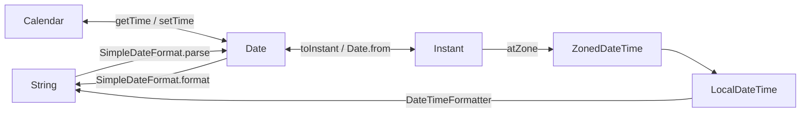
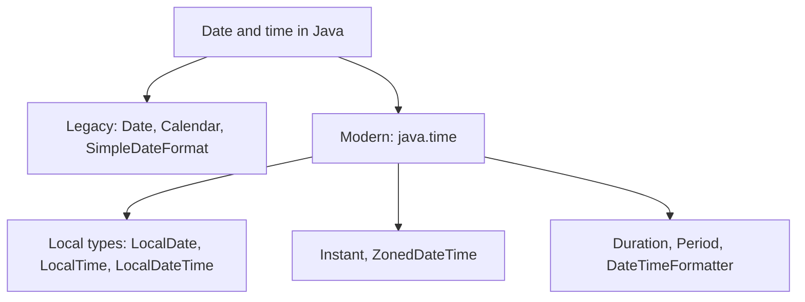

# Date, LocalDateTime (java.time), Calendar and SimpleDateFormat in Java

**TL;DR:** Java has two generations of date/time APIs. The **legacy** one (`java.util.Date`, `Calendar`/`GregorianCalendar`, `java.text.SimpleDateFormat`) is mutable, has **zero-based months**, `Date` is really an **instant** (milliseconds since 1970-01-01T00:00:00Z) and `SimpleDateFormat` is **not thread-safe**. The **modern** `java.time` API (Java 8+: `LocalDate`, `LocalTime`, `LocalDateTime`, `ZonedDateTime`, `Instant`, `Duration`, `Period`, `DateTimeFormatter`) is **immutable**, thread-safe, 1-based and clearer. To convert text ⇄ date with the legacy API: `new SimpleDateFormat(pattern).format(date)` and `.parse(text)` (throws checked `ParseException`). Pattern letters are case-sensitive: `MM` = month, `mm` = minute, `HH` = 24-hour, `hh` = 12-hour, `yyyy` = year, `YYYY` = week-year (a trap). New code should use `java.time`.

## Table of Contents

1. [TL;DR](#1-tldr)
2. [Why it matters](#2-why-it-matters)
3. [Prerequisites](#3-prerequisites)
4. [Mental model](#4-mental-model)
5. [Core concepts](#5-core-concepts)
6. [How it works](#6-how-it-works)
7. [Examples](#7-examples)
8. [Comparisons](#8-comparisons)
9. [Trade-offs](#9-trade-offs)
10. [Gotchas](#10-gotchas)
11. [Practical application](#11-practical-application)
12. [Interview prep](#12-interview-prep)
13. [Interview question bank](#13-interview-question-bank)
14. [Tricky code snippets](#14-tricky-code-snippets)
15. [Connections](#15-connections)
16. [Summary](#16-summary)
17. [Answers](#answers)

---

## 1. TL;DR

| Class | Package | Represents | Mutable? |
|---|---|---|---|
| `Date` | `java.util` | An instant (millis since epoch) | Yes |
| `Calendar` / `GregorianCalendar` | `java.util` | Calendar fields + arithmetic | Yes |
| `SimpleDateFormat` | `java.text` | Text ⇄ `Date` | Yes (not thread-safe) |
| `LocalDate` / `LocalTime` / `LocalDateTime` | `java.time` | Date / time / both, no zone | No |
| `Instant` | `java.time` | Machine timestamp (UTC) | No |
| `ZonedDateTime` | `java.time` | Date-time + zone | No |
| `Duration` / `Period` | `java.time` | Time-based / date-based amount | No |
| `DateTimeFormatter` | `java.time.format` | Text ⇄ java.time | No (thread-safe) |

**The analogy: a clock, a calendar page and a timezone map.**

| Real world | Java |
|---|---|
| Stopwatch since a fixed moment (1970) | `Date` / `Instant` |
| A wall calendar page and a wall clock with no country | `LocalDate`, `LocalTime`, `LocalDateTime` |
| The same moment shown in different countries | `ZonedDateTime`, `TimeZone` |
| A printed label format ("dd-MM-yyyy") | `SimpleDateFormat` / `DateTimeFormatter` |

**Running example:** format the instant `0` as `dd-MM-yyyy HH:mm` in UTC, then parse `25-12-2024 10:30` back (Snippet 1).

---

## 2. Why it matters

**The problem.** Dates look simple but hide time zones, leap years, daylight saving, months that start at 0 and mutable objects. The legacy API is famously error-prone.

**What goes wrong** (verified on Java 21):

| Mistake | Result | Snippet |
|---|---|---|
| Thinking `Date` holds a calendar date | It's millis since 1970 | 2 |
| Using `new Date(y, m, d)` | Deprecated; year = y + 1900 | 3, 32 |
| Month numbers in `Calendar` | January = `0` | 5 |
| `mm` vs `MM` in a pattern | Minutes vs month: garbage | 10 |
| `hh` vs `HH` | 12-hour vs 24-hour | 11 |
| `YYYY` instead of `yyyy` | Wrong year near New Year | 17 |
| Parsing `2024-02-30` leniently | Silently becomes March 1 | 13 |
| Parsing `01/01/99` with `yyyy` | Year 0099 | 18 |
| Shared `SimpleDateFormat` across threads | Corrupt output ⚠️ | 30 |
| Ignoring the time zone | Different calendar day | 15 |
| Forgetting `java.time` is immutable | `d.plusDays(1)` is discarded | 20 |

**Why interviewers ask.** "How do you convert `String` to `Date`?", "why is `SimpleDateFormat` not thread-safe?", "`Date` vs `Calendar` vs `LocalDateTime`", "why are months zero-based?", "`mm` vs `MM`", "how to get days between two dates?", "`Instant` vs `LocalDateTime`".

---

## 3. Prerequisites

| Prerequisite | One-line refresher | Importance |
|---|---|---|
| Strings and `Object` | `toString`, `equals`, `compareTo` | Essential |
| Exceptions | `ParseException` is checked; `DateTimeException` is unchecked | Essential |
| Immutability | Immutable objects return new values | Essential |
| Enums | `Month`, `DayOfWeek`, `ChronoUnit` | Important |
| Threads (basic) | Why shared mutable objects are risky | Helpful |
| Time zones | An offset from UTC plus daylight rules | Helpful |

---

## 4. Mental model

> **The one picture to keep in your head:** a point on the timeline (an **instant**) is one thing; its **human description** (year, month, day, hour...) depends on a **time zone** and a **calendar**. `Date`/`Instant` hold the point; `LocalDateTime` is only the description (no zone); `ZonedDateTime` is both; formatters convert descriptions to text and back.

```
 Instant (UTC timeline)  ── zone ──▶  ZonedDateTime  ──▶ LocalDateTime ──▶ text "25-12-2024 10:30"
     ▲  millis since 1970                (Asia/Kolkata)     (no zone)         (format / parse)
     │
   Date (legacy) ◀─ toInstant / Date.from ─▶ Instant
```
*The same instant gives different local date-times in different zones (Snippet 15, 25).*


*Legacy path on the left, java.time on the right; `Instant` is the bridge.*

---

## 5. Core concepts

### 5.1 Glossary

| Term | Definition |
|---|---|
| Epoch | 1970-01-01T00:00:00Z |
| Instant | A point on the UTC timeline |
| Time zone | Region rules, e.g. `Asia/Kolkata` (+05:30), with daylight saving |
| Offset | Fixed difference from UTC, e.g. `+05:30` |
| Lenient | Accepts out-of-range values and rolls them over |
| Pattern letters | `y M d H h m s S a E z` etc. |
| Week-year | Year of the week containing the date (`YYYY`) |
| ISO-8601 | `2024-12-25T14:05:09` text format used by `toString` |

### 5.2 `java.util.Date`

- Wraps a `long` of **milliseconds since the epoch** (Snippet 2). Despite the name, it has no calendar-day or zone information.
- `toString()` uses the **default time zone**: `Thu Jan 01 00:00:00 UTC 1970` (Snippet 31).
- Most methods (`getYear`, `getMonth`, `getDate`, constructor `Date(y,m,d)`) are **deprecated**: year is offset by 1900 and month is 0-based (Snippets 3, 32).
- **Mutable** (`setTime`), so aliasing is dangerous (Snippet 4).
- Compare with `before`, `after`, `compareTo`, `equals` (Snippet 2).

### 5.3 `Calendar` and `GregorianCalendar`

- `Calendar` is an **abstract** class; `Calendar.getInstance()` returns a `GregorianCalendar` in most locales (Snippet 9).
- **Months are 0-based** (`Calendar.JANUARY == 0`); `DAY_OF_WEEK` runs `SUNDAY = 1` to `SATURDAY = 7` (Snippet 5).
- `add(field, n)` moves the date, adjusting larger fields; Jan 31 + 1 month = Feb 29 (clamped) (Snippet 6).
- `roll(field, n)` changes one field **without** changing larger ones (Dec + 1 month stays in the same year) (Snippet 6).
- **Lenient** by default: day 32 of January becomes February 1; `setLenient(false)` makes out-of-range values throw (Snippet 7).
- Convert with `getTime()` / `setTime(Date)`, `getTimeInMillis()` / `setTimeInMillis` (Snippet 8).

### 5.4 `SimpleDateFormat`

```java
SimpleDateFormat f = new SimpleDateFormat("dd-MM-yyyy HH:mm");
String s = f.format(date);        // Date → String
Date d = f.parse("25-12-2024 10:30");   // String → Date (throws ParseException)
```
- Default time zone is the JVM's; set one with `setTimeZone` (Snippet 15).
- `parse` throws checked `ParseException` with an error offset (Snippet 12).
- **Lenient** by default: `2024-02-30` → March 1 (Snippet 13); `setLenient(false)` to reject it.
- `parse(String)` ignores trailing text after a valid prefix (Snippet 14).
- Use `Locale` for names (`EEEE`, `MMMM`) (Snippet 16).
- **Not thread-safe**; use one per thread (`ThreadLocal`, Snippet 30) or `DateTimeFormatter`.

### 5.5 Pattern letters

| Letter | Meaning | Example |
|---|---|---|
| `yyyy` | Year | `2024` |
| `yy` | Two-digit year (parse: sliding 80-year window) ⚠️ | `24` |
| `YYYY` | **Week-year** (trap near New Year) | Snippet 17 |
| `MM` / `MMM` / `MMMM` | Month number / short / full name | `12` / `Dec` / `December` |
| `dd` | Day of month | `05` |
| `EEE` / `EEEE` | Day name short / full | `Wed` / `Wednesday` |
| `HH` | Hour 0-23 | `14` |
| `hh` | Hour 1-12 (with `a`) | `02` |
| `mm` | **Minute** | `05` |
| `ss` / `SSS` | Second / millisecond | `09` / `123` |
| `a` | AM/PM | `PM` |
| `z` / `Z` / `XXX` | Zone name / offset | `IST` / `+0530` / `+05:30` |

`mm` vs `MM` and `hh` vs `HH` are the classic bugs (Snippets 10, 11).

### 5.6 `java.time` basics

- `LocalDate` (date), `LocalTime` (time), `LocalDateTime` (both), `ZonedDateTime` (with zone), `OffsetDateTime`, `Instant` (UTC timestamp) (Snippets 19, 25).
- **Months are 1-based** (`LocalDate.of(2024, 1, 31)`), and there are enums `Month` and `DayOfWeek` (Snippets 19, 28).
- **Immutable**: `plusDays` returns a new object; ignoring the result loses it (Snippet 20).
- Invalid dates throw unchecked `DateTimeException` (Snippet 21).
- `toString()` is ISO-8601 (`2024-01-31T10:30`) (Snippet 22).
- Compare with `isBefore/isAfter/equals/compareTo`, not `==` (Snippet 29).

### 5.7 `DateTimeFormatter`

```java
DateTimeFormatter f = DateTimeFormatter.ofPattern("dd-MM-yyyy HH:mm:ss");
String s = f.format(ldt);                 // or ldt.format(f)
LocalDateTime x = LocalDateTime.parse(s, f);
```
- Immutable and thread-safe; strict about invalid dates (`DateTimeParseException`, Snippet 23).
- Built-in ISO formatters (`ISO_LOCAL_DATE` etc.) are used by `LocalDate.parse(text)`.

### 5.8 `Duration` and `Period`

- `Duration` = time-based (seconds, nanos): `PT8H45M` (Snippet 24).
- `Period` = date-based (years, months, days): `P1M1D` (Snippet 24).
- `ChronoUnit.DAYS.between(a, b)` gives total days (Snippet 24).

### 5.9 Zones and instants

- `Instant` is a UTC timestamp; `atZone(zoneId)` gives the local view (Snippet 25).
- Same instant, different `LocalDateTime` per zone; `toInstant()` equal (Snippet 25).
- DST: adding a **day** keeps wall-clock time; adding **24 hours** doesn't (Snippet 27).

### 5.10 Converting between old and new

| From → To | Code |
|---|---|
| `Date` → `Instant` | `date.toInstant()` |
| `Instant` → `Date` | `Date.from(instant)` |
| `Date` → `LocalDateTime` | `LocalDateTime.ofInstant(date.toInstant(), zone)` |
| `GregorianCalendar` ← `ZonedDateTime` | `GregorianCalendar.from(zdt)` |

(Snippet 26.)

---

## 6. How it works

### 6.1 `Date` stores only millis

`new Date(86_400_000L)` is exactly one day after the epoch, regardless of any zone (Snippet 2). Printing it applies the default zone.

### 6.2 Worked trace: the running example

```java
SimpleDateFormat f = new SimpleDateFormat("dd-MM-yyyy HH:mm"); // 1
f.setTimeZone(TimeZone.getTimeZone("UTC"));                    // 2
f.format(new Date(0L));                                        // 3
f.parse("25-12-2024 10:30").getTime();                         // 4
```

| Step | What happens |
|---|---|
| 1 | Pattern compiled to field list: day, month, year, hour, minute |
| 2 | Calendar inside uses UTC |
| 3 | millis `0` → fields 1970-01-01 00:00 → `01-01-1970 00:00` |
| 4 | Fields 2024-12-25 10:30 in UTC → `1735122600000` |

Output: `01-01-1970 00:00`, `1735122600000`, `25-12-2024 10:30`.

### 6.3 Lenient arithmetic

A lenient `Calendar`/`SimpleDateFormat` normalizes out-of-range fields: day 30 of February becomes March 1 (leap year 2024) (Snippets 7, 13). Strict parsers (`DateTimeFormatter`, `setLenient(false)`) throw instead.

### 6.4 `add` vs `roll`

- `add(MONTH, 1)` on Dec 31 → January **next year**, day clamped to valid (Snippet 6).
- `roll(MONTH, 1)` → January of the **same year**.

### 6.5 `plusDays` vs `plus(Duration)` across DST

On 2024-03-09 12:00 New York: `plusDays(1)` → 12:00 on the 10th; `plus(24h)` → 13:00 because one hour was skipped (Snippet 27).

### 6.6 Why `SimpleDateFormat` is not thread-safe

It keeps an internal `Calendar` that every `format`/`parse` mutates. Concurrent calls can interleave and produce wrong dates or exceptions ⚠️ (not reproducible deterministically). Fixes: one instance per thread (Snippet 30), synchronization, or `DateTimeFormatter`.

---

## 7. Examples

### 7.1 Toy example

```java
SimpleDateFormat f = new SimpleDateFormat("dd-MM-yyyy");
String s = f.format(new Date());
Date d = f.parse("25-12-2024");
```

### 7.2 Real-world examples

- **Format a timestamp for display or logs** (Snippets 1, 22).
- **Parse user input** in a fixed format (Snippets 12, 23).
- **Days between two dates** (`ChronoUnit.DAYS.between`) (Snippet 24).
- **Convert between zones** for a global app (Snippet 25).
- **Calling legacy APIs** that return `Date` (Snippet 26).
- **Per-thread formatter** (Snippet 30).

---

## 8. Comparisons

### 8.1 `Date` vs `Calendar` vs `java.time`

| | `Date` | `Calendar` | `java.time` |
|---|---|---|---|
| Represents | Instant (millis) | Fields + arithmetic | Separate types for date/time/zone |
| Mutable | Yes | Yes | No |
| Month base | 0 (deprecated API) | 0 | 1 |
| Thread-safe | No | No | Yes |
| Time zone | Default only for printing | `TimeZone` | `ZoneId` |
| Status | Legacy | Legacy | Recommended |

### 8.2 `LocalDateTime` vs `ZonedDateTime` vs `Instant`

| | `LocalDateTime` | `ZonedDateTime` | `Instant` |
|---|---|---|---|
| Has zone | No | Yes | UTC only |
| Identifies a moment | No | Yes | Yes |
| Use for | Birthdays, appointments "wall time" | Meetings across zones | Timestamps, logs |

### 8.3 `SimpleDateFormat` vs `DateTimeFormatter`

| | `SimpleDateFormat` | `DateTimeFormatter` |
|---|---|---|
| Thread-safe | No | Yes |
| Works with | `Date` | `java.time` types |
| Invalid input | Lenient by default | Strict |
| Exception | `ParseException` (checked) | `DateTimeParseException` (unchecked) |
| `YYYY` | Week-year | Week-based-year (also a trap) |

### 8.4 `Duration` vs `Period`

| | `Duration` | `Period` |
|---|---|---|
| Unit | Seconds/nanos | Years/months/days |
| Between | `LocalTime`, `Instant`... | `LocalDate`s |
| DST aware | No (exact time) | Yes (calendar-based) |

### 8.5 `add` vs `roll`, `hh` vs `HH`, `mm` vs `MM`

| Pair | Difference |
|---|---|
| `add` / `roll` | Carries into larger fields / does not |
| `hh` / `HH` | 12-hour (needs `a`) / 24-hour |
| `mm` / `MM` | minute / month |
| `yyyy` / `YYYY` | calendar year / week-year |

### 8.6 `Date`/`Calendar` bridge methods

| | Method |
|---|---|
| `Calendar` → `Date` | `getTime()` |
| `Date` → `Calendar` | `setTime(date)` |
| `Date` → `Instant` | `toInstant()` |

---

## 9. Trade-offs

- **Legacy vs modern:** `Date`/`Calendar` exist in old code; wrap them at the boundary and use `java.time` inside.
- **Leniency:** convenient for arithmetic, dangerous for validation; turn it off when parsing user input.
- **`LocalDateTime` has no zone:** perfect for "9:00 on 5 May" in any place, wrong for a moment in time (use `Instant`/`ZonedDateTime`).
- **Time zones are data:** rules change (DST); store UTC (`Instant`) and convert at display time.
- **Default zone/locale:** convenient but makes behaviour vary by machine; pass them explicitly.
- **Performance:** creating `SimpleDateFormat` is costly; `DateTimeFormatter` can be a shared constant.

---

## 10. Gotchas

### Myths

- ❌ **Myth:** "`Date` holds a date." ✅ **Reality:** millis since the epoch (Snippet 2).
- ❌ **Myth:** "`Calendar.JANUARY` is 1." ✅ **Reality:** 0 (Snippet 5).
- ❌ **Myth:** "`mm` is the month." ✅ **Reality:** minutes (Snippet 10).
- ❌ **Myth:** "`hh` gives 0-23." ✅ **Reality:** 1-12 with `a` (Snippet 11).
- ❌ **Myth:** "`YYYY` is the year." ✅ **Reality:** week-year (Snippet 17).
- ❌ **Myth:** "`parse` rejects `2024-02-30`." ✅ **Reality:** lenient: March 1 (Snippet 13).
- ❌ **Myth:** "`parse` fails if there is trailing text." ✅ **Reality:** ignored (Snippet 14).
- ❌ **Myth:** "`LocalDate.plusDays` modifies the date." ✅ **Reality:** returns a new one (Snippet 20).
- ❌ **Myth:** "`SimpleDateFormat` is thread-safe." ✅ **Reality:** not (Section 6.6).
- ❌ **Myth:** "`Calendar` is a concrete class." ✅ **Reality:** abstract (Snippet 9).
- ❌ **Myth:** "`new Date(2024, 12, 25)` is Christmas 2024." ✅ **Reality:** year 3924, month 12 = January 3925 (deprecated constructor; Snippet 32 shows the right offsets).

### Common mistakes and edge cases

- **Mixing up `mm`/`MM` and `hh`/`HH`** (Snippets 10, 11).
- **Using `YYYY`** (Snippet 17).
- **Not setting a time zone/locale** ⚠️.
- **`yyyy` with two-digit input**: year 0099 (Snippet 18).
- **Comparing with `==`** (use `equals`/`isBefore`) (Snippet 29).
- **Forgetting that `parse` can return the wrong day** when lenient (Snippet 13).
- **Sharing one formatter between threads** (Snippet 30).
- **Adding 24 hours instead of a day across DST** (Snippet 27).
- **Using `Period` where you need exact seconds**, or the reverse (Snippet 24).

---

## 11. Practical application

### Checklist
- [ ] Use `java.time` for new code; convert legacy types at the edges.
- [ ] Store timestamps as `Instant`/UTC; convert to a zone for display.
- [ ] Set the `TimeZone`/`ZoneId` and `Locale` explicitly.
- [ ] Use `yyyy`, `MM`, `dd`, `HH`, `mm`, `ss`; `hh` only with `a`.
- [ ] `setLenient(false)` on `SimpleDateFormat` when validating.
- [ ] Never share a `SimpleDateFormat` between threads.
- [ ] Use `ChronoUnit`/`Period`/`Duration` for differences.
- [ ] Catch `ParseException`/`DateTimeParseException` for user input.

### Hands-on exercise

```java
Calendar c = new GregorianCalendar(2024, Calendar.JANUARY, 31);
c.add(Calendar.MONTH, 1);
System.out.println(c.get(Calendar.MONTH) + " " + c.get(Calendar.DAY_OF_MONTH));
```
What is printed?

<details><summary>Solution</summary>

`1 29`. `add(MONTH, 1)` moves January 31 to February; 2024 is a leap year and February has 29 days, so the day is clamped to 29. Month `1` is February (months are 0-based).

Verified on Java 21 (Snippet 6).
</details>

---

## 12. Interview prep

Eight model answers, as you would say them aloud.

<details><summary>1. How do you convert a `Date` to a `String` and back?</summary>

`SimpleDateFormat f = new SimpleDateFormat("dd-MM-yyyy");` then `f.format(date)` and `f.parse(text)`, which throws checked `ParseException`. Set the time zone and consider `setLenient(false)` (5.4; Snippets 1, 12, 13).
</details>

<details><summary>2. What is the difference between `Date`, `Calendar` and `LocalDateTime`?</summary>

`Date` is an instant (millis since 1970); `Calendar` adds field-based arithmetic; both are mutable and legacy. `LocalDateTime` (`java.time`) is an immutable date and time with no time zone (8.1, 8.2; Snippets 2, 5, 19).
</details>

<details><summary>3. Why is `SimpleDateFormat` not thread-safe?</summary>

It holds an internal mutable `Calendar` that every `format`/`parse` modifies. Use one per thread, a `ThreadLocal`, or the thread-safe `DateTimeFormatter` (6.6; Snippet 30).
</details>

<details><summary>4. What are the common pattern-letter mistakes?</summary>

`mm` is minutes (`MM` is month), `hh` is 12-hour (`HH` is 24-hour), and `YYYY` is the week-year (use `yyyy`) (5.5; Snippets 10, 11, 17).
</details>

<details><summary>5. Why are `Calendar` months zero-based, and what is the consequence?</summary>

A legacy design choice: `Calendar.JANUARY == 0`, so `new GregorianCalendar(2024, 0, 31)` is Jan 31. `java.time` is 1-based (5.3, 5.6; Snippets 5, 19).
</details>

<details><summary>6. What is the difference between `Calendar.add` and `roll`?</summary>

`add` carries into larger fields (Dec + 1 month goes to the next year); `roll` changes only that field and leaves larger fields alone (6.4; Snippet 6).
</details>

<details><summary>7. What do `Instant`, `LocalDateTime` and `ZonedDateTime` represent?</summary>

`Instant` is a UTC timestamp; `LocalDateTime` is wall-clock date and time with no zone (not a moment); `ZonedDateTime` is date-time plus a zone, so it identifies a moment (8.2; Snippet 25).
</details>

<details><summary>8. How do you compute the days between two dates?</summary>

`ChronoUnit.DAYS.between(d1, d2)` for total days, or `Period.between(d1, d2)` for years/months/days (5.8; Snippet 24).
</details>

---

## 13. Interview question bank


### 13.1 Date (Q1–Q12)

<details><summary>Q1. What does `java.util.Date` store?</summary>

Milliseconds since 1970-01-01T00:00:00Z (Snippet 2).
</details>

<details><summary>Q2. Is `Date` mutable?</summary>

Yes, `setTime` (Snippet 4).
</details>

<details><summary>Q3. Why are most `Date` methods deprecated?</summary>

Zone/locale-unaware, 1900-based year, 0-based month (Snippets 3, 32).
</details>

<details><summary>Q4. What does `new Date(124, 11, 25)` mean?</summary>

25 Dec 2024 (year 1900+124, month 0-based) (Snippet 32).
</details>

<details><summary>Q5. How do you compare two `Date`s?</summary>

`before`, `after`, `compareTo`, `equals` (Snippet 2).
</details>

<details><summary>Q6. What zone does `Date.toString()` use?</summary>

The JVM default zone (Snippet 31).
</details>

<details><summary>Q7. How do you get millis?</summary>

`getTime()` (Snippet 2).
</details>

<details><summary>Q8. Does `Date` have a time zone?</summary>

No, only printing/formatting uses one.
</details>

<details><summary>Q9. How do you convert to `Instant`?</summary>

`date.toInstant()` (Snippet 26).
</details>

<details><summary>Q10. How do you convert from `Instant`?</summary>

`Date.from(instant)` (Snippet 26).
</details>

<details><summary>Q11. Is `java.sql.Date` the same as `java.util.Date`?</summary>

It's a subclass representing a SQL DATE; avoid mixing ⚠️.
</details>

<details><summary>Q12. What happens if two references point to the same `Date`?</summary>

Mutation through one shows in the other (Snippet 4).
</details>


### 13.2 Calendar (Q13–Q26)

<details><summary>Q13. Is `Calendar` abstract?</summary>

Yes (Snippet 9).
</details>

<details><summary>Q14. What does `getInstance()` return?</summary>

Usually a `GregorianCalendar` ⚠️ locale-dependent (Snippet 9).
</details>

<details><summary>Q15. What is `Calendar.JANUARY`?</summary>

`0` (Snippet 5).
</details>

<details><summary>Q16. What is `Calendar.DECEMBER`?</summary>

`11` (Snippet 5).
</details>

<details><summary>Q17. What are `SUNDAY` and `SATURDAY`?</summary>

`1` and `7` (Snippet 5).
</details>

<details><summary>Q18. `add` vs `roll`?</summary>

`add` carries to larger fields, `roll` doesn't (Snippet 6).
</details>

<details><summary>Q19. Jan 31 + 1 month?</summary>

Feb 29 in 2024 (clamped) (Snippet 6).
</details>

<details><summary>Q20. What is leniency?</summary>

Out-of-range fields roll over (Snippet 7).
</details>

<details><summary>Q21. How do you disable it?</summary>

`setLenient(false)` (Snippet 7).
</details>

<details><summary>Q22. What exception is thrown in strict mode?</summary>

`IllegalArgumentException` (Snippet 7).
</details>

<details><summary>Q23. Convert `Calendar` to `Date`?</summary>

`getTime()` (Snippet 8).
</details>

<details><summary>Q24. Convert `Date` to `Calendar`?</summary>

`setTime(date)` (Snippet 8).
</details>

<details><summary>Q25. Get/set millis?</summary>

`getTimeInMillis`/`setTimeInMillis` (Snippet 8).
</details>

<details><summary>Q26. Is `Calendar` thread-safe?</summary>

No.
</details>


### 13.3 SimpleDateFormat: format and parse (Q27–Q42)

<details><summary>Q27. How do you format a `Date`?</summary>

`new SimpleDateFormat(pattern).format(date)` (Snippet 1).
</details>

<details><summary>Q28. How do you parse a `String`?</summary>

`parse(text)` returning `Date` (Snippet 1).
</details>

<details><summary>Q29. Which exception does `parse` throw?</summary>

`ParseException` (checked) (Snippet 12).
</details>

<details><summary>Q30. What does `getErrorOffset` return?</summary>

The index where parsing failed (Snippet 12).
</details>

<details><summary>Q31. Is `parse` lenient?</summary>

By default yes (Snippet 13).
</details>

<details><summary>Q32. `2024-02-30` leniently?</summary>

March 1, 2024 (Snippet 13).
</details>

<details><summary>Q33. Does `parse` reject trailing text?</summary>

No (Snippet 14).
</details>

<details><summary>Q34. How do you detect how much was parsed?</summary>

`parse(text, ParsePosition)` (Snippet 14).
</details>

<details><summary>Q35. How do you control the time zone?</summary>

`setTimeZone` (Snippet 15).
</details>

<details><summary>Q36. What does the same millis print in different zones?</summary>

Different local times (Snippet 15).
</details>

<details><summary>Q37. Which pattern gives `Tuesday`?</summary>

`EEEE` (Snippet 16).
</details>

<details><summary>Q38. Which gives `November`?</summary>

`MMMM` (Snippet 16).
</details>

<details><summary>Q39. Why pass a `Locale`?</summary>

Names depend on the locale (Snippet 16).
</details>

<details><summary>Q40. What does `DateFormat.getDateInstance` return?</summary>

Usually a `SimpleDateFormat` (Snippet 33).
</details>

<details><summary>Q41. What does `yy` do on parsing?</summary>

Sliding window around the current year ⚠️ (Snippet 18).
</details>

<details><summary>Q42. `yyyy` with `"99"`?</summary>

Year 0099 (Snippet 18).
</details>


### 13.4 Pattern letters (Q43–Q50)

<details><summary>Q43. `mm` or `MM` is the month?</summary>

`MM` (Snippet 10).
</details>

<details><summary>Q44. `hh` or `HH` is 24-hour?</summary>

`HH` (Snippet 11).
</details>

<details><summary>Q45. What is `hh` at midnight?</summary>

`12 AM` (Snippet 11).
</details>

<details><summary>Q46. `yyyy` vs `YYYY`?</summary>

Year vs week-year (Snippet 17).
</details>

<details><summary>Q47. What does `a` mean?</summary>

AM/PM (Snippet 11).
</details>

<details><summary>Q48. What does `z` print?</summary>

Zone abbreviation like `IST` (Snippet 15).
</details>

<details><summary>Q49. What is `S`?</summary>

Milliseconds.
</details>

<details><summary>Q50. What does `kk` represent?</summary>

Hour 1-24.
</details>


### 13.5 java.time (Q51–Q70)

<details><summary>Q51. Which package is modern?</summary>

`java.time` (Java 8+) (Snippet 19).
</details>

<details><summary>Q52. Is `LocalDate` mutable?</summary>

No (Snippet 20).
</details>

<details><summary>Q53. What does `d.plusDays(1);` alone do?</summary>

Nothing (result discarded) (Snippet 20).
</details>

<details><summary>Q54. Is January 1 or 0?</summary>

1 in `java.time` (Snippet 19).
</details>

<details><summary>Q55. What exception for invalid date?</summary>

`DateTimeException` (Snippet 21).
</details>

<details><summary>Q56. Is `LocalDate.parse("2024-02-30")` lenient?</summary>

No; `DateTimeParseException` (Snippet 23).
</details>

<details><summary>Q57. What does `LocalDateTime.toString` look like?</summary>

ISO-8601, `2024-12-25T14:05:09` (Snippet 22).
</details>

<details><summary>Q58. What is the thread-safe formatter?</summary>

`DateTimeFormatter` (Snippet 22).
</details>

<details><summary>Q59. How do you format?</summary>

`formatter.format(x)` or `x.format(formatter)` (Snippet 22).
</details>

<details><summary>Q60. How do you parse?</summary>

`LocalDateTime.parse(text, formatter)` (Snippet 22).
</details>

<details><summary>Q61. `Period` vs `Duration`?</summary>

Date-based vs time-based (Snippet 24).
</details>

<details><summary>Q62. Days between two dates?</summary>

`ChronoUnit.DAYS.between` (Snippet 24).
</details>

<details><summary>Q63. What is `Instant`?</summary>

UTC timestamp (Snippet 25).
</details>

<details><summary>Q64. `LocalDateTime` vs `ZonedDateTime`?</summary>

No zone vs with zone (Snippet 25).
</details>

<details><summary>Q65. Is `==` valid for `LocalDate`?</summary>

No, use `equals` (Snippet 29).
</details>

<details><summary>Q66. What is `LocalDate.ofEpochDay(0)`?</summary>

1970-01-01 (Snippet 29).
</details>

<details><summary>Q67. What does `plusMonths(1)` do on Jan 31?</summary>

Clamps to the last valid day (Snippet 28).
</details>

<details><summary>Q68. What is `DayOfWeek.MONDAY.getValue()`?</summary>

`1` (Snippet 28).
</details>

<details><summary>Q69. `plusDays(1)` vs `plus(Duration.ofHours(24))` over DST?</summary>

Wall-clock vs exact (Snippet 27).
</details>

<details><summary>Q70. What happens to a time inside a DST gap?</summary>

Shifted forward (Snippet 27).
</details>


### 13.6 Threads, design, conversion (Q71–Q78)

<details><summary>Q71. Why isn't `SimpleDateFormat` thread-safe?</summary>

It mutates an internal `Calendar`.
</details>

<details><summary>Q72. How to use it safely?</summary>

One per thread / `ThreadLocal` (Snippet 30).
</details>

<details><summary>Q73. Preferred alternative?</summary>

`DateTimeFormatter`.
</details>

<details><summary>Q74. Which type for a log timestamp?</summary>

`Instant`.
</details>

<details><summary>Q75. Which for a birthday?</summary>

`LocalDate`.
</details>

<details><summary>Q76. Which for a meeting across zones?</summary>

`ZonedDateTime`.
</details>

<details><summary>Q77. How to bridge `Date` and `java.time`?</summary>

`toInstant`/`Date.from` (Snippet 26).
</details>

<details><summary>Q78. What's the epoch?</summary>

1970-01-01T00:00:00Z.
</details>

---

## 14. Tricky code snippets

33 snippets, each compiled and run on OpenJDK 21. Predict the output (or the compile error) before opening the answer. Snippets fix the time zone (`UTC`, `Asia/Kolkata`...) so output doesn't depend on the machine ⚠️; `Date.toString()` and `Calendar.getInstance()` use the default zone and locale. Two-digit-year parsing depends on today's date ⚠️.

### Snippet 1: Format and parse in UTC

```java
import java.text.*;
import java.util.*;
public class Main {
    public static void main(String[] a) throws Exception {
        SimpleDateFormat f = new SimpleDateFormat("dd-MM-yyyy HH:mm");
        f.setTimeZone(TimeZone.getTimeZone("UTC"));
        Date d = new Date(0L);
        String s = f.format(d);
        System.out.println(s);
        Date back = f.parse("25-12-2024 10:30");
        System.out.println(back.getTime());
        System.out.println(f.format(back));
    }
}
```

<details><summary>Answer</summary>

```
01-01-1970 00:00
1735122600000
25-12-2024 10:30
```

Trace in 6.2.
</details>

### Snippet 2: `Date` basics

```java
import java.util.*;
public class Main {
    public static void main(String[] a) {
        Date d = new Date(86_400_000L);
        System.out.println(d.getTime());
        System.out.println(d.toInstant());
        Date e = new Date(86_400_000L);
        System.out.println(d.equals(e) + " " + d.before(new Date(86_400_001L)) + " " + d.compareTo(new Date(0)));
    }
}
```

<details><summary>Answer</summary>

```
86400000
1970-01-02T00:00:00Z
true true 1
```

A `Date` is just millis; `compareTo` returns `1` as it is after epoch 0.
</details>

### Snippet 3: Deprecated `Date` constructor

```java
import java.util.*;
public class Main {
    @SuppressWarnings("deprecation")
    public static void main(String[] a) {
        Date d = new Date(100, 0, 31);
        System.out.println((d.getYear()) + " " + d.getMonth() + " " + d.getDate());
    }
}
```

<details><summary>Answer</summary>

```
100 0 31
```

`getYear()` is year − 1900; months are 0-based.
</details>

### Snippet 4: Aliased `Date`

```java
import java.util.*;
public class Main {
    public static void main(String[] a) {
        Date d = new Date(1000L);
        Date same = d;
        same.setTime(2000L);
        System.out.println(d.getTime());
    }
}
```

<details><summary>Answer</summary>

```
2000
```

`same` and `d` are the same mutable object.
</details>

### Snippet 5: Zero-based months

```java
import java.util.*;
public class Main {
    public static void main(String[] a) {
        Calendar c = new GregorianCalendar(2024, 0, 31);
        System.out.println(c.get(Calendar.MONTH) + " " + c.get(Calendar.YEAR) + " " + c.get(Calendar.DAY_OF_MONTH));
        System.out.println(Calendar.JANUARY + " " + Calendar.DECEMBER + " " + Calendar.SUNDAY + " " + Calendar.SATURDAY);
    }
}
```

<details><summary>Answer</summary>

```
0 2024 31
0 11 1 7
```

January = 0, December = 11, Sunday = 1, Saturday = 7.
</details>

### Snippet 6: `add` vs `roll`

```java
import java.util.*;
public class Main {
    public static void main(String[] a) {
        Calendar c = new GregorianCalendar(2024, Calendar.JANUARY, 31);
        c.add(Calendar.MONTH, 1);
        System.out.println(c.get(Calendar.MONTH) + " " + c.get(Calendar.DAY_OF_MONTH));
        Calendar r = new GregorianCalendar(2024, Calendar.DECEMBER, 31);
        r.roll(Calendar.MONTH, 1);
        System.out.println(r.get(Calendar.YEAR) + " " + r.get(Calendar.MONTH));
        Calendar b = new GregorianCalendar(2024, Calendar.DECEMBER, 31);
        b.add(Calendar.MONTH, 1);
        System.out.println(b.get(Calendar.YEAR) + " " + b.get(Calendar.MONTH));
    }
}
```

<details><summary>Answer</summary>

```
1 29
2024 0
2025 0
```

`add` clamps Jan 31 → Feb 29 and carries Dec → next January; `roll` stays in 2024.
</details>

### Snippet 7: Lenient `Calendar`

```java
import java.util.*;
public class Main {
    public static void main(String[] a) {
        Calendar c = new GregorianCalendar(2024, 0, 1);
        c.set(Calendar.DAY_OF_MONTH, 32);
        System.out.println(c.get(Calendar.MONTH) + " " + c.get(Calendar.DAY_OF_MONTH));
        c.setLenient(false);
        try { c.set(Calendar.DAY_OF_MONTH, 40); c.getTime(); }
        catch (IllegalArgumentException e) { System.out.println("IllegalArgumentException"); }
    }
}
```

<details><summary>Answer</summary>

```
1 1
IllegalArgumentException
```

Day 32 of January rolls to Feb 1 (month 1, day 1); in strict mode day 40 is rejected.
</details>

### Snippet 8: `Calendar` ⇄ `Date`

```java
import java.util.*;
public class Main {
    public static void main(String[] a) {
        Calendar c = Calendar.getInstance(TimeZone.getTimeZone("UTC"));
        c.setTimeInMillis(0L);
        Date d = c.getTime();
        Calendar c2 = Calendar.getInstance(TimeZone.getTimeZone("UTC"));
        c2.setTime(d);
        System.out.println(d.getTime() + " " + c2.get(Calendar.YEAR) + " " + c2.get(Calendar.DAY_OF_WEEK));
    }
}
```

<details><summary>Answer</summary>

```
0 1970 5
```

Epoch was a Thursday, which is `5` (Sunday = 1).
</details>

### Snippet 9: `Calendar` is abstract

```java
import java.util.*;
public class Main {
    public static void main(String[] a) {
        Calendar c = Calendar.getInstance();
        System.out.println(c.getClass().getSimpleName());
        System.out.println(java.lang.reflect.Modifier.isAbstract(Calendar.class.getModifiers()));
    }
}
```

<details><summary>Answer</summary>

```
GregorianCalendar
true
```

`getInstance()` returns a subclass. ⚠️ Locale-dependent (e.g. Thai Buddhist calendar).
</details>

### Snippet 10: `mm` vs `MM`, `hh`

```java
import java.text.*;
import java.util.*;
public class Main {
    public static void main(String[] a) {
        SimpleDateFormat f = new SimpleDateFormat("yyyy-MM-dd HH:mm:ss");
        SimpleDateFormat g = new SimpleDateFormat("yyyy-mm-dd hh:MM:ss a", Locale.ENGLISH);
        f.setTimeZone(TimeZone.getTimeZone("UTC")); g.setTimeZone(TimeZone.getTimeZone("UTC"));
        Date d = new Date(1_700_000_000_000L);
        System.out.println(f.format(d));
        System.out.println(g.format(d));
    }
}
```

<details><summary>Answer</summary>

```
2023-11-14 22:13:20
2023-13-14 10:11:20 PM
```

In the second pattern `mm` is minutes (13) and `MM` is the month (11) in the wrong places.
</details>

### Snippet 11: 12-hour vs 24-hour

```java
import java.text.*;
import java.util.*;
public class Main {
    public static void main(String[] a) {
        Date d = new Date(1_700_000_000_000L + 3_600_000L * 3);
        SimpleDateFormat h12 = new SimpleDateFormat("hh a", Locale.ENGLISH), h24 = new SimpleDateFormat("HH");
        h12.setTimeZone(TimeZone.getTimeZone("UTC")); h24.setTimeZone(TimeZone.getTimeZone("UTC"));
        System.out.println(h12.format(d) + " | " + h24.format(d));
        Date noon = new Date(12 * 3_600_000L), mid = new Date(0L);
        System.out.println(h12.format(noon) + " | " + h12.format(mid));
    }
}
```

<details><summary>Answer</summary>

```
01 AM | 01
12 PM | 12 AM
```

`hh` shows 12 for both noon and midnight.
</details>

### Snippet 12: `ParseException`

```java
import java.text.*;
import java.util.*;
public class Main {
    public static void main(String[] a) {
        SimpleDateFormat f = new SimpleDateFormat("yyyy-MM-dd");
        try { f.parse("not a date"); }
        catch (ParseException e) { System.out.println("ParseException at " + e.getErrorOffset() + ": " + e.getMessage()); }
    }
}
```

<details><summary>Answer</summary>

```
ParseException at 0: Unparseable date: "not a date"
```

The checked exception includes the error offset.
</details>

### Snippet 13: Lenient parse

```java
import java.text.*;
import java.util.*;
public class Main {
    public static void main(String[] a) throws Exception {
        SimpleDateFormat f = new SimpleDateFormat("yyyy-MM-dd");
        f.setTimeZone(TimeZone.getTimeZone("UTC"));
        System.out.println(f.format(f.parse("2024-02-30")));
        f.setLenient(false);
        try { f.parse("2024-02-30"); } catch (ParseException e) { System.out.println("ParseException: " + e.getMessage()); }
    }
}
```

<details><summary>Answer</summary>

```
2024-03-01
ParseException: Unparseable date: "2024-02-30"
```

2024 is a leap year, so Feb 30 rolls to Mar 1 unless strict.
</details>

### Snippet 14: Trailing text

```java
import java.text.*;
import java.util.*;
public class Main {
    public static void main(String[] a) throws Exception {
        SimpleDateFormat f = new SimpleDateFormat("yyyy-MM-dd");
        f.setTimeZone(TimeZone.getTimeZone("UTC"));
        System.out.println(f.format(f.parse("2024-05-17 and more text")));
        ParsePosition p = new ParsePosition(0);
        Date d = f.parse("2024-05-17xyz", p);
        System.out.println(p.getIndex() + " " + (d != null));
    }
}
```

<details><summary>Answer</summary>

```
2024-05-17
10 true
```

`parse(String)` stops after a valid prefix; the position index is 10.
</details>

### Snippet 15: Time zone

```java
import java.text.*;
import java.util.*;
public class Main {
    public static void main(String[] a) {
        Date d = new Date(0L);
        SimpleDateFormat f = new SimpleDateFormat("yyyy-MM-dd HH:mm z");
        f.setTimeZone(TimeZone.getTimeZone("UTC"));
        System.out.println(f.format(d));
        f.setTimeZone(TimeZone.getTimeZone("Asia/Kolkata"));
        System.out.println(f.format(d));
        f.setTimeZone(TimeZone.getTimeZone("America/New_York"));
        System.out.println(f.format(d));
    }
}
```

<details><summary>Answer</summary>

```
1970-01-01 00:00 UTC
1970-01-01 05:30 IST
1969-12-31 19:00 EST
```

One instant, three local times (even different dates).
</details>

### Snippet 16: Names

```java
import java.text.*;
import java.util.*;
public class Main {
    public static void main(String[] a) throws Exception {
        Date d = new Date(1_700_000_000_000L);
        SimpleDateFormat f = new SimpleDateFormat("EEEE, d MMMM yyyy", Locale.ENGLISH);
        f.setTimeZone(TimeZone.getTimeZone("UTC"));
        System.out.println(f.format(d));
        SimpleDateFormat g = new SimpleDateFormat("EEE MMM dd yy", Locale.ENGLISH);
        g.setTimeZone(TimeZone.getTimeZone("UTC"));
        System.out.println(g.format(d));
        System.out.println(f.parse("Tuesday, 14 November 2023").getTime());
    }
}
```

<details><summary>Answer</summary>

```
Tuesday, 14 November 2023
Tue Nov 14 23
1699920000000
```

`EEEE`/`MMMM` give full names; parsing in the default zone ⚠️ gives zone-dependent millis (this run: UTC).
</details>

### Snippet 17: `yyyy` vs `YYYY`

```java
import java.text.*;
import java.util.*;
public class Main {
    public static void main(String[] a) {
        Calendar c = new GregorianCalendar(TimeZone.getTimeZone("UTC"), Locale.US);
        c.clear(); c.set(2024, Calendar.DECEMBER, 30);
        SimpleDateFormat y = new SimpleDateFormat("yyyy-MM-dd", Locale.US), Y = new SimpleDateFormat("YYYY-MM-dd", Locale.US);
        y.setTimeZone(TimeZone.getTimeZone("UTC")); Y.setTimeZone(TimeZone.getTimeZone("UTC"));
        System.out.println(y.format(c.getTime()) + " " + Y.format(c.getTime()));
    }
}
```

<details><summary>Answer</summary>

```
2024-12-30 2025-12-30
```

Dec 30, 2024 falls in week 1 of 2025 (US rules).
</details>

### Snippet 18: Two-digit year

```java
import java.text.*;
import java.util.*;
public class Main {
    public static void main(String[] a) throws Exception {
        SimpleDateFormat f = new SimpleDateFormat("dd/MM/yy");
        f.setTimeZone(TimeZone.getTimeZone("UTC"));
        SimpleDateFormat o = new SimpleDateFormat("yyyy");
        o.setTimeZone(TimeZone.getTimeZone("UTC"));
        System.out.println(o.format(f.parse("01/01/99")).length() + " " + o.format(f.parse("01/01/99")).startsWith("19")
            + " " + o.format(f.parse("01/01/05")).startsWith("20"));
        SimpleDateFormat full = new SimpleDateFormat("dd/MM/yyyy");
        full.setTimeZone(TimeZone.getTimeZone("UTC"));
        System.out.println(full.format(full.parse("01/01/99")));
    }
}
```

<details><summary>Answer</summary>

```
4 true true
01/01/0099
```

`yy` uses a sliding window ⚠️; `yyyy` treats "99" literally as year 99.
</details>

### Snippet 19: `LocalDate`, `LocalTime`

```java
import java.time.*;
public class Main {
    public static void main(String[] a) {
        LocalDate d = LocalDate.of(2024, 1, 31);
        LocalTime t = LocalTime.of(10, 30);
        LocalDateTime dt = LocalDateTime.of(d, t);
        System.out.println(d + " " + t + " " + dt);
        System.out.println(d.getMonthValue() + " " + d.getMonth() + " " + d.getDayOfWeek());
    }
}
```

<details><summary>Answer</summary>

```
2024-01-31 10:30 2024-01-31T10:30
1 JANUARY WEDNESDAY
```

ISO `toString`; months are 1-based.
</details>

### Snippet 20: Immutability

```java
import java.time.*;
public class Main {
    public static void main(String[] a) {
        LocalDate d = LocalDate.of(2024, 1, 31);
        d.plusDays(1);
        System.out.println(d);
        LocalDate e = d.plusMonths(1);
        System.out.println(e + " " + d.plusDays(1));
    }
}
```

<details><summary>Answer</summary>

```
2024-01-31
2024-02-29 2024-02-01
```

`plusDays` result was discarded; `plusMonths` clamps to Feb 29.
</details>

### Snippet 21: Invalid dates

```java
import java.time.*;
public class Main {
    public static void main(String[] a) {
        try { LocalDate.of(2024, 2, 30); } catch (DateTimeException e) { System.out.println("DateTimeException: " + e.getMessage()); }
        try { LocalDate.of(2023, 2, 29); } catch (DateTimeException e) { System.out.println("DateTimeException: " + e.getMessage()); }
        System.out.println(LocalDate.of(2024, 2, 29).isLeapYear());
    }
}
```

<details><summary>Answer</summary>

```
DateTimeException: Invalid date 'FEBRUARY 30'
DateTimeException: Invalid date 'February 29' as '2023' is not a leap year
true
```

`java.time` is strict.
</details>

### Snippet 22: `DateTimeFormatter`

```java
import java.time.*;
import java.time.format.*;
import java.util.*;
public class Main {
    public static void main(String[] a) {
        LocalDateTime dt = LocalDateTime.of(2024, 12, 25, 14, 5, 9);
        DateTimeFormatter f = DateTimeFormatter.ofPattern("dd-MM-yyyy HH:mm:ss");
        String s = f.format(dt);
        System.out.println(s);
        System.out.println(LocalDateTime.parse(s, f).equals(dt));
        System.out.println(dt.format(DateTimeFormatter.ofPattern("EEEE, d MMMM yyyy hh:mm a", Locale.ENGLISH)));
        System.out.println(dt);
    }
}
```

<details><summary>Answer</summary>

```
25-12-2024 14:05:09
true
Wednesday, 25 December 2024 02:05 PM
2024-12-25T14:05:09
```

Round trip works; `toString` is ISO.
</details>

### Snippet 23: Parse errors

```java
import java.time.*;
import java.time.format.*;
public class Main {
    public static void main(String[] a) {
        try { LocalDate.parse("2024-02-30"); } catch (DateTimeParseException e) { System.out.println("DateTimeParseException: " + e.getMessage()); }
        try { LocalDate.parse("25-12-2024"); } catch (DateTimeParseException e) { System.out.println("DateTimeParseException at " + e.getErrorIndex()); }
        System.out.println(LocalDate.parse("2024-12-25"));
    }
}
```

<details><summary>Answer</summary>

```
DateTimeParseException: Text '2024-02-30' could not be parsed: Invalid date 'FEBRUARY 30'
DateTimeParseException at 0
2024-12-25
```

`LocalDate.parse(text)` expects ISO `yyyy-MM-dd`.
</details>

### Snippet 24: `Period`, `Duration`

```java
import java.time.*;
import java.time.temporal.ChronoUnit;
public class Main {
    public static void main(String[] a) {
        LocalDate a1 = LocalDate.of(2024, 1, 31), b1 = LocalDate.of(2024, 3, 1);
        Period p = Period.between(a1, b1);
        System.out.println(p + " " + p.getMonths() + " " + p.getDays());
        System.out.println(ChronoUnit.DAYS.between(a1, b1));
        Duration d = Duration.between(LocalTime.of(9, 0), LocalTime.of(17, 45));
        System.out.println(d + " " + d.toMinutes());
    }
}
```

<details><summary>Answer</summary>

```
P1M1D 1 1
30
PT8H45M 525
```

Jan 31 → Mar 1 = 1 month 1 day by the calendar, but 30 days total.
</details>

### Snippet 25: `Instant` and zones

```java
import java.time.*;
public class Main {
    public static void main(String[] a) {
        Instant i = Instant.ofEpochSecond(0);
        ZonedDateTime utc = i.atZone(ZoneId.of("UTC"));
        ZonedDateTime ist = i.atZone(ZoneId.of("Asia/Kolkata"));
        System.out.println(i + " " + utc.toLocalDateTime());
        System.out.println(ist.toLocalDateTime() + " " + ist.getOffset());
        System.out.println(utc.toInstant().equals(ist.toInstant()));
    }
}
```

<details><summary>Answer</summary>

```
1970-01-01T00:00:00Z 1970-01-01T00:00
1970-01-01T05:30 +05:30
true
```

Same instant, different local views.
</details>

### Snippet 26: Legacy ⇄ modern

```java
import java.time.*;
import java.util.*;
public class Main {
    public static void main(String[] a) {
        Date d = new Date(0L);
        Instant i = d.toInstant();
        LocalDateTime ldt = LocalDateTime.ofInstant(i, ZoneOffset.UTC);
        System.out.println(i + " " + ldt);
        Date back = Date.from(ldt.toInstant(ZoneOffset.UTC));
        System.out.println(back.getTime() + " " + back.equals(d));
        Calendar c = GregorianCalendar.from(ZonedDateTime.of(2024, 1, 1, 0, 0, 0, 0, ZoneOffset.UTC));
        System.out.println(c.get(Calendar.MONTH));
    }
}
```

<details><summary>Answer</summary>

```
1970-01-01T00:00:00Z 1970-01-01T00:00
0 true
0
```

`Instant` is the bridge; `GregorianCalendar.from` keeps January = 0.
</details>

### Snippet 27: DST

```java
import java.time.*;
public class Main {
    public static void main(String[] a) {
        ZoneId ny = ZoneId.of("America/New_York");
        LocalDateTime gap = LocalDateTime.of(2024, 3, 10, 2, 30);
        System.out.println(ZonedDateTime.of(gap, ny));
        ZonedDateTime before = ZonedDateTime.of(2024, 3, 9, 12, 0, 0, 0, ny);
        System.out.println(before.plusDays(1).getHour() + " " + before.plus(Duration.ofHours(24)).getHour());
    }
}
```

<details><summary>Answer</summary>

```
2024-03-10T03:30-04:00[America/New_York]
12 13
```

02:30 doesn't exist, so it shifts to 03:30; adding 24 hours across the spring-forward gives 13:00.
</details>

### Snippet 28: Enums

```java
import java.time.*;
public class Main {
    public static void main(String[] a) {
        System.out.println(DayOfWeek.MONDAY.getValue() + " " + DayOfWeek.SUNDAY.getValue() + " " + Month.JANUARY.getValue());
        System.out.println(DayOfWeek.FRIDAY.plus(3) + " " + Month.DECEMBER.plus(2));
        System.out.println(LocalDate.of(2024, 1, 31).plusMonths(1));
    }
}
```

<details><summary>Answer</summary>

```
1 7 1
MONDAY FEBRUARY
2024-02-29
```

Monday = 1 and Sunday = 7; `plus` wraps around.
</details>

### Snippet 29: `==` vs `equals`

```java
import java.time.*;
public class Main {
    public static void main(String[] a) {
        LocalDate x = LocalDate.of(2024, 5, 1), y = LocalDate.of(2024, 5, 1);
        System.out.println((x == y) + " " + x.equals(y) + " " + x.isBefore(LocalDate.of(2024, 5, 2)) + " " + x.compareTo(LocalDate.of(2024, 4, 1)));
        System.out.println(LocalDate.ofEpochDay(0) + " " + LocalDate.of(1970, 1, 1).toEpochDay());
    }
}
```

<details><summary>Answer</summary>

```
false true true 1
1970-01-01 0
```

Separate objects; `compareTo` returns the month difference (5 − 4 = 1).
</details>

### Snippet 30: One formatter per thread

```java
import java.text.*;
import java.util.*;
public class Main {
    static final ThreadLocal<SimpleDateFormat> F = ThreadLocal.withInitial(() -> {
        SimpleDateFormat f = new SimpleDateFormat("yyyy-MM-dd");
        f.setTimeZone(TimeZone.getTimeZone("UTC"));
        return f;
    });
    public static void main(String[] a) throws Exception {
        Thread[] ts = new Thread[4];
        final String[] out = new String[4];
        for (int i = 0; i < 4; i++) {
            final int k = i;
            ts[i] = new Thread(() -> out[k] = F.get().format(new Date(k * 86_400_000L)));
            ts[i].start();
        }
        for (Thread t : ts) t.join();
        System.out.println(Arrays.toString(out));
    }
}
```

<details><summary>Answer</summary>

```
[1970-01-01, 1970-01-02, 1970-01-03, 1970-01-04]
```

Each thread gets its own formatter, so results are correct.
</details>

### Snippet 31: `Date.toString()`

```java
import java.util.*;
public class Main {
    public static void main(String[] a) {
        TimeZone.setDefault(TimeZone.getTimeZone("UTC"));
        System.out.println(new Date(0L));
        System.out.println(new Date(0L).toString().length());
    }
}
```

<details><summary>Answer</summary>

```
Thu Jan 01 00:00:00 UTC 1970
28
```

Default zone and locale format.
</details>

### Snippet 32: Deprecated constructor

```java
import java.util.*;
public class Main {
    @SuppressWarnings("deprecation")
    public static void main(String[] a) {
        TimeZone.setDefault(TimeZone.getTimeZone("UTC"));
        Date d = new Date(124, 11, 25);
        System.out.println(d.getYear() + " " + d.getMonth() + " " + d.getDate() + " " + d.getDay());
        System.out.println(d);
    }
}
```

<details><summary>Answer</summary>

```
124 11 25 3
Wed Dec 25 00:00:00 UTC 2024
```

Year offset 1900; Wed = day `3`.
</details>

### Snippet 33: `DateFormat` factory

```java
import java.text.*;
import java.util.*;
public class Main {
    public static void main(String[] a) {
        DateFormat f = DateFormat.getDateInstance(DateFormat.MEDIUM, Locale.US);
        f.setTimeZone(TimeZone.getTimeZone("UTC"));
        System.out.println(f.format(new Date(0L)));
        System.out.println(f instanceof SimpleDateFormat);
    }
}
```

<details><summary>Answer</summary>

```
Jan 1, 1970
true
```

The `MEDIUM` US style; the instance is a `SimpleDateFormat`. ⚠️ Locale data can change across JDK versions.
</details>

---

## 15. Connections

| Related topic | How it connects |
|---|---|
| Strings | Text ⇄ date conversion |
| Exceptions | `ParseException` (checked), `DateTimeException` (unchecked) |
| Immutability | `java.time` types are immutable |
| Threads | `SimpleDateFormat` is not thread-safe, `ThreadLocal` |
| Enums | `Month`, `DayOfWeek`, `ChronoUnit` |
| Object class | `equals`, `compareTo`, `toString` of date types |
| Collections | Sorting dates (`Comparable`) |
| I/O (NIO) | File timestamps ⚠️ |


*Prefer the modern branch; bridge through `Instant`.*

---

## 16. Summary

### 60-second card

- `Date` = instant (millis); `Calendar` = fields + arithmetic; both mutable, legacy, 0-based months.
- `SimpleDateFormat`: `format(Date)` → `String`, `parse(String)` → `Date` (`ParseException`); lenient by default; not thread-safe.
- Patterns: `yyyy MM dd HH mm ss`; `hh` needs `a`; `YYYY` is week-year.
- `java.time`: immutable, 1-based, strict, thread-safe.
- `LocalDateTime` has no zone; `Instant`/`ZonedDateTime` identify a moment.
- `Period` (calendar) vs `Duration` (exact time); `ChronoUnit.X.between`.
- Convert with `toInstant()` / `Date.from()`.

### Cheat sheet

```java
SimpleDateFormat f = new SimpleDateFormat("dd-MM-yyyy HH:mm"); f.setLenient(false);
String s = f.format(new Date());           Date d = f.parse("25-12-2024 10:30");
DateTimeFormatter g = DateTimeFormatter.ofPattern("dd-MM-yyyy HH:mm");
LocalDateTime ldt = LocalDateTime.parse("25-12-2024 10:30", g);
long days = ChronoUnit.DAYS.between(LocalDate.of(2024,1,1), LocalDate.of(2024,3,1));
```

| Need | Use |
|---|---|
| Timestamp | `Instant` |
| Date only | `LocalDate` |
| Date + time, no zone | `LocalDateTime` |
| Moment in a zone | `ZonedDateTime` |
| Text ⇄ legacy `Date` | `SimpleDateFormat` |
| Text ⇄ java.time | `DateTimeFormatter` |
| Difference | `ChronoUnit`, `Period`, `Duration` |

### Self-test

1. What does a `Date` actually store?
2. What is `Calendar.JANUARY`?
3. `mm` vs `MM`? `hh` vs `HH`?
4. What does lenient parsing do to `2024-02-30`?
5. Why is `SimpleDateFormat` not thread-safe?
6. `LocalDateTime` vs `Instant`?
7. `Calendar.add` vs `roll`?
8. How do you convert `Date` ⇄ `LocalDateTime`?

### Anki flashcards

```
Date :: Millis since 1970-01-01T00:00:00Z (mutable)
Calendar.JANUARY :: 0 (java.time months are 1-based)
mm / MM :: minute / month
hh / HH :: 12-hour / 24-hour
YYYY :: Week-year (use yyyy)
SimpleDateFormat :: Lenient by default, not thread-safe
LocalDateTime :: Date + time with no zone
Instant :: UTC timestamp; bridge via toInstant / Date.from
```

### Resources

- The Java Tutorials, "Date Time" trail: docs.oracle.com/javase/tutorial/datetime
- API docs: `java.time`, `java.time.format.DateTimeFormatter`, `java.text.SimpleDateFormat`, `java.util.Calendar`
- *Java 8 in Action* or the JSR-310 documentation for design rationale ⚠️

---

## Answers

1. Milliseconds since 1970-01-01T00:00:00Z.
2. `0`.
3. Minute vs month; 12-hour (with `a`) vs 24-hour.
4. It rolls over to March 1 (2024 is a leap year) unless `setLenient(false)`.
5. It mutates an internal `Calendar` during `format`/`parse`.
6. `LocalDateTime` has no zone and isn't a moment; `Instant` is a UTC timestamp.
7. `add` carries into larger fields; `roll` doesn't.
8. `LocalDateTime.ofInstant(date.toInstant(), zone)` and `Date.from(ldt.atZone(zone).toInstant())`.
