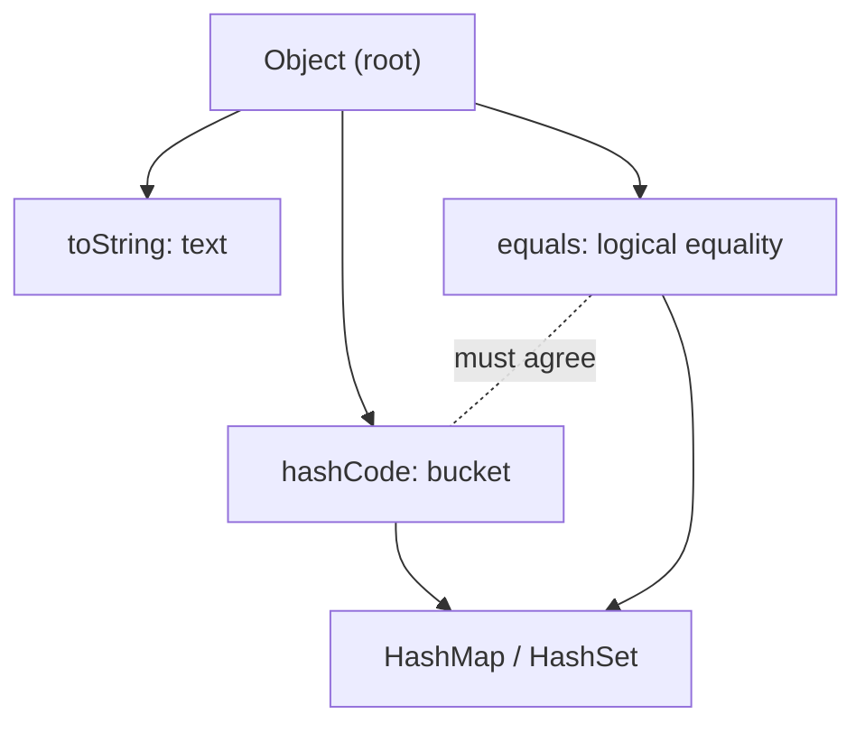
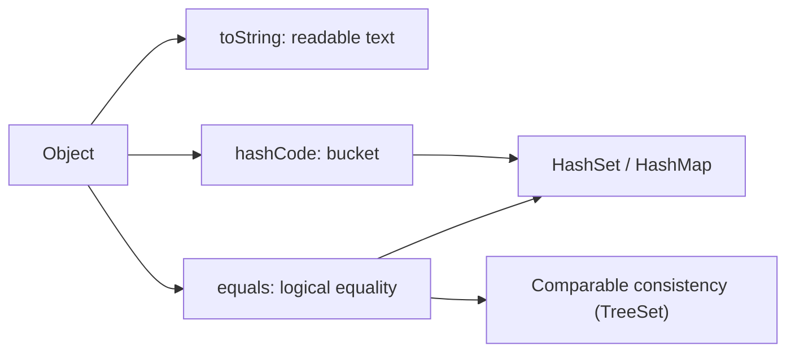

# The Object Class: Overriding toString, equals and hashCode

**TL;DR:** `java.lang.Object` is the root of every class. Its 11 methods include `toString()`, `equals(Object)` and `hashCode()`. By default `toString()` returns `ClassName@hexHashCode`, `equals()` is **identity** (`==`) and `hashCode()` is an identity-based number. Override them to give objects **meaningful text**, **logical equality** and a **consistent hash**. The **contract**: `equals` must be reflexive, symmetric, transitive, consistent and `false` for `null`; and **equal objects must have equal hash codes** (the reverse isn't required). If you override `equals` you **must** override `hashCode`, otherwise `HashSet`/`HashMap` misbehave. Use `@Override` (a wrong signature like `equals(P)` silently *overloads*), `Objects.equals` / `Objects.hash`, and never use mutable fields in keys.

## Table of Contents

1. [TL;DR](#1-tldr)
2. [Why it matters](#2-why-it-matters)
3. [Prerequisites](#3-prerequisites)
4. [Mental model](#4-mental-model)
5. [Core concepts](#5-core-concepts)
6. [How it works](#6-how-it-works)
7. [Examples](#7-examples)
8. [Comparisons](#8-comparisons)
9. [Trade-offs](#9-trade-offs)
10. [Gotchas](#10-gotchas)
11. [Practical application](#11-practical-application)
12. [Interview prep](#12-interview-prep)
13. [Interview question bank](#13-interview-question-bank)
14. [Tricky code snippets](#14-tricky-code-snippets)
15. [Connections](#15-connections)
16. [Summary](#16-summary)
17. [Answers](#answers)

---

## 1. TL;DR

| Method | Default behaviour | Override to |
|---|---|---|
| `toString()` | `ClassName@hexHash` | Readable description |
| `equals(Object)` | Same reference (`==`) | Logical (value) equality |
| `hashCode()` | Identity-based int | Match `equals`; spread values |
| `getClass()` | `final`; runtime class | (cannot) |
| `clone()` | `protected`, shallow | See the copy note |
| `finalize()` | Deprecated | Don't |
| `wait/notify/notifyAll` | `final`; threads | (cannot) |

**The analogy: an ID card system.**

| Real world | Java |
|---|---|
| Card number printed on the back (just a serial) | Default `toString`/`hashCode` |
| "Same person?" = same physical card | Default `equals` (`==`) |
| "Same person?" = same name and birth date | Overridden `equals` |
| Filing cabinet drawers chosen by surname initial | `hashCode` → bucket |
| Two people with the same initial share a drawer | Hash collision (allowed) |
| Different drawers for the same person = lost file | `equals` without `hashCode` |

**Running example:** `P("Ann", 30)` twice: `==` is false, `equals` is true, hash codes match, and a `HashSet` finds the second one (Snippet 1).

---

## 2. Why it matters

**The problem.** The defaults compare identities. Collections, caches, maps, tests and logs all rely on `equals`, `hashCode` and `toString` to behave logically.

**What goes wrong** (verified on Java 21):

| Mistake | Result | Snippet |
|---|---|---|
| Printing an object with no `toString` | `Main$P@1b2c3d` | 2 |
| `equals` without `hashCode` | `HashSet` keeps duplicates ⚠️ | 4 |
| `hashCode` without `equals` | Duplicates (identity `equals`) | 5 |
| Mutating a field used in `hashCode` | Key lost in `HashMap` | 7 |
| `equals(P o)` instead of `equals(Object o)` | Overload; not used by collections | 8, 9 |
| `instanceof` in a subclass-aware `equals` | Symmetry broken | 10, 31 |
| `toString` calling a cyclic reference | `StackOverflowError` | 19 |
| `arr.toString()` | `[I@...` | 18 |
| Comparing `Integer` with `Long` via `equals` | `false` | 30 |
| TreeSet vs HashSet with different rules | Different sizes | 29 |

**Why interviewers ask.** "equals and hashCode contract", "what happens if you override only one?", "why mutable keys are dangerous", "`==` vs `equals`", "how does `HashMap` use them?", "what's in `Object`?", "why `@Override`?", "`getClass()` vs `instanceof` in `equals`".

---

## 3. Prerequisites

| Prerequisite | One-line refresher | Importance |
|---|---|---|
| Inheritance and overriding | Every class extends `Object`; overriding needs the exact signature | Essential |
| `==` vs `equals` | Reference vs logical equality | Essential |
| String pool basics | `String` overrides `equals/hashCode` | Important |
| Collections (hashing) | `HashSet`/`HashMap` use `hashCode` + `equals` | Important |
| Wrapper classes | `Integer`, `Long` have value `equals` | Important |
| Polymorphism | Dynamic dispatch picks the overriding method | Important |

---

## 4. Mental model

> **The one picture to keep in your head:** a hash-based collection first uses `hashCode()` to jump to a **bucket**, then uses `equals()` to find the **exact match** inside the bucket. If two equal objects produce **different** hash codes, the collection looks in the wrong bucket and never calls `equals`. If two different objects share a hash code, `equals` separates them.

```
 key ──hashCode()──▶ bucket index ──▶ [ k1, k2, k3 ]  ──equals()──▶ the matching key
                       (fast jump)        (few entries)             (exact test)
 equal objects MUST land in the same bucket  ⇒  equal ⇒ same hashCode
```
*Different hash codes ⇒ definitely not equal; same hash code ⇒ maybe equal.*


*`equals` and `hashCode` are a pair that hash collections depend on.*

---

## 5. Core concepts

### 5.1 Glossary

| Term | Definition |
|---|---|
| `Object` | Superclass of every class (implicitly) |
| Identity | Same object in memory (`==`) |
| Equality | Same logical value (`equals`) |
| Hash code | `int` summary used to pick a bucket |
| Collision | Two different objects with the same hash code (allowed) |
| Contract | Rules `equals`/`hashCode` must satisfy |
| `Objects` | Utility class: `equals`, `hash`, `hashCode`, `toString`, `requireNonNull` |

### 5.2 The methods of `Object`

`getClass`, `hashCode`, `equals`, `clone`, `toString`, `notify`, `notifyAll`, `wait` (3 overloads), `finalize` (Snippet 25). `getClass`, `notify`, `notifyAll` and `wait` are `final` (cannot be overridden); the others are overridable (Snippet 26).

### 5.3 `toString()`

- Default: `getClass().getName() + "@" + Integer.toHexString(hashCode())` (Snippet 2).
- Called implicitly by `println`, string concatenation, `String.valueOf`, and collections' `toString` (Snippet 16).
- Calling it on `null` throws NPE; `String.valueOf(null-ref)` and `"" + ref` give `"null"` (Snippets 16, 17).
- Arrays don't override it: `[I@...`; use `Arrays.toString`/`deepToString` (Snippet 18).
- Avoid printing cyclic references in `toString` (Snippet 19).

### 5.4 `equals(Object)`: the contract

For non-null references `x`, `y`, `z`:

| Rule | Meaning |
|---|---|
| Reflexive | `x.equals(x)` is true |
| Symmetric | `x.equals(y)` ⇔ `y.equals(x)` (Snippets 10, 31 break it) |
| Transitive | `x=y` and `y=z` ⇒ `x=z` |
| Consistent | Same answer while the compared fields don't change |
| Non-null | `x.equals(null)` is false (Snippet 12) |

Default `equals` is identity (Snippet 3).

### 5.5 Writing a good `equals`

```java
@Override public boolean equals(Object o) {
    if (this == o) return true;                 // fast path
    if (!(o instanceof P)) return false;        // type check (also handles null)
    P p = (P) o;
    return age == p.age && Objects.equals(name, p.name);
}
```
- Signature must be exactly `equals(Object)` (Snippets 8, 9).
- Compare primitives with `==` (use `Double.compare` for `double`), references with `Objects.equals` (null-safe).
- **`instanceof` vs `getClass()`:** `instanceof` allows subclasses to be equal to a parent (can break symmetry, Snippet 10); `getClass() ==` demands the same exact class (safe, but breaks Liskov in some designs, Snippet 11).

### 5.6 `hashCode()`: the contract

1. Consistent: same value during one execution while the used fields don't change.
2. **If `a.equals(b)` then `a.hashCode() == b.hashCode()`.**
3. Unequal objects *may* share a hash code (collision), but distinct codes help performance.

Typical: `Objects.hash(name, age)` (Snippets 1, 13). Use the **same fields** as `equals`.

### 5.7 What happens if you override only one

| Overridden | Result | Snippet |
|---|---|---|
| `equals` only | Equal objects land in different buckets: duplicates, failed `contains` ⚠️ | 4 |
| `hashCode` only | Same bucket, but `equals` is identity: still duplicates | 5 |
| Both | Works | 1, 6 |

### 5.8 Mutable keys

If a field used by `hashCode` changes after the object is inserted into a `HashMap`/`HashSet`, lookups use the new hash and fail; the entry becomes unreachable (Snippet 7). Use immutable keys.

### 5.9 Built-in implementations

- `String.hashCode()`: `s[0]*31^(n-1) + ... + s[n-1]` (Snippet 14); `"Aa"` and `"BB"` collide.
- Wrappers: `Integer` = value, `Boolean` = 1231/1237, `Long` = `(int)(v ^ (v >>> 32))`, `Double` from the bits (Snippets 13, 15).
- `Objects.hash(a, b, c)` = `Arrays.hashCode(new Object[]{...})`, equal to `31`-based combination (Snippet 13).
- Collections: `List` hash combines elements in order; `Set` hash is the sum of element hashes; equal collections of different implementations are equal (Snippet 22).
- `record` and `enum`: auto-generated value-based (record) / identity-based and `final` (enum) methods (Snippets 20, 21).
- **Arrays** use identity `equals`; use `Arrays.equals` (Snippet 22).

### 5.10 `getClass()`

Returns the **runtime** class (`final`); `getClass() == Q.class` is an exact match, `instanceof` includes subclasses (Snippet 24).

### 5.11 `Comparable` vs `equals`

`TreeSet`/`TreeMap` use `compareTo`/`Comparator`, not `equals`/`hashCode`; make `compareTo` consistent with `equals` (Snippet 29).

---

## 6. How it works

### 6.1 How `HashSet.contains(p)` finds an element

1. Compute `h = p.hashCode()` and pick a bucket from it.
2. If the bucket is empty → not found.
3. For each entry whose stored hash equals `h`, call `p.equals(entry)`.
4. Found if any returns true.

So correctness needs: equal objects ⇒ same `h` (step 1) and a correct `equals` (step 3).

### 6.2 Worked trace: the running example

```java
P p1 = new P("Ann", 30), p2 = new P("Ann", 30);
Set<P> s = new HashSet<>(List.of(p1));
s.contains(p2);
```

| Step | What happens |
|---|---|
| 1 | `p1.hashCode()` = `Objects.hash("Ann", 30)` → bucket B |
| 2 | `s.contains(p2)`: `p2.hashCode()` is equal → bucket B |
| 3 | Same stored hash → call `p2.equals(p1)` → true |
| 4 | Result `true` |

Output: `P[Ann,30] false true true` then `true`.

### 6.3 Why `equals` without `hashCode` fails

Two logically equal objects inherit identity hash codes, so they go to different buckets (almost always); `contains` never calls `equals` (Snippet 4). It's probabilistic: with an unlucky collision it might work, which is what makes the bug dangerous ⚠️.

### 6.4 Symmetry trap with inheritance

`A.equals` uses `instanceof A`, `B.equals` uses `instanceof B`. Then `a.equals(b)` is true but `b.equals(a)` is false (Snippet 10). Adding a field in a subclass cannot be reconciled with a value-based `equals` without breaking the contract (Effective Java, Item 10); prefer composition.

### 6.5 Implicit `toString`

`"v=" + p` compiles to `String.valueOf(p)`-style conversion, which calls `p.toString()` unless `p` is `null` (Snippet 16).

---

## 7. Examples

### 7.1 Toy example

```java
@Override public String toString() { return "P[" + name + "," + age + "]"; }
```
Snippet 1.

### 7.2 Real-world examples

- **Domain keys** in maps (`new Key(id)`) need `equals` + `hashCode`.
- **Debug logging** of entities relies on `toString`.
- **Test assertions** (`assertEquals`) call `equals`.
- **Deduplicating** objects in a `Set`.
- **Records** give you all three automatically (Snippet 20).

---

## 8. Comparisons

### 8.1 `==` vs `equals`

| | `==` | `equals` |
|---|---|---|
| Compares | References (or primitive values) | Logical state (if overridden) |
| Overridable | No | Yes |
| `null` safe | Yes | Receiver must not be `null` |
| Default | Identity | Identity |

### 8.2 `instanceof` vs `getClass()` in `equals`

| | `instanceof` | `getClass() ==` |
|---|---|---|
| Subclass instances equal? | Yes (may break symmetry) | No |
| Works with proxies/frameworks | Better | Can fail |
| Safe by default | No | Yes |

### 8.3 Hand-written vs `Objects` vs records

| | Hand-written | `Objects.hash/equals` | `record` |
|---|---|---|---|
| Boilerplate | High | Medium | None |
| Null-safe | You decide | Yes | Yes |
| Speed | Best | Slight overhead | Good |

### 8.4 `HashSet` vs `TreeSet` equality

| | `HashSet` | `TreeSet` |
|---|---|---|
| Uses | `hashCode` + `equals` | `compareTo`/`Comparator` |
| Duplicate when | `equals` true | compare returns 0 |

### 8.5 Wrapper `equals` between types

| Call | Result |
|---|---|
| `Integer.valueOf(5).equals(5L)` | `false` (different class) |
| `Long.valueOf(5).equals(5L)` | `true` |
| `Double.NaN` `.equals(NaN)` | `true`; but `NaN == NaN` is `false` |

### 8.6 `Arrays` utility vs direct calls

| Task | Wrong | Right |
|---|---|---|
| Print an array | `arr.toString()` | `Arrays.toString(arr)` |
| Compare arrays | `a.equals(b)` | `Arrays.equals(a, b)` |
| Hash an array | `a.hashCode()` | `Arrays.hashCode(a)` |

---

## 9. Trade-offs

- **Correctness vs effort:** writing `equals`/`hashCode` by hand is error-prone; use `Objects`, an IDE generator, Lombok or a `record`.
- **Equality semantics:** decide whether subclasses can equal parents; there is no perfect answer.
- **Hash quality:** poor hash codes (all the same value) turn `HashMap` lookups into scans (tree bins in Java 8+ soften this) ⚠️.
- **Mutable vs immutable:** immutable value classes make `hashCode` stable; mutable ones are hazardous as keys.
- **`toString` content:** informative for debugging, but don't print secrets, and avoid expensive or cyclic traversals.
- **Performance:** cache `hashCode` for big immutable objects (as `String` does).

---

## 10. Gotchas

### Myths

- ❌ **Myth:** "`equals` compares values by default." ✅ **Reality:** identity (Snippet 3).
- ❌ **Myth:** "Overriding `equals` alone is enough." ✅ **Reality:** also override `hashCode` (Snippet 4).
- ❌ **Myth:** "Equal hash codes mean equal objects." ✅ **Reality:** collisions exist (`"Aa"`, `"BB"`, Snippet 14).
- ❌ **Myth:** "Different hash codes might still be equal." ✅ **Reality:** if the contract holds, different hash codes mean not equal.
- ❌ **Myth:** "`equals(P o)` overrides `equals`." ✅ **Reality:** it overloads (Snippets 8, 9).
- ❌ **Myth:** "`toString` on a `null` reference prints `null`." ✅ **Reality:** NPE; concatenation prints `null` (Snippets 16, 17).
- ❌ **Myth:** "`array.toString()` shows the elements." ✅ **Reality:** `[I@...` (Snippet 18).
- ❌ **Myth:** "`array.equals` compares contents." ✅ **Reality:** identity (Snippet 22).
- ❌ **Myth:** "`Integer.equals(Long)` is true if values match." ✅ **Reality:** false (Snippet 30).
- ❌ **Myth:** "Changing a map key's field is harmless." ✅ **Reality:** the entry is lost (Snippet 7).
- ❌ **Myth:** "`TreeSet` uses `equals`." ✅ **Reality:** `compareTo` (Snippet 29).

### Common mistakes and edge cases

- **Wrong `equals` signature** (use `@Override`).
- **Different fields in `equals` and `hashCode`.**
- **Forgetting `null` handling** (`Objects.equals`, `instanceof`).
- **Using floating-point `==` in `equals`** (use `Double.compare`) (Snippet 30).
- **Mutable key fields** (Snippet 7).
- **Cyclic `toString`** (Snippet 19).
- **Subclass adding state** (Snippet 31).
- **Expecting `hashCode()` of the same object to differ across runs**: identity hash codes vary per run ⚠️.

---

## 11. Practical application

### Checklist
- [ ] Override `toString` on domain classes (no secrets, no cycles).
- [ ] Override `equals` and `hashCode` **together**, using the same fields.
- [ ] Use `@Override`, signature `equals(Object)`.
- [ ] Use `Objects.equals`/`Objects.hash` (or a `record`).
- [ ] Use immutable fields as keys.
- [ ] Prefer `getClass()` checks (or make the class `final`) unless designing for subclass equality.
- [ ] Make `compareTo` consistent with `equals`.
- [ ] Use `Arrays.toString/equals/hashCode` for arrays.

### Hands-on exercise

```java
System.out.println("Aa".hashCode() == "BB".hashCode());
System.out.println("Aa".equals("BB"));
```
What is printed, and what does it demonstrate?

<details><summary>Solution</summary>

`true` then `false`. Both strings have hash code `2112` (`65*31 + 97` = `66*31 + 66`), but they aren't equal. It shows that equal hash codes do **not** imply equal objects (a collision), while `equals` decides.

Verified on Java 21 (Snippet 14).
</details>

---

## 12. Interview prep

Eight model answers, as you would say them aloud.

<details><summary>1. What is the `Object` class and what does it provide?</summary>

The root of the class hierarchy; every class extends it. It provides `toString`, `equals`, `hashCode`, `getClass`, `clone`, `finalize` (deprecated) and `wait`/`notify`/`notifyAll` (5.2; Snippets 25, 26).
</details>

<details><summary>2. What do the default `toString`, `equals` and `hashCode` do?</summary>

`toString` returns `ClassName@hexHash`; `equals` is identity (`==`); `hashCode` is an identity-based int. That is why you override them for value classes (5.3-5.6; Snippets 2, 3).
</details>

<details><summary>3. What is the `equals`/`hashCode` contract?</summary>

`equals` must be reflexive, symmetric, transitive, consistent and false for `null`; and if `a.equals(b)` then their hash codes must be equal. Unequal objects may share a hash code (5.4, 5.6).
</details>

<details><summary>4. What happens if you override `equals` but not `hashCode`?</summary>

Equal objects usually get different identity hash codes, so a `HashSet`/`HashMap` looks in the wrong bucket: duplicates and failed `contains` ⚠️ (6.3; Snippet 4).
</details>

<details><summary>5. Why is a mutable object a bad hash key?</summary>

If a field used in `hashCode` changes after insertion, lookups compute a different hash and cannot find the entry (5.8; Snippet 7).
</details>

<details><summary>6. Why use `@Override` on `equals`?</summary>

`equals(P o)` is an overload, not an override, so collections still call `equals(Object)` (the identity one). `@Override` turns this into a compile error (Snippets 8, 9).
</details>

<details><summary>7. `instanceof` or `getClass()` in `equals`?</summary>

`instanceof` lets subclasses equal a parent but can break symmetry; `getClass() ==` requires the exact same class and is safer. Records and final classes avoid the issue (5.5, 6.4; Snippets 10, 11).
</details>

<details><summary>8. How does `HashMap` use `hashCode` and `equals`?</summary>

`hashCode` picks the bucket; `equals` finds the exact key within it. Equal keys must therefore have equal hash codes (6.1; Snippets 1, 6).
</details>

---

## 13. Interview question bank


### 13.1 Object class basics (Q1–Q12)

<details><summary>Q1. What is the root class?</summary>

`java.lang.Object` (Snippet 25).
</details>

<details><summary>Q2. Does every class extend it?</summary>

Yes, implicitly.
</details>

<details><summary>Q3. Name its methods.</summary>

`getClass, hashCode, equals, clone, toString, notify, notifyAll, wait, finalize` (Snippet 25).
</details>

<details><summary>Q4. Which are `final`?</summary>

`getClass`, `notify`, `notifyAll`, `wait` (Snippet 26).
</details>

<details><summary>Q5. Which are overridable?</summary>

`toString`, `equals`, `hashCode`, `clone`, `finalize` (Snippet 26).
</details>

<details><summary>Q6. What does `getClass()` return?</summary>

The runtime `Class` (Snippet 24).
</details>

<details><summary>Q7. `getClass()` vs `instanceof`?</summary>

Exact class vs any subtype (Snippet 24).
</details>

<details><summary>Q8. Is `finalize` recommended?</summary>

No, deprecated.
</details>

<details><summary>Q9. Which methods deal with threads?</summary>

`wait`, `notify`, `notifyAll`.
</details>

<details><summary>Q10. Is `clone` public?</summary>

No, protected.
</details>

<details><summary>Q11. Can an interface type call `toString`?</summary>

Yes; every reference has `Object` methods.
</details>

<details><summary>Q12. Which class gives null-safe helpers?</summary>

`java.util.Objects` (Snippet 12).
</details>


### 13.2 toString (Q13–Q26)

<details><summary>Q13. What is the default `toString`?</summary>

`ClassName@hexHashCode` (Snippet 2).
</details>

<details><summary>Q14. Why override it?</summary>

Readable logs and debugging.
</details>

<details><summary>Q15. When is `toString` called implicitly?</summary>

`println`, `+`, `String.valueOf`, collection printing (Snippet 16).
</details>

<details><summary>Q16. What does `"" + nullRef` give?</summary>

`"null"` (Snippet 16).
</details>

<details><summary>Q17. What does `nullRef.toString()` do?</summary>

`NullPointerException` (Snippet 17).
</details>

<details><summary>Q18. What does `Objects.toString(o, "default")` do?</summary>

Returns the default when `o` is null (Snippet 17).
</details>

<details><summary>Q19. What does `arr.toString()` print?</summary>

`[I@...` (Snippet 18).
</details>

<details><summary>Q20. How to print an array?</summary>

`Arrays.toString` / `deepToString` (Snippet 18).
</details>

<details><summary>Q21. What does a cyclic `toString` cause?</summary>

`StackOverflowError` (Snippet 19).
</details>

<details><summary>Q22. What does a record's `toString` look like?</summary>

`P[name=Ann, age=30]` (Snippet 20).
</details>

<details><summary>Q23. What does an enum's `toString` return?</summary>

The constant name (Snippet 21).
</details>

<details><summary>Q24. Should `toString` include secrets?</summary>

No.
</details>

<details><summary>Q25. Should it be parseable?</summary>

Not required; document the format if so.
</details>

<details><summary>Q26. Does `List.toString` call element `toString`?</summary>

Yes (Snippet 16).
</details>


### 13.3 equals (Q27–Q44)

<details><summary>Q27. What does default `equals` do?</summary>

Identity (Snippet 3).
</details>

<details><summary>Q28. What is `==` for references?</summary>

Same object (Snippet 3).
</details>

<details><summary>Q29. Name the `equals` contract rules.</summary>

Reflexive, symmetric, transitive, consistent, non-null.
</details>

<details><summary>Q30. What should `x.equals(null)` return?</summary>

`false` (Snippet 12).
</details>

<details><summary>Q31. What if `x` is null in `x.equals(y)`?</summary>

NPE (Snippet 12).
</details>

<details><summary>Q32. How to avoid it?</summary>

`Objects.equals(x, y)` or `"lit".equals(x)` (Snippet 12).
</details>

<details><summary>Q33. What's the correct signature?</summary>

`public boolean equals(Object o)` (Snippet 8).
</details>

<details><summary>Q34. What does `equals(P o)` do?</summary>

Overloads; not used by collections (Snippet 8).
</details>

<details><summary>Q35. How does `@Override` help?</summary>

Compile error for a wrong signature (Snippet 9).
</details>

<details><summary>Q36. Symmetry violation example?</summary>

Parent `instanceof` vs child `instanceof` (Snippet 10).
</details>

<details><summary>Q37. Does `getClass()` fix it?</summary>

Yes, at the cost of subclass equality (Snippet 11).
</details>

<details><summary>Q38. Compare `double` fields how?</summary>

`Double.compare` (Snippet 30).
</details>

<details><summary>Q39. `Double.NaN.equals(NaN)`?</summary>

`true` (Snippet 30).
</details>

<details><summary>Q40. `0.0 == -0.0`?</summary>

`true`, but `Double.equals` gives `false` (Snippet 30).
</details>

<details><summary>Q41. `Integer.valueOf(5).equals(5L)`?</summary>

`false` (Snippet 30).
</details>

<details><summary>Q42. Do arrays override `equals`?</summary>

No (Snippet 22).
</details>

<details><summary>Q43. Do `List`s from different implementations compare equal?</summary>

Yes (Snippet 22).
</details>

<details><summary>Q44. Is `List.equals(Set)` true for same elements?</summary>

No (Snippet 22).
</details>


### 13.4 hashCode (Q45–Q58)

<details><summary>Q45. What does default `hashCode` do?</summary>

Identity-based int (Snippet 27).
</details>

<details><summary>Q46. What is the main rule?</summary>

Equal objects ⇒ equal hash codes (Snippet 1).
</details>

<details><summary>Q47. Do equal hash codes imply equal objects?</summary>

No, collisions (Snippet 14).
</details>

<details><summary>Q48. Example collision?</summary>

`"Aa"` and `"BB"` (Snippet 14).
</details>

<details><summary>Q49. What's `String.hashCode`?</summary>

`31`-based polynomial (Snippet 14).
</details>

<details><summary>Q50. What's `Objects.hash(1, 2, 3)`?</summary>

`30817` (Snippet 13).
</details>

<details><summary>Q51. What's `Objects.hash()`?</summary>

`1` (Snippet 13).
</details>

<details><summary>Q52. What's `Objects.hashCode(null)`?</summary>

`0` (Snippet 13).
</details>

<details><summary>Q53. `Boolean.TRUE.hashCode()`?</summary>

`1231` (Snippet 13).
</details>

<details><summary>Q54. `Long` hash of `1L << 32`?</summary>

`1` (Snippet 15).
</details>

<details><summary>Q55. Is `hashCode` stable across runs?</summary>

Not for identity hash codes ⚠️.
</details>

<details><summary>Q56. What if you override `hashCode` only?</summary>

Still duplicates (Snippet 5).
</details>

<details><summary>Q57. Which fields should it use?</summary>

The same as `equals`.
</details>

<details><summary>Q58. `System.identityHashCode(null)`?</summary>

`0` (Snippet 27).
</details>


### 13.5 Collections and keys (Q59–Q70)

<details><summary>Q59. What happens with `equals` only in a `HashSet`?</summary>

Duplicates, failed `contains` ⚠️ (Snippet 4).
</details>

<details><summary>Q60. What happens with both in a `HashMap`?</summary>

Correct replace/lookup (Snippet 6).
</details>

<details><summary>Q61. What happens if a key is mutated?</summary>

Lookup fails (Snippet 7).
</details>

<details><summary>Q62. Is the entry removed?</summary>

No, it stays but is unreachable (Snippet 7).
</details>

<details><summary>Q63. Which collections use `compareTo` not `equals`?</summary>

`TreeSet`, `TreeMap` (Snippet 29).
</details>

<details><summary>Q64. What if `compareTo` returns 0 for non-equal objects?</summary>

`TreeSet` treats them as duplicates (Snippet 29).
</details>

<details><summary>Q65. Is `Set.hashCode` order-dependent?</summary>

No, sum of elements (Snippet 22).
</details>

<details><summary>Q66. Is `List.hashCode` order-dependent?</summary>

Yes (Snippet 22).
</details>

<details><summary>Q67. How do records implement these?</summary>

Components-based, auto-generated (Snippet 20).
</details>

<details><summary>Q68. Are enum `equals`/`hashCode` final?</summary>

Yes (Snippet 21).
</details>

<details><summary>Q69. Which key types are safest?</summary>

Immutable (`String`, `Integer`, records).
</details>

<details><summary>Q70. What is a good hash code property?</summary>

Spread values evenly.
</details>


### 13.6 Design (Q71–Q76)

<details><summary>Q71. How does `HashMap` find a key?</summary>

Bucket by hash, then `equals` (6.1).
</details>

<details><summary>Q72. What is `Objects.hash` for?</summary>

Combine fields into a hash (Snippet 13).
</details>

<details><summary>Q73. Why `this == o` first?</summary>

Fast path and reflexivity.
</details>

<details><summary>Q74. `equals` and inheritance advice?</summary>

Prefer composition; avoid adding state to value subclasses (Snippet 31).
</details>

<details><summary>Q75. Should `equals` be used in `compareTo`?</summary>

`compareTo` should be consistent with `equals` (Snippet 29).
</details>

<details><summary>Q76. When to prefer a record?</summary>

Simple immutable value carriers (Snippet 20).
</details>

---

## 14. Tricky code snippets

31 snippets, each compiled and run on OpenJDK 21. Predict the output (or the compile error) before opening the answer. Nested classes are `static`. Identity hash codes are never printed because they differ between runs ⚠️; snippets that depend on them only compare or test them. The list of `Object` methods is JDK-version dependent ⚠️.

### Snippet 1: Running example

```java
import java.util.*;
public class Main {
    static class P {
        String name; int age;
        P(String n, int a) { name = n; age = a; }
        @Override public String toString() { return "P[" + name + "," + age + "]"; }
        @Override public boolean equals(Object o) {
            if (this == o) return true;
            if (!(o instanceof P)) return false;
            P p = (P) o;
            return age == p.age && Objects.equals(name, p.name);
        }
        @Override public int hashCode() { return Objects.hash(name, age); }
    }
    public static void main(String[] a) {
        P p1 = new P("Ann", 30), p2 = new P("Ann", 30);
        System.out.println(p1 + " " + (p1 == p2) + " " + p1.equals(p2) + " " + (p1.hashCode() == p2.hashCode()));
        Set<P> s = new HashSet<>(List.of(p1));
        System.out.println(s.contains(p2));
    }
}
```

<details><summary>Answer</summary>

```
P[Ann,30] false true true
true
```

Different objects, equal state, equal hash codes (trace in 6.2).
</details>

### Snippet 2: Default `toString`

```java
public class Main {
    static class P { }
    public static void main(String[] a) {
        P p = new P();
        String s = p.toString();
        System.out.println(s.startsWith("Main$P@") + " " + s.equals(p.getClass().getName() + "@" + Integer.toHexString(p.hashCode())));
    }
}
```

<details><summary>Answer</summary>

```
true true
```

`ClassName@hex(hashCode)`; here the class is `Main$P`.
</details>

### Snippet 3: Default `equals`

```java
public class Main {
    static class P { int x = 1; }
    public static void main(String[] a) {
        P p1 = new P(), p2 = new P(), p3 = p1;
        System.out.println(p1.equals(p2) + " " + p1.equals(p3) + " " + (p1 == p3));
    }
}
```

<details><summary>Answer</summary>

```
false true true
```

Only the same reference is equal.
</details>

### Snippet 4: `equals` only

```java
import java.util.*;
public class Main {
    static class P { int x; P(int x) { this.x = x; }
        @Override public boolean equals(Object o) { return o instanceof P && ((P) o).x == x; } }
    public static void main(String[] a) {
        Set<P> s = new HashSet<>();
        s.add(new P(1));
        System.out.println(new P(1).equals(new P(1)) + " " + s.contains(new P(1)) + " " + s.size());
        s.add(new P(1)); s.add(new P(1));
        System.out.println(s.size());
    }
}
```

<details><summary>Answer</summary>

```
true false 1
3
```

Equal objects have different identity hash codes, so `contains` looks in another bucket. ⚠️ Almost always; a rare hash collision could change it.
</details>

### Snippet 5: `hashCode` only

```java
import java.util.*;
public class Main {
    static class P { int x; P(int x) { this.x = x; }
        @Override public int hashCode() { return x; } }
    public static void main(String[] a) {
        Set<P> s = new HashSet<>();
        s.add(new P(1)); s.add(new P(1));
        System.out.println(s.size());
    }
}
```

<details><summary>Answer</summary>

```
2
```

Same bucket, but `equals` is identity, so both are kept.
</details>

### Snippet 6: Both overridden

```java
import java.util.*;
public class Main {
    static class K { int id; K(int i) { id = i; }
        @Override public boolean equals(Object o) { return o instanceof K k && k.id == id; }
        @Override public int hashCode() { return Integer.hashCode(id); } }
    public static void main(String[] a) {
        Map<K, String> m = new HashMap<>();
        m.put(new K(1), "a"); m.put(new K(1), "b");
        System.out.println(m.size() + " " + m.get(new K(1)));
    }
}
```

<details><summary>Answer</summary>

```
1 b
```

The second `put` replaces the value for an equal key.
</details>

### Snippet 7: Mutated key

```java
import java.util.*;
public class Main {
    static class K { int id; K(int i) { id = i; }
        @Override public boolean equals(Object o) { return o instanceof K k && k.id == id; }
        @Override public int hashCode() { return Integer.hashCode(id); } }
    public static void main(String[] a) {
        Map<K, String> m = new HashMap<>();
        K k = new K(1);
        m.put(k, "v");
        k.id = 2;
        System.out.println(m.get(k) + " " + m.get(new K(1)) + " " + m.size() + " " + m.containsKey(k));
    }
}
```

<details><summary>Answer</summary>

```
null null 1 false
```

The entry sits in the bucket for id 1; `k` now hashes to 2, and `new K(1)` finds the bucket but `equals` compares id 1 with the stored key whose id is now 2.
</details>

### Snippet 8: `equals(P)` overload

```java
public class Main {
    static class P { int x; P(int x) { this.x = x; }
        public boolean equals(P o) { return o.x == x; } }
    public static void main(String[] a) {
        P p = new P(1), q = new P(1);
        Object o = q;
        System.out.println(p.equals(q) + " " + p.equals(o));
        java.util.List<P> l = java.util.List.of(p);
        System.out.println(l.contains(q));
    }
}
```

<details><summary>Answer</summary>

```
true false
false
```

Static type `P` picks the overload; static type `Object` uses `Object.equals` (identity); `List.contains` uses the latter.
</details>

### Snippet 9: `@Override` on `equals(P)`

```java
public class Main {
    static class P { int x;
        @Override public boolean equals(P o) { return o.x == x; } }
    public static void main(String[] a) { }
}
```

<details><summary>Answer</summary>

Compile error: *method does not override or implement a method from a supertype*.

Good: the compiler flags the wrong signature.
</details>

### Snippet 10: Symmetry

```java
import java.util.*;
public class Main {
    static class A { int x = 1; @Override public boolean equals(Object o) { return o instanceof A a && a.x == x; } }
    static class B extends A { int y = 2; @Override public boolean equals(Object o) { return o instanceof B b && b.x == x && b.y == y; } }
    public static void main(String[] a) {
        A pa = new A(); B pb = new B();
        System.out.println(pa.equals(pb) + " " + pb.equals(pa));
    }
}
```

<details><summary>Answer</summary>

```
true false
```

`A.equals(B)` uses `instanceof A`; `B.equals(A)` requires `instanceof B`.
</details>

### Snippet 11: `getClass()` check

```java
public class Main {
    static class A { int x = 1;
        @Override public boolean equals(Object o) { return o != null && getClass() == o.getClass() && ((A) o).x == x; } }
    static class B extends A { }
    public static void main(String[] a) {
        A pa = new A(); B pb = new B();
        System.out.println(pa.equals(pb) + " " + pb.equals(pa) + " " + pb.equals(new B()));
    }
}
```

<details><summary>Answer</summary>

```
false false true
```

Different classes are never equal (symmetric but no subclass equality).
</details>

### Snippet 12: `null` handling

```java
import java.util.*;
public class Main {
    static class P { int x = 1;
        @Override public boolean equals(Object o) { return o instanceof P p && p.x == x; } }
    public static void main(String[] a) {
        P p = new P();
        System.out.println(p.equals(null));
        String s = null;
        try { s.equals("x"); } catch (NullPointerException e) { System.out.println("NullPointerException"); }
        System.out.println("x".equals(s) + " " + Objects.equals(null, null) + " " + Objects.equals(s, "x"));
    }
}
```

<details><summary>Answer</summary>

```
false
NullPointerException
false true false
```

`instanceof` is false for null; calling a method on a null receiver throws; `Objects.equals` is safe.
</details>

### Snippet 13: `Objects.hash` and basics

```java
import java.util.*;
public class Main {
    public static void main(String[] a) {
        System.out.println(Objects.hash(1, 2, 3));
        System.out.println(Arrays.hashCode(new int[]{1, 2, 3}));
        System.out.println(Objects.hash() + " " + Objects.hashCode(null) + " " + Objects.hash((Object) null));
        System.out.println("a".hashCode() + " " + "ab".hashCode() + " " + Integer.valueOf(42).hashCode() + " " + Boolean.TRUE.hashCode());
    }
}
```

<details><summary>Answer</summary>

```
30817
30817
1 0 31
97 3105 42 1231
```

`31*(31*(31*1+1)+2)+3 = 30817`; `Objects.hash()` is `1`; the `null` varargs gives `31`.
</details>

### Snippet 14: `String.hashCode`

```java
public class Main {
    public static void main(String[] a) {
        String s = "abc";
        int h = 0;
        for (char c : s.toCharArray()) h = 31 * h + c;
        System.out.println(h + " " + s.hashCode() + " " + (h == s.hashCode()));
        System.out.println("Aa".hashCode() + " " + "BB".hashCode() + " " + "Aa".equals("BB"));
    }
}
```

<details><summary>Answer</summary>

```
96354 96354 true
2112 2112 false
```

Polynomial with base 31; `"Aa"` and `"BB"` collide.
</details>

### Snippet 15: Wrapper hash codes

```java
public class Main {
    public static void main(String[] a) {
        System.out.println(Long.valueOf(1L << 32).hashCode() + " " + Long.valueOf(5).hashCode());
        System.out.println(Double.valueOf(1.0).hashCode() + " " + Character.valueOf('A').hashCode());
        System.out.println(Boolean.FALSE.hashCode() + " " + Integer.valueOf(-1).hashCode());
    }
}
```

<details><summary>Answer</summary>

```
1 5
1072693248 65
1237 -1
```

`Long` folds high and low bits; `Boolean` uses 1231/1237; `Character` is its code point.
</details>

### Snippet 16: Implicit `toString`

```java
import java.util.*;
public class Main {
    static class P { @Override public String toString() { return "P!"; } }
    public static void main(String[] a) {
        P p = new P();
        System.out.println(p);
        System.out.println("v=" + p);
        System.out.println(String.valueOf(p) + " " + List.of(p) + " " + Arrays.asList(p, p));
        P n = null;
        System.out.println("n=" + n + " " + String.valueOf((Object) null));
    }
}
```

<details><summary>Answer</summary>

```
P!
v=P!
P! [P!] [P!, P!]
n=null null
```

`println`, `+`, `String.valueOf` and collections call `toString` (null becomes `"null"`).
</details>

### Snippet 17: `toString` on null

```java
public class Main {
    static class P { }
    public static void main(String[] a) {
        P p = null;
        try { p.toString(); } catch (NullPointerException e) { System.out.println("NullPointerException"); }
        System.out.println(String.valueOf(p) + " " + java.util.Objects.toString(p, "default"));
    }
}
```

<details><summary>Answer</summary>

```
NullPointerException
null default
```

Use `String.valueOf` or `Objects.toString(o, default)`.
</details>

### Snippet 18: Arrays

```java
import java.util.*;
public class Main {
    public static void main(String[] a) {
        int[] arr = {1, 2};
        String s = arr.toString();
        System.out.println(s.startsWith("[I@"));
        System.out.println(Arrays.toString(arr) + " " + Arrays.deepToString(new int[][]{{1}, {2, 3}}));
        System.out.println(new String[0].toString().startsWith("[Ljava.lang.String;@"));
    }
}
```

<details><summary>Answer</summary>

```
true
[1, 2] [[1], [2, 3]]
true
```

Arrays don't override `toString`; type codes: `[I` = int[], `[Ljava.lang.String;`.
</details>

### Snippet 19: Cycle in `toString`

```java
public class Main {
    static class A { B b; @Override public String toString() { return "A(" + b + ")"; } }
    static class B { A a; @Override public String toString() { return "B(" + a + ")"; } }
    public static void main(String[] x) {
        A a = new A(); B b = new B(); a.b = b; b.a = a;
        try { System.out.println(a); } catch (StackOverflowError e) { System.out.println("StackOverflowError"); }
    }
}
```

<details><summary>Answer</summary>

```
StackOverflowError
```

`A.toString` → `B.toString` → `A.toString`...
</details>

### Snippet 20: Record

```java
public class Main {
    record P(String name, int age) { }
    public static void main(String[] a) {
        P p = new P("Ann", 30), q = new P("Ann", 30);
        System.out.println(p + " " + p.equals(q) + " " + (p.hashCode() == q.hashCode()) + " " + (p == q));
    }
}
```

<details><summary>Answer</summary>

```
P[name=Ann, age=30] true true false
```

Records generate value-based `equals`, `hashCode`, `toString`.
</details>

### Snippet 21: Enum

```java
public class Main {
    enum C { RED, GREEN }
    public static void main(String[] a) throws Exception {
        System.out.println(C.RED + " " + C.RED.equals(C.RED) + " " + (C.RED == C.valueOf("RED")));
        System.out.println(java.lang.reflect.Modifier.isFinal(Enum.class.getMethod("equals", Object.class).getModifiers()) + " "
            + java.lang.reflect.Modifier.isFinal(Enum.class.getMethod("hashCode").getModifiers()));
    }
}
```

<details><summary>Answer</summary>

```
RED true true
true true
```

Enum's `equals`/`hashCode` are `final` identity methods.
</details>

### Snippet 22: Collections

```java
import java.util.*;
public class Main {
    public static void main(String[] a) {
        System.out.println(List.of(1, 2).equals(Arrays.asList(1, 2)) + " " + new ArrayList<>(List.of(1)).equals(new LinkedList<>(List.of(1))));
        System.out.println(new HashSet<>(List.of(1, 2)).equals(new TreeSet<>(List.of(2, 1))));
        System.out.println(List.of(1, 2).equals(Set.of(1, 2)) + " " + new int[]{1}.equals(new int[]{1}) + " " + Arrays.equals(new int[]{1}, new int[]{1}));
        System.out.println(List.of(1, 2, 3).hashCode() + " " + Set.of(1, 2, 3).hashCode());
    }
}
```

<details><summary>Answer</summary>

```
true true
true
false false true
30817 6
```

`List` equality is element-wise across implementations; `Set` equality ignores order; arrays use identity; list hash is order-dependent (30817), set hash is the sum (6).
</details>

### Snippet 23: `==` vs `equals`

```java
public class Main {
    public static void main(String[] a) {
        String s1 = "hi", s2 = "hi", s3 = new String("hi");
        System.out.println((s1 == s2) + " " + (s1 == s3) + " " + s1.equals(s3) + " " + (s1 == s3.intern()));
    }
}
```

<details><summary>Answer</summary>

```
true false true true
```

Literals share the pool; `new String` doesn't; `intern()` returns the pooled one.
</details>

### Snippet 24: `getClass()`

```java
public class Main {
    static class P { }
    static class Q extends P { }
    public static void main(String[] a) {
        P p = new Q();
        System.out.println(p.getClass().getSimpleName() + " " + p.getClass().getSuperclass().getSimpleName() + " " + (p.getClass() == Q.class) + " " + (p.getClass() == P.class));
        System.out.println(p instanceof P);
        System.out.println(p.getClass().getName());
    }
}
```

<details><summary>Answer</summary>

```
Q P true false
true
Main$Q
```

The runtime class is `Q`; `instanceof P` is true for subclasses.
</details>

### Snippet 25: Methods of `Object`

```java
import java.util.*;
public class Main {
    public static void main(String[] a) {
        List<String> names = new ArrayList<>();
        for (var m : Object.class.getDeclaredMethods()) if (java.lang.reflect.Modifier.isPublic(m.getModifiers()) || java.lang.reflect.Modifier.isProtected(m.getModifiers())) names.add(m.getName());
        Collections.sort(names);
        System.out.println(names);
    }
}
```

<details><summary>Answer</summary>

```
[clone, equals, finalize, getClass, hashCode, notify, notifyAll, toString, wait, wait, wait]
```

Three `wait` overloads. ⚠️ JDK-version dependent (e.g. `finalize` is deprecated).
</details>

### Snippet 26: Which methods are `final`?

```java
import java.lang.reflect.*;
public class Main {
    public static void main(String[] a) throws Exception {
        for (String n : new String[]{"getClass", "notify", "notifyAll", "wait", "toString", "equals", "hashCode", "clone", "finalize"}) {
            Method m = null;
            for (Method x : Object.class.getDeclaredMethods()) if (x.getName().equals(n)) { m = x; break; }
            System.out.print(n + "=" + Modifier.isFinal(m.getModifiers()) + " ");
        }
        System.out.println();
    }
}
```

<details><summary>Answer</summary>

```
getClass=true notify=true notifyAll=true wait=true toString=false equals=false hashCode=false clone=false finalize=false
```

Threading methods and `getClass` can't be overridden.
</details>

### Snippet 27: `identityHashCode`

```java
public class Main {
    static class P { }
    public static void main(String[] a) {
        P p = new P();
        System.out.println(p.hashCode() == p.hashCode());
        System.out.println(System.identityHashCode(p) == p.hashCode());
        System.out.println(System.identityHashCode(null) + " " + (System.identityHashCode(p) == new P().hashCode()));
    }
}
```

<details><summary>Answer</summary>

```
true
true
0 false
```

Without overriding, `hashCode()` is `System.identityHashCode`; `null` gives `0`; different objects virtually always differ ⚠️.
</details>

### Snippet 28: Overridden `hashCode`

```java
public class Main {
    static class P { int x = 5; @Override public int hashCode() { return 42; } }
    public static void main(String[] a) {
        P p = new P();
        System.out.println(p.hashCode() + " " + p.hashCode());
        System.out.println(p.toString().endsWith("@" + Integer.toHexString(42)));
    }
}
```

<details><summary>Answer</summary>

```
42 42
true
```

`toString` uses the overridden `hashCode`: `...@2a` (42 in hex).
</details>

### Snippet 29: `TreeSet` vs `HashSet`

```java
import java.util.*;
public class Main {
    static class P implements Comparable<P> { int x; String n; P(int x, String n) { this.x = x; this.n = n; }
        public int compareTo(P o) { return Integer.compare(x, o.x); }
        @Override public boolean equals(Object o) { return o instanceof P p && p.x == x && p.n.equals(n); }
        @Override public int hashCode() { return Objects.hash(x, n); } }
    public static void main(String[] a) {
        Set<P> t = new TreeSet<>(); t.add(new P(1, "a")); t.add(new P(1, "b"));
        Set<P> h = new HashSet<>(); h.add(new P(1, "a")); h.add(new P(1, "b"));
        System.out.println(t.size() + " " + h.size());
    }
}
```

<details><summary>Answer</summary>

```
1 2
```

`compareTo` returns 0 for equal `x`, so the `TreeSet` drops the second; `HashSet` uses `equals` (the names differ).
</details>

### Snippet 30: `Double.equals` quirks

```java
public class Main {
    public static void main(String[] a) {
        System.out.println(Double.valueOf(Double.NaN).equals(Double.NaN) + " " + (Double.NaN == Double.NaN));
        System.out.println(Double.valueOf(0.0).equals(-0.0) + " " + (0.0 == -0.0));
        System.out.println(Integer.valueOf(5).equals(5L) + " " + Long.valueOf(5).equals(5L));
    }
}
```

<details><summary>Answer</summary>

```
true false
false true
false true
```

`NaN.equals(NaN)` is true but `NaN == NaN` false; `0.0 == -0.0` true but `Double.equals` false; `Integer` never equals `Long`.
</details>

### Snippet 31: Subclass with extra state

```java
import java.util.*;
public class Main {
    static class Pt { final int x; Pt(int x) { this.x = x; }
        @Override public boolean equals(Object o) { return o instanceof Pt p && p.x == x; }
        @Override public int hashCode() { return x; } }
    static class P3 extends Pt { final int z; P3(int x, int z) { super(x); this.z = z; }
        @Override public boolean equals(Object o) { return o instanceof P3 p && super.equals(o) && p.z == z; } }
    public static void main(String[] a) {
        Pt p = new Pt(1); P3 q = new P3(1, 2);
        System.out.println(p.equals(q) + " " + q.equals(p) + " " + (p.hashCode() == q.hashCode()));
    }
}
```

<details><summary>Answer</summary>

```
true false true
```

Symmetry is broken: `Pt.equals(P3)` is true (ignores `z`), `P3.equals(Pt)` false.
</details>

---

## 15. Connections

| Related topic | How it connects |
|---|---|
| Collections (`HashMap`, `HashSet`) | Rely on `hashCode` + `equals` |
| Comparable / Comparator | `TreeSet`; keep consistent with `equals` |
| Strings, wrappers | Built-in value `equals/hashCode` |
| Records and enums | Auto-generated / final implementations |
| Inheritance and polymorphism | Overriding vs overloading; symmetry issues |
| Shallow vs deep copy | `clone()` is declared in `Object` |
| Garbage collection | `finalize()` is declared in `Object` |
| Threads | `wait`/`notify` are in `Object` |


*The three overridable methods and where they are used.*

---

## 16. Summary

### 60-second card

- Defaults: `toString` = `Class@hex`, `equals` = `==`, `hashCode` = identity.
- Override `equals` and `hashCode` **together**; same fields; equal ⇒ same hash.
- `equals`: reflexive, symmetric, transitive, consistent, false for null; signature `equals(Object)` with `@Override`.
- Hash collections: hash → bucket, `equals` → exact match.
- Don't mutate key fields.
- Arrays: `Arrays.toString/equals/hashCode`.
- Use `Objects.equals/hash` or a `record`.
- `getClass()` check is safe; `instanceof` can break symmetry.

### Cheat sheet

```java
@Override public String toString() { return "P[" + name + "," + age + "]"; }
@Override public boolean equals(Object o) {
    if (this == o) return true;
    if (!(o instanceof P p)) return false;
    return age == p.age && Objects.equals(name, p.name);
}
@Override public int hashCode() { return Objects.hash(name, age); }
```

| Need | Use |
|---|---|
| Value class | `record` |
| Null-safe equality | `Objects.equals(a, b)` |
| Hash from fields | `Objects.hash(...)` |
| Print an array | `Arrays.toString` / `deepToString` |
| Compare arrays | `Arrays.equals` / `deepEquals` |

### Self-test

1. What do the default `toString`, `equals` and `hashCode` do?
2. State the `equals`/`hashCode` contract.
3. What goes wrong if you override only `equals`?
4. Why is `equals(P o)` wrong?
5. Why can a mutable key be lost in a `HashMap`?
6. `instanceof` vs `getClass()` in `equals`?
7. Do equal hash codes mean equal objects?
8. Why does `Integer.valueOf(5).equals(5L)` return `false`?

### Anki flashcards

```
Default toString :: ClassName@hexHashCode
Default equals :: Identity (==)
equals/hashCode contract :: a.equals(b) => same hashCode
Override only equals :: HashSet duplicates / contains fails
equals(P o) :: Overload, not override; use equals(Object)
Mutable key :: Changing hashed fields loses the entry
"Aa" vs "BB" :: Same hashCode (2112), not equal
Arrays :: Identity equals; use Arrays.equals
```

### Resources

- API docs: `java.lang.Object`, `java.util.Objects`
- *Effective Java*, Joshua Bloch: Items on `equals`, `hashCode`, `toString`
- The Java Tutorials, "The Object Class" trail

---

## Answers

1. `toString` → `Class@hex`; `equals` → identity; `hashCode` → identity-based int.
2. `equals` is reflexive, symmetric, transitive, consistent and false for `null`; equal objects must have equal hash codes.
3. Equal objects get different hash codes, so hash collections keep duplicates or fail `contains`.
4. It overloads instead of overriding; collections call `equals(Object)`.
5. The bucket is chosen by the old hash; after the change lookups use a new hash.
6. `instanceof` allows subclasses (may break symmetry); `getClass()` requires the exact class.
7. No; collisions exist (`"Aa"` and `"BB"`).
8. Different wrapper classes are never equal.
