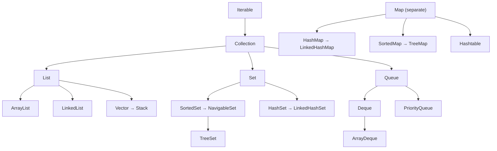
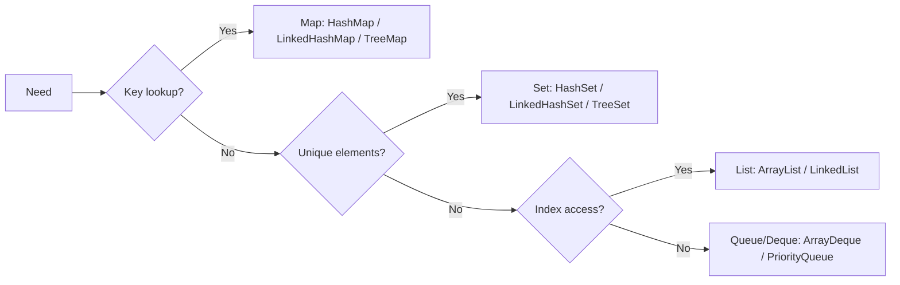

# Introduction to the Java Collections Framework: Hierarchy, List, Queue, Set and Map

**TL;DR:** The **Collections Framework** (`java.util`) is a set of interfaces, implementations and algorithms for groups of objects. The root of the **Collection hierarchy** is `Iterable` → `Collection`, which branches into **`List`** (ordered, duplicates, index access), **`Set`** (no duplicates) and **`Queue`/`Deque`** (processing order, e.g. FIFO). **`Map`** (key → value) is a separate hierarchy that does **not** extend `Collection`. Choose the **interface** by what you need (order? duplicates? key lookup?) and the **implementation** by performance (`ArrayList`, `LinkedList`, `HashSet`, `LinkedHashSet`, `TreeSet`, `ArrayDeque`, `PriorityQueue`, `HashMap`, `LinkedHashMap`, `TreeMap`). Collections hold **objects only** (no primitives; use wrappers via generics), are **fail-fast** on concurrent structural modification, and rely on `equals`/`hashCode` (hash-based) or `compareTo` (tree-based).

## Table of Contents

1. [TL;DR](#1-tldr)
2. [Why it matters](#2-why-it-matters)
3. [Prerequisites](#3-prerequisites)
4. [Mental model](#4-mental-model)
5. [Core concepts](#5-core-concepts)
6. [How it works](#6-how-it-works)
7. [Examples](#7-examples)
8. [Comparisons](#8-comparisons)
9. [Trade-offs](#9-trade-offs)
10. [Gotchas](#10-gotchas)
11. [Practical application](#11-practical-application)
12. [Interview prep](#12-interview-prep)
13. [Interview question bank](#13-interview-question-bank)
14. [Tricky code snippets](#14-tricky-code-snippets)
15. [Connections](#15-connections)
16. [Summary](#16-summary)
17. [Answers](#answers)

> **Scope note.** This note is the big-picture introduction. `ArrayList`/`LinkedList`/`Vector` operations, the `Collections` class with `Comparable`/`Comparator`, and `Queue` get their own notes next.

---

## 1. TL;DR

| Interface | Duplicates? | Order | Main implementations |
|---|---|---|---|
| `List` | Yes | Insertion order, index access | `ArrayList`, `LinkedList`, `Vector` |
| `Set` | No | Depends on the class | `HashSet`, `LinkedHashSet`, `TreeSet` |
| `Queue` / `Deque` | Yes | Processing order (FIFO, priority, LIFO) | `LinkedList`, `ArrayDeque`, `PriorityQueue` |
| `Map` | Keys unique | Depends on the class | `HashMap`, `LinkedHashMap`, `TreeMap`, `Hashtable` |

**The analogy: containers in a warehouse.**

| Real world | Java |
|---|---|
| A numbered shelf, items can repeat | `List` |
| A tray where an identical item can't be added twice | `Set` |
| A queue at a counter (first come, first served) | `Queue` (FIFO) |
| A priority lane (most urgent first) | `PriorityQueue` |
| A dictionary: word → meaning | `Map` |
| The warehouse catalogue of rules | `Collection` interface |

**Running example:** the list `[b, a, b]` shown as a `List` (keeps all), `TreeSet` (`[a, b]`), `ArrayDeque` (head `b`) and `TreeMap` word counts `{a=1, b=2}` (Snippet 1).

---

## 2. Why it matters

**The problem.** Arrays have a fixed size and no ready-made operations. Real programs need growable lists, unique sets, lookups by key and queues, each with well-defined performance.

**What goes wrong** (verified on Java 21):

| Mistake | Result | Snippet |
|---|---|---|
| `List<int>` | Compile error (primitives not allowed) | 14 |
| Removing in a for-each loop | `ConcurrentModificationException` | 10 |
| `list.remove(1)` on `List<Integer>` | Removes **index** 1, not value 1 | 15 |
| `Set.of(1, 1)` | `IllegalArgumentException` | 12 |
| Modifying `List.of(...)` | `UnsupportedOperationException` | 12 |
| Adding to `Arrays.asList` | `UnsupportedOperationException` | 12 |
| `null` in `TreeMap`/`Hashtable`/`Map.of` | `NullPointerException` | 8 |
| Relying on `HashSet` order | Unspecified ⚠️ | 16, 17 |
| Raw types | `ClassCastException` later | 25 |
| `List<Number> = List<Integer>` | Compile error (invariance) | 26 |
| `contains(new P(1))` without `equals` | `false` | 29 |

**Why interviewers ask.** "Collection hierarchy", "`Collection` vs `Collections`", "`List` vs `Set` vs `Map`", "why `Map` isn't a `Collection`", "fail-fast iterators", "which collection for X", "`HashMap` vs `TreeMap`", "`Arrays.asList` pitfalls".

---

## 3. Prerequisites

| Prerequisite | One-line refresher | Importance |
|---|---|---|
| Interfaces and polymorphism | Program to the interface, e.g. `List<String> l = new ArrayList<>()` | Essential |
| Generics (basics) | `List<String>` gives type safety | Essential |
| Wrapper classes and autoboxing | Primitives are boxed to `Integer` etc. | Essential |
| `equals` / `hashCode` | Hash collections depend on them | Essential |
| Arrays | Collections replace fixed-size arrays | Important |
| Iterator / for-each | Traversal | Important |

---

## 4. Mental model

> **The one picture to keep in your head:** pick **two things**: the **contract** (interface: ordered? unique? keyed?) and the **engine** (implementation: array, linked nodes, hash table, tree, heap). The interface tells you *what you can do*; the implementation decides *how fast* and *in what order*.

```
 Iterable
    │
 Collection ───────────────┬──────────────────┬────────────────────┐
    │                       │                  │                    │
   List                    Set               Queue                 (Map is separate)
 ArrayList            HashSet (hash)          │                    Map
 LinkedList           LinkedHashSet        Deque                   ├─ HashMap
 Vector               SortedSet → TreeSet   ArrayDeque, LinkedList ├─ LinkedHashMap
                                           PriorityQueue           ├─ TreeMap (SortedMap)
                                                                   └─ Hashtable
```
*`Map` is outside the `Collection` tree.*


*`LinkedList` implements both `List` and `Deque`.*

---

## 5. Core concepts

### 5.1 Glossary

| Term | Definition |
|---|---|
| Collection | Interface for a group of elements (`java.util.Collection`) |
| Collections | Utility class (private constructor) with static helpers (`sort`, `max`, `unmodifiableList`) (Snippet 3) |
| Iterable | Root interface; enables for-each (Snippet 4) |
| Iterator | Cursor with `hasNext`, `next`, `remove` |
| Fail-fast | Throws `ConcurrentModificationException` on unexpected modification (Snippet 10) |
| Unmodifiable / immutable | Cannot be changed (`List.of`) (Snippet 12) |
| Ordered / sorted | Insertion/index order vs ordering by comparator |
| Generics | Compile-time type parameters (`List<String>`) |
| View | A live window over another collection (`keySet`, `Arrays.asList`) |

### 5.2 `Iterable` and `Collection`

`Iterable<T>` has `iterator()` (and `forEach`). `Collection<E>` adds:
`size`, `isEmpty`, `contains`, `add`, `remove`, `addAll`, `removeAll`, `retainAll`, `containsAll`, `clear`, `toArray`, `stream` (Snippet 18). `Map` is **not** `Iterable` and not a `Collection` (Snippets 2, 4).

### 5.3 `List`

- Ordered, **allows duplicates and nulls**, index-based (`get`, `set`, `add(i, e)`, `remove(i)`, `indexOf`) (Snippet 5).
- Implementations: `ArrayList` (resizable array), `LinkedList` (doubly linked), `Vector` (legacy, synchronized), `Stack` (legacy). They get their own note.
- `remove(int)` vs `remove(Object)` trap on `List<Integer>` (Snippet 15).

### 5.4 `Set`

- **No duplicates** (decided by `equals`/`hashCode`, or `compareTo` for trees). `add` returns `false` if already present (Snippet 6).
- `HashSet`: unordered, O(1) average. `LinkedHashSet`: insertion order. `TreeSet`: sorted, O(log n), no nulls (Snippets 6, 9, 16).
- `SortedSet`/`NavigableSet` add `first`, `last`, `floor`, `ceiling`, `headSet`...

### 5.5 `Queue` and `Deque`

- `Queue`: elements for processing; typically FIFO. Pairs of methods: `add/offer`, `remove/poll`, `element/peek`: the first of each throws, the second returns `false`/`null` (Snippet 20).
- `PriorityQueue`: ordered by priority (natural order or `Comparator`), not FIFO (Snippet 21).
- `Deque`: double-ended; also a stack (`push`, `pop`) (Snippet 22). `ArrayDeque` is the usual choice.
- Details in the Queue note.

### 5.6 `Map`

- Key → value; **unique keys**, duplicate values fine (Snippet 7).
- `put` returns the **old value** (or `null`); `get` returns `null` if absent; `getOrDefault`, `putIfAbsent`, `merge`, `computeIfAbsent` (Snippets 1, 7).
- Views: `keySet()`, `values()`, `entrySet()` are live; removing through them changes the map (Snippet 19).
- `HashMap` (unordered, one `null` key), `LinkedHashMap` (insertion/access order), `TreeMap` (sorted keys, no `null` key), `Hashtable` (legacy synchronized, no `null`s) (Snippets 8, 17).

### 5.7 Null rules

| Collection | `null` allowed? | Snippet |
|---|---|---|
| `ArrayList`, `LinkedList` | Yes (many) | 9 |
| `HashSet`, `LinkedHashSet` | One `null` | 9 |
| `TreeSet` / `TreeMap` key | No (NPE) | 8, 9 |
| `ArrayDeque`, `PriorityQueue` | No | 9 |
| `HashMap` | One null key, null values | 8 |
| `Hashtable`, `ConcurrentHashMap` | No | 8 |
| `List.of`, `Set.of`, `Map.of` | No (NPE) | 8, 32 |

### 5.8 Immutable and fixed-size lists

- `List.of`, `Set.of`, `Map.of` (Java 9): **immutable**; `Set.of`/`Map.of` reject duplicates (Snippet 12); null elements → NPE (Snippet 32).
- `Arrays.asList(array)`: **fixed-size**, write-through view of the array: `set` works, `add`/`remove` throw (Snippets 12, 13).
- `Collections.unmodifiableList(l)`: read-only **view**; changes to the original show through (Snippet 24).

### 5.9 Generics, wildcards

- Type safety at compile time; **no primitives** (Snippet 14).
- **Invariance:** `List<Integer>` is not a `List<Number>` (Snippet 26).
- `List<? extends Number>` can be read as `Number` but not added to (Snippet 27).
- Raw types bypass checks and fail later with `ClassCastException` (Snippet 25).

### 5.10 Iteration and fail-fast

- for-each uses an `Iterator`. Modifying the collection structurally during iteration (except via `Iterator.remove`) throws `ConcurrentModificationException` (Snippet 10).
- Safe options: `Iterator.remove()`, `removeIf`, collect to remove later, concurrent collections (Snippet 11).

### 5.11 Thread-safety

- Most collections are **not** thread-safe. Old synchronized: `Vector`, `Hashtable`. Wrappers: `Collections.synchronizedList/Map`. Modern: `ConcurrentHashMap`, `CopyOnWriteArrayList` (Snippet 31, 24).

---

## 6. How it works

### 6.1 Interface vs implementation

```java
List<String> list = new ArrayList<>();   // declare the interface, choose the implementation
```
Swapping `ArrayList` for `LinkedList` later needs no other changes.

### 6.2 Worked trace: the running example

```java
List<String> list = new ArrayList<>(List.of("b", "a", "b"));   // 1
Set<String> set = new TreeSet<>(list);                         // 2
Queue<String> q = new ArrayDeque<>(list);                      // 3
Map<String, Integer> m = new TreeMap<>();                      // 4
for (String s : list) m.merge(s, 1, Integer::sum);             // 5
```

| Step | State |
|---|---|
| 1 | `[b, a, b]` (duplicates kept) |
| 2 | Adds `b`, `a`, `b` (second `b` ignored), sorted → `[a, b]` |
| 3 | FIFO queue `[b, a, b]`; `peek()` = `b` |
| 4-5 | `merge` counts: `b→1`, `a→1`, `b→2`; sorted keys → `{a=1, b=2}` |

Output: `[b, a, b] [a, b] b {a=1, b=2}`.

### 6.3 Fail-fast mechanism

Each structural change increments a `modCount`; an iterator remembers it. If it differs on `next()`, a `ConcurrentModificationException` is thrown. Quirk: removing the **second-to-last** element in a for-each makes `hasNext()` return `false` before the check, so **no exception** occurs (Snippet 10) ⚠️ (don't rely on it).

### 6.4 Hash vs tree vs linked

- **Hash** (`HashSet`, `HashMap`): bucket by `hashCode`, then `equals`.
- **Tree** (`TreeSet`, `TreeMap`): red-black tree ordered by `compareTo`/`Comparator`.
- **Linked** variants keep a linked list for iteration order.

### 6.5 `Arrays.asList` is a view

The returned list writes through to the array and vice versa; its size is fixed (Snippet 13). `Arrays.asList(int[])` gives a list of **one** element (the array) (Snippet 13).

---

## 7. Examples

### 7.1 Toy example

```java
List<String> names = new ArrayList<>();
names.add("Ann"); names.add("Bob");
for (String n : names) System.out.println(n);
```

### 7.2 Real-world examples

- **List:** shopping cart, search results.
- **Set:** unique tags, visited nodes in a graph, set math (union/intersection) (Snippet 30).
- **Queue:** task scheduling, BFS; `PriorityQueue` for top-K.
- **Map:** caches, word counts, indexing by id (Snippets 1, 28).
- **Deque:** stack for parsing, sliding windows (Snippet 22).

---

## 8. Comparisons

### 8.1 `List` vs `Set` vs `Map` vs `Queue`

| | `List` | `Set` | `Queue` | `Map` |
|---|---|---|---|---|
| Duplicates | Yes | No | Yes | Unique keys |
| Index access | Yes | No | No | By key |
| Extends `Collection` | Yes | Yes | Yes | **No** |
| Typical use | Sequence | Uniqueness | Processing order | Lookup |

### 8.2 `Collection` vs `Collections`

| | `Collection` | `Collections` |
|---|---|---|
| Kind | Interface | Utility class with a private constructor (Snippet 3) |
| Purpose | Contract of a group | Algorithms: `sort`, `reverse`, `shuffle`, `max`, `unmodifiableX`, `synchronizedX` |

### 8.3 Choosing a `Set`

| | `HashSet` | `LinkedHashSet` | `TreeSet` |
|---|---|---|---|
| Order | None | Insertion | Sorted |
| `add/contains` | O(1) avg | O(1) avg | O(log n) |
| `null` | One | One | No |

### 8.4 Choosing a `Map`

| | `HashMap` | `LinkedHashMap` | `TreeMap` | `Hashtable` |
|---|---|---|---|---|
| Order | None | Insertion/access | Sorted keys | None |
| Get/put | O(1) avg | O(1) avg | O(log n) | O(1) avg |
| Null key | One | One | No | No |
| Thread-safe | No | No | No | Yes (legacy) |

### 8.5 Immutable vs unmodifiable vs fixed-size

| | `List.of` | `Collections.unmodifiableList` | `Arrays.asList` |
|---|---|---|---|
| `add` | Throws | Throws | Throws |
| `set` | Throws | Throws | Works |
| Reflects changes to source | N/A | Yes (view) | Yes (array) |
| Nulls | No | Allowed | Allowed |

### 8.6 Array vs collection

| | Array | Collection |
|---|---|---|
| Size | Fixed | Grows |
| Element type | Primitives or objects | Objects only |
| Utilities | `Arrays` | Rich API |
| Generics | No | Yes |

---

## 9. Trade-offs

- **`ArrayList` vs `LinkedList`:** random access vs cheap inserts at ends/iterator (see the List note).
- **Hash vs tree:** speed vs sorted order and range queries.
- **Ordering guarantees:** `LinkedHashX` costs a bit more memory for predictable iteration.
- **Immutability:** safer sharing, but you can't modify.
- **Thread-safety:** wrappers/legacy classes lock everything; concurrent collections scale better.
- **Boxing:** `List<Integer>` boxes values (memory and time); primitive arrays or specialised libraries are leaner.
- **API choice:** return the interface (`List`, `Map`), not the implementation.

---

## 10. Gotchas

### Myths

- ❌ **Myth:** "`Map` is a `Collection`." ✅ **Reality:** separate hierarchy (Snippet 2).
- ❌ **Myth:** "`Collections` and `Collection` are the same." ✅ **Reality:** utility class vs interface (Snippet 3).
- ❌ **Myth:** "`HashSet` keeps insertion order." ✅ **Reality:** unspecified; use `LinkedHashSet` (Snippets 16, 17).
- ❌ **Myth:** "`l.remove(1)` removes the value 1." ✅ **Reality:** removes index 1 for `List<Integer>` (Snippet 15).
- ❌ **Myth:** "`Arrays.asList` returns a normal `ArrayList`." ✅ **Reality:** fixed-size view (Snippets 12, 13).
- ❌ **Myth:** "You can remove while iterating with for-each." ✅ **Reality:** CME (Snippet 10).
- ❌ **Myth:** "`List<Number>` accepts a `List<Integer>`." ✅ **Reality:** generics are invariant (Snippet 26).
- ❌ **Myth:** "All collections allow `null`." ✅ **Reality:** many don't (Snippets 8, 9, 32).
- ❌ **Myth:** "`unmodifiableList` is a copy." ✅ **Reality:** a view (Snippet 24).
- ❌ **Myth:** "`Set` has `get(index)`." ✅ **Reality:** no index access.

### Common mistakes and edge cases

- **Using raw types** (Snippet 25).
- **Modifying during for-each** (Snippet 10): use `Iterator.remove` or `removeIf` (Snippet 11).
- **Forgetting `equals`/`hashCode`** on elements/keys (Snippet 29).
- **Using `Arrays.asList(int[])`** (Snippet 13).
- **Relying on `HashMap` order** (Snippet 17).
- **Calling `contains(null)` on `List.of`** (Snippet 32).
- **Mutating keys/elements** used for hashing/sorting.
- **Choosing `Vector`/`Hashtable` for new code.**

---

## 11. Practical application

### Checklist
- [ ] Declare variables with the interface type (`List`, `Set`, `Map`, `Deque`).
- [ ] Choose by need: order/duplicates/lookup, then by performance.
- [ ] Override `equals` + `hashCode` for hashed elements/keys; `Comparable` for sorted ones.
- [ ] Use `Iterator.remove`/`removeIf` for removal during traversal.
- [ ] Use `List.of`/`Set.of`/`Map.of` for constants; copy with `new ArrayList<>(...)` if you need to modify.
- [ ] Don't use raw types; use generics and wildcards properly.
- [ ] Prefer `ArrayDeque` over `Stack`/`LinkedList` for stack/queue.
- [ ] Use concurrent collections for multi-threaded access.

### Hands-on exercise

```java
List<Integer> m = new ArrayList<>(List.of(1, 2, 3, 4));
for (Integer x : m) if (x == 3) m.remove(x);
System.out.println(m);
```
What is printed?

<details><summary>Solution</summary>

`[1, 2, 4]` (no exception). `3` is the second-to-last element: after removing it, the size is 3 and the iterator's cursor is 3, so `hasNext()` returns `false` and the loop ends before `next()` could detect the modification. Removing `2` instead would throw `ConcurrentModificationException` (Snippet 10).

Verified on Java 21. ⚠️ Don't rely on this behaviour; use `Iterator.remove()` or `removeIf`.
</details>

---

## 12. Interview prep

Eight model answers, as you would say them aloud.

<details><summary>1. Explain the Collection hierarchy.</summary>

`Iterable` → `Collection` → `List`, `Set` (→ `SortedSet` → `NavigableSet`) and `Queue` (→ `Deque`). `Map` (→ `SortedMap` → `NavigableMap`) is a separate hierarchy. Implementations: `ArrayList`, `LinkedList`, `HashSet`, `TreeSet`, `ArrayDeque`, `PriorityQueue`, `HashMap`, `TreeMap` (4; Snippets 2, 3).
</details>

<details><summary>2. What is the difference between `Collection` and `Collections`?</summary>

`Collection` is the root interface; `Collections` is a utility class (private constructor) with static methods like `sort`, `max`, `unmodifiableList` and `synchronizedList` (8.2; Snippet 3).
</details>

<details><summary>3. `List` vs `Set` vs `Map`?</summary>

`List` is ordered and allows duplicates; `Set` rejects duplicates; `Map` stores unique keys mapped to values and is not a `Collection` (8.1; Snippets 5, 6, 7).
</details>

<details><summary>4. Why doesn't `Map` extend `Collection`?</summary>

A map holds key-value pairs, not single elements; `Collection` methods like `add(E)` don't fit. You view it through `keySet()`, `values()` and `entrySet()` (5.6; Snippets 2, 19).
</details>

<details><summary>5. What is fail-fast?</summary>

Iterators detect structural modification via a `modCount` and throw `ConcurrentModificationException`. Use `Iterator.remove()`, `removeIf` or concurrent collections (5.10, 6.3; Snippets 10, 11).
</details>

<details><summary>6. `HashSet` vs `LinkedHashSet` vs `TreeSet`?</summary>

Unordered O(1), insertion-ordered O(1), and sorted O(log n) with no `null` (8.3; Snippets 6, 9, 16).
</details>

<details><summary>7. How do `Arrays.asList`, `List.of` and `Collections.unmodifiableList` differ?</summary>

`asList` is a fixed-size write-through view of the array; `List.of` is immutable and rejects nulls; `unmodifiableList` is a read-only view of a list that can still change underneath (8.5; Snippets 12, 13, 24).
</details>

<details><summary>8. Which collection would you choose for X?</summary>

Sequence with index access: `ArrayList`. Unique items: `HashSet` (sorted: `TreeSet`). Lookup by key: `HashMap`. FIFO/stack: `ArrayDeque`. Priority order: `PriorityQueue` (Section 8).
</details>

---

## 13. Interview question bank


### 13.1 Framework and hierarchy (Q1–Q14)

<details><summary>Q1. What is the Collections Framework?</summary>

Interfaces, implementations and algorithms in `java.util` for groups of objects.
</details>

<details><summary>Q2. What is the root interface?</summary>

`Iterable`, then `Collection` (Snippet 2).
</details>

<details><summary>Q3. Does `Collection` extend `Iterable`?</summary>

Yes (Snippet 2).
</details>

<details><summary>Q4. Is `Map` a `Collection`?</summary>

No (Snippet 2).
</details>

<details><summary>Q5. Is `Map` `Iterable`?</summary>

No; iterate `entrySet()` (Snippet 4).
</details>

<details><summary>Q6. Main sub-interfaces of `Collection`?</summary>

`List`, `Set`, `Queue` (Snippet 2).
</details>

<details><summary>Q7. Where does `Deque` fit?</summary>

Extends `Queue` (hierarchy diagram).
</details>

<details><summary>Q8. What is `SortedSet`/`NavigableSet`?</summary>

Sorted `Set` with navigation methods; `TreeSet` implements it.
</details>

<details><summary>Q9. What does `LinkedList` implement?</summary>

`List` and `Deque`.
</details>

<details><summary>Q10. `Collection` vs `Collections`?</summary>

Interface vs utility class (Snippet 3).
</details>

<details><summary>Q11. Is `Collections` instantiable?</summary>

No, private constructor (Snippet 3).
</details>

<details><summary>Q12. Why program to interfaces?</summary>

Swap implementations freely.
</details>

<details><summary>Q13. What does `Iterable` give?</summary>

for-each support (Snippet 4).
</details>

<details><summary>Q14. Do collections store primitives?</summary>

No, wrapper objects; `List<int>` doesn't compile (Snippet 14).
</details>


### 13.2 List (Q15–Q26)

<details><summary>Q15. Is a `List` ordered?</summary>

Yes, insertion/index order (Snippet 5).
</details>

<details><summary>Q16. Duplicates allowed?</summary>

Yes (Snippet 5).
</details>

<details><summary>Q17. Nulls allowed?</summary>

Yes in `ArrayList`/`LinkedList` (Snippet 9).
</details>

<details><summary>Q18. `indexOf` vs `lastIndexOf`?</summary>

First vs last occurrence (Snippet 5).
</details>

<details><summary>Q19. `remove(int)` vs `remove(Object)`?</summary>

Index vs element (Snippet 15).
</details>

<details><summary>Q20. How to remove the value 1 from `List<Integer>`?</summary>

`remove(Integer.valueOf(1))` (Snippet 15).
</details>

<details><summary>Q21. What does `Arrays.asList(intArray)` give?</summary>

A list of one element (Snippet 13).
</details>

<details><summary>Q22. Can you `add` to `Arrays.asList`?</summary>

No, `UnsupportedOperationException` (Snippet 12).
</details>

<details><summary>Q23. Can you `set`?</summary>

Yes (Snippet 12).
</details>

<details><summary>Q24. Is `Arrays.asList` a view?</summary>

Yes, write-through to the array (Snippet 13).
</details>

<details><summary>Q25. Can `List.of` hold null?</summary>

No, NPE (Snippet 32).
</details>

<details><summary>Q26. What does `List.of(1).contains(null)` do?</summary>

NPE (Snippet 32).
</details>


### 13.3 Set (Q27–Q38)

<details><summary>Q27. What does `Set.add` return for a duplicate?</summary>

`false` (Snippet 6).
</details>

<details><summary>Q28. What defines a duplicate in `HashSet`?</summary>

`equals` + `hashCode` (Snippet 29).
</details>

<details><summary>Q29. What defines it in `TreeSet`?</summary>

`compareTo`/`Comparator` returning 0.
</details>

<details><summary>Q30. Does `HashSet` keep order?</summary>

No (Snippet 16).
</details>

<details><summary>Q31. `LinkedHashSet` order?</summary>

Insertion (Snippet 16).
</details>

<details><summary>Q32. `TreeSet` order?</summary>

Sorted (Snippet 16).
</details>

<details><summary>Q33. Can `TreeSet` hold null?</summary>

No (Snippet 9).
</details>

<details><summary>Q34. Can `HashSet` hold null?</summary>

One (Snippet 9).
</details>

<details><summary>Q35. What does `Set.of(1, 1)` do?</summary>

`IllegalArgumentException` (Snippet 12).
</details>

<details><summary>Q36. How to compute union/intersection/difference?</summary>

`addAll`, `retainAll`, `removeAll` (Snippet 30).
</details>

<details><summary>Q37. How to remove duplicates from a list?</summary>

`new LinkedHashSet<>(list)` (Snippet 6) or `stream().distinct()` (Snippet 28).
</details>

<details><summary>Q38. Is there `get(i)` on a `Set`?</summary>

No.
</details>


### 13.4 Queue and Deque (Q39–Q50)

<details><summary>Q39. What is `Queue`?</summary>

Collection for holding elements for processing, typically FIFO (Snippet 20).
</details>

<details><summary>Q40. `add` vs `offer`?</summary>

Throws vs returns false when full.
</details>

<details><summary>Q41. `remove` vs `poll`?</summary>

Throws vs returns `null` when empty (Snippet 20).
</details>

<details><summary>Q42. `element` vs `peek`?</summary>

Throws vs returns `null` when empty (Snippet 20).
</details>

<details><summary>Q43. `poll()` on an empty queue?</summary>

`null` (Snippet 20).
</details>

<details><summary>Q44. `remove()` on an empty queue?</summary>

`NoSuchElementException` (Snippet 20).
</details>

<details><summary>Q45. What is `PriorityQueue` order?</summary>

Natural/comparator priority, smallest first (Snippet 21).
</details>

<details><summary>Q46. How to get a max-heap?</summary>

`Comparator.reverseOrder()` (Snippet 21).
</details>

<details><summary>Q47. What is `Deque`?</summary>

Double-ended queue; also a stack (Snippet 22).
</details>

<details><summary>Q48. Stack methods on `Deque`?</summary>

`push`, `pop`, `peek` (Snippet 22).
</details>

<details><summary>Q49. Which class do you use as a stack?</summary>

`ArrayDeque`, not `Stack`.
</details>

<details><summary>Q50. Null in `ArrayDeque`?</summary>

No, NPE (Snippet 9).
</details>


### 13.5 Map (Q51–Q64)

<details><summary>Q51. What does `put` return?</summary>

The old value or `null` (Snippet 7).
</details>

<details><summary>Q52. What does `get` return for a missing key?</summary>

`null` (Snippet 7).
</details>

<details><summary>Q53. `getOrDefault`?</summary>

Value or default (Snippet 7).
</details>

<details><summary>Q54. `putIfAbsent`?</summary>

Puts only if absent, returns existing value (Snippet 7).
</details>

<details><summary>Q55. How to count words?</summary>

`merge(k, 1, Integer::sum)` (Snippet 1).
</details>

<details><summary>Q56. Name the views.</summary>

`keySet`, `values`, `entrySet` (Snippet 19).
</details>

<details><summary>Q57. Are they live?</summary>

Yes; removing through them changes the map (Snippet 19).
</details>

<details><summary>Q58. `HashMap` null key?</summary>

One allowed (Snippet 8).
</details>

<details><summary>Q59. `TreeMap` null key?</summary>

NPE (Snippet 8).
</details>

<details><summary>Q60. `Hashtable` null?</summary>

NPE (Snippet 8).
</details>

<details><summary>Q61. `ConcurrentHashMap` null value?</summary>

NPE (Snippet 8).
</details>

<details><summary>Q62. `LinkedHashMap` order?</summary>

Insertion (Snippet 17).
</details>

<details><summary>Q63. `TreeMap` order?</summary>

Sorted keys (Snippet 17).
</details>

<details><summary>Q64. `Map.of("a", null)?</summary>

NPE (Snippet 8).
</details>


### 13.6 Iteration, generics and safety (Q65–Q80)

<details><summary>Q65. What is `ConcurrentModificationException`?</summary>

Structural change during iteration (Snippet 10).
</details>

<details><summary>Q66. Safe removal while iterating?</summary>

`Iterator.remove`, `removeIf` (Snippet 11).
</details>

<details><summary>Q67. Why does removing the second-to-last element not throw?</summary>

`hasNext()` is false first (Snippet 10).
</details>

<details><summary>Q68. What is a raw type?</summary>

A generic type without arguments (Snippet 25).
</details>

<details><summary>Q69. Risk of raw types?</summary>

Runtime `ClassCastException` (Snippet 25).
</details>

<details><summary>Q70. Is `List<Integer>` a `List<Number>`?</summary>

No, invariant (Snippet 26).
</details>

<details><summary>Q71. What does `? extends Number` allow?</summary>

Reading as `Number`, not adding (Snippet 27).
</details>

<details><summary>Q72. Primitive type arguments?</summary>

Not allowed (Snippet 14).
</details>

<details><summary>Q73. Does `unmodifiableList` copy?</summary>

No, a view (Snippet 24).
</details>

<details><summary>Q74. Which classes are legacy synchronized?</summary>

`Vector`, `Hashtable` (Snippet 31).
</details>

<details><summary>Q75. Modern thread-safe options?</summary>

`ConcurrentHashMap`, `CopyOnWriteArrayList` (Snippet 31).
</details>

<details><summary>Q76. What does `synchronizedMap` return?</summary>

A wrapper (Snippet 31).
</details>

<details><summary>Q77. `contains` on a list of objects without `equals`?</summary>

Uses identity (Snippet 29).
</details>

<details><summary>Q78. What does `binarySearch` need?</summary>

A sorted list; returns `-(insertion point) - 1` if absent (Snippet 23).
</details>

<details><summary>Q79. How to convert a stream to a set/list?</summary>

`Collectors.toSet()`, `toList()` (Snippet 28).
</details>

<details><summary>Q80. What does `toArray(new Integer[0])` do?</summary>

Returns a typed array (Snippet 18).
</details>

---

## 14. Tricky code snippets

32 snippets, each compiled and run on OpenJDK 21. Predict the output (or the compile error) before opening the answer. Iteration order of `HashSet`/`HashMap` is **unspecified** ⚠️; small-integer examples (Snippets 16, 17) happen to print sorted on Java 21 but must not be relied on.

### Snippet 1: The four families

```java
import java.util.*;
public class Main {
    public static void main(String[] a) {
        List<String> list = new ArrayList<>(List.of("b", "a", "b"));
        Set<String> set = new TreeSet<>(list);
        Queue<String> q = new ArrayDeque<>(list);
        Map<String, Integer> m = new TreeMap<>();
        for (String s : list) m.merge(s, 1, Integer::sum);
        System.out.println(list + " " + set + " " + q.peek() + " " + m);
    }
}
```

<details><summary>Answer</summary>

```
[b, a, b] [a, b] b {a=1, b=2}
```

List keeps duplicates, `TreeSet` dedups and sorts, the queue head is the first element, the map counts.
</details>

### Snippet 2: Hierarchy checks

```java
import java.util.*;
public class Main {
    public static void main(String[] a) {
        System.out.println((new ArrayList<>() instanceof Collection) + " " + (new HashSet<>() instanceof Collection) + " " + (new ArrayDeque<>() instanceof Collection));
        System.out.println(Map.class.isAssignableFrom(HashMap.class) + " " + Collection.class.isAssignableFrom(HashMap.class));
        System.out.println(Collection.class.getSuperclass() + " " + Arrays.toString(Collection.class.getInterfaces()));
    }
}
```

<details><summary>Answer</summary>

```
true true true
true false
null [interface java.lang.Iterable]
```

`Map` is not a `Collection`; `Collection` has no superclass (it's an interface) and extends `Iterable`.
</details>

### Snippet 3: `Collection` vs `Collections`

```java
import java.util.*;
public class Main {
    public static void main(String[] a) {
        Collection<Integer> c = new ArrayList<>(List.of(3, 1, 2));
        System.out.println(Collection.class.isInterface() + " " + java.lang.reflect.Modifier.isPrivate(Collections.class.getDeclaredConstructors()[0].getModifiers()));
        List<Integer> l = new ArrayList<>(c);
        Collections.sort(l);
        System.out.println(l + " " + Collections.max(c));
    }
}
```

<details><summary>Answer</summary>

```
true true
[1, 2, 3] 3
```

`Collection` is an interface; `Collections` is a utility class whose constructor is private (so it can't be instantiated).
</details>

### Snippet 4: `Iterable`

```java
import java.util.*;
public class Main {
    public static void main(String[] a) {
        System.out.println(Iterable.class.isAssignableFrom(Collection.class));
        System.out.println(Iterable.class.isAssignableFrom(Map.class));
        Map<String, Integer> m = new LinkedHashMap<>(); m.put("a", 1); m.put("b", 2);
        for (Map.Entry<String, Integer> e : m.entrySet()) System.out.print(e.getKey() + e.getValue() + " ");
        System.out.println();
    }
}
```

<details><summary>Answer</summary>

```
true
false
a1 b2
```

A `Map` isn't `Iterable`; iterate its `entrySet()`.
</details>

### Snippet 5: `List`

```java
import java.util.*;
public class Main {
    public static void main(String[] a) {
        List<Integer> l = new ArrayList<>(List.of(3, 1, 3, 2));
        System.out.println(l + " " + l.get(2) + " " + l.indexOf(3) + " " + l.lastIndexOf(3));
    }
}
```

<details><summary>Answer</summary>

```
[3, 1, 3, 2] 3 0 2
```

Index 2 holds 3; first 3 at index 0, last at 2.
</details>

### Snippet 6: `Set`

```java
import java.util.*;
public class Main {
    public static void main(String[] a) {
        Set<Integer> s = new HashSet<>();
        System.out.println(s.add(1) + " " + s.add(1) + " " + s.size());
        System.out.println(new LinkedHashSet<>(List.of(3, 1, 3, 2)) + " " + new TreeSet<>(List.of(3, 1, 3, 2)));
    }
}
```

<details><summary>Answer</summary>

```
true false 1
[3, 1, 2] [1, 2, 3]
```

`add` returns false for a duplicate; `LinkedHashSet` keeps insertion order, `TreeSet` sorts.
</details>

### Snippet 7: `Map` basics

```java
import java.util.*;
public class Main {
    public static void main(String[] a) {
        Map<String, Integer> m = new HashMap<>();
        System.out.println(m.put("a", 1) + " " + m.put("a", 2) + " " + m.get("a") + " " + m.get("z"));
        System.out.println(m.getOrDefault("z", 0) + " " + m.putIfAbsent("a", 9) + " " + m.putIfAbsent("b", 5) + " " + m);
    }
}
```

<details><summary>Answer</summary>

```
null 1 2 null
0 2 null {a=2, b=5}
```

`put` returns the old value; `putIfAbsent("a", 9)` keeps `2` and returns it.
</details>

### Snippet 8: `null` in maps

```java
import java.util.*;
import java.util.concurrent.*;
public class Main {
    public static void main(String[] a) {
        Map<String, Integer> h = new HashMap<>(); h.put(null, 1);
        System.out.println(h.get(null));
        try { new TreeMap<String, Integer>().put(null, 1); } catch (NullPointerException e) { System.out.println("TreeMap: NullPointerException"); }
        try { new Hashtable<String, Integer>().put(null, 1); } catch (NullPointerException e) { System.out.println("Hashtable: NullPointerException"); }
        try { Map.of("a", null); } catch (NullPointerException e) { System.out.println("Map.of: NullPointerException"); }
        try { new ConcurrentHashMap<String, Integer>().put("a", null); } catch (NullPointerException e) { System.out.println("ConcurrentHashMap: NullPointerException"); }
    }
}
```

<details><summary>Answer</summary>

```
1
TreeMap: NullPointerException
Hashtable: NullPointerException
Map.of: NullPointerException
ConcurrentHashMap: NullPointerException
```

Only `HashMap` (and `LinkedHashMap`) accept `null` keys.
</details>

### Snippet 9: `null` in sets, lists

```java
import java.util.*;
public class Main {
    public static void main(String[] a) {
        Set<String> h = new HashSet<>(); h.add(null);
        System.out.println(h);
        try { new TreeSet<String>().add(null); } catch (NullPointerException e) { System.out.println("TreeSet: NullPointerException"); }
        try { new ArrayDeque<String>().add(null); } catch (NullPointerException e) { System.out.println("ArrayDeque: NullPointerException"); }
        List<String> l = new ArrayList<>(); l.add(null); l.add(null);
        System.out.println(l + " " + l.size());
    }
}
```

<details><summary>Answer</summary>

```
[null]
TreeSet: NullPointerException
ArrayDeque: NullPointerException
[null, null] 2
```

`TreeSet` and `ArrayDeque` reject `null`; lists accept many.
</details>

### Snippet 10: Removing in for-each

```java
import java.util.*;
public class Main {
    public static void main(String[] a) {
        List<Integer> l = new ArrayList<>(List.of(1, 2, 3, 4));
        try { for (Integer x : l) if (x == 2) l.remove(x); System.out.println(l); }
        catch (ConcurrentModificationException e) { System.out.println("CME"); }
        List<Integer> m = new ArrayList<>(List.of(1, 2, 3, 4));
        try { for (Integer x : m) if (x == 3) m.remove(x); System.out.println(m); }
        catch (ConcurrentModificationException e) { System.out.println("CME"); }
    }
}
```

<details><summary>Answer</summary>

```
CME
[1, 2, 4]
```

Removing `2` triggers the check; removing `3` (second to last) ends the loop first.
</details>

### Snippet 11: Safe removal

```java
import java.util.*;
public class Main {
    public static void main(String[] a) {
        List<Integer> l = new ArrayList<>(List.of(1, 2, 3, 4));
        for (Iterator<Integer> it = l.iterator(); it.hasNext(); ) if (it.next() % 2 == 0) it.remove();
        System.out.println(l);
        l.removeIf(x -> x == 1);
        System.out.println(l);
    }
}
```

<details><summary>Answer</summary>

```
[1, 3]
[3]
```

`Iterator.remove` and `removeIf` are safe.
</details>

### Snippet 12: Immutable and fixed-size

```java
import java.util.*;
public class Main {
    public static void main(String[] a) {
        List<Integer> l = List.of(1, 2);
        try { l.add(3); } catch (UnsupportedOperationException e) { System.out.println("UnsupportedOperationException"); }
        List<Integer> arr = Arrays.asList(1, 2);
        arr.set(0, 9);
        try { arr.add(3); } catch (UnsupportedOperationException e) { System.out.println("asList add: UnsupportedOperationException"); }
        System.out.println(arr);
        try { Set.of(1, 1); } catch (IllegalArgumentException e) { System.out.println("IllegalArgumentException: " + e.getMessage()); }
    }
}
```

<details><summary>Answer</summary>

```
UnsupportedOperationException
asList add: UnsupportedOperationException
[9, 2]
IllegalArgumentException: duplicate element: 1
```

`List.of` is immutable; `asList` allows `set` but not `add`; `Set.of` rejects duplicates.
</details>

### Snippet 13: `Arrays.asList` is a view

```java
import java.util.*;
public class Main {
    public static void main(String[] a) {
        Integer[] arr = {1, 2, 3};
        List<Integer> l = Arrays.asList(arr);
        arr[0] = 99; l.set(1, 88);
        System.out.println(Arrays.toString(arr) + " " + l);
        int[] p = {1, 2, 3};
        System.out.println(Arrays.asList(p).size());
    }
}
```

<details><summary>Answer</summary>

```
[99, 88, 3] [99, 88, 3]
1
```

The array and list share storage; `asList(int[])` is a one-element list.
</details>

### Snippet 14: `List<int>`

```java
import java.util.*;
public class Main {
    public static void main(String[] a) {
        List<int> l = new ArrayList<>();
    }
}
```

<details><summary>Answer</summary>

Compile error: *unexpected type*.

Type arguments must be reference types.
</details>

### Snippet 15: `remove(int)` vs `remove(Object)`

```java
import java.util.*;
public class Main {
    public static void main(String[] a) {
        List<Integer> l = new ArrayList<>(List.of(10, 20, 30, 1));
        l.remove(1);
        System.out.println(l);
        l.remove(Integer.valueOf(1));
        System.out.println(l);
    }
}
```

<details><summary>Answer</summary>

```
[10, 30, 1]
[10, 30]
```

`remove(1)` removes the index; `Integer.valueOf(1)` removes the value.
</details>

### Snippet 16: Set orders

```java
import java.util.*;
public class Main {
    public static void main(String[] a) {
        Set<Integer> s = new HashSet<>(List.of(5, 3, 9, 1));
        System.out.println(s);
        Set<String> t = new TreeSet<>(List.of("pear", "apple", "fig"));
        System.out.println(t);
        System.out.println(new LinkedHashSet<>(List.of("pear", "apple", "fig")));
    }
}
```

<details><summary>Answer</summary>

```
[1, 3, 5, 9]
[apple, fig, pear]
[pear, apple, fig]
```

Small `Integer`s hash to themselves, so `HashSet` prints sorted by accident ⚠️; `TreeSet` sorts; `LinkedHashSet` keeps insertion.
</details>

### Snippet 17: Map orders

```java
import java.util.*;
public class Main {
    public static void main(String[] a) {
        Map<String, Integer> lh = new LinkedHashMap<>(), tm = new TreeMap<>();
        for (String k : new String[]{"c", "a", "b"}) { lh.put(k, 1); tm.put(k, 1); }
        System.out.println(lh.keySet() + " " + tm.keySet());
        Map<Integer, String> hm = new HashMap<>();
        for (int i : new int[]{3, 1, 2}) hm.put(i, "v");
        System.out.println(hm.keySet());
    }
}
```

<details><summary>Answer</summary>

```
[c, a, b] [a, b, c]
[1, 2, 3]
```

`LinkedHashMap` keeps insertion, `TreeMap` sorts; `HashMap` order is unspecified ⚠️.
</details>

### Snippet 18: `Collection` operations

```java
import java.util.*;
public class Main {
    public static void main(String[] a) {
        Collection<Integer> c = new ArrayList<>(List.of(1, 2, 3));
        System.out.println(c.contains(2) + " " + c.size() + " " + c.isEmpty());
        c.addAll(List.of(4, 5)); c.removeAll(List.of(1, 5)); c.retainAll(List.of(2, 3, 4, 9));
        System.out.println(c + " " + c.containsAll(List.of(2, 3)));
        System.out.println(Arrays.toString(c.toArray()) + " " + c.toArray(new Integer[0]).length);
        c.clear();
        System.out.println(c.isEmpty());
    }
}
```

<details><summary>Answer</summary>

```
true 3 false
[2, 3, 4] true
[2, 3, 4] 3
true
```

Sequence of `addAll`, `removeAll`, `retainAll` then `toArray`.
</details>

### Snippet 19: `keySet`/`values`/`entrySet` are views

```java
import java.util.*;
public class Main {
    public static void main(String[] a) {
        Map<String, Integer> m = new TreeMap<>(Map.of("a", 1, "b", 2, "c", 3));
        m.keySet().remove("a");
        m.values().remove(3);
        System.out.println(m);
        for (Map.Entry<String, Integer> e : m.entrySet()) e.setValue(e.getValue() * 10);
        System.out.println(m);
    }
}
```

<details><summary>Answer</summary>

```
{b=2}
{b=20}
```

Removing through views changes the map; `setValue` writes through.
</details>

### Snippet 20: Queue methods

```java
import java.util.*;
public class Main {
    public static void main(String[] a) {
        Queue<Integer> q = new LinkedList<>();
        q.offer(1); q.offer(2); q.add(3);
        System.out.println(q.peek() + " " + q.poll() + " " + q + " " + q.size());
        Queue<Integer> e = new LinkedList<>();
        System.out.println(e.peek() + " " + e.poll());
        try { e.remove(); } catch (NoSuchElementException x) { System.out.println("NoSuchElementException"); }
        try { e.element(); } catch (NoSuchElementException x) { System.out.println("element: NoSuchElementException"); }
    }
}
```

<details><summary>Answer</summary>

```
1 1 [2, 3] 2
null null
NoSuchElementException
element: NoSuchElementException
```

`peek`/`poll` return `null` on empty; `remove`/`element` throw.
</details>

### Snippet 21: `PriorityQueue`

```java
import java.util.*;
public class Main {
    public static void main(String[] a) {
        PriorityQueue<Integer> pq = new PriorityQueue<>(List.of(5, 1, 4, 2, 3));
        StringBuilder sb = new StringBuilder();
        while (!pq.isEmpty()) sb.append(pq.poll()).append(' ');
        System.out.println(sb.toString().trim());
        PriorityQueue<Integer> max = new PriorityQueue<>(Comparator.reverseOrder());
        max.addAll(List.of(5, 1, 4)); System.out.println(max.peek());
    }
}
```

<details><summary>Answer</summary>

```
1 2 3 4 5
5
```

`poll` returns the smallest; reversing the comparator gives a max-heap.
</details>

### Snippet 22: `Deque`

```java
import java.util.*;
public class Main {
    public static void main(String[] a) {
        Deque<Integer> d = new ArrayDeque<>();
        d.push(1); d.push(2); d.addLast(3);
        System.out.println(d + " " + d.pop() + " " + d.pollLast() + " " + d);
    }
}
```

<details><summary>Answer</summary>

```
[2, 1, 3] 2 3 [1]
```

`push` adds at the front; `pop` removes the front; `pollLast` removes the back.
</details>

### Snippet 23: `binarySearch`

```java
import java.util.*;
public class Main {
    public static void main(String[] a) {
        List<Integer> l = new ArrayList<>(List.of(5, 1, 4));
        Collections.sort(l);
        System.out.println(l + " " + Collections.binarySearch(l, 4) + " " + Collections.binarySearch(l, 3));
    }
}
```

<details><summary>Answer</summary>

```
[1, 4, 5] 1 -2
```

`3` would be inserted at index 1, so the result is `-(1) - 1 = -2`.
</details>

### Snippet 24: Wrappers

```java
import java.util.*;
public class Main {
    public static void main(String[] a) {
        List<Integer> base = new ArrayList<>(List.of(1));
        List<Integer> ro = Collections.unmodifiableList(base);
        base.add(2);
        System.out.println(ro);
        try { ro.add(3); } catch (UnsupportedOperationException e) { System.out.println("UnsupportedOperationException"); }
        System.out.println(Collections.synchronizedList(new ArrayList<>(base)).size());
    }
}
```

<details><summary>Answer</summary>

```
[1, 2]
UnsupportedOperationException
2
```

The read-only view reflects changes to the base list.
</details>

### Snippet 25: Raw types

```java
import java.util.*;
public class Main {
    @SuppressWarnings({"rawtypes", "unchecked"})
    public static void main(String[] a) {
        List raw = new ArrayList<String>();
        raw.add(1);
        List<String> typed = raw;
        try { String s = typed.get(0); } catch (ClassCastException e) { System.out.println("ClassCastException"); }
        System.out.println(raw);
    }
}
```

<details><summary>Answer</summary>

```
ClassCastException
[1]
```

The `Integer` was added through the raw type; the cast to `String` fails when read.
</details>

### Snippet 26: `List<Number> = List<Integer>`

```java
import java.util.*;
public class Main {
    public static void main(String[] a) {
        List<Integer> ints = new ArrayList<>();
        List<Number> nums = ints;
    }
}
```

<details><summary>Answer</summary>

Compile error: *incompatible types: List<Integer> cannot be converted to List<Number>*.

Generics are invariant.
</details>

### Snippet 27: `? extends`

```java
import java.util.*;
public class Main {
    static double sum(List<? extends Number> l) { double s = 0; for (Number n : l) s += n.doubleValue(); return s; }
    public static void main(String[] a) {
        List<? extends Number> l = new ArrayList<>(List.of(1, 2.5));
        System.out.println(sum(l));
        l.add(3);
    }
}
```

<details><summary>Answer</summary>

Compile error: *incompatible types: int cannot be converted to CAP#1*.

You can't add to a `List<? extends Number>` (the call to `sum` is fine, but the program doesn't compile).
</details>

### Snippet 28: Streams to collections

```java
import java.util.*;
import java.util.stream.*;
public class Main {
    public static void main(String[] a) {
        List<String> w = List.of("bb", "a", "bb", "ccc");
        System.out.println(w.stream().collect(Collectors.toSet()).size() + " " + w.stream().distinct().toList());
        System.out.println(new TreeMap<>(w.stream().collect(Collectors.groupingBy(String::length, Collectors.counting()))));
    }
}
```

<details><summary>Answer</summary>

```
3 [bb, a, ccc]
{1=1, 2=2, 3=1}
```

`toSet` dedups; `distinct` keeps first occurrences; `groupingBy` counts by length.
</details>

### Snippet 29: `contains` with no `equals`

```java
import java.util.*;
public class Main {
    static class P { int x; P(int x) { this.x = x; } }
    public static void main(String[] a) {
        List<P> l = new ArrayList<>(); P p = new P(1); l.add(p);
        System.out.println(l.contains(p) + " " + l.contains(new P(1)) + " " + l.indexOf(new P(1)));
    }
}
```

<details><summary>Answer</summary>

```
true false -1
```

Identity comparison only matches the same instance.
</details>

### Snippet 30: Set algebra

```java
import java.util.*;
public class Main {
    public static void main(String[] a) {
        Set<Integer> s1 = new HashSet<>(List.of(1, 2, 3)), s2 = new HashSet<>(List.of(2, 3, 4));
        Set<Integer> union = new TreeSet<>(s1); union.addAll(s2);
        Set<Integer> inter = new TreeSet<>(s1); inter.retainAll(s2);
        Set<Integer> diff = new TreeSet<>(s1); diff.removeAll(s2);
        System.out.println(union + " " + inter + " " + diff);
    }
}
```

<details><summary>Answer</summary>

```
[1, 2, 3, 4] [2, 3] [1]
```

Union, intersection and difference via `addAll`, `retainAll`, `removeAll`.
</details>

### Snippet 31: Thread-safe types

```java
import java.util.*;
import java.util.concurrent.*;
public class Main {
    public static void main(String[] a) {
        System.out.println(new Vector<>().getClass().getSimpleName() + " " + new Hashtable<>().getClass().getSimpleName() + " " + new CopyOnWriteArrayList<>().getClass().getSimpleName() + " " + new ConcurrentHashMap<>().getClass().getSimpleName());
        System.out.println(Collections.synchronizedMap(new HashMap<>()).getClass().getSimpleName());
    }
}
```

<details><summary>Answer</summary>

```
Vector Hashtable CopyOnWriteArrayList ConcurrentHashMap
SynchronizedMap
```

Legacy, copy-on-write, concurrent and wrapper classes.
</details>

### Snippet 32: Nulls and `List.of`

```java
import java.util.*;
public class Main {
    public static void main(String[] a) {
        try { List.of(1, null); } catch (NullPointerException e) { System.out.println("List.of: NullPointerException"); }
        List<Integer> l = Arrays.asList(1, null);
        System.out.println(l + " " + l.contains(null));
        try { List.of(1).contains(null); } catch (NullPointerException e) { System.out.println("contains(null): NullPointerException"); }
    }
}
```

<details><summary>Answer</summary>

```
List.of: NullPointerException
[1, null] true
contains(null): NullPointerException
```

Immutable collections reject `null`, even in `contains`.
</details>

---

## 15. Connections

| Related topic | How it connects |
|---|---|
| `equals`/`hashCode` | Hash-based collections need them |
| `Comparable`/`Comparator` | Tree-based collections and sorting need them |
| Generics | Type-safe collections |
| Wrapper classes | Autoboxing for primitives |
| Iterators | for-each and fail-fast |
| Streams | `stream()`, `Collectors` |
| Concurrency | Concurrent collections, synchronized wrappers |
| Arrays | `Arrays.asList`, `toArray` |
| Data structures | Array, linked list, hash table, red-black tree, heap |


*A quick decision tree for picking a collection.*

---

## 16. Summary

### 60-second card

- `Iterable` → `Collection` → `List` / `Set` / `Queue` (→ `Deque`); `Map` is separate.
- `List` ordered + duplicates; `Set` unique; `Queue` processing order; `Map` key → value.
- `Collection` is the interface; `Collections` is the utility class.
- Prefer interface types in declarations.
- Hash classes use `equals`/`hashCode`; tree classes use `compareTo`/`Comparator`.
- Don't remove in for-each: use `Iterator.remove`/`removeIf`.
- `List.of` immutable; `Arrays.asList` fixed-size view; `unmodifiableList` read-only view.
- No primitives; no raw types; generics are invariant.

### Cheat sheet

```java
List<String> l = new ArrayList<>();        Set<String> s = new LinkedHashSet<>();
Map<String,Integer> m = new HashMap<>();   Deque<Integer> d = new ArrayDeque<>();
m.merge(word, 1, Integer::sum);            l.removeIf(x -> x.isEmpty());
List<String> fixed = List.of("a", "b");    List<String> copy = new ArrayList<>(fixed);
```

| Need | Use |
|---|---|
| Growable list | `ArrayList` |
| Unique, unordered | `HashSet` |
| Unique, insertion order | `LinkedHashSet` |
| Unique, sorted | `TreeSet` |
| Key lookup | `HashMap` (`TreeMap` if sorted) |
| FIFO / stack | `ArrayDeque` |
| Priority | `PriorityQueue` |

### Self-test

1. Draw the Collection hierarchy. Where does `Map` fit?
2. `Collection` vs `Collections`?
3. What makes a `Set` reject a duplicate in `HashSet` vs `TreeSet`?
4. Why does removing inside for-each throw?
5. `List.of` vs `Arrays.asList` vs `unmodifiableList`?
6. Which maps allow a `null` key?
7. `l.remove(1)` on `List<Integer>`?
8. Why can't you write `List<int>`?

### Anki flashcards

```
Collection hierarchy :: Iterable > Collection > List / Set / Queue (Map separate)
Collection vs Collections :: Interface vs utility class
List :: Ordered, duplicates, index access
Set :: No duplicates (equals/hashCode or compareTo)
Queue :: Processing order; offer/poll/peek return null, add/remove/element throw
Map :: key -> value, not a Collection; one null key in HashMap only
Fail-fast :: ConcurrentModificationException on structural change
Arrays.asList :: Fixed-size view of the array
```

### Resources

- The Java Tutorials, "Collections" trail: docs.oracle.com/javase/tutorial/collections
- API docs: `java.util.Collection`, `List`, `Set`, `Queue`, `Deque`, `Map`
- *Effective Java*, Joshua Bloch: items on generics and collections

---

## Answers

1. `Iterable` → `Collection` → `List`, `Set`, `Queue` (→ `Deque`); `Map` is a separate hierarchy.
2. An interface vs a utility class of static helpers.
3. `HashSet`: `hashCode` + `equals`; `TreeSet`: `compareTo`/`Comparator` returning 0.
4. The iterator detects a structural change (`modCount`) and throws `ConcurrentModificationException`.
5. Immutable; fixed-size write-through view; read-only view of a changeable list.
6. `HashMap` and `LinkedHashMap` (one `null` key); not `TreeMap`, `Hashtable`, `ConcurrentHashMap` or `Map.of`.
7. It removes the element at **index** 1.
8. Type arguments must be reference types; use `List<Integer>`.
