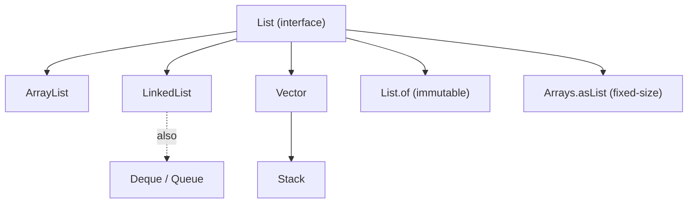
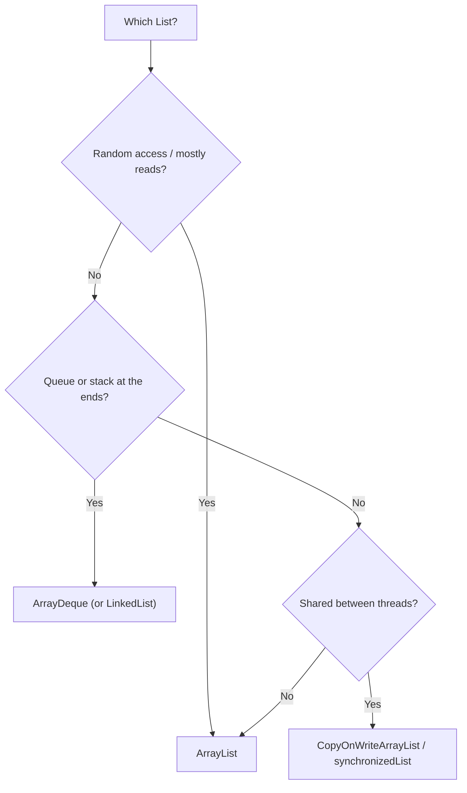

# Java List Collection: ArrayList, LinkedList and Vector

**TL;DR:** A `List` is an **ordered** collection that **allows duplicates and `null`s** and supports **index access**. The three classic implementations: **`ArrayList`** (resizable array: fast `get/set`, slow middle insert/delete; the default choice), **`LinkedList`** (doubly linked list that is also a `Deque`: fast insert/remove at the ends, slow indexed access), and **`Vector`** (legacy, every method `synchronized`, doubles capacity; `Stack` extends it). Core operations: **insert** (`add`, `add(i,e)`, `addAll`), **delete** (`remove(int)`, `remove(Object)`, `removeIf`, `clear`), **search** (`contains`, `indexOf`, `lastIndexOf`, `Collections.binarySearch`), **sort** (`list.sort(cmp)`, `Collections.sort`), **iterate** (for, for-each, `Iterator`, `ListIterator`, `forEach`) and **replace** (`set`, `replaceAll`, `Collections.replaceAll`). Traps: `remove(int)` vs `remove(Object)`, `ConcurrentModificationException`, removing in an index loop, `Arrays.asList`/`List.of` limits.

## Table of Contents

1. [TL;DR](#1-tldr)
2. [Why it matters](#2-why-it-matters)
3. [Prerequisites](#3-prerequisites)
4. [Mental model](#4-mental-model)
5. [Core concepts](#5-core-concepts)
6. [How it works](#6-how-it-works)
7. [Examples](#7-examples)
8. [Comparisons](#8-comparisons)
9. [Trade-offs](#9-trade-offs)
10. [Gotchas](#10-gotchas)
11. [Practical application](#11-practical-application)
12. [Interview prep](#12-interview-prep)
13. [Interview question bank](#13-interview-question-bank)
14. [Tricky code snippets](#14-tricky-code-snippets)
15. [Connections](#15-connections)
16. [Summary](#16-summary)
17. [Answers](#answers)

---

## 1. TL;DR

| | `ArrayList` | `LinkedList` | `Vector` |
|---|---|---|---|
| Backed by | Resizable array | Doubly linked nodes | Resizable array |
| `get(i)` | O(1) | O(n) | O(1) |
| `add` at end | O(1) amortized | O(1) | O(1) amortized |
| Insert/remove in the middle | O(n) | O(1) once positioned, O(n) to find | O(n) |
| Thread-safe | No | No | Yes (each method synchronized) |
| Growth | ~1.5× ⚠️ | per node | 2× (default) |
| Also a | `RandomAccess` | `Deque`, `Queue` | `RandomAccess` (legacy) |

**The analogy: three ways to store a train.**

| Real world | Java |
|---|---|
| Numbered seats in a fixed-length carriage you swap for a longer one when full | `ArrayList` |
| Carriages coupled to neighbours; to reach carriage 50 you walk through 49 | `LinkedList` |
| The same carriage with a conductor locking the door on every access | `Vector` |

**Running example:** build `[a, b, c, d]` with `add`, remove `d`, set the first to `A`, sort in reverse, search and iterate (Snippet 1).

---

## 2. Why it matters

**The problem.** The `List` is the most-used collection. Picking the wrong implementation or misusing its operations causes bugs (wrong element removed, exceptions) and performance problems.

**What goes wrong** (verified on Java 21):

| Mistake | Result | Snippet |
|---|---|---|
| `l.remove(1)` on `List<Integer>` | Removes the **index** | 3 |
| `add(50, x)` beyond size | `IndexOutOfBoundsException` | 2 |
| `get` on an empty list | `IndexOutOfBoundsException` (`ArrayIndexOutOfBounds` for `Vector`) | 4 |
| Removing in a for-each | `ConcurrentModificationException` | 20 |
| Removing in an index loop forward | Skips elements | 21 |
| `new ArrayList<>(10).set(0, x)` | Capacity isn't size | 29 |
| Sorting with `null`s | `NullPointerException` | 8 |
| `ll.contains(1)` for `List<Long>` | `false` (an `Integer`) | 22 |
| `Collections.nCopies` of a mutable object | One shared object | 24 |
| `for (Integer x : l) x = x * 10` | List unchanged | 28 |
| `Iterator.remove()` before `next()` | `IllegalStateException` | 30 |

**Why interviewers ask.** "`ArrayList` vs `LinkedList`", "`ArrayList` vs `Vector`", "how does `ArrayList` grow?", "how to remove while iterating?", "`Iterator` vs `ListIterator`", "sort a list of objects", "`remove(int)` vs `remove(Object)`", "is `Vector` still used?", "`Arrays.asList` limits".

---

## 3. Prerequisites

| Prerequisite | One-line refresher | Importance |
|---|---|---|
| Collections introduction | `List` is one branch of `Collection` | Essential |
| Generics and autoboxing | `List<Integer>` boxes `int`s | Essential |
| `equals` | `contains`, `indexOf`, `remove(Object)` use it | Essential |
| Arrays | `ArrayList` is backed by an array | Important |
| Linked lists (data structure) | Nodes with `prev`/`next` | Important |
| Comparators (basics) | For sorting (next note) | Helpful |

---

## 4. Mental model

> **The one picture to keep in your head:** `ArrayList` = **one contiguous array** with spare capacity: jump to any index instantly, but inserting/deleting in the middle shifts everything after it. `LinkedList` = **a chain of nodes**: inserting is just re-pointing two links, but reaching position *i* means walking the chain. `Vector` = an `ArrayList` where every method takes a lock.

```
 ArrayList  [ a | b | c | d | _ | _ ]   size=4, capacity=6   get(2) → direct
                         ▲ insert at 1 → shift b,c,d right

 LinkedList  null ◀─ [a] ⇄ [b] ⇄ [c] ⇄ [d] ─▶ null    first/last pointers
                           ▲ insert after a → relink 2 pointers; get(2) → walk
```
*Pick by access pattern: random reads → array; ends/iterator edits → linked (or `ArrayDeque`).*


*`LinkedList` is the only classic `List` that is also a `Deque`.*

---

## 5. Core concepts

### 5.1 Glossary

| Term | Definition |
|---|---|
| Index | 0-based position in the list |
| Capacity vs size | Array length vs number of elements (Snippet 29) |
| Amortized O(1) | Occasional resize, cheap on average |
| `RandomAccess` | Marker: fast indexed access (`ArrayList`, `Vector`) (Snippet 12) |
| `Iterator` | Forward cursor with `remove` |
| `ListIterator` | Bidirectional cursor with `set`, `add`, `previous` |
| Fail-fast | `ConcurrentModificationException` on unexpected change |
| `subList` | Live view of a range (Snippet 17) |
| Stack | LIFO class extending `Vector` (legacy) |

### 5.2 Creating lists

```java
List<String> a = new ArrayList<>();
List<String> b = new ArrayList<>(List.of("x", "y"));   // copy of any collection
List<String> c = new ArrayList<>(100);                 // initial capacity, still empty (Snippet 29)
List<String> d = new LinkedList<>();
List<String> e = new Vector<>();
```

### 5.3 Insert operations

| Method | Effect |
|---|---|
| `add(e)` | Append |
| `add(i, e)` | Insert at `i` (valid `0..size`), shift the rest |
| `addAll(c)` / `addAll(i, c)` | Append / insert many |
| `LinkedList.addFirst/addLast`, `Vector.addElement/insertElementAt` | End/legacy variants |

`add(i, e)` with `i > size` throws `IndexOutOfBoundsException` (Snippet 2). `addAll(self)` is safe (Snippet 31).

### 5.4 Delete operations

| Method | Effect |
|---|---|
| `remove(int index)` | Remove at index, return the element |
| `remove(Object o)` | Remove the **first** equal element, return `boolean` |
| `removeAll(c)` / `retainAll(c)` | Remove / keep only elements in `c` |
| `removeIf(predicate)` | Remove matching (safe in loops) |
| `subList(a, b).clear()` | Remove a range |
| `clear()` | Remove all |
| `Iterator.remove()` | Remove the last returned element (Snippets 10, 30) |

See Snippet 3.

### 5.5 Search operations

- `contains(o)`, `indexOf(o)` (first, or `-1`), `lastIndexOf(o)`: linear scans using `equals` (Snippet 5).
- `Collections.binarySearch(sortedList, key)`: O(log n) on a **sorted** list; if absent returns `-(insertionPoint) - 1` (Snippet 5).
- `Collections.frequency`, `min`, `max` (Snippet 5).
- Type matters: `List<Long>.contains(1)` is `false` because `1` boxes to `Integer` (Snippet 22).

### 5.6 Replace operations

- `set(i, e)`: replaces and **returns the old element** (Snippet 6).
- `replaceAll(UnaryOperator)`: transform every element (Snippet 6).
- `Collections.replaceAll(list, old, new)`, `Collections.fill`, `Collections.swap` (Snippet 6).
- Assigning to the for-each variable does **not** change the list (Snippet 28).

### 5.7 Sort operations

```java
list.sort(null);                                  // natural order (Comparable)
list.sort(Comparator.comparing(String::length));  // custom
Collections.sort(list);                           // same as list.sort(null)
Collections.reverse(list);
```
- Stable merge/TimSort variant: equal elements keep their order (Snippet 8).
- `null` elements break natural ordering; use `Comparator.nullsFirst` (Snippet 8).
- Comparator details are in the next note.

### 5.8 Iterate operations

| Way | Notes |
|---|---|
| Index `for` | `get(i)`; fine for `ArrayList`, **O(n²)** for `LinkedList` |
| for-each | Uses an `Iterator`; no modification |
| `Iterator` | `hasNext/next/remove` |
| `ListIterator` | Both directions, `set`, `add`, `nextIndex` (Snippets 9, 10) |
| `forEach(lambda)` / streams | Functional style |

### 5.9 `ArrayList`

- Backed by `Object[]`; default capacity 10 allocated on first add; grows by about 1.5× ⚠️ (internal detail); `ensureCapacity`, `trimToSize` (Snippet 27).
- `get/set` O(1); `add(e)` amortized O(1); `add(i,e)`/`remove(i)` O(n) (shifts).
- Not synchronized; allows `null` and duplicates.

### 5.10 `LinkedList`

- Doubly linked; implements `List`, `Deque`, `Queue` (Snippet 12).
- `addFirst/addLast/removeFirst/removeLast/getFirst/getLast/peek/poll/push/pop` (Snippet 11).
- `get(i)` walks from the nearer end: O(n).
- Higher memory per element (node + two links) and poor cache locality.

### 5.11 `Vector` and `Stack`

- Same array design as `ArrayList` but **all methods are `synchronized`**; doubles capacity by default (or grows by a given increment) (Snippet 14).
- Legacy API: `addElement`, `elementAt`, `firstElement`, `lastElement`, `removeElement`, `Enumeration` (Snippet 13).
- `Vector.get` out of range → `ArrayIndexOutOfBoundsException` (Snippet 4).
- `Stack` extends `Vector` with `push`, `pop`, `peek`, `search`, `empty` (Snippet 15); prefer `ArrayDeque`.

### 5.12 Views and conversions

- `subList(from, to)` is a **view**; structural change to the parent invalidates it (Snippet 17).
- `toArray(new String[0])`, `toArray(String[]::new)` (Snippet 18).
- `new ArrayList<>(orig)` is a shallow copy; `Collections.copy(dest, src)` needs `dest.size() >= src.size()` (Snippet 19).
- `List.copyOf` is an immutable snapshot; `unmodifiableList` a view (Snippet 23).

---

## 6. How it works

### 6.1 `ArrayList.add(i, e)` and `remove(i)`

1. Check index bounds.
2. Ensure capacity (grow and copy if full).
3. `System.arraycopy` the tail one slot right (add) or left (remove).
4. Store/clear, update `size`, `modCount++`.

So middle operations cost O(n); `add` at the end is O(1) amortized.

### 6.2 Worked trace: the running example

```java
List<String> l = new ArrayList<>();
l.add("b"); l.add("d"); l.add(1, "c"); l.add(0, "a");
l.remove("d"); l.set(0, "A");
Collections.sort(l, Collections.reverseOrder());
```

| Step | List |
|---|---|
| `add("b")`, `add("d")` | `[b, d]` |
| `add(1, "c")` | `[b, c, d]` |
| `add(0, "a")` | `[a, b, c, d]` (size 4) |
| `remove("d")` | `[a, b, c]` |
| `set(0, "A")` | `[A, b, c]` |
| sort reversed (natural order: uppercase before lowercase) | `[c, b, A]` |

Output: `[a, b, c, d] 4`, `[c, b, A] 0 true`, `c b A `.

### 6.3 `LinkedList` insertion

`add(i, e)` finds node *i* (walking from the head or tail, whichever is nearer), then creates a node and re-links `prev`/`next`: no shifting.

### 6.4 Why removing in an index loop skips elements

After `remove(i)`, the next element slides into index `i`, but the loop increments to `i+1`, skipping it. In `[1, 2, 2, 3]` removing the first `2` leaves `[1, 2, 3]` and the second `2` is skipped (Snippet 21). Iterate backwards, use `removeIf`, or an `Iterator`.

### 6.5 Fail-fast iterators

`ArrayList`, `LinkedList`, `Vector` iterators check `modCount`. `Vector`'s `synchronized` methods don't prevent this single-thread failure (Snippet 20). `CopyOnWriteArrayList` iterates a snapshot (Snippet 20).

### 6.6 `ListIterator`

A cursor between elements: `next()` moves forward and returns the element; `previous()` moves back; `add` inserts at the cursor; `set`/`remove` act on the last returned element (Snippets 9, 10).

---

## 7. Examples

### 7.1 Toy example

```java
List<String> l = new ArrayList<>(List.of("b", "a"));
Collections.sort(l);          // [a, b]
l.add(1, "x");                // [a, x, b]
```

### 7.2 Real-world examples

- **Results lists**, shopping cart (`ArrayList`).
- **Undo/redo history** or LRU-ish structures (`LinkedList`/`ArrayDeque`).
- **Legacy code** using `Vector`/`Stack`/`Enumeration` (Snippets 13, 15).
- **Sorting** search results by several keys (Snippet 7).
- **Batch deletes** with `removeIf` and `subList(...).clear()` (Snippet 3).

---

## 8. Comparisons

### 8.1 `ArrayList` vs `LinkedList`

| | `ArrayList` | `LinkedList` |
|---|---|---|
| `get(i)` / `set(i)` | O(1) | O(n) |
| Add/remove at end | O(1) | O(1) |
| Add/remove at start | O(n) | O(1) |
| Add/remove in the middle | O(n) (shift, fast `arraycopy`) | O(n) to find, O(1) to link |
| Memory | Compact | Node overhead |
| Cache locality | Good | Poor |
| Extra API | `ensureCapacity`, `trimToSize` | `Deque` methods |
| In practice | Usually faster | Rarely wins; consider `ArrayDeque` |

### 8.2 `ArrayList` vs `Vector`

| | `ArrayList` | `Vector` |
|---|---|---|
| Synchronized | No | Yes (per method) |
| Growth | ~1.5× ⚠️ | 2× or fixed increment |
| Introduced | Java 1.2 | Java 1.0 (legacy) |
| Iteration | `Iterator`/`ListIterator` | Also `Enumeration` |
| Out-of-range `get` | `IndexOutOfBoundsException` | `ArrayIndexOutOfBoundsException` |
| Recommended | Yes | No (use `CopyOnWriteArrayList` or wrap) |

### 8.3 `Vector` vs `Collections.synchronizedList`

| | `Vector` | `synchronizedList(new ArrayList<>())` |
|---|---|---|
| Locking | Method-level | Method-level (wrapper) |
| Compound actions | Not atomic | Not atomic (synchronize manually) |
| Iteration | Not safe without external lock | Same |

### 8.4 `Iterator` vs `ListIterator`

| | `Iterator` | `ListIterator` |
|---|---|---|
| Direction | Forward | Both |
| Modify | `remove` | `remove`, `set`, `add` |
| Index info | No | `nextIndex`, `previousIndex` |
| Applies to | Any `Collection` | `List` only |

### 8.5 Ways to remove

| Goal | Use |
|---|---|
| By index | `remove(int)` |
| By value | `remove(Object)` |
| By condition | `removeIf` |
| Range | `subList(a, b).clear()` |
| During iteration | `Iterator.remove()` |

### 8.6 `Stack` vs `Deque`

| | `Stack` | `ArrayDeque` as stack |
|---|---|---|
| Based on | `Vector` (synchronized, index access) | Array deque |
| Push/pop | `push`/`pop` | `push`/`pop` |
| Order printed | Bottom → top (`[1, 2, 3]`) | Top first (`[2, 1]`) (Snippet 15) |
| Recommended | No | Yes |

---

## 9. Trade-offs

- **Random access vs middle inserts:** `ArrayList` wins almost always in practice, even for inserts, thanks to fast `arraycopy`, unless the list is huge and edits are always at the head.
- **Memory:** `LinkedList` nodes cost ~3 references each.
- **Capacity:** pre-size with `new ArrayList<>(n)` if you know the size; `trimToSize` to release spare space.
- **Thread-safety:** `Vector` locks every call (slow, and still not safe for compound actions); use `CopyOnWriteArrayList` for read-mostly or explicit synchronization.
- **Sorting:** `list.sort` is O(n log n) and stable; sorting a `LinkedList` copies to an array internally.
- **Immutability:** `List.of` is safest to share; copy when you need to mutate.

---

## 10. Gotchas

### Myths

- ❌ **Myth:** "`LinkedList` is faster for insertion." ✅ **Reality:** finding the position is O(n), so only ends/iterator inserts are cheap.
- ❌ **Myth:** "`l.remove(1)` removes value 1." ✅ **Reality:** index 1 for `List<Integer>` (Snippet 3).
- ❌ **Myth:** "`new ArrayList<>(10)` has 10 elements." ✅ **Reality:** size 0 (Snippet 29).
- ❌ **Myth:** "`Vector` is thread-safe, so iteration is safe." ✅ **Reality:** still fail-fast and compound actions aren't atomic (Snippet 20).
- ❌ **Myth:** "Assigning to the for-each variable updates the list." ✅ **Reality:** it only changes the local variable (Snippet 28).
- ❌ **Myth:** "`Collections.nCopies(2, new ArrayList<>())` creates two lists." ✅ **Reality:** the same list twice (Snippet 24).
- ❌ **Myth:** "`subList` is a copy." ✅ **Reality:** a view (Snippet 17).
- ❌ **Myth:** "`binarySearch` works on any list." ✅ **Reality:** the list must be sorted (Snippet 5).
- ❌ **Myth:** "`List<int[]>.contains(new int[]{9, 2})` is true." ✅ **Reality:** arrays use identity `equals` (Snippet 24).
- ❌ **Myth:** "`Stack` prints top first." ✅ **Reality:** bottom first (Snippet 15).

### Common mistakes and edge cases

- **Forward index loop that removes** (Snippet 21).
- **Modifying in for-each** (Snippet 20).
- **Calling `Iterator.remove()` twice or before `next()`** (Snippet 30).
- **`Collections.copy` into a too-small list** (Snippet 19).
- **Sorting lists that contain `null`** (Snippet 8).
- **Using `LinkedList.get(i)` in a loop** (O(n²)).
- **Mixing `Integer`/`Long` in `contains`/`indexOf`** (Snippet 22).
- **Modifying the parent while using a `subList`** (Snippet 17).
- **Sorting an immutable list** (Snippet 23).

---

## 11. Practical application

### Checklist
- [ ] Default to `ArrayList`; consider `ArrayDeque` for queue/stack, not `LinkedList`.
- [ ] Declare as `List<T>`; size with `new ArrayList<>(n)` when known.
- [ ] Remove with `removeIf`, an `Iterator`, or iterate backwards.
- [ ] Use `remove(Integer.valueOf(x))` for values in `List<Integer>`.
- [ ] Sort with `list.sort(Comparator...)`; handle `null`s explicitly.
- [ ] `binarySearch` only on sorted lists.
- [ ] Don't use `Vector`/`Stack` in new code.
- [ ] Copy defensively (`new ArrayList<>(...)`, `List.copyOf`).

### Hands-on exercise

```java
List<Integer> l = new ArrayList<>(List.of(1, 2, 2, 3));
for (int i = 0; i < l.size(); i++) if (l.get(i) == 2) l.remove(i);
System.out.println(l);
```
What is printed, and how do you fix it?

<details><summary>Solution</summary>

`[1, 2, 3]`. After removing the first `2` (index 1), the second `2` shifts to index 1, but `i` increments to 2, so it is skipped. Fixes: loop backwards (`for (int i = l.size() - 1; i >= 0; i--)`), call `l.removeIf(x -> x == 2)`, or use an `Iterator`.

Verified on Java 21 (Snippet 21).
</details>

---

## 12. Interview prep

Eight model answers, as you would say them aloud.

<details><summary>1. `ArrayList` vs `LinkedList`: when do you use which?</summary>

`ArrayList` (array): O(1) `get/set`, amortized O(1) append, O(n) middle insert/delete, compact. `LinkedList` (doubly linked, also a `Deque`): O(1) at the ends, O(n) indexed access. `ArrayList` is the default; for queues/stacks prefer `ArrayDeque` (8.1; Snippets 11, 12).
</details>

<details><summary>2. `ArrayList` vs `Vector`?</summary>

`Vector` is legacy: every method is `synchronized`, it doubles its capacity, and it has `Enumeration`. `ArrayList` is unsynchronized, grows ~1.5× ⚠️ and is preferred; use `CopyOnWriteArrayList` or `Collections.synchronizedList` for sharing (8.2; Snippets 13, 14).
</details>

<details><summary>3. How do you remove elements while iterating?</summary>

Use `Iterator.remove()`, `removeIf`, iterate backwards by index, or a concurrent list. A for-each with `list.remove` throws `ConcurrentModificationException` (6.4, 6.5; Snippets 10, 20, 21).
</details>

<details><summary>4. What is the trap in `list.remove(1)` on `List<Integer>`?</summary>

It calls `remove(int index)` and removes the element at index 1. To remove the value, use `remove(Integer.valueOf(1))` (5.4; Snippet 3).
</details>

<details><summary>5. How does `ArrayList` grow?</summary>

It's backed by an `Object[]` (default capacity 10 on first add). When full it allocates a bigger array (~1.5× ⚠️) and copies, so `add` is amortized O(1). `ensureCapacity`/`trimToSize` tune it, and capacity is not size (5.9; Snippets 27, 29).
</details>

<details><summary>6. How do you sort a list and search it?</summary>

`list.sort(comparator)` or `Collections.sort(list)` (stable, O(n log n)); search with `indexOf`/`contains` (linear) or `Collections.binarySearch` on a sorted list (5.5, 5.7; Snippets 5, 7, 8).
</details>

<details><summary>7. `Iterator` vs `ListIterator`?</summary>

`Iterator` goes forward and can `remove`; `ListIterator` (lists only) goes both ways and can `set`, `add`, and report `nextIndex` (8.4; Snippets 9, 10).
</details>

<details><summary>8. What are the limits of `Arrays.asList` and `List.of`?</summary>

`Arrays.asList` is a fixed-size write-through view (`set` works, `add` throws); `List.of` is immutable and rejects nulls. Wrap in `new ArrayList<>(...)` to modify (Snippets 7, 23 and the previous note).
</details>

---

## 13. Interview question bank


### 13.1 List basics (Q1–Q12)

<details><summary>Q1. Is `List` ordered?</summary>

Yes, by index (Snippet 1).
</details>

<details><summary>Q2. Does `List` allow duplicates?</summary>

Yes.
</details>

<details><summary>Q3. Does it allow `null`?</summary>

Yes in `ArrayList`/`LinkedList`/`Vector` (Snippet 25).
</details>

<details><summary>Q4. Name the main implementations.</summary>

`ArrayList`, `LinkedList`, `Vector` (Snippet 1).
</details>

<details><summary>Q5. Valid index range?</summary>

`0..size-1` for `get/set/remove`; `0..size` for `add(i, e)` (Snippet 2).
</details>

<details><summary>Q6. What does `get(2)` on a two-element list throw?</summary>

`IndexOutOfBoundsException` (Snippet 4).
</details>

<details><summary>Q7. What does `Vector.get` throw?</summary>

`ArrayIndexOutOfBoundsException` (Snippet 4).
</details>

<details><summary>Q8. What does `LinkedList.get` throw?</summary>

`IndexOutOfBoundsException` (Snippet 4).
</details>

<details><summary>Q9. Is `ArrayList` synchronized?</summary>

No.
</details>

<details><summary>Q10. Does `ArrayList` implement `RandomAccess`?</summary>

Yes; `LinkedList` doesn't (Snippet 12).
</details>

<details><summary>Q11. What does `equals` compare in lists?</summary>

Elements in order, across implementations (Snippet 16).
</details>

<details><summary>Q12. Is capacity the same as size?</summary>

No (Snippet 29).
</details>


### 13.2 Insert (Q13–Q20)

<details><summary>Q13. How do you append?</summary>

`add(e)` (Snippet 2).
</details>

<details><summary>Q14. How do you insert at an index?</summary>

`add(i, e)` (Snippet 2).
</details>

<details><summary>Q15. What happens to later elements?</summary>

They shift right (6.1).
</details>

<details><summary>Q16. What if `i > size`?</summary>

`IndexOutOfBoundsException` (Snippet 2).
</details>

<details><summary>Q17. Can you `add(size, e)`?</summary>

Yes, appends (Snippet 2).
</details>

<details><summary>Q18. How do you insert many?</summary>

`addAll(c)`, `addAll(i, c)` (Snippet 2).
</details>

<details><summary>Q19. Can you `addAll` the list to itself?</summary>

Yes (Snippet 31).
</details>

<details><summary>Q20. Which class has `insertElementAt`?</summary>

`Vector` (Snippet 13).
</details>


### 13.3 Delete (Q21–Q32)

<details><summary>Q21. `remove(int)` vs `remove(Object)`?</summary>

Index vs first equal element (Snippet 3).
</details>

<details><summary>Q22. What does `remove(int)` return?</summary>

The removed element (Snippet 3).
</details>

<details><summary>Q23. What does `remove(Object)` return?</summary>

`boolean` (Snippet 3).
</details>

<details><summary>Q24. How to remove an `Integer` value?</summary>

`remove(Integer.valueOf(x))` (Snippet 3).
</details>

<details><summary>Q25. Remove a missing object?</summary>

Returns `false` (Snippet 3).
</details>

<details><summary>Q26. Remove several?</summary>

`removeAll`, `retainAll`, `removeIf` (Snippet 3).
</details>

<details><summary>Q27. Remove a range?</summary>

`subList(a, b).clear()` (Snippet 3).
</details>

<details><summary>Q28. Empty the list?</summary>

`clear()` (Snippet 3).
</details>

<details><summary>Q29. Remove in a forward index loop?</summary>

Skips elements (Snippet 21).
</details>

<details><summary>Q30. Safe removal in a loop?</summary>

Backwards loop, `Iterator.remove`, `removeIf` (Snippets 10, 21).
</details>

<details><summary>Q31. `Iterator.remove()` before `next()`?</summary>

`IllegalStateException` (Snippet 30).
</details>

<details><summary>Q32. Remove `null`?</summary>

`remove(null)` removes the first `null` (Snippet 25).
</details>


### 13.4 Search (Q33–Q42)

<details><summary>Q33. `indexOf` of a missing element?</summary>

`-1` (Snippet 5).
</details>

<details><summary>Q34. `indexOf` vs `lastIndexOf`?</summary>

First vs last (Snippet 5).
</details>

<details><summary>Q35. What does `contains` use?</summary>

`equals` (Snippet 5).
</details>

<details><summary>Q36. Is `contains` O(1)?</summary>

No, O(n) (Snippet 5).
</details>

<details><summary>Q37. What does `binarySearch` require?</summary>

A sorted list (Snippet 5).
</details>

<details><summary>Q38. What does it return if absent?</summary>

`-(insertion point) - 1` (Snippet 5).
</details>

<details><summary>Q39. `Collections.frequency`?</summary>

Count of equal elements (Snippet 5).
</details>

<details><summary>Q40. `List<Long>.contains(1)`?</summary>

`false` (Snippet 22).
</details>

<details><summary>Q41. `contains` of an array element?</summary>

Identity `equals`, so `false` (Snippet 24).
</details>

<details><summary>Q42. Find `null`?</summary>

`indexOf(null)` (Snippet 25).
</details>


### 13.5 Sort and replace (Q43–Q54)

<details><summary>Q43. How to sort in natural order?</summary>

`list.sort(null)` or `Collections.sort(list)` (Snippet 7).
</details>

<details><summary>Q44. How to sort by a key?</summary>

`list.sort(Comparator.comparing(...))` (Snippet 7).
</details>

<details><summary>Q45. How to sort in reverse?</summary>

`Collections.reverseOrder()` or `reversed()` (Snippet 1).
</details>

<details><summary>Q46. Is the sort stable?</summary>

Yes (Snippet 8).
</details>

<details><summary>Q47. Sorting with `null`s?</summary>

NPE; use `nullsFirst` (Snippet 8).
</details>

<details><summary>Q48. Sort an immutable list?</summary>

`UnsupportedOperationException` (Snippet 23).
</details>

<details><summary>Q49. What does `set` return?</summary>

The old element (Snippet 6).
</details>

<details><summary>Q50. `replaceAll`?</summary>

Transforms each element (Snippet 6).
</details>

<details><summary>Q51. `Collections.replaceAll`?</summary>

Replaces old value with new (Snippet 6).
</details>

<details><summary>Q52. `Collections.fill`/`swap`/`rotate`?</summary>

Fill, swap, rotate (Snippets 6, 26).
</details>

<details><summary>Q53. Does `for (Integer x : l) x = x*10` change the list?</summary>

No (Snippet 28).
</details>

<details><summary>Q54. How to update every element?</summary>

`set(i, ...)` loop or `replaceAll` (Snippet 28).
</details>


### 13.6 Iteration and views (Q55–Q66)

<details><summary>Q55. Ways to iterate a list?</summary>

Index, for-each, `Iterator`, `ListIterator`, `forEach` (Snippet 9).
</details>

<details><summary>Q56. Iterate backwards?</summary>

`listIterator(size)` + `previous()` (Snippet 9).
</details>

<details><summary>Q57. `ListIterator.set`/`add`?</summary>

Replace/insert at the cursor (Snippet 10).
</details>

<details><summary>Q58. Which iterator is fail-fast?</summary>

`ArrayList`, `LinkedList`, `Vector` (Snippet 20).
</details>

<details><summary>Q59. Does `Vector` avoid `ConcurrentModificationException`?</summary>

No (Snippet 20).
</details>

<details><summary>Q60. Which list iterates a snapshot?</summary>

`CopyOnWriteArrayList` (Snippet 20).
</details>

<details><summary>Q61. Is `subList` a copy?</summary>

No, a view (Snippet 17).
</details>

<details><summary>Q62. What happens to a `subList` after the parent changes structurally?</summary>

`ConcurrentModificationException` (Snippet 17).
</details>

<details><summary>Q63. `toArray(new String[0])`?</summary>

Typed array (Snippet 18).
</details>

<details><summary>Q64. `toArray()` type?</summary>

`Object[]` (Snippet 18).
</details>

<details><summary>Q65. `Collections.copy` requirement?</summary>

`dest.size() >= src.size()` (Snippet 19).
</details>

<details><summary>Q66. `new ArrayList<>(orig)` depth?</summary>

Shallow copy (Snippet 19).
</details>


### 13.7 LinkedList, Vector, Stack (Q67–Q78)

<details><summary>Q67. What interfaces does `LinkedList` implement?</summary>

`List`, `Deque`, `Queue` (Snippet 12).
</details>

<details><summary>Q68. `LinkedList.peek()` on empty?</summary>

`null` (Snippet 11).
</details>

<details><summary>Q69. `getFirst()` on empty?</summary>

`NoSuchElementException` (Snippet 11).
</details>

<details><summary>Q70. `push` adds where?</summary>

At the front (Snippet 12).
</details>

<details><summary>Q71. Why is `LinkedList.get(i)` slow?</summary>

Walks the nodes.
</details>

<details><summary>Q72. `Vector` default capacity growth?</summary>

Doubles: 10, 20, 40 (Snippet 14).
</details>

<details><summary>Q73. Vector with capacity increment?</summary>

Grows by the increment (Snippet 14).
</details>

<details><summary>Q74. What is `Enumeration`?</summary>

Legacy iteration over `Vector.elements()` (Snippet 13).
</details>

<details><summary>Q75. Which class does `Stack` extend?</summary>

`Vector` (Snippet 15).
</details>

<details><summary>Q76. `Stack.pop()` when empty?</summary>

`EmptyStackException` (Snippet 15).
</details>

<details><summary>Q77. `Stack.search(x)`?</summary>

1-based distance from the top (Snippet 15).
</details>

<details><summary>Q78. Preferred stack class?</summary>

`ArrayDeque`.
</details>

---

## 14. Tricky code snippets

31 snippets, each compiled and run on OpenJDK 21. Predict the output (or the compile error) before opening the answer. Exception messages such as `Index 2 out of bounds for length 2` are JDK-specific ⚠️. `Collections.shuffle` is only checked after sorting so the output is deterministic.

### Snippet 1: Insert, delete, replace, sort, search, iterate

```java
import java.util.*;
public class Main {
    public static void main(String[] a) {
        List<String> l = new ArrayList<>();
        l.add("b"); l.add("d"); l.add(1, "c"); l.add(0, "a");
        System.out.println(l + " " + l.size());
        l.remove("d"); l.set(0, "A");
        Collections.sort(l, Collections.reverseOrder());
        System.out.println(l + " " + l.indexOf("c") + " " + l.contains("b"));
        for (String s : l) System.out.print(s + " ");
        System.out.println();
    }
}
```

<details><summary>Answer</summary>

```
[a, b, c, d] 4
[c, b, A] 0 true
c b A
```

Trace in 6.2; uppercase `A` sorts before lowercase, so reverse order puts it last.
</details>

### Snippet 2: Insert variants

```java
import java.util.*;
public class Main {
    public static void main(String[] a) {
        List<Integer> l = new ArrayList<>(List.of(1, 2, 3));
        l.add(4); l.add(0, 0); l.add(2, 99); l.addAll(List.of(7, 8)); l.addAll(1, List.of(-1, -2));
        System.out.println(l);
        try { l.add(50, 1); } catch (IndexOutOfBoundsException e) { System.out.println("IndexOutOfBoundsException: " + e.getMessage()); }
        l.add(l.size(), 5);
        System.out.println(l.get(l.size() - 1));
    }
}
```

<details><summary>Answer</summary>

```
[0, -1, -2, 1, 99, 2, 3, 4, 7, 8]
IndexOutOfBoundsException: Index: 50, Size: 10
5
```

`add(i, e)` shifts later elements; `add(size, e)` appends. ⚠️ Message format is JDK-specific.
</details>

### Snippet 3: Delete variants

```java
import java.util.*;
public class Main {
    public static void main(String[] a) {
        List<Integer> l = new ArrayList<>(List.of(10, 20, 30, 20, 40));
        System.out.println(l.remove(1) + " " + l);
        System.out.println(l.remove(Integer.valueOf(20)) + " " + l);
        System.out.println(l.remove(Integer.valueOf(99)) + " " + l);
        l.removeAll(List.of(10)); System.out.println(l);
        l.addAll(List.of(5, 6, 7)); l.subList(1, 3).clear(); System.out.println(l);
        l.clear(); System.out.println(l.isEmpty());
    }
}
```

<details><summary>Answer</summary>

```
20 [10, 30, 20, 40]
true [10, 30, 40]
false [10, 30, 40]
[30, 40]
[30, 6, 7]
true
```

`remove(1)` returns the element at index 1; `remove(Integer.valueOf(20))` removes the first equal value and returns `true`; `subList(1, 3).clear()` removes `40` and `5`.
</details>

### Snippet 4: Out-of-range access

```java
import java.util.*;
public class Main {
    public static void main(String[] a) {
        List<Integer> l = new ArrayList<>(List.of(1, 2));
        try { l.get(2); } catch (IndexOutOfBoundsException e) { System.out.println("get: " + e.getMessage()); }
        try { l.set(-1, 0); } catch (IndexOutOfBoundsException e) { System.out.println("set: " + e.getMessage()); }
        try { new LinkedList<Integer>().get(0); } catch (IndexOutOfBoundsException e) { System.out.println("LinkedList: " + e.getMessage()); }
        try { new Vector<Integer>().get(0); } catch (ArrayIndexOutOfBoundsException e) { System.out.println("Vector: ArrayIndexOutOfBoundsException " + e.getMessage()); }
    }
}
```

<details><summary>Answer</summary>

```
get: Index 2 out of bounds for length 2
set: Index -1 out of bounds for length 2
LinkedList: Index: 0, Size: 0
Vector: ArrayIndexOutOfBoundsException Array index out of range: 0
```

Different classes, different exception types/messages ⚠️ (`ArrayIndexOutOfBoundsException` is a subclass of `IndexOutOfBoundsException`).
</details>

### Snippet 5: Search variants

```java
import java.util.*;
public class Main {
    public static void main(String[] a) {
        List<String> l = new ArrayList<>(List.of("x", "y", "x", "z"));
        System.out.println(l.contains("y") + " " + l.indexOf("x") + " " + l.lastIndexOf("x") + " " + l.indexOf("q"));
        List<Integer> s = new ArrayList<>(List.of(1, 3, 5, 7));
        System.out.println(Collections.binarySearch(s, 5) + " " + Collections.binarySearch(s, 4) + " " + Collections.binarySearch(s, 9));
        System.out.println(Collections.frequency(l, "x") + " " + Collections.max(s) + " " + Collections.min(s));
    }
}
```

<details><summary>Answer</summary>

```
true 0 2 -1
2 -3 -5
2 7 1
```

`binarySearch(4)` → insertion point 2 → `-3`; `binarySearch(9)` → insertion point 4 → `-5`.
</details>

### Snippet 6: Replace variants

```java
import java.util.*;
public class Main {
    public static void main(String[] a) {
        List<String> l = new ArrayList<>(List.of("a", "b", "c", "b"));
        System.out.println(l.set(1, "B") + " " + l);
        l.replaceAll(String::toUpperCase); System.out.println(l);
        Collections.replaceAll(l, "C", "c"); System.out.println(l);
        Collections.fill(l, "-"); System.out.println(l);
        Collections.swap(l, 0, 3); System.out.println(Collections.nCopies(2, "x"));
    }
}
```

<details><summary>Answer</summary>

```
b [a, B, c, b]
[A, B, C, B]
[A, B, c, B]
[-, -, -, -]
[x, x]
```

`set` returns the old value; the last line prints `nCopies`, not the list.
</details>

### Snippet 7: Sort variants

```java
import java.util.*;
public class Main {
    public static void main(String[] a) {
        List<String> l = new ArrayList<>(List.of("pear", "Apple", "fig", "banana"));
        Collections.sort(l); System.out.println(l);
        l.sort(String.CASE_INSENSITIVE_ORDER); System.out.println(l);
        l.sort(Comparator.comparing(String::length).thenComparing(Comparator.naturalOrder())); System.out.println(l);
        l.sort(null); System.out.println(l);
        Collections.reverse(l); System.out.println(l);
    }
}
```

<details><summary>Answer</summary>

```
[Apple, banana, fig, pear]
[Apple, banana, fig, pear]
[fig, pear, Apple, banana]
[Apple, banana, fig, pear]
[pear, fig, banana, Apple]
```

Natural order puts `Apple` first (uppercase < lowercase); length order is 3, 4, 5, 6; `sort(null)` is natural again.
</details>

### Snippet 8: Stability and nulls

```java
import java.util.*;
public class Main {
    public static void main(String[] a) {
        List<String> l = new ArrayList<>(Arrays.asList("bb", "a", "cc", "d"));
        l.sort(Comparator.comparingInt(String::length));
        System.out.println(l);
        List<String> n = new ArrayList<>(Arrays.asList("b", null, "a"));
        try { Collections.sort(n); } catch (NullPointerException e) { System.out.println("NullPointerException"); }
        n.sort(Comparator.nullsFirst(Comparator.naturalOrder())); System.out.println(n);
    }
}
```

<details><summary>Answer</summary>

```
[a, d, bb, cc]
NullPointerException
[null, a, b]
```

Equal-length elements keep their original order (stable sort).
</details>

### Snippet 9: Iteration styles

```java
import java.util.*;
public class Main {
    public static void main(String[] a) {
        List<String> l = List.of("a", "b", "c");
        for (int i = 0; i < l.size(); i++) System.out.print(l.get(i));
        System.out.print(" ");
        for (String s : l) System.out.print(s);
        System.out.print(" ");
        for (Iterator<String> it = l.iterator(); it.hasNext(); ) System.out.print(it.next());
        System.out.print(" ");
        l.forEach(System.out::print);
        System.out.println();
        ListIterator<String> li = l.listIterator(l.size());
        while (li.hasPrevious()) System.out.print(li.previous() + li.nextIndex());
        System.out.println();
    }
}
```

<details><summary>Answer</summary>

```
abc abc abc abc
c2b1a0
```

After `previous()` returns `c`, `nextIndex()` is `2`, and so on.
</details>

### Snippet 10: `ListIterator.set/add/remove`

```java
import java.util.*;
public class Main {
    public static void main(String[] a) {
        List<String> l = new ArrayList<>(List.of("a", "b", "c"));
        ListIterator<String> it = l.listIterator();
        while (it.hasNext()) {
            String s = it.next();
            if (s.equals("b")) { it.set("B"); it.add("b2"); }
            if (s.equals("c")) it.remove();
        }
        System.out.println(l);
    }
}
```

<details><summary>Answer</summary>

```
[a, B, b2]
```

`b` replaced by `B`, `b2` inserted after it (skipped by the iterator), then `c` removed.
</details>

### Snippet 11: `LinkedList` end operations

```java
import java.util.*;
public class Main {
    public static void main(String[] a) {
        LinkedList<String> l = new LinkedList<>();
        l.add("b"); l.addFirst("a"); l.addLast("c"); l.add(1, "x");
        System.out.println(l + " " + l.getFirst() + " " + l.getLast() + " " + l.peekFirst());
        System.out.println(l.removeFirst() + " " + l.removeLast() + " " + l.pop() + " " + l);
        System.out.println(new LinkedList<String>().peek() + " " + new LinkedList<String>().pollFirst());
        try { new LinkedList<String>().getFirst(); } catch (NoSuchElementException e) { System.out.println("NoSuchElementException"); }
    }
}
```

<details><summary>Answer</summary>

```
[a, x, b, c] a c a
a c x [b]
null null
NoSuchElementException
```

`pop` removes the first element; `peek`/`pollFirst` return `null` on an empty list.
</details>

### Snippet 12: Interfaces

```java
import java.util.*;
public class Main {
    public static void main(String[] a) {
        LinkedList<Integer> l = new LinkedList<>(List.of(1, 2));
        System.out.println((l instanceof List) + " " + (l instanceof Deque) + " " + (l instanceof Queue) + " " + (l instanceof RandomAccess));
        System.out.println((new ArrayList<>() instanceof RandomAccess) + " " + (new Vector<>() instanceof RandomAccess));
        l.offer(3); l.push(0);
        System.out.println(l);
    }
}
```

<details><summary>Answer</summary>

```
true true true false
true true
[0, 1, 2, 3]
```

`LinkedList` isn't `RandomAccess`; `offer` appends and `push` inserts at the front.
</details>

### Snippet 13: `Vector` legacy methods

```java
import java.util.*;
public class Main {
    public static void main(String[] a) {
        Vector<Integer> v = new Vector<>();
        v.add(1); v.addElement(2); v.insertElementAt(0, 0);
        System.out.println(v + " " + v.elementAt(1) + " " + v.firstElement() + " " + v.lastElement() + " " + v.capacity());
        v.removeElement(1); v.removeElementAt(0); v.setElementAt(9, 0);
        System.out.println(v);
        Enumeration<Integer> e = v.elements();
        while (e.hasMoreElements()) System.out.print(e.nextElement() + " ");
        System.out.println();
    }
}
```

<details><summary>Answer</summary>

```
[0, 1, 2] 1 0 2 10
[9]
9
```

Default capacity is 10; `removeElement(1)` removes the value 1, `removeElementAt(0)` removes the index 0, leaving `[2]`, then `setElementAt(9, 0)`.
</details>

### Snippet 14: `Vector` growth

```java
import java.util.*;
public class Main {
    public static void main(String[] a) {
        Vector<Integer> v = new Vector<>();
        System.out.print(v.capacity() + " ");
        for (int i = 0; i < 11; i++) v.add(i);
        System.out.print(v.capacity() + " ");
        for (int i = 0; i < 10; i++) v.add(i);
        System.out.println(v.capacity());
        Vector<Integer> w = new Vector<>(2, 5);
        w.add(1); w.add(2); w.add(3);
        System.out.println(w.capacity());
    }
}
```

<details><summary>Answer</summary>

```
10 20 40
7
```

Doubles when full; with `Vector(2, 5)` capacity grows by 5 (2 → 7).
</details>

### Snippet 15: `Stack`

```java
import java.util.*;
public class Main {
    public static void main(String[] a) {
        Stack<Integer> s = new Stack<>();
        s.push(1); s.push(2); s.push(3);
        System.out.println(s + " " + s.peek() + " " + s.pop() + " " + s.search(1) + " " + s.get(0) + " " + (s instanceof Vector));
        try { new Stack<Integer>().pop(); } catch (EmptyStackException e) { System.out.println("EmptyStackException"); }
        Deque<Integer> d = new ArrayDeque<>(); d.push(1); d.push(2); System.out.println(d);
    }
}
```

<details><summary>Answer</summary>

```
[1, 2, 3] 3 3 2 1 true
EmptyStackException
[2, 1]
```

A `Stack` prints bottom → top; `search(1)` is the 1-based distance from the top; `ArrayDeque.push` adds at the front.
</details>

### Snippet 16: List equality

```java
import java.util.*;
public class Main {
    public static void main(String[] a) {
        List<Integer> x = new ArrayList<>(List.of(1, 2)), y = new LinkedList<>(List.of(1, 2)), z = new Vector<>(List.of(2, 1));
        System.out.println(x.equals(y) + " " + x.equals(z) + " " + (x.hashCode() == y.hashCode()));
    }
}
```

<details><summary>Answer</summary>

```
true false true
```

Same elements in the same order are equal across implementations; order matters.
</details>

### Snippet 17: `subList`

```java
import java.util.*;
public class Main {
    public static void main(String[] a) {
        List<Integer> l = new ArrayList<>(List.of(1, 2, 3, 4, 5));
        List<Integer> s = l.subList(1, 4);
        s.set(0, 20); s.remove(Integer.valueOf(3));
        System.out.println(l + " " + s);
        l.add(6);
        try { s.size(); } catch (ConcurrentModificationException e) { System.out.println("ConcurrentModificationException"); }
    }
}
```

<details><summary>Answer</summary>

```
[1, 20, 4, 5] [20, 4]
ConcurrentModificationException
```

Writes go through to the parent; adding to the parent invalidates the sublist.
</details>

### Snippet 18: `toArray`

```java
import java.util.*;
public class Main {
    public static void main(String[] a) {
        List<String> l = new ArrayList<>(List.of("a", "b"));
        String[] arr = l.toArray(new String[0]);
        Object[] o = l.toArray();
        System.out.println(arr.length + " " + o.getClass().getSimpleName() + " " + arr.getClass().getSimpleName());
        String[] sized = l.toArray(new String[5]);
        System.out.println(Arrays.toString(sized));
        System.out.println(Arrays.toString(l.toArray(String[]::new)));
    }
}
```

<details><summary>Answer</summary>

```
2 Object[] String[]
[a, b, null, null, null]
[a, b]
```

With a larger target array the elements are copied in and the rest of the slots stay `null`.
</details>

### Snippet 19: Copies

```java
import java.util.*;
public class Main {
    public static void main(String[] a) {
        List<Integer> orig = new ArrayList<>(List.of(1, 2, 3));
        List<Integer> copy = new ArrayList<>(orig);
        List<Integer> alias = orig;
        copy.add(4); alias.add(5);
        System.out.println(orig + " " + copy);
        List<Integer> dest = new ArrayList<>(Arrays.asList(0, 0, 0, 0, 0));
        Collections.copy(dest, orig);
        System.out.println(dest);
        try { Collections.copy(new ArrayList<>(List.of(0)), orig); } catch (IndexOutOfBoundsException e) { System.out.println("IndexOutOfBoundsException: " + e.getMessage()); }
    }
}
```

<details><summary>Answer</summary>

```
[1, 2, 3, 5] [1, 2, 3, 4]
[1, 2, 3, 5, 0]
IndexOutOfBoundsException: Source does not fit in dest
```

`alias` is the same list; `copy` is independent; `Collections.copy` overwrites by index.
</details>

### Snippet 20: Fail-fast across classes

```java
import java.util.*;
public class Main {
    public static void main(String[] a) {
        List<Integer> l = new ArrayList<>(List.of(1, 2, 3));
        try { for (int x : l) l.add(x); } catch (ConcurrentModificationException e) { System.out.println("ArrayList add: CME"); }
        List<Integer> v = new Vector<>(List.of(1, 2, 3));
        try { for (int x : v) v.remove(Integer.valueOf(x)); } catch (ConcurrentModificationException e) { System.out.println("Vector remove: CME"); }
        List<Integer> c = new java.util.concurrent.CopyOnWriteArrayList<>(List.of(1, 2, 3));
        for (int x : c) c.add(x * 10);
        System.out.println(c);
    }
}
```

<details><summary>Answer</summary>

```
ArrayList add: CME
Vector remove: CME
[1, 2, 3, 10, 20, 30]
```

`Vector` is synchronized but still fail-fast; `CopyOnWriteArrayList` iterates a snapshot.
</details>

### Snippet 21: Removing in an index loop

```java
import java.util.*;
public class Main {
    public static void main(String[] a) {
        List<Integer> l = new ArrayList<>(List.of(1, 2, 2, 3));
        for (int i = 0; i < l.size(); i++) if (l.get(i) == 2) l.remove(i);
        System.out.println(l);
        List<Integer> m = new ArrayList<>(List.of(1, 2, 2, 3));
        for (int i = m.size() - 1; i >= 0; i--) if (m.get(i) == 2) m.remove(i);
        System.out.println(m);
    }
}
```

<details><summary>Answer</summary>

```
[1, 2, 3]
[1, 3]
```

The forward loop skips the second `2`; the backward loop removes both.
</details>

### Snippet 22: Boxing in lists

```java
import java.util.*;
public class Main {
    public static void main(String[] a) {
        List<Integer> l = new ArrayList<>(List.of(127, 128, 1000));
        System.out.println((l.get(0) == 127) + " " + l.get(1).equals(128) + " " + (l.get(2) == 1000));
        List<Long> ll = new ArrayList<>(List.of(1L));
        System.out.println(ll.contains(1) + " " + ll.contains(1L) + " " + ll.indexOf(1));
    }
}
```

<details><summary>Answer</summary>

```
true true true
false true -1
```

Comparing `Integer` with an `int` literal unboxes; `1` boxes to `Integer`, not `Long`, so `contains(1)` is `false`.
</details>

### Snippet 23: View vs snapshot

```java
import java.util.*;
public class Main {
    public static void main(String[] a) {
        List<Integer> src = new LinkedList<>(List.of(1, 2));
        List<Integer> view = Collections.unmodifiableList(src), copy = List.copyOf(src);
        src.add(3);
        System.out.println(view + " " + copy);
        try { Collections.sort(List.of(2, 1)); } catch (UnsupportedOperationException e) { System.out.println("sort immutable: UnsupportedOperationException"); }
    }
}
```

<details><summary>Answer</summary>

```
[1, 2, 3] [1, 2]
sort immutable: UnsupportedOperationException
```

The view reflects later changes; immutable lists can't be sorted in place.
</details>

### Snippet 24: Arrays and `nCopies`

```java
import java.util.*;
public class Main {
    public static void main(String[] a) {
        List<int[]> l = new ArrayList<>();
        int[] x = {1, 2};
        l.add(x); l.add(x);
        x[0] = 9;
        System.out.println(l.get(0)[0] + " " + l.get(1)[0] + " " + l.contains(new int[]{9, 2}));
        List<List<Integer>> grid = new ArrayList<>(Collections.nCopies(2, new ArrayList<Integer>()));
        grid.get(0).add(1);
        System.out.println(grid);
    }
}
```

<details><summary>Answer</summary>

```
9 9 false
[[1], [1]]
```

Both entries are the same `int[]`; `contains` uses identity for arrays; `nCopies` repeats one list object.
</details>

### Snippet 25: `null` elements

```java
import java.util.*;
public class Main {
    public static void main(String[] a) {
        List<String> l = new ArrayList<>(Arrays.asList("a", null, "b", null));
        System.out.println(l.indexOf(null) + " " + l.lastIndexOf(null) + " " + l.remove(null) + " " + l);
        System.out.println(new LinkedList<>(l).contains(null) + " " + Collections.frequency(l, null));
    }
}
```

<details><summary>Answer</summary>

```
1 3 true [a, b, null]
```

`remove(null)` removes the first `null`, leaving one.
</details>

### Snippet 26: `rotate`, `swap`, `shuffle`

```java
import java.util.*;
public class Main {
    public static void main(String[] a) {
        List<Integer> l = new ArrayList<>(List.of(1, 2, 3, 4, 5));
        Collections.rotate(l, 2); System.out.println(l);
        Collections.swap(l, 0, 4); System.out.println(l);
        Collections.shuffle(l, new Random(42));
        List<Integer> sorted = new ArrayList<>(l); Collections.sort(sorted);
        System.out.println(sorted);
    }
}
```

<details><summary>Answer</summary>

```
[4, 5, 1, 2, 3]
[3, 5, 1, 2, 4]
[1, 2, 3, 4, 5]
```

Rotate right by 2; swap indexes 0 and 4; the shuffled list holds the same elements (checked after sorting).
</details>

### Snippet 27: Capacity API

```java
import java.util.*;
public class Main {
    public static void main(String[] a) {
        ArrayList<Integer> l = new ArrayList<>(List.of(1, 2, 3));
        l.ensureCapacity(100); l.trimToSize();
        System.out.println(l + " " + l.size());
        try { new ArrayList<Integer>(-1); } catch (IllegalArgumentException e) { System.out.println("IllegalArgumentException: " + e.getMessage()); }
    }
}
```

<details><summary>Answer</summary>

```
[1, 2, 3] 3
IllegalArgumentException: Illegal Capacity: -1
```

`ensureCapacity`/`trimToSize` don't change contents or size.
</details>

### Snippet 28: For-each assignment

```java
import java.util.*;
public class Main {
    public static void main(String[] a) {
        List<Integer> l = new ArrayList<>(List.of(1, 2, 3));
        for (Integer x : l) x = x * 10;
        System.out.println(l);
        List<StringBuilder> sb = new ArrayList<>(List.of(new StringBuilder("a")));
        for (StringBuilder s : sb) s.append("!");
        System.out.println(sb);
        for (int i = 0; i < l.size(); i++) l.set(i, l.get(i) * 10);
        System.out.println(l);
    }
}
```

<details><summary>Answer</summary>

```
[1, 2, 3]
[a!]
[10, 20, 30]
```

Reassigning the loop variable doesn't change the list; mutating the object does; `set` does.
</details>

### Snippet 29: Capacity vs size

```java
import java.util.*;
public class Main {
    public static void main(String[] a) {
        List<Integer> l = new ArrayList<>(10);
        System.out.println(l.size() + " " + l.isEmpty());
        try { l.set(0, 1); } catch (IndexOutOfBoundsException e) { System.out.println("IndexOutOfBoundsException: " + e.getMessage()); }
        Integer[] arr = new Integer[10];
        System.out.println(arr.length + " " + arr[0]);
    }
}
```

<details><summary>Answer</summary>

```
0 true
IndexOutOfBoundsException: Index 0 out of bounds for length 0
10 null
```

An `ArrayList` with capacity 10 is still empty; an array of length 10 has 10 (null) slots.
</details>

### Snippet 30: `Iterator.remove` rules

```java
import java.util.*;
public class Main {
    public static void main(String[] a) {
        List<Integer> l = new ArrayList<>(List.of(1, 2, 3));
        Iterator<Integer> it = l.iterator();
        try { it.remove(); } catch (IllegalStateException e) { System.out.println("IllegalStateException (remove before next)"); }
        it.next(); it.remove();
        try { it.remove(); } catch (IllegalStateException e) { System.out.println("IllegalStateException (second remove)"); }
        System.out.println(l);
    }
}
```

<details><summary>Answer</summary>

```
IllegalStateException (remove before next)
IllegalStateException (second remove)
[2, 3]
```

`remove` must follow a `next` and can be called once per `next`.
</details>

### Snippet 31: `addAll(self)`

```java
import java.util.*;
public class Main {
    public static void main(String[] a) {
        List<Integer> l = new ArrayList<>(List.of(1, 2));
        l.addAll(l);
        System.out.println(l);
        l.add(l.size(), l.get(0));
        System.out.println(l + " " + l.hashCode());
    }
}
```

<details><summary>Answer</summary>

```
[1, 2, 1, 2]
[1, 2, 1, 2, 1] 29613278
```

The collection is copied before insertion; the hash is a deterministic combination of element hashes.
</details>

---

## 15. Connections

| Related topic | How it connects |
|---|---|
| Collections introduction | `List` is one branch of the hierarchy |
| `Comparable`/`Comparator`, `Collections` class | Sorting and utilities for lists (next note) |
| Queue / Deque | `LinkedList` and `ArrayDeque` |
| Iterators and fail-fast | `Iterator`, `ListIterator`, `modCount` |
| Generics and autoboxing | `List<Integer>` pitfalls |
| Arrays | `Arrays.asList`, `toArray` |
| Threads | `Vector`, `synchronizedList`, `CopyOnWriteArrayList` |
| Data structures | Dynamic array, linked list |


*`ArrayList` is the answer unless you have a specific reason.*

---

## 16. Summary

### 60-second card

- `List`: ordered, duplicates and `null`s, index access.
- `ArrayList`: array, O(1) get, O(n) middle edits. `LinkedList`: nodes, O(1) at ends, O(n) get, also `Deque`. `Vector`: synchronized legacy, doubles.
- Insert `add(i,e)`; delete `remove(int)`/`remove(Object)`/`removeIf`; search `indexOf`/`binarySearch`; sort `list.sort`; replace `set`/`replaceAll`.
- Iterate with for-each/`Iterator`/`ListIterator`; remove with `Iterator.remove`/`removeIf`.
- Watch `remove(1)`, forward-loop removal and fail-fast.
- Capacity ≠ size; `subList` is a view.

### Cheat sheet

```java
List<String> l = new ArrayList<>(List.of("b", "a"));
l.add(1, "x"); l.remove("a"); l.set(0, "B"); l.removeIf(String::isEmpty);
l.sort(Comparator.naturalOrder());
int i = Collections.binarySearch(l, "x");
for (ListIterator<String> it = l.listIterator(); it.hasNext(); ) { String s = it.next(); }
```

| Need | Use |
|---|---|
| Default list | `ArrayList` |
| Queue/stack | `ArrayDeque` |
| Legacy/synchronized | `Vector` (avoid) |
| Remove by value (`Integer`) | `remove(Integer.valueOf(x))` |
| Remove by condition | `removeIf` |
| Sorted search | `Collections.binarySearch` |
| Bidirectional edit | `ListIterator` |

### Self-test

1. `ArrayList` vs `LinkedList` complexity?
2. `ArrayList` vs `Vector`?
3. What does `remove(1)` do on `List<Integer>`?
4. How do you safely remove during iteration?
5. What does `binarySearch` return when the key is absent?
6. Capacity vs size?
7. Why does a forward index loop that removes skip elements?
8. `Iterator` vs `ListIterator`?

### Anki flashcards

```
ArrayList :: Resizable array; O(1) get, O(n) middle insert/delete
LinkedList :: Doubly linked; List + Deque; O(n) get
Vector :: Legacy, synchronized, doubles capacity
remove(int) vs remove(Object) :: Index vs element
Safe removal in loops :: Iterator.remove / removeIf / backward loop
binarySearch absent :: -(insertion point) - 1
subList :: Live view, not a copy
Stack :: Extends Vector; prefer ArrayDeque
```

### Resources

- The Java Tutorials, "The List Interface": docs.oracle.com/javase/tutorial/collections/interfaces/list.html
- API docs: `java.util.List`, `ArrayList`, `LinkedList`, `Vector`, `ListIterator`
- *Effective Java*, Joshua Bloch: items on generics and collections

---

## Answers

1. `ArrayList`: O(1) get, O(n) middle insert/delete; `LinkedList`: O(n) get, O(1) at the ends.
2. `Vector` is synchronized legacy and doubles; `ArrayList` is unsynchronized and preferred.
3. Removes the element at **index** 1.
4. `Iterator.remove()`, `removeIf`, a backward loop, or a concurrent list.
5. `-(insertion point) - 1`.
6. Capacity is the array length; size is the number of elements.
7. Elements shift left after a removal, but the index still increments.
8. `Iterator` is forward-only with `remove`; `ListIterator` is bidirectional with `set`/`add` (lists only).
