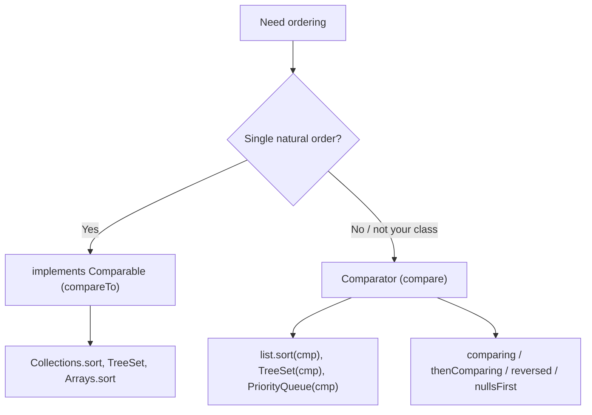
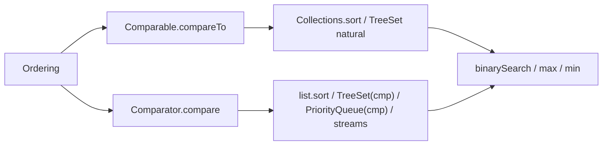

# The Collections Class, Comparable and Comparator in Java

**TL;DR:** **`java.util.Collections`** is a utility class (private constructor, all `static` methods) with algorithms and wrappers for collections: `sort`, `reverse`, `shuffle`, `swap`, `rotate`, `binarySearch`, `max`, `min`, `frequency`, `nCopies`, `emptyList`, `unmodifiableX`, `synchronizedX`. Sorting needs an ordering: **`Comparable<T>`** gives a class its **natural order** via one method `int compareTo(T other)` (negative / zero / positive); **`Comparator<T>`** is an **external** ordering via `int compare(T a, T b)`, usually written as a lambda or built with `Comparator.comparing(...).thenComparing(...).reversed()`, `nullsFirst`, `naturalOrder`, `reverseOrder`. `Collections.sort(list)` requires `Comparable` elements (otherwise a compile error or `ClassCastException`); `list.sort(cmp)` and `Collections.sort(list, cmp)` take a comparator. Sorting is **stable**. `TreeSet`/`TreeMap`/`PriorityQueue` use the same ordering. Avoid `a - b` comparators (overflow) and keep `compareTo` consistent with `equals`.

## Table of Contents

1. [TL;DR](#1-tldr)
2. [Why it matters](#2-why-it-matters)
3. [Prerequisites](#3-prerequisites)
4. [Mental model](#4-mental-model)
5. [Core concepts](#5-core-concepts)
6. [How it works](#6-how-it-works)
7. [Examples](#7-examples)
8. [Comparisons](#8-comparisons)
9. [Trade-offs](#9-trade-offs)
10. [Gotchas](#10-gotchas)
11. [Practical application](#11-practical-application)
12. [Interview prep](#12-interview-prep)
13. [Interview question bank](#13-interview-question-bank)
14. [Tricky code snippets](#14-tricky-code-snippets)
15. [Connections](#15-connections)
16. [Summary](#16-summary)
17. [Answers](#answers)

---

## 1. TL;DR

| | `Comparable<T>` | `Comparator<T>` |
|---|---|---|
| Package | `java.lang` | `java.util` |
| Method | `int compareTo(T o)` | `int compare(T a, T b)` |
| Where defined | Inside the class (natural order) | Outside (any number of orders) |
| Used by | `Collections.sort(list)`, `TreeSet`, `Arrays.sort` | `list.sort(cmp)`, `Collections.sort(list, cmp)`, `TreeSet(cmp)` |
| Modifies the class | Yes | No |

| `Collections` method | Purpose |
|---|---|
| `sort`, `reverse`, `shuffle`, `swap`, `rotate`, `fill` | In-place reordering |
| `binarySearch` | Search a sorted list |
| `max`, `min`, `frequency`, `disjoint` | Queries |
| `unmodifiableX`, `synchronizedX` | Wrapper views |
| `emptyList`, `singletonList`, `nCopies`, `addAll` | Factories/bulk |

**The analogy: ranking contestants.**

| Real world | Java |
|---|---|
| The rule built into each contestant ("ranked by score") | `Comparable.compareTo` |
| A judge's separate scorecard (by name, then by age) | `Comparator` |
| The referee who runs the ranking | `Collections.sort` |
| "Who is ahead?" answered with negative/zero/positive | The comparison result |
| A tie broken by arrival order | Stable sort |

**Running example:** sort `P(Cy,40)`, `P(Ann,30)`, `P(Bob,30)` by age (natural), then by name reversed, then find max and min (Snippet 1).

---

## 2. Why it matters

**The problem.** Collections of your own objects can't be sorted or kept in a `TreeSet` unless Java knows how to order them. Comparator mistakes cause subtle bugs: lost elements in sets, overflow, `NullPointerException`.

**What goes wrong** (verified on Java 21):

| Mistake | Result | Snippet |
|---|---|---|
| `Collections.sort(list)` of non-`Comparable` | Compile error | 2 |
| Same via `Object[]` / `TreeSet<Object>` | `ClassCastException` | 3 |
| Comparator `a - b` | Overflow gives the wrong order | 6 |
| Comparator that ignores a field | `TreeSet` drops "duplicates" | 10 |
| `compareTo` inconsistent with `equals` | `HashSet` vs `TreeSet` sizes differ | 11 |
| Sorting `null`s | `NullPointerException` | 25 |
| Comparator never returns `0` for equal | `TreeSet` can't find the element | 21 |
| `binarySearch` on unsorted/wrong-order list | Wrong result | 12 |
| `new Collections()` | Compile error (private constructor) | 29 |
| Sorting numeric strings | `[1, 10, 2, 9]` | 27 |

**Why interviewers ask.** "`Comparable` vs `Comparator`", "sort a list of employees by salary then name", "how does `TreeSet` order elements?", "`Collection` vs `Collections`", "why not `a - b`?", "is `sort` stable?", "consistent with equals", "`Collections.sort` vs `Arrays.sort`".

---

## 3. Prerequisites

| Prerequisite | One-line refresher | Importance |
|---|---|---|
| Collections and `List` | Lists, sets and maps | Essential |
| Interfaces and generics | `Comparable<T>`, `Comparator<T>` | Essential |
| Lambdas / method references | Comparators are functional interfaces | Essential |
| `equals`/`hashCode` | Needed to understand "consistent with equals" | Important |
| Wrapper classes | `Integer.compare`, `compareTo` on wrappers | Important |
| Static methods | `Collections` is all static | Helpful |

---

## 4. Mental model

> **The one picture to keep in your head:** sorting only needs to answer one question for any two elements: *"which comes first?"* A comparison returns **negative** (first < second), **zero** (tie) or **positive** (first > second). `Comparable` bakes that answer into the class; a `Comparator` supplies it from outside. Everything else (sorting, `TreeSet`, `PriorityQueue`, `max`, `binarySearch`) is built on that single answer.

```
 compare(a, b)  <0  : a before b
                 0  : a ties b (stable sort keeps original order; TreeSet treats as duplicate)
                >0  : a after b

 Collections.sort(list)            → uses elements' compareTo   (Comparable)
 Collections.sort(list, cmp)       → uses cmp.compare           (Comparator)
```
*One three-way answer powers all ordering features.*


*Natural order inside the class; everything else via `Comparator`.*

---

## 5. Core concepts

### 5.1 Glossary

| Term | Definition |
|---|---|
| `Collections` | Utility class of static helper methods (private constructor) (Snippet 29) |
| Natural ordering | The order defined by `Comparable.compareTo` |
| `Comparable<T>` | Interface in `java.lang` with `compareTo(T)` |
| `Comparator<T>` | Functional interface in `java.util` with `compare(T, T)` |
| Stable sort | Equal elements keep their relative order (Snippet 13) |
| Consistent with equals | `compareTo == 0` ⇔ `equals` true |
| Key extractor | Function used by `Comparator.comparing` |
| View/wrapper | `unmodifiableX`/`synchronizedX` return wrappers |

### 5.2 `Comparable`

```java
class P implements Comparable<P> {
    int age;
    @Override public int compareTo(P o) { return Integer.compare(age, o.age); }
}
```
- Return negative/zero/positive (Snippet 4); build with `Integer.compare`, `String.compareTo`, `Double.compare`.
- All wrappers, `String`, `Date`, `BigDecimal`, enums (ordinal order) are `Comparable` (Snippets 4, 26).
- Multiple fields: compare the first, fall through on `0` (Snippet 19).
- `Comparable<A>` inherited by `B extends A` works through `Comparable<? super T>` (Snippet 20).

### 5.3 `Comparator`

```java
Comparator<String> byLen = (a, b) -> Integer.compare(a.length(), b.length());
list.sort(byLen);
```
- Implement as a class, lambda, or build with factory methods (Snippet 5).
- It is a **functional interface** (one abstract method `compare`; `equals` is inherited from `Object`).
- Never use `a - b` for `int`s (Snippet 6); use `Integer.compare`.

### 5.3a Comparator builders (Java 8+)

| Method | Meaning |
|---|---|
| `Comparator.comparing(keyExtractor)` | Order by a key |
| `comparingInt/Long/Double` | Avoid boxing |
| `.thenComparing(...)` | Tie-breaker (Snippet 7) |
| `.reversed()` | Flip the order (Snippet 9) |
| `Comparator.naturalOrder()` / `reverseOrder()` | Natural / reverse of `Comparable` (Snippet 24) |
| `Comparator.nullsFirst(c)` / `nullsLast(c)` | Null-safe wrapper (Snippets 8, 25) |
| `Collections.reverseOrder()` / `reverseOrder(cmp)` | Legacy reverse (Snippets 9, 24) |

### 5.4 Sorting methods

| Call | Notes |
|---|---|
| `Collections.sort(list)` | Needs `Comparable` elements (Snippet 2) |
| `Collections.sort(list, cmp)` | Custom |
| `list.sort(cmp)` | Java 8+; `null` = natural order |
| `Arrays.sort(arr)` / `Arrays.sort(arr, cmp)` | Arrays; primitives have no comparator (Snippet 22) |
| `stream.sorted(cmp)` | Streams (Snippet 30) |

- Object sorts are **stable** (TimSort, a merge sort variant) (Snippet 13). Primitive array sorts are not stability-relevant.
- Sorting a `subList` sorts that range in the parent (Snippet 23).
- Immutable lists (`List.of`) can't be sorted in place.

### 5.5 Searching and extremes

- `Collections.binarySearch(list, key)` / `(list, key, cmp)`: list must be sorted **by the same ordering** (Snippet 12). Absent → `-(insertionPoint) - 1`.
- `Collections.max/min(collection)` natural; `(collection, cmp)` custom (Snippet 1).
- `Collections.frequency(c, o)`, `disjoint(c1, c2)` (Snippet 14).

### 5.6 Reordering utilities

`reverse`, `shuffle` (optionally seeded, Snippet 17), `swap(list, i, j)`, `rotate(list, distance)` (negative rotates left, Snippet 28), `fill`, `copy`, `replaceAll`, `Collections.addAll(c, elements...)` (Snippet 14).

### 5.7 Factories and wrappers

| Method | Result |
|---|---|
| `emptyList()`, `singletonList(x)`, `nCopies(n, x)` | Immutable lists (Snippets 14, 15) |
| `unmodifiableList/Set/Map(x)` | Read-only **view** (Snippet 16) |
| `synchronizedList/Map(x)` | Thread-safe wrapper; iterate inside `synchronized(list)` (Snippet 18) |

### 5.8 Ordering in sorted collections

- `TreeSet`/`TreeMap` use `compareTo`/`Comparator` **instead of** `equals`: `compare == 0` means duplicate (Snippets 10, 11).
- `PriorityQueue` orders by comparator/natural order (Snippet 30).
- `TreeMap(String.CASE_INSENSITIVE_ORDER)` treats `a` and `A` as the same key (Snippet 10).

### 5.9 The comparator contract

For a comparator/`compareTo` to be well-behaved:
1. `sgn(compare(x, y)) == -sgn(compare(y, x))` (antisymmetry).
2. Transitive: `x > y` and `y > z` ⇒ `x > z`.
3. `compare(x, y) == 0` ⇒ same sign against any `z`.
4. **Recommended:** `compare(x, y) == 0` ⇔ `x.equals(y)` (consistent with equals; `BigDecimal` is the famous exception, Snippet 11).

Violating it (Snippet 21) can corrupt `TreeSet` and may throw `IllegalArgumentException: Comparison method violates its general contract!` on larger lists ⚠️.

---

## 6. How it works

### 6.1 How `Collections.sort(list)` works

1. Copies the list to an array (`list.toArray()`).
2. Runs a stable merge-based sort (TimSort), calling `compareTo`/`compare`.
3. Writes the sorted elements back through the list iterator.

Time: O(n log n), nearly O(n) for almost-sorted data.

### 6.2 Worked trace: the running example

```java
Collections.sort(l);                                          // by age
l.sort(Comparator.comparing((P p) -> p.name).reversed());     // by name desc
Collections.max(l);  Collections.min(l, byName);
```

| Step | List / result |
|---|---|
| Start | `[Cy40, Ann30, Bob30]` |
| Natural (age) | `[Ann30, Bob30, Cy40]` (Ann/Bob tie: stable keeps order) |
| Name reversed | `[Cy40, Bob30, Ann30]` |
| `max` (natural) | `Cy40` (largest age) |
| `min` by name | `Ann30` |

Output: `[Ann30, Bob30, Cy40]`, `[Cy40, Bob30, Ann30]`, `Cy40 Ann30`.

### 6.3 Why `a - b` fails

`Integer.MAX_VALUE - (-1)` overflows to a negative number, so the comparator says "MAX is smaller than -1" (Snippet 6). `Integer.compare(a, b)` never overflows.

### 6.4 How `thenComparing` works

`c1.thenComparing(c2)` returns a comparator that applies `c1`, and only if it returns `0` applies `c2`. Chain as many as needed (Snippet 7).

### 6.5 `TreeSet` and the comparator

`TreeSet.add(x)` walks the tree calling `compare`; if it finds `0` it considers `x` already present and does nothing. A comparator that looks only at length will drop all but one string of each length (Snippet 10).

### 6.6 `binarySearch` assumptions

It halves the range using the comparator; if the list isn't sorted by that same ordering, the answer is undefined (Snippet 12).

---

## 7. Examples

### 7.1 Toy example

```java
List<String> l = new ArrayList<>(List.of("ccc", "a", "bb"));
l.sort(Comparator.comparing(String::length));      // [a, bb, ccc]
```

### 7.2 Real-world examples

- **Employees** by department, then salary descending, then name (Snippet 7).
- **Leaderboard** with `PriorityQueue` or `TreeSet` using a comparator (Snippet 30).
- **Case-insensitive** sorted maps (Snippet 10).
- **Sorting nullable** columns (Snippets 8, 25).
- **Natural order for domain types** like `Version` or `Money` via `Comparable`.

---

## 8. Comparisons

### 8.1 `Comparable` vs `Comparator`

| | `Comparable` | `Comparator` |
|---|---|---|
| Source | Inside the class | Separate object/lambda |
| Number of orders | One | Many |
| Needs source access | Yes | No (works for library classes) |
| Method | `compareTo(T)` | `compare(T, T)` |
| Typical call | `Collections.sort(list)` | `list.sort(cmp)` |

### 8.2 `Collections.sort` vs `list.sort` vs `Arrays.sort` vs `stream.sorted`

| | Input | In place? | Comparator |
|---|---|---|---|
| `Collections.sort(list)` | `List<T extends Comparable>` | Yes | Optional overload |
| `list.sort(cmp)` | `List` | Yes | Yes (`null` = natural) |
| `Arrays.sort(arr)` | Array | Yes | Objects only |
| `stream.sorted()` | Stream | No (new stream) | Optional |

### 8.3 `reverse()` vs `reversed()` vs `reverseOrder()`

| | What it does |
|---|---|
| `Collections.reverse(list)` | Reverses the **current order** in place (no comparator) |
| `cmp.reversed()` | A comparator with the opposite order |
| `Collections.reverseOrder()` / `Comparator.reverseOrder()` | Reverse of natural order |

### 8.4 `Collections` wrappers

| | `unmodifiableList` | `synchronizedList` | `List.copyOf` |
|---|---|---|---|
| Copy? | No (view) | No (view) | Yes (snapshot) |
| Mutable? | No | Yes (synchronized) | No |

### 8.5 `Collections.sort` on `Comparable` vs `Comparator` signatures

| Overload | Signature |
|---|---|
| Natural | `<T extends Comparable<? super T>> void sort(List<T>)` |
| Custom | `<T> void sort(List<T>, Comparator<? super T>)` |

### 8.6 Hand-written comparator vs builders

| | Lambda `(a, b) -> ...` | `Comparator.comparing(...)` |
|---|---|---|
| Readability | Fine for one key | Better for chains |
| Null handling | Manual | `nullsFirst/Last` |
| Boxing | Manual | `comparingInt` avoids it |

---

## 9. Trade-offs

- **Natural order vs flexibility:** one `compareTo` is convenient but fixed; comparators allow many orders without touching the class.
- **Consistency with equals:** violating it surprises `HashSet` vs `TreeSet` users (Snippet 11).
- **Performance:** `comparingInt` avoids boxing; sorting `LinkedList` copies to an array first.
- **Stability:** you can chain sorts (sort by secondary, then by primary) because the sort is stable.
- **Mutable sort keys** inside a `TreeSet`/`TreeMap` break the tree; use immutable keys.
- **Utility class design:** `Collections` can't be instantiated; everything is static (Snippet 29).
- **Locale:** `String.compareTo` compares UTF-16 code units, not language rules; use `Collator` for locale-aware sorting ⚠️.

---

## 10. Gotchas

### Myths

- ❌ **Myth:** "`Collections.sort` sorts any list." ✅ **Reality:** elements must be `Comparable` or pass a comparator (Snippets 2, 3).
- ❌ **Myth:** "`a - b` is a fine `int` comparator." ✅ **Reality:** can overflow (Snippet 6).
- ❌ **Myth:** "`TreeSet` uses `equals`." ✅ **Reality:** comparator/`compareTo` (Snippet 10).
- ❌ **Myth:** "`Collections.reverse` sorts in descending order." ✅ **Reality:** it only reverses the current order (Snippet 9).
- ❌ **Myth:** "`Comparable` and `Comparator` are the same." ✅ **Reality:** natural vs external ordering.
- ❌ **Myth:** "`unmodifiableList` copies." ✅ **Reality:** a view (Snippet 16).
- ❌ **Myth:** "Numeric strings sort numerically." ✅ **Reality:** lexicographic (Snippet 27).
- ❌ **Myth:** "`BigDecimal` `1.0` equals `1.00`." ✅ **Reality:** `equals` false, `compareTo` 0 (Snippet 11).
- ❌ **Myth:** "`binarySearch` works on any list." ✅ **Reality:** sorted by the same ordering (Snippet 12).
- ❌ **Myth:** "Sorting an unsorted-descending list with natural `binarySearch` still finds the key." ✅ **Reality:** may return `-1` (Snippet 12).

### Common mistakes and edge cases

- **Forgetting `null` handling** (Snippet 25).
- **`compareTo` not returning 0 for equal** (Snippet 21).
- **Comparators that ignore some fields** in sorted sets (Snippet 10).
- **Sorting with a comparator that isn't transitive** ⚠️.
- **Using `==` on `Integer` keys** in comparators; use `Integer.compare`.
- **Sorting an immutable list** (`List.of`, `Collections.emptyList`) throws `UnsupportedOperationException` (Snippet 15 shows the same for `add`).
- **Forgetting the `Comparable<? super T>` rule** when sorting subclasses (Snippet 20).
- **Case-sensitive default order:** uppercase before lowercase (`"Z".compareTo("a")` is negative, Snippet 4).

---

## 11. Practical application

### Checklist
- [ ] Make domain classes `Comparable` only if there's an obvious natural order.
- [ ] Use `Integer.compare`, `Double.compare`, `String.compareTo`, never `a - b`.
- [ ] Prefer `Comparator.comparing(...).thenComparing(...)`.
- [ ] Wrap nullable keys with `nullsFirst`/`nullsLast`.
- [ ] Keep `compareTo` consistent with `equals`, or document it.
- [ ] Use the same comparator for `sort` and `binarySearch`.
- [ ] Don't mutate sort keys of elements in `TreeSet`/`TreeMap`/`PriorityQueue`.
- [ ] Use `Collator` for locale-sensitive text.

### Hands-on exercise

```java
List<String> l = new ArrayList<>(List.of("10", "9", "2", "1"));
Collections.sort(l);
System.out.println(l);
```
What is printed, and how do you sort numerically?

<details><summary>Solution</summary>

`[1, 10, 2, 9]`. `String.compareTo` compares characters, so `"10"` < `"2"` (`'1'` < `'2'`). To sort numerically: `l.sort(Comparator.comparingInt(Integer::parseInt))` gives `[1, 2, 9, 10]`.

Verified on Java 21 (Snippet 27).
</details>

---

## 12. Interview prep

Eight model answers, as you would say them aloud.

<details><summary>1. What is the difference between `Comparable` and `Comparator`?</summary>

`Comparable<T>` (`java.lang`) defines a class's single natural order with `compareTo(T)`. `Comparator<T>` (`java.util`) is a separate ordering with `compare(T, T)`, so you can have many and sort classes you don't own (8.1; Snippets 1, 5).
</details>

<details><summary>2. How do you sort a list of employees by department, then salary descending, then name?</summary>

`list.sort(Comparator.comparing(Emp::dept).thenComparing(Emp::sal, Comparator.reverseOrder()).thenComparing(Emp::name));` (6.4; Snippet 7).
</details>

<details><summary>3. What happens if you call `Collections.sort` on a list of objects that aren't `Comparable`?</summary>

A compile error for a typed list; with `Object[]`/raw usage or a `TreeSet`, a `ClassCastException` at run time. Pass a `Comparator` instead (Snippets 2, 3).
</details>

<details><summary>4. Why shouldn't you write `(a, b) -> a - b`?</summary>

Subtraction can overflow (`MAX_VALUE - (-1)` is negative), reversing the result. Use `Integer.compare(a, b)` (6.3; Snippet 6).
</details>

<details><summary>5. How does `TreeSet` decide duplicates, and what is "consistent with equals"?</summary>

`TreeSet` uses `compareTo`/`Comparator`, not `equals`: a result of `0` means duplicate. A class is consistent with equals when `compareTo == 0` exactly when `equals` is true; `BigDecimal` `1.0` vs `1.00` is the classic exception (5.8, 5.9; Snippets 10, 11).
</details>

<details><summary>6. Is `Collections.sort` stable, and what's its complexity?</summary>

Yes, stable (TimSort), O(n log n), close to O(n) for nearly sorted data. Stability lets you chain sorts and keeps ties in original order (6.1; Snippet 13).
</details>

<details><summary>7. What do `Collections.reverse`, `reversed()` and `reverseOrder()` do differently?</summary>

`Collections.reverse(list)` flips the current order in place; `cmp.reversed()` makes a comparator with the opposite order; `reverseOrder()` is the reverse of natural order (8.3; Snippet 9).
</details>

<details><summary>8. What is the `Collections` class, and how does it differ from `Collection`?</summary>

`Collection` is the root interface; `Collections` is a utility class with a private constructor holding static algorithms (`sort`, `binarySearch`, `max`, `shuffle`) and wrappers (`unmodifiableX`, `synchronizedX`) (5.1; Snippets 14, 29).
</details>

---

## 13. Interview question bank


### 13.1 The Collections class (Q1–Q16)

<details><summary>Q1. What is `java.util.Collections`?</summary>

A utility class of static methods for collections (Snippet 14).
</details>

<details><summary>Q2. Can you instantiate it?</summary>

No, private constructor (Snippet 29).
</details>

<details><summary>Q3. `Collection` vs `Collections`?</summary>

Interface vs utility class.
</details>

<details><summary>Q4. Name sorting/reordering methods.</summary>

`sort`, `reverse`, `shuffle`, `swap`, `rotate` (Snippets 14, 28).
</details>

<details><summary>Q5. `max`/`min`?</summary>

Largest/smallest by natural order or comparator (Snippet 1).
</details>

<details><summary>Q6. `frequency`?</summary>

Count of equal elements (Snippet 14).
</details>

<details><summary>Q7. `disjoint`?</summary>

True if no common elements (Snippet 14).
</details>

<details><summary>Q8. `nCopies(n, x)`?</summary>

Immutable list with `n` references to `x` (Snippet 14).
</details>

<details><summary>Q9. `emptyList()`/`singletonList`?</summary>

Immutable lists (Snippet 15).
</details>

<details><summary>Q10. Can you add to `emptyList()`?</summary>

No, `UnsupportedOperationException` (Snippet 15).
</details>

<details><summary>Q11. `unmodifiableMap` copy or view?</summary>

View (Snippet 16).
</details>

<details><summary>Q12. `synchronizedList` iteration rule?</summary>

Synchronize on the list manually (Snippet 18).
</details>

<details><summary>Q13. Is `shuffle` reproducible?</summary>

With a seeded `Random` (Snippet 17).
</details>

<details><summary>Q14. `rotate(list, -1)`?</summary>

Shifts left by one (Snippet 28).
</details>

<details><summary>Q15. `Collections.addAll`?</summary>

Adds varargs elements (Snippet 14).
</details>

<details><summary>Q16. `indexOfSubList`?</summary>

Index of a sublist or `-1` (Snippet 28).
</details>


### 13.2 Comparable (Q17–Q30)

<details><summary>Q17. What is `Comparable`?</summary>

Interface with `compareTo` for natural order (Snippet 1).
</details>

<details><summary>Q18. Which package?</summary>

`java.lang`.
</details>

<details><summary>Q19. What does `compareTo` return?</summary>

Negative, zero, positive (Snippet 4).
</details>

<details><summary>Q20. `"apple".compareTo("banana")`?</summary>

Negative (`-1`) (Snippet 4).
</details>

<details><summary>Q21. `"abc".compareTo("abcd")`?</summary>

`-1` (length difference) (Snippet 4).
</details>

<details><summary>Q22. Is `Boolean` comparable?</summary>

Yes; `true > false` (Snippet 4).
</details>

<details><summary>Q23. Is an enum comparable?</summary>

Yes, by ordinal (Snippet 26).
</details>

<details><summary>Q24. What if the class isn't `Comparable`?</summary>

Compile error / `ClassCastException` (Snippets 2, 3).
</details>

<details><summary>Q25. How to compare multiple fields?</summary>

Compare the first; if `0`, the next (Snippet 19).
</details>

<details><summary>Q26. Can a subclass be sorted if the parent is `Comparable<Parent>`?</summary>

Yes, thanks to `? super T` (Snippet 20).
</details>

<details><summary>Q27. `compareTo` and `null`?</summary>

Should throw NPE for `null`.
</details>

<details><summary>Q28. Consistent with equals?</summary>

`compareTo == 0` ⇔ `equals`.
</details>

<details><summary>Q29. Example of inconsistency?</summary>

`BigDecimal` `1.0` vs `1.00` (Snippet 11).
</details>

<details><summary>Q30. What does `TreeSet` use?</summary>

`compareTo`/comparator, not `equals` (Snippet 10).
</details>


### 13.3 Comparator (Q31–Q48)

<details><summary>Q31. What is `Comparator`?</summary>

Functional interface with `compare(T, T)` (Snippet 5).
</details>

<details><summary>Q32. Which package?</summary>

`java.util`.
</details>

<details><summary>Q33. Is it a functional interface?</summary>

Yes (Snippet 5).
</details>

<details><summary>Q34. Three ways to write one?</summary>

Class, lambda, `Comparator.comparing` (Snippet 5).
</details>

<details><summary>Q35. Sort by length?</summary>

`Comparator.comparing(String::length)` (Snippet 5).
</details>

<details><summary>Q36. Reverse a comparator?</summary>

`.reversed()` (Snippet 9).
</details>

<details><summary>Q37. Tie-breaker?</summary>

`.thenComparing(...)` (Snippet 7).
</details>

<details><summary>Q38. Null-safe?</summary>

`nullsFirst`/`nullsLast` (Snippet 8).
</details>

<details><summary>Q39. Natural order comparator?</summary>

`Comparator.naturalOrder()` (Snippet 24).
</details>

<details><summary>Q40. Reverse natural?</summary>

`Comparator.reverseOrder()`/`Collections.reverseOrder()` (Snippet 9).
</details>

<details><summary>Q41. `comparingInt` vs `comparing`?</summary>

Avoids boxing.
</details>

<details><summary>Q42. Why not `a - b`?</summary>

Overflow (Snippet 6).
</details>

<details><summary>Q43. What does `comparing(P::age)` do with `null` ages?</summary>

NPE (Snippet 25).
</details>

<details><summary>Q44. How to fix it?</summary>

`comparing(P::age, nullsFirst(naturalOrder()))` (Snippet 25).
</details>

<details><summary>Q45. What does `list.sort(null)` do?</summary>

Sorts in natural order (same as `Comparator.naturalOrder()`).
</details>

<details><summary>Q46. Comparator for a `TreeSet`?</summary>

`new TreeSet<>(cmp)` (Snippet 10).
</details>

<details><summary>Q47. Comparator for a `PriorityQueue`?</summary>

`new PriorityQueue<>(cmp)` (Snippet 30).
</details>

<details><summary>Q48. Comparator for a stream?</summary>

`sorted(cmp)`, `max(cmp)`, `min(cmp)` (Snippet 30).
</details>


### 13.4 Sorting behaviour (Q49–Q60)

<details><summary>Q49. Is sorting stable?</summary>

Yes for objects (Snippet 13).
</details>

<details><summary>Q50. Algorithm?</summary>

TimSort (merge-based) ⚠️.
</details>

<details><summary>Q51. Complexity?</summary>

O(n log n).
</details>

<details><summary>Q52. Sort an array of `int`?</summary>

`Arrays.sort(p)` (Snippet 22).
</details>

<details><summary>Q53. Sort `Integer[]` descending?</summary>

`Arrays.sort(o, Collections.reverseOrder())` (Snippet 22).
</details>

<details><summary>Q54. Sort a sublist?</summary>

`Collections.sort(l.subList(a, b))` sorts that range in the parent (Snippet 23).
</details>

<details><summary>Q55. Sort numeric strings numerically?</summary>

`comparingInt(Integer::parseInt)` (Snippet 27).
</details>

<details><summary>Q56. Default string order?</summary>

Lexicographic by UTF-16 code unit (Snippet 4).
</details>

<details><summary>Q57. Case-insensitive sort?</summary>

`String.CASE_INSENSITIVE_ORDER` (Snippet 22).
</details>

<details><summary>Q58. Enum sort order?</summary>

Declaration order (Snippet 26).
</details>

<details><summary>Q59. Sort immutable list?</summary>

`UnsupportedOperationException`.
</details>

<details><summary>Q60. `Collections.sort` signature?</summary>

`<T extends Comparable<? super T>> void sort(List<T>)`.
</details>


### 13.5 Search and sorted collections (Q61–Q72)

<details><summary>Q61. `binarySearch` precondition?</summary>

Sorted by the same ordering (Snippet 12).
</details>

<details><summary>Q62. Return if absent?</summary>

`-(insertion point) - 1` (Snippet 12).
</details>

<details><summary>Q63. With a comparator?</summary>

`binarySearch(list, key, cmp)` (Snippet 12).
</details>

<details><summary>Q64. On a descending list with natural order?</summary>

Wrong answer (Snippet 12).
</details>

<details><summary>Q65. `TreeSet` with a length comparator and equal lengths?</summary>

Later ones dropped (Snippet 10).
</details>

<details><summary>Q66. `TreeMap(String.CASE_INSENSITIVE_ORDER)` with `a` and `A`?</summary>

One key, last value wins (Snippet 10).
</details>

<details><summary>Q67. Inconsistent comparator and `TreeSet.contains`?</summary>

May return `false` for elements present (Snippet 21).
</details>

<details><summary>Q68. `HashSet` vs `TreeSet` of `BigDecimal`s `1.0`, `1.00`?</summary>

2 vs 1 (Snippet 11).
</details>

<details><summary>Q69. Antisymmetry rule?</summary>

`sgn(compare(x,y)) == -sgn(compare(y,x))` (Section 5.9).
</details>

<details><summary>Q70. Transitivity rule?</summary>

`x>y`, `y>z` ⇒ `x>z`.
</details>

<details><summary>Q71. What can a violating comparator throw?</summary>

`IllegalArgumentException` on larger lists ⚠️.
</details>

<details><summary>Q72. Mutating a key inside a `TreeSet`?</summary>

Breaks searching.
</details>

---

## 14. Tricky code snippets

30 snippets, each compiled and run on OpenJDK 21. Predict the output (or the compile error) before opening the answer. Records and nested classes are used for brevity. Results of sorting with an **inconsistent** comparator (Snippets 6, 21) depend on the sorting algorithm ⚠️.

### Snippet 1: Sort, reverse-by-name, max/min

```java
import java.util.*;
public class Main {
    static class P implements Comparable<P> {
        String name; int age;
        P(String n, int a) { name = n; age = a; }
        @Override public int compareTo(P o) { return Integer.compare(age, o.age); }
        @Override public String toString() { return name + age; }
    }
    public static void main(String[] a) {
        List<P> l = new ArrayList<>(List.of(new P("Cy", 40), new P("Ann", 30), new P("Bob", 30)));
        Collections.sort(l);
        System.out.println(l);
        l.sort(Comparator.comparing((P p) -> p.name).reversed());
        System.out.println(l);
        System.out.println(Collections.max(l) + " " + Collections.min(l, Comparator.comparing(p -> p.name)));
    }
}
```

<details><summary>Answer</summary>

```
[Ann30, Bob30, Cy40]
[Cy40, Bob30, Ann30]
Cy40 Ann30
```

Trace in 6.2; `max` uses natural order (age), `min` uses the comparator (name).
</details>

### Snippet 2: `Collections.sort` of non-`Comparable`

```java
import java.util.*;
public class Main {
    static class P { int x; P(int x) { this.x = x; } }
    public static void main(String[] a) {
        List<P> l = new ArrayList<>(List.of(new P(2), new P(1)));
        Collections.sort(l);
    }
}
```

<details><summary>Answer</summary>

Compile error: *no suitable method found for sort(List<P>)*.

`T` must extend `Comparable<? super T>`.
</details>

### Snippet 3: Run-time version

```java
import java.util.*;
public class Main {
    static class P { int x; P(int x) { this.x = x; } }
    public static void main(String[] a) {
        Object[] arr = {new P(2), new P(1)};
        try { Arrays.sort(arr); } catch (ClassCastException e) { System.out.println("ClassCastException"); }
        try { new TreeSet<Object>().add(new P(1)); } catch (ClassCastException e) { System.out.println("TreeSet: ClassCastException"); }
    }
}
```

<details><summary>Answer</summary>

```
ClassCastException
TreeSet: ClassCastException
```

With `Object[]` or `TreeSet<Object>` the compiler can't check; the cast to `Comparable` fails.
</details>

### Snippet 4: `compareTo` results

```java
import java.util.*;
public class Main {
    public static void main(String[] a) {
        System.out.println("apple".compareTo("banana") + " " + "b".compareTo("a") + " " + "abc".compareTo("abcd") + " " + "a".compareTo("a"));
        System.out.println(Integer.valueOf(5).compareTo(9) + " " + Double.compare(1.5, 1.5) + " " + Boolean.TRUE.compareTo(false) + " " + Character.valueOf('a').compareTo('c'));
        System.out.println("Z".compareTo("a") + " " + "Z".compareToIgnoreCase("a"));
    }
}
```

<details><summary>Answer</summary>

```
-1 1 -1 0
-1 0 1 -2
-7 25
```

`String.compareTo` returns a character or length difference; `Integer.compareTo` returns -1/0/1; `compareToIgnoreCase` compares `'z'` with `'a'` (25).
</details>

### Snippet 5: Three styles

```java
import java.util.*;
public class Main {
    static class ByLen implements Comparator<String> { public int compare(String a, String b) { return a.length() - b.length(); } }
    public static void main(String[] a) {
        List<String> l = new ArrayList<>(List.of("ccc", "a", "bb"));
        l.sort(new ByLen()); System.out.println(l);
        l.sort((x, y) -> y.compareTo(x)); System.out.println(l);
        l.sort(Comparator.comparing(String::length).reversed()); System.out.println(l);
        System.out.println(Comparator.class.isInterface());
    }
}
```

<details><summary>Answer</summary>

```
[a, bb, ccc]
[ccc, bb, a]
[ccc, bb, a]
true
```

Class, lambda and builder all work; `Comparator` is an interface.
</details>

### Snippet 6: `a - b` overflow

```java
import java.util.*;
public class Main {
    public static void main(String[] a) {
        Integer x = Integer.MAX_VALUE, y = -1;
        Comparator<Integer> bad = (p, q) -> p - q;
        Comparator<Integer> good = Integer::compare;
        System.out.println(bad.compare(x, y) + " " + good.compare(x, y));
        List<Integer> l = new ArrayList<>(List.of(Integer.MIN_VALUE, 1, -1));
        l.sort(bad); System.out.println(l);
    }
}
```

<details><summary>Answer</summary>

```
-2147483648 1
[-1, 1, -2147483648]
```

`MAX_VALUE - (-1)` overflows to `MIN_VALUE`; the resulting order is wrong ⚠️ (algorithm-dependent).
</details>

### Snippet 7: Multi-key sort

```java
import java.util.*;
public class Main {
    record E(String dept, String name, int sal) { }
    public static void main(String[] a) {
        List<E> l = new ArrayList<>(List.of(new E("IT", "Bob", 50), new E("HR", "Ann", 40), new E("IT", "Amy", 50), new E("IT", "Cy", 60)));
        l.sort(Comparator.comparing(E::dept).thenComparing(E::sal, Comparator.reverseOrder()).thenComparing(E::name));
        for (E e : l) System.out.print(e.name() + " ");
        System.out.println();
    }
}
```

<details><summary>Answer</summary>

```
Ann Cy Amy Bob
```

HR first; in IT salary descending (Cy 60, then 50s) and ties by name (Amy, Bob).
</details>

### Snippet 8: `nullsFirst` / `nullsLast`

```java
import java.util.*;
public class Main {
    public static void main(String[] a) {
        List<String> l = new ArrayList<>(Arrays.asList("b", null, "a"));
        l.sort(Comparator.nullsFirst(Comparator.naturalOrder())); System.out.println(l);
        l.sort(Comparator.nullsLast(Comparator.reverseOrder())); System.out.println(l);
    }
}
```

<details><summary>Answer</summary>

```
[null, a, b]
[b, a, null]
```

The wrapped comparator handles `null`; the second also reverses the non-null part.
</details>

### Snippet 9: `reverse` vs `reversed` vs `reverseOrder`

```java
import java.util.*;
public class Main {
    public static void main(String[] a) {
        List<Integer> l = new ArrayList<>(List.of(2, 3, 1));
        l.sort(Collections.reverseOrder()); System.out.println(l);
        l.sort(Comparator.naturalOrder()); System.out.println(l);
        Collections.reverse(l); System.out.println(l);
        l.sort(Comparator.<Integer>naturalOrder().reversed()); System.out.println(l);
        Comparator<String> byLen = Comparator.comparing(String::length);
        System.out.println(Collections.reverseOrder(byLen).compare("a", "bb") + " " + byLen.reversed().compare("a", "bb"));
    }
}
```

<details><summary>Answer</summary>

```
[3, 2, 1]
[1, 2, 3]
[3, 2, 1]
[3, 2, 1]
1 1
```

`Collections.reverse` flips the current list; the others sort descending.
</details>

### Snippet 10: Comparator decides duplicates

```java
import java.util.*;
public class Main {
    public static void main(String[] a) {
        Set<String> t = new TreeSet<>(Comparator.comparing(String::length));
        t.add("aa"); t.add("bb"); t.add("c"); t.add("ddd");
        System.out.println(t + " " + t.size() + " " + t.contains("zz"));
        TreeMap<String, Integer> m = new TreeMap<>(String.CASE_INSENSITIVE_ORDER);
        m.put("a", 1); m.put("A", 2);
        System.out.println(m);
    }
}
```

<details><summary>Answer</summary>

```
[c, aa, ddd] 3 true
{a=2}
```

`"bb"` ties with `"aa"` (same length) and is dropped; `contains("zz")` is `true`; `A` and `a` are the same key (the key stays `a`, the value is replaced).
</details>

### Snippet 11: `BigDecimal`

```java
import java.util.*;
public class Main {
    public static void main(String[] a) {
        java.math.BigDecimal x = new java.math.BigDecimal("1.0"), y = new java.math.BigDecimal("1.00");
        System.out.println(x.equals(y) + " " + (x.compareTo(y) == 0));
        System.out.println(new HashSet<>(List.of(x, y)).size() + " " + new TreeSet<>(List.of(x, y)).size());
    }
}
```

<details><summary>Answer</summary>

```
false true
2 1
```

`1.0` and `1.00` differ by `equals` (scale) but compare equal.
</details>

### Snippet 12: `binarySearch` and ordering

```java
import java.util.*;
public class Main {
    public static void main(String[] a) {
        List<String> l = new ArrayList<>(List.of("a", "bb", "ccc", "dddd"));
        System.out.println(Collections.binarySearch(l, "xx", Comparator.comparing(String::length)));
        List<Integer> d = new ArrayList<>(List.of(9, 5, 1));
        System.out.println(Collections.binarySearch(d, 1) + " " + Collections.binarySearch(d, 1, Collections.reverseOrder()));
    }
}
```

<details><summary>Answer</summary>

```
1
-1 2
```

Searching length 2 in a length-sorted list gives index 1. In `[9, 5, 1]` (descending) natural `binarySearch(1)` fails (`-1`) but with `reverseOrder()` it finds index 2.
</details>

### Snippet 13: Stability

```java
import java.util.*;
public class Main {
    public static void main(String[] a) {
        String[] w = {"bb", "aa", "c", "dd", "b"};
        List<String> l = new ArrayList<>(Arrays.asList(w));
        Collections.sort(l, Comparator.comparingInt(String::length));
        System.out.println(l);
    }
}
```

<details><summary>Answer</summary>

```
[c, b, bb, aa, dd]
```

Ties keep their original order (`bb`, `aa`, `dd` and `c`, `b`).
</details>

### Snippet 14: Utility methods

```java
import java.util.*;
public class Main {
    public static void main(String[] a) {
        List<Integer> l = new ArrayList<>(List.of(3, 1, 2));
        System.out.println(Collections.max(l) + " " + Collections.min(l) + " " + Collections.frequency(l, 1) + " " + Collections.disjoint(l, List.of(9)));
        Collections.reverse(l); System.out.println(l);
        Collections.swap(l, 0, 2); System.out.println(l);
        Collections.addAll(l, 7, 8); System.out.println(l);
        System.out.println(Collections.emptyList() + " " + Collections.singletonList(1) + " " + Collections.nCopies(3, "x"));
    }
}
```

<details><summary>Answer</summary>

```
3 1 1 true
[2, 1, 3]
[3, 1, 2]
[3, 1, 2, 7, 8]
[] [1] [x, x, x]
```

`max`, `min`, `frequency`, `disjoint`, then reverse, swap, `addAll` and factories.
</details>

### Snippet 15: Immutable factories

```java
import java.util.*;
public class Main {
    public static void main(String[] a) {
        try { Collections.emptyList().add(1); } catch (UnsupportedOperationException e) { System.out.println("emptyList add: UnsupportedOperationException"); }
        try { Collections.singletonList(1).add(2); } catch (UnsupportedOperationException e) { System.out.println("singletonList add: UnsupportedOperationException"); }
        System.out.println(Collections.emptyList().equals(List.of()) + " " + Collections.emptyList().size());
    }
}
```

<details><summary>Answer</summary>

```
emptyList add: UnsupportedOperationException
singletonList add: UnsupportedOperationException
true 0
```

Both factory lists are immutable.
</details>

### Snippet 16: Views

```java
import java.util.*;
public class Main {
    public static void main(String[] a) {
        Map<String, Integer> m = new HashMap<>(Map.of("a", 1));
        Map<String, Integer> ro = Collections.unmodifiableMap(m);
        m.put("b", 2);
        System.out.println(ro.size());
        try { ro.put("c", 3); } catch (UnsupportedOperationException e) { System.out.println("UnsupportedOperationException"); }
        Set<Integer> s = Collections.unmodifiableSet(new TreeSet<>(List.of(2, 1)));
        System.out.println(s);
    }
}
```

<details><summary>Answer</summary>

```
2
UnsupportedOperationException
[1, 2]
```

The read-only view reflects later changes to the source map.
</details>

### Snippet 17: Seeded shuffle

```java
import java.util.*;
public class Main {
    public static void main(String[] a) {
        List<Integer> x = new ArrayList<>(List.of(1, 2, 3, 4, 5, 6)), y = new ArrayList<>(x);
        Collections.shuffle(x, new Random(7)); Collections.shuffle(y, new Random(7));
        System.out.println(x.equals(y));
        List<Integer> z = new ArrayList<>(x); Collections.sort(z); System.out.println(z);
    }
}
```

<details><summary>Answer</summary>

```
true
[1, 2, 3, 4, 5, 6]
```

The same seed gives the same permutation; sorting restores order.
</details>

### Snippet 18: Synchronized wrapper

```java
import java.util.*;
public class Main {
    public static void main(String[] a) {
        List<Integer> s = Collections.synchronizedList(new ArrayList<>(List.of(1, 2, 3)));
        synchronized (s) { int sum = 0; for (int x : s) sum += x; System.out.println(sum); }
        System.out.println(s.getClass().getSimpleName().startsWith("Synchronized"));
    }
}
```

<details><summary>Answer</summary>

```
6
true
```

Iteration must be inside a `synchronized (list)` block.
</details>

### Snippet 19: Multi-field `compareTo`

```java
import java.util.*;
public class Main {
    static class P implements Comparable<P> {
        String last, first; P(String l, String f) { last = l; first = f; }
        public int compareTo(P o) { int c = last.compareTo(o.last); return c != 0 ? c : first.compareTo(o.first); }
        public String toString() { return last + "," + first; }
    }
    public static void main(String[] a) {
        List<P> l = new ArrayList<>(List.of(new P("Lee", "Zoe"), new P("Kim", "Amy"), new P("Lee", "Al")));
        Collections.sort(l); System.out.println(l);
    }
}
```

<details><summary>Answer</summary>

```
[Kim,Amy, Lee,Al, Lee,Zoe]
```

Last name first, then first name.
</details>

### Snippet 20: Subclass of a `Comparable` parent

```java
import java.util.*;
public class Main {
    static class A implements Comparable<A> { int v; A(int v) { this.v = v; } public int compareTo(A o) { return v - o.v; } }
    static class B extends A { B(int v) { super(v); } }
    public static void main(String[] a) {
        List<B> l = new ArrayList<>(List.of(new B(3), new B(1)));
        Collections.sort(l);
        System.out.println(l.get(0).v);
    }
}
```

<details><summary>Answer</summary>

```
1
```

`Collections.sort(List<B>)` compiles because `B` is `Comparable<? super B>` (via `Comparable<A>`).
</details>

### Snippet 21: Broken comparator

```java
import java.util.*;
public class Main {
    public static void main(String[] a) {
        Comparator<Integer> broken = (x, y) -> x < y ? -1 : 1;
        System.out.println(broken.compare(1, 1) + " " + broken.compare(1, 2) + " " + broken.compare(2, 1));
        TreeSet<Integer> t = new TreeSet<>(broken);
        t.add(1); t.add(1);
        System.out.println(t.size() + " " + t.contains(1));
    }
}
```

<details><summary>Answer</summary>

```
1 -1 1
2 false
```

`compare(1, 1)` returns `1` (never `0`), so the `TreeSet` keeps both and can't find `1`.
</details>

### Snippet 22: Arrays

```java
import java.util.*;
public class Main {
    public static void main(String[] a) {
        int[] p = {3, 1, 2};
        Arrays.sort(p);
        Integer[] o = {3, 1, 2};
        Arrays.sort(o, Collections.reverseOrder());
        System.out.println(Arrays.toString(p) + " " + Arrays.toString(o));
        String[] s = {"b", "A", "c"};
        Arrays.sort(s); System.out.println(Arrays.toString(s));
        Arrays.sort(s, String.CASE_INSENSITIVE_ORDER); System.out.println(Arrays.toString(s));
    }
}
```

<details><summary>Answer</summary>

```
[1, 2, 3] [3, 2, 1]
[A, b, c]
[A, b, c]
```

`int[]` sorts naturally; `Integer[]` accepts a comparator; uppercase sorts before lowercase.
</details>

### Snippet 23: Sorting a range

```java
import java.util.*;
public class Main {
    public static void main(String[] a) {
        List<Integer> l = new LinkedList<>(List.of(5, 3, 4, 1, 2));
        Collections.sort(l.subList(1, 4));
        System.out.println(l);
    }
}
```

<details><summary>Answer</summary>

```
[5, 1, 3, 4, 2]
```

`subList(1, 4)` is a view of `[3, 4, 1]`, sorted in the parent.
</details>

### Snippet 24: `naturalOrder` / `reverseOrder`

```java
import java.util.*;
public class Main {
    public static void main(String[] a) {
        Comparator<String> n = Comparator.naturalOrder();
        System.out.println(n.compare("a", "b") + " " + n.reversed().compare("a", "b") + " " + (Comparator.<String>reverseOrder().compare("a", "b")));
        System.out.println(Collections.reverseOrder().compare(1, 2));
    }
}
```

<details><summary>Answer</summary>

```
-1 1 1
1
```

`reverseOrder().compare("a", "b")` is positive.
</details>

### Snippet 25: Null keys

```java
import java.util.*;
public class Main {
    record P(String n, Integer age) { }
    public static void main(String[] a) {
        List<P> l = new ArrayList<>(List.of(new P("a", 2), new P("b", null)));
        try { l.sort(Comparator.comparing(P::age)); } catch (NullPointerException e) { System.out.println("NullPointerException"); }
        l.sort(Comparator.comparing(P::age, Comparator.nullsFirst(Comparator.naturalOrder())));
        System.out.println(l.get(0).n());
    }
}
```

<details><summary>Answer</summary>

```
NullPointerException
b
```

`comparing(P::age)` dereferences `null`; `nullsFirst` puts the null-age element first.
</details>

### Snippet 26: Enum ordering

```java
import java.util.*;
public class Main {
    enum Lvl { LOW, MID, HIGH }
    public static void main(String[] a) {
        List<Lvl> l = new ArrayList<>(List.of(Lvl.HIGH, Lvl.LOW, Lvl.MID));
        Collections.sort(l); System.out.println(l + " " + Lvl.HIGH.compareTo(Lvl.LOW) + " " + (Lvl.HIGH instanceof Comparable));
    }
}
```

<details><summary>Answer</summary>

```
[LOW, MID, HIGH] 2 true
```

Enums compare by ordinal; `HIGH.compareTo(LOW)` is `2 - 0`.
</details>

### Snippet 27: Numeric strings

```java
import java.util.*;
public class Main {
    public static void main(String[] a) {
        List<String> l = new ArrayList<>(List.of("10", "9", "2", "1"));
        Collections.sort(l); System.out.println(l);
        l.sort(Comparator.comparingInt(Integer::parseInt)); System.out.println(l);
    }
}
```

<details><summary>Answer</summary>

```
[1, 10, 2, 9]
[1, 2, 9, 10]
```

Lexicographic vs numeric order.
</details>

### Snippet 28: `rotate` and sublists

```java
import java.util.*;
public class Main {
    public static void main(String[] a) {
        List<Integer> l = new ArrayList<>(List.of(1, 2, 3, 4, 5));
        Collections.rotate(l, -1); System.out.println(l);
        Collections.reverse(l.subList(0, 3)); System.out.println(l);
        System.out.println(Collections.indexOfSubList(l, List.of(1, 5)) + " " + Collections.lastIndexOfSubList(l, List.of(9)));
    }
}
```

<details><summary>Answer</summary>

```
[2, 3, 4, 5, 1]
[4, 3, 2, 5, 1]
-1 -1
```

Negative rotation shifts left; reversing a `subList` reverses that range in the parent.
</details>

### Snippet 29: `new Collections()`

```java
import java.util.*;
public class Main {
    public static void main(String[] a) {
        Collections c = new Collections();
    }
}
```

<details><summary>Answer</summary>

Compile error: *Collections() has private access in Collections*.

It's a utility class.
</details>

### Snippet 30: Comparators elsewhere

```java
import java.util.*;
import java.util.stream.*;
public class Main {
    public static void main(String[] a) {
        PriorityQueue<String> pq = new PriorityQueue<>(Comparator.comparing(String::length).thenComparing(Comparator.reverseOrder()));
        pq.addAll(List.of("bb", "a", "cc", "ddd"));
        StringBuilder sb = new StringBuilder(); while (!pq.isEmpty()) sb.append(pq.poll()).append(' ');
        System.out.println(sb.toString().trim());
        System.out.println(Stream.of("bb", "a", "ccc").sorted(Comparator.comparing(String::length).reversed()).collect(Collectors.toList()));
        System.out.println(Stream.of(3, 1, 2).max(Comparator.naturalOrder()).get() + " " + Stream.of(3, 1, 2).min(Integer::compare).get());
    }
}
```

<details><summary>Answer</summary>

```
a cc bb ddd
[ccc, bb, a]
3 1
```

Length ascending, ties reverse-alphabetical (`cc` before `bb`); streams accept comparators too.
</details>

---

## 15. Connections

| Related topic | How it connects |
|---|---|
| Collections introduction, List note | `list.sort`, `Collections.sort` |
| `TreeSet`, `TreeMap`, `PriorityQueue` | Ordered by `Comparable`/`Comparator` |
| Object class (`equals`/`hashCode`) | Consistency with `compareTo` |
| Lambdas and functional interfaces | `Comparator` is functional |
| Generics | `Comparable<? super T>` |
| Wrapper classes, Strings | Provide `compareTo` |
| Streams | `sorted`, `min`, `max` |
| Immutability | `Collections.unmodifiableX` views |


*All ordering features hang off the same three-way comparison.*

---

## 16. Summary

### 60-second card

- `Collections`: static helpers (`sort`, `reverse`, `shuffle`, `swap`, `rotate`, `binarySearch`, `max`, `min`, `frequency`, wrappers, factories); can't be instantiated.
- `Comparable.compareTo` = natural order (inside the class); `Comparator.compare` = external order.
- Result: negative / zero / positive.
- Build comparators with `comparing(...).thenComparing(...).reversed()`, `nullsFirst`, `naturalOrder`, `reverseOrder`.
- Never `a - b`; use `Integer.compare`.
- Sorting is stable, O(n log n).
- `TreeSet`/`TreeMap` use comparison, not `equals`.
- `binarySearch` needs the list sorted by the same ordering.

### Cheat sheet

```java
list.sort(Comparator.comparing(Emp::dept).thenComparing(Emp::sal, Comparator.reverseOrder()).thenComparing(Emp::name));
Collections.sort(list);                         // Comparable elements
Collections.binarySearch(sorted, key);
Set<String> ci = new TreeSet<>(String.CASE_INSENSITIVE_ORDER);
list.sort(Comparator.comparing(P::age, Comparator.nullsFirst(Comparator.naturalOrder())));
```

| Need | Use |
|---|---|
| Natural order of your class | Implement `Comparable<T>` |
| Another order | `Comparator` |
| Descending | `reversed()` / `reverseOrder()` |
| Nullable key | `nullsFirst` / `nullsLast` |
| Read-only view | `Collections.unmodifiableList` |
| Thread-safe wrapper | `Collections.synchronizedList` |
| Random order | `Collections.shuffle(list, new Random(seed))` |

### Self-test

1. `Comparable` vs `Comparator`?
2. Why is `(a, b) -> a - b` dangerous?
3. How does `TreeSet` detect duplicates?
4. `Collections.reverse` vs `Comparator.reversed()`?
5. How do you sort by two fields?
6. What must be true before `binarySearch`?
7. Is `Collections.sort` stable?
8. What does "consistent with equals" mean?

### Anki flashcards

```
Comparable :: compareTo(T) in the class; natural order (java.lang)
Comparator :: compare(T, T) external order (java.util); functional interface
compare result :: negative / zero / positive
Why not a - b :: Integer overflow
TreeSet duplicates :: compare == 0 (not equals)
Collections.reverse :: Flips the current order; doesn't sort
Collections.sort :: Stable, O(n log n), needs Comparable or a Comparator
binarySearch absent :: -(insertion point) - 1
```

### Resources

- The Java Tutorials, "Object Ordering": docs.oracle.com/javase/tutorial/collections/interfaces/order.html
- API docs: `java.util.Collections`, `java.lang.Comparable`, `java.util.Comparator`
- *Effective Java*, Joshua Bloch: item on implementing `Comparable`

---

## Answers

1. `Comparable` is the class's natural order (`compareTo`); `Comparator` is an external ordering (`compare`).
2. The subtraction can overflow and flip the sign.
3. `compare`/`compareTo` returns `0`.
4. `reverse` flips the current list order; `reversed()` returns a comparator with the opposite order.
5. `Comparator.comparing(f1).thenComparing(f2)`.
6. The list must be sorted by the same ordering.
7. Yes.
8. `compareTo == 0` exactly when `equals` is true.
