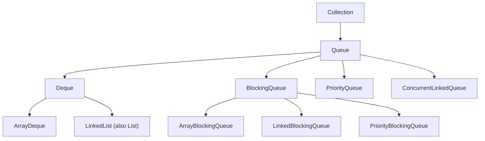
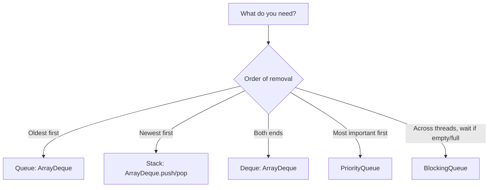

# Java Queue Collection: Queue, Deque, PriorityQueue, ArrayDeque and LinkedList

**TL;DR:** A **`Queue<E>`** (`java.util`, extends `Collection`) holds elements **for processing**, typically **FIFO** (first in, first out). It has **two forms of each operation**: one **throws** on failure (`add`, `remove`, `element`) and one **returns a special value** (`offer` → `false`, `poll` → `null`, `peek` → `null`). **`Deque`** ("deck", double-ended queue) adds operations at both ends (`addFirst/addLast`, `pollFirst/pollLast`, `push/pop`) and can serve as a **stack** or a queue. Implementations: **`LinkedList`** (List + Deque, allows `null`), **`ArrayDeque`** (resizable array, fastest general queue/stack, **no `null`**), **`PriorityQueue`** (binary **heap**, ordered by priority not FIFO; printing shows heap order), and the concurrent **`BlockingQueue`** family (`ArrayBlockingQueue`, `LinkedBlockingQueue`, `PriorityBlockingQueue`) with `put`/`take`. `Queue` is an interface (cannot be instantiated), and `Stack` is legacy: prefer `ArrayDeque`.

## Table of Contents

1. [TL;DR](#1-tldr)
2. [Why it matters](#2-why-it-matters)
3. [Prerequisites](#3-prerequisites)
4. [Mental model](#4-mental-model)
5. [Core concepts](#5-core-concepts)
6. [How it works](#6-how-it-works)
7. [Examples](#7-examples)
8. [Comparisons](#8-comparisons)
9. [Trade-offs](#9-trade-offs)
10. [Gotchas](#10-gotchas)
11. [Practical application](#11-practical-application)
12. [Interview prep](#12-interview-prep)
13. [Interview question bank](#13-interview-question-bank)
14. [Tricky code snippets](#14-tricky-code-snippets)
15. [Connections](#15-connections)
16. [Summary](#16-summary)
17. [Answers](#answers)

---

## 1. TL;DR

| Operation | Throws on failure | Returns special value |
|---|---|---|
| Insert | `add(e)` | `offer(e)` (`false`) |
| Remove head | `remove()` | `poll()` (`null`) |
| Examine head | `element()` | `peek()` (`null`) |

| Class | Order | Nulls | Notes |
|---|---|---|---|
| `LinkedList` | FIFO / both ends | Yes | Also a `List` |
| `ArrayDeque` | FIFO / both ends | **No** | Best queue/stack |
| `PriorityQueue` | By priority (heap) | **No** | `peek`/`poll` = smallest by default |
| `ArrayBlockingQueue` | FIFO, bounded | No | Blocks (`put`/`take`) |
| `LinkedBlockingQueue` | FIFO, optionally bounded | No | Blocks |
| `PriorityBlockingQueue` | Priority | No | Blocks on empty |
| `ConcurrentLinkedQueue` | FIFO | No | Non-blocking, thread-safe |

**The analogy: a ticket counter and an emergency room.**

| Real world | Java |
|---|---|
| People line up; the first to arrive is served first | `Queue` (FIFO) |
| Join at the back, leave from the front | `offer` / `poll` |
| Peek at who is next without serving them | `peek` / `element` |
| A line you can join or leave from both ends | `Deque` |
| A stack of plates: last in, first out | `Deque.push` / `pop` |
| Emergency room: the most urgent patient goes first | `PriorityQueue` |
| A counter that says "wait here until someone arrives" | `BlockingQueue.take()` |

**Running example:** `offer("a")`, `offer("b")`, `add("c")` on a `LinkedList` queue, then `peek`, `poll`, `remove`, `element` (Snippet 1).

---

## 2. Why it matters

**The problem.** Many tasks process items in arrival order (jobs, messages, BFS) or by importance (scheduling, top-K). Lists and sets don't give a clean contract for that.

**What goes wrong** (verified on Java 21):

| Mistake | Result | Snippet |
|---|---|---|
| `new Queue<>()` | Compile error (interface) | 2 |
| `remove()`/`element()` on an empty queue | `NoSuchElementException` | 3 |
| `add` to a full bounded queue | `IllegalStateException: Queue full` | 4 |
| Printing a `PriorityQueue` expecting sorted order | Heap order | 7 |
| `PriorityQueue` of non-`Comparable` | `ClassCastException` (even on the first add) | 9 |
| `null` in `PriorityQueue`/`ArrayDeque` | `NullPointerException` | 10, 14 |
| `Stack` vs `ArrayDeque` printing | Opposite order | 30 |
| Changing priority after insertion | Heap not re-ordered | 23 |
| Using a `for-each` and `add` | `ConcurrentModificationException` | 32 |
| `ArrayDeque.equals` | Identity (not by content) | 31 |

**Why interviewers ask.** "Queue vs Stack", "`add` vs `offer`", "`remove` vs `poll`", "`PriorityQueue` internals", "`ArrayDeque` vs `LinkedList`", "implement a stack with a deque", "min-heap top-K", "BFS", "producer-consumer with `BlockingQueue`".

---

## 3. Prerequisites

| Prerequisite | One-line refresher | Importance |
|---|---|---|
| Collections introduction | `Queue` extends `Collection` | Essential |
| List note (`LinkedList`) | It implements `List` and `Deque` | Essential |
| `Comparable`/`Comparator` | `PriorityQueue` ordering | Essential |
| Generics and exceptions | `NoSuchElementException`, `IllegalStateException` | Important |
| Threads (basic) | For `BlockingQueue` | Helpful |
| Heaps/trees (data structure) | Binary heap | Helpful |

---

## 4. Mental model

> **The one picture to keep in your head:** a queue has a **head** (where you remove/examine) and a **tail** (where you insert). FIFO queues remove the **oldest**; a `PriorityQueue` removes the **highest priority** (smallest by default) regardless of arrival; a `Deque` has two ends; a stack is a deque used from one end. Every operation comes in a *throwing* and a *returning-null/false* flavour.

```
 FIFO Queue:   tail ──▶ [ c ][ b ][ a ] ──▶ head
               offer/add               poll/remove/peek/element

 Deque:   ◀── addFirst/offerFirst/push [ 1 ][ 2 ][ 3 ] addLast/offerLast ──▶
          ◀── pollFirst/removeFirst/pop            pollLast/removeLast ──▶

 PriorityQueue (min-heap):        1           heap array: [1, 2, 4, 5, 3]
                                 / \          peek() = 1, poll() = smallest
                                2   4         (array order is NOT sorted order)
                               / \
                              5   3
```
*Head access is O(1) for all; a heap gives O(log n) insert and poll.*


*`PriorityQueue` is a `Queue` but not a `Deque`.*

---

## 5. Core concepts

### 5.1 Glossary

| Term | Definition |
|---|---|
| Head / tail | Front (next to be removed) / back (where elements are added) |
| FIFO / LIFO | First-in-first-out / last-in-first-out |
| Deque | Double-ended queue (pronounced "deck") |
| Heap | Tree-shaped structure with the smallest (or largest) at the root |
| Bounded queue | Has a fixed capacity |
| Blocking queue | `put`/`take` wait when full/empty |
| Priority | The ordering defined by `Comparable` or a `Comparator` |
| Sequenced collection | Java 21 interface with defined first/last and `reversed()` (Snippet 33) |

### 5.2 The `Queue` interface

| Method | Behaviour |
|---|---|
| `add(e)` | Insert or throw `IllegalStateException` if capacity-bound |
| `offer(e)` | Insert or return `false` |
| `remove()` | Remove and return the head, or throw `NoSuchElementException` |
| `poll()` | Remove and return the head, or `null` |
| `element()` | Return the head, or throw `NoSuchElementException` |
| `peek()` | Return the head, or `null` |

Snippets 1, 3, 4. `Queue` is an interface and extends `Collection` (Snippet 2). Because `poll()`/`peek()` return `null` for "empty", avoid `null` elements (only `LinkedList` allows them, Snippet 14).

### 5.3 `Deque`

| First end | Last end |
|---|---|
| `addFirst`, `offerFirst` | `addLast`, `offerLast` |
| `removeFirst`, `pollFirst` | `removeLast`, `pollLast` |
| `getFirst`, `peekFirst` | `getLast`, `peekLast` |
| Stack: `push` (= `addFirst`), `pop` (= `removeFirst`), `peek` (= `peekFirst`) | |

Snippets 12, 13. Also `descendingIterator()` (Snippet 16), `removeFirstOccurrence`/`removeLastOccurrence` (Snippet 17). The `Queue` methods map to the tail/head (`offer` = `offerLast`, `poll` = `pollFirst`).

### 5.4 `LinkedList` as queue

Implements `List` and `Deque`; allows `null`; every element is a node (Snippets 14, 18). Good when you need list **and** queue behaviour; otherwise `ArrayDeque` is faster and smaller.

### 5.5 `ArrayDeque`

- Circular resizable array; amortized O(1) at both ends; **no `null`** (Snippet 14); not thread-safe.
- Best default for queues and stacks (Snippets 13, 29).
- `pop()`/`removeFirst()` on empty throws `NoSuchElementException` (Snippet 15).

### 5.6 `PriorityQueue`

- Binary **min-heap** by default; `peek`/`poll` return the **smallest** (natural order), or by comparator (Snippets 6, 8).
- `add`/`offer`/`poll` O(log n); `peek` O(1); `contains`/`remove(Object)` O(n) (Snippet 11).
- Elements must be `Comparable` or you supply a `Comparator` (Snippet 9); no `null` (Snippet 10).
- `toString`/iteration show **heap array order**, not sorted order (Snippet 7); to read in order, `poll` repeatedly or sort a copy (Snippet 24).
- Ties have no guaranteed order (not stable).
- Max-heap: `new PriorityQueue<>(Collections.reverseOrder())` (Snippet 8).
- **Mutating** an element's priority after insertion doesn't re-heapify (Snippet 23).
- Not thread-safe; use `PriorityBlockingQueue`.

### 5.7 `BlockingQueue` (concurrency)

- `put(e)` blocks when full; `take()` blocks when empty; `offer(e, timeout, unit)`/`poll(timeout, unit)` wait up to a time (Snippet 19).
- `ArrayBlockingQueue` (bounded), `LinkedBlockingQueue`, `PriorityBlockingQueue`, `DelayQueue`, `SynchronousQueue` (Snippet 21).
- Typical producer-consumer pattern (Snippet 20).
- `ConcurrentLinkedQueue`/`ConcurrentLinkedDeque` are non-blocking thread-safe queues (Snippet 21).

### 5.8 Stack: `Stack` vs `Deque`

`Stack` (legacy, extends `Vector`) prints bottom → top; `ArrayDeque` used as a stack prints top first (Snippet 30). Prefer `Deque<Integer> st = new ArrayDeque<>()`.

### 5.9 Common algorithms

- **BFS** with a queue (Snippet 25).
- **Sliding window maximum** with a deque (Snippet 26).
- **Top-K** with a size-K min-heap (Snippet 27).
- **Balanced parentheses** with a stack (Snippet 28).
- **Last-N buffer** with a bounded deque (Snippet 29).

### 5.10 Equality and iteration

- `LinkedList.equals` compares by elements (it's a `List`); `ArrayDeque` and `PriorityQueue` use identity (Snippet 31).
- `ArrayDeque`/`LinkedList` iterators are fail-fast (Snippet 32); `descendingIterator` goes tail → head (Snippet 16).
- Java 21: `Deque` and `List` are `SequencedCollection`s with `reversed()`, `getFirst()` etc.; `PriorityQueue` is not (Snippet 33) ⚠️.

---

## 6. How it works

### 6.1 FIFO with a linked list or array

`LinkedList` links nodes: `offer` adds at the tail, `poll` removes the head: O(1). `ArrayDeque` keeps `head` and `tail` indices in a circular array and doubles it when full.

### 6.2 Worked trace: the running example

```java
Queue<String> q = new LinkedList<>();
q.offer("a"); q.offer("b"); q.add("c");   // 1
q.peek(); q.size();                        // 2
q.poll(); q.remove();                      // 3
q.element(); q.poll(); q.poll(); q.peek(); // 4
```

| Step | Queue | Result |
|---|---|---|
| 1 | `[a, b, c]` | |
| 2 | `[a, b, c]` | `a`, `3` |
| 3 | `[c]` | `poll()` → `a`, `remove()` → `b` |
| 4 | `[]` | `element()` → `c`, `poll()` → `c`, `poll()` → `null`, `peek()` → `null` |

Output: `[a, b, c] a 3`, `a b [c]`, `c c null null`.

### 6.3 How `PriorityQueue` works

An array holds a complete binary tree: children of index `i` are `2i+1` and `2i+2`.
- **Insert:** add at the end, **sift up** while smaller than the parent.
- **Poll:** take the root, move the last element to the root, **sift down**.
- Adding `5, 3, 4, 1, 2` gives the array `[1, 2, 4, 5, 3]` (Snippet 7): parent `1` ≤ children; siblings aren't ordered.

### 6.4 Why a changed priority isn't noticed

The heap only reorders on insert/remove. If you change a field the comparator uses (Snippet 23), the element stays where it was; `remove(x)` then `add(x)` fixes it.

### 6.5 Blocking behaviour

`put` waits on a condition until space is available; `take` waits until an element exists. A producer thread and a consumer thread coordinate without explicit `wait/notify` (Snippet 20).

### 6.6 Deque as stack

`push` = `addFirst`, `pop` = `removeFirst`, `peek` = `peekFirst`: the head is the top. Printing starts at the head, which is why `[3, 2, 1]` appears (Snippet 13).

---

## 7. Examples

### 7.1 Toy example

```java
Queue<String> q = new ArrayDeque<>();
q.offer("a"); q.offer("b");
q.poll();     // "a"
```

### 7.2 Real-world examples

- **Task/job queues:** `LinkedBlockingQueue` in thread pools.
- **BFS / level-order traversal** (Snippet 25).
- **Undo stack / expression evaluation** (`ArrayDeque`) (Snippets 13, 28).
- **Scheduling by priority / Dijkstra / top-K / median** (`PriorityQueue`) (Snippets 8, 27).
- **Rate limiting / last-N windows** (Snippets 26, 29).
- **Producer-consumer** (Snippet 20).

---

## 8. Comparisons

### 8.1 `Queue` vs `Stack` vs `Deque`

| | Queue | Stack | Deque |
|---|---|---|---|
| Order | FIFO | LIFO | Both |
| Add | Tail (`offer`) | Top (`push`) | Either end |
| Remove | Head (`poll`) | Top (`pop`) | Either end |
| Class | `ArrayDeque`/`LinkedList` | `ArrayDeque` (not `Stack`) | `ArrayDeque`/`LinkedList` |

### 8.2 `add` vs `offer`, `remove` vs `poll`, `element` vs `peek`

| Throwing | Returning | Differ when |
|---|---|---|
| `add` | `offer` | Queue is capacity-bound/full |
| `remove` | `poll` | Queue is empty |
| `element` | `peek` | Queue is empty |

### 8.3 `ArrayDeque` vs `LinkedList`

| | `ArrayDeque` | `LinkedList` |
|---|---|---|
| Structure | Circular array | Doubly linked nodes |
| `null` elements | No | Yes |
| Memory/speed | Better | Node overhead |
| Also a `List` | No | Yes (`get(i)`) |
| `equals` | Identity | Content (List) |
| Recommended for | Queue/stack | When you need List + Deque |

### 8.4 `PriorityQueue` vs `TreeSet` vs sorted `List`

| | `PriorityQueue` | `TreeSet` | Sorted `ArrayList` |
|---|---|---|---|
| Access | Min/max only | Any in order, range queries | By index |
| Insert | O(log n) | O(log n) | O(n) |
| Duplicates | Allowed | No | Allowed |
| Iteration order | Heap (not sorted) | Sorted | Sorted |

### 8.5 `Stack` vs `ArrayDeque` as stack

| | `Stack` | `ArrayDeque` |
|---|---|---|
| Printing | Bottom → top | Top first |
| Synchronized | Yes (legacy) | No |
| Empty `pop` | `EmptyStackException` | `NoSuchElementException` |
| Index access | Yes (`Vector`) | No |

### 8.6 Blocking vs non-blocking queues

| | `BlockingQueue` | `ConcurrentLinkedQueue` / `ArrayDeque` |
|---|---|---|
| Waiting | `put`/`take` block | `poll` returns `null` |
| Capacity | Can be bounded | Unbounded |
| Thread-safe | Yes | `ConcurrentLinkedQueue`: yes; `ArrayDeque`: no |

---

## 9. Trade-offs

- **`ArrayDeque` vs `LinkedList`:** `ArrayDeque` wins in speed and memory, but forbids `null` and has no list API.
- **Heap cost:** `PriorityQueue` gives cheap min/max, but you can't iterate sorted or update priorities in place.
- **Bounded vs unbounded:** bounded blocking queues apply back-pressure; unbounded ones can exhaust memory.
- **Fairness and ordering:** `PriorityQueue` ties are unordered; add a sequence number to make FIFO among equals.
- **Thread-safety:** use `BlockingQueue`/`Concurrent*` classes across threads; plain queues are unsafe.
- **API choice:** program to `Queue`/`Deque`; choose the class by need.
- **`null` as signal:** because `poll`/`peek` return `null` for empty, `null` elements are banned in most queues.

---

## 10. Gotchas

### Myths

- ❌ **Myth:** "`Queue` is a class." ✅ **Reality:** an interface (Snippet 2).
- ❌ **Myth:** "`remove()` returns `null` on empty." ✅ **Reality:** it throws; `poll()` returns `null` (Snippet 3).
- ❌ **Myth:** "`PriorityQueue` prints in sorted order." ✅ **Reality:** heap order (Snippet 7).
- ❌ **Myth:** "`PriorityQueue` is FIFO among equal priorities." ✅ **Reality:** not guaranteed.
- ❌ **Myth:** "`ArrayDeque` allows `null`." ✅ **Reality:** NPE (Snippet 14).
- ❌ **Myth:** "`Stack` and `ArrayDeque` print the same." ✅ **Reality:** opposite orders (Snippet 30).
- ❌ **Myth:** "`ArrayDeque.equals` compares contents." ✅ **Reality:** identity (Snippet 31).
- ❌ **Myth:** "Changing an element's priority re-sorts the queue." ✅ **Reality:** no (Snippet 23).
- ❌ **Myth:** "`add` and `offer` are the same." ✅ **Reality:** differ on bounded queues (Snippet 4).
- ❌ **Myth:** "`PriorityQueue` is thread-safe." ✅ **Reality:** use `PriorityBlockingQueue`.

### Common mistakes and edge cases

- **Calling `remove()`/`element()` on an empty queue** (Snippet 3).
- **Adding in a for-each over the same queue** (Snippet 32).
- **Putting `null` into a queue** (Snippets 10, 14).
- **Non-comparable elements in `PriorityQueue`** (Snippet 9).
- **Using `x - y` in comparators** (overflow; Comparator note).
- **Using `Stack`/`Vector`** in new code.
- **Expecting `contains`/`remove(Object)` to be fast** on `PriorityQueue` (O(n)) (Snippet 11).
- **Forgetting that `pop` throws** on an empty `ArrayDeque` (Snippet 15).

---

## 11. Practical application

### Checklist
- [ ] FIFO: `Queue<T> q = new ArrayDeque<>();` (or `LinkedList` if `null`s/List needed).
- [ ] Stack: `Deque<T> st = new ArrayDeque<>();`, not `Stack`.
- [ ] Use `offer/poll/peek` for "maybe empty" and `add/remove/element` when empty is a bug.
- [ ] Priority: `PriorityQueue` with a `Comparator`; never rely on its `toString` order.
- [ ] Don't mutate keys used by the comparator; remove and re-add instead.
- [ ] Threads: `BlockingQueue` with `put/take`; choose bounded queues for back-pressure.
- [ ] No `null` elements (except `LinkedList`, and even then avoid).
- [ ] Don't modify a queue while iterating with for-each.

### Hands-on exercise

```java
PriorityQueue<Integer> pq = new PriorityQueue<>();
for (int x : new int[]{5, 3, 4, 1, 2}) pq.add(x);
System.out.println(pq);
System.out.println(pq.peek());
```
What is printed, and why isn't the first line `[1, 2, 3, 4, 5]`?

<details><summary>Solution</summary>

`[1, 2, 4, 5, 3]` then `1`. A `PriorityQueue` is a binary heap stored in an array: only the root (index 0) is guaranteed to be the minimum, and each parent is ≤ its children. `toString` prints the array, not sorted order. `poll()` repeatedly returns `1, 2, 3, 4, 5`.

Verified on Java 21 (Snippet 7).
</details>

---

## 12. Interview prep

Eight model answers, as you would say them aloud.

<details><summary>1. What is a `Queue`, and what is the difference between `add`/`offer`, `remove`/`poll` and `element`/`peek`?</summary>

A `Queue` holds elements for processing, usually FIFO. `add`, `remove` and `element` throw (`IllegalStateException`, `NoSuchElementException`); `offer`, `poll` and `peek` return `false`/`null` instead (5.2; Snippets 1, 3, 4).
</details>

<details><summary>2. What is a `Deque`, and how do you use it as a stack?</summary>

A double-ended queue with operations at both ends. As a stack use `push` (addFirst), `pop` (removeFirst) and `peek` (peekFirst); prefer `ArrayDeque` over the legacy `Stack` (5.3, 5.8; Snippets 13, 30).
</details>

<details><summary>3. `ArrayDeque` vs `LinkedList`?</summary>

`ArrayDeque` is a circular array: faster and lighter, but no `null`s and no list API. `LinkedList` is doubly linked, allows `null`, and is also a `List`. Default to `ArrayDeque` for queues and stacks (8.3; Snippets 14, 18).
</details>

<details><summary>4. How does `PriorityQueue` work and what are its gotchas?</summary>

A binary min-heap in an array (or by `Comparator`): `peek` O(1), `offer`/`poll` O(log n), `remove(Object)`/`contains` O(n). Iteration and `toString` show heap order, not sorted; ties aren't FIFO; mutating a priority isn't noticed; no `null`; elements must be comparable (5.6, 6.3; Snippets 7, 9, 23).
</details>

<details><summary>5. How would you get the top K elements from a large stream?</summary>

Keep a min-heap (`PriorityQueue`) of size K: add each element and `poll` when the size exceeds K; the heap then holds the K largest (Snippet 27).
</details>

<details><summary>6. What is a `BlockingQueue`, and where is it used?</summary>

A thread-safe queue whose `put` blocks when full and `take` blocks when empty, used for producer-consumer and thread pools. Examples: `ArrayBlockingQueue` (bounded), `LinkedBlockingQueue`, `PriorityBlockingQueue` (5.7; Snippets 19, 20, 21).
</details>

<details><summary>7. Why do most queues forbid `null`?</summary>

`poll()` and `peek()` return `null` to mean "empty"; a `null` element would be ambiguous. `ArrayDeque`, `PriorityQueue` and blocking queues throw `NullPointerException`; only `LinkedList` allows it (5.2; Snippets 10, 14).
</details>

<details><summary>8. How do BFS and the sliding-window maximum use queues?</summary>

BFS uses a FIFO queue to visit nodes level by level (Snippet 25); sliding-window max keeps a deque of indices with decreasing values so the maximum is always at the front (Snippet 26).
</details>

---

## 13. Interview question bank


### 13.1 Queue basics (Q1–Q16)

<details><summary>Q1. What is a `Queue`?</summary>

A collection for holding elements for processing, usually FIFO (Snippet 1).
</details>

<details><summary>Q2. Is `Queue` a class or an interface?</summary>

Interface (Snippet 2).
</details>

<details><summary>Q3. Does `Queue` extend `Collection`?</summary>

Yes (Snippet 2).
</details>

<details><summary>Q4. What does FIFO mean?</summary>

First in, first out (Snippet 5).
</details>

<details><summary>Q5. `add` vs `offer`?</summary>

Throws vs returns `false` when full (Snippet 4).
</details>

<details><summary>Q6. `remove()` vs `poll()`?</summary>

Throws vs `null` on empty (Snippet 3).
</details>

<details><summary>Q7. `element()` vs `peek()`?</summary>

Throws vs `null` on empty (Snippet 3).
</details>

<details><summary>Q8. What does `peek()` do on an empty queue?</summary>

Returns `null` (Snippet 3).
</details>

<details><summary>Q9. What does `remove()` do on an empty queue?</summary>

`NoSuchElementException` (Snippet 3).
</details>

<details><summary>Q10. What does `add` do when a bounded queue is full?</summary>

`IllegalStateException: Queue full` (Snippet 4).
</details>

<details><summary>Q11. What does `offer` return when full?</summary>

`false` (Snippet 4).
</details>

<details><summary>Q12. Which class is the typical FIFO queue?</summary>

`ArrayDeque` (or `LinkedList`).
</details>

<details><summary>Q13. Does `LinkedList` implement `Queue`?</summary>

Yes, via `Deque` (Snippet 18).
</details>

<details><summary>Q14. Can you get by index from a `Queue`?</summary>

Not on the interface; `LinkedList.get(i)` exists (Snippet 18).
</details>

<details><summary>Q15. What does `remove(Object)` do?</summary>

Removes the first matching element (Snippet 17).
</details>

<details><summary>Q16. Is the iteration order FIFO?</summary>

For `ArrayDeque`/`LinkedList`, head to tail (Snippet 16).
</details>


### 13.2 Deque and stack (Q17–Q30)

<details><summary>Q17. What is a `Deque`?</summary>

A double-ended queue (Snippet 12).
</details>

<details><summary>Q18. Methods at the front?</summary>

`addFirst`, `offerFirst`, `removeFirst`, `pollFirst`, `getFirst`, `peekFirst` (Snippet 12).
</details>

<details><summary>Q19. Methods at the back?</summary>

`addLast`, `offerLast`, `removeLast`, `pollLast`, `getLast`, `peekLast` (Snippet 12).
</details>

<details><summary>Q20. Stack methods on `Deque`?</summary>

`push`, `pop`, `peek` (Snippet 13).
</details>

<details><summary>Q21. Where does `push` add?</summary>

At the front (Snippet 13).
</details>

<details><summary>Q22. What does a `Deque` used as a stack print?</summary>

Top first, e.g. `[3, 2, 1]` (Snippet 13).
</details>

<details><summary>Q23. What does `Stack` print?</summary>

Bottom first, e.g. `[1, 2, 3]` (Snippet 30).
</details>

<details><summary>Q24. Empty `ArrayDeque.pop()`?</summary>

`NoSuchElementException` (Snippet 15).
</details>

<details><summary>Q25. Empty `Stack.pop()`?</summary>

`EmptyStackException` (Snippet 15).
</details>

<details><summary>Q26. Which class is the preferred stack?</summary>

`ArrayDeque`.
</details>

<details><summary>Q27. What is `descendingIterator`?</summary>

Iterates tail to head (Snippet 16).
</details>

<details><summary>Q28. `removeFirstOccurrence`/`removeLastOccurrence`?</summary>

Remove the first/last matching element (Snippet 17).
</details>

<details><summary>Q29. Is `Deque` a `SequencedCollection` in Java 21?</summary>

Yes; has `reversed()` (Snippet 33) ⚠️.
</details>

<details><summary>Q30. Is `PriorityQueue` a `Deque`?</summary>

No.
</details>


### 13.3 ArrayDeque and LinkedList (Q31–Q40)

<details><summary>Q31. Does `ArrayDeque` allow `null`?</summary>

No, NPE (Snippet 14).
</details>

<details><summary>Q32. Does `LinkedList` allow `null`?</summary>

Yes (Snippet 14).
</details>

<details><summary>Q33. Which is faster for queue use?</summary>

`ArrayDeque`.
</details>

<details><summary>Q34. Which has a `List` API?</summary>

`LinkedList` (Snippet 18).
</details>

<details><summary>Q35. Is `ArrayDeque` thread-safe?</summary>

No.
</details>

<details><summary>Q36. Is `ArrayDeque.equals` by content?</summary>

No, identity (Snippet 31).
</details>

<details><summary>Q37. Is `LinkedList.equals` by content?</summary>

Yes (Snippet 31).
</details>

<details><summary>Q38. What is a good bounded last-N structure?</summary>

`ArrayDeque` with `pollFirst` when over N (Snippet 29).
</details>

<details><summary>Q39. Can you add while iterating?</summary>

No, `ConcurrentModificationException` (Snippet 32).
</details>

<details><summary>Q40. Safe removal while iterating?</summary>

`Iterator.remove()`/`removeIf` (Snippet 32).
</details>


### 13.4 PriorityQueue (Q41–Q58)

<details><summary>Q41. What structure is behind `PriorityQueue`?</summary>

Binary heap in an array (Section 6.3).
</details>

<details><summary>Q42. Default order?</summary>

Natural ascending: smallest first (Snippet 6).
</details>

<details><summary>Q43. How do you get a max-heap?</summary>

`Collections.reverseOrder()` (Snippet 8).
</details>

<details><summary>Q44. How do you set custom priority?</summary>

Pass a `Comparator` (Snippet 8).
</details>

<details><summary>Q45. Complexity of `offer`/`poll`/`peek`?</summary>

O(log n) / O(log n) / O(1).
</details>

<details><summary>Q46. Complexity of `contains`/`remove(Object)`?</summary>

O(n) (Snippet 11).
</details>

<details><summary>Q47. Does `toString` show sorted order?</summary>

No, heap order (Snippet 7).
</details>

<details><summary>Q48. How to read in sorted order?</summary>

`poll` until empty, or sort a copy (Snippet 24).
</details>

<details><summary>Q49. Are equal priorities FIFO?</summary>

Not guaranteed.
</details>

<details><summary>Q50. Non-comparable elements?</summary>

`ClassCastException` (Snippet 9).
</details>

<details><summary>Q51. `null` element?</summary>

NPE (Snippet 10).
</details>

<details><summary>Q52. What if you change the priority of an element?</summary>

The heap isn't fixed (Snippet 23).
</details>

<details><summary>Q53. How to fix it?</summary>

`remove(x)` then `add(x)` (Snippet 23).
</details>

<details><summary>Q54. Is it thread-safe?</summary>

No; use `PriorityBlockingQueue`.
</details>

<details><summary>Q55. Does it allow duplicates?</summary>

Yes (Snippet 7).
</details>

<details><summary>Q56. How to implement top-K largest?</summary>

Min-heap of size K (Snippet 27).
</details>

<details><summary>Q57. `new PriorityQueue<>(collection)`?</summary>

Heapifies the collection (Snippet 22).
</details>

<details><summary>Q58. Is it a `SequencedCollection`?</summary>

No (Snippet 33).
</details>


### 13.5 BlockingQueue and applications (Q59–Q72)

<details><summary>Q59. What is a `BlockingQueue`?</summary>

A thread-safe queue with blocking `put`/`take` (Snippet 19).
</details>

<details><summary>Q60. `put` vs `offer`?</summary>

`put` waits; `offer` returns `false` (Snippet 19).
</details>

<details><summary>Q61. `take` vs `poll`?</summary>

`take` waits; `poll` returns `null`; `poll(timeout)` waits up to a limit (Snippet 19).
</details>

<details><summary>Q62. `remainingCapacity`?</summary>

Free slots (Snippet 19).
</details>

<details><summary>Q63. Name implementations.</summary>

`ArrayBlockingQueue`, `LinkedBlockingQueue`, `PriorityBlockingQueue`, `DelayQueue`, `SynchronousQueue` (Snippet 21).
</details>

<details><summary>Q64. Is `ConcurrentLinkedQueue` blocking?</summary>

No (Snippet 21).
</details>

<details><summary>Q65. Producer-consumer with a `BlockingQueue`?</summary>

Producer `put`s, consumer `take`s (Snippet 20).
</details>

<details><summary>Q66. What data structure for BFS?</summary>

Queue (Snippet 25).
</details>

<details><summary>Q67. For DFS?</summary>

Stack/`Deque`.
</details>

<details><summary>Q68. Sliding-window maximum?</summary>

Monotonic deque (Snippet 26).
</details>

<details><summary>Q69. Balanced parentheses?</summary>

Stack (Snippet 28).
</details>

<details><summary>Q70. Task scheduling by priority?</summary>

`PriorityQueue` (Snippet 8).
</details>

<details><summary>Q71. Implement a queue with two stacks?</summary>

Push to one, pour into the other on dequeue.
</details>

<details><summary>Q72. Implement a stack with two queues?</summary>

Move all but the last element on each pop.
</details>

---

## 14. Tricky code snippets

33 snippets, each compiled and run on OpenJDK 21. Predict the output (or the compile error) before opening the answer. Thread-based snippets (19, 20) are deterministic by design (single producer, single consumer, FIFO). Snippet 33 needs Java 21 ⚠️ (`SequencedCollection`). The printed form of a `PriorityQueue` is the heap array, not sorted order ⚠️.

### Snippet 1: Queue operations

```java
import java.util.*;
public class Main {
    public static void main(String[] a) {
        Queue<String> q = new LinkedList<>();
        q.offer("a"); q.offer("b"); q.add("c");
        System.out.println(q + " " + q.peek() + " " + q.size());
        System.out.println(q.poll() + " " + q.remove() + " " + q);
        System.out.println(q.element() + " " + q.poll() + " " + q.poll() + " " + q.peek());
    }
}
```

<details><summary>Answer</summary>

```
[a, b, c] a 3
a b [c]
c c null null
```

Trace in 6.2.
</details>

### Snippet 2: `new Queue<>()`

```java
import java.util.*;
public class Main {
    public static void main(String[] a) {
        System.out.println(Queue.class.isInterface() + " " + Collection.class.isAssignableFrom(Queue.class) + " " + Queue.class.isAssignableFrom(Deque.class));
        Queue<Integer> q = new Queue<>();
    }
}
```

<details><summary>Answer</summary>

Compile error: *Queue is abstract; cannot be instantiated*.

`Queue` is an interface (it extends `Collection`; `Deque` extends `Queue`).
</details>

### Snippet 3: Empty queue

```java
import java.util.*;
public class Main {
    public static void main(String[] a) {
        Queue<Integer> q = new ArrayDeque<>();
        System.out.println(q.peek() + " " + q.poll());
        try { q.remove(); } catch (NoSuchElementException e) { System.out.println("remove: NoSuchElementException"); }
        try { q.element(); } catch (NoSuchElementException e) { System.out.println("element: NoSuchElementException"); }
        System.out.println(q.isEmpty() + " " + q.size());
    }
}
```

<details><summary>Answer</summary>

```
null null
remove: NoSuchElementException
element: NoSuchElementException
true 0
```

`peek`/`poll` return `null`; `remove`/`element` throw.
</details>

### Snippet 4: Full bounded queue

```java
import java.util.*;
import java.util.concurrent.*;
public class Main {
    public static void main(String[] a) {
        Queue<Integer> q = new ArrayBlockingQueue<>(2);
        System.out.println(q.add(1) + " " + q.offer(2) + " " + q.offer(3));
        try { q.add(4); } catch (IllegalStateException e) { System.out.println("IllegalStateException: " + e.getMessage()); }
        System.out.println(q);
    }
}
```

<details><summary>Answer</summary>

```
true true false
IllegalStateException: Queue full
[1, 2]
```

`offer` returns `false`; `add` throws. ⚠️ Message text is implementation-specific.
</details>

### Snippet 5: FIFO

```java
import java.util.*;
public class Main {
    public static void main(String[] a) {
        Queue<Integer> q = new LinkedList<>(List.of(1, 2, 3));
        q.add(4);
        StringBuilder sb = new StringBuilder();
        while (!q.isEmpty()) sb.append(q.poll());
        System.out.println(sb);
    }
}
```

<details><summary>Answer</summary>

```
1234
```

Elements leave in the order they arrived.
</details>

### Snippet 6: `PriorityQueue` order

```java
import java.util.*;
public class Main {
    public static void main(String[] a) {
        PriorityQueue<Integer> pq = new PriorityQueue<>();
        pq.addAll(List.of(5, 1, 4, 2, 3));
        System.out.println(pq.peek() + " " + pq.size());
        StringBuilder sb = new StringBuilder();
        while (!pq.isEmpty()) sb.append(pq.poll()).append(' ');
        System.out.println(sb.toString().trim());
    }
}
```

<details><summary>Answer</summary>

```
1 5
1 2 3 4 5
```

`poll` returns the smallest each time.
</details>

### Snippet 7: Printing a heap

```java
import java.util.*;
public class Main {
    public static void main(String[] a) {
        PriorityQueue<Integer> pq = new PriorityQueue<>();
        for (int x : new int[]{5, 3, 4, 1, 2}) pq.add(x);
        System.out.println(pq);
        List<Integer> it = new ArrayList<>();
        for (int x : pq) it.add(x);
        System.out.println(it);
        System.out.println(pq.peek());
    }
}
```

<details><summary>Answer</summary>

```
[1, 2, 4, 5, 3]
[1, 2, 4, 5, 3]
1
```

`toString` and iteration use the heap array; only the head is the minimum.
</details>

### Snippet 8: Custom priority

```java
import java.util.*;
public class Main {
    record Task(String name, int pri) { }
    public static void main(String[] a) {
        PriorityQueue<Task> pq = new PriorityQueue<>(Comparator.comparingInt(Task::pri).reversed().thenComparing(Task::name));
        pq.add(new Task("c", 1)); pq.add(new Task("a", 3)); pq.add(new Task("b", 3)); pq.add(new Task("d", 2));
        StringBuilder sb = new StringBuilder();
        while (!pq.isEmpty()) sb.append(pq.poll().name());
        System.out.println(sb);
        PriorityQueue<Integer> max = new PriorityQueue<>(Collections.reverseOrder());
        max.addAll(List.of(2, 9, 4)); System.out.println(max.poll());
    }
}
```

<details><summary>Answer</summary>

```
abdc
9
```

Priority 3 first (`a`, `b` by name), then 2 (`d`), then 1 (`c`); a reversed natural order gives a max-heap.
</details>

### Snippet 9: Non-`Comparable` elements

```java
import java.util.*;
public class Main {
    static class T { int p; T(int p) { this.p = p; } }
    public static void main(String[] a) {
        PriorityQueue<T> pq = new PriorityQueue<>();
        try { pq.add(new T(1)); System.out.println("added one"); pq.add(new T(2)); }
        catch (ClassCastException e) { System.out.println("ClassCastException"); }
    }
}
```

<details><summary>Answer</summary>

```
ClassCastException
```

Even the first `add` casts to `Comparable` (so "added one" never prints). ⚠️ Very old JDKs allowed the first add.
</details>

### Snippet 10: `null` and tuple priority

```java
import java.util.*;
public class Main {
    public static void main(String[] a) {
        PriorityQueue<String> pq = new PriorityQueue<>();
        try { pq.add(null); } catch (NullPointerException e) { System.out.println("NullPointerException"); }
        PriorityQueue<int[]> p2 = new PriorityQueue<>((x, y) -> x[0] - y[0]);
        p2.add(new int[]{1, 10}); p2.add(new int[]{1, 20}); p2.add(new int[]{0, 5});
        System.out.println(p2.poll()[1] + " " + p2.size());
    }
}
```

<details><summary>Answer</summary>

```
NullPointerException
5 2
```

`null` isn't allowed; the lowest first component `0` polls first (its second value is `5`).
</details>

### Snippet 11: `contains` / `remove(Object)`

```java
import java.util.*;
public class Main {
    public static void main(String[] a) {
        PriorityQueue<Integer> pq = new PriorityQueue<>(List.of(3, 1, 2));
        System.out.println(pq.contains(2) + " " + pq.remove(2) + " " + pq.remove(9) + " " + pq.size() + " " + pq.peek());
    }
}
```

<details><summary>Answer</summary>

```
true true false 2 1
```

Linear scans; removing `2` leaves `[1, 3]` with min `1`.
</details>

### Snippet 12: Both ends

```java
import java.util.*;
public class Main {
    public static void main(String[] a) {
        Deque<Integer> d = new ArrayDeque<>();
        d.addFirst(2); d.addLast(3); d.offerFirst(1); d.offerLast(4);
        System.out.println(d + " " + d.peekFirst() + " " + d.peekLast());
        System.out.println(d.pollFirst() + " " + d.pollLast() + " " + d.removeFirst() + " " + d.removeLast() + " " + d.pollFirst() + " " + d.peekLast());
        try { d.getFirst(); } catch (NoSuchElementException e) { System.out.println("NoSuchElementException"); }
    }
}
```

<details><summary>Answer</summary>

```
[1, 2, 3, 4] 1 4
1 4 2 3 null null
NoSuchElementException
```

Removals from both ends empty the deque; `poll`/`peek` give `null`, `getFirst` throws.
</details>

### Snippet 13: Stack vs queue use

```java
import java.util.*;
public class Main {
    public static void main(String[] a) {
        Deque<Integer> s = new ArrayDeque<>();
        s.push(1); s.push(2); s.push(3);
        System.out.println(s + " " + s.peek() + " " + s.pop() + " " + s);
        Deque<Integer> q = new ArrayDeque<>();
        q.offer(1); q.offer(2); q.offer(3);
        System.out.println(q + " " + q.peek() + " " + q.poll());
    }
}
```

<details><summary>Answer</summary>

```
[3, 2, 1] 3 3 [2, 1]
[1, 2, 3] 1 1
```

`push` adds at the head (top first); `offer` adds at the tail (FIFO).
</details>

### Snippet 14: `null` elements

```java
import java.util.*;
public class Main {
    public static void main(String[] a) {
        Deque<String> d = new ArrayDeque<>();
        try { d.add(null); } catch (NullPointerException e) { System.out.println("ArrayDeque: NullPointerException"); }
        Deque<String> l = new LinkedList<>();
        l.add(null);
        System.out.println(l + " " + l.size());
        System.out.println(l.peek() + " " + l.poll() + " " + l.poll());
    }
}
```

<details><summary>Answer</summary>

```
ArrayDeque: NullPointerException
[null] 1
null null null
```

`LinkedList` accepts `null`, so `peek`/`poll` can't distinguish `null` element from empty.
</details>

### Snippet 15: Empty `pop`

```java
import java.util.*;
public class Main {
    public static void main(String[] a) {
        Deque<Integer> d = new ArrayDeque<>();
        try { d.pop(); } catch (NoSuchElementException e) { System.out.println("pop: NoSuchElementException"); }
        Stack<Integer> s = new Stack<>();
        try { s.pop(); } catch (EmptyStackException e) { System.out.println("Stack.pop: EmptyStackException"); }
        System.out.println(d.peek() + " " + s.empty());
    }
}
```

<details><summary>Answer</summary>

```
pop: NoSuchElementException
Stack.pop: EmptyStackException
null true
```

Different exceptions for `Deque` and `Stack`.
</details>

### Snippet 16: Iteration

```java
import java.util.*;
public class Main {
    public static void main(String[] a) {
        Deque<Integer> d = new ArrayDeque<>(List.of(1, 2, 3));
        for (int x : d) System.out.print(x);
        System.out.print(" ");
        Iterator<Integer> it = d.descendingIterator();
        while (it.hasNext()) System.out.print(it.next());
        System.out.println();
        d.push(0);
        System.out.println(d);
    }
}
```

<details><summary>Answer</summary>

```
123 321
[0, 1, 2, 3]
```

Head to tail, then tail to head; `push` adds at the head.
</details>

### Snippet 17: `remove(Object)` and occurrences

```java
import java.util.*;
public class Main {
    public static void main(String[] a) {
        Queue<String> q = new LinkedList<>(List.of("a", "b", "a"));
        System.out.println(q.remove("a") + " " + q + " " + q.remove("z"));
        Deque<String> d = new ArrayDeque<>(List.of("a", "b", "a"));
        System.out.println(d.removeLastOccurrence("a") + " " + d + " " + d.removeFirstOccurrence("q"));
    }
}
```

<details><summary>Answer</summary>

```
true [b, a] false
true [a, b] false
```

Removes the first (or last) matching element; absent elements return `false`.
</details>

### Snippet 18: `LinkedList` roles

```java
import java.util.*;
public class Main {
    public static void main(String[] a) {
        LinkedList<Integer> l = new LinkedList<>(List.of(1, 2, 3));
        l.offer(4); l.push(0);
        System.out.println(l + " " + l.get(2) + " " + l.indexOf(3) + " " + l.peekLast());
        Queue<Integer> q = l;
        System.out.println(q.poll() + " " + q);
    }
}
```

<details><summary>Answer</summary>

```
[0, 1, 2, 3, 4] 2 3 4
0 [1, 2, 3, 4]
```

List indexes and queue operations on the same object.
</details>

### Snippet 19: `BlockingQueue` timeouts

```java
import java.util.*;
import java.util.concurrent.*;
public class Main {
    public static void main(String[] a) throws Exception {
        BlockingQueue<Integer> q = new LinkedBlockingQueue<>(2);
        q.put(1); q.put(2);
        System.out.println(q.offer(3) + " " + q.offer(3, 10, TimeUnit.MILLISECONDS) + " " + q.remainingCapacity());
        System.out.println(q.take() + " " + q.poll(10, TimeUnit.MILLISECONDS) + " " + q.poll(10, TimeUnit.MILLISECONDS));
    }
}
```

<details><summary>Answer</summary>

```
false false 0
1 2 null
```

The queue is full (capacity 2): `offer` fails immediately and after 10 ms; `poll(timeout)` returns `null` when empty.
</details>

### Snippet 20: Producer-consumer

```java
import java.util.*;
import java.util.concurrent.*;
public class Main {
    public static void main(String[] a) throws Exception {
        BlockingQueue<Integer> q = new ArrayBlockingQueue<>(2);
        List<Integer> got = Collections.synchronizedList(new ArrayList<>());
        Thread prod = new Thread(() -> { try { for (int i = 1; i <= 5; i++) q.put(i); q.put(-1); } catch (InterruptedException e) { } });
        Thread cons = new Thread(() -> { try { for (int x; (x = q.take()) != -1; ) got.add(x); } catch (InterruptedException e) { } });
        prod.start(); cons.start(); prod.join(); cons.join();
        System.out.println(got);
    }
}
```

<details><summary>Answer</summary>

```
[1, 2, 3, 4, 5]
```

`put` blocks when the capacity-2 queue is full; `take` blocks when empty; a sentinel `-1` stops the consumer.
</details>

### Snippet 21: Types

```java
import java.util.*;
import java.util.concurrent.*;
public class Main {
    public static void main(String[] a) {
        System.out.println(new PriorityBlockingQueue<Integer>() instanceof BlockingQueue);
        System.out.println(new ConcurrentLinkedQueue<Integer>() instanceof BlockingQueue);
        System.out.println(new ConcurrentLinkedDeque<Integer>() instanceof Deque);
        System.out.println(new LinkedBlockingDeque<Integer>() instanceof BlockingDeque);
    }
}
```

<details><summary>Answer</summary>

```
true
false
true
true
```

`ConcurrentLinkedQueue` is thread-safe but not a `BlockingQueue`.
</details>

### Snippet 22: Copy and remove min

```java
import java.util.*;
public class Main {
    public static void main(String[] a) {
        PriorityQueue<Integer> pq = new PriorityQueue<>(List.of(9, 7, 8, 1, 2, 3));
        int first = pq.peek();
        pq.remove(first);
        System.out.println(first + " " + pq.peek() + " " + pq.size());
        PriorityQueue<Integer> copy = new PriorityQueue<>(pq);
        System.out.println(copy.poll() + " " + pq.size());
    }
}
```

<details><summary>Answer</summary>

```
1 2 5
2 5
```

After removing the minimum `1`, the next minimum is `2`; the copy constructor makes an independent queue.
</details>

### Snippet 23: Mutating priority

```java
import java.util.*;
public class Main {
    static class J { int p; J(int p) { this.p = p; } public String toString() { return "J" + p; } }
    public static void main(String[] a) {
        PriorityQueue<J> pq = new PriorityQueue<>(Comparator.comparingInt(j -> j.p));
        J x = new J(5), y = new J(3), z = new J(4);
        pq.add(x); pq.add(y); pq.add(z);
        x.p = 1;
        System.out.println(pq.peek());
        pq.remove(x); pq.add(x);
        System.out.println(pq.peek());
    }
}
```

<details><summary>Answer</summary>

```
J3
J1
```

Changing `x.p` to `1` doesn't re-heapify; removing and re-adding does.
</details>

### Snippet 24: Reading in order

```java
import java.util.*;
import java.util.stream.*;
public class Main {
    public static void main(String[] a) {
        Queue<Integer> q = new PriorityQueue<>(List.of(3, 1, 2));
        System.out.println(q.stream().sorted().collect(Collectors.toList()));
        List<Integer> drained = new ArrayList<>();
        while (!q.isEmpty()) drained.add(q.poll());
        System.out.println(drained + " " + q.isEmpty());
        Queue<Integer> ad = new ArrayDeque<>(List.of(3, 1, 2));
        System.out.println(new ArrayList<>(ad));
    }
}
```

<details><summary>Answer</summary>

```
[1, 2, 3]
[1, 2, 3] true
[3, 1, 2]
```

Sort a stream or `poll` to see order; an `ArrayDeque` keeps insertion order.
</details>

### Snippet 25: BFS

```java
import java.util.*;
public class Main {
    public static void main(String[] a) {
        Map<Integer, List<Integer>> g = Map.of(1, List.of(2, 3), 2, List.of(4), 3, List.of(4), 4, List.of());
        Queue<Integer> q = new ArrayDeque<>(List.of(1));
        Set<Integer> seen = new LinkedHashSet<>(List.of(1));
        while (!q.isEmpty()) for (int n : g.get(q.poll())) if (seen.add(n)) q.add(n);
        System.out.println(seen);
    }
}
```

<details><summary>Answer</summary>

```
[1, 2, 3, 4]
```

Level order from node 1.
</details>

### Snippet 26: Sliding window maximum

```java
import java.util.*;
public class Main {
    public static void main(String[] a) {
        int[] nums = {1, 3, -1, -3, 5, 3, 6, 7}; int k = 3;
        Deque<Integer> d = new ArrayDeque<>(); List<Integer> out = new ArrayList<>();
        for (int i = 0; i < nums.length; i++) {
            while (!d.isEmpty() && d.peekFirst() <= i - k) d.pollFirst();
            while (!d.isEmpty() && nums[d.peekLast()] < nums[i]) d.pollLast();
            d.addLast(i);
            if (i >= k - 1) out.add(nums[d.peekFirst()]);
        }
        System.out.println(out);
    }
}
```

<details><summary>Answer</summary>

```
[3, 3, 5, 5, 6, 7]
```

The deque holds indices with decreasing values; the front is the window maximum.
</details>

### Snippet 27: Top-K

```java
import java.util.*;
public class Main {
    public static void main(String[] a) {
        int[] nums = {5, 1, 9, 3, 7, 2}; int k = 3;
        PriorityQueue<Integer> h = new PriorityQueue<>();
        for (int n : nums) { h.add(n); if (h.size() > k) h.poll(); }
        List<Integer> top = new ArrayList<>(h); Collections.sort(top, Collections.reverseOrder());
        System.out.println(top + " " + h.peek());
    }
}
```

<details><summary>Answer</summary>

```
[9, 7, 5] 5
```

A size-3 min-heap keeps the three largest; the head is the smallest of them.
</details>

### Snippet 28: Stack for brackets

```java
import java.util.*;
public class Main {
    static boolean ok(String s) {
        Deque<Character> st = new ArrayDeque<>();
        for (char c : s.toCharArray()) {
            if ("([{".indexOf(c) >= 0) st.push(c);
            else { if (st.isEmpty()) return false; char o = st.pop(); if ("([{".indexOf(o) != ")]}".indexOf(c)) return false; }
        }
        return st.isEmpty();
    }
    public static void main(String[] a) { System.out.println(ok("{[()]}") + " " + ok("([)]") + " " + ok("((")); }
}
```

<details><summary>Answer</summary>

```
true false false
```

Opening brackets are pushed and matched on pop; `"(("` leaves an unmatched one.
</details>

### Snippet 29: Last N

```java
import java.util.*;
public class Main {
    public static void main(String[] a) {
        Deque<Integer> last3 = new ArrayDeque<>();
        for (int i = 1; i <= 6; i++) { last3.addLast(i); if (last3.size() > 3) last3.pollFirst(); }
        System.out.println(last3);
    }
}
```

<details><summary>Answer</summary>

```
[4, 5, 6]
```

`pollFirst` drops the oldest when size exceeds 3.
</details>

### Snippet 30: `Stack` vs `ArrayDeque`

```java
import java.util.*;
public class Main {
    public static void main(String[] a) {
        Stack<Integer> st = new Stack<>(); Deque<Integer> d = new ArrayDeque<>();
        for (int i = 1; i <= 3; i++) { st.push(i); d.push(i); }
        System.out.println(st + " " + d);
        System.out.println(st.peek() + " " + d.peek() + " " + new ArrayList<>(st).get(0) + " " + new ArrayList<>(d).get(0));
    }
}
```

<details><summary>Answer</summary>

```
[1, 2, 3] [3, 2, 1]
3 3 1 3
```

Same top element, opposite printed order.
</details>

### Snippet 31: `equals`

```java
import java.util.*;
public class Main {
    public static void main(String[] a) {
        Queue<Integer> x = new LinkedList<>(List.of(1, 2)), y = new LinkedList<>(List.of(1, 2));
        Queue<Integer> p = new ArrayDeque<>(List.of(1, 2)), q = new ArrayDeque<>(List.of(1, 2));
        System.out.println(x.equals(y) + " " + p.equals(q) + " " + new PriorityQueue<>(List.of(1)).equals(new PriorityQueue<>(List.of(1))));
        System.out.println(x.equals(new ArrayList<>(List.of(1, 2))) + " " + x.hashCode() + " " + y.hashCode());
    }
}
```

<details><summary>Answer</summary>

```
true false false
true 994 994
```

`LinkedList` uses `List.equals`; `ArrayDeque` and `PriorityQueue` use identity.
</details>

### Snippet 32: Modifying while iterating

```java
import java.util.*;
public class Main {
    public static void main(String[] a) {
        Queue<Integer> q = new ArrayDeque<>(List.of(1, 2, 3));
        try { for (int x : q) q.add(x); } catch (ConcurrentModificationException e) { System.out.println("ConcurrentModificationException"); }
        for (Iterator<Integer> it = q.iterator(); it.hasNext(); ) if (it.next() % 2 == 1) it.remove();
        System.out.println(q);
        q.removeIf(x -> x == 2);
        System.out.println(q.isEmpty());
    }
}
```

<details><summary>Answer</summary>

```
ConcurrentModificationException
[2]
true
```

The first `add` happened before the exception (queue `[1, 2, 3, 1]`); `Iterator.remove` deleted odd values; `removeIf` removed the rest.
</details>

### Snippet 33: Java 21 `SequencedCollection`

```java
import java.util.*;
public class Main {
    public static void main(String[] a) {
        Deque<Integer> d = new ArrayDeque<>(List.of(1, 2, 3));
        System.out.println(d.reversed() + " " + (d instanceof SequencedCollection));
        List<Integer> l = new ArrayList<>(List.of(1, 2, 3));
        System.out.println(l.getFirst() + " " + l.getLast() + " " + l.reversed());
        System.out.println((new PriorityQueue<Integer>() instanceof SequencedCollection));
    }
}
```

<details><summary>Answer</summary>

```
[3, 2, 1] true
1 3 [3, 2, 1]
false
```

`Deque` and `List` gained `reversed()`; lists gained `getFirst()`/`getLast()`. ⚠️ Java 21+ only.
</details>

---

## 15. Connections

| Related topic | How it connects |
|---|---|
| Collections introduction | `Queue` is a branch under `Collection` |
| List note | `LinkedList` is both `List` and `Deque` |
| `Comparable`/`Comparator` | Priority ordering |
| Threads / concurrency | `BlockingQueue`, thread pools, producer-consumer |
| Data structures and algorithms | BFS, heaps, sliding window, top-K |
| Exceptions | `NoSuchElementException`, `IllegalStateException`, `EmptyStackException` |
| Generics and `null` | Why `null` elements are banned |
| Java 21 | `SequencedCollection` (`reversed`, `getFirst`) ⚠️ |


*Choose by removal order.*

---

## 16. Summary

### 60-second card

- `Queue`: FIFO; `add/offer`, `remove/poll`, `element/peek` (throw vs `false`/`null`).
- `Deque`: both ends; stack via `push/pop/peek`.
- `ArrayDeque`: best default, no `null`. `LinkedList`: List + Deque, allows `null`.
- `PriorityQueue`: min-heap; printing shows heap order; O(log n) offer/poll; ties not FIFO; no `null`; needs comparable elements.
- `BlockingQueue`: `put`/`take` for producer-consumer.
- `Stack` is legacy (bottom-first printing); `ArrayDeque` prints top-first.
- Don't mutate a priority in place; don't modify during for-each.

### Cheat sheet

```java
Queue<String> q = new ArrayDeque<>();   q.offer("a");  String h = q.poll();
Deque<Integer> st = new ArrayDeque<>(); st.push(1);    int top = st.pop();
PriorityQueue<Integer> minHeap = new PriorityQueue<>();
PriorityQueue<Integer> maxHeap = new PriorityQueue<>(Collections.reverseOrder());
BlockingQueue<Job> jobs = new LinkedBlockingQueue<>(100); jobs.put(job); Job j = jobs.take();
```

| Need | Use |
|---|---|
| FIFO | `ArrayDeque` / `LinkedList` |
| LIFO | `ArrayDeque` (`push`/`pop`) |
| Priority | `PriorityQueue` |
| Thread hand-off | `ArrayBlockingQueue` / `LinkedBlockingQueue` |
| Non-blocking concurrent | `ConcurrentLinkedQueue` |
| Allow `null` elements | `LinkedList` (avoid) |

### Self-test

1. What is the difference between `remove()` and `poll()`?
2. How do you use a `Deque` as a stack?
3. Why is the `PriorityQueue` print order not sorted?
4. `ArrayDeque` vs `LinkedList`?
5. Why don't queues allow `null`?
6. How do you get the K largest elements?
7. What does `BlockingQueue.take()` do on an empty queue?
8. Which classes print bottom-first and top-first as stacks?

### Anki flashcards

```
Queue throwing methods :: add, remove, element
Queue special-value methods :: offer (false), poll (null), peek (null)
Deque as stack :: push = addFirst, pop = removeFirst, peek = peekFirst
ArrayDeque :: Circular array; best queue/stack; no null
PriorityQueue :: Min-heap; toString shows heap order, not sorted
Max-heap :: new PriorityQueue<>(Collections.reverseOrder())
BlockingQueue :: put waits when full, take waits when empty
Stack vs ArrayDeque print :: bottom first vs top first
```

### Resources

- The Java Tutorials, "The Queue Interface": docs.oracle.com/javase/tutorial/collections/interfaces/queue.html
- API docs: `java.util.Queue`, `Deque`, `PriorityQueue`, `ArrayDeque`, `java.util.concurrent.BlockingQueue`
- *Effective Java*, Joshua Bloch: items on choosing collections and concurrency utilities

---

## Answers

1. `remove()` throws `NoSuchElementException` on an empty queue; `poll()` returns `null`.
2. `push` (addFirst), `pop` (removeFirst), `peek` (peekFirst); `ArrayDeque` is the preferred class.
3. It's a binary heap: only the head is guaranteed minimal, and `toString` prints the underlying array.
4. `ArrayDeque`: faster, no `null`, no list API; `LinkedList`: allows `null`, also a `List`.
5. `poll()`/`peek()` return `null` to signal "empty", so a `null` element would be ambiguous.
6. Keep a min-heap of size K; poll when it grows beyond K.
7. It blocks until an element is available.
8. `Stack` prints bottom-first; `ArrayDeque` prints top-first.
